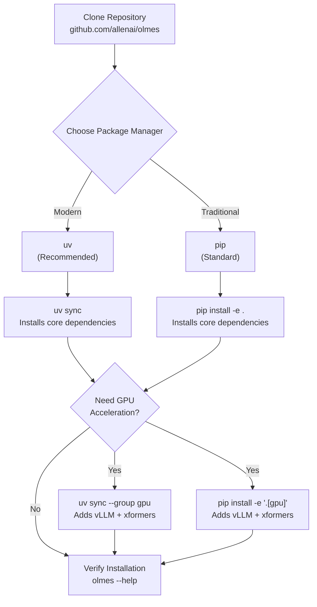
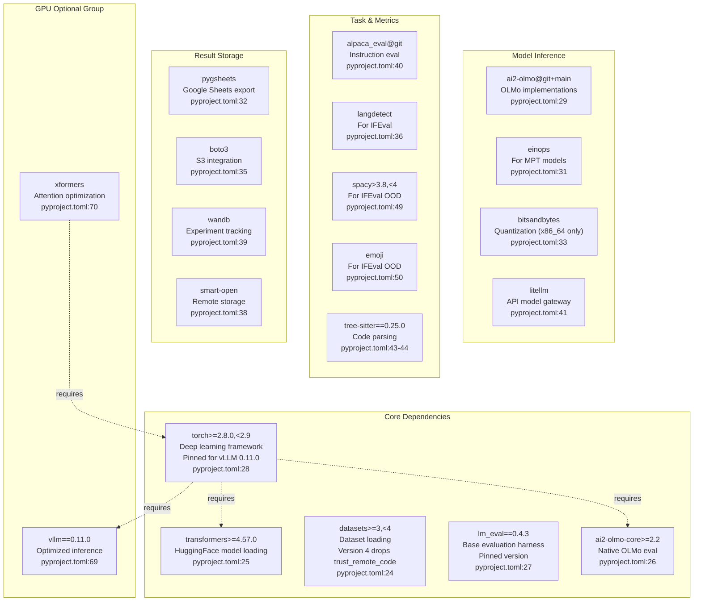
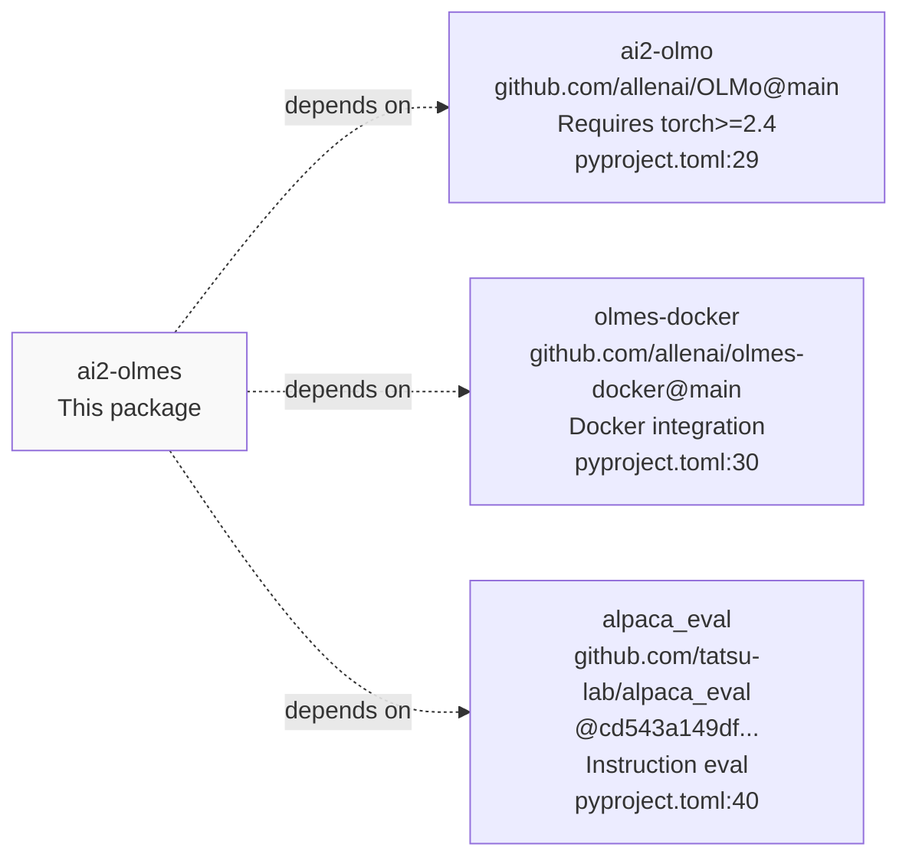
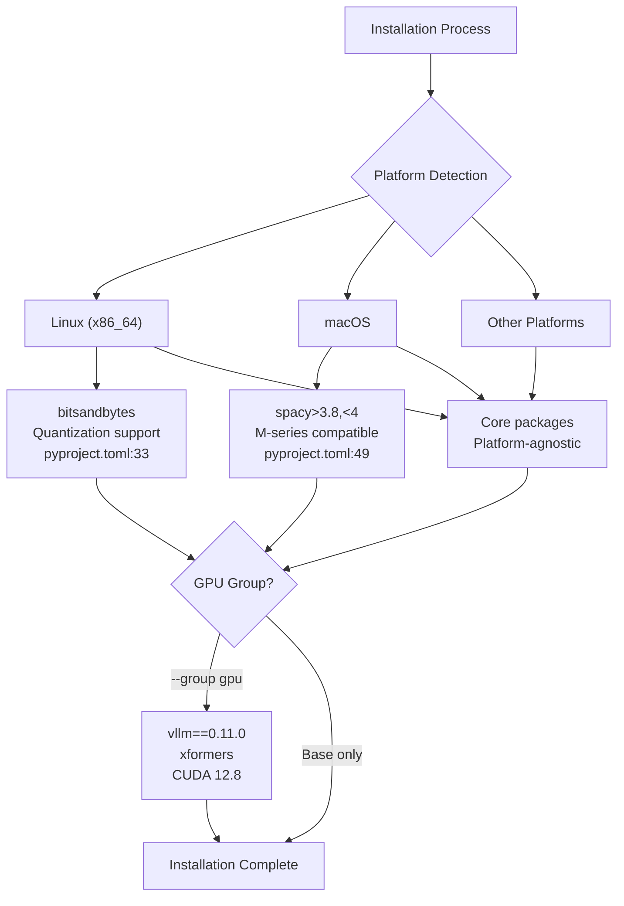

<!-- source: DeepWiki mcp.deepwiki.com · repo allenai/olmes · page 1.2 Installation and Setup · fetched 2026-10-26 -->

# Installation and Setup

<details>
<summary>Relevant source files</summary>

The following files were used as context for generating this wiki page:

- [.gitignore](.gitignore)
- [README.md](README.md)
- [pyproject.toml](pyproject.toml)

</details>


This page covers the installation and setup process for OLMES, including system prerequisites, dependency management, and optional GPU acceleration. For information about configuring models and tasks after installation, see [Model Configuration](#3) and [Task System](#4). For details about the command-line interface, see [Command Line Interface](#2).

## Prerequisites

### Python Version Requirements

OLMES requires **Python 3.10 or higher, but below 3.13**. This constraint is specified in [pyproject.toml:19]().

```
requires-python = ">=3.10,<3.13"
```

### System Requirements

**Platform Compatibility:**
- Linux (x86_64) - Full support including quantization via `bitsandbytes`
- macOS (including M-series) - Full support with platform-specific spacy builds
- Windows - Core functionality supported, but not primary development platform

**Hardware Considerations:**
- CPU-only: Minimum 16GB RAM recommended for loading most models
- GPU: NVIDIA GPU with CUDA 12.8 support for vLLM acceleration (optional)
- Storage: Several GB for model caching and evaluation datasets

**Sources:** [pyproject.toml:33](), [pyproject.toml:49](), [pyproject.toml:103-117]()

## Installation Methods

### Installation Flow Overview



**Sources:** [README.md:29-42]()

### Using uv (Recommended)

The recommended installation method uses `uv`, a fast Python package installer:

```bash
git clone https://github.com/allenai/olmes.git
cd olmes

# Core installation
uv sync

# With GPU support (vLLM)
uv sync --group gpu
```

The `uv` tool automatically handles dependency resolution and creates a virtual environment. GPU support is configured as a dependency group in [pyproject.toml:97-100]().

**Sources:** [README.md:31-37](), [pyproject.toml:73-100]()

### Using pip

Traditional installation using pip:

```bash
git clone https://github.com/allenai/olmes.git
cd olmes

# Core installation
pip install -e .

# With GPU support (vLLM)
pip install -e ".[gpu]"
```

The `-e` flag installs in editable mode, allowing you to modify the source code. The GPU extras are defined in [pyproject.toml:66-71]().

**Sources:** [README.md:39-42](), [pyproject.toml:66-71]()

## Dependency Architecture

### Core Dependency Groups



**Sources:** [pyproject.toml:20-56](), [pyproject.toml:66-71](), [pyproject.toml:97-100]()

### Critical Version Pins

Several dependencies are pinned to specific versions due to compatibility constraints:

| Package | Version | Reason | Source |
|---------|---------|--------|--------|
| `omegaconf` | `==2.4.0.dev3` | Workaround for `parse_latex` in minerva_math | [pyproject.toml:21]() |
| `antlr4-python3-runtime` | `==4.11` | Required by omegaconf workaround | [pyproject.toml:22]() |
| `numpy` | `<2` | Avoid warnings about compiled modules | [pyproject.toml:23]() |
| `datasets` | `>=3,<4` | Version 4 removes `trust_remote_code=True` | [pyproject.toml:24]() |
| `lm_eval` | `==0.4.3` | Pinned to review changes before updates | [pyproject.toml:27]() |
| `torch` | `>=2.8.0,<2.9` | Required for vLLM 0.11.0 compatibility | [pyproject.toml:28]() |
| `fsspec` | `==2023.5.0` | Hack to avoid dataset loading issues (e.g., boolq) | [pyproject.toml:34]() |
| `vllm` | `==0.11.0` | Optimized inference engine | [pyproject.toml:69]() |
| `tree-sitter` | `==0.25.0` | Code parsing for code eval tasks | [pyproject.toml:43]() |

**Sources:** [pyproject.toml:21-56](), [pyproject.toml:66-71]()

### Git Dependencies

Three packages are installed directly from git repositories to access latest features:



**Sources:** [pyproject.toml:29-30](), [pyproject.toml:40]()

## GPU Support

### Enabling vLLM Acceleration

For high-throughput inference on NVIDIA GPUs, install the GPU dependency group:

```bash
# With uv
uv sync --group gpu

# With pip
pip install -e ".[gpu]"
```

This installs:
- **vLLM 0.11.0** - Optimized inference engine with paged attention
- **xformers** - Memory-efficient attention implementations

**CUDA Requirements:**
- CUDA 12.8 (specified via PyTorch index in [pyproject.toml:103-117]())
- NVIDIA GPU with Compute Capability 7.0+ (V100 or newer)

**Sources:** [README.md:37-38](), [README.md:41-42](), [pyproject.toml:68-71](), [pyproject.toml:97-100](), [pyproject.toml:103-112]()

### PyTorch Index Configuration

OLMES uses platform-specific PyTorch indexes for optimal GPU support:

```toml
[tool.uv.sources]
torch = [
  { index = "pytorch-cu128", marker = "sys_platform == 'linux'" },
]

[[tool.uv.index]]
name = "pytorch-cu128"
url = "https://download.pytorch.org/whl/cu128"
explicit = true
```

This ensures Linux systems receive CUDA 12.8-compatible PyTorch builds. On other platforms, PyTorch is installed from PyPI.

**Sources:** [pyproject.toml:102-117]()

### Platform-Specific Dependencies



**Key Platform Differences:**
- **Linux x86_64**: Includes `bitsandbytes` for 8-bit quantization ([pyproject.toml:33]())
- **macOS (M-series)**: Uses spacy >3.8 for M-series compatibility ([pyproject.toml:49]())
- **All platforms**: Core dependencies work universally

**Sources:** [pyproject.toml:33](), [pyproject.toml:49]()

## Environment Variables

### Required for Optional Features

Certain features require environment variables to be set before use:

| Feature | Variable | Purpose | Referenced In |
|---------|----------|---------|---------------|
| Google Sheets Export | `GDRIVE_SERVICE_ACCOUNT_JSON` | Service account credentials | [README.md:296]() |
| OpenAI Models/Judges | `OPENAI_API_KEY` | API authentication | [README.md:134]() |
| HuggingFace Models | `HF_TOKEN` | Access gated models | [README.md:148]() |

**Example Setup:**
```bash
# For API-based models and LLM judges
export OPENAI_API_KEY="sk-..."

# For gated HuggingFace models
export HF_TOKEN="hf_..."

# For Google Sheets export
export GDRIVE_SERVICE_ACCOUNT_JSON='{"type": "service_account", ...}'
```

**Sources:** [README.md:134](), [README.md:147-148](), [README.md:295-296]()

### Storage Configuration

Optional environment variables for result storage integrations are passed via command-line flags rather than environment variables:
- `--gsheet` for Google Sheets export
- `--remote-output-dir s3://...` for S3 storage (uses AWS credentials)
- `--wandb-run-path` for Weights & Biases tracking
- `--hf-save-dir` for HuggingFace datasets

For details on result storage options, see [Output and Result Storage](#5).

**Sources:** [README.md:293-300]()

## CLI Entry Point Registration

The `olmes` command is registered as a console script in [pyproject.toml:59-60]():

```toml
[project.scripts]
olmes = "oe_eval.launch:main"
```

This creates the `olmes` executable that calls the `main()` function in [oe_eval/launch.py](). After installation, verify the command is available:

```bash
olmes --help
```

**Sources:** [pyproject.toml:59-60](), [README.md:46]()

## Verification Steps

### Basic Installation Check

```bash
# Verify CLI is available
olmes --help

# List available models
olmes --list-models

# List available tasks
olmes --list-tasks
```

### Test Evaluation

Run a minimal evaluation to verify the setup:

```bash
olmes \
    --model allenai/OLMo-2-0425-1B \
    --task arc_challenge::olmes \
    --output-dir test_workspace \
    --limit 5
```

This command:
- Loads a small OLMo model (1B parameters)
- Runs ARC Challenge evaluation on 5 examples
- Verifies model loading, task execution, and result storage

**Sources:** [README.md:48-53]()

### Inspect Task Configuration

Use the `--inspect` flag to verify task setup without running a full evaluation:

```bash
olmes --task arc_challenge:mc::olmes --inspect
```

This shows a sample prompt and runs a 5-instance evaluation with a small Pythia model to verify task configuration.

**Sources:** [README.md:71-75]()

## Troubleshooting Common Issues

### ImportError for lm_eval

If you encounter import errors related to `lm_eval`, ensure version 0.4.3 is installed:
```bash
pip list | grep lm-eval
```

The version is pinned in [pyproject.toml:27]() to ensure compatibility.

### CUDA Version Mismatch

If vLLM fails to load, verify CUDA 12.8 compatibility:
```bash
python -c "import torch; print(torch.version.cuda)"
```

PyTorch must be built with CUDA 12.8 for vLLM 0.11.0 compatibility.

### Dataset Loading Failures

If datasets fail to load (e.g., boolq), this may be due to `fsspec` version issues. The installation pins `fsspec==2023.5.0` as a workaround ([pyproject.toml:34]()).

### Platform-Specific Issues

**On macOS M-series:**
- Ensure spacy >3.8 is installed ([pyproject.toml:49]())
- vLLM is not supported on macOS; use `--model-type hf` instead of `--model-type vllm`

**On Windows:**
- `bitsandbytes` quantization is not available (x86_64 Linux only)
- Some GPU features may have limited support

**Sources:** [pyproject.toml:27](), [pyproject.toml:28](), [pyproject.toml:33-34](), [pyproject.toml:49]()

---

