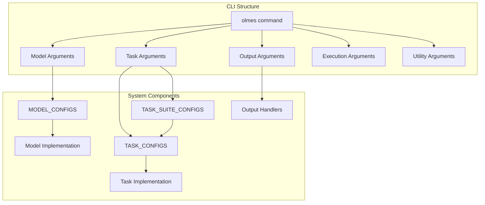
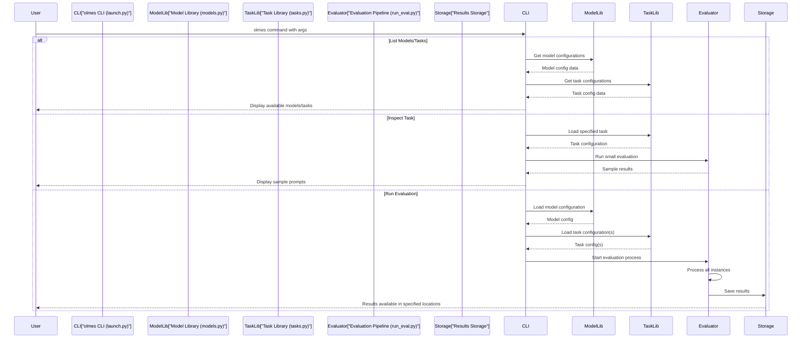
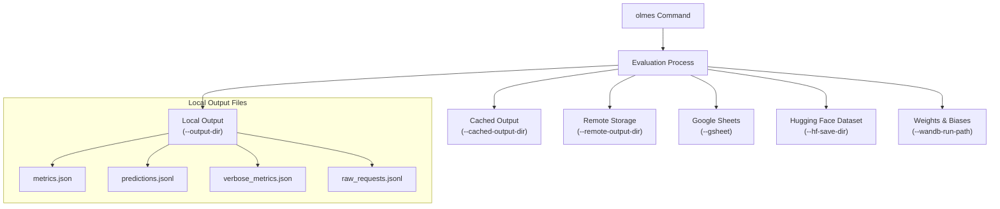
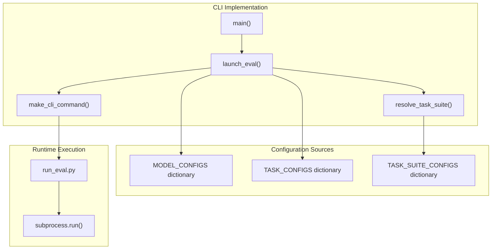

<!-- source: DeepWiki mcp.deepwiki.com · repo allenai/olmes · page 2 Command Line Interface · fetched 2026-10-26 -->

# Command Line Interface

<details>
<summary>Relevant source files</summary>

The following files were used as context for generating this wiki page:

- [README.md](README.md)

</details>


This page documents the command-line interface (CLI) for the OLMES (Open Language Model Evaluation System), which is the primary way users interact with the system to run language model evaluations. For information about configuring specific models, see [Model Configuration](#3), and for task configuration details, see [Task Configuration](#4).

## Overview

The OLMES CLI enables users to evaluate language models on various tasks by specifying:
- Which model to use
- Which task(s) to evaluate
- How to store and format the results
- Various execution parameters

The CLI is designed to be flexible, supporting everything from quick evaluations of a single task to complex batch evaluations across multiple task suites.



Sources: [README.md:40-67]()), [oe_eval/launch.py:60-171]()

## Basic Usage

### Running a Single Evaluation

The simplest way to run an evaluation is to specify a model and task:

```bash
olmes --model olmo-1b --task arc_challenge::olmes --output-dir my-eval-dir1
```

This runs the OLMES version of ARC Challenge with the olmo-1b model and stores results in `my-eval-dir1`.

### Running Multiple Tasks

You can evaluate multiple tasks with the same model:

```bash
olmes --model olmo-1b --task arc_challenge::olmes hellaswag::olmes --output-dir my-eval-dir1
```

### Inspecting Task Configurations

Before running a full evaluation, you can inspect a task's prompt format:

```bash
olmes --task arc_challenge:mc::olmes --inspect
```

This runs a small evaluation (5 examples) with a tiny model to show how the task is formatted.

### Previewing Commands

To see the full expanded command without running it:

```bash
olmes --model pythia-1b --task mmlu::olmes --output-dir my-eval-dir1 --dry-run
```

Sources: [README.md:39-67]()

## Execution Flow

The following diagram illustrates what happens when you execute an OLMES command:



Sources: [oe_eval/launch.py:191-380]()

## Command-Line Arguments

The OLMES CLI supports numerous arguments that can be categorized as follows:

### Model Selection Arguments

| Argument | Description | Example |
|----------|-------------|---------|
| `--model` | Name of model from model library or HF path | `--model olmo-7b` or `--model allenai/OLMo-7B` |
| `--model-type` | Model implementation type | `--model-type vllm` |
| `--revision` | Revision of model in HF hub | `--revision main` |
| `--model-args` | Extra model args (as JSON) | `--model-args '{"trust_remote_code": true}'` |

### Task Selection Arguments

| Argument | Description | Example |
|----------|-------------|---------|
| `--task` | Task spec(s) from library or jsonl file | `--task mmlu::olmes arc_challenge::olmes` |
| `--limit` | Max number or fraction of instances | `--limit 100` or `--limit 0.5` |
| `--num-shots` | Override number of shots for tasks | `--num-shots 5` |
| `--split` | Override evaluation split | `--split validation` |
| `--use-chat-format` | Use chat format for prompting | `--use-chat-format true` |
| `--task-args` | Extra task args (as JSON) | `--task-args '{"max_tokens": 100}'` |
| `--random-subsample-seed` | Seed for instance sampling | `--random-subsample-seed 42` |

### Output Configuration Arguments

| Argument | Description | Example |
|----------|-------------|---------|
| `--output-dir` | Directory for output files | `--output-dir ./results` |
| `--cached-output-dir` | Directory for cached output | `--cached-output-dir ./cache` |
| `--remote-output-dir` | Remote directory (e.g., S3) | `--remote-output-dir s3://bucket/results` |
| `--gsheet` | Google Sheet for writing results | `--gsheet "My Results Sheet"` |
| `--hf-save-dir` | HF dataset path for saving results | `--hf-save-dir username/dataset//folder` |
| `--wandb-run-path` | W&B run path for logging | `--wandb-run-path ai2-llm/project/runs/id` |
| `--save-raw-requests` | Save raw requests in output | `--save-raw-requests false` |
| `--recompute-metrics` | Recompute metrics for cached predictions | `--recompute-metrics` |

### Execution Control Arguments

| Argument | Description | Example |
|----------|-------------|---------|
| `--batch-size` | Batch size for processing | `--batch-size 32` |
| `--gpus` | Number of GPUs to use | `--gpus 2` |
| `--num-workers` | Number of worker processes | `--num-workers 4` |
| `--vllm-for-mc` | Use VLLM for multiple-choice tasks | `--vllm-for-mc` |

### Utility Arguments

| Argument | Description | Example |
|----------|-------------|---------|
| `--dry-run` | Show command without executing | `--dry-run` |
| `--inspect` | Run small evaluation to show formatting | `--inspect` |
| `--list-models` | List models in library (with optional regex) | `--list-models llama` |
| `--list-tasks` | List tasks in library (with optional regex) | `--list-tasks arc` |
| `--list-task-suites` | List task suites (with optional regex) | `--list-task-suites olmes` |

Sources: [oe_eval/launch.py:60-166]()

## Running Specific Models

### Using Models from the Library

OLMES includes a library of pre-configured models that can be referenced by name:

```bash
olmes --model olmo-7b --task arc_challenge::olmes
```

To see all available models:

```bash
olmes --list-models
```

To search for specific models:

```bash
olmes --list-models llama
```

### Using Hugging Face Models Directly

Models can be referenced directly by their Hugging Face path:

```bash
olmes --model allenai/OLMo-7B --task arc_challenge::olmes
```

### Configuring Model Parameters

Additional model parameters can be specified using `--model-args`:

```bash
olmes --model google/gemma-2b --model-args '{"trust_remote_code": true, "add_bos_token": true}' --task arc_challenge::olmes
```

### Using Different Model Implementations

OLMES supports different model implementations through the `--model-type` argument:

```bash
# Using vLLM for faster inference
olmes --model olmo-7b --model-type vllm --task arc_challenge::olmes

# Using LiteLLM for API-based models
olmes --model gpt-4 --model-type litellm --task arc_challenge::olmes
```

Sources: [README.md:108-123]()

## Running Specific Tasks

### Using Tasks from the Library

OLMES includes a library of pre-configured tasks:

```bash
olmes --model olmo-7b --task arc_challenge::olmes
```

To see all available tasks:

```bash
olmes --list-tasks
```

To search for specific tasks:

```bash
olmes --list-tasks mmlu
```

### Task Naming Convention

Tasks in OLMES follow a naming convention:

```
task_name:format::variant
```

For example:
- `arc_challenge:mc::olmes` - ARC Challenge in multiple-choice format, OLMES variant
- `mmlu:rc::olmo1` - MMLU in reading comprehension format, OLMo1 variant

### Running Multiple Tasks

Multiple tasks can be specified:

```bash
olmes --model olmo-7b --task arc_challenge::olmes hellaswag::olmes piqa::olmes
```

### Using Task Suites

Task suites are pre-defined collections of related tasks:

```bash
olmes --model olmo-7b --task core_9mcqa::olmes
```

To see available task suites:

```bash
olmes --list-task-suites
```

Common task suites include:
- `core_9mcqa::olmes` - Core 9 multiple-choice tasks from OLMES
- `mmlu::olmes` - MMLU tasks with OLMES configuration
- `main_suite::olmo1` - Main evaluation suite from OLMo paper
- `tulu_3_dev` - Development tasks from TÜLU 3
- `olmo_2_generative::olmes` - Generative tasks from OLMo 2

### Configuring Task Parameters

Task parameters can be overridden:

```bash
# Change number of few-shot examples
olmes --model olmo-7b --task arc_challenge::olmes --num-shots 3

# Change evaluation split
olmes --model olmo-7b --task arc_challenge::olmes --split validation

# Limit number of instances
olmes --model olmo-7b --task arc_challenge::olmes --limit 100
```

Additional task parameters can be specified using `--task-args`:

```bash
olmes --model olmo-7b --task arc_challenge::olmes --task-args '{"max_tokens": 100}'
```

Sources: [README.md:126-171](), [oe_eval/launch.py:180-189]()

## Output Configuration

OLMES supports multiple output destinations for evaluation results:



### Local Output

Results are stored in the directory specified by `--output-dir`:

```bash
olmes --model olmo-7b --task arc_challenge::olmes --output-dir ./results
```

The output directory will contain files including:
- `metrics.json` - Summary metrics for the task
- `predictions.jsonl` - Model predictions for each instance
- `verbose_metrics.json` - Detailed metrics for each instance
- `raw_requests.jsonl` - Raw requests sent to the model (if `--save-raw-requests` is true)

### Remote Storage

Results can be copied to a remote storage location:

```bash
olmes --model olmo-7b --task arc_challenge::olmes --output-dir ./results --remote-output-dir s3://bucket/results
```

### Google Sheets Integration

Results can be written to a Google Sheet:

```bash
olmes --model olmo-7b --task arc_challenge::olmes --output-dir ./results --gsheet "My Results Sheet"
```

This requires setting the `GDRIVE_SERVICE_ACCOUNT_JSON` environment variable with authentication credentials.

### Hugging Face Dataset Integration

Results can be saved to a Hugging Face dataset:

```bash
olmes --model olmo-7b --task arc_challenge::olmes --output-dir ./results --hf-save-dir username/dataset//folder
```

### Weights & Biases Integration

Results can be logged to a Weights & Biases run:

```bash
olmes --model olmo-7b --task arc_challenge::olmes --output-dir ./results --wandb-run-path ai2-llm/project/runs/id
```

Sources: [README.md:172-182](), [oe_eval/launch.py:102-121]()

## Advanced Usage

### Task Inspection

To inspect a task's prompt format without running a full evaluation:

```bash
olmes --task arc_challenge:mc::olmes --inspect
```

This runs a small evaluation (5 examples) with a tiny model to show the task's format.

### Dry Running

To see the full expanded command without running it:

```bash
olmes --model olmo-7b --task arc_challenge::olmes --dry-run
```

### Batch Size and GPU Configuration

For better performance, adjust batch size and GPU count:

```bash
olmes --model olmo-7b --task arc_challenge::olmes --batch-size 32 --gpus 2
```

### Recomputing Metrics

To recompute metrics for cached predictions:

```bash
olmes --model olmo-7b --task arc_challenge::olmes --output-dir ./results --cached-output-dir ./cache --recompute-metrics
```

### Using VLLM for Multiple-Choice Tasks

For faster evaluation of multiple-choice tasks with VLLM:

```bash
olmes --model olmo-7b --task arc_challenge::olmes --model-type vllm --vllm-for-mc
```

### Running Specific Evaluation Suites

OLMES includes several pre-defined evaluation suites:

```bash
# OLMES standard - Original 10 multiple-choice tasks
olmes --model olmo-7b --task core_9mcqa::olmes --output-dir ./results
olmes --model olmo-7b --task mmlu::olmes --output-dir ./results

# OLMo evaluations
olmes --model olmo-7b --task main_suite::olmo1 --output-dir ./results
olmes --model olmo-7b --task mmlu::olmo1 --output-dir ./results

# TÜLU 3 evaluations
olmes --model olmo-7b --task tulu_3_dev --output-dir ./results
olmes --model olmo-7b --task tulu_3_unseen --output-dir ./results

# OLMo 2 evaluations
olmes --model olmo-7b --task core_9mcqa::olmes --output-dir ./results
olmes --model olmo-7b --task mmlu::olmes --output-dir ./results
olmes --model olmo-7b --task olmo_2_generative::olmes --output-dir ./results
olmes --model olmo-7b --task olmo_2_heldout::olmes --output-dir ./results
```

Sources: [README.md:70-105](), [oe_eval/launch.py:127-166]()

## Internal Implementation

The CLI is implemented in [oe_eval/launch.py](), which parses arguments, resolves model and task configurations, and launches the evaluation process:



The CLI workflow:

1. Parse command-line arguments
2. If listing models/tasks/suites, display them and exit
3. Load model configuration (from library or direct path)
4. Load and resolve task configurations (expanding task suites)
5. Apply any overrides from command-line arguments
6. Construct the full command for running the evaluation
7. Either display the command (dry run) or execute it

The CLI supports both local execution and integration with Ai2's internal compute resources if available.

Sources: [oe_eval/launch.py:190-396]()

---

