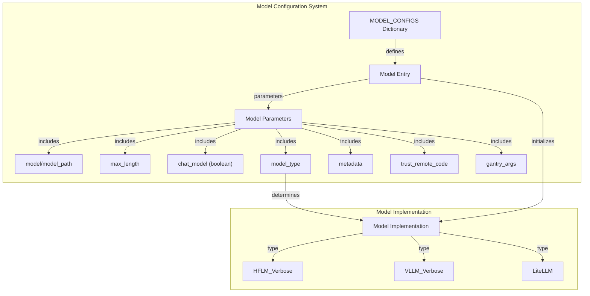
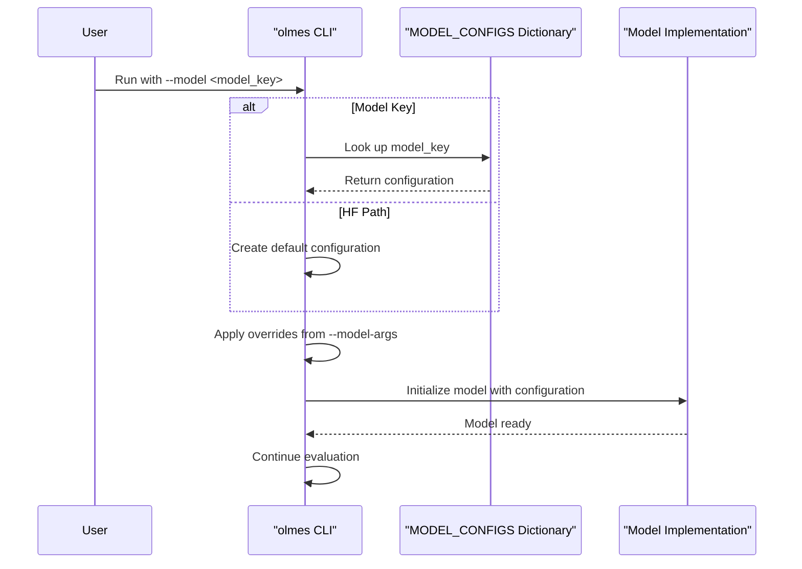
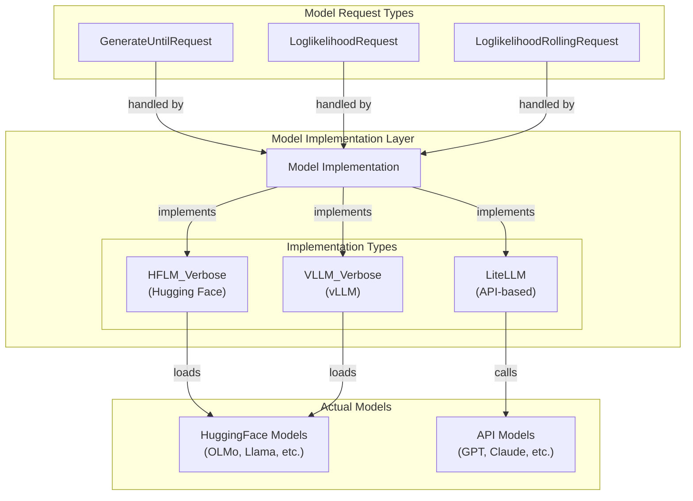
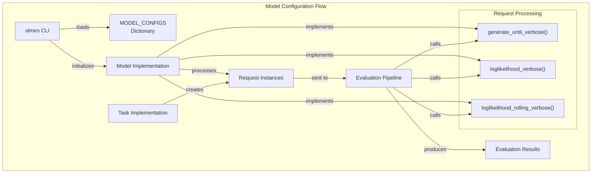

<!-- source: DeepWiki mcp.deepwiki.com · repo allenai/olmes · page 3 Model Configuration · fetched 2026-10-26 -->

# Model Configuration

<details>
<summary>Relevant source files</summary>

The following files were used as context for generating this wiki page:

- [README.md](README.md)
- [oe_eval/configs/models.py](oe_eval/configs/models.py)

</details>


## Purpose and Scope

This document explains how to configure and use different language models for evaluation in OLMES. It covers the structure of model configurations, how to specify models, and the different model implementation types supported by the system. For information about configuring tasks for evaluation, see [Task Configuration](#4).

## Model Configuration Overview

The model configuration in OLMES defines which models are available for evaluation and specifies their parameters. These configurations are stored in a central dictionary and can be referenced by their keys when running evaluations.



Sources: [oe_eval/configs/models.py:1-416]()

## Model Configuration Structure

The `MODEL_CONFIGS` dictionary in [oe_eval/configs/models.py]() is the central repository of model configurations in OLMES. Each entry in this dictionary represents a model with its specific configuration parameters.

A typical model configuration entry includes:

| Parameter | Type | Description |
|-----------|------|-------------|
| `model` | string | Identifier for the model, typically a Hugging Face model path |
| `model_path` | string or list | Optional local or remote path to the model |
| `max_length` | integer | Maximum context length the model supports |
| `chat_model` | boolean | Whether the model is a chat/instruction model |
| `trust_remote_code` | boolean | Whether to trust remote code in the model repository |
| `gantry_args` | dict | Additional arguments for gantry deployment |
| `model_type` | string | Type of model implementation to use (e.g., "litellm") |
| `metadata` | dict | Additional metadata about the model |

Example entry from the configuration:

```
"gemma-7b": {
    "model": "google/gemma-7b",
    "trust_remote_code": True,
    "add_bos_token": True,
    "gantry_args": {"hf_token": True},
    "metadata": {},
},
```

Sources: [oe_eval/configs/models.py:61-77](), [README.md:108-123]()

## Specifying Models for Evaluation

There are two primary ways to specify a model for evaluation:

1. **By Hugging Face path**: 
   ```
   olmes --model allenai/OLMoE-1B-7B-0924 --task arc_challenge::olmes
   ```

2. **By model key in the model library**:
   ```
   olmes --model olmoe-1b-7b-0924 --task arc_challenge::olmes
   ```

When using a model key, OLMES looks up the model configuration in the `MODEL_CONFIGS` dictionary, which can include additional configuration options.



Sources: [README.md:108-123]()

## Model Implementation Types

OLMES supports multiple model implementation types, which can be specified using the `--model-type` flag or in the model configuration:

### 1. Hugging Face Models (Default)

The default model implementation uses the Hugging Face Transformers library to load and run models.

### 2. vLLM Models

For improved performance, especially with large models, you can use the vLLM implementation:

```
olmes --model llama3-8b --model-type vllm --task arc_challenge::olmes
```

### 3. LiteLLM (API-based Models)

For API-based models like OpenAI's GPT models or Anthropic's Claude models, OLMES uses the LiteLLM implementation:

```
olmes --model gpt-4o-2024-08-06 --task arc_challenge::olmes
```

API-based models are configured with the `model_type: "litellm"` parameter in their model configuration.



Sources: [oe_eval/configs/models.py:376-415](), [README.md:114-116]()

## Model Configuration Parameters

### Chat Models

For instruction-tuned models designed for chat interactions, set the `chat_model` parameter to `True`:

```
"llama3-8b-instruct": {
    "model": "meta-llama/Meta-Llama-3-8B-Instruct",
    "chat_model": True,
    "max_length": 8192,
    "gantry_args": {"hf_token": True},
    "metadata": {},
},
```

This tells OLMES to use the appropriate prompt formatting for chat models.

### Context Length

The `max_length` parameter specifies the maximum context length supported by the model:

```
"qwen2.5-7b-instruct": {
    "model": "Qwen/Qwen2.5-7B-Instruct",
    "chat_model": True,
    "max_length": 8192,  # supports up to 32768
    "metadata": {},
},
```

This is important for models with extended context windows, as it determines how much context can be included in the evaluation.

### Model-specific Arguments

Some models require additional arguments like `trust_remote_code` or `add_bos_token`:

```
"gemma-2b": {
    "model": "google/gemma-2b",
    "trust_remote_code": True,
    "add_bos_token": True,
    "gantry_args": {"hf_token": True},
    "metadata": {},
},
```

These parameters ensure that the model loads and runs correctly.

Sources: [oe_eval/configs/models.py:64-77](), [oe_eval/configs/models.py:162-167](), [oe_eval/configs/models.py:324-328]()

## Overriding Model Configuration

You can override model configuration parameters directly from the command line using the `--model-args` flag:

```
olmes --model google/gemma-2b --model-args '{"trust_remote_code": True, "add_bos_token": True}' --task arc_challenge::olmes
```

This is useful for quick adjustments without modifying the model configuration files.

Sources: [README.md:117-121]()

## Available Models

To see a list of all available models in the system:

```
olmes --list-models
```

To search for models containing a specific substring:

```
olmes --list-models llama
```

This will show all models with "llama" in their name.

Sources: [README.md:122-123]()

## Model Implementation Details

Each model implementation type provides a set of methods to handle different request types:

| Method | Description |
|--------|-------------|
| `generate_until_verbose()` | Generates text until a stop condition is reached |
| `loglikelihood_verbose()` | Calculates log-likelihood for a given text |
| `loglikelihood_rolling_verbose()` | Calculates rolling log-likelihoods for a text |

These methods are used by the evaluation pipeline to process requests and generate predictions.



Sources: [README.md:108-123]()

## API-Based Models

OLMES supports API-based models through the LiteLLM integration. These models are configured with `model_type: "litellm"` and typically include parameters like:

| Parameter | Description |
|-----------|-------------|
| `model` | Provider and model name (e.g., "openai/gpt-4o-2024-08-06") |
| `max_length` | Maximum context length supported |
| `chat_model` | Set to `True` for chat API models |

Example API model configuration:

```
"gpt-4o-2024-08-06": {
    "model": "openai/gpt-4o-2024-08-06",
    "max_length": 16384,
    "chat_model": True,
    "model_type": "litellm",
},
```

API-based models require appropriate environment variables or configuration for authentication with the respective API providers.

Sources: [oe_eval/configs/models.py:376-415]()

## Summary

Model configuration in OLMES provides a flexible way to specify and customize models for evaluation. By using the model library or direct Hugging Face paths, and optionally overriding parameters, you can evaluate a wide range of models from local files, Hugging Face repositories, or through APIs.

For information on configuring tasks to evaluate these models on, see the [Task Configuration](#4) page.

---

