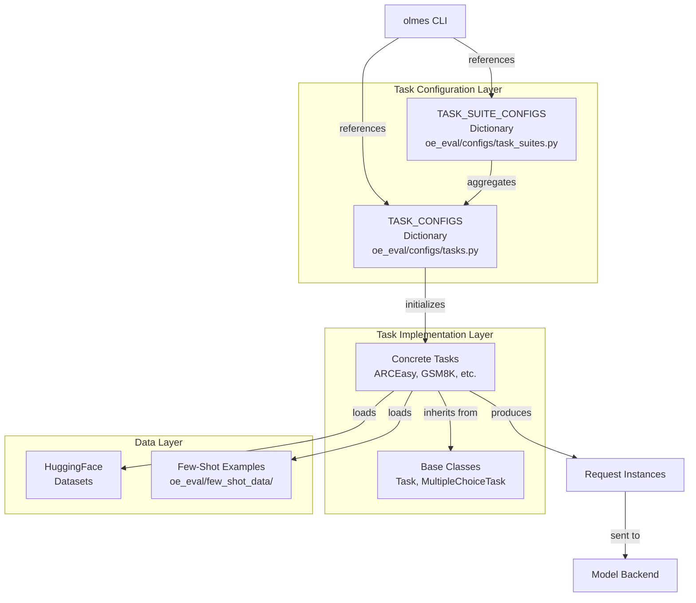
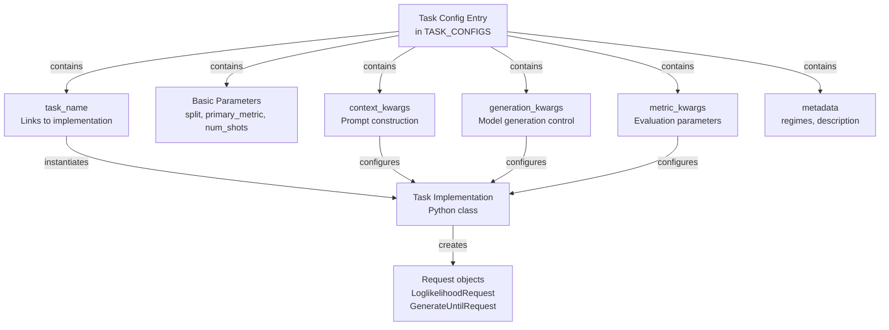
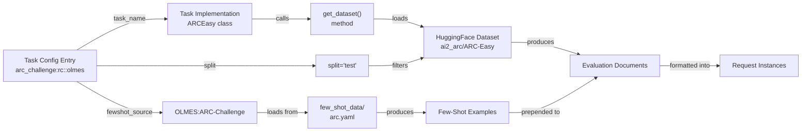
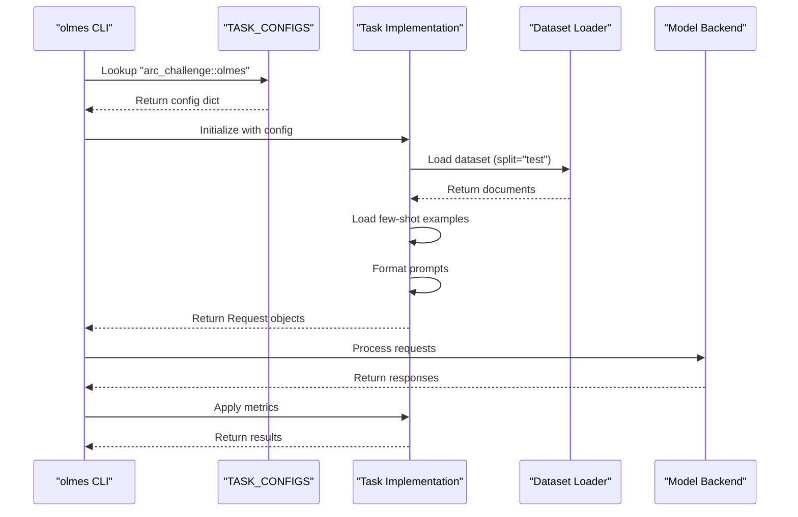
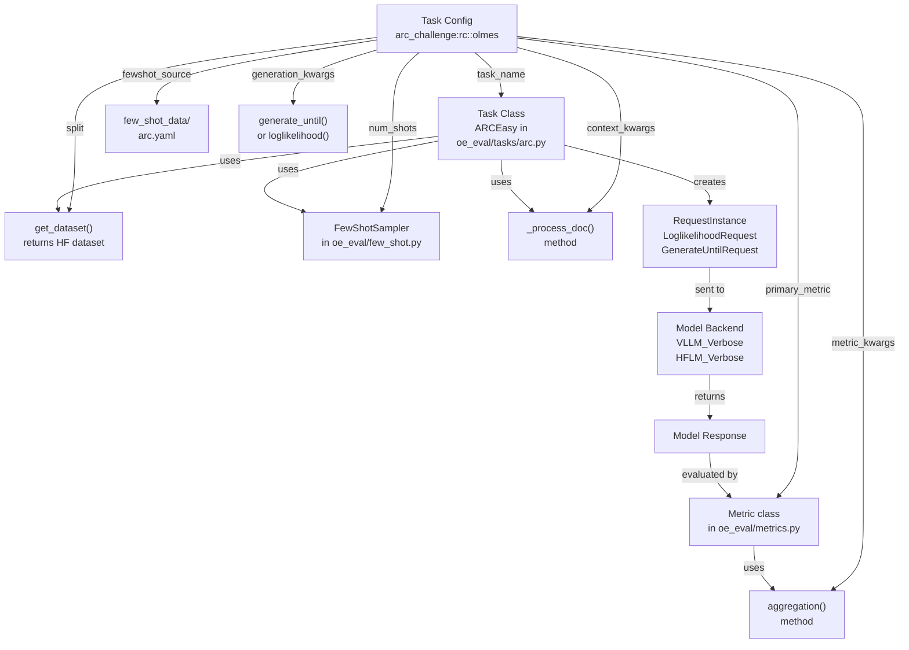
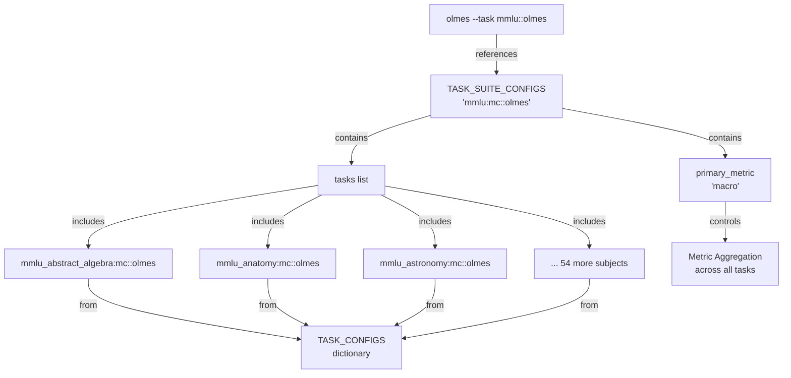

<!-- source: DeepWiki mcp.deepwiki.com · repo allenai/olmes · page 4 Task System · fetched 2026-10-26 -->

# Task System

<details>
<summary>Relevant source files</summary>

The following files were used as context for generating this wiki page:

- [README.md](README.md)
- [oe_eval/configs/task_suites.py](oe_eval/configs/task_suites.py)
- [oe_eval/utilities/gsheet_writing.py](oe_eval/utilities/gsheet_writing.py)

</details>


The Task System in OLMES is responsible for defining, configuring, and managing evaluation tasks. It provides a structured way to specify how language models are evaluated on various benchmarks, including parameters, prompting strategies, evaluation metrics, and dataset loading.

The task system consists of three main components:
1. **Task Configurations** - Parameter dictionaries that define how tasks are executed
2. **Task Suites** - Collections of related tasks grouped for convenient evaluation (see [Task Suites](#4.1))
3. **Task Implementations** - Python classes that implement the evaluation logic (see [Task Implementation Patterns](#4.2))

For information about configuring models, see [Model Configuration](#3).

## Task System Architecture

The following diagram illustrates how the task system components interact:

**Diagram: Task System Component Relationships**



Sources: [oe_eval/configs/tasks.py:1-50](), [oe_eval/configs/task_suites.py:1-30](), [README.md:44-86]()

## Task Naming Convention

Task identifiers in OLMES follow a hierarchical naming pattern:

```
"task_name:variant::regime"
```

Where:
- `task_name`: Base task name (e.g., `arc_challenge`, `mmlu`, `gsm8k`)
- `variant` (optional): Task variant (e.g., `mc` for multiple-choice, `rc` for reading comprehension, `cot` for chain-of-thought)
- `regime`: Evaluation regime (e.g., `olmes`, `olmo1`, `tulu`)

**Examples:**

| Task ID | Components | Description |
|---------|-----------|-------------|
| `arc_challenge:mc::olmes` | task=`arc_challenge`, variant=`mc`, regime=`olmes` | ARC Challenge in multiple-choice format |
| `gsm8k::olmo1` | task=`gsm8k`, regime=`olmo1` | GSM8K with OLMo-1 configuration |
| `bbh_boolean_expressions:cot::tulu` | task=`bbh_boolean_expressions`, variant=`cot`, regime=`tulu` | BBH Boolean Expressions with chain-of-thought |

Sources: [oe_eval/configs/tasks.py:21-100](), [README.md:48-68]()

## Task Configuration Dictionary

All available tasks are defined in the `TASK_CONFIGS` dictionary in [oe_eval/configs/tasks.py](). Each entry is a configuration dictionary that specifies task parameters.

**Diagram: Task Configuration Structure**



Sources: [oe_eval/configs/tasks.py:40-100]()

### Example Task Configuration

```python
"arc_challenge:rc::olmes": {
    "task_name": "arc_challenge",
    "split": "test",
    "primary_metric": "acc_uncond",
    "num_shots": 5,
    "fewshot_source": "OLMES:ARC-Challenge",
    "metadata": {
        "regimes": ["OLMES-v0.1"],
    },
}
```

This configuration:
- Uses the `arc_challenge` task implementation
- Evaluates on the `test` split
- Reports `acc_uncond` as the primary metric
- Uses 5 few-shot examples from the OLMES ARC-Challenge set
- Is part of the OLMES-v0.1 evaluation regime

Sources: [oe_eval/configs/tasks.py:73-82]()

## Task Configuration Parameters

Task configurations control all aspects of evaluation through several parameter groups:

| Parameter Group | Purpose | Example Parameters |
|----------------|---------|-------------------|
| **Basic Parameters** | Core task settings | `task_name`, `split`, `primary_metric`, `num_shots`, `limit` |
| **context_kwargs** | Prompt construction | `description`, `short_prefix`, `cot_style`, `prompt_variant` |
| **generation_kwargs** | Model generation | `max_gen_toks`, `temperature`, `stop_sequences`, `do_sample` |
| **metric_kwargs** | Evaluation metrics | `pass_at_ks`, `answer_format_regex`, `answer_extract_fn` |
| **metadata** | Documentation | `regimes`, `description` |

### Common Parameters

| Parameter | Description | Example Values |
|-----------|-------------|----------------|
| `task_name` | Links to task implementation class | `arc_challenge`, `gsm8k`, `mmlu_history` |
| `split` | Dataset split to evaluate | `test`, `validation`, `train` |
| `primary_metric` | Main metric to report | `acc_raw`, `exact_match`, `pass_at_1` |
| `num_shots` | Few-shot examples to include | `0`, `5`, `8` |
| `fewshot_source` | Source of few-shot examples | `OLMES:ARC-Challenge`, `STD:GSM8k` |
| `use_chat_format` | Use chat-style prompts | `true`, `false` |

Sources: [oe_eval/configs/tasks.py:40-100](), [oe_eval/configs/tasks.py:197-230]()

## Task-to-Dataset Relationship

**Diagram: Task Configuration to Dataset Loading**



Each task implementation defines how to:
1. Load the underlying dataset (usually from HuggingFace)
2. Process documents from the dataset into evaluation instances
3. Format prompts using few-shot examples
4. Extract and evaluate model responses

Sources: [oe_eval/configs/tasks.py:73-82](), [README.md:44-58]()

## Evaluation Pipeline Flow

**Diagram: Task Configuration in Evaluation Pipeline**



Sources: [README.md:44-68]()

## Task Types and Variants

OLMES supports multiple task types, each with specific evaluation approaches:

| Task Type | Variant | Description | Example Tasks |
|-----------|---------|-------------|---------------|
| **Multiple-Choice** | `:mc` | Select from labeled options | ARC, MMLU, BoolQ |
| **Reading Comprehension** | `:rc` | Cloze-style completion | ARC, HellaSwag, PIQA |
| **Chain-of-Thought** | `:cot` | Reasoning with intermediate steps | BBH, GSM8K, MMLU |
| **Code Generation** | (varies) | Generate executable code | HumanEval, MBPP |
| **Free-Form Generation** | (none) | Open-ended text generation | DROP, SQuAD, CoQA |

Different variants of the same task can use different prompting strategies and metrics. For example:
- `arc_challenge:mc::olmes` - Multiple-choice format with labeled options (A, B, C, D)
- `arc_challenge:rc::olmes` - Reading comprehension format with cloze-style prompts

See [Multiple-Choice Q&A Tasks](#4.3), [Math and Code Generation Tasks](#4.4), and [Task Implementation Patterns](#4.2) for details on specific task types.

Sources: [oe_eval/configs/tasks.py:40-100](), [oe_eval/configs/tasks.py:562-582](), [oe_eval/configs/tasks.py:219-228]()

## Task Configuration to Code Mapping

**Diagram: Configuration Parameters to Code Entities**



Sources: [oe_eval/configs/tasks.py:73-82](), [oe_eval/tasks/arc.py:1-100]()

## Task Suites

Task suites aggregate multiple related tasks for convenient evaluation. They are defined in [oe_eval/configs/task_suites.py]() in the `TASK_SUITE_CONFIGS` dictionary.

**Diagram: Task Suite Structure**



Example suite definition:
```python
TASK_SUITE_CONFIGS["mmlu:mc::olmes"] = {
    "tasks": [f"mmlu_{sub}:mc::olmes" for sub in MMLU_SUBJECTS],
    "primary_metric": "macro",
}
```

Task suites enable running comprehensive evaluations with a single command:
```bash
olmes --model olmo-7b --task core_9mcqa::olmes
```

For more details, see [Task Suites](#4.1).

Sources: [oe_eval/configs/task_suites.py:29-56](), [README.md:89-128]()

## Command Line Usage

Task configurations can be specified directly on the command line:

```bash
# Run a single task
olmes --model olmo-1b --task arc_challenge::olmes --output-dir my-eval-dir1

# Run multiple tasks
olmes --model olmo-1b --task arc_challenge::olmes hellaswag::olmes --output-dir my-eval-dir1

# Override task parameters
olmes --task arc_challenge:rc::olmes --split dev --num_shots 0
```

For more complex configurations, JSON format can be used for per-task overrides:

```bash
olmes --task '{"task_name": "arc_challenge:rc::olmes", "num_shots": 2}' '{"task_name": "hellaswag:rc::olmes", "num_shots": 4}'
```

You can inspect a task's prompt before running a full evaluation:

```bash
olmes --task arc_challenge:mc::olmes --inspect
```

Sources: [README.md:39-67](), [README.md:126-158]()

## Creating Custom Task Configurations

### Extending Existing Configurations

You can create new task configurations by extending existing ones:

```python
# Example: Creating full versions of OLMES tasks without sample limits
OLMES_FULL_CONFIGS: dict = {}
for task_alias, task_config in TASK_CONFIGS.items():
    if task_alias.endswith("::olmes"):
        olmes_full_alias = task_alias.replace("::olmes", "::olmes:full")
        olmes_full_config = copy.deepcopy(task_config)
        if "limit" in olmes_full_config:
            del olmes_full_config["limit"]
        OLMES_FULL_CONFIGS[olmes_full_alias] = olmes_full_config
```

### Programmatically Generating Configurations

Tasks with common patterns can be generated programmatically:

```python
# Example: Creating configurations for all BBH tasks
for task_type in BBH_TASKS:
    TASK_CONFIGS[f"bbh_{task_type}:qa::none"] = {
        "task_name": f"bbh_{task_type}",
        "split": "test",
        "num_shots": 3,
        "context_kwargs": {
            "use_cot": False,
        },
        "metadata": {
            "regimes": [],
        },
    }
```

Sources: [oe_eval/configs/tasks.py:1149-1172](), [oe_eval/configs/tasks.py:2437-2447]()

## Evaluation Regimes

OLMES supports several evaluation regimes, each with specific task configurations:

| Regime | Description | Associated Tasks |
|--------|-------------|------------------|
| `OLMES-v0.1` | Original OLMES standard | Multiple-choice tasks (ARC, BoolQ, etc.) |
| `OLMES-v0.2` | Expanded OLMES standard | Generative tasks (DROP, GSM8K, etc.) |
| `OLMo-v1` | OLMo paper evaluation | Various tasks with OLMo-specific configs |
| `Tulu` | TÜLU paper evaluation | Various tasks with TÜLU-specific configs |

To run all tasks from a specific regime, you can use the corresponding task suite:

```bash
# Run core OLMES multiple-choice tasks
olmes --model olmo-7b --task core_9mcqa::olmes --output-dir <dir>

# Run OLMo main suite tasks
olmes --model olmo-7b --task main_suite::olmo1 --output-dir <dir>
```

Sources: [README.md:70-105](), [oe_eval/configs/tasks.py:77-81]()

---

