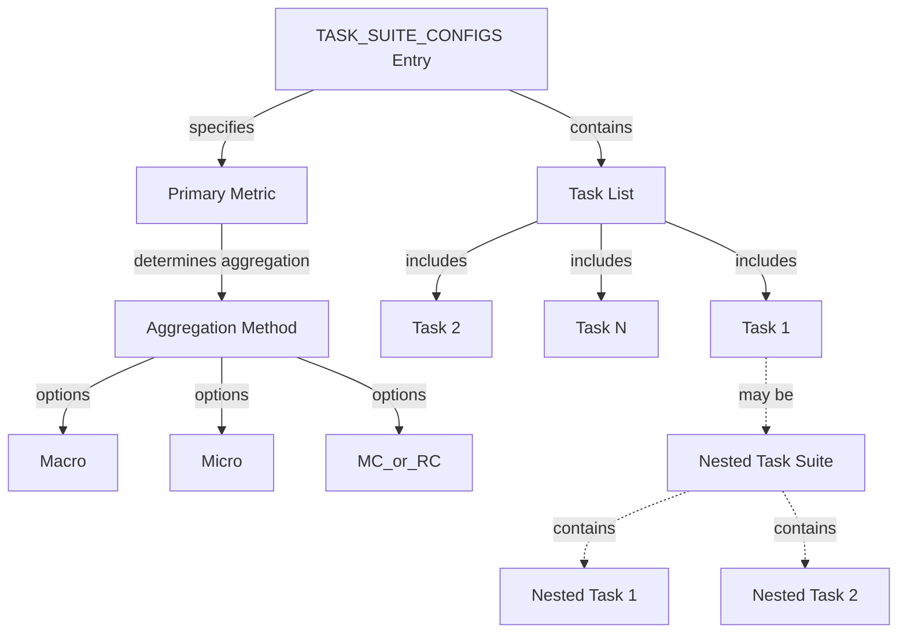
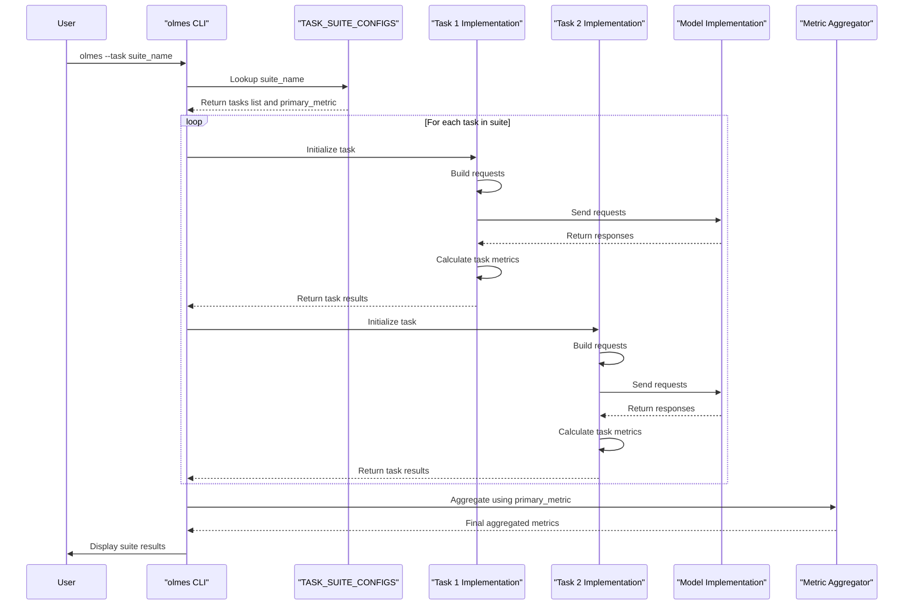
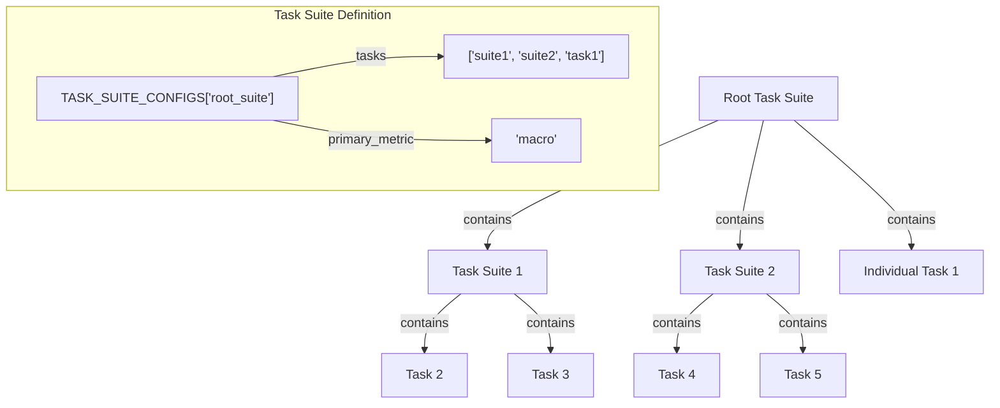
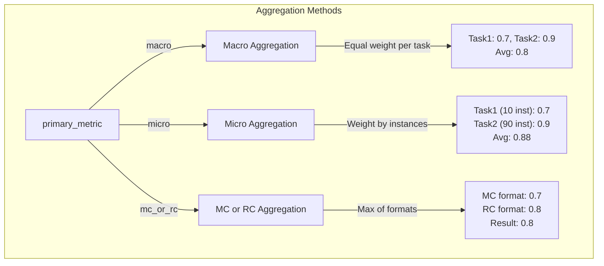

<!-- source: DeepWiki mcp.deepwiki.com · repo allenai/olmes · page 4.1 Task Suites · fetched 2026-10-26 -->

# Task Suites

<details>
<summary>Relevant source files</summary>

The following files were used as context for generating this wiki page:

- [README.md](README.md)
- [oe_eval/configs/task_suites.py](oe_eval/configs/task_suites.py)
- [oe_eval/utilities/gsheet_writing.py](oe_eval/utilities/gsheet_writing.py)

</details>


## Purpose and Scope

This document explains what task suites are in the OLMES system, how they're defined, and how to use them. Task suites allow users to evaluate language models on groups of related tasks with a single command, providing a convenient way to assess model performance across entire categories of tasks such as multiple-choice QA, reasoning, or math problems.

For information about individual task configurations, see [Task Configuration](#4) and [Base Task Implementation](#4.2).

## What Are Task Suites?

Task suites are collections of related tasks grouped together for convenience and systematic evaluation. They allow you to:

1. Run multiple related tasks with a single command
2. Group tasks by category, difficulty, or purpose
3. Define how metrics should be aggregated across tasks
4. Create standardized evaluation benchmarks

### Task Suite Structure



Sources: [oe_eval/configs/task_suites.py:1-376]()

## Task Suite Configuration

Task suites are defined in the `TASK_SUITE_CONFIGS` dictionary in [oe_eval/configs/task_suites.py]().

Each task suite entry consists of:

1. A unique identifier (key in the dictionary)
2. A configuration dictionary containing:
   - `tasks`: A list of task IDs or other task suite IDs
   - `primary_metric` (optional): How to aggregate metrics across tasks

Example of a task suite configuration:

```python
TASK_SUITE_CONFIGS["core_9mcqa::olmes"] = {
    "tasks": [
        "arc_easy::olmes",
        "arc_challenge::olmes",
        "boolq::olmes",
        "csqa::olmes",
        "hellaswag::olmes",
        "openbookqa::olmes",
        "piqa::olmes",
        "socialiqa::olmes",
        "winogrande::olmes",
    ],
    "primary_metric": "macro",
}
```

### Primary Metric Types

The `primary_metric` field determines how metrics are aggregated across tasks in a suite:

| Metric Type | Description |
|-------------|-------------|
| `"macro"`   | Equal weight to each task, regardless of dataset size |
| `"micro"`   | Weight each instance equally (larger datasets have more influence) |
| `"mc_or_rc"` | Special case for tasks with multiple formulations; takes the max score between multiple-choice and reading comprehension formats |

Sources: [oe_eval/configs/task_suites.py:15-17]()

## Using Task Suites

### Command Line Usage

Task suites are invoked via the CLI by specifying the task suite name to the `--task` argument:

```bash
olmes --model model_name --task suite_name --output-dir output_directory
```

For example, to run the core 9 multiple-choice tasks from the OLMES standard:

```bash
olmes --model olmo-7b --task core_9mcqa::olmes --output-dir my_results
```

### Task Suite Execution Flow



Sources: [oe_eval/configs/task_suites.py:1-376](), [README.md:40-50]()

## Common Predefined Task Suites

OLMES includes many predefined task suites for common evaluation scenarios. Here are some key examples:

### OLMES Standard Suites

| Suite Name | Description | Components |
|------------|-------------|------------|
| `core_9mcqa::olmes` | The 9 core multiple-choice tasks | ARC (Easy/Challenge), BoolQ, CSQA, HellaSwag, OpenBookQA, PIQA, SocialIQA, Winogrande |
| `mmlu:mc::olmes` | MMLU tasks in multiple-choice format | 57 MMLU subject domains |

### OLMo Evaluation Suites

| Suite Name | Description | Components |
|------------|-------------|------------|
| `main_suite::olmo1` | Tasks used in the original OLMo paper | ARC, BoolQ, COPA, HellaSwag, OpenBookQA, PIQA, SciQ, Winogrande, TruthfulQA, GSM8K |
| `mmlu::olmo1` | MMLU tasks for OLMo paper | All MMLU subjects |

### OLMo 2 Evaluation Suites

| Suite Name | Description | Components |
|------------|-------------|------------|
| `olmo_2_generative::olmes` | 5 generative tasks for OLMo 2 | CoQA, SQuAD, Jeopardy, NaturalQs, DROP |
| `olmo_2_heldout::olmes` | 5 held-out tasks for OLMo 2 final evaluation | AGI Eval, BBH, GSM8K, MMLU Pro, TriviaQA |

### TÜLU 3 Evaluation Suites

| Suite Name | Description |
|------------|-------------|
| `tulu_3_dev` | Tasks evaluated during TÜLU 3 development |
| `tulu_3_unseen` | Held-out tasks used in TÜLU 3 final evaluation |

Sources: [oe_eval/configs/task_suites.py:19-343](), [README.md:72-104]()

## Creating Custom Task Suites

To create a custom task suite, add a new entry to the `TASK_SUITE_CONFIGS` dictionary:

```python
TASK_SUITE_CONFIGS["my_custom_suite"] = {
    "tasks": [
        "task1::configuration", 
        "task2::configuration",
        "task3::configuration"
    ],
    "primary_metric": "macro",
}
```

### Hierarchical Task Suites

Task suites can include other task suites, creating a hierarchical structure:



This pattern is used in the codebase for organizing large evaluation suites, as seen in the HELMET task suite example:

```python
# Create individual tag-based suites
for tag in ["icl", "longqa", "niah", "rag", "recall", "rerank", "summ", "cite"]:
    suite_name = f"helmet_{tag}__{size}::suite"
    all_suites.append(suite_name)
    TASK_SUITE_CONFIGS[suite_name] = {"tasks": tasks, "primary_metric": "macro"}

# Create an "all" suite that contains all the tag-based suites
TASK_SUITE_CONFIGS[f"helmet_all__{size}::suite"] = {
    "tasks": all_suites,
    "primary_metric": "macro",
}
```

Sources: [oe_eval/configs/task_suites.py:345-362]()

## Metric Aggregation

The `primary_metric` field in task suite configurations determines how metrics are aggregated:

### Aggregation Methods



- **Macro Aggregation**: Each task contributes equally to the final score
  - Example: MMLU with 57 subjects gives equal weight to each subject
  - Good for representing breadth of capability across diverse task types

- **Micro Aggregation**: Each instance contributes equally
  - Example: BBH tasks with varying numbers of examples
  - Gives more influence to larger datasets

- **MC or RC Aggregation**: Takes maximum between multiple formats
  - Used when tasks have both multiple-choice and reading comprehension variants
  - Applies to OLMES format tasks that try both formulations

Sources: [oe_eval/configs/task_suites.py:13-17](), [oe_eval/configs/task_suites.py:31-35]()

## Practical Examples

Here are some common use cases of task suites from the README:

```bash
# Run OLMES standard evaluation (9 core tasks)
olmes --model olmo-7b --task core_9mcqa::olmes --output-dir <dir>

# Run MMLU evaluation
olmes --model olmo-7b --task mmlu::olmes --output-dir <dir>

# Reproduce OLMo paper results
olmes --model olmo-7b --task main_suite::olmo1 --output-dir <dir>
olmes --model olmo-7b --task mmlu::olmo1 --output-dir <dir>
```

For more advanced use cases, you can:
- Run multiple task suites in one command
- Override task suite parameters using command-line arguments
- Create custom task suites for specialized evaluations

Sources: [README.md:72-104]()

---

