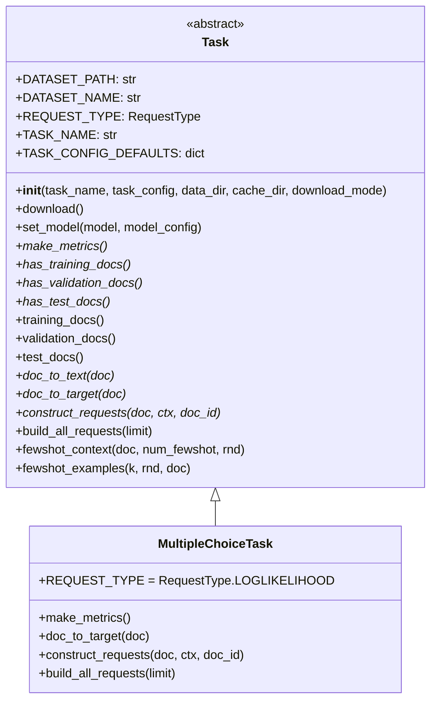
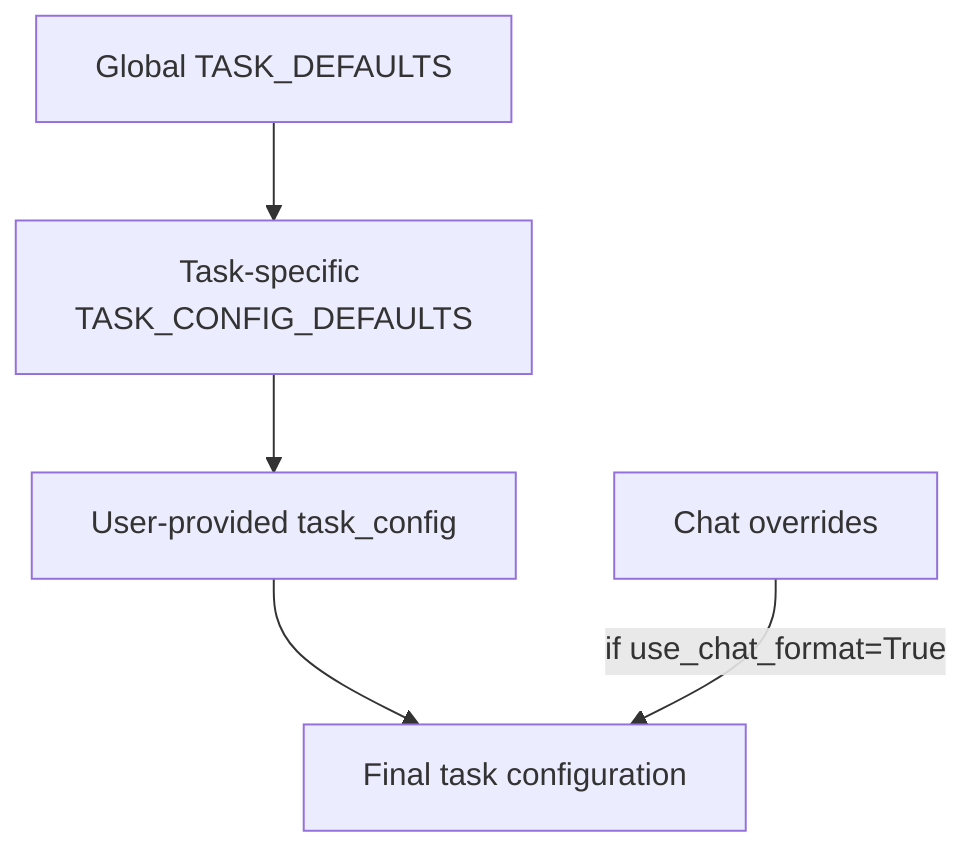
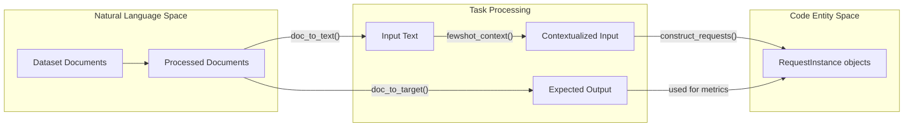
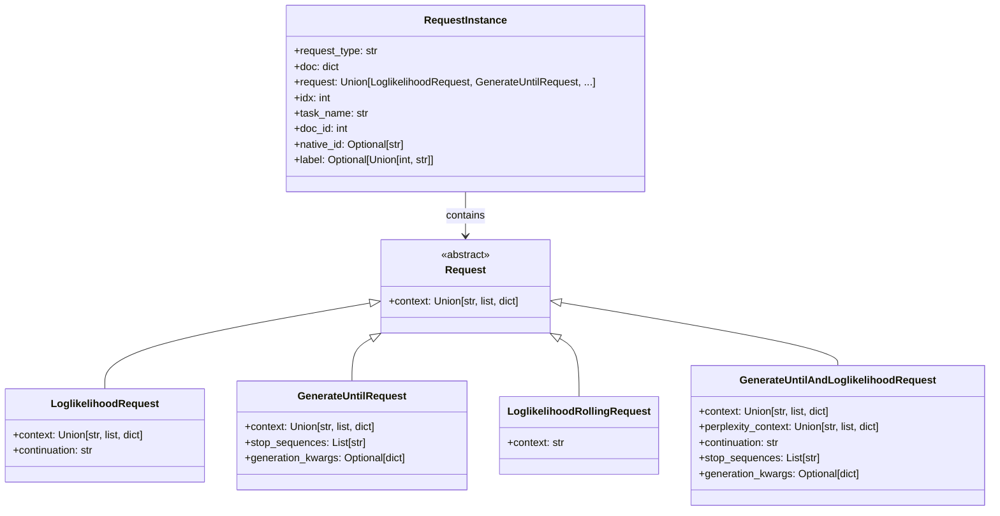
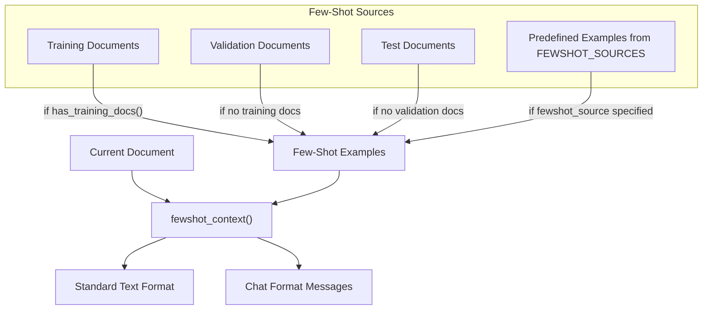
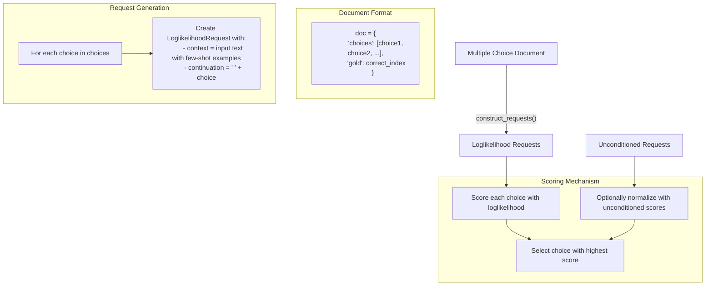

<!-- source: DeepWiki mcp.deepwiki.com · repo allenai/olmes · page 4.2 Task Implementation Patterns · fetched 2026-10-26 -->

# Base Task Implementation

Relevant source files

The following files were used as context for generating this wiki page:

- [README.md](README.md)
- [oe_eval/tasks/oe_eval_tasks/arc.py](oe_eval/tasks/oe_eval_tasks/arc.py)
- [oe_eval/tasks/oe_eval_tasks/boolq.py](oe_eval/tasks/oe_eval_tasks/boolq.py)

## Purpose and Scope

This document describes the base task implementation in OLMES, focusing on the abstract `Task` class and its derivative `MultipleChoiceTask`. These classes provide the foundation for all evaluation tasks in the system and define how tasks are configured, how they handle data, and how they generate requests for models to process.

For information about task suites (collections of tasks), see [Task Suites](#4.1).
For specific task implementations like BBH, see [Big-Bench Hard Tasks](#4.3) and [AGI Eval Tasks](#4.4).

## Task Class Overview

The `Task` abstract base class is the foundation for all evaluation tasks in OLMES. It defines the structure and functionality required to convert datasets into request instances that can be processed by language models.

Sources: [oe_eval/tasks/base_task.py:29-576]()

### Key Attributes and Methods

The `Task` class defines several key attributes and methods that control how evaluation tasks operate:

| Attribute/Method | Purpose |
|------------------|---------|
| `DATASET_PATH` | Path to the dataset in HuggingFace datasets Hub or a custom loading script |
| `DATASET_NAME` | Name of a subset within `DATASET_PATH` |
| `REQUEST_TYPE` | Type of request this task generates (e.g., `GENERATE_UNTIL`, `LOGLIKELIHOOD`) |
| `TASK_NAME` | Name of the task |
| `TASK_CONFIG_DEFAULTS` | Default configuration parameters for the task |
| `make_metrics()` | Creates metric objects for evaluation |
| `doc_to_text(doc)` | Converts a document to input text for the model |
| `doc_to_target(doc)` | Converts a document to the expected output |
| `construct_requests(doc, ctx, doc_id)` | Creates request instances for evaluation |

Sources: [oe_eval/tasks/base_task.py:47-145](), [oe_eval/tasks/base_task.py:186-392]()

## Task Initialization and Configuration

When a task is instantiated, it processes configuration options with a cascading defaults system:

The initialization process:
1. Merges global defaults from `TASK_DEFAULTS` with task-specific defaults from `TASK_CONFIG_DEFAULTS`
2. Applies any chat formatting overrides if `use_chat_format` is enabled
3. Overrides defaults with user-provided configuration
4. Sets up dataset path and split information

Sources: [oe_eval/tasks/base_task.py:61-144]()

## Data Flow and Processing

The base `Task` class defines a clear data flow from dataset documents to model requests:

Sources: [oe_eval/tasks/base_task.py:369-392](), [oe_eval/tasks/base_task.py:394-430](), [oe_eval/tasks/base_task.py:432-549]()

## Request Construction System

Tasks generate `RequestInstance` objects that encapsulate all information needed for model evaluation:

Sources: [oe_eval/components/instances.py:55-114](), [oe_eval/components/requests.py:7-84]()

The base `Task` class provides helper methods for creating common request types:

1. `construct_basic_generation_requests()`: Creates requests for text generation tasks
2. `construct_basic_likelihood_rolling_requests()`: Creates requests for token-by-token likelihood evaluation

Sources: [oe_eval/tasks/base_task.py:237-326]()

## Few-Shot Context Handling

A key capability of the `Task` class is its ability to handle few-shot examples for prompting:

The `fewshot_context()` method supports:
- Different numbers of few-shot examples (via `num_fewshot`)
- Descriptive text before and after examples (via `description` and `final_description`)
- System prompts for chat formatting (via `system_prompt`)
- Multi-turn conversation formatting (via `fewshot_as_multiturn`)

Sources: [oe_eval/tasks/base_task.py:432-575]()

## Multiple Choice Task Implementation

The `MultipleChoiceTask` class is a specialized implementation of `Task` for multiple-choice evaluation:

Key features of `MultipleChoiceTask`:
- Uses `LOGLIKELIHOOD` request type to score each choice
- Implements `MCAccuracy` metric for evaluation
- Optionally calculates unconditioned scores for normalization
- Handles document-to-target conversion for multiple choice format

Sources: [oe_eval/tasks/base_task.py:578-682]()

## Creating a Custom Task

To create a custom task, you need to subclass either `Task` or one of its derivatives like `MultipleChoiceTask` and implement the required abstract methods:

| Method | Implementation Requirement |
|--------|----------------------------|
| `make_metrics()` | Create and return metrics for evaluation |
| `has_training_docs()` | Return whether the task has training docs |
| `has_validation_docs()` | Return whether the task has validation docs |
| `has_test_docs()` | Return whether the task has test docs |
| `doc_to_text(doc)` | Convert a document to input text |
| `doc_to_target(doc)` | Convert a document to expected output |
| `construct_requests(doc, ctx, doc_id)` | Create request instances for evaluation |

Additionally, you should:
1. Set appropriate class attributes like `DATASET_PATH`, `DATASET_NAME`, and `REQUEST_TYPE`
2. Override `training_docs()`, `validation_docs()`, and `test_docs()` if your task has those splits
3. Set task-specific defaults in `TASK_CONFIG_DEFAULTS` as needed

Sources: [oe_eval/tasks/base_task.py:186-204](), [oe_eval/tasks/base_task.py:369-392]()

## Request Type Selection

When implementing a task, choosing the right request type is crucial:

| Task Type | Suggested Request Type | Purpose |
|-----------|------------------------|---------|
| Multiple-choice | `LOGLIKELIHOOD` | Compare probabilities of different choices |
| Generation | `GENERATE_UNTIL` | Generate text until stop conditions |
| BPC/Perplexity | `LOGLIKELIHOOD_ROLLING` | Token-by-token likelihood evaluation |
| Combined tasks | `GENERATE_UNTIL_AND_LOGLIKELIHOOD` | Generate text and evaluate likelihood of gold standard |

The request type determines how the model will process the input and what metrics can be applied to the results.

Sources: [oe_eval/components/requests.py:7-12](), [oe_eval/tasks/base_task.py:237-296]()

---

