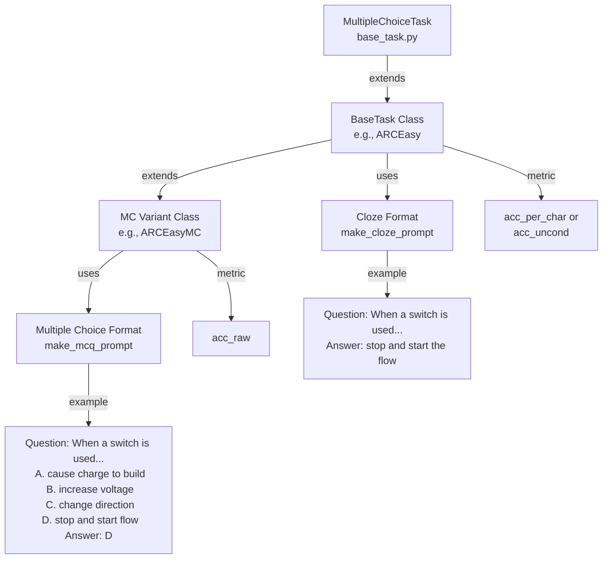
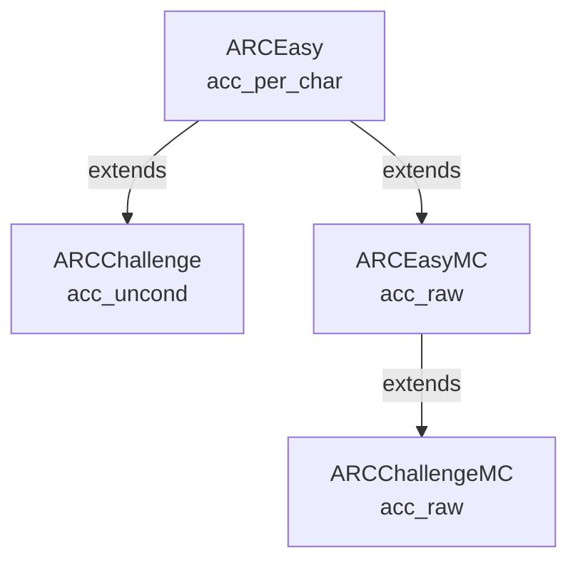
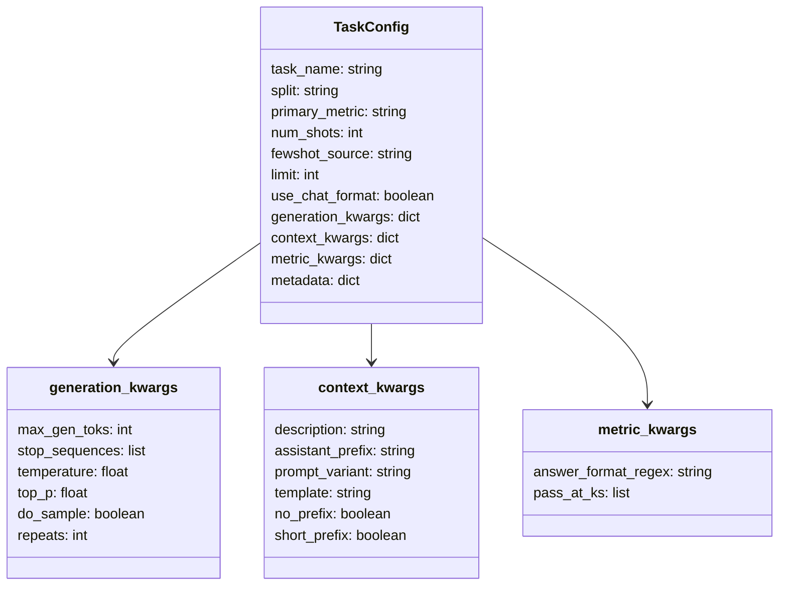

<!-- source: DeepWiki mcp.deepwiki.com · repo allenai/olmes · page 4.3 Multiple-Choice Q&A Tasks · fetched 2026-10-26 -->

# Multiple-Choice Q&A Tasks

<details>
<summary>Relevant source files</summary>

The following files were used as context for generating this wiki page:

- [oe_eval/tasks/oe_eval_tasks/arc.py](oe_eval/tasks/oe_eval_tasks/arc.py)
- [oe_eval/tasks/oe_eval_tasks/boolq.py](oe_eval/tasks/oe_eval_tasks/boolq.py)
- [oe_eval/tasks/oe_eval_tasks/copa.py](oe_eval/tasks/oe_eval_tasks/copa.py)
- [oe_eval/tasks/oe_eval_tasks/csqa.py](oe_eval/tasks/oe_eval_tasks/csqa.py)
- [oe_eval/tasks/oe_eval_tasks/hellaswag.py](oe_eval/tasks/oe_eval_tasks/hellaswag.py)
- [oe_eval/tasks/oe_eval_tasks/openbookqa.py](oe_eval/tasks/oe_eval_tasks/openbookqa.py)
- [oe_eval/tasks/oe_eval_tasks/piqa.py](oe_eval/tasks/oe_eval_tasks/piqa.py)
- [oe_eval/tasks/oe_eval_tasks/sciq.py](oe_eval/tasks/oe_eval_tasks/sciq.py)
- [oe_eval/tasks/oe_eval_tasks/siqa.py](oe_eval/tasks/oe_eval_tasks/siqa.py)

</details>


## Overview

Multiple-choice question-answering tasks form a core component of OLMES evaluation, testing a model's ability to select correct answers from a set of predefined choices. These tasks evaluate capabilities including scientific reasoning, commonsense understanding, reading comprehension, and social reasoning.

All multiple-choice Q&A tasks in OLMES inherit from the `MultipleChoiceTask` base class defined in [oe_eval/tasks/base_task.py](). This base class provides common functionality for processing multiple-choice questions and computing choice-based metrics.

The following tasks are documented in this section:

| Task | Dataset | Domain | Choices |
|------|---------|--------|---------|
| ARC | AI2 Reasoning Challenge | Science reasoning | 3-5 |
| BoolQ | SuperGLUE | Binary question answering | 2 (yes/no) |
| COPA | SuperGLUE | Causal reasoning | 2 |
| CommonsenseQA | Commonsense reasoning | General knowledge | 5 |
| HellaSwag | Commonsense inference | Sentence completion | 4 |
| OpenBookQA | Science question answering | Elementary science | 4 |
| PIQA | Physical reasoning | Everyday situations | 2 |
| SciQ | Science questions | Physics/Chemistry/Biology | 4 |
| SocialIQA | Social reasoning | Social interactions | 3 |

Sources: [oe_eval/tasks/oe_eval_tasks/arc.py](), [oe_eval/tasks/oe_eval_tasks/boolq.py](), [oe_eval/tasks/oe_eval_tasks/copa.py](), [oe_eval/tasks/oe_eval_tasks/csqa.py](), [oe_eval/tasks/oe_eval_tasks/hellaswag.py](), [oe_eval/tasks/oe_eval_tasks/openbookqa.py](), [oe_eval/tasks/oe_eval_tasks/piqa.py](), [oe_eval/tasks/oe_eval_tasks/sciq.py](), [oe_eval/tasks/oe_eval_tasks/siqa.py]()

## Task Implementation Pattern

### MultipleChoiceTask Base Class

All tasks documented in this section extend `MultipleChoiceTask`, which provides:

- **Document Processing Pipeline**: Methods like `_process_doc()` transform raw dataset examples into standardized format with `query`, `choices`, and `gold` fields
- **Split Management**: Methods `has_training_docs()`, `has_validation_docs()`, `has_test_docs()` and corresponding `*_docs()` methods
- **Prompt Formatting**: Integration with prompt formatting utilities from [oe_eval/tasks/utils.py]()
- **Unconditioned Scoring**: Support for conditional probability normalization via `unconditioned_prompt()`

### Cloze vs Multiple-Choice Variants

Most tasks implement two prompt formatting strategies, resulting in separate task classes:



**Cloze Format** (Base Classes):
- Question followed by partial answer prefix
- Model completes the answer directly
- Uses `make_cloze_prompt()` utility
- Evaluated with `acc_per_char` or `acc_uncond` metrics
- Example: `ARCEasy`, `BoolQ`, `CommonsenseQA`, `HellaSwag`, `OpenBookQA`, `PiQA`, `SciQ`, `SocialIQA`

**Multiple-Choice Format** (MC Variants):
- Question with labeled answer choices (A, B, C, D, E)
- Model selects single letter
- Uses `make_mcq_prompt()` utility
- Evaluated with `acc_raw` metric
- Example: `ARCEasyMC`, `BoolQMC`, `CommonsenseQAMC`, `HellaSwagMC`, `OpenBookQAMC`, `PiQAMC`, `SciQMC`, `SocialIQAMC`

Sources: [oe_eval/tasks/oe_eval_tasks/arc.py:32-143](), [oe_eval/tasks/oe_eval_tasks/boolq.py:9-95](), [oe_eval/tasks/utils.py]()

## ARC (AI2 Reasoning Challenge)

ARC is a dataset of grade-school science questions requiring reasoning beyond simple fact retrieval. The dataset is split into two difficulty levels, each with both cloze and multiple-choice variants.

### Implementation Classes



| Class | Dataset Split | Prompt Format | Primary Metric | Questions |
|-------|---------------|---------------|----------------|-----------|
| `ARCEasy` | `ARC-Easy` | Cloze | `acc_per_char` | 5,197 easy questions |
| `ARCChallenge` | `ARC-Challenge` | Cloze | `acc_uncond` | 2,590 hard questions |
| `ARCEasyMC` | `ARC-Easy` | Multiple-choice | `acc_raw` | 5,197 easy questions |
| `ARCChallengeMC` | `ARC-Challenge` | Multiple-choice | `acc_raw` | 2,590 hard questions |

### Dataset Structure

- **Source**: `allenai/ai2_arc` on HuggingFace
- **Splits**: train, validation, test
- **Fields**: `id`, `question`, `choices` (text and labels), `answerKey`

### Document Processing

The `_process_doc()` method in [oe_eval/tasks/oe_eval_tasks/arc.py:70-84]() performs:
1. Converts numeric answer keys (`"1"`, `"2"`, etc.) to letters (`"A"`, `"B"`, etc.)
2. For cloze variants: Uses `make_cloze_prompt()` to format question
3. For MC variants: Uses `make_mcq_prompt()` to include labeled choices

**Cloze Format Example**:
```
Question: When a switch is used in an electrical circuit, the switch can
Answer: stop and start the flow of current.
```

**Multiple-Choice Format Example**:
```
Question: When a switch is used in an electrical circuit, the switch can
 A. cause the charge to build.
 B. increase and decrease the voltage.
 C. cause the current to change direction.
 D. stop and start the flow of current.
Answer: D
```

Sources: [oe_eval/tasks/oe_eval_tasks/arc.py:1-143]()

## BoolQ

BoolQ is a yes/no question answering dataset from SuperGLUE where questions are posed about passages and require binary responses.

### Implementation Classes

| Class | Prompt Format | Primary Metric | Native ID Field |
|-------|---------------|----------------|-----------------|
| `BoolQ` | Cloze (yes/no) | `acc_raw` | `idx` |
| `BoolQMC` | Multiple-choice (A/B) | `acc_raw` | `idx` |

### Dataset Structure

- **Source**: `aps/super_glue` dataset, `boolq` subset
- **Splits**: train, validation (no test split)
- **Fields**: `passage`, `question`, `label`, `idx`

### Document Processing

The `_process_doc()` method in [oe_eval/tasks/oe_eval_tasks/boolq.py:43-58]() creates:
- Passage context followed by question
- Choices are `["yes", "no"]`
- Gold label inverted: `1 - doc["label"]` (due to dataset encoding)

**Cloze Format Example**:
```
Persian language -- Persian (/ˈpɜːrʒən, -ʃən/), also known ...
Question: do iran and afghanistan speak the same language?
Answer: yes
```

**Multiple-Choice Format Example**:
```
Persian language -- Persian (/ˈpɜːrʒən, -ʃən/), also known by its endonym ...
Question: do iran and afghanistan speak the same language?
 A. yes
 B. no
Answer: A
```

### Unconditioned Normalization

`BoolQ` supports optional unconditioned normalization via `metric_kwargs["uncond_docid_offset"]` parameter. When set, the task returns `"Answer:"` as the unconditioned prompt for probability normalization.

Sources: [oe_eval/tasks/oe_eval_tasks/boolq.py:1-95]()

## COPA (Choice of Plausible Alternatives)

COPA evaluates causal reasoning by requiring models to select the most plausible cause or effect for a given premise.

### Implementation Class

| Class | Prompt Format | Primary Metric | Choices |
|-------|---------------|----------------|---------|
| `Copa` | Cloze with connector | `acc_raw` | 2 |

### Dataset Structure

- **Source**: `aps/super_glue` dataset, `copa` subset
- **Splits**: train, validation (no test split)
- **Fields**: `premise`, `choice1`, `choice2`, `question` (cause/effect), `label`, `idx`

### Document Processing

The `_process_doc()` method in [oe_eval/tasks/oe_eval_tasks/copa.py:43-59]() performs unique processing:
1. Maps question type to connector: `"cause"` → `"because"`, `"effect"` → `"therefore"`
2. Removes period from premise and adds connector
3. Uncapitalizes first letter of each choice using `uncapitalize()` method

**Example**:
```
The man broke his toe because he got a hole in his sock.
Answer: he dropped a hammer on his foot.

(Choices: ["he got a hole in his sock", "he dropped a hammer on his foot"])
```

This task does not have an MC variant; it uses the cloze format exclusively with connectors that make the task clear.

Sources: [oe_eval/tasks/oe_eval_tasks/copa.py:1-63]()

## CommonsenseQA

CommonsenseQA tests commonsense knowledge through five-choice questions requiring reasoning about everyday concepts.

### Implementation Classes

| Class | Prompt Format | Primary Metric | Choices |
|-------|---------------|----------------|---------|
| `CommonsenseQA` | Cloze | `acc_uncond` | 5 (A-E) |
| `CommonsenseQAMC` | Multiple-choice | `acc_raw` | 5 (A-E) |

### Dataset Structure

- **Source**: `tau/commonsense_qa` on HuggingFace
- **Splits**: train, validation (no test split)
- **Fields**: `id`, `question`, `choices` (text list), `answerKey`

### Document Processing

Standard multiple-choice processing in [oe_eval/tasks/oe_eval_tasks/csqa.py:62-74]():
- Extracts question and choices
- Maps answerKey letter to gold index

**Cloze Format Example**:
```
Question: Sammy wanted to go to where the people were.  Where might he go?
Answer: populated areas
```

**Multiple-Choice Format Example**:
```
Question: Sammy wanted to go to where the people were.  Where might he go?
 A. race track
 B. populated areas
 C. the desert
 D. apartment
 E. roadblock
Answer: B
```

Sources: [oe_eval/tasks/oe_eval_tasks/csqa.py:1-109]()

## HellaSwag

HellaSwag is a commonsense inference dataset that tests whether models can select the correct completion for a given scenario. The dataset uses adversarial filtering to create challenging wrong answers.

### Implementation Classes

| Class | Prompt Format | Primary Metric | Choices |
|-------|---------------|----------------|---------|
| `HellaSwag` | Cloze | `acc_per_char` | 4 |
| `HellaSwagMC` | Multiple-choice | `acc_raw` | 4 |

### Dataset Structure

- **Source**: `allenai/hellaswag` on HuggingFace
- **Splits**: train, validation (no test split)
- **Fields**: `ind`, `activity_label`, `ctx_a`, `ctx_b`, `endings`, `label`

### Document Processing

The `_process_doc()` method in [oe_eval/tasks/oe_eval_tasks/hellaswag.py:61-69]() includes:
1. Combines `ctx_a` and capitalized `ctx_b` as context
2. Prepends `activity_label` to context
3. Applies `preprocess()` method to clean WikiHow artifacts

The `preprocess()` classmethod in [oe_eval/tasks/oe_eval_tasks/hellaswag.py:72-80]() removes:
- `[title]` markers (replaces with period)
- Other bracket artifacts `[.*?]`
- Normalizes whitespace

**Cloze Format Example**:
```
Health: How to cope with suicidal thoughts. Put off any plans. Promise yourself that you'll wait 48 hours before doing anything. Remember, thoughts don't have the power to force you to act.
Answer: Sometimes extreme pain can distort our perception.
```

**Multiple-Choice Format Example**:
```
Health: How to choose dental floss. Choose a thick floss when you have large gaps. If you have large spaces between your teeth, pick an extra thick floss. Some options include dental tape or super dental floss.
Choose the best continuation:
 A. If you have small gaps between your teeth, a thicker floss might work fine...
 B. Choosing a thicker floss will help ensure that you are actually flossing all surfaces...
 C. However, since dental floss is so wide and heavy, you'll need to pick a thinner one...
 D. You can pick between super and super thick floss with two or four slits...
Answer: B
```

Sources: [oe_eval/tasks/oe_eval_tasks/hellaswag.py:1-121]()

## OpenBookQA

OpenBookQA tests application of core science facts to novel situations, requiring both the "book" knowledge and additional commonsense reasoning.

### Implementation Classes

| Class | Prompt Format | Primary Metric | Choices |
|-------|---------------|----------------|---------|
| `OpenBookQA` | Cloze (configurable) | `acc_uncond` | 4 (A-D) |
| `OpenBookQAMC` | Multiple-choice | `acc_raw` | 4 (A-D) |

### Dataset Structure

- **Source**: `allenai/openbookqa` dataset, `main` subset
- **Splits**: train, validation, test
- **Fields**: `id`, `question_stem`, `choices` (text list), `answerKey`

### Document Processing

The `_process_doc()` method in [oe_eval/tasks/oe_eval_tasks/openbookqa.py:67-80]() supports:
- Optional `context_kwargs["no_prefix"]` to match original Eleuther AI format
- When `False` (default): Uses `make_cloze_prompt()` with "Question:" prefix
- When `True`: Uses bare question stem

**Cloze Format Example**:
```
Question: When food is reduced in the stomach
Answer: nutrients are being deconstructed
```

**Multiple-Choice Format Example**:
```
Question: When food is reduced in the stomach
 A. the mind needs time to digest
 B. take a second to digest what I said
 C. nutrients are being deconstructed
 D. reader's digest is a body of works
Answer: C
```

Sources: [oe_eval/tasks/oe_eval_tasks/openbookqa.py:1-116]()

## PIQA (Physical Interaction QA)

PIQA evaluates physical commonsense reasoning about everyday situations by asking models to select the most sensible solution to achieve a goal.

### Implementation Classes

| Class | Prompt Format | Primary Metric | Choices |
|-------|---------------|----------------|---------|
| `PiQA` | Cloze with "Goal:" prefix | `acc_per_char` | 2 |
| `PiQAMC` | Multiple-choice | `acc_raw` | 2 |

### Dataset Structure

- **Source**: `ybisk/piqa` on HuggingFace
- **Splits**: train, validation (no test split)
- **Fields**: `goal`, `sol1`, `sol2`, `label`
- **Note**: Uses `with_indices=True` to generate index field

### Document Processing

The `_process_doc()` method in [oe_eval/tasks/oe_eval_tasks/piqa.py:61-71]() formats goals with `"Goal: "` prefix using `make_cloze_prompt()`.

**Cloze Format Example**:
```
Goal: To create a makeshift ice pack,
Answer: take a sponge and soak it in water. Put the sponge in a refrigerator and let it freeze. Once frozen, take it out and put it in a ziploc bag. You can now use it as an ice pack.
```

**Multiple-Choice Format Example**:
```
Goal: To create a makeshift ice pack,
 A. take a sponge and soak it in oil. Put the sponge in a refrigerator and let it freeze...
 B. take a sponge and soak it in water. Put the sponge in a refrigerator and let it freeze...
Answer: B
```

Sources: [oe_eval/tasks/oe_eval_tasks/piqa.py:1-107]()

## SciQ

SciQ is a crowdsourced science question dataset covering Physics, Chemistry, and Biology with supporting evidence passages.

### Implementation Classes

| Class | Prompt Format | Primary Metric | Choices |
|-------|---------------|----------------|---------|
| `SciQ` | Cloze | `acc_raw` | 4 |
| `SciQMC` | Multiple-choice (shuffled) | `acc_raw` | 4 |

### Dataset Structure

- **Source**: `allenai/sciq` on HuggingFace
- **Splits**: train, validation, test
- **Fields**: `question`, `distractor1`, `distractor2`, `distractor3`, `correct_answer`, `support`
- **Note**: Uses `with_indices=True` to generate index field

### Document Processing

The base `_process_doc()` method in [oe_eval/tasks/oe_eval_tasks/sciq.py:63-78]() places correct answer at position 3 (index 3).

The MC variant in [oe_eval/tasks/oe_eval_tasks/sciq.py:93-120]() implements **deterministic shuffling**:
- Uses `random.Random(index)` with example index as seed
- Shuffles choices consistently for each example
- Tracks gold answer position after shuffle
- Labels choices as A, B, C, D

This ensures answer distribution is not biased (all answers would be "D" without shuffling).

**Cloze Format Example**:
```
Question: What type of organism is commonly used in preparation of foods such as cheese and yogurt?
Answer: mesophilic organisms
```

**Multiple-Choice Format Example**:
```
Question: What type of organism is commonly used in preparation of foods such as cheese and yogurt?
 A. protozoa
 B. gymnosperms
 C. mesophilic organisms
 D. viruses
Answer: C
```

Sources: [oe_eval/tasks/oe_eval_tasks/sciq.py:1-125]()

## SocialIQA

SocialIQA tests commonsense reasoning about social interactions and human behavior.

### Implementation Classes

| Class | Prompt Format | Primary Metric | Choices |
|-------|---------------|----------------|---------|
| `SocialIQA` | Cloze | `acc_per_char` | 3 (A-C) |
| `SocialIQAMC` | Multiple-choice | `acc_raw` | 3 (A-C) |

### Dataset Structure

- **Source**: `allenai/social_i_qa` on HuggingFace
- **Splits**: train, validation (no test split)
- **Fields**: `context`, `question`, `answerA`, `answerB`, `answerC`, `label`
- **Note**: Uses `with_indices=True` to generate index field
- **Label Format**: Labels are `"1"`, `"2"`, `"3"` (converted to 0-indexed by subtracting 1)

### Document Processing

The `_process_doc()` method in [oe_eval/tasks/oe_eval_tasks/siqa.py:66-75]() concatenates context and question, then converts string label to zero-indexed integer: `int(doc["label"]) - 1`.

**Cloze Format Example**:
```
Question: Quinn wanted to help me clean my room up because it was so messy. What will Quinn want to do next?
Answer: Pick up the dirty clothes
```

**Multiple-Choice Format Example**:
```
Question: Quinn wanted to help me clean my room up because it was so messy. What will Quinn want to do next?
 A. Eat messy snacks
 B. help out a friend
 C. Pick up the dirty clothes
Answer: C
```

Sources: [oe_eval/tasks/oe_eval_tasks/siqa.py:1-111]()

## Task Configuration Structure

Task configurations in OLMES follow a consistent structure that allows for flexible task setup:



Key components of task configurations:

1. **Base Task Properties**:
   - `task_name`: Core task implementation name
   - `split`: Dataset split to use (test, validation)
   - `primary_metric`: Main evaluation metric
   - `num_shots`: Number of few-shot examples

2. **Example Handling**:
   - `fewshot_source`: Source of few-shot examples
   - `limit`: Maximum number of examples to evaluate

3. **Format Control**:
   - `use_chat_format`: Whether to format inputs as chat
   - `context_kwargs`: Customization of prompt format
   - `generation_kwargs`: Parameters for generation

4. **Evaluation Settings**:
   - `metric_kwargs`: Parameters for metric calculation

Sources: [oe_eval/configs/tasks.py:21-1050]()

## Common Task Features

### Few-Shot Examples

Most tasks support few-shot learning with examples from different sources:
- `OLMES:<TaskName>`: OLMES-curated examples
- `STD:<TaskName>`: Standard examples from datasets
- `Llama3:<TaskName>`: Examples tuned for Llama 3 models

### Task Variants

Tasks can have multiple variants indicated by suffixes:
- `<task>::olmes`: OLMES evaluation setup
- `<task>::olmo1`: OLMo v1 evaluation setup
- `<task>::llama3`: Llama 3 evaluation setup
- `<task>::bpb`: Bits-per-byte evaluation

### Common Metrics

Different task types use different primary metrics:
- `exact_match`: Exact string match
- `f1`: F1 score between prediction and reference
- `acc_raw`, `acc_uncond`, `acc_per_char`: Different accuracy calculations
- `pass_at_1`: For code generation tasks
- `bits_per_byte`: For perplexity evaluations

Sources: [oe_eval/configs/tasks.py:25-1050]()

---

