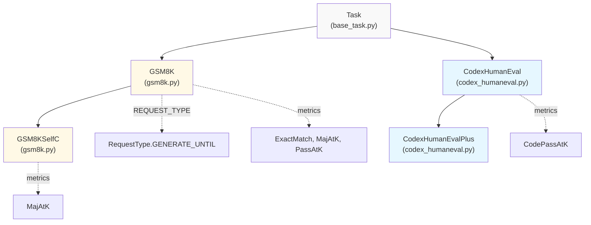
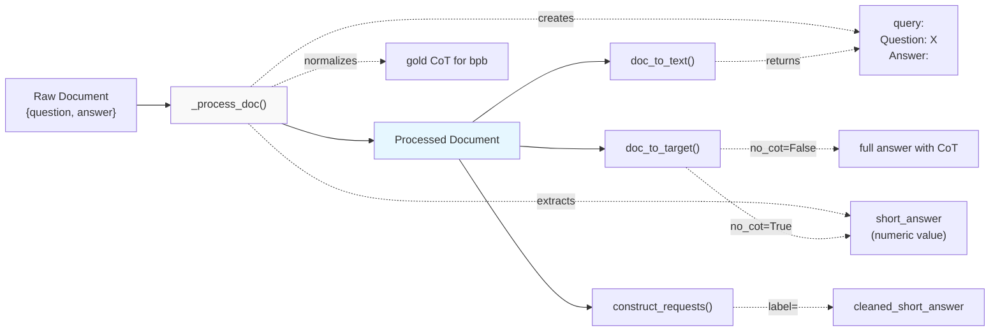
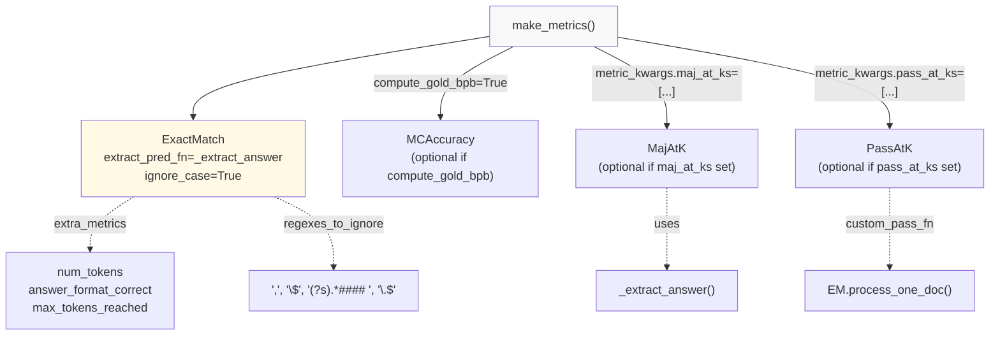
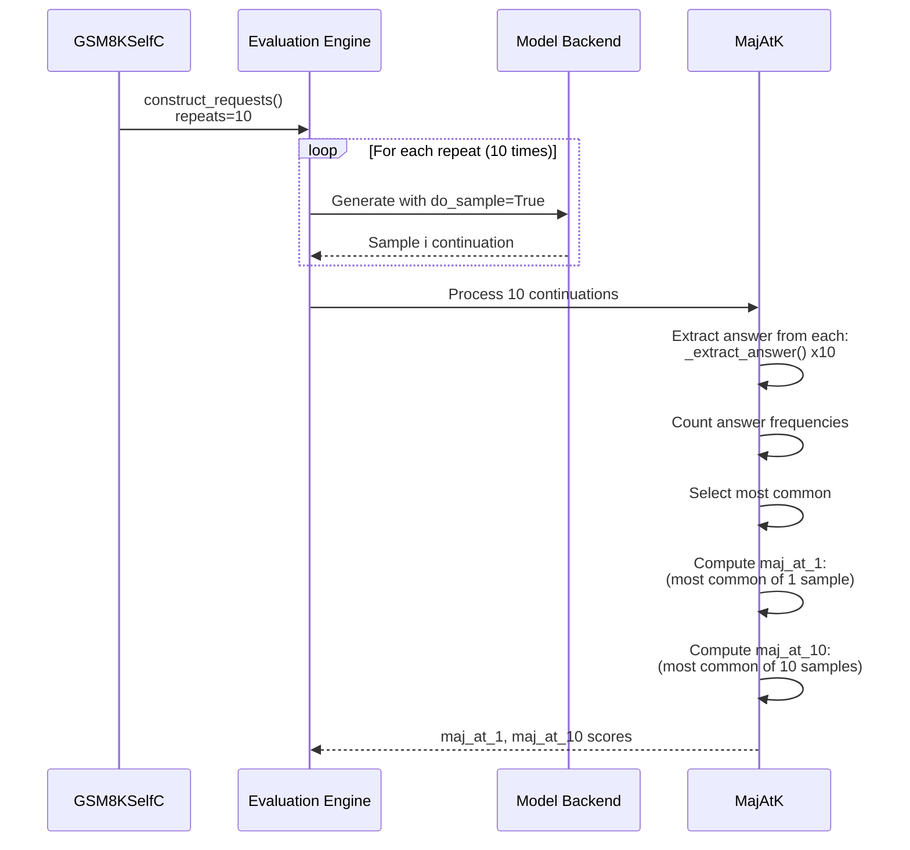
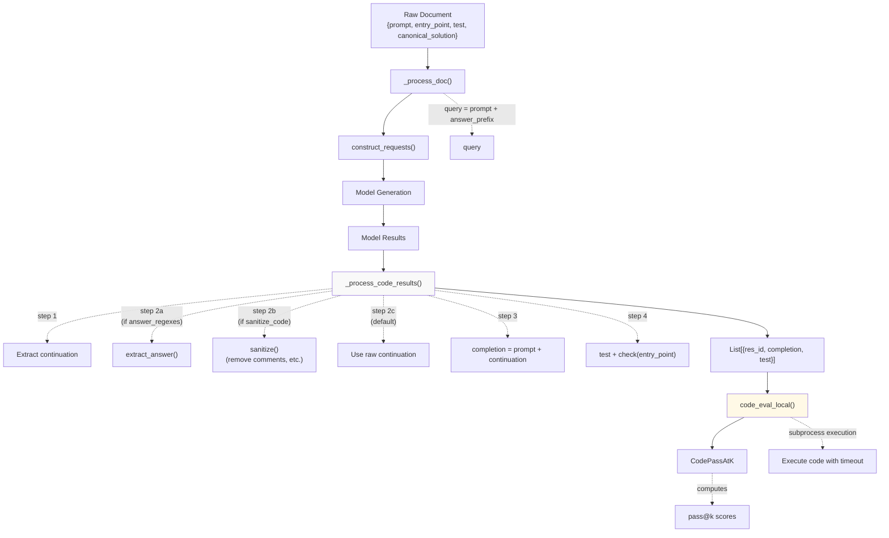
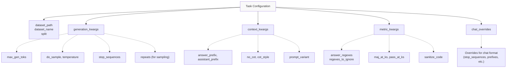

<!-- source: DeepWiki mcp.deepwiki.com · repo allenai/olmes · page 4.4 Math and Code Generation Tasks · fetched 2026-10-26 -->

# Math and Code Generation Tasks

<details>
<summary>Relevant source files</summary>

The following files were used as context for generating this wiki page:

- [oe_eval/tasks/oe_eval_tasks/codex_humaneval.py](oe_eval/tasks/oe_eval_tasks/codex_humaneval.py)
- [oe_eval/tasks/oe_eval_tasks/gsm8k.py](oe_eval/tasks/oe_eval_tasks/gsm8k.py)

</details>


This document describes the math reasoning and code generation tasks in OLMES, which differ from standard multiple-choice tasks by requiring free-form text or code generation followed by specialized evaluation. These tasks are:

- **GSM8K**: Grade school math word problems with chain-of-thought reasoning
- **GSM8KSelfC**: Math problems with self-consistency sampling and majority voting
- **CodexHumanEval**: Python code generation with execution-based evaluation
- **CodexHumanEvalPlus**: Extended code generation with additional test cases

For multiple-choice Q&A tasks (ARC, BoolQ, etc.), see [4.3](#4.3). For general task implementation patterns, see [4.2](#4.2).

## Task Class Hierarchy

Both math and code generation tasks extend the base `Task` class rather than `MultipleChoiceTask`, as they require generation rather than scoring over discrete choices.

**Diagram: Math and Code Task Inheritance**


**Sources:** [oe_eval/tasks/oe_eval_tasks/gsm8k.py:42-127](), [oe_eval/tasks/oe_eval_tasks/codex_humaneval.py:34-103]()

## GSM8K: Math Word Problems with Chain-of-Thought

The `GSM8K` task evaluates mathematical reasoning using the Grade School Math 8K dataset, which contains 8,500 linguistically diverse grade school math word problems.

### Dataset Structure

The GSM8K dataset contains problems with the following structure:
- **question**: Natural language math problem
- **answer**: Step-by-step solution with calculator annotations (`<<calculation>>`) and final answer after `####`
- **short_answer**: The numeric final answer

The `_process_doc` method [oe_eval/tasks/oe_eval_tasks/gsm8k.py:159-186]() transforms each document:
- Extracts `short_answer` from the `####` delimiter
- Formats `query` as "Question: {question}\nAnswer:"
- Normalizes the gold chain-of-thought for perplexity evaluation
- Applies prompt templates via `apply_prompt_template`

**Diagram: GSM8K Document Processing Pipeline**


**Sources:** [oe_eval/tasks/oe_eval_tasks/gsm8k.py:150-186]()

### Configuration and Prompting

The `TASK_CONFIG_DEFAULTS` [oe_eval/tasks/oe_eval_tasks/gsm8k.py:53-81]() specifies:

| Configuration Key | Default Value | Purpose |
|-------------------|---------------|---------|
| `dataset_path` | `"openai/gsm8k"` | HuggingFace dataset identifier |
| `dataset_name` | `"main"` | Dataset configuration |
| `fewshot_source` | `"STD:GSM8k"` | Standard 8-shot examples with CoT |
| `generation_kwargs.max_gen_toks` | `512` | Maximum tokens to generate |
| `generation_kwargs.do_sample` | `False` | Greedy decoding (default) |
| `generation_kwargs.stop_sequences` | `["Question:", "</s>", ...]` | Generation stop conditions |
| `context_kwargs.no_cot` | `False` | Whether to disable chain-of-thought |
| `context_kwargs.cot_style` | `None` | Optional CoT formatting style |

The `context_kwargs` dictionary controls prompting behavior:
- `no_cot=False` (default): Uses full answer with step-by-step reasoning
- `no_cot=True`: Uses only the numeric final answer
- `fewshot_as_multiturn=True` in chat mode: Formats few-shot examples as conversation turns

### Answer Extraction

The `_extract_answer` method [oe_eval/tasks/oe_eval_tasks/gsm8k.py:232-266]() performs multi-step extraction:

1. **Comma removal**: `re.sub(r"(\d),(\d)", r"\1\2", continuation)` converts "1,234" to "1234"
2. **Regex-based extraction** (if `answer_regexes` configured):
   - Strips trailing periods
   - Removes math delimiters: `$...$`, `\(...\)`, `**...**`, `\[...\]`
   - Applies custom regexes via `extract_answer()`
3. **Fallback numeric extraction**: `re.findall(r"[-+]?\d*\.\d+|\d+", output)` finds all numbers and returns the last one

This multi-stage approach handles various answer formats models might produce.

### Metrics

The `make_metrics` method [oe_eval/tasks/oe_eval_tasks/gsm8k.py:83-126]() constructs metrics based on configuration:

**Diagram: GSM8K Metric Construction**


**Sources:** [oe_eval/tasks/oe_eval_tasks/gsm8k.py:83-126]()

The primary metric is `ExactMatch` with:
- `extract_pred_fn=self._extract_answer`: Uses the answer extraction logic described above
- `ignore_case=True`: Case-insensitive comparison
- `regexes_to_ignore`: List of patterns to strip from both prediction and reference (commas, dollar signs, GSM8K-specific formatting)
- Extra metrics: `num_tokens`, `answer_format_correct`, `max_tokens_reached`

## GSM8K Self-Consistency: Majority Voting

The `GSM8KSelfC` task [oe_eval/tasks/oe_eval_tasks/gsm8k.py:280-333]() implements self-consistency decoding (Wang et al., 2022), which samples multiple reasoning paths and selects the most common answer via majority voting.

### Configuration Differences

`TASK_CONFIG_DEFAULTS` overrides [oe_eval/tasks/oe_eval_tasks/gsm8k.py:293-306]():

| Configuration Key | GSM8K Default | GSM8KSelfC Default |
|-------------------|---------------|---------------------|
| `primary_metric` | `"exact_match"` | `"maj_at_10"` |
| `generation_kwargs.do_sample` | `False` | `True` |
| `generation_kwargs.temperature` | `0.0` | `0.5` |
| `generation_kwargs.top_k` | N/A | `40` |
| `metric_kwargs` | `{}` | `{"maj_at_ks": [1, 10]}` |

### Request Construction and Repeats

The `construct_requests` method [oe_eval/tasks/oe_eval_tasks/gsm8k.py:319-333]() overrides the parent to set:

```python
generation_kwargs["repeats"] = max(
    self.task_config["metric_kwargs"].get("maj_at_ks", [1, 10])
)
```

This ensures that for `maj_at_ks=[1, 10]`, the model generates 10 independent samples per question. The `MajAtK` metric then:
- For `maj_at_1`: Returns the most common answer from 1 sample (equivalent to single sampling)
- For `maj_at_10`: Returns the most common answer from all 10 samples (majority voting)

**Diagram: Self-Consistency Evaluation Flow**


**Sources:** [oe_eval/tasks/oe_eval_tasks/gsm8k.py:280-333]()

### Metrics

The `make_metrics` method [oe_eval/tasks/oe_eval_tasks/gsm8k.py:308-317]() creates only `MajAtK`:

```python
self._metrics = [
    MajAtK(
        extract_pred_fn=self._extract_answer,
        ignore_case=True,
        ignore_punctuation=False,
        **self.task_config["metric_kwargs"],
    )
]
```

The `MajAtK` metric computes `maj_at_k` for each k in `maj_at_ks`, representing the accuracy when using the majority answer from k samples.

## CodexHumanEval: Code Generation with Execution

The `CodexHumanEval` task [oe_eval/tasks/oe_eval_tasks/codex_humaneval.py:34-184]() evaluates code generation by executing generated Python functions against unit tests.

### Dataset Structure

The HumanEval dataset contains 164 programming problems with:
- **prompt**: Function signature, docstring, and any imports
- **entry_point**: Function name to test
- **test**: Unit test code (without the final `check()` call)
- **canonical_solution**: Reference implementation

The `_process_doc` method [oe_eval/tasks/oe_eval_tasks/codex_humaneval.py:129-138]() transforms documents:

```python
out_doc["query"] = doc["prompt"] + self.task_config["context_kwargs"].get(
    "answer_prefix", ""
)
out_doc = apply_prompt_template(out_doc, self.task_config)
```

The `answer_prefix` (default: `"Here is the completed function:\n\n```python\n"`) is appended to guide the model to generate code in a specific format.

### Configuration

The `TASK_CONFIG_DEFAULTS` [oe_eval/tasks/oe_eval_tasks/codex_humaneval.py:55-87]() specifies:

| Configuration Key | Default Value | Purpose |
|-------------------|---------------|---------|
| `dataset_path` | `"openai/openai_humaneval"` | HuggingFace dataset |
| `generation_kwargs.max_gen_toks` | `512` | Maximum code tokens |
| `generation_kwargs.do_sample` | `False` | Greedy decoding |
| `generation_kwargs.stop_sequences` | `["\nclass", "\nif", "\nprint", ...]` | Code completion boundaries |
| `generation_kwargs.repeats` | `1` | Number of samples (for pass@k > 1) |
| `context_kwargs.answer_prefix` | `"Here is the completed function:\n\n```python\n"` | Prefix before code |
| `metric_kwargs.pass_at_ks` | `[1]` | Compute pass@1 |

The `chat_overrides` dictionary specifies that in chat mode, `assistant_prefix` should be used instead of `answer_prefix`.

**Diagram: CodexHumanEval Code Processing and Execution**


**Sources:** [oe_eval/tasks/oe_eval_tasks/codex_humaneval.py:34-184]()

### Code Processing and Sanitization

The `_process_code_results` method [oe_eval/tasks/oe_eval_tasks/codex_humaneval.py:152-183]() prepares code for execution:

1. **Extract continuation**: Gets `model_resps["continuation"]` from results
2. **Apply extraction/sanitization** (three options):
   - **If `answer_regexes` configured**: Uses `extract_answer()` to extract code from markdown or other formatting
   - **If `sanitize_code=True`**: Uses `sanitize()` from [oe_eval/metrics/code_evals/sanitize.py]() to remove comments, docstrings, and other non-functional code
   - **Default**: Uses raw continuation
3. **Create completion**: Concatenates `prompt + continuation` (the prompt may include necessary imports)
4. **Create unit tests**: Appends `check(entry_point)` to the test code

The method returns a list of dictionaries with `res_id`, `completion`, and `test` for each result.

### Code Execution and pass@k Metric

The `make_metrics` method [oe_eval/tasks/oe_eval_tasks/codex_humaneval.py:89-102]() creates:

```python
self._metrics = [
    CodePassAtK(
        process_code_results_fn=self._process_code_results,
        code_exe_fn=code_eval_local,
        extra_metric_names=["num_tokens"],
        **self.task_config["metric_kwargs"],
    )
]
```

The `CodePassAtK` metric:
- Takes `process_code_results_fn` to transform model outputs into executable code
- Takes `code_exe_fn` (typically `code_eval_local` from [oe_eval/metrics/code_evals/code_eval_routes.py]()) to execute code
- Computes pass@k for each k in `pass_at_ks`

**Code Execution Flow:**

1. `code_eval_local` executes each `completion` with its `test` in a subprocess
2. If execution succeeds without exceptions, the test passes (result=1)
3. If execution fails or times out, the test fails (result=0)
4. The pass@k metric aggregates results across multiple samples

**pass@k Calculation:**

For n samples with c passes, pass@k estimates the probability that at least one of k samples passes:

```
pass@k = 1 - [(n - c) choose k] / [n choose k]
```

This unbiased estimator is described in Appendix A of the HumanEval paper (Chen et al., 2021).

### Request Construction

The `construct_requests` method [oe_eval/tasks/oe_eval_tasks/codex_humaneval.py:146-150]() adds the canonical solution as a "choice" for optional perplexity evaluation:

```python
doc.update({"choices": [doc["canonical_solution"]]})
return self.construct_basic_generation_requests(doc, ctx, doc_id)
```

If `compute_gold_bpb=True` is set, `MCAccuracy` metric is added to compute bits-per-byte on the reference solution.

## CodexHumanEvalPlus: Extended Test Cases

The `CodexHumanEvalPlus` task [oe_eval/tasks/oe_eval_tasks/codex_humaneval.py:186-204]() extends `CodexHumanEval` to use the HumanEval+ dataset, which includes additional automatically generated test cases per problem.

**Configuration differences:**

```python
TASK_CONFIG_DEFAULTS = get_dict_with_defaults(
    {
        "dataset_path": "evalplus/humanevalplus",
        "metric_kwargs": {"timeout": 20.0},
    },
    CodexHumanEval.TASK_CONFIG_DEFAULTS,
)
```

The longer timeout (20.0 vs default) accommodates the larger number of test cases. All other functionality is inherited from `CodexHumanEval`.

## Configuration Patterns

Both task types share common configuration patterns for generation and evaluation.

**Diagram: Configuration Structure for Math and Code Tasks**


**Sources:** [oe_eval/tasks/oe_eval_tasks/gsm8k.py:53-81](), [oe_eval/tasks/oe_eval_tasks/codex_humaneval.py:55-87]()

### Generation Control

Both tasks use `generation_kwargs` to control model sampling:

- **`max_gen_toks`**: Maximum tokens to generate (512 for both)
- **`do_sample`**: `False` for greedy decoding (GSM8K), `True` for sampling (GSM8KSelfC, optional for CodexHumanEval)
- **`temperature`**: Controls randomness when `do_sample=True`
- **`stop_sequences`**: List of strings that halt generation (task-specific)
- **`repeats`**: Number of independent generations per document (for pass@k or maj@k)

### Answer Extraction Control

Both tasks support custom answer extraction:

- **`answer_regexes`** in `metric_kwargs`: List of regex patterns to extract final answers
- **`regexes_to_ignore`** in `metric_kwargs`: Patterns to strip before comparison
- **`sanitize_code`** in `metric_kwargs`: Apply code sanitization for CodexHumanEval

### Chat Format Support

The `chat_overrides` dictionary provides alternative configurations when `use_chat_format=True`:

- **GSM8K**: Uses `fewshot_as_multiturn=True` to format few-shot examples as conversation turns, sets `assistant_prefix="Answer:"`
- **CodexHumanEval**: Uses `assistant_prefix` instead of `answer_prefix` to guide code generation in chat format

## Summary

Math and code generation tasks in OLMES share several design principles:

1. **Extend `Task` base class**: Both use free-form generation rather than multiple-choice scoring
2. **Flexible answer extraction**: Support regex-based extraction to handle various output formats
3. **Specialized metrics**: `ExactMatch`, `MajAtK`, `PassAtK`, and `CodePassAtK` provide task-appropriate evaluation
4. **Sampling support**: `repeats` parameter enables multiple samples for ensemble methods (self-consistency, pass@k)
5. **Chat format adaptation**: `chat_overrides` configures prompting for instruction-tuned models
6. **Configurable generation**: `generation_kwargs` controls sampling temperature, top-k, stop sequences, etc.

These tasks demonstrate OLMES's ability to handle complex evaluation scenarios beyond standard multiple-choice benchmarks, including mathematical reasoning chains and executable code generation.

**Sources:** [oe_eval/tasks/oe_eval_tasks/gsm8k.py:1-334](), [oe_eval/tasks/oe_eval_tasks/codex_humaneval.py:1-204]()

---

