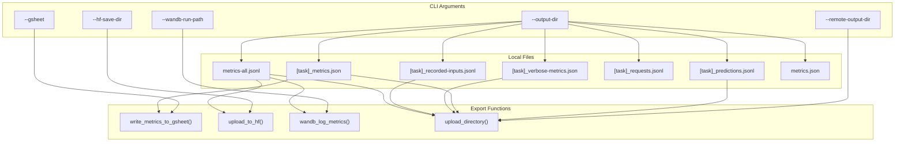
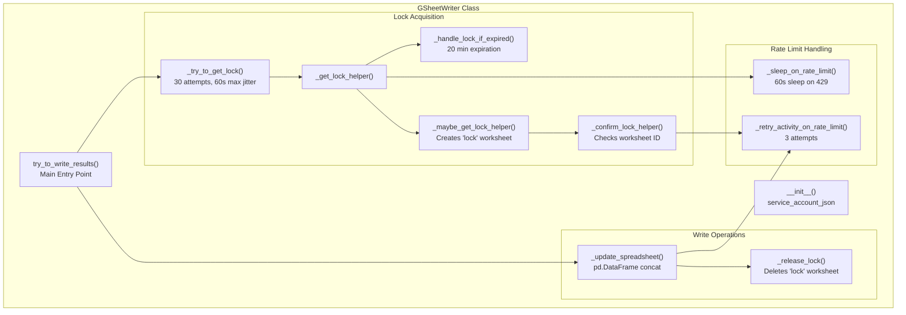
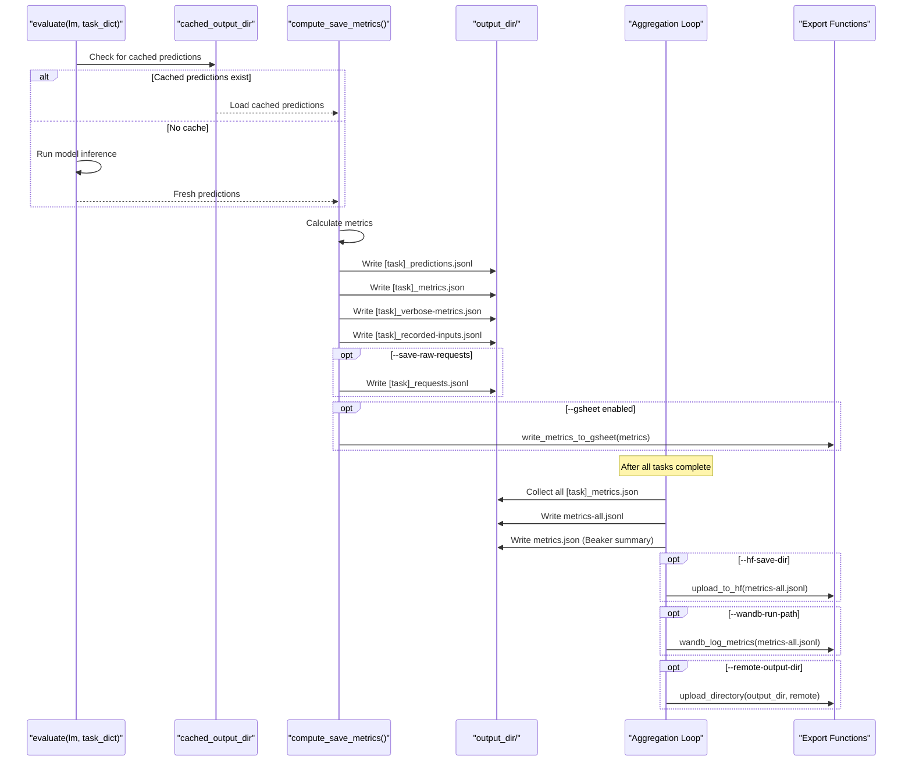

<!-- source: DeepWiki mcp.deepwiki.com · repo allenai/olmes · page 5 Output and Result Storage · fetched 2026-10-26 -->

# Output and Result Storage

<details>
<summary>Relevant source files</summary>

The following files were used as context for generating this wiki page:

- [README.md](README.md)
- [oe_eval/configs/task_suites.py](oe_eval/configs/task_suites.py)
- [oe_eval/utilities/gsheet_writing.py](oe_eval/utilities/gsheet_writing.py)

</details>


OLMES provides a multi-tier storage system for evaluation results. Primary storage is to a local `--output-dir`, with optional exports to Google Sheets, Hugging Face datasets, Weights & Biases, and remote file systems (S3).

## Overview

**Storage Hierarchy:**

| Storage Type | CLI Argument | Required Environment Variable | Primary Use Case |
|-------------|--------------|-------------------------------|------------------|
| Local Directory | `--output-dir` | None | Default storage for all results |
| Google Sheets | `--gsheet` | `GDRIVE_SERVICE_ACCOUNT_JSON` | Collaborative result tracking |
| HF Dataset | `--hf-save-dir` | `HF_TOKEN` | Public dataset archival |
| S3/Remote | `--remote-output-dir` | AWS credentials | Cloud backup |
| Weights & Biases | `--wandb-run-path` | `WANDB_API_KEY` | Experiment tracking |

**Output Structure Flow:**



Sources: [README.md:291-300]()

## Local Storage

Results are written to `--output-dir` with per-task files and aggregated summaries.

**Directory Structure:**

```
output-dir/
├── metrics-all.jsonl           # Aggregate of all task metrics (JSONL)
├── metrics.json                # Simplified summary for Beaker
├── arc_challenge_predictions.jsonl
├── arc_challenge_metrics.json
├── arc_challenge_verbose-metrics.json
├── arc_challenge_recorded-inputs.jsonl
├── arc_challenge_requests.jsonl  # (if --save-raw-requests)
├── hellaswag_predictions.jsonl
├── hellaswag_metrics.json
└── ...
```

**File Formats:**

| Filename Pattern | Format | Content | CLI Control |
|-----------------|--------|---------|-------------|
| `[task]_predictions.jsonl` | JSONL | Per-instance predictions, logprobs, metrics | Always generated |
| `[task]_metrics.json` | JSON | Task-level aggregated metrics, config | Always generated |
| `[task]_verbose-metrics.json` | JSON | Extended metric details (if available) | Always generated |
| `[task]_recorded-inputs.jsonl` | JSONL | Sample prompts sent to model | `--num-recorded-inputs` (default: 3) |
| `[task]_requests.jsonl` | JSONL | Raw `RequestInstance` objects | `--save-raw-requests` flag |
| `metrics-all.jsonl` | JSONL | Concatenated metrics for all tasks | Always generated |
| `metrics.json` | JSON | Beaker-compatible summary | Always generated |

**Predictions JSONL Schema:**

Each line in `[task]_predictions.jsonl` contains:
- `doc_id`: Instance identifier
- `arguments`: Input context and choices
- `resps`: Model responses (text and/or logprobs)
- `filtered_resps`: Post-processed responses
- Metric values: Per-instance metric scores (e.g., `acc`, `exact_match`)

**Metrics JSON Schema:**

`[task]_metrics.json` structure:
- `metrics`: Dict of metric name → value
- `task_name`: Task identifier
- `task_config`: Full task configuration dict
- `model_config`: Full model configuration dict
- `task_hash`: Unique hash of task config
- `model_hash`: Unique hash of model config
- `num_instances`: Total evaluation instances
- `processing_time`: Wall-clock seconds
- `compute_config`: Hardware/batch info

Sources: [README.md:291-294]()

## Google Sheets Integration

The `GSheetWriter` class in [oe_eval/utilities/gsheet_writing.py]() implements concurrent-safe Google Sheets writing with lock management and rate limit handling.

**Class Structure:**



**Lock Mechanism:**

The writer uses a special `"lock"` worksheet to coordinate concurrent writes:

1. `_maybe_get_lock_helper()` creates a worksheet named `"lock"` with timestamp in cell A1
2. If creation succeeds immediately, lock acquired; if worksheet already exists, retry
3. If two processes create simultaneously, Google Sheets creates `"lock"` and `"lock_conflict{id}"`
4. `_confirm_lock_helper()` checks worksheet ID to determine which process won
5. Loser deletes conflict worksheet, waits 5-65 seconds with jitter, retries
6. Lock expires after 20 minutes (`max_seconds_lock_can_be_held`)
7. `_release_lock()` deletes the `"lock"` worksheet

**Rate Limit Handling:**

- All API calls wrapped in `_sleep_on_rate_limit()` which detects HTTP 429 or `RATE_LIMIT_EXCEEDED`
- Critical operations use `_retry_activity_on_rate_limit()` for 3 retry attempts
- 60-second sleep on each rate limit hit
- Extra 60-second sleep if rate limited during lock acquisition to let lock holder finish

**Usage:**

```bash
export GDRIVE_SERVICE_ACCOUNT_JSON='{"type": "service_account", ...}'
olmes --model olmo-7b --task arc_challenge::olmes \
      --output-dir workspace \
      --gsheet "OLMES Results"
```

The function `write_metrics_to_gsheet()` at [oe_eval/utilities/gsheet_writing.py:551-570]() converts task metrics via `convert_metrics_to_gsheet()` and calls `GSheetWriter.try_to_write_results()`.

**Fallback Behavior:**

If lock cannot be acquired after 30 attempts, results are written to a timestamped worksheet `extra-{timestamp}_{random}` instead of failing silently.

Sources: [oe_eval/utilities/gsheet_writing.py:1-570](), [README.md:295-296]()

## Hugging Face Dataset Export

Upload `metrics-all.jsonl` to a Hugging Face dataset repository with `--hf-save-dir`.

**Format:** `--hf-save-dir <repo-name>//<directory>`

**Example:**
```bash
olmes --model olmo-7b --task mmlu::olmes \
      --hf-save-dir "allenai/olmes-results//mmlu-evaluations"
```

**Repository Structure:**

```
<repo-name>/
└── <directory>/
    └── YYYYMMDD-HHMMSS-<task_name>-<N>-tasks.jsonl
```

The filename includes:
- Timestamp: `YYYYMMDD-HHMMSS`
- Primary task name (or first task if suite)
- Task count: `<N>-tasks`

**Implementation:**

The `upload_to_hf()` function:
1. Reads `metrics-all.jsonl` from local output directory
2. Generates timestamped filename
3. Uploads to specified repository path using HF Hub API
4. Requires `HF_TOKEN` environment variable for private repositories

Sources: [README.md:297]()

## Weights & Biases Export

Log evaluation metrics to an existing W&B run with `--wandb-run-path`.

**Format:** `--wandb-run-path <entity>/<project>/runs/<run_id>`

**Example:**
```bash
olmes --model olmo-7b --task gsm8k::olmes \
      --wandb-run-path "ai2-llm/olmes-evals/runs/abc123xyz"
```

**Logged Data:**

The `wandb_log_metrics()` function logs each line in `metrics-all.jsonl` as a W&B metric, including:
- Task name
- Primary metric score
- All metric values
- Model hash
- Task hash
- Configuration dicts

**Requirements:**
- Pre-existing W&B run (creates if doesn't exist)
- `WANDB_API_KEY` environment variable

Sources: [README.md:299]()

## Remote Directory Upload (S3)

Upload entire output directory to remote storage (S3, GCS, etc.) with `--remote-output-dir`.

**Supported Protocols:**
- `s3://bucket/path` (AWS S3)
- `gs://bucket/path` (Google Cloud Storage)
- Any protocol supported by `fsspec`

**Example:**
```bash
olmes --model olmo-7b --task core_9mcqa::olmes \
      --remote-output-dir "s3://ai2-llm/olmes-results/olmo-7b/core-eval"
```

**Behavior:**

The `upload_directory()` function:
1. Evaluates all tasks and writes to local `--output-dir`
2. Recursively uploads all files in the directory to remote path
3. Preserves directory structure and filenames
4. Uses `boto3` for S3, `gcsfs` for GCS

**Temporary Directory Mode:**

If `--remote-output-dir` is specified without `--output-dir`, OLMES:
1. Creates temporary local directory
2. Writes results locally
3. Uploads to remote
4. Cleans up temporary directory

**AWS Configuration:**

Requires AWS credentials via:
- `AWS_ACCESS_KEY_ID` and `AWS_SECRET_ACCESS_KEY` environment variables
- `~/.aws/credentials` file
- IAM role (if running on EC2)

Sources: [README.md:298]()

## Storage Pipeline

Results flow through a multi-stage pipeline: per-task local writes → aggregation → optional remote exports.

**Evaluation to Storage Flow:**



**Key Functions:**

| Function | Location | Purpose |
|----------|----------|---------|
| `compute_save_metrics()` | `oe_eval/run_eval.py` | Per-task metric calculation and file writing |
| `write_metrics_to_gsheet()` | `oe_eval/utilities/gsheet_writing.py:551-570` | Convert and upload to Google Sheets |
| `upload_to_hf()` | `oe_eval/utilities/hf_hub_writing.py` | Upload to HF dataset repository |
| `wandb_log_metrics()` | `oe_eval/utilities/wandb_writing.py` | Log to W&B run |
| `upload_directory()` | `oe_eval/utilities/remote_utils.py` | Recursive upload to remote storage |

**Cached Output Reuse:**

If `--cached-output-dir` points to a directory with existing `[task]_predictions.jsonl`:
1. Predictions are loaded instead of re-running inference
2. Metrics are recalculated from cached predictions (unless `--recompute-metrics` is False)
3. Significant speedup for experiments that only change metric calculation

Sources: [README.md:291-300]()

## CLI Arguments Reference

**Storage Location Arguments:**

| Argument | Type | Default | Description |
|----------|------|---------|-------------|
| `--output-dir` | Path | Required | Local directory for all output files |
| `--cached-output-dir` | Path | `None` | Load predictions from this directory instead of re-running inference |
| `--remote-output-dir` | URL | `None` | Upload entire output directory to remote storage (e.g., `s3://bucket/path`) |

**Remote Export Arguments:**

| Argument | Type | Default | Description |
|----------|------|---------|-------------|
| `--gsheet` | String | `None` | Google Sheet name for results (requires `GDRIVE_SERVICE_ACCOUNT_JSON`) |
| `--hf-save-dir` | String | `None` | HF dataset path: `<repo>//<directory>` (requires `HF_TOKEN`) |
| `--wandb-run-path` | String | `None` | W&B run path: `<entity>/<project>/runs/<run_id>` (requires `WANDB_API_KEY`) |

**Output Control Arguments:**

| Argument | Type | Default | Description |
|----------|------|---------|-------------|
| `--num-recorded-inputs` | Int | 3 | Number of sample inputs to save per task in `recorded-inputs.jsonl` |
| `--save-raw-requests` | Flag | False | Save raw `RequestInstance` objects to `[task]_requests.jsonl` |
| `--recompute-metrics` | Flag | True | If False, skip metric recomputation when using `--cached-output-dir` |

**Full Example:**

```bash
export GDRIVE_SERVICE_ACCOUNT_JSON='{"type": "service_account", ...}'
export HF_TOKEN="hf_..."
export WANDB_API_KEY="..."
export AWS_ACCESS_KEY_ID="..."
export AWS_SECRET_ACCESS_KEY="..."

olmes \
    --model allenai/OLMo-2-1124-7B \
    --task mmlu::olmes gsm8k::olmes \
    --output-dir ./workspace/olmo2-eval \
    --num-recorded-inputs 5 \
    --save-raw-requests \
    --gsheet "OLMo 2 Evaluations" \
    --hf-save-dir "allenai/olmo2-results//main-eval" \
    --wandb-run-path "ai2-llm/olmo2/runs/eval-001" \
    --remote-output-dir "s3://ai2-llm-results/olmo2/7b/main-eval"
```

This command:
1. Evaluates OLMo 2 7B on MMLU and GSM8K
2. Saves results locally to `./workspace/olmo2-eval`
3. Saves 5 sample inputs per task
4. Includes raw requests in output
5. Uploads to Google Sheets, Hugging Face, W&B, and S3

Sources: [README.md:291-300]()

## Implementation Details

The storage system is implemented across several modules:

1. Core storage logic in the `compute_save_metrics` function in `run_eval.py`
2. Google Sheets integration in `utilities/gsheet_writing.py`
3. Hugging Face integration in `utilities/hf_hub_writing.py`
4. Weights & Biases integration in `utilities/wandb_writing.py`
5. Remote storage integration in `utilities/remote_utils.py`

The main file formats are JSONL for predictions and detailed results and JSON for aggregated metrics. The system is designed to be flexible, allowing users to choose which storage options to enable based on their needs.

Sources: [oe_eval/run_eval.py:459-547](), [oe_eval/utilities/gsheet_writing.py:1-570]()

---

