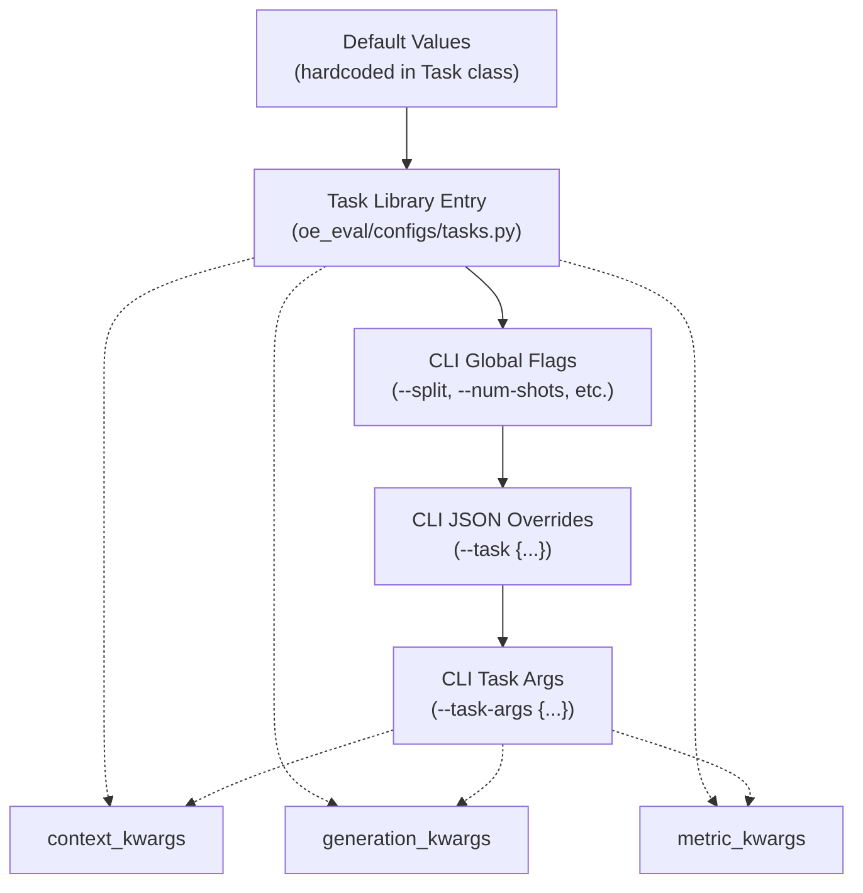
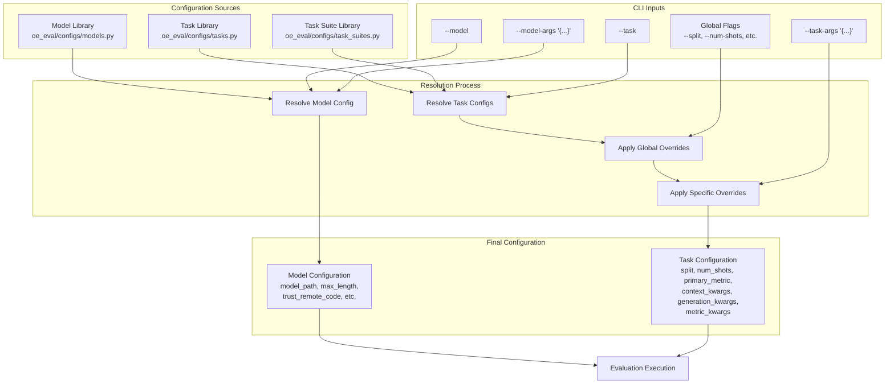

<!-- source: DeepWiki mcp.deepwiki.com · repo allenai/olmes · page 6 Advanced Usage · fetched 2026-10-26 -->

# Advanced Usage

<details>
<summary>Relevant source files</summary>

The following files were used as context for generating this wiki page:

- [README.md](README.md)
- [oe_eval/configs/task_suites.py](oe_eval/configs/task_suites.py)
- [oe_eval/utilities/gsheet_writing.py](oe_eval/utilities/gsheet_writing.py)

</details>


This page covers advanced configuration options for customizing evaluation behavior beyond basic CLI usage. Topics include overriding task parameters, configuring prompt formatting, controlling generation settings, customizing metrics, and specifying few-shot examples. For basic CLI usage and model/task selection, see [Command Line Interface](#2). For information about task implementation internals, see [Task Implementation Patterns](#4.2).

---

## Configuration Override System

OLMES uses a hierarchical configuration system where parameters can be specified at multiple levels, with later levels overriding earlier ones:



**Sources:** [README.md:244-273](), [oe_eval/configs/task_suites.py:29-33]()

---

## Task Parameter Overrides

### Global Parameter Overrides

Apply the same override to all tasks using command-line flags:

```bash
# Evaluate on dev split instead of test
olmes --task arc_challenge::olmes hellaswag::olmes --split dev

# Change number of few-shot examples
olmes --task mmlu::olmes --num-shots 0

# Limit evaluation to first 100 instances
olmes --task gsm8k::olmes --limit 100
```

Common global override flags:
- `--split`: Data split to evaluate (`train`, `validation`, `test`, `dev`)
- `--num-shots`: Number of few-shot examples
- `--limit`: Maximum number of instances to evaluate
- `--random-subsample-seed`: Random seed for instance sampling

**Sources:** [README.md:263-266]()

### Per-Task JSON Overrides

Override parameters for individual tasks using JSON format:

```bash
# Different num_shots for different tasks
olmes \
    --task '{"task_name": "arc_challenge::olmes", "num_shots": 2}' \
    --task '{"task_name": "hellaswag::olmes", "num_shots": 4}' \
    --output-dir workspace
```

JSON task configuration supports all parameters from the task library:

| Parameter | Type | Description |
|-----------|------|-------------|
| `task_name` | string | Task identifier (required in JSON mode) |
| `split` | string | Data split to use |
| `num_shots` | integer | Number of few-shot examples |
| `limit` | integer | Max instances to evaluate |
| `primary_metric` | string | Metric to use as primary score |
| `fewshot_source` | string | Source of few-shot examples |
| `random_subsample_seed` | integer | Seed for random sampling |
| `metadata` | object | Additional metadata |
| `context_kwargs` | object | Prompt formatting parameters |
| `generation_kwargs` | object | Generation control parameters |
| `metric_kwargs` | object | Metric computation parameters |

**Sources:** [README.md:267-272](), [oe_eval/configs/task_suites.py:248-262]()

---

## Context Arguments (context_kwargs)

Context arguments control how prompts are formatted and presented to the model. These are specified in the task library or via `--task-args`:

```bash
# Apply context_kwargs to all tasks
olmes \
    --task arc_challenge::olmes \
    --task-args '{"context_kwargs": {"description": "Custom instruction prefix"}}' \
    --output-dir workspace
```

### Common Context Parameters

Context parameters vary by task implementation but typically include:

| Parameter | Type | Description | Example Tasks |
|-----------|------|-------------|---------------|
| `description` | string | Instruction prefix before examples | Multiple-choice tasks |
| `target_delimiter` | string | Separator between question and answer | Generative tasks |
| `fewshot_as_multiturn` | boolean | Format few-shot as conversation | Chat models |
| `fewshot_delimiter` | string | Separator between few-shot examples | All tasks |
| `include_label_in_prompt` | boolean | Whether to show answer choices | MC tasks |

### Task-Specific Context Configuration

Different task implementations expose different context parameters. Check task source code for available options:

- **Multiple-choice tasks** ([oe_eval/tasks/multiple_choice_task.py]()): Control answer choice formatting
- **Generation tasks** ([oe_eval/tasks/task.py]()): Control prompt templates
- **Code tasks**: Control code formatting and execution environment setup
- **Math tasks**: Control LaTeX rendering and solution formatting

**Sources:** [README.md:260-262](), [oe_eval/configs/task_suites.py:248-273]()

---

## Generation Arguments (generation_kwargs)

Generation arguments control model inference behavior including sampling parameters, generation length, and stopping criteria:

```bash
# Increase generation length for long-form tasks
olmes \
    --model allenai/OLMo-2-1124-7B \
    --task safety::olmo3 \
    --task-args '{"generation_kwargs": {"max_gen_toks": 2048, "truncate_context": false}}' \
    --output-dir workspace
```

### Common Generation Parameters

| Parameter | Type | Description | Default |
|-----------|------|-------------|---------|
| `max_gen_toks` | integer | Maximum tokens to generate | Varies by task |
| `temperature` | float | Sampling temperature (0 = greedy) | 0.0 |
| `top_p` | float | Nucleus sampling parameter | 1.0 |
| `top_k` | integer | Top-k sampling parameter | 0 (disabled) |
| `do_sample` | boolean | Enable sampling (vs greedy) | false |
| `truncate_context` | boolean | Truncate context if too long | true |
| `until` | list[string] | Stop sequences | Task-specific |

### Generation Strategy Examples

```bash
# Greedy decoding (default for most tasks)
olmes --task gsm8k::olmes --task-args '{"generation_kwargs": {"temperature": 0.0}}'

# Sampling for creative generation
olmes --task alpaca_eval::olmes \
    --task-args '{"generation_kwargs": {"temperature": 0.7, "top_p": 0.9, "do_sample": true}}'

# Long context without truncation (for reasoning models)
olmes --task safety::olmo3 \
    --task-args '{"generation_kwargs": {"max_gen_toks": 32768, "truncate_context": false}}'
```

### Self-Consistency and Pass@k Evaluation

Some tasks use multiple samples for robust evaluation:

```bash
# Self-consistency for math (generate N solutions, use majority vote)
olmes --task gsm8k::olmes:n8 --output-dir workspace

# Pass@k for code (generate N solutions, measure if any pass)
olmes --task codex_humaneval::pass@10 --output-dir workspace
```

These variants are pre-configured in the task library with appropriate `generation_kwargs` and `metric_kwargs`.

**Sources:** [README.md:150-157](), [oe_eval/configs/task_suites.py:657-665]()

---

## Metric Arguments (metric_kwargs)

Metric arguments control how evaluation metrics are computed and aggregated:

```bash
# Configure pass@k evaluation
olmes \
    --task codex_humaneval::olmes \
    --task-args '{"metric_kwargs": {"k_values": [1, 5, 10], "num_samples": 20}}' \
    --output-dir workspace
```

### Common Metric Parameters

| Parameter | Type | Description | Task Types |
|-----------|------|-------------|-----------|
| `k_values` | list[int] | K values for pass@k | Code generation |
| `num_samples` | integer | Number of samples for pass@k | Code generation |
| `judge_model` | string | Model for LLM-as-judge | Instruction following |
| `aggregation` | string | Aggregation method (`macro`, `micro`) | Multi-task suites |
| `normalization` | string | Answer normalization method | Generative QA |

### Metric Selection

Each task has a `primary_metric` that determines which score is reported as the main result:

```python
# From task library (oe_eval/configs/tasks.py)
"arc_challenge:rc::olmes": {
    "task_name": "arc_challenge",
    "split": "test",
    "primary_metric": "acc_uncond",  # Which metric to use as "primary_score"
    "num_shots": 5,
}
```

Override the primary metric to report different scores:

```bash
# Report different accuracy metric
olmes --task arc_challenge::olmes \
    --task-args '{"primary_metric": "acc_per_char"}' \
    --output-dir workspace
```

**Sources:** [README.md:260-262](), [oe_eval/configs/task_suites.py:282-287]()

---

## Few-Shot Configuration

### Number of Few-Shot Examples

Control how many examples are shown to the model before evaluation:

```bash
# Zero-shot evaluation
olmes --task mmlu::olmes --num-shots 0

# 5-shot evaluation (OLMES default)
olmes --task mmlu::olmes --num-shots 5

# Different shots for different tasks
olmes \
    --task '{"task_name": "arc_challenge::olmes", "num_shots": 25}' \
    --task '{"task_name": "hellaswag::olmes", "num_shots": 10}'
```

### Few-Shot Source

Specify where few-shot examples come from:

```bash
# Use curated OLMES few-shot examples
olmes --task arc_challenge::olmes  # Uses fewshot_source: "OLMES:ARC-Challenge"

# Sample from training split
olmes --task gsm8k::custom --fewshot-source train --num-shots 8

# Use specific validation instances
olmes --task mmlu::custom --fewshot-source validation --num-shots 3
```

Few-shot sources in task library:

| Source Format | Description | Example |
|---------------|-------------|---------|
| `OLMES:TaskName` | Curated examples from OLMES paper | `OLMES:ARC-Challenge` |
| `train` | Sample from training split | Standard approach |
| `validation` | Sample from validation split | When train unavailable |
| Custom dataset | HuggingFace dataset path | `user/dataset:split` |

### Few-Shot Formatting

Control how few-shot examples are formatted:

```bash
# Format as multi-turn conversation (for chat models)
olmes --task mmlu::olmes \
    --task-args '{"context_kwargs": {"fewshot_as_multiturn": true}}'

# Custom delimiter between examples
olmes --task gsm8k::olmes \
    --task-args '{"context_kwargs": {"fewshot_delimiter": "\n\n---\n\n"}}'
```

**Sources:** [README.md:248-259](), [oe_eval/configs/task_suites.py:253-257]()

---

## Custom Data Splits and Limits

### Evaluating on Different Splits

```bash
# Evaluate on development set
olmes --task arc_challenge::olmes --split validation

# Evaluate on training set (for debugging)
olmes --task mmlu::olmes --split train --limit 10

# Evaluate on held-out test set (default for most tasks)
olmes --task gsm8k::olmes --split test
```

Common split names by dataset:

| Dataset | Available Splits | Default |
|---------|-----------------|---------|
| ARC | `train`, `validation`, `test` | `test` |
| MMLU | `dev`, `validation`, `test`, `auxiliary_train` | `test` |
| GSM8K | `train`, `test` | `test` |
| HumanEval | `test` | `test` |
| BoolQ | `train`, `validation` | `validation` |

### Limiting Evaluation Instances

Control how many instances are evaluated:

```bash
# Quick test on first 10 instances
olmes --task mmlu::olmes --limit 10

# Evaluate on first 100 of each MMLU subject
olmes --task mmlu:mc::olmes --limit 100

# Full evaluation (no limit)
olmes --task arc_challenge::olmes  # Default: no limit
```

### Random Subsampling

Sample random subset of instances:

```bash
# Evaluate random 500 instances with fixed seed
olmes --task gsm8k::olmes \
    --limit 500 \
    --random-subsample-seed 42

# Different seed for reproducible alternative sample
olmes --task gsm8k::olmes \
    --limit 500 \
    --random-subsample-seed 123
```

**Sources:** [README.md:263-266](), [oe_eval/configs/task_suites.py:539-544]()

---

## Model Arguments (model_args)

Model arguments control model loading and inference settings:

```bash
# Trust remote code for custom model implementations
olmes \
    --model google/gemma-2b \
    --model-args '{"trust_remote_code": true, "add_bos_token": true}' \
    --output-dir workspace

# Configure context length
olmes \
    --model allenai/OLMo-3-1025-7B \
    --model-args '{"max_length": 4096}' \
    --output-dir workspace

# Use local model path
olmes \
    --model custom-model \
    --model-args '{"model_path": "/path/to/local/model", "trust_remote_code": true}' \
    --output-dir workspace
```

### Common Model Arguments

| Parameter | Type | Description | Use Case |
|-----------|------|-------------|----------|
| `model_path` | string | Path to model (HF Hub or local) | Override model location |
| `max_length` | integer | Maximum context length | Control memory usage |
| `trust_remote_code` | boolean | Allow custom model code | Required for some models |
| `add_bos_token` | boolean | Prepend BOS token | Model-specific requirement |
| `dtype` | string | Data type (`float16`, `bfloat16`, `float32`) | Control precision |
| `device_map` | string | Device placement strategy | Multi-GPU setups |
| `process_output` | string | Output processing mode | Reasoning models (`r1_style`) |

### Backend-Specific Arguments

**vLLM arguments** (when using `--model-type vllm`):
```bash
olmes --model-type vllm \
    --model allenai/OLMo-2-1124-7B \
    --model-args '{"tensor_parallel_size": 4, "gpu_memory_utilization": 0.9}' \
    --output-dir workspace
```

**LiteLLM arguments** (when using `--model-type litellm` for API models):
```bash
olmes --model-type litellm \
    --model gpt-4 \
    --model-args '{"api_key": "sk-...", "max_tokens": 2048}' \
    --output-dir workspace
```

**Sources:** [README.md:229-238](), [README.md:150-157]()

---

## Dry Run and Inspection

### Inspecting Configuration

Preview the full evaluation configuration before running:

```bash
# Show resolved configuration
olmes \
    --model allenai/OLMo-2-1124-7B \
    --task mmlu::olmes \
    --output-dir workspace \
    --dry-run
```

The `--dry-run` flag displays:
- Complete model configuration (including all resolved arguments)
- Task configurations for each task in the suite
- Backend and inference settings
- Output paths and logging configuration

This is especially useful when using complex JSON overrides to verify the final configuration.

### Inspecting Task Prompts

See example prompts and run quick evaluation:

```bash
# Show sample prompt and run 5-instance test
olmes --task arc_challenge:mc::olmes --inspect
```

The `--inspect` flag:
1. Loads the task and displays a sample formatted prompt
2. Runs a quick evaluation on 5 instances using a small model (Pythia)
3. Shows the types of predictions being made

**Sources:** [README.md:71-85]()

---

## Configuration Flow Diagram



**Sources:** [README.md:217-289]()

---

## Complex Configuration Examples

### Multi-Task with Different Settings

```bash
# Evaluate multiple tasks with individual configurations
olmes \
    --model allenai/OLMo-2-1124-7B \
    --task '{"task_name": "arc_challenge::olmes", "num_shots": 0, "split": "test"}' \
    --task '{"task_name": "gsm8k::olmes", "num_shots": 8, "generation_kwargs": {"max_gen_toks": 512}}' \
    --task '{"task_name": "codex_humaneval::olmes", "generation_kwargs": {"temperature": 0.8}}' \
    --output-dir workspace
```

### Reasoning Model Configuration

```bash
# Configure for reasoning model with long context
olmes \
    --model allenai/OLMo-3-Reasoning \
    --task safety::olmo3 \
    --model-args '{"max_length": 32768, "process_output": "r1_style"}' \
    --task-args '{"generation_kwargs": {"max_gen_toks": 32768, "truncate_context": false}}' \
    --output-dir workspace
```

### Custom Few-Shot with Context Formatting

```bash
# Zero-shot with custom prompt formatting
olmes \
    --model allenai/OLMo-2-1124-7B \
    --task mmlu::olmes \
    --num-shots 0 \
    --task-args '{
        "context_kwargs": {
            "description": "Answer the following question:",
            "fewshot_delimiter": "\n\n"
        }
    }' \
    --output-dir workspace
```

### Debugging Configuration

```bash
# Quick test on small subset with verbose output
olmes \
    --model allenai/OLMo-2-1124-7B \
    --task arc_challenge::olmes \
    --split validation \
    --limit 10 \
    --num-shots 0 \
    --dry-run  # Preview before running
```

**Sources:** [README.md:147-157](), [README.md:263-272]()

---

## Parameter Reference Table

### Task Configuration Parameters

| Parameter | CLI Flag | JSON Key | Type | Description |
|-----------|----------|----------|------|-------------|
| Split | `--split` | `split` | string | Data split to evaluate |
| Few-shot count | `--num-shots` | `num_shots` | integer | Number of few-shot examples |
| Instance limit | `--limit` | `limit` | integer | Max instances to evaluate |
| Random seed | `--random-subsample-seed` | `random_subsample_seed` | integer | Seed for sampling |
| Primary metric | N/A | `primary_metric` | string | Metric to report as primary |
| Few-shot source | N/A | `fewshot_source` | string | Source of few-shot examples |
| Context args | `--task-args` | `context_kwargs` | object | Prompt formatting params |
| Generation args | `--task-args` | `generation_kwargs` | object | Generation control params |
| Metric args | `--task-args` | `metric_kwargs` | object | Metric computation params |

### Model Configuration Parameters

| Parameter | JSON Key | Type | Description |
|-----------|----------|------|-------------|
| Model path | `model_path` | string | Path to model (HF or local) |
| Max context | `max_length` | integer | Maximum context length |
| Trust code | `trust_remote_code` | boolean | Allow custom model code |
| BOS token | `add_bos_token` | boolean | Prepend BOS token |
| Data type | `dtype` | string | Model precision |
| Device map | `device_map` | string | Device placement strategy |
| Output processing | `process_output` | string | Output processing mode |

**Sources:** [README.md:217-289](), [oe_eval/configs/task_suites.py:248-262](), [oe_eval/utilities/gsheet_writing.py:520-549]()

---

