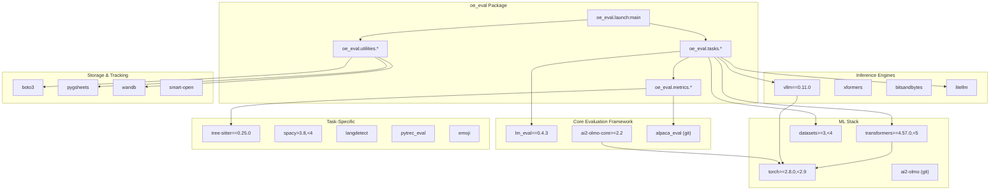
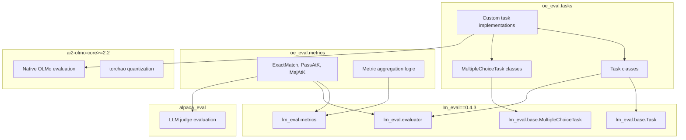
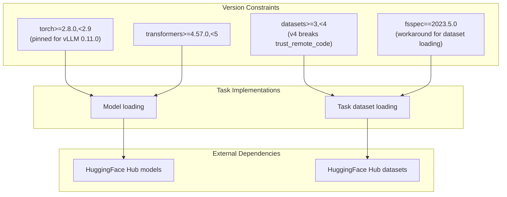
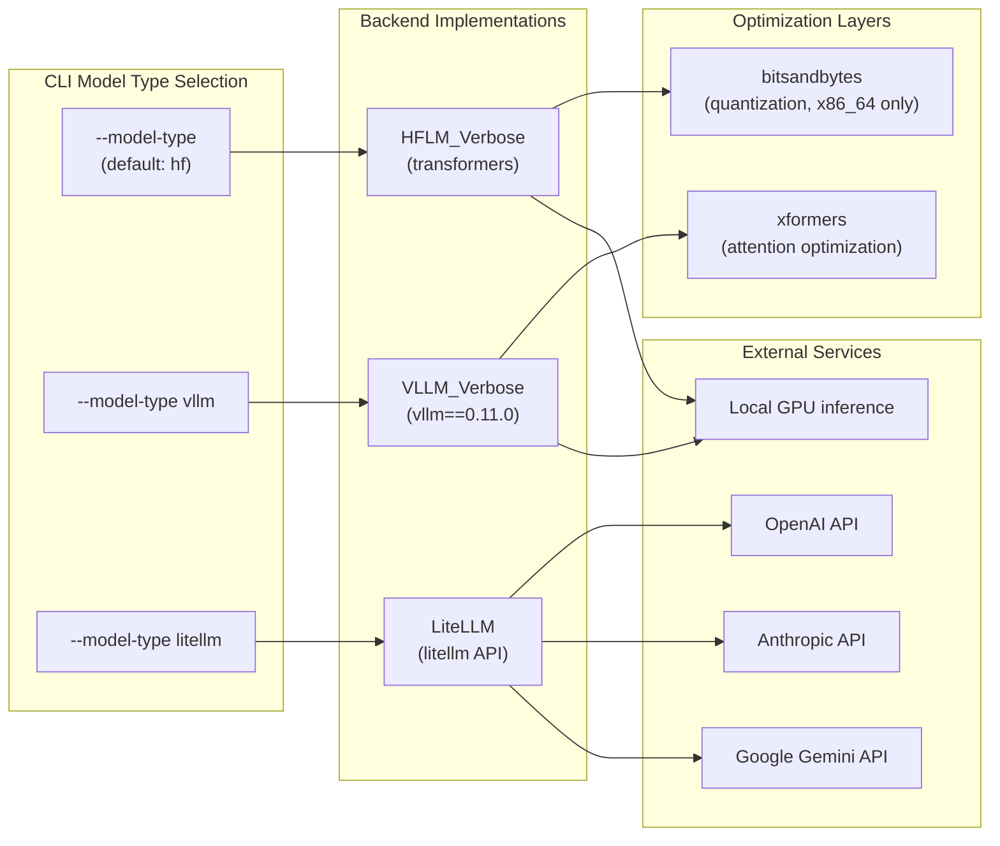
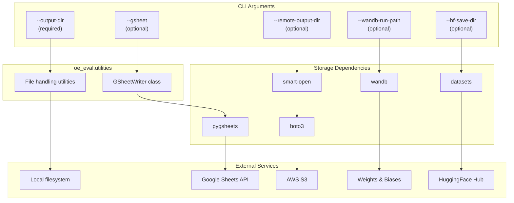

<!-- source: DeepWiki mcp.deepwiki.com · repo allenai/olmes · page 7 Dependencies and Integration · fetched 2026-10-26 -->

# Dependencies and Integration

<details>
<summary>Relevant source files</summary>

The following files were used as context for generating this wiki page:

- [.gitignore](.gitignore)
- [README.md](README.md)
- [pyproject.toml](pyproject.toml)

</details>


OLMES integrates with a comprehensive ecosystem of external libraries, frameworks, and services to provide language model evaluation capabilities. This document details the dependency structure, version requirements, integration points in the codebase, and platform-specific considerations.

For model configuration details, see [Model Configuration](#3). For installation instructions, see [Installation and Setup](#1.2).

## Dependency Architecture

OLMES dependencies are organized into six functional categories: evaluation framework, ML stack, inference engines, API integration, storage systems, and task-specific libraries. The dependency graph shows version pinning strategies and integration points.

**Dependency Categories and Integration Points**



Sources: [pyproject.toml:20-56](), [README.md:18-24]()

## Core Evaluation Framework

OLMES extends the Eleuther AI `lm-evaluation-harness` with custom enhancements while maintaining compatibility with its evaluation infrastructure.

### lm-evaluation-harness

Version: `==0.4.3` (pinned)

The base evaluation framework providing task execution, metric calculation, and model interface abstractions. OLMES extends this with deep configuration support, instance-level predictions, and custom metrics.

Integration points:
- Task implementations inherit from `lm_eval.base.Task` and `lm_eval.base.MultipleChoiceTask`
- Metric system in `oe_eval/metrics/` extends `lm_eval` metric classes
- Model backends wrap `lm_eval` model implementations

### ai2-olmo-core

Version: `>=2.2` (with torchao extra)

Provides native OLMo model evaluation capabilities and optimization support. Includes torchao integration for efficient model quantization and execution.

### alpaca_eval

Version: Git dependency at commit `cd543a149df89434d8a54582c0151c0b945c3d20`

Used for instruction-following evaluation with LLM judges. Required for tasks in the OLMo 3 adapt suite.

**Evaluation Framework Integration**



Sources: [pyproject.toml:26-27](), [pyproject.toml:40](), [README.md:18-24]()

## ML Stack

The core machine learning dependencies provide model loading, training utilities, and dataset management.

### PyTorch

Version: `>=2.8.0,<2.9` (pinned for vLLM compatibility)

The primary deep learning framework. Version range is strictly controlled to maintain vLLM compatibility.

### Transformers

Version: `>=4.57.0,<5`

Hugging Face Transformers library for loading and running models. Provides the default model backend via `HFLM_Verbose` class implementations in `lm_eval`.

### Datasets

Version: `>=3,<4`

Hugging Face Datasets for loading evaluation datasets. Version 4 is excluded due to `trust_remote_code=True` incompatibility.

Workaround: Uses `fsspec==2023.5.0` (pinned) to avoid dataset loading issues.

### ai2-olmo

Version: Git dependency from `main` branch

Native OLMo model implementations. Requires PyTorch >=2.4 for compatibility.

**ML Stack Dependencies and Constraints**



Sources: [pyproject.toml:23-29](), [pyproject.toml:34]()

## Inference Engines

OLMES supports multiple inference backends for different performance and deployment scenarios.

### vLLM (Optional)

Version: `==0.11.0` (GPU group dependency)

High-throughput inference engine with optimized memory management and batching. Requires CUDA-compatible GPU.

Installation:
```bash
pip install -e ".[gpu]"
# or with uv
uv sync --group gpu
```

### xformers (Optional)

GPU group dependency providing optimized attention implementations for transformer models. Reduces memory usage and improves inference speed.

### bitsandbytes (Conditional)

Platform constraint: `platform_machine == 'x86_64'`

Provides model quantization for memory-efficient inference. Not available on ARM architectures (e.g., Apple Silicon).

### litellm

Unified API gateway for accessing commercial LLM providers (OpenAI, Anthropic, Google Gemini, etc.). Used with `--model-type litellm` flag.

Supported providers:
- OpenAI (GPT models)
- Anthropic (Claude models)
- Google Gemini
- Azure OpenAI
- Other providers via standardized interface

**Inference Backend Selection**



Sources: [pyproject.toml:33](), [pyproject.toml:68-71](), [pyproject.toml:97-100](), [README.md:229-230]()

## Storage and Tracking

OLMES supports multiple result storage backends through dedicated integration libraries.

### pygsheets

Google Sheets API integration for collaborative result storage. The `GSheetWriter` class in `oe_eval/utilities/` implements locking mechanisms to prevent concurrent write conflicts.

CLI flags:
- `--gsheet`: Enable Google Sheets export
- Requires `GDRIVE_SERVICE_ACCOUNT_JSON` environment variable with authentication credentials

### boto3

AWS SDK for uploading results to S3 buckets. Supports remote storage of evaluation outputs.

CLI flags:
- `--remote-output-dir s3://bucket/path`: Specify S3 destination

### wandb

Weights & Biases integration for experiment tracking and metric visualization.

CLI flags:
- `--wandb-run-path`: Specify W&B project and run path

### smart-open

Provides unified interface for reading/writing to remote locations (S3, GCS, Azure, etc.). Enables transparent remote file operations.

### HuggingFace Datasets

Results can be uploaded as HuggingFace datasets for sharing and reproducibility.

CLI flags:
- `--hf-save-dir`: Specify dataset repository path

**Storage Integration and CLI Flags**



Sources: [pyproject.toml:32](), [pyproject.toml:35](), [pyproject.toml:38-39](), [README.md:293-299]()

## Task-Specific Dependencies

Specialized libraries required for specific evaluation tasks and benchmarks.

### IFEval Dependencies

Instruction-following evaluation tasks require multiple NLP processing libraries:

- `langdetect`: Language identification for multi-lingual prompts
- `immutabledict`: Immutable data structures for prompt templates
- `spacy>3.8,<4`: NLP processing pipeline
  - Platform note: Version bumped to support M-series Mac compilation
  - Requires spacy model: `en-core-web-sm`
- `emoji`: Emoji detection and handling in prompts
- `syllapy`: Syllable counting for linguistic constraints

### Code Evaluation Dependencies

Code generation and evaluation tasks (HumanEval, MBPP) require:

- `tree-sitter==0.25.0`: Language-agnostic parser for code analysis
- `tree-sitter-python`: Python grammar for tree-sitter

### AlpacaEval Dependencies

Instruction-following evaluation with LLM judges:

- `alpaca_eval` (git dependency): LLM-as-judge evaluation framework
- `litellm`: API access for judge models (GPT-4, Claude, etc.)
- `tenacity`: Retry logic for API calls
- `gradio-client`: Client for Gradio-based judge interfaces

### HELMET Dependencies

Holistic evaluation tasks:

- `pytrec_eval`: Information retrieval metrics (precision, recall, nDCG)
- Located in `oe_eval/dependencies/HELMET/` (MIT License)

### Math Evaluation

Mathematical reasoning tasks:

- `omegaconf==2.4.0.dev3`: Configuration management
  - Pinned for `parse_latex` compatibility in Minerva Math
- `antlr4-python3-runtime==4.11`: Parser for mathematical expressions
  - Required by `parse_latex` workaround
- `statsmodels`: Statistical analysis for math metrics

### Additional Utilities

- `cloudpickle`: Serialization for distributed evaluation
- `pymysql`: Database connectivity for result storage
- `nltk==3.8.1`: Natural language processing utilities

**Task Dependencies by Evaluation Type**

| Task Type | Dependencies | Purpose |
|-----------|-------------|---------|
| IFEval | `langdetect`, `spacy`, `emoji`, `syllapy`, `immutabledict` | Instruction constraint verification |
| Code Generation | `tree-sitter==0.25.0`, `tree-sitter-python` | Code parsing and execution |
| AlpacaEval | `alpaca_eval`, `litellm`, `gradio-client` | LLM judge evaluation |
| HELMET | `pytrec_eval` | Information retrieval metrics |
| Math | `omegaconf==2.4.0.dev3`, `antlr4-python3-runtime==4.11`, `statsmodels` | Mathematical expression parsing |

Sources: [pyproject.toml:21-22](), [pyproject.toml:36-37](), [pyproject.toml:40-51](), [pyproject.toml:43-44](), [pyproject.toml:49]()

## Dependency Configuration

The table below summarizes the key external dependencies and their configuration requirements:

| Dependency | Purpose | Configuration Requirements |
|------------|---------|---------------------------|
| Hugging Face Transformers | Load and run HF models | API token for access to gated models |
| vLLM | Efficient LLM serving | CUDA-compatible GPU for optimal performance |
| LiteLLM | Unified API for multiple providers | API keys for each provider (OpenAI, Anthropic, etc.) |
| Google Sheets API | Store results in spreadsheets | Google API credentials and permissions |
| Hugging Face Datasets | Share evaluation results | Hugging Face API token with write permissions |
| Weights & Biases | Experiment tracking | W&B API key and project configuration |
| Evaluation Datasets | Model assessment | Downloaded locally or accessible path configuration |

## Licensing Considerations

Most external dependencies used by OLMES have their own licensing terms that should be considered when using the system:

1. **HELMET** is available under the MIT License as shown in oe_eval/dependencies/HELMET/LICENSE
2. **Commercial API providers** (OpenAI, Anthropic) have usage terms and pricing that apply when using their services
3. **Evaluation datasets** may have specific usage restrictions or citations requirements

When extending OLMES or using it for production purposes, ensure compliance with all applicable license terms of the dependencies being used.

## Setting Up Dependencies

For detailed instructions on installing and configuring these dependencies, see [Installation and Setup](#1.2).

Sources: High-Level System Architecture Diagram, Output and Storage System Diagram