# Page: Overview

# Overview

<details>
<summary>Relevant source files</summary>

The following files were used as context for generating this wiki page:

- [.gitignore](.gitignore)
- [README.md](README.md)
- [pyproject.toml](pyproject.toml)

</details>


OLMES (Open Language Model Evaluation System) is a comprehensive framework for evaluating large language models across diverse benchmark tasks. Developed by the Allen Institute for AI as part of their Open Language Model efforts, OLMES has been used to produce evaluation results for multiple research releases including OLMo, OLMo 2, OLMo 3, TÜLU 3, and the OLMES standard itself.

## Purpose and Relationship to lm-evaluation-harness

OLMES extends the [lm-evaluation-harness](https://github.com/EleutherAI/lm-evaluation-harness) framework (version 0.4.3) from Eleuther AI with several AI2-specific enhancements:

| Enhancement | Description |
|-------------|-------------|
| **Deep configurations** | Support for task variants with different prompt styles, metrics, and evaluation parameters |
| **Instance predictions** | Detailed logging of per-instance predictions including logprobs and intermediate outputs |
| **Custom metrics** | Extended metric system including `PassAtK`, `MajAtK`, and specialized aggregations |
| **Storage integrations** | Export results to Google Sheets, S3, Weights & Biases, and Hugging Face datasets |

The codebase maintains `lm_eval==0.4.3` as a pinned dependency while extending core task classes and evaluation workflows.

Sources: [README.md:1-26](), [pyproject.toml:27]()

## Supported Model Types

OLMES supports three model backend types through distinct implementations:

| Model Type | Implementation | Use Case | Example |
|------------|---------------|----------|---------|
| **HuggingFace** | `HFLM_Verbose` class | Standard transformers models with detailed logging | `allenai/OLMo-2-1B` |
| **vLLM** | `VLLM_Verbose` class | High-throughput GPU inference with optimizations | Any HF model with `--model-type vllm` |
| **LiteLLM** | `LiteLLM` class | API-based models (OpenAI, Anthropic, Gemini) | `gpt-4`, `claude-3-opus` |

Models are configured via the `MODEL_CONFIGS` registry in [oe_eval/configs/models.py]() (~100 pre-configured models) or specified directly by HuggingFace path.

Sources: [README.md:224-238](), [pyproject.toml:68-70]()

## Supported Task Types

OLMES implements approximately 40 task classes spanning multiple evaluation categories:

| Task Category | Example Tasks | Base Class | Evaluation Method |
|---------------|---------------|------------|-------------------|
| **Multiple-Choice QA** | ARC, BoolQ, COPA, HellaSwag, PIQA | `MultipleChoiceTask` | Loglikelihood scoring |
| **Knowledge** | MMLU (57 subjects), TruthfulQA | `MultipleChoiceTask` | MC1/MC2 accuracy |
| **Math Reasoning** | GSM8K with CoT/self-consistency | `Task` | Generated answer extraction |
| **Code Generation** | HumanEval, MBPP | `Task` | Pass@k with execution |
| **Reasoning** | Big-Bench Hard (27 tasks) | `MultipleChoiceTask` | Chain-of-thought variants |

Tasks are organized into research-specific suites via `TASK_SUITE_CONFIGS` in [oe_eval/configs/task_suites.py]() (e.g., `olmo3:base`, `tulu_3_dev`).

Sources: [README.md:89-215]()

## System Architecture Overview

OLMES implements a six-layer architecture with clear separation of concerns:

### Component Layers and Code Mapping

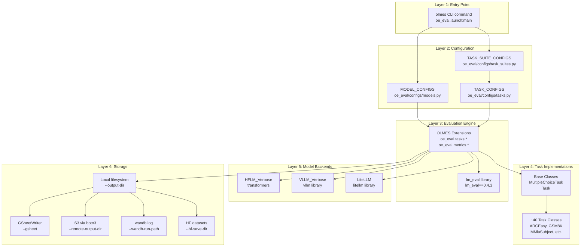

Sources: [pyproject.toml:60](), [README.md:1-26]()

### Data Flow and Request Processing

The evaluation process follows a structured pipeline from configuration to storage:

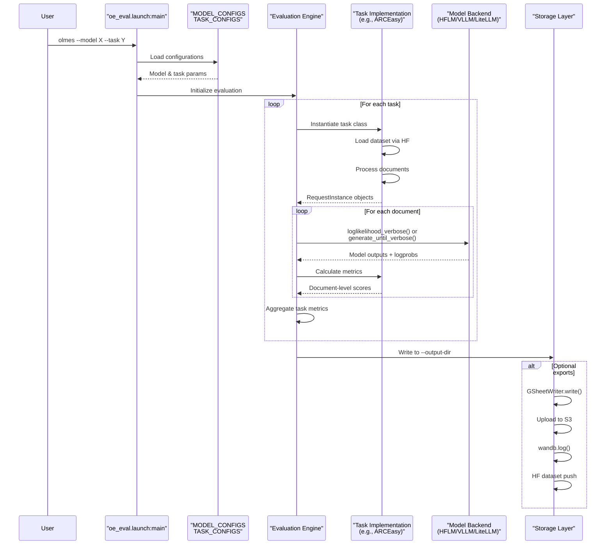

Sources: [README.md:46-86](), [README.md:293-300]()

## Configuration Hierarchy

OLMES uses a three-tier configuration system that enables flexible task composition:

### Configuration Structure

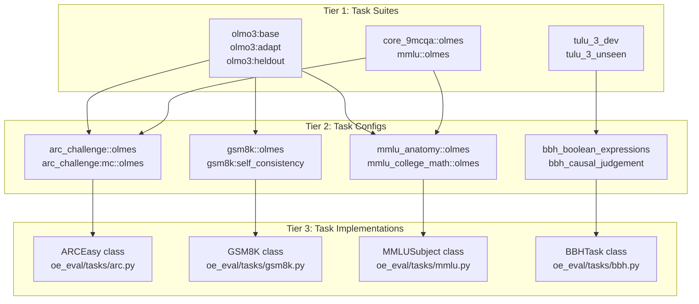

**Key Configuration Files:**
- [oe_eval/configs/task_suites.py](): Defines suite-level aggregations with primary metrics
- [oe_eval/configs/tasks.py](): Contains ~200 task configuration entries specifying splits, shots, and metrics
- [oe_eval/tasks/*.py](): Implements concrete task classes inheriting from `Task` or `MultipleChoiceTask`

Sources: [README.md:91-289]()

## Model Backend Implementations

OLMES provides three model backend types with verbose logging capabilities:

### Model Backend Architecture

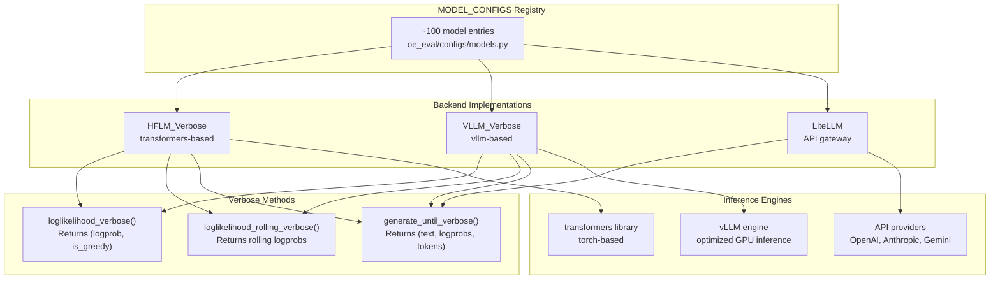

**Backend Selection:**
- Default: `HFLM_Verbose` (standard transformers)
- Flag `--model-type vllm`: `VLLM_Verbose` (GPU-optimized)
- Flag `--model-type litellm`: `LiteLLM` (API models)

The `_verbose` suffix indicates these implementations extend base lm_eval classes with additional logging of logprobs, token IDs, and intermediate outputs for detailed analysis.

Sources: [README.md:224-238](), [pyproject.toml:25-29, 68-70]()

## Task Implementation Pattern

All task implementations follow a consistent inheritance pattern:

### Task Class Hierarchy

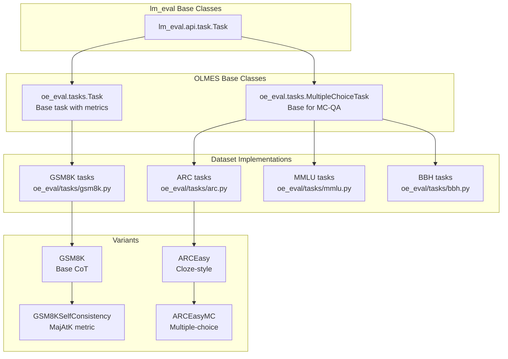

**Common Implementation Methods:**
- `has_training_docs()`, `has_validation_docs()`, `has_test_docs()`: Dataset split availability
- `training_docs()`, `validation_docs()`, `test_docs()`: Dataset loading
- `_process_doc(doc)`: Convert dataset document to evaluation format
- `doc_to_text(doc)`: Generate prompt text
- `doc_to_target(doc)`: Extract correct answer
- `construct_requests(doc, ctx, **kwargs)`: Create `RequestInstance` objects

Sources: [README.md:244-289]()

## Results Storage and Export

OLMES implements a hub-and-spoke storage pattern with local-first writes and optional remote exports:

### Storage System Architecture

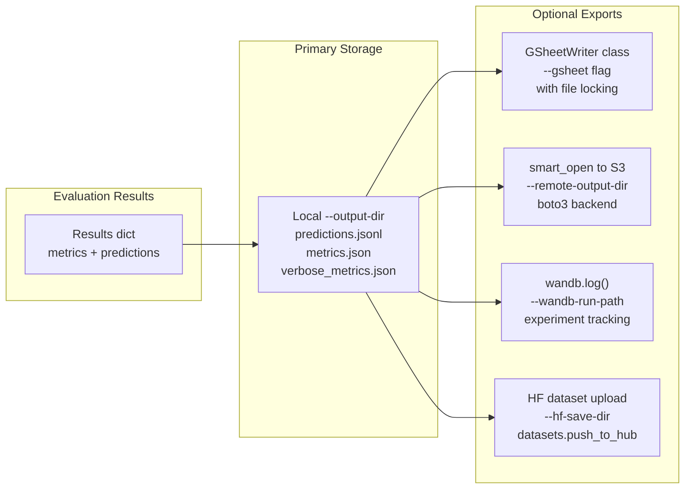

**Export Configuration:**
| Export Type | CLI Flag | Authentication | Format |
|-------------|----------|----------------|--------|
| Google Sheets | `--gsheet <sheet-id>` | `GDRIVE_SERVICE_ACCOUNT_JSON` env var | GSheetWriter with locking |
| S3 | `--remote-output-dir s3://...` | boto3 credentials | Direct file copy |
| Wandb | `--wandb-run-path <project/run>` | `WANDB_API_KEY` | Structured metrics logging |
| HF Datasets | `--hf-save-dir <path>` | HF token | Dataset format |

Sources: [README.md:293-300]()

## Basic Usage

To start using OLMES:

1. **Installation**:
   ```
   git clone https://github.com/allenai/olmes.git
   cd olmes
   conda create -n olmes python=3.10
   conda activate olmes
   pip install -e .
   ```

2. **Basic Evaluation**:
   ```
   olmes --model olmo-1b --task arc_challenge::olmes --output-dir my-eval-dir1
   ```

3. **Running Task Suites**:
   ```
   olmes --model olmo-7b --task core_9mcqa::olmes --output-dir <dir>
   ```

4. **Inspecting Tasks Before Running**:
   ```
   olmes --task arc_challenge:mc::olmes --inspect
   ```

Sources: [README.md:23-67]()

For more detailed information on specific components and advanced usage, please refer to the other documentation pages linked at the top of this document.

---

# Page: System Architecture

# System Architecture

<details>
<summary>Relevant source files</summary>

The following files were used as context for generating this wiki page:

- [README.md](README.md)
- [oe_eval/configs/task_suites.py](oe_eval/configs/task_suites.py)
- [oe_eval/utilities/gsheet_writing.py](oe_eval/utilities/gsheet_writing.py)

</details>


## Purpose and Scope

This document describes the high-level architecture of the OLMES evaluation framework, including its layered structure, core components, and how they interact during evaluation execution. It covers the configuration layer, evaluation engine, task implementations, model backends, and results storage systems.

For information about specific command-line options, see [Command Line Interface](#2). For details on configuring individual models, see [Model Configuration](#3). For task-specific implementation details, see [Task System](#4).

## System Overview

OLMES is built as a six-layer architecture that separates concerns between user interaction, configuration management, evaluation orchestration, task execution, model inference, and results persistence.

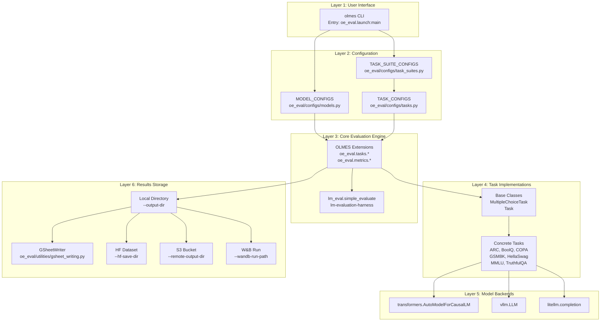

**Sources:** [README.md:1-300](), [oe_eval/configs/task_suites.py:1-50]()

## Configuration Layer

The configuration layer implements a three-tier hierarchy: models, task suites, and individual tasks. This design enables composition and reuse across different evaluation scenarios.

### Configuration Registries

| Registry | File Location | Purpose | Size |
|----------|---------------|---------|------|
| `MODEL_CONFIGS` | `oe_eval/configs/models.py` | Model specifications and parameters | ~100 models |
| `TASK_SUITE_CONFIGS` | `oe_eval/configs/task_suites.py` | Aggregated task groups | ~150 suites |
| `TASK_CONFIGS` | `oe_eval/configs/tasks.py` | Individual task configurations | ~500 tasks |

### Task Suite Composition Pattern

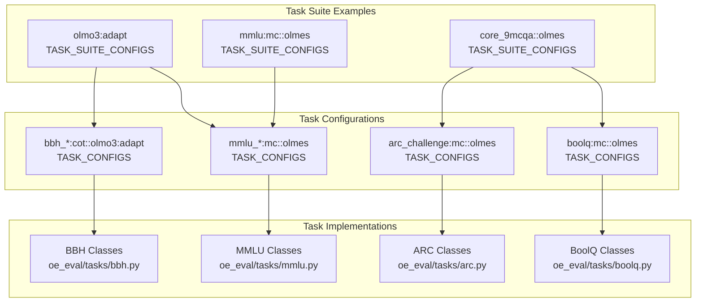

Task suite configurations specify:
- `tasks`: List of task configuration IDs or other task suite IDs
- `primary_metric`: Aggregation method (`"macro"`, `"micro"`, or `"mc_or_rc"`)

Task configurations specify:
- `task_name`: Implementation class identifier
- `split`: Dataset split to evaluate (`"test"`, `"validation"`, `"train"`)
- `primary_metric`: Metric field to report as primary score
- `num_shots`: Number of few-shot examples
- `fewshot_source`: Source for few-shot examples
- `context_kwargs`: Prompt configuration parameters
- `generation_kwargs`: Generation configuration parameters
- `metric_kwargs`: Metric computation parameters

**Sources:** [oe_eval/configs/task_suites.py:29-112](), [README.md:244-289]()

## Evaluation Engine

The evaluation engine extends the `lm-evaluation-harness` library with OLMES-specific enhancements. It coordinates the evaluation flow from configuration resolution through result aggregation.

### Engine Components

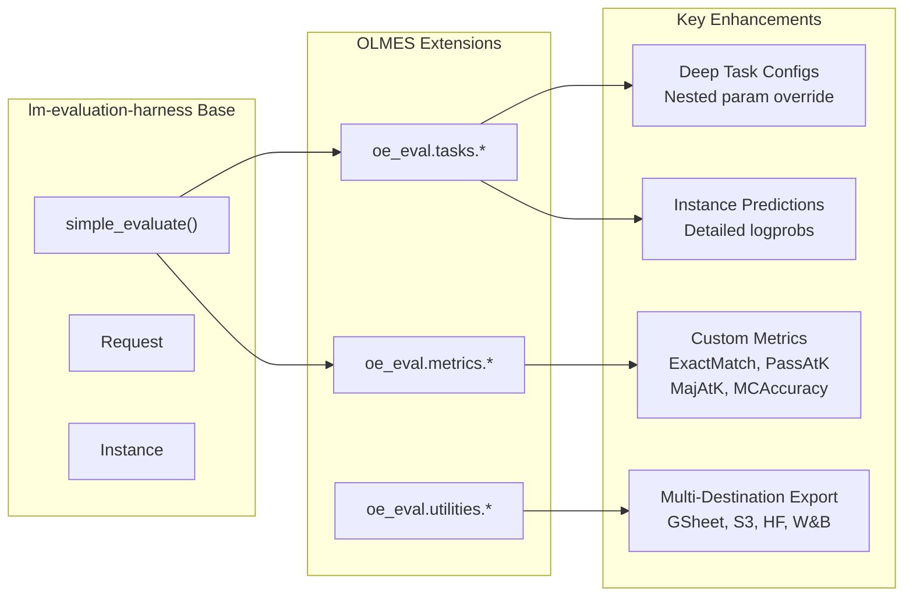

### Enhancement Details

**Deep Configurations**: OLMES supports variant-specific configurations through naming conventions. Task IDs follow the pattern `base_name:variant1:variant2::regime`, allowing multiple configuration layers to override base task parameters.

**Instance Predictions**: The framework records detailed per-instance information including:
- Model logprobabilities for each token
- Full generated text before answer extraction
- Normalized and extracted answers
- Individual instance metrics

**Custom Metrics**: OLMES implements specialized metric classes in `oe_eval/metrics/`:
- `ExactMatch`: String matching with normalization
- `PassAtK`: Code execution success rate
- `MajAtK`: Majority voting across multiple samples
- `MCAccuracy`: Multiple-choice accuracy variants

**Sources:** [README.md:18-25](), [README.md:291-300]()

## Task System

Tasks are implemented using an inheritance hierarchy with two primary base classes: `Task` for generative evaluations and `MultipleChoiceTask` for multiple-choice questions.

### Task Class Hierarchy

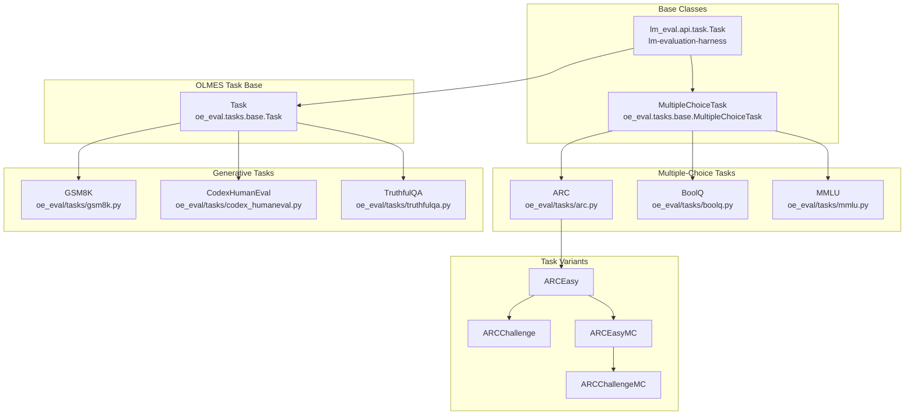

### Task Implementation Pattern

Each task implementation provides:

| Component | Purpose | Example |
|-----------|---------|---------|
| `dataset` | HuggingFace dataset identifier | `"allenai/ai2_arc"` |
| `has_*_docs()` | Check if split exists | `has_test_docs()` |
| `*_docs()` | Iterator over dataset split | `test_docs()` |
| `_process_doc()` | Convert dataset item to prompt | Field extraction, formatting |
| `doc_to_text()` | Generate question text | Prompt template application |
| `doc_to_target()` | Extract ground truth | Answer extraction |
| `construct_requests()` | Create evaluation requests | `RequestInstance` objects |

**Sources:** [README.md:244-289]()

## Model Backends

OLMES supports three model backend types, each optimized for different use cases:

### Backend Selection

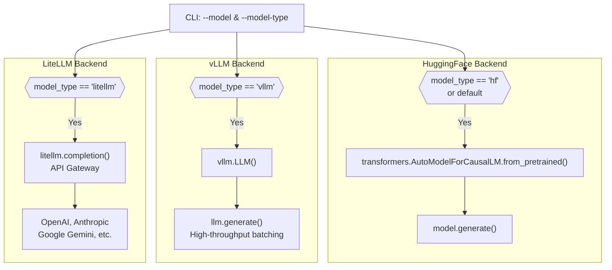

### Backend Characteristics

| Backend | File/Module | Use Case | Requirements |
|---------|-------------|----------|--------------|
| HuggingFace | `transformers` | Default, maximum compatibility | PyTorch, model weights |
| vLLM | `vllm` | High-throughput GPU inference | GPU, `pip install .[gpu]` |
| LiteLLM | `litellm` | Remote API models | API keys in environment |

**Model Arguments**: All backends accept model-specific arguments via `--model-args`. Common parameters include:
- `max_length`: Maximum context size
- `trust_remote_code`: Enable custom model code
- `add_bos_token`: Add beginning-of-sequence token
- `dtype`: Model precision (`"bfloat16"`, `"float16"`)

**Sources:** [README.md:222-238]()

## Results Storage

OLMES implements a hub-and-spoke storage pattern with a required local directory and optional external destinations.

### Storage Architecture

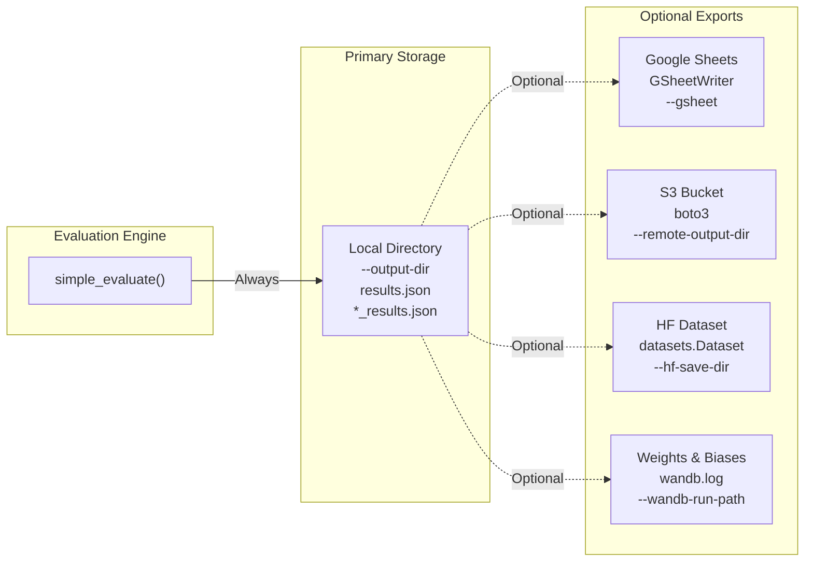

### Google Sheets Writer with Locking

The `GSheetWriter` class implements a distributed locking mechanism to prevent concurrent writes from multiple evaluation runs:

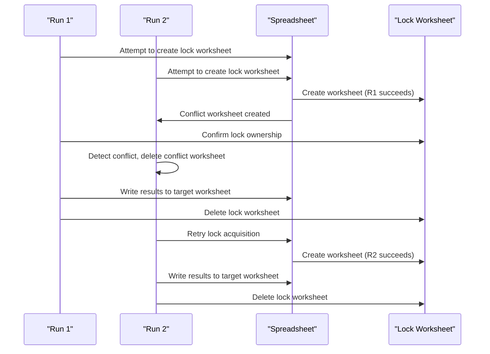

**Lock Implementation Details:**
- Lock worksheet name: `"lock"` ([oe_eval/utilities/gsheet_writing.py:23]())
- Lock timeout: 20 minutes ([oe_eval/utilities/gsheet_writing.py:60-64]())
- Lock acquisition attempts: 30 with exponential backoff ([oe_eval/utilities/gsheet_writing.py:305]())
- Conflict resolution: Automatic detection via worksheet ID comparison ([oe_eval/utilities/gsheet_writing.py:129-248]())

**Sources:** [oe_eval/utilities/gsheet_writing.py:1-570](), [README.md:293-299]()

## Evaluation Execution Flow

The evaluation process follows a nested iteration pattern with clear separation between configuration, orchestration, and execution phases.

### Execution Sequence

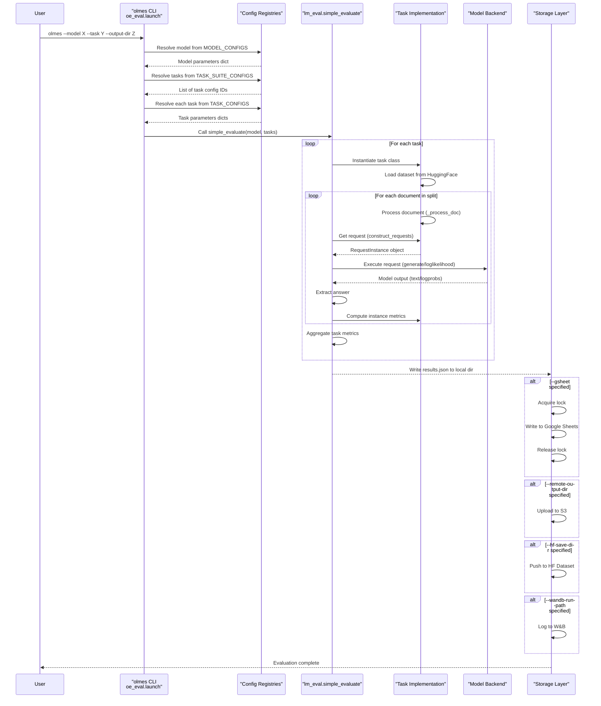

### Key Execution States

| Phase | Entry Point | Responsibilities |
|-------|-------------|------------------|
| **Configuration Resolution** | `oe_eval.launch:main` | Parse CLI args, resolve configs from registries |
| **Evaluation Setup** | `lm_eval.simple_evaluate` | Initialize model backend, instantiate task classes |
| **Document Processing** | Task `*_docs()` methods | Load datasets, iterate over splits |
| **Request Construction** | Task `construct_requests()` | Format prompts, create request objects |
| **Model Inference** | Backend-specific methods | Execute generations or score loglikelihoods |
| **Metric Computation** | Task `process_results()` | Aggregate instance metrics to task metrics |
| **Result Persistence** | Storage layer methods | Write JSON, export to external systems |

**Sources:** [README.md:44-86]()

## Component Integration Points

### Configuration to Engine

The engine receives resolved configurations as dictionaries. Model configs specify backend type and initialization parameters. Task configs override base task class defaults.

**Example Model Config:**
```python
{
    "model": "allenai/OLMo-2-1124-7B",
    "model_path": "/local/path/to/model",
    "max_length": 2048,
    "dtype": "bfloat16"
}
```

**Example Task Config:**
```python
{
    "task_name": "arc_challenge:mc",
    "split": "test",
    "num_shots": 5,
    "fewshot_source": "OLMES:ARC-Challenge",
    "primary_metric": "acc_raw"
}
```

### Engine to Tasks

The engine instantiates task classes dynamically by task name and calls standardized methods:
- `has_{split}_docs()` - Check split availability
- `{split}_docs()` - Iterate documents  
- `doc_to_text()` - Format question
- `doc_to_target()` - Extract answer
- `construct_requests()` - Build request objects
- `process_results()` - Compute metrics

### Tasks to Model Backends

Tasks create `RequestInstance` objects specifying:
- `request_type`: `"loglikelihood"`, `"loglikelihood_rolling"`, or `"generate_until"`
- `arguments`: Prompt text, continuation text, or generation parameters
- `idx`: Document index for result tracking

The engine dispatches requests to the appropriate model backend method based on `request_type`.

### Engine to Storage

After evaluation completes, the engine returns a results dictionary containing:
- Per-task metrics aggregated across instances
- Model configuration used
- Task configurations used
- Timestamp and processing time
- Instance-level predictions (if enabled)

The storage layer serializes this to JSON in the local directory, then optionally exports to external systems using service-specific APIs.

**Sources:** [README.md:44-300](), [oe_eval/configs/task_suites.py:29-56]()

---

# Page: Installation and Setup

# Installation and Setup

<details>
<summary>Relevant source files</summary>

The following files were used as context for generating this wiki page:

- [.gitignore](.gitignore)
- [README.md](README.md)
- [pyproject.toml](pyproject.toml)

</details>


This page covers the installation and setup process for OLMES, including system prerequisites, dependency management, and optional GPU acceleration. For information about configuring models and tasks after installation, see [Model Configuration](#3) and [Task System](#4). For details about the command-line interface, see [Command Line Interface](#2).

## Prerequisites

### Python Version Requirements

OLMES requires **Python 3.10 or higher, but below 3.13**. This constraint is specified in [pyproject.toml:19]().

```
requires-python = ">=3.10,<3.13"
```

### System Requirements

**Platform Compatibility:**
- Linux (x86_64) - Full support including quantization via `bitsandbytes`
- macOS (including M-series) - Full support with platform-specific spacy builds
- Windows - Core functionality supported, but not primary development platform

**Hardware Considerations:**
- CPU-only: Minimum 16GB RAM recommended for loading most models
- GPU: NVIDIA GPU with CUDA 12.8 support for vLLM acceleration (optional)
- Storage: Several GB for model caching and evaluation datasets

**Sources:** [pyproject.toml:33](), [pyproject.toml:49](), [pyproject.toml:103-117]()

## Installation Methods

### Installation Flow Overview

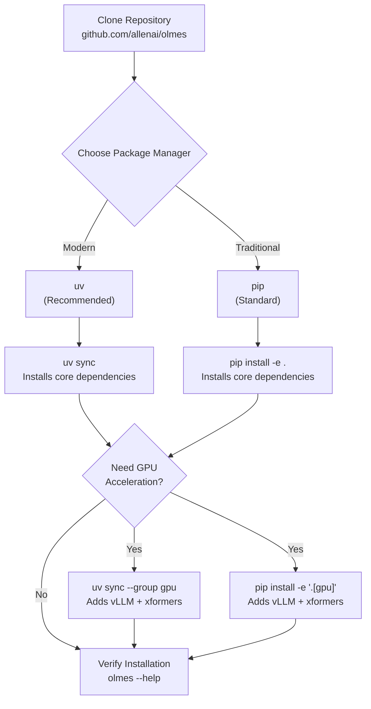

**Sources:** [README.md:29-42]()

### Using uv (Recommended)

The recommended installation method uses `uv`, a fast Python package installer:

```bash
git clone https://github.com/allenai/olmes.git
cd olmes

# Core installation
uv sync

# With GPU support (vLLM)
uv sync --group gpu
```

The `uv` tool automatically handles dependency resolution and creates a virtual environment. GPU support is configured as a dependency group in [pyproject.toml:97-100]().

**Sources:** [README.md:31-37](), [pyproject.toml:73-100]()

### Using pip

Traditional installation using pip:

```bash
git clone https://github.com/allenai/olmes.git
cd olmes

# Core installation
pip install -e .

# With GPU support (vLLM)
pip install -e ".[gpu]"
```

The `-e` flag installs in editable mode, allowing you to modify the source code. The GPU extras are defined in [pyproject.toml:66-71]().

**Sources:** [README.md:39-42](), [pyproject.toml:66-71]()

## Dependency Architecture

### Core Dependency Groups

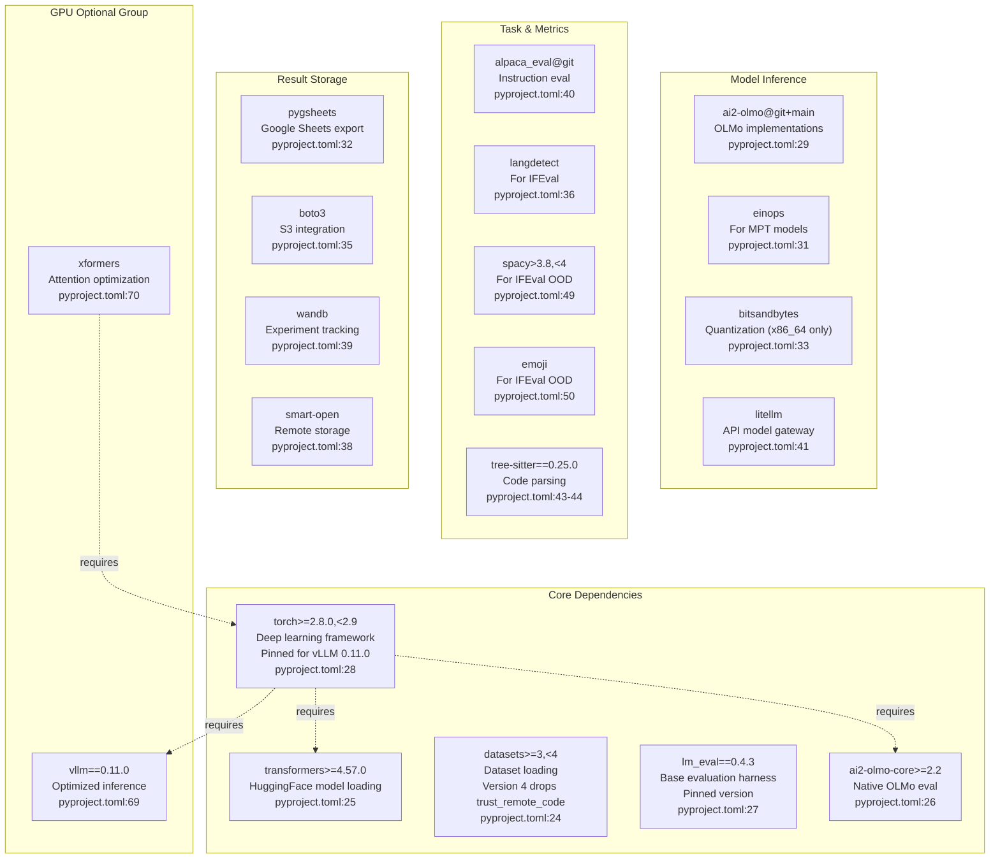

**Sources:** [pyproject.toml:20-56](), [pyproject.toml:66-71](), [pyproject.toml:97-100]()

### Critical Version Pins

Several dependencies are pinned to specific versions due to compatibility constraints:

| Package | Version | Reason | Source |
|---------|---------|--------|--------|
| `omegaconf` | `==2.4.0.dev3` | Workaround for `parse_latex` in minerva_math | [pyproject.toml:21]() |
| `antlr4-python3-runtime` | `==4.11` | Required by omegaconf workaround | [pyproject.toml:22]() |
| `numpy` | `<2` | Avoid warnings about compiled modules | [pyproject.toml:23]() |
| `datasets` | `>=3,<4` | Version 4 removes `trust_remote_code=True` | [pyproject.toml:24]() |
| `lm_eval` | `==0.4.3` | Pinned to review changes before updates | [pyproject.toml:27]() |
| `torch` | `>=2.8.0,<2.9` | Required for vLLM 0.11.0 compatibility | [pyproject.toml:28]() |
| `fsspec` | `==2023.5.0` | Hack to avoid dataset loading issues (e.g., boolq) | [pyproject.toml:34]() |
| `vllm` | `==0.11.0` | Optimized inference engine | [pyproject.toml:69]() |
| `tree-sitter` | `==0.25.0` | Code parsing for code eval tasks | [pyproject.toml:43]() |

**Sources:** [pyproject.toml:21-56](), [pyproject.toml:66-71]()

### Git Dependencies

Three packages are installed directly from git repositories to access latest features:

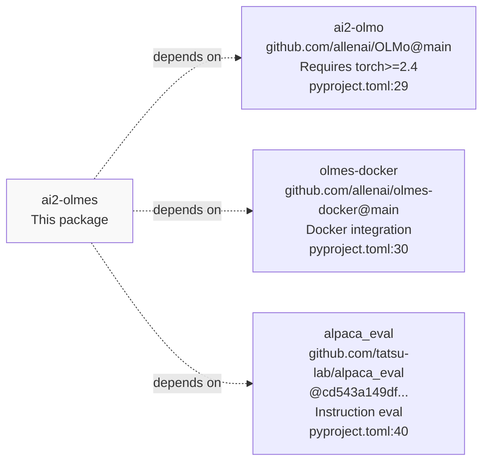

**Sources:** [pyproject.toml:29-30](), [pyproject.toml:40]()

## GPU Support

### Enabling vLLM Acceleration

For high-throughput inference on NVIDIA GPUs, install the GPU dependency group:

```bash
# With uv
uv sync --group gpu

# With pip
pip install -e ".[gpu]"
```

This installs:
- **vLLM 0.11.0** - Optimized inference engine with paged attention
- **xformers** - Memory-efficient attention implementations

**CUDA Requirements:**
- CUDA 12.8 (specified via PyTorch index in [pyproject.toml:103-117]())
- NVIDIA GPU with Compute Capability 7.0+ (V100 or newer)

**Sources:** [README.md:37-38](), [README.md:41-42](), [pyproject.toml:68-71](), [pyproject.toml:97-100](), [pyproject.toml:103-112]()

### PyTorch Index Configuration

OLMES uses platform-specific PyTorch indexes for optimal GPU support:

```toml
[tool.uv.sources]
torch = [
  { index = "pytorch-cu128", marker = "sys_platform == 'linux'" },
]

[[tool.uv.index]]
name = "pytorch-cu128"
url = "https://download.pytorch.org/whl/cu128"
explicit = true
```

This ensures Linux systems receive CUDA 12.8-compatible PyTorch builds. On other platforms, PyTorch is installed from PyPI.

**Sources:** [pyproject.toml:102-117]()

### Platform-Specific Dependencies

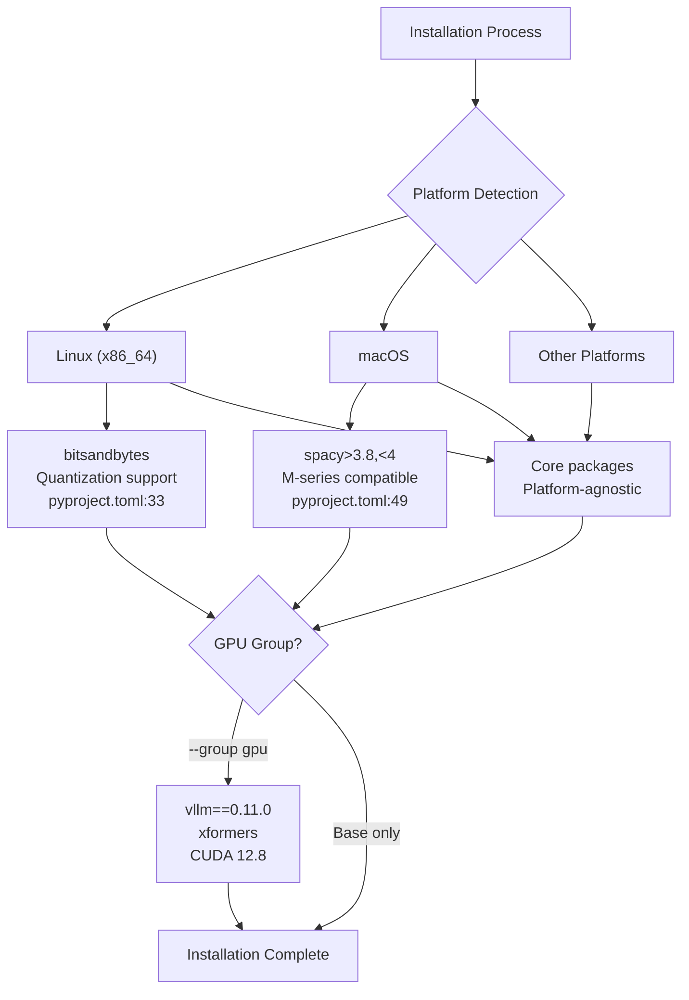

**Key Platform Differences:**
- **Linux x86_64**: Includes `bitsandbytes` for 8-bit quantization ([pyproject.toml:33]())
- **macOS (M-series)**: Uses spacy >3.8 for M-series compatibility ([pyproject.toml:49]())
- **All platforms**: Core dependencies work universally

**Sources:** [pyproject.toml:33](), [pyproject.toml:49]()

## Environment Variables

### Required for Optional Features

Certain features require environment variables to be set before use:

| Feature | Variable | Purpose | Referenced In |
|---------|----------|---------|---------------|
| Google Sheets Export | `GDRIVE_SERVICE_ACCOUNT_JSON` | Service account credentials | [README.md:296]() |
| OpenAI Models/Judges | `OPENAI_API_KEY` | API authentication | [README.md:134]() |
| HuggingFace Models | `HF_TOKEN` | Access gated models | [README.md:148]() |

**Example Setup:**
```bash
# For API-based models and LLM judges
export OPENAI_API_KEY="sk-..."

# For gated HuggingFace models
export HF_TOKEN="hf_..."

# For Google Sheets export
export GDRIVE_SERVICE_ACCOUNT_JSON='{"type": "service_account", ...}'
```

**Sources:** [README.md:134](), [README.md:147-148](), [README.md:295-296]()

### Storage Configuration

Optional environment variables for result storage integrations are passed via command-line flags rather than environment variables:
- `--gsheet` for Google Sheets export
- `--remote-output-dir s3://...` for S3 storage (uses AWS credentials)
- `--wandb-run-path` for Weights & Biases tracking
- `--hf-save-dir` for HuggingFace datasets

For details on result storage options, see [Output and Result Storage](#5).

**Sources:** [README.md:293-300]()

## CLI Entry Point Registration

The `olmes` command is registered as a console script in [pyproject.toml:59-60]():

```toml
[project.scripts]
olmes = "oe_eval.launch:main"
```

This creates the `olmes` executable that calls the `main()` function in [oe_eval/launch.py](). After installation, verify the command is available:

```bash
olmes --help
```

**Sources:** [pyproject.toml:59-60](), [README.md:46]()

## Verification Steps

### Basic Installation Check

```bash
# Verify CLI is available
olmes --help

# List available models
olmes --list-models

# List available tasks
olmes --list-tasks
```

### Test Evaluation

Run a minimal evaluation to verify the setup:

```bash
olmes \
    --model allenai/OLMo-2-0425-1B \
    --task arc_challenge::olmes \
    --output-dir test_workspace \
    --limit 5
```

This command:
- Loads a small OLMo model (1B parameters)
- Runs ARC Challenge evaluation on 5 examples
- Verifies model loading, task execution, and result storage

**Sources:** [README.md:48-53]()

### Inspect Task Configuration

Use the `--inspect` flag to verify task setup without running a full evaluation:

```bash
olmes --task arc_challenge:mc::olmes --inspect
```

This shows a sample prompt and runs a 5-instance evaluation with a small Pythia model to verify task configuration.

**Sources:** [README.md:71-75]()

## Troubleshooting Common Issues

### ImportError for lm_eval

If you encounter import errors related to `lm_eval`, ensure version 0.4.3 is installed:
```bash
pip list | grep lm-eval
```

The version is pinned in [pyproject.toml:27]() to ensure compatibility.

### CUDA Version Mismatch

If vLLM fails to load, verify CUDA 12.8 compatibility:
```bash
python -c "import torch; print(torch.version.cuda)"
```

PyTorch must be built with CUDA 12.8 for vLLM 0.11.0 compatibility.

### Dataset Loading Failures

If datasets fail to load (e.g., boolq), this may be due to `fsspec` version issues. The installation pins `fsspec==2023.5.0` as a workaround ([pyproject.toml:34]()).

### Platform-Specific Issues

**On macOS M-series:**
- Ensure spacy >3.8 is installed ([pyproject.toml:49]())
- vLLM is not supported on macOS; use `--model-type hf` instead of `--model-type vllm`

**On Windows:**
- `bitsandbytes` quantization is not available (x86_64 Linux only)
- Some GPU features may have limited support

**Sources:** [pyproject.toml:27](), [pyproject.toml:28](), [pyproject.toml:33-34](), [pyproject.toml:49]()

---

# Page: Command Line Interface

# Command Line Interface

<details>
<summary>Relevant source files</summary>

The following files were used as context for generating this wiki page:

- [README.md](README.md)

</details>


This page documents the command-line interface (CLI) for the OLMES (Open Language Model Evaluation System), which is the primary way users interact with the system to run language model evaluations. For information about configuring specific models, see [Model Configuration](#3), and for task configuration details, see [Task Configuration](#4).

## Overview

The OLMES CLI enables users to evaluate language models on various tasks by specifying:
- Which model to use
- Which task(s) to evaluate
- How to store and format the results
- Various execution parameters

The CLI is designed to be flexible, supporting everything from quick evaluations of a single task to complex batch evaluations across multiple task suites.

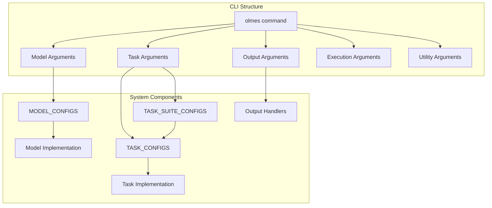

Sources: [README.md:40-67]()), [oe_eval/launch.py:60-171]()

## Basic Usage

### Running a Single Evaluation

The simplest way to run an evaluation is to specify a model and task:

```bash
olmes --model olmo-1b --task arc_challenge::olmes --output-dir my-eval-dir1
```

This runs the OLMES version of ARC Challenge with the olmo-1b model and stores results in `my-eval-dir1`.

### Running Multiple Tasks

You can evaluate multiple tasks with the same model:

```bash
olmes --model olmo-1b --task arc_challenge::olmes hellaswag::olmes --output-dir my-eval-dir1
```

### Inspecting Task Configurations

Before running a full evaluation, you can inspect a task's prompt format:

```bash
olmes --task arc_challenge:mc::olmes --inspect
```

This runs a small evaluation (5 examples) with a tiny model to show how the task is formatted.

### Previewing Commands

To see the full expanded command without running it:

```bash
olmes --model pythia-1b --task mmlu::olmes --output-dir my-eval-dir1 --dry-run
```

Sources: [README.md:39-67]()

## Execution Flow

The following diagram illustrates what happens when you execute an OLMES command:

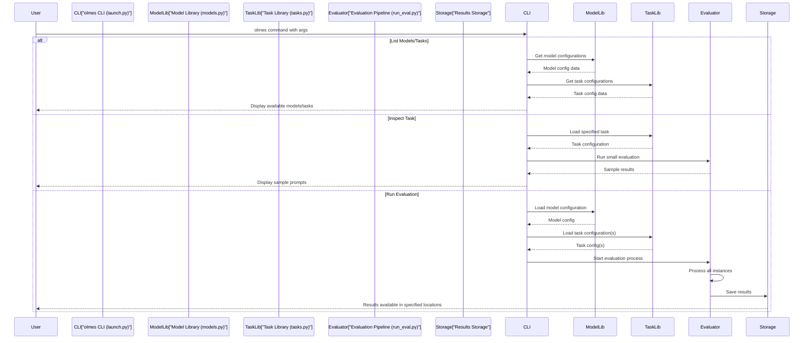

Sources: [oe_eval/launch.py:191-380]()

## Command-Line Arguments

The OLMES CLI supports numerous arguments that can be categorized as follows:

### Model Selection Arguments

| Argument | Description | Example |
|----------|-------------|---------|
| `--model` | Name of model from model library or HF path | `--model olmo-7b` or `--model allenai/OLMo-7B` |
| `--model-type` | Model implementation type | `--model-type vllm` |
| `--revision` | Revision of model in HF hub | `--revision main` |
| `--model-args` | Extra model args (as JSON) | `--model-args '{"trust_remote_code": true}'` |

### Task Selection Arguments

| Argument | Description | Example |
|----------|-------------|---------|
| `--task` | Task spec(s) from library or jsonl file | `--task mmlu::olmes arc_challenge::olmes` |
| `--limit` | Max number or fraction of instances | `--limit 100` or `--limit 0.5` |
| `--num-shots` | Override number of shots for tasks | `--num-shots 5` |
| `--split` | Override evaluation split | `--split validation` |
| `--use-chat-format` | Use chat format for prompting | `--use-chat-format true` |
| `--task-args` | Extra task args (as JSON) | `--task-args '{"max_tokens": 100}'` |
| `--random-subsample-seed` | Seed for instance sampling | `--random-subsample-seed 42` |

### Output Configuration Arguments

| Argument | Description | Example |
|----------|-------------|---------|
| `--output-dir` | Directory for output files | `--output-dir ./results` |
| `--cached-output-dir` | Directory for cached output | `--cached-output-dir ./cache` |
| `--remote-output-dir` | Remote directory (e.g., S3) | `--remote-output-dir s3://bucket/results` |
| `--gsheet` | Google Sheet for writing results | `--gsheet "My Results Sheet"` |
| `--hf-save-dir` | HF dataset path for saving results | `--hf-save-dir username/dataset//folder` |
| `--wandb-run-path` | W&B run path for logging | `--wandb-run-path ai2-llm/project/runs/id` |
| `--save-raw-requests` | Save raw requests in output | `--save-raw-requests false` |
| `--recompute-metrics` | Recompute metrics for cached predictions | `--recompute-metrics` |

### Execution Control Arguments

| Argument | Description | Example |
|----------|-------------|---------|
| `--batch-size` | Batch size for processing | `--batch-size 32` |
| `--gpus` | Number of GPUs to use | `--gpus 2` |
| `--num-workers` | Number of worker processes | `--num-workers 4` |
| `--vllm-for-mc` | Use VLLM for multiple-choice tasks | `--vllm-for-mc` |

### Utility Arguments

| Argument | Description | Example |
|----------|-------------|---------|
| `--dry-run` | Show command without executing | `--dry-run` |
| `--inspect` | Run small evaluation to show formatting | `--inspect` |
| `--list-models` | List models in library (with optional regex) | `--list-models llama` |
| `--list-tasks` | List tasks in library (with optional regex) | `--list-tasks arc` |
| `--list-task-suites` | List task suites (with optional regex) | `--list-task-suites olmes` |

Sources: [oe_eval/launch.py:60-166]()

## Running Specific Models

### Using Models from the Library

OLMES includes a library of pre-configured models that can be referenced by name:

```bash
olmes --model olmo-7b --task arc_challenge::olmes
```

To see all available models:

```bash
olmes --list-models
```

To search for specific models:

```bash
olmes --list-models llama
```

### Using Hugging Face Models Directly

Models can be referenced directly by their Hugging Face path:

```bash
olmes --model allenai/OLMo-7B --task arc_challenge::olmes
```

### Configuring Model Parameters

Additional model parameters can be specified using `--model-args`:

```bash
olmes --model google/gemma-2b --model-args '{"trust_remote_code": true, "add_bos_token": true}' --task arc_challenge::olmes
```

### Using Different Model Implementations

OLMES supports different model implementations through the `--model-type` argument:

```bash
# Using vLLM for faster inference
olmes --model olmo-7b --model-type vllm --task arc_challenge::olmes

# Using LiteLLM for API-based models
olmes --model gpt-4 --model-type litellm --task arc_challenge::olmes
```

Sources: [README.md:108-123]()

## Running Specific Tasks

### Using Tasks from the Library

OLMES includes a library of pre-configured tasks:

```bash
olmes --model olmo-7b --task arc_challenge::olmes
```

To see all available tasks:

```bash
olmes --list-tasks
```

To search for specific tasks:

```bash
olmes --list-tasks mmlu
```

### Task Naming Convention

Tasks in OLMES follow a naming convention:

```
task_name:format::variant
```

For example:
- `arc_challenge:mc::olmes` - ARC Challenge in multiple-choice format, OLMES variant
- `mmlu:rc::olmo1` - MMLU in reading comprehension format, OLMo1 variant

### Running Multiple Tasks

Multiple tasks can be specified:

```bash
olmes --model olmo-7b --task arc_challenge::olmes hellaswag::olmes piqa::olmes
```

### Using Task Suites

Task suites are pre-defined collections of related tasks:

```bash
olmes --model olmo-7b --task core_9mcqa::olmes
```

To see available task suites:

```bash
olmes --list-task-suites
```

Common task suites include:
- `core_9mcqa::olmes` - Core 9 multiple-choice tasks from OLMES
- `mmlu::olmes` - MMLU tasks with OLMES configuration
- `main_suite::olmo1` - Main evaluation suite from OLMo paper
- `tulu_3_dev` - Development tasks from TÜLU 3
- `olmo_2_generative::olmes` - Generative tasks from OLMo 2

### Configuring Task Parameters

Task parameters can be overridden:

```bash
# Change number of few-shot examples
olmes --model olmo-7b --task arc_challenge::olmes --num-shots 3

# Change evaluation split
olmes --model olmo-7b --task arc_challenge::olmes --split validation

# Limit number of instances
olmes --model olmo-7b --task arc_challenge::olmes --limit 100
```

Additional task parameters can be specified using `--task-args`:

```bash
olmes --model olmo-7b --task arc_challenge::olmes --task-args '{"max_tokens": 100}'
```

Sources: [README.md:126-171](), [oe_eval/launch.py:180-189]()

## Output Configuration

OLMES supports multiple output destinations for evaluation results:

```mermaid
graph TD
    CLI["olmes Command"] --> Eval["Evaluation Process"]
    
    Eval --> LocalOut["Local Output\n(--output-dir)"]
    Eval --> CachedOut["Cached Output\n(--cached-output-dir)"]
    Eval --> RemoteOut["Remote Storage\n(--remote-output-dir)"]
    Eval --> GSheet["Google Sheets\n(--gsheet)"]
    Eval --> HF["Hugging Face Dataset\n(--hf-save-dir)"]
    Eval --> WandB["Weights & Biases\n(--wandb-run-path)"]
    
    subgraph "Local Output Files"
        LocalOut --> Metrics["metrics.json"]
        LocalOut --> Predictions["predictions.jsonl"]
        LocalOut --> Verbose["verbose_metrics.json"]
        LocalOut --> Requests["raw_requests.jsonl"]
    end
```

### Local Output

Results are stored in the directory specified by `--output-dir`:

```bash
olmes --model olmo-7b --task arc_challenge::olmes --output-dir ./results
```

The output directory will contain files including:
- `metrics.json` - Summary metrics for the task
- `predictions.jsonl` - Model predictions for each instance
- `verbose_metrics.json` - Detailed metrics for each instance
- `raw_requests.jsonl` - Raw requests sent to the model (if `--save-raw-requests` is true)

### Remote Storage

Results can be copied to a remote storage location:

```bash
olmes --model olmo-7b --task arc_challenge::olmes --output-dir ./results --remote-output-dir s3://bucket/results
```

### Google Sheets Integration

Results can be written to a Google Sheet:

```bash
olmes --model olmo-7b --task arc_challenge::olmes --output-dir ./results --gsheet "My Results Sheet"
```

This requires setting the `GDRIVE_SERVICE_ACCOUNT_JSON` environment variable with authentication credentials.

### Hugging Face Dataset Integration

Results can be saved to a Hugging Face dataset:

```bash
olmes --model olmo-7b --task arc_challenge::olmes --output-dir ./results --hf-save-dir username/dataset//folder
```

### Weights & Biases Integration

Results can be logged to a Weights & Biases run:

```bash
olmes --model olmo-7b --task arc_challenge::olmes --output-dir ./results --wandb-run-path ai2-llm/project/runs/id
```

Sources: [README.md:172-182](), [oe_eval/launch.py:102-121]()

## Advanced Usage

### Task Inspection

To inspect a task's prompt format without running a full evaluation:

```bash
olmes --task arc_challenge:mc::olmes --inspect
```

This runs a small evaluation (5 examples) with a tiny model to show the task's format.

### Dry Running

To see the full expanded command without running it:

```bash
olmes --model olmo-7b --task arc_challenge::olmes --dry-run
```

### Batch Size and GPU Configuration

For better performance, adjust batch size and GPU count:

```bash
olmes --model olmo-7b --task arc_challenge::olmes --batch-size 32 --gpus 2
```

### Recomputing Metrics

To recompute metrics for cached predictions:

```bash
olmes --model olmo-7b --task arc_challenge::olmes --output-dir ./results --cached-output-dir ./cache --recompute-metrics
```

### Using VLLM for Multiple-Choice Tasks

For faster evaluation of multiple-choice tasks with VLLM:

```bash
olmes --model olmo-7b --task arc_challenge::olmes --model-type vllm --vllm-for-mc
```

### Running Specific Evaluation Suites

OLMES includes several pre-defined evaluation suites:

```bash
# OLMES standard - Original 10 multiple-choice tasks
olmes --model olmo-7b --task core_9mcqa::olmes --output-dir ./results
olmes --model olmo-7b --task mmlu::olmes --output-dir ./results

# OLMo evaluations
olmes --model olmo-7b --task main_suite::olmo1 --output-dir ./results
olmes --model olmo-7b --task mmlu::olmo1 --output-dir ./results

# TÜLU 3 evaluations
olmes --model olmo-7b --task tulu_3_dev --output-dir ./results
olmes --model olmo-7b --task tulu_3_unseen --output-dir ./results

# OLMo 2 evaluations
olmes --model olmo-7b --task core_9mcqa::olmes --output-dir ./results
olmes --model olmo-7b --task mmlu::olmes --output-dir ./results
olmes --model olmo-7b --task olmo_2_generative::olmes --output-dir ./results
olmes --model olmo-7b --task olmo_2_heldout::olmes --output-dir ./results
```

Sources: [README.md:70-105](), [oe_eval/launch.py:127-166]()

## Internal Implementation

The CLI is implemented in [oe_eval/launch.py](), which parses arguments, resolves model and task configurations, and launches the evaluation process:

```mermaid
graph TD
    subgraph "CLI Implementation"
        main["main()"]
        launchEval["launch_eval()"]
        resolveTask["resolve_task_suite()"]
        makeCliCommand["make_cli_command()"]
        
        main --> launchEval
        launchEval --> resolveTask
        launchEval --> makeCliCommand
    end
    
    subgraph "Configuration Sources"
        ModelConfigs["MODEL_CONFIGS dictionary"]
        TaskConfigs["TASK_CONFIGS dictionary"]
        TaskSuiteConfigs["TASK_SUITE_CONFIGS dictionary"]
    end
    
    subgraph "Runtime Execution"
        RunEval["run_eval.py"]
        SubProcess["subprocess.run()"]
    end
    
    launchEval --> ModelConfigs
    launchEval --> TaskConfigs
    resolveTask --> TaskSuiteConfigs
    makeCliCommand --> RunEval
    RunEval --> SubProcess
```

The CLI workflow:

1. Parse command-line arguments
2. If listing models/tasks/suites, display them and exit
3. Load model configuration (from library or direct path)
4. Load and resolve task configurations (expanding task suites)
5. Apply any overrides from command-line arguments
6. Construct the full command for running the evaluation
7. Either display the command (dry run) or execute it

The CLI supports both local execution and integration with Ai2's internal compute resources if available.

Sources: [oe_eval/launch.py:190-396]()

---

# Page: Model Configuration

# Model Configuration

<details>
<summary>Relevant source files</summary>

The following files were used as context for generating this wiki page:

- [README.md](README.md)
- [oe_eval/configs/models.py](oe_eval/configs/models.py)

</details>


## Purpose and Scope

This document explains how to configure and use different language models for evaluation in OLMES. It covers the structure of model configurations, how to specify models, and the different model implementation types supported by the system. For information about configuring tasks for evaluation, see [Task Configuration](#4).

## Model Configuration Overview

The model configuration in OLMES defines which models are available for evaluation and specifies their parameters. These configurations are stored in a central dictionary and can be referenced by their keys when running evaluations.

```mermaid
graph TD
    subgraph "Model Configuration System"
        MC["MODEL_CONFIGS Dictionary"]
        MC -->|defines| ModelEntry["Model Entry"]
        
        ModelEntry -->|parameters| MP["Model Parameters"]
        MP -->|includes| ModelPath["model/model_path"]
        MP -->|includes| MaxLength["max_length"]
        MP -->|includes| ChatModel["chat_model (boolean)"]
        MP -->|includes| ModelType["model_type"]
        MP -->|includes| MetaData["metadata"]
        MP -->|includes| TrustRemoteCode["trust_remote_code"]
        MP -->|includes| GantryArgs["gantry_args"]
    end
    
    subgraph "Model Implementation"
        MI["Model Implementation"]
        HFLM["HFLM_Verbose"]
        VLLM["VLLM_Verbose"]
        LiteLLM["LiteLLM"]
        
        MI -->|type| HFLM
        MI -->|type| VLLM
        MI -->|type| LiteLLM
    end
    
    ModelEntry -->|initializes| MI
    ModelType -->|determines| MI
```

Sources: [oe_eval/configs/models.py:1-416]()

## Model Configuration Structure

The `MODEL_CONFIGS` dictionary in [oe_eval/configs/models.py]() is the central repository of model configurations in OLMES. Each entry in this dictionary represents a model with its specific configuration parameters.

A typical model configuration entry includes:

| Parameter | Type | Description |
|-----------|------|-------------|
| `model` | string | Identifier for the model, typically a Hugging Face model path |
| `model_path` | string or list | Optional local or remote path to the model |
| `max_length` | integer | Maximum context length the model supports |
| `chat_model` | boolean | Whether the model is a chat/instruction model |
| `trust_remote_code` | boolean | Whether to trust remote code in the model repository |
| `gantry_args` | dict | Additional arguments for gantry deployment |
| `model_type` | string | Type of model implementation to use (e.g., "litellm") |
| `metadata` | dict | Additional metadata about the model |

Example entry from the configuration:

```
"gemma-7b": {
    "model": "google/gemma-7b",
    "trust_remote_code": True,
    "add_bos_token": True,
    "gantry_args": {"hf_token": True},
    "metadata": {},
},
```

Sources: [oe_eval/configs/models.py:61-77](), [README.md:108-123]()

## Specifying Models for Evaluation

There are two primary ways to specify a model for evaluation:

1. **By Hugging Face path**: 
   ```
   olmes --model allenai/OLMoE-1B-7B-0924 --task arc_challenge::olmes
   ```

2. **By model key in the model library**:
   ```
   olmes --model olmoe-1b-7b-0924 --task arc_challenge::olmes
   ```

When using a model key, OLMES looks up the model configuration in the `MODEL_CONFIGS` dictionary, which can include additional configuration options.

```mermaid
sequenceDiagram
    participant User
    participant CLI as "olmes CLI"
    participant ModelConfig as "MODEL_CONFIGS Dictionary"
    participant ModelImpl as "Model Implementation"
    
    User->>CLI: Run with --model <model_key>
    alt Model Key
        CLI->>ModelConfig: Look up model_key
        ModelConfig-->>CLI: Return configuration
    else HF Path
        CLI->>CLI: Create default configuration
    end
    
    CLI->>CLI: Apply overrides from --model-args
    CLI->>ModelImpl: Initialize model with configuration
    ModelImpl-->>CLI: Model ready
    CLI->>CLI: Continue evaluation
```

Sources: [README.md:108-123]()

## Model Implementation Types

OLMES supports multiple model implementation types, which can be specified using the `--model-type` flag or in the model configuration:

### 1. Hugging Face Models (Default)

The default model implementation uses the Hugging Face Transformers library to load and run models.

### 2. vLLM Models

For improved performance, especially with large models, you can use the vLLM implementation:

```
olmes --model llama3-8b --model-type vllm --task arc_challenge::olmes
```

### 3. LiteLLM (API-based Models)

For API-based models like OpenAI's GPT models or Anthropic's Claude models, OLMES uses the LiteLLM implementation:

```
olmes --model gpt-4o-2024-08-06 --task arc_challenge::olmes
```

API-based models are configured with the `model_type: "litellm"` parameter in their model configuration.

```mermaid
graph TD
    subgraph "Model Request Types"
        GUR["GenerateUntilRequest"]
        LLR["LoglikelihoodRequest"]
        LRR["LoglikelihoodRollingRequest"]
    end
    
    subgraph "Model Implementation Layer"
        MI["Model Implementation"]
        
        subgraph "Implementation Types"
            HFLM["HFLM_Verbose<br>(Hugging Face)"]
            VLLM["VLLM_Verbose<br>(vLLM)"]
            LITELLM["LiteLLM<br>(API-based)"]
        end
        
        MI -->|implements| HFLM
        MI -->|implements| VLLM
        MI -->|implements| LITELLM
    end
    
    GUR -->|handled by| MI
    LLR -->|handled by| MI
    LRR -->|handled by| MI
    
    subgraph "Actual Models"
        HFModels["HuggingFace Models<br>(OLMo, Llama, etc.)"]
        APIModels["API Models<br>(GPT, Claude, etc.)"]
    end
    
    HFLM -->|loads| HFModels
    VLLM -->|loads| HFModels
    LITELLM -->|calls| APIModels
```

Sources: [oe_eval/configs/models.py:376-415](), [README.md:114-116]()

## Model Configuration Parameters

### Chat Models

For instruction-tuned models designed for chat interactions, set the `chat_model` parameter to `True`:

```
"llama3-8b-instruct": {
    "model": "meta-llama/Meta-Llama-3-8B-Instruct",
    "chat_model": True,
    "max_length": 8192,
    "gantry_args": {"hf_token": True},
    "metadata": {},
},
```

This tells OLMES to use the appropriate prompt formatting for chat models.

### Context Length

The `max_length` parameter specifies the maximum context length supported by the model:

```
"qwen2.5-7b-instruct": {
    "model": "Qwen/Qwen2.5-7B-Instruct",
    "chat_model": True,
    "max_length": 8192,  # supports up to 32768
    "metadata": {},
},
```

This is important for models with extended context windows, as it determines how much context can be included in the evaluation.

### Model-specific Arguments

Some models require additional arguments like `trust_remote_code` or `add_bos_token`:

```
"gemma-2b": {
    "model": "google/gemma-2b",
    "trust_remote_code": True,
    "add_bos_token": True,
    "gantry_args": {"hf_token": True},
    "metadata": {},
},
```

These parameters ensure that the model loads and runs correctly.

Sources: [oe_eval/configs/models.py:64-77](), [oe_eval/configs/models.py:162-167](), [oe_eval/configs/models.py:324-328]()

## Overriding Model Configuration

You can override model configuration parameters directly from the command line using the `--model-args` flag:

```
olmes --model google/gemma-2b --model-args '{"trust_remote_code": True, "add_bos_token": True}' --task arc_challenge::olmes
```

This is useful for quick adjustments without modifying the model configuration files.

Sources: [README.md:117-121]()

## Available Models

To see a list of all available models in the system:

```
olmes --list-models
```

To search for models containing a specific substring:

```
olmes --list-models llama
```

This will show all models with "llama" in their name.

Sources: [README.md:122-123]()

## Model Implementation Details

Each model implementation type provides a set of methods to handle different request types:

| Method | Description |
|--------|-------------|
| `generate_until_verbose()` | Generates text until a stop condition is reached |
| `loglikelihood_verbose()` | Calculates log-likelihood for a given text |
| `loglikelihood_rolling_verbose()` | Calculates rolling log-likelihoods for a text |

These methods are used by the evaluation pipeline to process requests and generate predictions.

```mermaid
graph TB
    subgraph "Model Configuration Flow"
        CLI["olmes CLI"]
        MC["MODEL_CONFIGS<br>Dictionary"]
        MODEL["Model Implementation"]
        TASK["Task Implementation"]
        EVAL["Evaluation Pipeline"]
        
        CLI -->|loads| MC
        CLI -->|initializes| MODEL
        MODEL -->|processes| REQS["Request Instances"]
        REQS -->|sent to| EVAL
        TASK -->|creates| REQS
        
        subgraph "Request Processing"
            GEN["generate_until_verbose()"]
            LL["loglikelihood_verbose()"]
            LLR["loglikelihood_rolling_verbose()"]
        end
        
        MODEL -->|implements| GEN
        MODEL -->|implements| LL
        MODEL -->|implements| LLR
        
        EVAL -->|calls| GEN
        EVAL -->|calls| LL
        EVAL -->|calls| LLR
        
        EVAL -->|produces| RES["Evaluation Results"]
    end
```

Sources: [README.md:108-123]()

## API-Based Models

OLMES supports API-based models through the LiteLLM integration. These models are configured with `model_type: "litellm"` and typically include parameters like:

| Parameter | Description |
|-----------|-------------|
| `model` | Provider and model name (e.g., "openai/gpt-4o-2024-08-06") |
| `max_length` | Maximum context length supported |
| `chat_model` | Set to `True` for chat API models |

Example API model configuration:

```
"gpt-4o-2024-08-06": {
    "model": "openai/gpt-4o-2024-08-06",
    "max_length": 16384,
    "chat_model": True,
    "model_type": "litellm",
},
```

API-based models require appropriate environment variables or configuration for authentication with the respective API providers.

Sources: [oe_eval/configs/models.py:376-415]()

## Summary

Model configuration in OLMES provides a flexible way to specify and customize models for evaluation. By using the model library or direct Hugging Face paths, and optionally overriding parameters, you can evaluate a wide range of models from local files, Hugging Face repositories, or through APIs.

For information on configuring tasks to evaluate these models on, see the [Task Configuration](#4) page.

---

# Page: Task System

# Task System

<details>
<summary>Relevant source files</summary>

The following files were used as context for generating this wiki page:

- [README.md](README.md)
- [oe_eval/configs/task_suites.py](oe_eval/configs/task_suites.py)
- [oe_eval/utilities/gsheet_writing.py](oe_eval/utilities/gsheet_writing.py)

</details>


The Task System in OLMES is responsible for defining, configuring, and managing evaluation tasks. It provides a structured way to specify how language models are evaluated on various benchmarks, including parameters, prompting strategies, evaluation metrics, and dataset loading.

The task system consists of three main components:
1. **Task Configurations** - Parameter dictionaries that define how tasks are executed
2. **Task Suites** - Collections of related tasks grouped for convenient evaluation (see [Task Suites](#4.1))
3. **Task Implementations** - Python classes that implement the evaluation logic (see [Task Implementation Patterns](#4.2))

For information about configuring models, see [Model Configuration](#3).

## Task System Architecture

The following diagram illustrates how the task system components interact:

**Diagram: Task System Component Relationships**

```mermaid
graph TB
    subgraph "Task Configuration Layer"
        TASK_CONFIGS["TASK_CONFIGS<br/>Dictionary<br/>oe_eval/configs/tasks.py"]
        TASK_SUITE_CONFIGS["TASK_SUITE_CONFIGS<br/>Dictionary<br/>oe_eval/configs/task_suites.py"]
    end
    
    subgraph "Task Implementation Layer"
        IMPL_BASE["Base Classes<br/>Task, MultipleChoiceTask"]
        IMPL_CONCRETE["Concrete Tasks<br/>ARCEasy, GSM8K, etc."]
    end
    
    subgraph "Data Layer"
        HF_DATASETS["HuggingFace<br/>Datasets"]
        FEWSHOT_DATA["Few-Shot Examples<br/>oe_eval/few_shot_data/"]
    end
    
    CLI["olmes CLI"] -->|references| TASK_CONFIGS
    CLI -->|references| TASK_SUITE_CONFIGS
    
    TASK_SUITE_CONFIGS -->|aggregates| TASK_CONFIGS
    TASK_CONFIGS -->|initializes| IMPL_CONCRETE
    IMPL_CONCRETE -->|inherits from| IMPL_BASE
    
    IMPL_CONCRETE -->|loads| HF_DATASETS
    IMPL_CONCRETE -->|loads| FEWSHOT_DATA
    
    IMPL_CONCRETE -->|produces| REQUESTS["Request Instances"]
    REQUESTS -->|sent to| MODEL["Model Backend"]
```

Sources: [oe_eval/configs/tasks.py:1-50](), [oe_eval/configs/task_suites.py:1-30](), [README.md:44-86]()

## Task Naming Convention

Task identifiers in OLMES follow a hierarchical naming pattern:

```
"task_name:variant::regime"
```

Where:
- `task_name`: Base task name (e.g., `arc_challenge`, `mmlu`, `gsm8k`)
- `variant` (optional): Task variant (e.g., `mc` for multiple-choice, `rc` for reading comprehension, `cot` for chain-of-thought)
- `regime`: Evaluation regime (e.g., `olmes`, `olmo1`, `tulu`)

**Examples:**

| Task ID | Components | Description |
|---------|-----------|-------------|
| `arc_challenge:mc::olmes` | task=`arc_challenge`, variant=`mc`, regime=`olmes` | ARC Challenge in multiple-choice format |
| `gsm8k::olmo1` | task=`gsm8k`, regime=`olmo1` | GSM8K with OLMo-1 configuration |
| `bbh_boolean_expressions:cot::tulu` | task=`bbh_boolean_expressions`, variant=`cot`, regime=`tulu` | BBH Boolean Expressions with chain-of-thought |

Sources: [oe_eval/configs/tasks.py:21-100](), [README.md:48-68]()

## Task Configuration Dictionary

All available tasks are defined in the `TASK_CONFIGS` dictionary in [oe_eval/configs/tasks.py](). Each entry is a configuration dictionary that specifies task parameters.

**Diagram: Task Configuration Structure**

```mermaid
graph TB
    ENTRY["Task Config Entry<br/>in TASK_CONFIGS"] -->|contains| TASK_NAME["task_name<br/>Links to implementation"]
    ENTRY -->|contains| BASIC["Basic Parameters<br/>split, primary_metric, num_shots"]
    ENTRY -->|contains| CONTEXT_KW["context_kwargs<br/>Prompt construction"]
    ENTRY -->|contains| GEN_KW["generation_kwargs<br/>Model generation control"]
    ENTRY -->|contains| METRIC_KW["metric_kwargs<br/>Evaluation parameters"]
    ENTRY -->|contains| META["metadata<br/>regimes, description"]
    
    TASK_NAME -->|instantiates| IMPL["Task Implementation<br/>Python class"]
    CONTEXT_KW -->|configures| IMPL
    GEN_KW -->|configures| IMPL
    METRIC_KW -->|configures| IMPL
    
    IMPL -->|creates| REQUESTS["Request objects<br/>LoglikelihoodRequest<br/>GenerateUntilRequest"]
```

Sources: [oe_eval/configs/tasks.py:40-100]()

### Example Task Configuration

```python
"arc_challenge:rc::olmes": {
    "task_name": "arc_challenge",
    "split": "test",
    "primary_metric": "acc_uncond",
    "num_shots": 5,
    "fewshot_source": "OLMES:ARC-Challenge",
    "metadata": {
        "regimes": ["OLMES-v0.1"],
    },
}
```

This configuration:
- Uses the `arc_challenge` task implementation
- Evaluates on the `test` split
- Reports `acc_uncond` as the primary metric
- Uses 5 few-shot examples from the OLMES ARC-Challenge set
- Is part of the OLMES-v0.1 evaluation regime

Sources: [oe_eval/configs/tasks.py:73-82]()

## Task Configuration Parameters

Task configurations control all aspects of evaluation through several parameter groups:

| Parameter Group | Purpose | Example Parameters |
|----------------|---------|-------------------|
| **Basic Parameters** | Core task settings | `task_name`, `split`, `primary_metric`, `num_shots`, `limit` |
| **context_kwargs** | Prompt construction | `description`, `short_prefix`, `cot_style`, `prompt_variant` |
| **generation_kwargs** | Model generation | `max_gen_toks`, `temperature`, `stop_sequences`, `do_sample` |
| **metric_kwargs** | Evaluation metrics | `pass_at_ks`, `answer_format_regex`, `answer_extract_fn` |
| **metadata** | Documentation | `regimes`, `description` |

### Common Parameters

| Parameter | Description | Example Values |
|-----------|-------------|----------------|
| `task_name` | Links to task implementation class | `arc_challenge`, `gsm8k`, `mmlu_history` |
| `split` | Dataset split to evaluate | `test`, `validation`, `train` |
| `primary_metric` | Main metric to report | `acc_raw`, `exact_match`, `pass_at_1` |
| `num_shots` | Few-shot examples to include | `0`, `5`, `8` |
| `fewshot_source` | Source of few-shot examples | `OLMES:ARC-Challenge`, `STD:GSM8k` |
| `use_chat_format` | Use chat-style prompts | `true`, `false` |

Sources: [oe_eval/configs/tasks.py:40-100](), [oe_eval/configs/tasks.py:197-230]()

## Task-to-Dataset Relationship

**Diagram: Task Configuration to Dataset Loading**

```mermaid
graph LR
    CONFIG["Task Config Entry<br/>arc_challenge:rc::olmes"] -->|task_name| IMPL["Task Implementation<br/>ARCEasy class"]
    CONFIG -->|split| SPLIT["split='test'"]
    CONFIG -->|fewshot_source| FEWSHOT_SRC["OLMES:ARC-Challenge"]
    
    IMPL -->|calls| GET_DATASET["get_dataset()<br/>method"]
    GET_DATASET -->|loads| HF_DS["HuggingFace Dataset<br/>ai2_arc/ARC-Easy"]
    
    SPLIT -->|filters| HF_DS
    HF_DS -->|produces| EVAL_DOCS["Evaluation Documents"]
    
    FEWSHOT_SRC -->|loads from| FEWSHOT_FILE["few_shot_data/<br/>arc.yaml"]
    FEWSHOT_FILE -->|produces| FEWSHOT_DOCS["Few-Shot Examples"]
    
    FEWSHOT_DOCS -->|prepended to| EVAL_DOCS
    EVAL_DOCS -->|formatted into| REQUESTS["Request Instances"]
```

Each task implementation defines how to:
1. Load the underlying dataset (usually from HuggingFace)
2. Process documents from the dataset into evaluation instances
3. Format prompts using few-shot examples
4. Extract and evaluate model responses

Sources: [oe_eval/configs/tasks.py:73-82](), [README.md:44-58]()

## Evaluation Pipeline Flow

**Diagram: Task Configuration in Evaluation Pipeline**

```mermaid
sequenceDiagram
    participant CLI as "olmes CLI"
    participant TC as "TASK_CONFIGS"
    participant TI as "Task Implementation"
    participant DS as "Dataset Loader"
    participant Model as "Model Backend"
    
    CLI->>TC: Lookup "arc_challenge::olmes"
    TC-->>CLI: Return config dict
    
    CLI->>TI: Initialize with config
    TI->>DS: Load dataset (split="test")
    DS-->>TI: Return documents
    
    TI->>TI: Load few-shot examples
    TI->>TI: Format prompts
    TI-->>CLI: Return Request objects
    
    CLI->>Model: Process requests
    Model-->>CLI: Return responses
    
    CLI->>TI: Apply metrics
    TI-->>CLI: Return results
```

Sources: [README.md:44-68]()

## Task Types and Variants

OLMES supports multiple task types, each with specific evaluation approaches:

| Task Type | Variant | Description | Example Tasks |
|-----------|---------|-------------|---------------|
| **Multiple-Choice** | `:mc` | Select from labeled options | ARC, MMLU, BoolQ |
| **Reading Comprehension** | `:rc` | Cloze-style completion | ARC, HellaSwag, PIQA |
| **Chain-of-Thought** | `:cot` | Reasoning with intermediate steps | BBH, GSM8K, MMLU |
| **Code Generation** | (varies) | Generate executable code | HumanEval, MBPP |
| **Free-Form Generation** | (none) | Open-ended text generation | DROP, SQuAD, CoQA |

Different variants of the same task can use different prompting strategies and metrics. For example:
- `arc_challenge:mc::olmes` - Multiple-choice format with labeled options (A, B, C, D)
- `arc_challenge:rc::olmes` - Reading comprehension format with cloze-style prompts

See [Multiple-Choice Q&A Tasks](#4.3), [Math and Code Generation Tasks](#4.4), and [Task Implementation Patterns](#4.2) for details on specific task types.

Sources: [oe_eval/configs/tasks.py:40-100](), [oe_eval/configs/tasks.py:562-582](), [oe_eval/configs/tasks.py:219-228]()

## Task Configuration to Code Mapping

**Diagram: Configuration Parameters to Code Entities**

```mermaid
graph TD
    CONFIG["Task Config<br/>arc_challenge:rc::olmes"] -->|task_name| IMPL_CLASS["Task Class<br/>ARCEasy in<br/>oe_eval/tasks/arc.py"]
    
    CONFIG -->|split| DATASET_METHOD["get_dataset()<br/>returns HF dataset"]
    CONFIG -->|num_shots| FEWSHOT_SAMPLER["FewShotSampler<br/>in oe_eval/few_shot.py"]
    CONFIG -->|fewshot_source| FEWSHOT_YAML["few_shot_data/<br/>arc.yaml"]
    CONFIG -->|primary_metric| METRIC_CLASS["Metric class<br/>in oe_eval/metrics.py"]
    
    CONFIG -->|context_kwargs| PROCESS_DOC["_process_doc()<br/>method"]
    CONFIG -->|generation_kwargs| GEN_METHOD["generate_until()<br/>or loglikelihood()"]
    CONFIG -->|metric_kwargs| METRIC_AGG["aggregation()<br/>method"]
    
    IMPL_CLASS -->|uses| DATASET_METHOD
    IMPL_CLASS -->|uses| FEWSHOT_SAMPLER
    IMPL_CLASS -->|uses| PROCESS_DOC
    IMPL_CLASS -->|creates| REQUEST_OBJ["RequestInstance<br/>LoglikelihoodRequest<br/>GenerateUntilRequest"]
    
    REQUEST_OBJ -->|sent to| MODEL_BACKEND["Model Backend<br/>VLLM_Verbose<br/>HFLM_Verbose"]
    MODEL_BACKEND -->|returns| RESPONSE["Model Response"]
    
    RESPONSE -->|evaluated by| METRIC_CLASS
    METRIC_CLASS -->|uses| METRIC_AGG
```

Sources: [oe_eval/configs/tasks.py:73-82](), [oe_eval/tasks/arc.py:1-100]()

## Task Suites

Task suites aggregate multiple related tasks for convenient evaluation. They are defined in [oe_eval/configs/task_suites.py]() in the `TASK_SUITE_CONFIGS` dictionary.

**Diagram: Task Suite Structure**

```mermaid
graph TB
    CLI["olmes --task mmlu::olmes"]
    
    CLI -->|references| SUITE["TASK_SUITE_CONFIGS<br/>'mmlu:mc::olmes'"]
    
    SUITE -->|contains| TASKS_LIST["tasks list"]
    SUITE -->|contains| PRIMARY["primary_metric<br/>'macro'"]
    
    TASKS_LIST -->|includes| T1["mmlu_abstract_algebra:mc::olmes"]
    TASKS_LIST -->|includes| T2["mmlu_anatomy:mc::olmes"]
    TASKS_LIST -->|includes| T3["mmlu_astronomy:mc::olmes"]
    TASKS_LIST -->|includes| TN["... 54 more subjects"]
    
    T1 -->|from| TASK_CONFIGS["TASK_CONFIGS<br/>dictionary"]
    T2 -->|from| TASK_CONFIGS
    T3 -->|from| TASK_CONFIGS
    TN -->|from| TASK_CONFIGS
    
    PRIMARY -->|controls| AGG["Metric Aggregation<br/>across all tasks"]
```

Example suite definition:
```python
TASK_SUITE_CONFIGS["mmlu:mc::olmes"] = {
    "tasks": [f"mmlu_{sub}:mc::olmes" for sub in MMLU_SUBJECTS],
    "primary_metric": "macro",
}
```

Task suites enable running comprehensive evaluations with a single command:
```bash
olmes --model olmo-7b --task core_9mcqa::olmes
```

For more details, see [Task Suites](#4.1).

Sources: [oe_eval/configs/task_suites.py:29-56](), [README.md:89-128]()

## Command Line Usage

Task configurations can be specified directly on the command line:

```bash
# Run a single task
olmes --model olmo-1b --task arc_challenge::olmes --output-dir my-eval-dir1

# Run multiple tasks
olmes --model olmo-1b --task arc_challenge::olmes hellaswag::olmes --output-dir my-eval-dir1

# Override task parameters
olmes --task arc_challenge:rc::olmes --split dev --num_shots 0
```

For more complex configurations, JSON format can be used for per-task overrides:

```bash
olmes --task '{"task_name": "arc_challenge:rc::olmes", "num_shots": 2}' '{"task_name": "hellaswag:rc::olmes", "num_shots": 4}'
```

You can inspect a task's prompt before running a full evaluation:

```bash
olmes --task arc_challenge:mc::olmes --inspect
```

Sources: [README.md:39-67](), [README.md:126-158]()

## Creating Custom Task Configurations

### Extending Existing Configurations

You can create new task configurations by extending existing ones:

```python
# Example: Creating full versions of OLMES tasks without sample limits
OLMES_FULL_CONFIGS: dict = {}
for task_alias, task_config in TASK_CONFIGS.items():
    if task_alias.endswith("::olmes"):
        olmes_full_alias = task_alias.replace("::olmes", "::olmes:full")
        olmes_full_config = copy.deepcopy(task_config)
        if "limit" in olmes_full_config:
            del olmes_full_config["limit"]
        OLMES_FULL_CONFIGS[olmes_full_alias] = olmes_full_config
```

### Programmatically Generating Configurations

Tasks with common patterns can be generated programmatically:

```python
# Example: Creating configurations for all BBH tasks
for task_type in BBH_TASKS:
    TASK_CONFIGS[f"bbh_{task_type}:qa::none"] = {
        "task_name": f"bbh_{task_type}",
        "split": "test",
        "num_shots": 3,
        "context_kwargs": {
            "use_cot": False,
        },
        "metadata": {
            "regimes": [],
        },
    }
```

Sources: [oe_eval/configs/tasks.py:1149-1172](), [oe_eval/configs/tasks.py:2437-2447]()

## Evaluation Regimes

OLMES supports several evaluation regimes, each with specific task configurations:

| Regime | Description | Associated Tasks |
|--------|-------------|------------------|
| `OLMES-v0.1` | Original OLMES standard | Multiple-choice tasks (ARC, BoolQ, etc.) |
| `OLMES-v0.2` | Expanded OLMES standard | Generative tasks (DROP, GSM8K, etc.) |
| `OLMo-v1` | OLMo paper evaluation | Various tasks with OLMo-specific configs |
| `Tulu` | TÜLU paper evaluation | Various tasks with TÜLU-specific configs |

To run all tasks from a specific regime, you can use the corresponding task suite:

```bash
# Run core OLMES multiple-choice tasks
olmes --model olmo-7b --task core_9mcqa::olmes --output-dir <dir>

# Run OLMo main suite tasks
olmes --model olmo-7b --task main_suite::olmo1 --output-dir <dir>
```

Sources: [README.md:70-105](), [oe_eval/configs/tasks.py:77-81]()

---

# Page: Task Suites

# Task Suites

<details>
<summary>Relevant source files</summary>

The following files were used as context for generating this wiki page:

- [README.md](README.md)
- [oe_eval/configs/task_suites.py](oe_eval/configs/task_suites.py)
- [oe_eval/utilities/gsheet_writing.py](oe_eval/utilities/gsheet_writing.py)

</details>


## Purpose and Scope

This document explains what task suites are in the OLMES system, how they're defined, and how to use them. Task suites allow users to evaluate language models on groups of related tasks with a single command, providing a convenient way to assess model performance across entire categories of tasks such as multiple-choice QA, reasoning, or math problems.

For information about individual task configurations, see [Task Configuration](#4) and [Base Task Implementation](#4.2).

## What Are Task Suites?

Task suites are collections of related tasks grouped together for convenience and systematic evaluation. They allow you to:

1. Run multiple related tasks with a single command
2. Group tasks by category, difficulty, or purpose
3. Define how metrics should be aggregated across tasks
4. Create standardized evaluation benchmarks

### Task Suite Structure

```mermaid
graph TD
    TS["TASK_SUITE_CONFIGS Entry"] -->|contains| TL["Task List"]
    TS -->|specifies| PM["Primary Metric"]
    
    TL -->|includes| T1["Task 1"]
    TL -->|includes| T2["Task 2"]
    TL -->|includes| TN["Task N"]
    
    PM -->|determines aggregation| AGG["Aggregation Method"]
    AGG -->|options| MAC["Macro"]
    AGG -->|options| MIC["Micro"]
    AGG -->|options| MCR["MC_or_RC"]
    
    T1 -.->|may be| NT["Nested Task Suite"]
    NT -.->|contains| NT1["Nested Task 1"]
    NT -.->|contains| NT2["Nested Task 2"]
```

Sources: [oe_eval/configs/task_suites.py:1-376]()

## Task Suite Configuration

Task suites are defined in the `TASK_SUITE_CONFIGS` dictionary in [oe_eval/configs/task_suites.py]().

Each task suite entry consists of:

1. A unique identifier (key in the dictionary)
2. A configuration dictionary containing:
   - `tasks`: A list of task IDs or other task suite IDs
   - `primary_metric` (optional): How to aggregate metrics across tasks

Example of a task suite configuration:

```python
TASK_SUITE_CONFIGS["core_9mcqa::olmes"] = {
    "tasks": [
        "arc_easy::olmes",
        "arc_challenge::olmes",
        "boolq::olmes",
        "csqa::olmes",
        "hellaswag::olmes",
        "openbookqa::olmes",
        "piqa::olmes",
        "socialiqa::olmes",
        "winogrande::olmes",
    ],
    "primary_metric": "macro",
}
```

### Primary Metric Types

The `primary_metric` field determines how metrics are aggregated across tasks in a suite:

| Metric Type | Description |
|-------------|-------------|
| `"macro"`   | Equal weight to each task, regardless of dataset size |
| `"micro"`   | Weight each instance equally (larger datasets have more influence) |
| `"mc_or_rc"` | Special case for tasks with multiple formulations; takes the max score between multiple-choice and reading comprehension formats |

Sources: [oe_eval/configs/task_suites.py:15-17]()

## Using Task Suites

### Command Line Usage

Task suites are invoked via the CLI by specifying the task suite name to the `--task` argument:

```bash
olmes --model model_name --task suite_name --output-dir output_directory
```

For example, to run the core 9 multiple-choice tasks from the OLMES standard:

```bash
olmes --model olmo-7b --task core_9mcqa::olmes --output-dir my_results
```

### Task Suite Execution Flow

```mermaid
sequenceDiagram
    participant User
    participant CLI as "olmes CLI"
    participant TC as "TASK_SUITE_CONFIGS"
    participant Task1 as "Task 1 Implementation"
    participant Task2 as "Task 2 Implementation"
    participant Model as "Model Implementation"
    participant Metrics as "Metric Aggregator"
    
    User->>CLI: olmes --task suite_name
    CLI->>TC: Lookup suite_name
    TC-->>CLI: Return tasks list and primary_metric
    
    loop For each task in suite
        CLI->>Task1: Initialize task
        Task1->>Task1: Build requests
        Task1->>Model: Send requests
        Model-->>Task1: Return responses
        Task1->>Task1: Calculate task metrics
        Task1-->>CLI: Return task results
        
        CLI->>Task2: Initialize task
        Task2->>Task2: Build requests
        Task2->>Model: Send requests
        Model-->>Task2: Return responses
        Task2->>Task2: Calculate task metrics
        Task2-->>CLI: Return task results
    end
    
    CLI->>Metrics: Aggregate using primary_metric
    Metrics-->>CLI: Final aggregated metrics
    CLI->>User: Display suite results
```

Sources: [oe_eval/configs/task_suites.py:1-376](), [README.md:40-50]()

## Common Predefined Task Suites

OLMES includes many predefined task suites for common evaluation scenarios. Here are some key examples:

### OLMES Standard Suites

| Suite Name | Description | Components |
|------------|-------------|------------|
| `core_9mcqa::olmes` | The 9 core multiple-choice tasks | ARC (Easy/Challenge), BoolQ, CSQA, HellaSwag, OpenBookQA, PIQA, SocialIQA, Winogrande |
| `mmlu:mc::olmes` | MMLU tasks in multiple-choice format | 57 MMLU subject domains |

### OLMo Evaluation Suites

| Suite Name | Description | Components |
|------------|-------------|------------|
| `main_suite::olmo1` | Tasks used in the original OLMo paper | ARC, BoolQ, COPA, HellaSwag, OpenBookQA, PIQA, SciQ, Winogrande, TruthfulQA, GSM8K |
| `mmlu::olmo1` | MMLU tasks for OLMo paper | All MMLU subjects |

### OLMo 2 Evaluation Suites

| Suite Name | Description | Components |
|------------|-------------|------------|
| `olmo_2_generative::olmes` | 5 generative tasks for OLMo 2 | CoQA, SQuAD, Jeopardy, NaturalQs, DROP |
| `olmo_2_heldout::olmes` | 5 held-out tasks for OLMo 2 final evaluation | AGI Eval, BBH, GSM8K, MMLU Pro, TriviaQA |

### TÜLU 3 Evaluation Suites

| Suite Name | Description |
|------------|-------------|
| `tulu_3_dev` | Tasks evaluated during TÜLU 3 development |
| `tulu_3_unseen` | Held-out tasks used in TÜLU 3 final evaluation |

Sources: [oe_eval/configs/task_suites.py:19-343](), [README.md:72-104]()

## Creating Custom Task Suites

To create a custom task suite, add a new entry to the `TASK_SUITE_CONFIGS` dictionary:

```python
TASK_SUITE_CONFIGS["my_custom_suite"] = {
    "tasks": [
        "task1::configuration", 
        "task2::configuration",
        "task3::configuration"
    ],
    "primary_metric": "macro",
}
```

### Hierarchical Task Suites

Task suites can include other task suites, creating a hierarchical structure:

```mermaid
graph TD
    Root["Root Task Suite"] -->|contains| TS1["Task Suite 1"]
    Root -->|contains| TS2["Task Suite 2"]
    Root -->|contains| T1["Individual Task 1"]
    
    TS1 -->|contains| T2["Task 2"]
    TS1 -->|contains| T3["Task 3"]
    
    TS2 -->|contains| T4["Task 4"]
    TS2 -->|contains| T5["Task 5"]
    
    subgraph "Task Suite Definition"
        C["TASK_SUITE_CONFIGS['root_suite']"] -->|tasks| L["['suite1', 'suite2', 'task1']"]
        C -->|primary_metric| M["'macro'"]
    end
```

This pattern is used in the codebase for organizing large evaluation suites, as seen in the HELMET task suite example:

```python
# Create individual tag-based suites
for tag in ["icl", "longqa", "niah", "rag", "recall", "rerank", "summ", "cite"]:
    suite_name = f"helmet_{tag}__{size}::suite"
    all_suites.append(suite_name)
    TASK_SUITE_CONFIGS[suite_name] = {"tasks": tasks, "primary_metric": "macro"}

# Create an "all" suite that contains all the tag-based suites
TASK_SUITE_CONFIGS[f"helmet_all__{size}::suite"] = {
    "tasks": all_suites,
    "primary_metric": "macro",
}
```

Sources: [oe_eval/configs/task_suites.py:345-362]()

## Metric Aggregation

The `primary_metric` field in task suite configurations determines how metrics are aggregated:

### Aggregation Methods

```mermaid
graph TD
    subgraph "Aggregation Methods"
        AGG["primary_metric"] -->|"macro"| MA["Macro Aggregation"]
        AGG -->|"micro"| MI["Micro Aggregation"]
        AGG -->|"mc_or_rc"| MC["MC or RC Aggregation"]
        
        MA -->|"Equal weight per task"| MAR["Task1: 0.7, Task2: 0.9\nAvg: 0.8"]
        MI -->|"Weight by instances"| MIR["Task1 (10 inst): 0.7\nTask2 (90 inst): 0.9\nAvg: 0.88"]
        MC -->|"Max of formats"| MCR["MC format: 0.7\nRC format: 0.8\nResult: 0.8"]
    end
```

- **Macro Aggregation**: Each task contributes equally to the final score
  - Example: MMLU with 57 subjects gives equal weight to each subject
  - Good for representing breadth of capability across diverse task types

- **Micro Aggregation**: Each instance contributes equally
  - Example: BBH tasks with varying numbers of examples
  - Gives more influence to larger datasets

- **MC or RC Aggregation**: Takes maximum between multiple formats
  - Used when tasks have both multiple-choice and reading comprehension variants
  - Applies to OLMES format tasks that try both formulations

Sources: [oe_eval/configs/task_suites.py:13-17](), [oe_eval/configs/task_suites.py:31-35]()

## Practical Examples

Here are some common use cases of task suites from the README:

```bash
# Run OLMES standard evaluation (9 core tasks)
olmes --model olmo-7b --task core_9mcqa::olmes --output-dir <dir>

# Run MMLU evaluation
olmes --model olmo-7b --task mmlu::olmes --output-dir <dir>

# Reproduce OLMo paper results
olmes --model olmo-7b --task main_suite::olmo1 --output-dir <dir>
olmes --model olmo-7b --task mmlu::olmo1 --output-dir <dir>
```

For more advanced use cases, you can:
- Run multiple task suites in one command
- Override task suite parameters using command-line arguments
- Create custom task suites for specialized evaluations

Sources: [README.md:72-104]()

---

# Page: Task Implementation Patterns

# Base Task Implementation

<details>
<summary>Relevant source files</summary>

The following files were used as context for generating this wiki page:

- [README.md](README.md)
- [oe_eval/tasks/oe_eval_tasks/arc.py](oe_eval/tasks/oe_eval_tasks/arc.py)
- [oe_eval/tasks/oe_eval_tasks/boolq.py](oe_eval/tasks/oe_eval_tasks/boolq.py)

</details>


## Purpose and Scope

This document describes the base task implementation in OLMES, focusing on the abstract `Task` class and its derivative `MultipleChoiceTask`. These classes provide the foundation for all evaluation tasks in the system and define how tasks are configured, how they handle data, and how they generate requests for models to process.

For information about task suites (collections of tasks), see [Task Suites](#4.1).
For specific task implementations like BBH, see [Big-Bench Hard Tasks](#4.3) and [AGI Eval Tasks](#4.4).

## Task Class Overview

The `Task` abstract base class is the foundation for all evaluation tasks in OLMES. It defines the structure and functionality required to convert datasets into request instances that can be processed by language models.

```mermaid
classDiagram
    class Task {
        <<abstract>>
        +DATASET_PATH: str
        +DATASET_NAME: str
        +REQUEST_TYPE: RequestType
        +TASK_NAME: str
        +TASK_CONFIG_DEFAULTS: dict
        
        +__init__(task_name, task_config, data_dir, cache_dir, download_mode)
        +download()
        +set_model(model, model_config)
        +make_metrics()* 
        +has_training_docs()*
        +has_validation_docs()*
        +has_test_docs()*
        +training_docs()
        +validation_docs()
        +test_docs()
        +doc_to_text(doc)*
        +doc_to_target(doc)*
        +construct_requests(doc, ctx, doc_id)*
        +build_all_requests(limit)
        +fewshot_context(doc, num_fewshot, rnd)
        +fewshot_examples(k, rnd, doc)
    }
    
    class MultipleChoiceTask {
        +REQUEST_TYPE = RequestType.LOGLIKELIHOOD
        +make_metrics()
        +doc_to_target(doc)
        +construct_requests(doc, ctx, doc_id)
        +build_all_requests(limit)
    }
    
    Task <|-- MultipleChoiceTask
```

Sources: [oe_eval/tasks/base_task.py:29-576]()

### Key Attributes and Methods

The `Task` class defines several key attributes and methods that control how evaluation tasks operate:

| Attribute/Method | Purpose |
|------------------|---------|
| `DATASET_PATH` | Path to the dataset in HuggingFace datasets Hub or a custom loading script |
| `DATASET_NAME` | Name of a subset within `DATASET_PATH` |
| `REQUEST_TYPE` | Type of request this task generates (e.g., `GENERATE_UNTIL`, `LOGLIKELIHOOD`) |
| `TASK_NAME` | Name of the task |
| `TASK_CONFIG_DEFAULTS` | Default configuration parameters for the task |
| `make_metrics()` | Creates metric objects for evaluation |
| `doc_to_text(doc)` | Converts a document to input text for the model |
| `doc_to_target(doc)` | Converts a document to the expected output |
| `construct_requests(doc, ctx, doc_id)` | Creates request instances for evaluation |

Sources: [oe_eval/tasks/base_task.py:47-145](), [oe_eval/tasks/base_task.py:186-392]()

## Task Initialization and Configuration

When a task is instantiated, it processes configuration options with a cascading defaults system:

```mermaid
flowchart TD
    TASK_DEFAULTS["Global TASK_DEFAULTS"] --> TaskSpecificDefaults["Task-specific TASK_CONFIG_DEFAULTS"]
    TaskSpecificDefaults --> UserTaskConfig["User-provided task_config"]
    UserTaskConfig --> FinalConfig["Final task configuration"]
    
    ChatOverrides["Chat overrides"] --> |"if use_chat_format=True"| FinalConfig
```

The initialization process:
1. Merges global defaults from `TASK_DEFAULTS` with task-specific defaults from `TASK_CONFIG_DEFAULTS`
2. Applies any chat formatting overrides if `use_chat_format` is enabled
3. Overrides defaults with user-provided configuration
4. Sets up dataset path and split information

Sources: [oe_eval/tasks/base_task.py:61-144]()

## Data Flow and Processing

The base `Task` class defines a clear data flow from dataset documents to model requests:

```mermaid
flowchart LR
    subgraph "Natural Language Space"
        Dataset["Dataset Documents"] --> ProcessedDocs["Processed Documents"]
    end
    
    subgraph "Task Processing"
        ProcessedDocs --> |"doc_to_text()"| InputText["Input Text"]
        InputText --> |"fewshot_context()"| ContextualizedInput["Contextualized Input"]
        ProcessedDocs --> |"doc_to_target()"| ExpectedOutput["Expected Output"]
    end
    
    subgraph "Code Entity Space"
        ContextualizedInput --> |"construct_requests()"| RequestInstances["RequestInstance objects"]
        ExpectedOutput --> |"used for metrics"| RequestInstances
    end
```

Sources: [oe_eval/tasks/base_task.py:369-392](), [oe_eval/tasks/base_task.py:394-430](), [oe_eval/tasks/base_task.py:432-549]()

## Request Construction System

Tasks generate `RequestInstance` objects that encapsulate all information needed for model evaluation:

```mermaid
classDiagram
    class RequestInstance {
        +request_type: str
        +doc: dict
        +request: Union[LoglikelihoodRequest, GenerateUntilRequest, ...]
        +idx: int
        +task_name: str
        +doc_id: int
        +native_id: Optional[str]
        +label: Optional[Union[int, str]]
    }
    
    class Request {
        <<abstract>>
        +context: Union[str, list, dict]
    }
    
    class LoglikelihoodRequest {
        +context: Union[str, list, dict]
        +continuation: str
    }
    
    class GenerateUntilRequest {
        +context: Union[str, list, dict]
        +stop_sequences: List[str]
        +generation_kwargs: Optional[dict]
    }
    
    class LoglikelihoodRollingRequest {
        +context: str
    }
    
    class GenerateUntilAndLoglikelihoodRequest {
        +context: Union[str, list, dict]
        +perplexity_context: Union[str, list, dict]
        +continuation: str
        +stop_sequences: List[str]
        +generation_kwargs: Optional[dict]
    }
    
    Request <|-- LoglikelihoodRequest
    Request <|-- GenerateUntilRequest
    Request <|-- LoglikelihoodRollingRequest
    Request <|-- GenerateUntilAndLoglikelihoodRequest
    
    RequestInstance --> Request : contains
```

Sources: [oe_eval/components/instances.py:55-114](), [oe_eval/components/requests.py:7-84]()

The base `Task` class provides helper methods for creating common request types:

1. `construct_basic_generation_requests()`: Creates requests for text generation tasks
2. `construct_basic_likelihood_rolling_requests()`: Creates requests for token-by-token likelihood evaluation

Sources: [oe_eval/tasks/base_task.py:237-326]()

## Few-Shot Context Handling

A key capability of the `Task` class is its ability to handle few-shot examples for prompting:

```mermaid
flowchart TD
    Doc["Current Document"] --> FewshotContext["fewshot_context()"]
    FewshotExamples["Few-Shot Examples"] --> FewshotContext
    
    subgraph "Few-Shot Sources"
        TrainingDocs["Training Documents"]
        ValidationDocs["Validation Documents"]
        TestDocs["Test Documents"]
        PredefinedExamples["Predefined Examples from FEWSHOT_SOURCES"]
    end
    
    TrainingDocs --> |"if has_training_docs()"| FewshotExamples
    ValidationDocs --> |"if no training docs"| FewshotExamples
    TestDocs --> |"if no validation docs"| FewshotExamples
    PredefinedExamples --> |"if fewshot_source specified"| FewshotExamples
    
    FewshotContext --> StandardFormat["Standard Text Format"]
    FewshotContext --> ChatFormat["Chat Format Messages"]
```

The `fewshot_context()` method supports:
- Different numbers of few-shot examples (via `num_fewshot`)
- Descriptive text before and after examples (via `description` and `final_description`)
- System prompts for chat formatting (via `system_prompt`)
- Multi-turn conversation formatting (via `fewshot_as_multiturn`)

Sources: [oe_eval/tasks/base_task.py:432-575]()

## Multiple Choice Task Implementation

The `MultipleChoiceTask` class is a specialized implementation of `Task` for multiple-choice evaluation:

```mermaid
flowchart TD
    Doc["Multiple Choice Document"] --> |"construct_requests()"| ChoiceRequests["Loglikelihood Requests"]
    
    subgraph "Document Format"
        MCDoc["doc = {
            'choices': [choice1, choice2, ...],
            'gold': correct_index
        }"]
    end
    
    subgraph "Request Generation"
        for["For each choice in choices"]
        CreateRequest["Create LoglikelihoodRequest with:
        - context = input text with few-shot examples
        - continuation = ' ' + choice"]
    end
    
    for --> CreateRequest
    
    subgraph "Scoring Mechanism"
        ScoreChoices["Score each choice with loglikelihood"]
        SelectHighest["Select choice with highest score"]
        OptionalNormalize["Optionally normalize with unconditioned scores"]
    end
    
    ChoiceRequests --> ScoreChoices --> SelectHighest
    UncondRequests["Unconditioned Requests"] --> OptionalNormalize --> SelectHighest
```

Key features of `MultipleChoiceTask`:
- Uses `LOGLIKELIHOOD` request type to score each choice
- Implements `MCAccuracy` metric for evaluation
- Optionally calculates unconditioned scores for normalization
- Handles document-to-target conversion for multiple choice format

Sources: [oe_eval/tasks/base_task.py:578-682]()

## Creating a Custom Task

To create a custom task, you need to subclass either `Task` or one of its derivatives like `MultipleChoiceTask` and implement the required abstract methods:

| Method | Implementation Requirement |
|--------|----------------------------|
| `make_metrics()` | Create and return metrics for evaluation |
| `has_training_docs()` | Return whether the task has training docs |
| `has_validation_docs()` | Return whether the task has validation docs |
| `has_test_docs()` | Return whether the task has test docs |
| `doc_to_text(doc)` | Convert a document to input text |
| `doc_to_target(doc)` | Convert a document to expected output |
| `construct_requests(doc, ctx, doc_id)` | Create request instances for evaluation |

Additionally, you should:
1. Set appropriate class attributes like `DATASET_PATH`, `DATASET_NAME`, and `REQUEST_TYPE`
2. Override `training_docs()`, `validation_docs()`, and `test_docs()` if your task has those splits
3. Set task-specific defaults in `TASK_CONFIG_DEFAULTS` as needed

Sources: [oe_eval/tasks/base_task.py:186-204](), [oe_eval/tasks/base_task.py:369-392]()

## Request Type Selection

When implementing a task, choosing the right request type is crucial:

| Task Type | Suggested Request Type | Purpose |
|-----------|------------------------|---------|
| Multiple-choice | `LOGLIKELIHOOD` | Compare probabilities of different choices |
| Generation | `GENERATE_UNTIL` | Generate text until stop conditions |
| BPC/Perplexity | `LOGLIKELIHOOD_ROLLING` | Token-by-token likelihood evaluation |
| Combined tasks | `GENERATE_UNTIL_AND_LOGLIKELIHOOD` | Generate text and evaluate likelihood of gold standard |

The request type determines how the model will process the input and what metrics can be applied to the results.

Sources: [oe_eval/components/requests.py:7-12](), [oe_eval/tasks/base_task.py:237-296]()

---

# Page: Multiple-Choice Q&A Tasks

# Multiple-Choice Q&A Tasks

<details>
<summary>Relevant source files</summary>

The following files were used as context for generating this wiki page:

- [oe_eval/tasks/oe_eval_tasks/arc.py](oe_eval/tasks/oe_eval_tasks/arc.py)
- [oe_eval/tasks/oe_eval_tasks/boolq.py](oe_eval/tasks/oe_eval_tasks/boolq.py)
- [oe_eval/tasks/oe_eval_tasks/copa.py](oe_eval/tasks/oe_eval_tasks/copa.py)
- [oe_eval/tasks/oe_eval_tasks/csqa.py](oe_eval/tasks/oe_eval_tasks/csqa.py)
- [oe_eval/tasks/oe_eval_tasks/hellaswag.py](oe_eval/tasks/oe_eval_tasks/hellaswag.py)
- [oe_eval/tasks/oe_eval_tasks/openbookqa.py](oe_eval/tasks/oe_eval_tasks/openbookqa.py)
- [oe_eval/tasks/oe_eval_tasks/piqa.py](oe_eval/tasks/oe_eval_tasks/piqa.py)
- [oe_eval/tasks/oe_eval_tasks/sciq.py](oe_eval/tasks/oe_eval_tasks/sciq.py)
- [oe_eval/tasks/oe_eval_tasks/siqa.py](oe_eval/tasks/oe_eval_tasks/siqa.py)

</details>


## Overview

Multiple-choice question-answering tasks form a core component of OLMES evaluation, testing a model's ability to select correct answers from a set of predefined choices. These tasks evaluate capabilities including scientific reasoning, commonsense understanding, reading comprehension, and social reasoning.

All multiple-choice Q&A tasks in OLMES inherit from the `MultipleChoiceTask` base class defined in [oe_eval/tasks/base_task.py](). This base class provides common functionality for processing multiple-choice questions and computing choice-based metrics.

The following tasks are documented in this section:

| Task | Dataset | Domain | Choices |
|------|---------|--------|---------|
| ARC | AI2 Reasoning Challenge | Science reasoning | 3-5 |
| BoolQ | SuperGLUE | Binary question answering | 2 (yes/no) |
| COPA | SuperGLUE | Causal reasoning | 2 |
| CommonsenseQA | Commonsense reasoning | General knowledge | 5 |
| HellaSwag | Commonsense inference | Sentence completion | 4 |
| OpenBookQA | Science question answering | Elementary science | 4 |
| PIQA | Physical reasoning | Everyday situations | 2 |
| SciQ | Science questions | Physics/Chemistry/Biology | 4 |
| SocialIQA | Social reasoning | Social interactions | 3 |

Sources: [oe_eval/tasks/oe_eval_tasks/arc.py](), [oe_eval/tasks/oe_eval_tasks/boolq.py](), [oe_eval/tasks/oe_eval_tasks/copa.py](), [oe_eval/tasks/oe_eval_tasks/csqa.py](), [oe_eval/tasks/oe_eval_tasks/hellaswag.py](), [oe_eval/tasks/oe_eval_tasks/openbookqa.py](), [oe_eval/tasks/oe_eval_tasks/piqa.py](), [oe_eval/tasks/oe_eval_tasks/sciq.py](), [oe_eval/tasks/oe_eval_tasks/siqa.py]()

## Task Implementation Pattern

### MultipleChoiceTask Base Class

All tasks documented in this section extend `MultipleChoiceTask`, which provides:

- **Document Processing Pipeline**: Methods like `_process_doc()` transform raw dataset examples into standardized format with `query`, `choices`, and `gold` fields
- **Split Management**: Methods `has_training_docs()`, `has_validation_docs()`, `has_test_docs()` and corresponding `*_docs()` methods
- **Prompt Formatting**: Integration with prompt formatting utilities from [oe_eval/tasks/utils.py]()
- **Unconditioned Scoring**: Support for conditional probability normalization via `unconditioned_prompt()`

### Cloze vs Multiple-Choice Variants

Most tasks implement two prompt formatting strategies, resulting in separate task classes:

```mermaid
graph TD
    BaseTask[BaseTask Class<br/>e.g., ARCEasy]
    MCVariant[MC Variant Class<br/>e.g., ARCEasyMC]
    
    MultipleChoiceTask[MultipleChoiceTask<br/>base_task.py]
    
    MultipleChoiceTask -->|extends| BaseTask
    BaseTask -->|extends| MCVariant
    
    BaseTask -->|uses| ClozeFormat[Cloze Format<br/>make_cloze_prompt]
    MCVariant -->|uses| MCFormat[Multiple Choice Format<br/>make_mcq_prompt]
    
    BaseTask -->|metric| AccUncond[acc_per_char or<br/>acc_uncond]
    MCVariant -->|metric| AccRaw[acc_raw]
    
    ClozeFormat -->|example| ClozeEx["Question: When a switch is used...<br/>Answer: stop and start the flow"]
    MCFormat -->|example| MCEx["Question: When a switch is used...<br/> A. cause charge to build<br/> B. increase voltage<br/> C. change direction<br/> D. stop and start flow<br/>Answer: D"]
```

**Cloze Format** (Base Classes):
- Question followed by partial answer prefix
- Model completes the answer directly
- Uses `make_cloze_prompt()` utility
- Evaluated with `acc_per_char` or `acc_uncond` metrics
- Example: `ARCEasy`, `BoolQ`, `CommonsenseQA`, `HellaSwag`, `OpenBookQA`, `PiQA`, `SciQ`, `SocialIQA`

**Multiple-Choice Format** (MC Variants):
- Question with labeled answer choices (A, B, C, D, E)
- Model selects single letter
- Uses `make_mcq_prompt()` utility
- Evaluated with `acc_raw` metric
- Example: `ARCEasyMC`, `BoolQMC`, `CommonsenseQAMC`, `HellaSwagMC`, `OpenBookQAMC`, `PiQAMC`, `SciQMC`, `SocialIQAMC`

Sources: [oe_eval/tasks/oe_eval_tasks/arc.py:32-143](), [oe_eval/tasks/oe_eval_tasks/boolq.py:9-95](), [oe_eval/tasks/utils.py]()

## ARC (AI2 Reasoning Challenge)

ARC is a dataset of grade-school science questions requiring reasoning beyond simple fact retrieval. The dataset is split into two difficulty levels, each with both cloze and multiple-choice variants.

### Implementation Classes

```mermaid
graph TD
    ARCEasy[ARCEasy<br/>acc_per_char]
    ARCChallenge[ARCChallenge<br/>acc_uncond]
    ARCEasyMC[ARCEasyMC<br/>acc_raw]
    ARCChallengeMC[ARCChallengeMC<br/>acc_raw]
    
    ARCEasy -->|extends| ARCChallenge
    ARCEasy -->|extends| ARCEasyMC
    ARCEasyMC -->|extends| ARCChallengeMC
```

| Class | Dataset Split | Prompt Format | Primary Metric | Questions |
|-------|---------------|---------------|----------------|-----------|
| `ARCEasy` | `ARC-Easy` | Cloze | `acc_per_char` | 5,197 easy questions |
| `ARCChallenge` | `ARC-Challenge` | Cloze | `acc_uncond` | 2,590 hard questions |
| `ARCEasyMC` | `ARC-Easy` | Multiple-choice | `acc_raw` | 5,197 easy questions |
| `ARCChallengeMC` | `ARC-Challenge` | Multiple-choice | `acc_raw` | 2,590 hard questions |

### Dataset Structure

- **Source**: `allenai/ai2_arc` on HuggingFace
- **Splits**: train, validation, test
- **Fields**: `id`, `question`, `choices` (text and labels), `answerKey`

### Document Processing

The `_process_doc()` method in [oe_eval/tasks/oe_eval_tasks/arc.py:70-84]() performs:
1. Converts numeric answer keys (`"1"`, `"2"`, etc.) to letters (`"A"`, `"B"`, etc.)
2. For cloze variants: Uses `make_cloze_prompt()` to format question
3. For MC variants: Uses `make_mcq_prompt()` to include labeled choices

**Cloze Format Example**:
```
Question: When a switch is used in an electrical circuit, the switch can
Answer: stop and start the flow of current.
```

**Multiple-Choice Format Example**:
```
Question: When a switch is used in an electrical circuit, the switch can
 A. cause the charge to build.
 B. increase and decrease the voltage.
 C. cause the current to change direction.
 D. stop and start the flow of current.
Answer: D
```

Sources: [oe_eval/tasks/oe_eval_tasks/arc.py:1-143]()

## BoolQ

BoolQ is a yes/no question answering dataset from SuperGLUE where questions are posed about passages and require binary responses.

### Implementation Classes

| Class | Prompt Format | Primary Metric | Native ID Field |
|-------|---------------|----------------|-----------------|
| `BoolQ` | Cloze (yes/no) | `acc_raw` | `idx` |
| `BoolQMC` | Multiple-choice (A/B) | `acc_raw` | `idx` |

### Dataset Structure

- **Source**: `aps/super_glue` dataset, `boolq` subset
- **Splits**: train, validation (no test split)
- **Fields**: `passage`, `question`, `label`, `idx`

### Document Processing

The `_process_doc()` method in [oe_eval/tasks/oe_eval_tasks/boolq.py:43-58]() creates:
- Passage context followed by question
- Choices are `["yes", "no"]`
- Gold label inverted: `1 - doc["label"]` (due to dataset encoding)

**Cloze Format Example**:
```
Persian language -- Persian (/ˈpɜːrʒən, -ʃən/), also known ...
Question: do iran and afghanistan speak the same language?
Answer: yes
```

**Multiple-Choice Format Example**:
```
Persian language -- Persian (/ˈpɜːrʒən, -ʃən/), also known by its endonym ...
Question: do iran and afghanistan speak the same language?
 A. yes
 B. no
Answer: A
```

### Unconditioned Normalization

`BoolQ` supports optional unconditioned normalization via `metric_kwargs["uncond_docid_offset"]` parameter. When set, the task returns `"Answer:"` as the unconditioned prompt for probability normalization.

Sources: [oe_eval/tasks/oe_eval_tasks/boolq.py:1-95]()

## COPA (Choice of Plausible Alternatives)

COPA evaluates causal reasoning by requiring models to select the most plausible cause or effect for a given premise.

### Implementation Class

| Class | Prompt Format | Primary Metric | Choices |
|-------|---------------|----------------|---------|
| `Copa` | Cloze with connector | `acc_raw` | 2 |

### Dataset Structure

- **Source**: `aps/super_glue` dataset, `copa` subset
- **Splits**: train, validation (no test split)
- **Fields**: `premise`, `choice1`, `choice2`, `question` (cause/effect), `label`, `idx`

### Document Processing

The `_process_doc()` method in [oe_eval/tasks/oe_eval_tasks/copa.py:43-59]() performs unique processing:
1. Maps question type to connector: `"cause"` → `"because"`, `"effect"` → `"therefore"`
2. Removes period from premise and adds connector
3. Uncapitalizes first letter of each choice using `uncapitalize()` method

**Example**:
```
The man broke his toe because he got a hole in his sock.
Answer: he dropped a hammer on his foot.

(Choices: ["he got a hole in his sock", "he dropped a hammer on his foot"])
```

This task does not have an MC variant; it uses the cloze format exclusively with connectors that make the task clear.

Sources: [oe_eval/tasks/oe_eval_tasks/copa.py:1-63]()

## CommonsenseQA

CommonsenseQA tests commonsense knowledge through five-choice questions requiring reasoning about everyday concepts.

### Implementation Classes

| Class | Prompt Format | Primary Metric | Choices |
|-------|---------------|----------------|---------|
| `CommonsenseQA` | Cloze | `acc_uncond` | 5 (A-E) |
| `CommonsenseQAMC` | Multiple-choice | `acc_raw` | 5 (A-E) |

### Dataset Structure

- **Source**: `tau/commonsense_qa` on HuggingFace
- **Splits**: train, validation (no test split)
- **Fields**: `id`, `question`, `choices` (text list), `answerKey`

### Document Processing

Standard multiple-choice processing in [oe_eval/tasks/oe_eval_tasks/csqa.py:62-74]():
- Extracts question and choices
- Maps answerKey letter to gold index

**Cloze Format Example**:
```
Question: Sammy wanted to go to where the people were.  Where might he go?
Answer: populated areas
```

**Multiple-Choice Format Example**:
```
Question: Sammy wanted to go to where the people were.  Where might he go?
 A. race track
 B. populated areas
 C. the desert
 D. apartment
 E. roadblock
Answer: B
```

Sources: [oe_eval/tasks/oe_eval_tasks/csqa.py:1-109]()

## HellaSwag

HellaSwag is a commonsense inference dataset that tests whether models can select the correct completion for a given scenario. The dataset uses adversarial filtering to create challenging wrong answers.

### Implementation Classes

| Class | Prompt Format | Primary Metric | Choices |
|-------|---------------|----------------|---------|
| `HellaSwag` | Cloze | `acc_per_char` | 4 |
| `HellaSwagMC` | Multiple-choice | `acc_raw` | 4 |

### Dataset Structure

- **Source**: `allenai/hellaswag` on HuggingFace
- **Splits**: train, validation (no test split)
- **Fields**: `ind`, `activity_label`, `ctx_a`, `ctx_b`, `endings`, `label`

### Document Processing

The `_process_doc()` method in [oe_eval/tasks/oe_eval_tasks/hellaswag.py:61-69]() includes:
1. Combines `ctx_a` and capitalized `ctx_b` as context
2. Prepends `activity_label` to context
3. Applies `preprocess()` method to clean WikiHow artifacts

The `preprocess()` classmethod in [oe_eval/tasks/oe_eval_tasks/hellaswag.py:72-80]() removes:
- `[title]` markers (replaces with period)
- Other bracket artifacts `[.*?]`
- Normalizes whitespace

**Cloze Format Example**:
```
Health: How to cope with suicidal thoughts. Put off any plans. Promise yourself that you'll wait 48 hours before doing anything. Remember, thoughts don't have the power to force you to act.
Answer: Sometimes extreme pain can distort our perception.
```

**Multiple-Choice Format Example**:
```
Health: How to choose dental floss. Choose a thick floss when you have large gaps. If you have large spaces between your teeth, pick an extra thick floss. Some options include dental tape or super dental floss.
Choose the best continuation:
 A. If you have small gaps between your teeth, a thicker floss might work fine...
 B. Choosing a thicker floss will help ensure that you are actually flossing all surfaces...
 C. However, since dental floss is so wide and heavy, you'll need to pick a thinner one...
 D. You can pick between super and super thick floss with two or four slits...
Answer: B
```

Sources: [oe_eval/tasks/oe_eval_tasks/hellaswag.py:1-121]()

## OpenBookQA

OpenBookQA tests application of core science facts to novel situations, requiring both the "book" knowledge and additional commonsense reasoning.

### Implementation Classes

| Class | Prompt Format | Primary Metric | Choices |
|-------|---------------|----------------|---------|
| `OpenBookQA` | Cloze (configurable) | `acc_uncond` | 4 (A-D) |
| `OpenBookQAMC` | Multiple-choice | `acc_raw` | 4 (A-D) |

### Dataset Structure

- **Source**: `allenai/openbookqa` dataset, `main` subset
- **Splits**: train, validation, test
- **Fields**: `id`, `question_stem`, `choices` (text list), `answerKey`

### Document Processing

The `_process_doc()` method in [oe_eval/tasks/oe_eval_tasks/openbookqa.py:67-80]() supports:
- Optional `context_kwargs["no_prefix"]` to match original Eleuther AI format
- When `False` (default): Uses `make_cloze_prompt()` with "Question:" prefix
- When `True`: Uses bare question stem

**Cloze Format Example**:
```
Question: When food is reduced in the stomach
Answer: nutrients are being deconstructed
```

**Multiple-Choice Format Example**:
```
Question: When food is reduced in the stomach
 A. the mind needs time to digest
 B. take a second to digest what I said
 C. nutrients are being deconstructed
 D. reader's digest is a body of works
Answer: C
```

Sources: [oe_eval/tasks/oe_eval_tasks/openbookqa.py:1-116]()

## PIQA (Physical Interaction QA)

PIQA evaluates physical commonsense reasoning about everyday situations by asking models to select the most sensible solution to achieve a goal.

### Implementation Classes

| Class | Prompt Format | Primary Metric | Choices |
|-------|---------------|----------------|---------|
| `PiQA` | Cloze with "Goal:" prefix | `acc_per_char` | 2 |
| `PiQAMC` | Multiple-choice | `acc_raw` | 2 |

### Dataset Structure

- **Source**: `ybisk/piqa` on HuggingFace
- **Splits**: train, validation (no test split)
- **Fields**: `goal`, `sol1`, `sol2`, `label`
- **Note**: Uses `with_indices=True` to generate index field

### Document Processing

The `_process_doc()` method in [oe_eval/tasks/oe_eval_tasks/piqa.py:61-71]() formats goals with `"Goal: "` prefix using `make_cloze_prompt()`.

**Cloze Format Example**:
```
Goal: To create a makeshift ice pack,
Answer: take a sponge and soak it in water. Put the sponge in a refrigerator and let it freeze. Once frozen, take it out and put it in a ziploc bag. You can now use it as an ice pack.
```

**Multiple-Choice Format Example**:
```
Goal: To create a makeshift ice pack,
 A. take a sponge and soak it in oil. Put the sponge in a refrigerator and let it freeze...
 B. take a sponge and soak it in water. Put the sponge in a refrigerator and let it freeze...
Answer: B
```

Sources: [oe_eval/tasks/oe_eval_tasks/piqa.py:1-107]()

## SciQ

SciQ is a crowdsourced science question dataset covering Physics, Chemistry, and Biology with supporting evidence passages.

### Implementation Classes

| Class | Prompt Format | Primary Metric | Choices |
|-------|---------------|----------------|---------|
| `SciQ` | Cloze | `acc_raw` | 4 |
| `SciQMC` | Multiple-choice (shuffled) | `acc_raw` | 4 |

### Dataset Structure

- **Source**: `allenai/sciq` on HuggingFace
- **Splits**: train, validation, test
- **Fields**: `question`, `distractor1`, `distractor2`, `distractor3`, `correct_answer`, `support`
- **Note**: Uses `with_indices=True` to generate index field

### Document Processing

The base `_process_doc()` method in [oe_eval/tasks/oe_eval_tasks/sciq.py:63-78]() places correct answer at position 3 (index 3).

The MC variant in [oe_eval/tasks/oe_eval_tasks/sciq.py:93-120]() implements **deterministic shuffling**:
- Uses `random.Random(index)` with example index as seed
- Shuffles choices consistently for each example
- Tracks gold answer position after shuffle
- Labels choices as A, B, C, D

This ensures answer distribution is not biased (all answers would be "D" without shuffling).

**Cloze Format Example**:
```
Question: What type of organism is commonly used in preparation of foods such as cheese and yogurt?
Answer: mesophilic organisms
```

**Multiple-Choice Format Example**:
```
Question: What type of organism is commonly used in preparation of foods such as cheese and yogurt?
 A. protozoa
 B. gymnosperms
 C. mesophilic organisms
 D. viruses
Answer: C
```

Sources: [oe_eval/tasks/oe_eval_tasks/sciq.py:1-125]()

## SocialIQA

SocialIQA tests commonsense reasoning about social interactions and human behavior.

### Implementation Classes

| Class | Prompt Format | Primary Metric | Choices |
|-------|---------------|----------------|---------|
| `SocialIQA` | Cloze | `acc_per_char` | 3 (A-C) |
| `SocialIQAMC` | Multiple-choice | `acc_raw` | 3 (A-C) |

### Dataset Structure

- **Source**: `allenai/social_i_qa` on HuggingFace
- **Splits**: train, validation (no test split)
- **Fields**: `context`, `question`, `answerA`, `answerB`, `answerC`, `label`
- **Note**: Uses `with_indices=True` to generate index field
- **Label Format**: Labels are `"1"`, `"2"`, `"3"` (converted to 0-indexed by subtracting 1)

### Document Processing

The `_process_doc()` method in [oe_eval/tasks/oe_eval_tasks/siqa.py:66-75]() concatenates context and question, then converts string label to zero-indexed integer: `int(doc["label"]) - 1`.

**Cloze Format Example**:
```
Question: Quinn wanted to help me clean my room up because it was so messy. What will Quinn want to do next?
Answer: Pick up the dirty clothes
```

**Multiple-Choice Format Example**:
```
Question: Quinn wanted to help me clean my room up because it was so messy. What will Quinn want to do next?
 A. Eat messy snacks
 B. help out a friend
 C. Pick up the dirty clothes
Answer: C
```

Sources: [oe_eval/tasks/oe_eval_tasks/siqa.py:1-111]()

## Task Configuration Structure

Task configurations in OLMES follow a consistent structure that allows for flexible task setup:

```mermaid
classDiagram
    class TaskConfig {
        task_name: string
        split: string
        primary_metric: string
        num_shots: int
        fewshot_source: string
        limit: int
        use_chat_format: boolean
        generation_kwargs: dict
        context_kwargs: dict
        metric_kwargs: dict
        metadata: dict
    }

    class generation_kwargs {
        max_gen_toks: int
        stop_sequences: list
        temperature: float
        top_p: float
        do_sample: boolean
        repeats: int
    }

    class context_kwargs {
        description: string
        assistant_prefix: string
        prompt_variant: string
        template: string
        no_prefix: boolean
        short_prefix: boolean
    }

    class metric_kwargs {
        answer_format_regex: string
        pass_at_ks: list
    }

    TaskConfig --> generation_kwargs
    TaskConfig --> context_kwargs
    TaskConfig --> metric_kwargs
```

Key components of task configurations:

1. **Base Task Properties**:
   - `task_name`: Core task implementation name
   - `split`: Dataset split to use (test, validation)
   - `primary_metric`: Main evaluation metric
   - `num_shots`: Number of few-shot examples

2. **Example Handling**:
   - `fewshot_source`: Source of few-shot examples
   - `limit`: Maximum number of examples to evaluate

3. **Format Control**:
   - `use_chat_format`: Whether to format inputs as chat
   - `context_kwargs`: Customization of prompt format
   - `generation_kwargs`: Parameters for generation

4. **Evaluation Settings**:
   - `metric_kwargs`: Parameters for metric calculation

Sources: [oe_eval/configs/tasks.py:21-1050]()

## Common Task Features

### Few-Shot Examples

Most tasks support few-shot learning with examples from different sources:
- `OLMES:<TaskName>`: OLMES-curated examples
- `STD:<TaskName>`: Standard examples from datasets
- `Llama3:<TaskName>`: Examples tuned for Llama 3 models

### Task Variants

Tasks can have multiple variants indicated by suffixes:
- `<task>::olmes`: OLMES evaluation setup
- `<task>::olmo1`: OLMo v1 evaluation setup
- `<task>::llama3`: Llama 3 evaluation setup
- `<task>::bpb`: Bits-per-byte evaluation

### Common Metrics

Different task types use different primary metrics:
- `exact_match`: Exact string match
- `f1`: F1 score between prediction and reference
- `acc_raw`, `acc_uncond`, `acc_per_char`: Different accuracy calculations
- `pass_at_1`: For code generation tasks
- `bits_per_byte`: For perplexity evaluations

Sources: [oe_eval/configs/tasks.py:25-1050]()

---

# Page: Math and Code Generation Tasks

# Math and Code Generation Tasks

<details>
<summary>Relevant source files</summary>

The following files were used as context for generating this wiki page:

- [oe_eval/tasks/oe_eval_tasks/codex_humaneval.py](oe_eval/tasks/oe_eval_tasks/codex_humaneval.py)
- [oe_eval/tasks/oe_eval_tasks/gsm8k.py](oe_eval/tasks/oe_eval_tasks/gsm8k.py)

</details>


This document describes the math reasoning and code generation tasks in OLMES, which differ from standard multiple-choice tasks by requiring free-form text or code generation followed by specialized evaluation. These tasks are:

- **GSM8K**: Grade school math word problems with chain-of-thought reasoning
- **GSM8KSelfC**: Math problems with self-consistency sampling and majority voting
- **CodexHumanEval**: Python code generation with execution-based evaluation
- **CodexHumanEvalPlus**: Extended code generation with additional test cases

For multiple-choice Q&A tasks (ARC, BoolQ, etc.), see [4.3](#4.3). For general task implementation patterns, see [4.2](#4.2).

## Task Class Hierarchy

Both math and code generation tasks extend the base `Task` class rather than `MultipleChoiceTask`, as they require generation rather than scoring over discrete choices.

**Diagram: Math and Code Task Inheritance**
```mermaid
graph TB
    Task["Task<br/>(base_task.py)"]
    GSM8K["GSM8K<br/>(gsm8k.py)"]
    GSM8KSelfC["GSM8KSelfC<br/>(gsm8k.py)"]
    CodexHumanEval["CodexHumanEval<br/>(codex_humaneval.py)"]
    CodexHumanEvalPlus["CodexHumanEvalPlus<br/>(codex_humaneval.py)"]
    
    Task --> GSM8K
    GSM8K --> GSM8KSelfC
    Task --> CodexHumanEval
    CodexHumanEval --> CodexHumanEvalPlus
    
    GSM8K -.->|"REQUEST_TYPE"| GENERATE["RequestType.GENERATE_UNTIL"]
    GSM8K -.->|"metrics"| EM["ExactMatch, MajAtK, PassAtK"]
    
    GSM8KSelfC -.->|"metrics"| MAJ["MajAtK"]
    
    CodexHumanEval -.->|"metrics"| CPK["CodePassAtK"]
    
    style Task fill:#f9f9f9
    style GSM8K fill:#fff9e6
    style GSM8KSelfC fill:#fff9e6
    style CodexHumanEval fill:#e6f7ff
    style CodexHumanEvalPlus fill:#e6f7ff
```

**Sources:** [oe_eval/tasks/oe_eval_tasks/gsm8k.py:42-127](), [oe_eval/tasks/oe_eval_tasks/codex_humaneval.py:34-103]()

## GSM8K: Math Word Problems with Chain-of-Thought

The `GSM8K` task evaluates mathematical reasoning using the Grade School Math 8K dataset, which contains 8,500 linguistically diverse grade school math word problems.

### Dataset Structure

The GSM8K dataset contains problems with the following structure:
- **question**: Natural language math problem
- **answer**: Step-by-step solution with calculator annotations (`<<calculation>>`) and final answer after `####`
- **short_answer**: The numeric final answer

The `_process_doc` method [oe_eval/tasks/oe_eval_tasks/gsm8k.py:159-186]() transforms each document:
- Extracts `short_answer` from the `####` delimiter
- Formats `query` as "Question: {question}\nAnswer:"
- Normalizes the gold chain-of-thought for perplexity evaluation
- Applies prompt templates via `apply_prompt_template`

**Diagram: GSM8K Document Processing Pipeline**
```mermaid
graph LR
    Raw["Raw Document<br/>{question, answer}"]
    Process["_process_doc()"]
    Doc["Processed Document"]
    Query["doc_to_text()"]
    Target["doc_to_target()"]
    Request["construct_requests()"]
    
    Raw --> Process
    Process --> Doc
    Doc --> Query
    Doc --> Target
    Doc --> Request
    
    Process -.->|"extracts"| Short["short_answer<br/>(numeric value)"]
    Process -.->|"creates"| Q["query:<br/>Question: X\nAnswer:"]
    Process -.->|"normalizes"| Gold["gold CoT for bpb"]
    
    Query -.->|"returns"| Q
    Target -.->|"no_cot=False"| FullAns["full answer with CoT"]
    Target -.->|"no_cot=True"| Short
    Request -.->|"label="| Clean["cleaned_short_answer"]
    
    style Process fill:#f9f9f9
    style Doc fill:#e6f7ff
```

**Sources:** [oe_eval/tasks/oe_eval_tasks/gsm8k.py:150-186]()

### Configuration and Prompting

The `TASK_CONFIG_DEFAULTS` [oe_eval/tasks/oe_eval_tasks/gsm8k.py:53-81]() specifies:

| Configuration Key | Default Value | Purpose |
|-------------------|---------------|---------|
| `dataset_path` | `"openai/gsm8k"` | HuggingFace dataset identifier |
| `dataset_name` | `"main"` | Dataset configuration |
| `fewshot_source` | `"STD:GSM8k"` | Standard 8-shot examples with CoT |
| `generation_kwargs.max_gen_toks` | `512` | Maximum tokens to generate |
| `generation_kwargs.do_sample` | `False` | Greedy decoding (default) |
| `generation_kwargs.stop_sequences` | `["Question:", "</s>", ...]` | Generation stop conditions |
| `context_kwargs.no_cot` | `False` | Whether to disable chain-of-thought |
| `context_kwargs.cot_style` | `None` | Optional CoT formatting style |

The `context_kwargs` dictionary controls prompting behavior:
- `no_cot=False` (default): Uses full answer with step-by-step reasoning
- `no_cot=True`: Uses only the numeric final answer
- `fewshot_as_multiturn=True` in chat mode: Formats few-shot examples as conversation turns

### Answer Extraction

The `_extract_answer` method [oe_eval/tasks/oe_eval_tasks/gsm8k.py:232-266]() performs multi-step extraction:

1. **Comma removal**: `re.sub(r"(\d),(\d)", r"\1\2", continuation)` converts "1,234" to "1234"
2. **Regex-based extraction** (if `answer_regexes` configured):
   - Strips trailing periods
   - Removes math delimiters: `$...$`, `\(...\)`, `**...**`, `\[...\]`
   - Applies custom regexes via `extract_answer()`
3. **Fallback numeric extraction**: `re.findall(r"[-+]?\d*\.\d+|\d+", output)` finds all numbers and returns the last one

This multi-stage approach handles various answer formats models might produce.

### Metrics

The `make_metrics` method [oe_eval/tasks/oe_eval_tasks/gsm8k.py:83-126]() constructs metrics based on configuration:

**Diagram: GSM8K Metric Construction**
```mermaid
graph TB
    MakeMetrics["make_metrics()"]
    
    EM["ExactMatch<br/>extract_pred_fn=_extract_answer<br/>ignore_case=True"]
    MCA["MCAccuracy<br/>(optional if compute_gold_bpb)"]
    MAK["MajAtK<br/>(optional if maj_at_ks set)"]
    PAK["PassAtK<br/>(optional if pass_at_ks set)"]
    
    MakeMetrics --> EM
    MakeMetrics -->|"compute_gold_bpb=True"| MCA
    MakeMetrics -->|"metric_kwargs.maj_at_ks=[...]"| MAK
    MakeMetrics -->|"metric_kwargs.pass_at_ks=[...]"| PAK
    
    EM -.->|"extra_metrics"| Extras["num_tokens<br/>answer_format_correct<br/>max_tokens_reached"]
    EM -.->|"regexes_to_ignore"| Ignore["',', '\$', '(?s).*#### ', '\.$'"]
    
    MAK -.->|"uses"| ExtractFn["_extract_answer()"]
    PAK -.->|"custom_pass_fn"| ProcessDoc["EM.process_one_doc()"]
    
    style MakeMetrics fill:#f9f9f9
    style EM fill:#fff9e6
```

**Sources:** [oe_eval/tasks/oe_eval_tasks/gsm8k.py:83-126]()

The primary metric is `ExactMatch` with:
- `extract_pred_fn=self._extract_answer`: Uses the answer extraction logic described above
- `ignore_case=True`: Case-insensitive comparison
- `regexes_to_ignore`: List of patterns to strip from both prediction and reference (commas, dollar signs, GSM8K-specific formatting)
- Extra metrics: `num_tokens`, `answer_format_correct`, `max_tokens_reached`

## GSM8K Self-Consistency: Majority Voting

The `GSM8KSelfC` task [oe_eval/tasks/oe_eval_tasks/gsm8k.py:280-333]() implements self-consistency decoding (Wang et al., 2022), which samples multiple reasoning paths and selects the most common answer via majority voting.

### Configuration Differences

`TASK_CONFIG_DEFAULTS` overrides [oe_eval/tasks/oe_eval_tasks/gsm8k.py:293-306]():

| Configuration Key | GSM8K Default | GSM8KSelfC Default |
|-------------------|---------------|---------------------|
| `primary_metric` | `"exact_match"` | `"maj_at_10"` |
| `generation_kwargs.do_sample` | `False` | `True` |
| `generation_kwargs.temperature` | `0.0` | `0.5` |
| `generation_kwargs.top_k` | N/A | `40` |
| `metric_kwargs` | `{}` | `{"maj_at_ks": [1, 10]}` |

### Request Construction and Repeats

The `construct_requests` method [oe_eval/tasks/oe_eval_tasks/gsm8k.py:319-333]() overrides the parent to set:

```python
generation_kwargs["repeats"] = max(
    self.task_config["metric_kwargs"].get("maj_at_ks", [1, 10])
)
```

This ensures that for `maj_at_ks=[1, 10]`, the model generates 10 independent samples per question. The `MajAtK` metric then:
- For `maj_at_1`: Returns the most common answer from 1 sample (equivalent to single sampling)
- For `maj_at_10`: Returns the most common answer from all 10 samples (majority voting)

**Diagram: Self-Consistency Evaluation Flow**
```mermaid
sequenceDiagram
    participant Task as GSM8KSelfC
    participant Engine as Evaluation Engine
    participant Model as Model Backend
    participant Metric as MajAtK
    
    Task->>Engine: construct_requests()<br/>repeats=10
    loop For each repeat (10 times)
        Engine->>Model: Generate with do_sample=True
        Model-->>Engine: Sample i continuation
    end
    
    Engine->>Metric: Process 10 continuations
    
    Metric->>Metric: Extract answer from each:<br/>_extract_answer() x10
    Metric->>Metric: Count answer frequencies
    Metric->>Metric: Select most common
    
    Metric->>Metric: Compute maj_at_1:<br/>(most common of 1 sample)
    Metric->>Metric: Compute maj_at_10:<br/>(most common of 10 samples)
    
    Metric-->>Engine: maj_at_1, maj_at_10 scores
```

**Sources:** [oe_eval/tasks/oe_eval_tasks/gsm8k.py:280-333]()

### Metrics

The `make_metrics` method [oe_eval/tasks/oe_eval_tasks/gsm8k.py:308-317]() creates only `MajAtK`:

```python
self._metrics = [
    MajAtK(
        extract_pred_fn=self._extract_answer,
        ignore_case=True,
        ignore_punctuation=False,
        **self.task_config["metric_kwargs"],
    )
]
```

The `MajAtK` metric computes `maj_at_k` for each k in `maj_at_ks`, representing the accuracy when using the majority answer from k samples.

## CodexHumanEval: Code Generation with Execution

The `CodexHumanEval` task [oe_eval/tasks/oe_eval_tasks/codex_humaneval.py:34-184]() evaluates code generation by executing generated Python functions against unit tests.

### Dataset Structure

The HumanEval dataset contains 164 programming problems with:
- **prompt**: Function signature, docstring, and any imports
- **entry_point**: Function name to test
- **test**: Unit test code (without the final `check()` call)
- **canonical_solution**: Reference implementation

The `_process_doc` method [oe_eval/tasks/oe_eval_tasks/codex_humaneval.py:129-138]() transforms documents:

```python
out_doc["query"] = doc["prompt"] + self.task_config["context_kwargs"].get(
    "answer_prefix", ""
)
out_doc = apply_prompt_template(out_doc, self.task_config)
```

The `answer_prefix` (default: `"Here is the completed function:\n\n```python\n"`) is appended to guide the model to generate code in a specific format.

### Configuration

The `TASK_CONFIG_DEFAULTS` [oe_eval/tasks/oe_eval_tasks/codex_humaneval.py:55-87]() specifies:

| Configuration Key | Default Value | Purpose |
|-------------------|---------------|---------|
| `dataset_path` | `"openai/openai_humaneval"` | HuggingFace dataset |
| `generation_kwargs.max_gen_toks` | `512` | Maximum code tokens |
| `generation_kwargs.do_sample` | `False` | Greedy decoding |
| `generation_kwargs.stop_sequences` | `["\nclass", "\nif", "\nprint", ...]` | Code completion boundaries |
| `generation_kwargs.repeats` | `1` | Number of samples (for pass@k > 1) |
| `context_kwargs.answer_prefix` | `"Here is the completed function:\n\n```python\n"` | Prefix before code |
| `metric_kwargs.pass_at_ks` | `[1]` | Compute pass@1 |

The `chat_overrides` dictionary specifies that in chat mode, `assistant_prefix` should be used instead of `answer_prefix`.

**Diagram: CodexHumanEval Code Processing and Execution**
```mermaid
graph TB
    Doc["Raw Document<br/>{prompt, entry_point, test, canonical_solution}"]
    Process["_process_doc()"]
    Construct["construct_requests()"]
    Model["Model Generation"]
    Results["Model Results"]
    ProcessCode["_process_code_results()"]
    Execute["code_eval_local()"]
    Metric["CodePassAtK"]
    
    Doc --> Process
    Process -.->|"query = prompt + answer_prefix"| Query["query"]
    Process --> Construct
    Construct --> Model
    Model --> Results
    
    Results --> ProcessCode
    ProcessCode -.->|"step 1"| Extract["Extract continuation"]
    ProcessCode -.->|"step 2a<br/>(if answer_regexes)"| Regex["extract_answer()"]
    ProcessCode -.->|"step 2b<br/>(if sanitize_code)"| Sanitize["sanitize()<br/>(remove comments, etc.)"]
    ProcessCode -.->|"step 2c<br/>(default)"| Raw["Use raw continuation"]
    ProcessCode -.->|"step 3"| Completion["completion = prompt + continuation"]
    ProcessCode -.->|"step 4"| Unittests["test + check(entry_point)"]
    
    ProcessCode --> CodeDict["List[{res_id, completion, test}]"]
    CodeDict --> Execute
    Execute -.->|"subprocess execution"| Exec["Execute code with timeout"]
    Execute --> Metric
    
    Metric -.->|"computes"| PassAt["pass@k scores"]
    
    style ProcessCode fill:#f9f9f9
    style Execute fill:#fff9e6
```

**Sources:** [oe_eval/tasks/oe_eval_tasks/codex_humaneval.py:34-184]()

### Code Processing and Sanitization

The `_process_code_results` method [oe_eval/tasks/oe_eval_tasks/codex_humaneval.py:152-183]() prepares code for execution:

1. **Extract continuation**: Gets `model_resps["continuation"]` from results
2. **Apply extraction/sanitization** (three options):
   - **If `answer_regexes` configured**: Uses `extract_answer()` to extract code from markdown or other formatting
   - **If `sanitize_code=True`**: Uses `sanitize()` from [oe_eval/metrics/code_evals/sanitize.py]() to remove comments, docstrings, and other non-functional code
   - **Default**: Uses raw continuation
3. **Create completion**: Concatenates `prompt + continuation` (the prompt may include necessary imports)
4. **Create unit tests**: Appends `check(entry_point)` to the test code

The method returns a list of dictionaries with `res_id`, `completion`, and `test` for each result.

### Code Execution and pass@k Metric

The `make_metrics` method [oe_eval/tasks/oe_eval_tasks/codex_humaneval.py:89-102]() creates:

```python
self._metrics = [
    CodePassAtK(
        process_code_results_fn=self._process_code_results,
        code_exe_fn=code_eval_local,
        extra_metric_names=["num_tokens"],
        **self.task_config["metric_kwargs"],
    )
]
```

The `CodePassAtK` metric:
- Takes `process_code_results_fn` to transform model outputs into executable code
- Takes `code_exe_fn` (typically `code_eval_local` from [oe_eval/metrics/code_evals/code_eval_routes.py]()) to execute code
- Computes pass@k for each k in `pass_at_ks`

**Code Execution Flow:**

1. `code_eval_local` executes each `completion` with its `test` in a subprocess
2. If execution succeeds without exceptions, the test passes (result=1)
3. If execution fails or times out, the test fails (result=0)
4. The pass@k metric aggregates results across multiple samples

**pass@k Calculation:**

For n samples with c passes, pass@k estimates the probability that at least one of k samples passes:

```
pass@k = 1 - [(n - c) choose k] / [n choose k]
```

This unbiased estimator is described in Appendix A of the HumanEval paper (Chen et al., 2021).

### Request Construction

The `construct_requests` method [oe_eval/tasks/oe_eval_tasks/codex_humaneval.py:146-150]() adds the canonical solution as a "choice" for optional perplexity evaluation:

```python
doc.update({"choices": [doc["canonical_solution"]]})
return self.construct_basic_generation_requests(doc, ctx, doc_id)
```

If `compute_gold_bpb=True` is set, `MCAccuracy` metric is added to compute bits-per-byte on the reference solution.

## CodexHumanEvalPlus: Extended Test Cases

The `CodexHumanEvalPlus` task [oe_eval/tasks/oe_eval_tasks/codex_humaneval.py:186-204]() extends `CodexHumanEval` to use the HumanEval+ dataset, which includes additional automatically generated test cases per problem.

**Configuration differences:**

```python
TASK_CONFIG_DEFAULTS = get_dict_with_defaults(
    {
        "dataset_path": "evalplus/humanevalplus",
        "metric_kwargs": {"timeout": 20.0},
    },
    CodexHumanEval.TASK_CONFIG_DEFAULTS,
)
```

The longer timeout (20.0 vs default) accommodates the larger number of test cases. All other functionality is inherited from `CodexHumanEval`.

## Configuration Patterns

Both task types share common configuration patterns for generation and evaluation.

**Diagram: Configuration Structure for Math and Code Tasks**
```mermaid
graph TB
    Config["Task Configuration"]
    
    Dataset["dataset_path<br/>dataset_name<br/>split"]
    Gen["generation_kwargs"]
    Context["context_kwargs"]
    Metrics["metric_kwargs"]
    Chat["chat_overrides"]
    
    Config --> Dataset
    Config --> Gen
    Config --> Context
    Config --> Metrics
    Config --> Chat
    
    Gen -.-> MaxToks["max_gen_toks"]
    Gen -.-> Sample["do_sample, temperature"]
    Gen -.-> Stop["stop_sequences"]
    Gen -.-> Repeats["repeats (for sampling)"]
    
    Context -.-> Prompts["answer_prefix, assistant_prefix"]
    Context -.-> CoT["no_cot, cot_style"]
    Context -.-> Variant["prompt_variant"]
    
    Metrics -.-> Regexes["answer_regexes<br/>regexes_to_ignore"]
    Metrics -.-> Ks["maj_at_ks, pass_at_ks"]
    Metrics -.-> Sanitize["sanitize_code"]
    
    Chat -.-> Override["Overrides for chat format<br/>(stop_sequences, prefixes, etc.)"]
    
    style Config fill:#f9f9f9
```

**Sources:** [oe_eval/tasks/oe_eval_tasks/gsm8k.py:53-81](), [oe_eval/tasks/oe_eval_tasks/codex_humaneval.py:55-87]()

### Generation Control

Both tasks use `generation_kwargs` to control model sampling:

- **`max_gen_toks`**: Maximum tokens to generate (512 for both)
- **`do_sample`**: `False` for greedy decoding (GSM8K), `True` for sampling (GSM8KSelfC, optional for CodexHumanEval)
- **`temperature`**: Controls randomness when `do_sample=True`
- **`stop_sequences`**: List of strings that halt generation (task-specific)
- **`repeats`**: Number of independent generations per document (for pass@k or maj@k)

### Answer Extraction Control

Both tasks support custom answer extraction:

- **`answer_regexes`** in `metric_kwargs`: List of regex patterns to extract final answers
- **`regexes_to_ignore`** in `metric_kwargs`: Patterns to strip before comparison
- **`sanitize_code`** in `metric_kwargs`: Apply code sanitization for CodexHumanEval

### Chat Format Support

The `chat_overrides` dictionary provides alternative configurations when `use_chat_format=True`:

- **GSM8K**: Uses `fewshot_as_multiturn=True` to format few-shot examples as conversation turns, sets `assistant_prefix="Answer:"`
- **CodexHumanEval**: Uses `assistant_prefix` instead of `answer_prefix` to guide code generation in chat format

## Summary

Math and code generation tasks in OLMES share several design principles:

1. **Extend `Task` base class**: Both use free-form generation rather than multiple-choice scoring
2. **Flexible answer extraction**: Support regex-based extraction to handle various output formats
3. **Specialized metrics**: `ExactMatch`, `MajAtK`, `PassAtK`, and `CodePassAtK` provide task-appropriate evaluation
4. **Sampling support**: `repeats` parameter enables multiple samples for ensemble methods (self-consistency, pass@k)
5. **Chat format adaptation**: `chat_overrides` configures prompting for instruction-tuned models
6. **Configurable generation**: `generation_kwargs` controls sampling temperature, top-k, stop sequences, etc.

These tasks demonstrate OLMES's ability to handle complex evaluation scenarios beyond standard multiple-choice benchmarks, including mathematical reasoning chains and executable code generation.

**Sources:** [oe_eval/tasks/oe_eval_tasks/gsm8k.py:1-334](), [oe_eval/tasks/oe_eval_tasks/codex_humaneval.py:1-204]()

---

# Page: Truthfulness Evaluation

# Truthfulness Evaluation

<details>
<summary>Relevant source files</summary>

The following files were used as context for generating this wiki page:

- [oe_eval/tasks/oe_eval_tasks/truthfulqa.py](oe_eval/tasks/oe_eval_tasks/truthfulqa.py)

</details>


This document describes the TruthfulQA task implementation in OLMES, which evaluates language models' ability to avoid generating false information that humans might believe due to common misconceptions. TruthfulQA is unique in its dual-metric evaluation approach (mc1 and mc2) designed to measure truthfulness rather than general knowledge.

For general task implementation patterns, see [Task Implementation Patterns](#4.2). For other multiple-choice tasks, see [Multiple-Choice Q&A Tasks](#4.3).

**Sources**: [oe_eval/tasks/oe_eval_tasks/truthfulqa.py:1-13]()

## Overview

TruthfulQA is a benchmark comprising 817 questions across 38 categories (health, law, finance, politics, etc.) specifically designed to test whether models propagate false beliefs learned from human-generated text. Questions are crafted so that humans would commonly answer incorrectly due to misconceptions, requiring models to distinguish truth from widely-believed falsehoods.

The benchmark uses a validation-only split and evaluates models through loglikelihood scoring of multiple-choice answers, with two distinct evaluation metrics (mc1 and mc2) that capture different aspects of truthfulness.

**Sources**: [oe_eval/tasks/oe_eval_tasks/truthfulqa.py:5-13]()

## MC1 and MC2 Evaluation Methodology

TruthfulQA employs a unique dual-metric evaluation approach that differentiates it from standard multiple-choice tasks:

| Metric | Description | Evaluation Method | Passing Criterion |
|--------|-------------|-------------------|-------------------|
| **mc1** | Single-choice accuracy | Model must assign highest probability to the one correct answer among all choices (correct + incorrect) | Exact match: only the correct answer gets highest score |
| **mc2** | Multi-choice accuracy | Model must assign high probabilities to all correct answers and low probabilities to all incorrect answers | Normalized sum: average probability across all correct answers |

### Key Differences from Standard MCQ

```mermaid
graph LR
    Q["Question"] --> mc1["mc1_targets"]
    Q --> mc2["mc2_targets"]
    
    mc1 --> mc1_choices["1 correct choice<br/>+ N incorrect choices"]
    mc2 --> mc2_choices["M correct choices<br/>+ K incorrect choices"]
    
    mc1_choices --> eval1["mc1 evaluation:<br/>argmax must equal<br/>correct answer"]
    mc2_choices --> eval2["mc2 evaluation:<br/>mean(P(correct)) vs<br/>mean(P(incorrect))"]
    
    eval1 --> strict["Strict: rewards<br/>confident correct answers"]
    eval2 --> lenient["Lenient: rewards<br/>distributing probability<br/>across valid answers"]
```

The mc1 metric is more stringent - the model must be maximally confident in the single correct answer. The mc2 metric is more forgiving - the model can distribute probability across multiple correct formulations of the truth.

**Sources**: [oe_eval/tasks/oe_eval_tasks/truthfulqa.py:77-89]()

## Dataset Structure and Processing

### Raw Dataset Format

The TruthfulQA dataset from HuggingFace contains two separate target structures that must be merged:

```mermaid
graph TB
    subgraph "Raw Document"
        question["question: str"]
        mc1["mc1_targets"]
        mc2["mc2_targets"]
    end
    
    mc1 --> mc1_data["choices: List[str]<br/>labels: List[int]"]
    mc2 --> mc2_data["choices: List[str]<br/>labels: List[int]"]
    
    mc1_data --> merge["_process_doc()<br/>Merge and deduplicate"]
    mc2_data --> merge
    
    merge --> processed["Processed Document"]
    
    subgraph "Processed Document"
        p_question["question: str"]
        p_choices["choices: List[str]<br/>(unified, deduplicated)"]
        p_labels["labels: List[int]<br/>(1=correct, 0=incorrect)"]
        p_mc1["mc1_indices: List[int]<br/>(indices for mc1 eval)"]
        p_mc2["mc2_indices: List[int]<br/>(indices for mc2 eval)"]
        p_index["index: int"]
    end
    
    processed --> p_question
    processed --> p_choices
    processed --> p_labels
    processed --> p_mc1
    processed --> p_mc2
    processed --> p_index
```

### Document Processing Algorithm

The `_process_doc` method [truthfulqa.py:74-98]() implements a careful merging strategy:

1. **Initialize with mc1 choices**: All mc1 choices become the base choice list
2. **Merge mc2 choices**: For each mc2 choice:
   - If choice already exists in list (from mc1): verify labels match and record index
   - If choice is new: append to list and record new index
3. **Track indices separately**: Maintain `mc1_indices` and `mc2_indices` pointing to positions in unified choice list

This ensures each unique choice appears exactly once while preserving which choices belong to which evaluation set.

```python
# Example structure after processing:
{
    "question": "What happens if you crack your knuckles?",
    "choices": [
        "Nothing in particular happens",           # mc1 + mc2 (index 0, correct)
        "You will get arthritis",                  # mc1 + mc2 (index 1, incorrect)
        "You will damage your joints",             # mc1 only (index 2, incorrect)
        "Your knuckles will become larger",        # mc2 only (index 3, incorrect)
    ],
    "labels": [1, 0, 0, 0],
    "mc1_indices": [0, 1, 2],      # mc1 uses first 3 choices
    "mc2_indices": [0, 1, 3],      # mc2 uses different subset
}
```

**Sources**: [oe_eval/tasks/oe_eval_tasks/truthfulqa.py:74-98]()

## Implementation Details

### Class Structure

```mermaid
classDiagram
    class Task {
        <<base class>>
        +make_metrics()
        +construct_requests()
        +doc_to_text()
    }
    
    class TruthfulQA {
        +VERSION: int = 1
        +TASK_CONFIG_DEFAULTS: dict
        +has_validation_docs() bool
        +validation_docs() List
        +_process_doc(doc, idx) dict
        +doc_to_text(doc) str
        +doc_to_target(doc) str
        +construct_requests(...) List~RequestInstance~
        +make_metrics() List~Metric~
    }
    
    class MC1MC2Accuracy {
        <<metric>>
        +aggregate(items) dict
        +compute_mc1(results) float
        +compute_mc2(results) float
    }
    
    Task <|-- TruthfulQA
    TruthfulQA --> MC1MC2Accuracy : uses
```

The `TruthfulQA` class [truthfulqa.py:36]() extends the base `Task` class and specializes in:
- Dataset processing with mc1/mc2 merging
- Loglikelihood-based evaluation
- Custom MC1MC2Accuracy metric integration

**Sources**: [oe_eval/tasks/oe_eval_tasks/truthfulqa.py:36-54]()

### Configuration

Default configuration [truthfulqa.py:38-48]():

| Parameter | Value | Purpose |
|-----------|-------|---------|
| `dataset_path` | `"truthfulqa/truthful_qa"` | HuggingFace dataset identifier |
| `dataset_name` | `"multiple_choice"` | Dataset configuration variant |
| `native_id_field` | `"index"` | Field used as document identifier |
| `split` | `"validation"` | Only split available (no train/test) |
| `primary_metric` | `"mc1"` | Default metric for reporting |
| `fewshot_source` | `"Original:TruthfulQA"` | Source for few-shot examples |
| `context_kwargs.short_prefix` | `False` | Use "Question:/Answer:" vs "Q:/A:" |

**Sources**: [oe_eval/tasks/oe_eval_tasks/truthfulqa.py:38-48]()

### Prompt Formatting

The task supports two prompt formats controlled by `context_kwargs.short_prefix` [truthfulqa.py:100-103]():

```
# short_prefix = False (default)
Question: What happens if you crack your knuckles?
Answer:

# short_prefix = True
Q: What happens if you crack your knuckles?
A:
```

The correct answer (always first in mc1_targets) is used as the target [truthfulqa.py:105-106]().

**Sources**: [oe_eval/tasks/oe_eval_tasks/truthfulqa.py:100-106]()

## Request Construction and Evaluation Flow

### Request Generation

For each document, TruthfulQA creates one `LoglikelihoodRequest` per choice [truthfulqa.py:108-133]():

```mermaid
graph TD
    doc["Processed Document<br/>(with merged choices)"] --> construct["construct_requests()"]
    
    construct --> loop["For each choice"]
    
    loop --> req["RequestInstance"]
    
    subgraph "RequestInstance Components"
        req --> type["request_type:<br/>LOGLIKELIHOOD"]
        req --> context["context:<br/>Question + prompt"]
        req --> cont["continuation:<br/>' {choice}'"]
        req --> idx_field["idx: choice index"]
        req --> meta["metadata:<br/>task_name, doc_id, native_id"]
    end
    
    req --> list["List[RequestInstance]<br/>(one per choice)"]
```

Key implementation details:
- **Request type**: `RequestType.LOGLIKELIHOOD` - scores probability of each choice
- **Context**: Output of `doc_to_text()` - the question with prompt prefix
- **Continuation**: Each choice prefixed with a space [truthfulqa.py:124]()
- **Index tracking**: Each request tagged with choice index for metric computation

**Sources**: [oe_eval/tasks/oe_eval_tasks/truthfulqa.py:108-133]()

### Evaluation Pipeline

```mermaid
sequenceDiagram
    participant Engine as "Evaluation Engine"
    participant Task as "TruthfulQA"
    participant Model as "Model Backend"
    participant Metric as "MC1MC2Accuracy"
    
    Engine->>Task: validation_docs()
    Task->>Task: _process_doc() for each
    Task-->>Engine: Processed documents
    
    loop For each document
        Engine->>Task: construct_requests(doc)
        Task-->>Engine: List[RequestInstance]<br/>(one per choice)
        
        loop For each choice
            Engine->>Model: compute loglikelihood
            Model-->>Engine: (logprob, is_greedy)
        end
        
        Engine->>Engine: Collect all choice scores
    end
    
    Engine->>Metric: aggregate(all_results)
    Metric->>Metric: Group by mc1_indices
    Metric->>Metric: Compute mc1 accuracy
    Metric->>Metric: Group by mc2_indices
    Metric->>Metric: Compute mc2 accuracy
    Metric-->>Engine: {"mc1": score1, "mc2": score2}
```

The metric receives loglikelihood scores for all choices and uses the `mc1_indices` and `mc2_indices` fields to determine which choices belong to which evaluation set, then computes both metrics independently.

**Sources**: [oe_eval/tasks/oe_eval_tasks/truthfulqa.py:50-53]()

## Metric Implementation

The `MC1MC2Accuracy` metric [truthfulqa.py:51-53]() is defined in the metrics module and implements:

1. **mc1 computation**: Identifies if the highest-scoring choice is labeled as correct (1) in the mc1 set
2. **mc2 computation**: Computes normalized score based on relative probabilities of correct vs incorrect answers in the mc2 set

The metric is passed `task_name` and any additional `metric_kwargs` from the task configuration for customization.

**Sources**: [oe_eval/tasks/oe_eval_tasks/truthfulqa.py:50-53]()

## Usage in Task Suites

TruthfulQA typically appears in evaluation suites with its mc1 metric as the primary metric. Example task reference:

```python
"truthfulqa": {
    "task_name": "Original:TruthfulQA",
    "primary_metric": "mc1",
}
```

The task can be evaluated independently or as part of larger task suites for comprehensive model evaluation. The dual-metric approach provides complementary views of model truthfulness - mc1 for confident correct identification, mc2 for broader truthful tendency.

**Sources**: [oe_eval/tasks/oe_eval_tasks/truthfulqa.py:43]()

---

# Page: Output and Result Storage

# Output and Result Storage

<details>
<summary>Relevant source files</summary>

The following files were used as context for generating this wiki page:

- [README.md](README.md)
- [oe_eval/configs/task_suites.py](oe_eval/configs/task_suites.py)
- [oe_eval/utilities/gsheet_writing.py](oe_eval/utilities/gsheet_writing.py)

</details>


OLMES provides a multi-tier storage system for evaluation results. Primary storage is to a local `--output-dir`, with optional exports to Google Sheets, Hugging Face datasets, Weights & Biases, and remote file systems (S3).

## Overview

**Storage Hierarchy:**

| Storage Type | CLI Argument | Required Environment Variable | Primary Use Case |
|-------------|--------------|-------------------------------|------------------|
| Local Directory | `--output-dir` | None | Default storage for all results |
| Google Sheets | `--gsheet` | `GDRIVE_SERVICE_ACCOUNT_JSON` | Collaborative result tracking |
| HF Dataset | `--hf-save-dir` | `HF_TOKEN` | Public dataset archival |
| S3/Remote | `--remote-output-dir` | AWS credentials | Cloud backup |
| Weights & Biases | `--wandb-run-path` | `WANDB_API_KEY` | Experiment tracking |

**Output Structure Flow:**

```mermaid
graph TB
    subgraph "CLI Arguments"
        CLI_OUT["--output-dir"]
        CLI_GSHEET["--gsheet"]
        CLI_HF["--hf-save-dir"]
        CLI_WANDB["--wandb-run-path"]
        CLI_REMOTE["--remote-output-dir"]
    end
    
    subgraph "Local Files"
        PRED["[task]_predictions.jsonl"]
        MET["[task]_metrics.json"]
        VERB["[task]_verbose-metrics.json"]
        REC["[task]_recorded-inputs.jsonl"]
        REQ["[task]_requests.jsonl"]
        ALL["metrics-all.jsonl"]
        SUMM["metrics.json"]
    end
    
    subgraph "Export Functions"
        GS_WRITE["write_metrics_to_gsheet()"]
        HF_UPLOAD["upload_to_hf()"]
        WB_LOG["wandb_log_metrics()"]
        REMOTE_UP["upload_directory()"]
    end
    
    CLI_OUT --> PRED
    CLI_OUT --> MET
    CLI_OUT --> VERB
    CLI_OUT --> REC
    CLI_OUT --> REQ
    CLI_OUT --> ALL
    CLI_OUT --> SUMM
    
    CLI_GSHEET --> GS_WRITE
    MET --> GS_WRITE
    
    CLI_HF --> HF_UPLOAD
    ALL --> HF_UPLOAD
    
    CLI_WANDB --> WB_LOG
    ALL --> WB_LOG
    
    CLI_REMOTE --> REMOTE_UP
    PRED --> REMOTE_UP
    MET --> REMOTE_UP
    VERB --> REMOTE_UP
    REC --> REMOTE_UP
    ALL --> REMOTE_UP
```

Sources: [README.md:291-300]()

## Local Storage

Results are written to `--output-dir` with per-task files and aggregated summaries.

**Directory Structure:**

```
output-dir/
├── metrics-all.jsonl           # Aggregate of all task metrics (JSONL)
├── metrics.json                # Simplified summary for Beaker
├── arc_challenge_predictions.jsonl
├── arc_challenge_metrics.json
├── arc_challenge_verbose-metrics.json
├── arc_challenge_recorded-inputs.jsonl
├── arc_challenge_requests.jsonl  # (if --save-raw-requests)
├── hellaswag_predictions.jsonl
├── hellaswag_metrics.json
└── ...
```

**File Formats:**

| Filename Pattern | Format | Content | CLI Control |
|-----------------|--------|---------|-------------|
| `[task]_predictions.jsonl` | JSONL | Per-instance predictions, logprobs, metrics | Always generated |
| `[task]_metrics.json` | JSON | Task-level aggregated metrics, config | Always generated |
| `[task]_verbose-metrics.json` | JSON | Extended metric details (if available) | Always generated |
| `[task]_recorded-inputs.jsonl` | JSONL | Sample prompts sent to model | `--num-recorded-inputs` (default: 3) |
| `[task]_requests.jsonl` | JSONL | Raw `RequestInstance` objects | `--save-raw-requests` flag |
| `metrics-all.jsonl` | JSONL | Concatenated metrics for all tasks | Always generated |
| `metrics.json` | JSON | Beaker-compatible summary | Always generated |

**Predictions JSONL Schema:**

Each line in `[task]_predictions.jsonl` contains:
- `doc_id`: Instance identifier
- `arguments`: Input context and choices
- `resps`: Model responses (text and/or logprobs)
- `filtered_resps`: Post-processed responses
- Metric values: Per-instance metric scores (e.g., `acc`, `exact_match`)

**Metrics JSON Schema:**

`[task]_metrics.json` structure:
- `metrics`: Dict of metric name → value
- `task_name`: Task identifier
- `task_config`: Full task configuration dict
- `model_config`: Full model configuration dict
- `task_hash`: Unique hash of task config
- `model_hash`: Unique hash of model config
- `num_instances`: Total evaluation instances
- `processing_time`: Wall-clock seconds
- `compute_config`: Hardware/batch info

Sources: [README.md:291-294]()

## Google Sheets Integration

The `GSheetWriter` class in [oe_eval/utilities/gsheet_writing.py]() implements concurrent-safe Google Sheets writing with lock management and rate limit handling.

**Class Structure:**

```mermaid
graph TB
    subgraph "GSheetWriter Class"
        INIT["__init__()<br>service_account_json"]
        TRY_WRITE["try_to_write_results()<br>Main Entry Point"]
        
        subgraph "Lock Acquisition"
            TRY_LOCK["_try_to_get_lock()<br>30 attempts, 60s max jitter"]
            GET_LOCK["_get_lock_helper()"]
            MAYBE_LOCK["_maybe_get_lock_helper()<br>Creates 'lock' worksheet"]
            CONFIRM["_confirm_lock_helper()<br>Checks worksheet ID"]
            HANDLE_EXP["_handle_lock_if_expired()<br>20 min expiration"]
        end
        
        subgraph "Write Operations"
            UPDATE["_update_spreadsheet()<br>pd.DataFrame concat"]
            RELEASE["_release_lock()<br>Deletes 'lock' worksheet"]
        end
        
        subgraph "Rate Limit Handling"
            SLEEP["_sleep_on_rate_limit()<br>60s sleep on 429"]
            RETRY["_retry_activity_on_rate_limit()<br>3 attempts"]
        end
    end
    
    TRY_WRITE --> TRY_LOCK
    TRY_LOCK --> GET_LOCK
    GET_LOCK --> HANDLE_EXP
    GET_LOCK --> MAYBE_LOCK
    MAYBE_LOCK --> CONFIRM
    
    TRY_WRITE --> UPDATE
    UPDATE --> RELEASE
    
    GET_LOCK --> SLEEP
    CONFIRM --> RETRY
    UPDATE --> RETRY
```

**Lock Mechanism:**

The writer uses a special `"lock"` worksheet to coordinate concurrent writes:

1. `_maybe_get_lock_helper()` creates a worksheet named `"lock"` with timestamp in cell A1
2. If creation succeeds immediately, lock acquired; if worksheet already exists, retry
3. If two processes create simultaneously, Google Sheets creates `"lock"` and `"lock_conflict{id}"`
4. `_confirm_lock_helper()` checks worksheet ID to determine which process won
5. Loser deletes conflict worksheet, waits 5-65 seconds with jitter, retries
6. Lock expires after 20 minutes (`max_seconds_lock_can_be_held`)
7. `_release_lock()` deletes the `"lock"` worksheet

**Rate Limit Handling:**

- All API calls wrapped in `_sleep_on_rate_limit()` which detects HTTP 429 or `RATE_LIMIT_EXCEEDED`
- Critical operations use `_retry_activity_on_rate_limit()` for 3 retry attempts
- 60-second sleep on each rate limit hit
- Extra 60-second sleep if rate limited during lock acquisition to let lock holder finish

**Usage:**

```bash
export GDRIVE_SERVICE_ACCOUNT_JSON='{"type": "service_account", ...}'
olmes --model olmo-7b --task arc_challenge::olmes \
      --output-dir workspace \
      --gsheet "OLMES Results"
```

The function `write_metrics_to_gsheet()` at [oe_eval/utilities/gsheet_writing.py:551-570]() converts task metrics via `convert_metrics_to_gsheet()` and calls `GSheetWriter.try_to_write_results()`.

**Fallback Behavior:**

If lock cannot be acquired after 30 attempts, results are written to a timestamped worksheet `extra-{timestamp}_{random}` instead of failing silently.

Sources: [oe_eval/utilities/gsheet_writing.py:1-570](), [README.md:295-296]()

## Hugging Face Dataset Export

Upload `metrics-all.jsonl` to a Hugging Face dataset repository with `--hf-save-dir`.

**Format:** `--hf-save-dir <repo-name>//<directory>`

**Example:**
```bash
olmes --model olmo-7b --task mmlu::olmes \
      --hf-save-dir "allenai/olmes-results//mmlu-evaluations"
```

**Repository Structure:**

```
<repo-name>/
└── <directory>/
    └── YYYYMMDD-HHMMSS-<task_name>-<N>-tasks.jsonl
```

The filename includes:
- Timestamp: `YYYYMMDD-HHMMSS`
- Primary task name (or first task if suite)
- Task count: `<N>-tasks`

**Implementation:**

The `upload_to_hf()` function:
1. Reads `metrics-all.jsonl` from local output directory
2. Generates timestamped filename
3. Uploads to specified repository path using HF Hub API
4. Requires `HF_TOKEN` environment variable for private repositories

Sources: [README.md:297]()

## Weights & Biases Export

Log evaluation metrics to an existing W&B run with `--wandb-run-path`.

**Format:** `--wandb-run-path <entity>/<project>/runs/<run_id>`

**Example:**
```bash
olmes --model olmo-7b --task gsm8k::olmes \
      --wandb-run-path "ai2-llm/olmes-evals/runs/abc123xyz"
```

**Logged Data:**

The `wandb_log_metrics()` function logs each line in `metrics-all.jsonl` as a W&B metric, including:
- Task name
- Primary metric score
- All metric values
- Model hash
- Task hash
- Configuration dicts

**Requirements:**
- Pre-existing W&B run (creates if doesn't exist)
- `WANDB_API_KEY` environment variable

Sources: [README.md:299]()

## Remote Directory Upload (S3)

Upload entire output directory to remote storage (S3, GCS, etc.) with `--remote-output-dir`.

**Supported Protocols:**
- `s3://bucket/path` (AWS S3)
- `gs://bucket/path` (Google Cloud Storage)
- Any protocol supported by `fsspec`

**Example:**
```bash
olmes --model olmo-7b --task core_9mcqa::olmes \
      --remote-output-dir "s3://ai2-llm/olmes-results/olmo-7b/core-eval"
```

**Behavior:**

The `upload_directory()` function:
1. Evaluates all tasks and writes to local `--output-dir`
2. Recursively uploads all files in the directory to remote path
3. Preserves directory structure and filenames
4. Uses `boto3` for S3, `gcsfs` for GCS

**Temporary Directory Mode:**

If `--remote-output-dir` is specified without `--output-dir`, OLMES:
1. Creates temporary local directory
2. Writes results locally
3. Uploads to remote
4. Cleans up temporary directory

**AWS Configuration:**

Requires AWS credentials via:
- `AWS_ACCESS_KEY_ID` and `AWS_SECRET_ACCESS_KEY` environment variables
- `~/.aws/credentials` file
- IAM role (if running on EC2)

Sources: [README.md:298]()

## Storage Pipeline

Results flow through a multi-stage pipeline: per-task local writes → aggregation → optional remote exports.

**Evaluation to Storage Flow:**

```mermaid
sequenceDiagram
    participant Eval as "evaluate(lm, task_dict)"
    participant Cache as "cached_output_dir"
    participant Save as "compute_save_metrics()"
    participant Local as "output_dir/"
    participant Agg as "Aggregation Loop"
    participant Export as "Export Functions"
    
    Eval->>Cache: Check for cached predictions
    alt Cached predictions exist
        Cache-->>Save: Load cached predictions
    else No cache
        Eval->>Eval: Run model inference
        Eval-->>Save: Fresh predictions
    end
    
    Save->>Save: Calculate metrics
    Save->>Local: Write [task]_predictions.jsonl
    Save->>Local: Write [task]_metrics.json
    Save->>Local: Write [task]_verbose-metrics.json
    Save->>Local: Write [task]_recorded-inputs.jsonl
    
    opt --save-raw-requests
        Save->>Local: Write [task]_requests.jsonl
    end
    
    opt --gsheet enabled
        Save->>Export: write_metrics_to_gsheet(metrics)
    end
    
    Note over Agg: After all tasks complete
    
    Agg->>Local: Collect all [task]_metrics.json
    Agg->>Local: Write metrics-all.jsonl
    Agg->>Local: Write metrics.json (Beaker summary)
    
    opt --hf-save-dir
        Agg->>Export: upload_to_hf(metrics-all.jsonl)
    end
    
    opt --wandb-run-path
        Agg->>Export: wandb_log_metrics(metrics-all.jsonl)
    end
    
    opt --remote-output-dir
        Agg->>Export: upload_directory(output_dir, remote)
    end
```

**Key Functions:**

| Function | Location | Purpose |
|----------|----------|---------|
| `compute_save_metrics()` | `oe_eval/run_eval.py` | Per-task metric calculation and file writing |
| `write_metrics_to_gsheet()` | `oe_eval/utilities/gsheet_writing.py:551-570` | Convert and upload to Google Sheets |
| `upload_to_hf()` | `oe_eval/utilities/hf_hub_writing.py` | Upload to HF dataset repository |
| `wandb_log_metrics()` | `oe_eval/utilities/wandb_writing.py` | Log to W&B run |
| `upload_directory()` | `oe_eval/utilities/remote_utils.py` | Recursive upload to remote storage |

**Cached Output Reuse:**

If `--cached-output-dir` points to a directory with existing `[task]_predictions.jsonl`:
1. Predictions are loaded instead of re-running inference
2. Metrics are recalculated from cached predictions (unless `--recompute-metrics` is False)
3. Significant speedup for experiments that only change metric calculation

Sources: [README.md:291-300]()

## CLI Arguments Reference

**Storage Location Arguments:**

| Argument | Type | Default | Description |
|----------|------|---------|-------------|
| `--output-dir` | Path | Required | Local directory for all output files |
| `--cached-output-dir` | Path | `None` | Load predictions from this directory instead of re-running inference |
| `--remote-output-dir` | URL | `None` | Upload entire output directory to remote storage (e.g., `s3://bucket/path`) |

**Remote Export Arguments:**

| Argument | Type | Default | Description |
|----------|------|---------|-------------|
| `--gsheet` | String | `None` | Google Sheet name for results (requires `GDRIVE_SERVICE_ACCOUNT_JSON`) |
| `--hf-save-dir` | String | `None` | HF dataset path: `<repo>//<directory>` (requires `HF_TOKEN`) |
| `--wandb-run-path` | String | `None` | W&B run path: `<entity>/<project>/runs/<run_id>` (requires `WANDB_API_KEY`) |

**Output Control Arguments:**

| Argument | Type | Default | Description |
|----------|------|---------|-------------|
| `--num-recorded-inputs` | Int | 3 | Number of sample inputs to save per task in `recorded-inputs.jsonl` |
| `--save-raw-requests` | Flag | False | Save raw `RequestInstance` objects to `[task]_requests.jsonl` |
| `--recompute-metrics` | Flag | True | If False, skip metric recomputation when using `--cached-output-dir` |

**Full Example:**

```bash
export GDRIVE_SERVICE_ACCOUNT_JSON='{"type": "service_account", ...}'
export HF_TOKEN="hf_..."
export WANDB_API_KEY="..."
export AWS_ACCESS_KEY_ID="..."
export AWS_SECRET_ACCESS_KEY="..."

olmes \
    --model allenai/OLMo-2-1124-7B \
    --task mmlu::olmes gsm8k::olmes \
    --output-dir ./workspace/olmo2-eval \
    --num-recorded-inputs 5 \
    --save-raw-requests \
    --gsheet "OLMo 2 Evaluations" \
    --hf-save-dir "allenai/olmo2-results//main-eval" \
    --wandb-run-path "ai2-llm/olmo2/runs/eval-001" \
    --remote-output-dir "s3://ai2-llm-results/olmo2/7b/main-eval"
```

This command:
1. Evaluates OLMo 2 7B on MMLU and GSM8K
2. Saves results locally to `./workspace/olmo2-eval`
3. Saves 5 sample inputs per task
4. Includes raw requests in output
5. Uploads to Google Sheets, Hugging Face, W&B, and S3

Sources: [README.md:291-300]()

## Implementation Details

The storage system is implemented across several modules:

1. Core storage logic in the `compute_save_metrics` function in `run_eval.py`
2. Google Sheets integration in `utilities/gsheet_writing.py`
3. Hugging Face integration in `utilities/hf_hub_writing.py`
4. Weights & Biases integration in `utilities/wandb_writing.py`
5. Remote storage integration in `utilities/remote_utils.py`

The main file formats are JSONL for predictions and detailed results and JSON for aggregated metrics. The system is designed to be flexible, allowing users to choose which storage options to enable based on their needs.

Sources: [oe_eval/run_eval.py:459-547](), [oe_eval/utilities/gsheet_writing.py:1-570]()

---

# Page: Advanced Usage

# Advanced Usage

<details>
<summary>Relevant source files</summary>

The following files were used as context for generating this wiki page:

- [README.md](README.md)
- [oe_eval/configs/task_suites.py](oe_eval/configs/task_suites.py)
- [oe_eval/utilities/gsheet_writing.py](oe_eval/utilities/gsheet_writing.py)

</details>


This page covers advanced configuration options for customizing evaluation behavior beyond basic CLI usage. Topics include overriding task parameters, configuring prompt formatting, controlling generation settings, customizing metrics, and specifying few-shot examples. For basic CLI usage and model/task selection, see [Command Line Interface](#2). For information about task implementation internals, see [Task Implementation Patterns](#4.2).

---

## Configuration Override System

OLMES uses a hierarchical configuration system where parameters can be specified at multiple levels, with later levels overriding earlier ones:

```mermaid
graph TD
    DEFAULT["Default Values<br/>(hardcoded in Task class)"]
    LIBRARY["Task Library Entry<br/>(oe_eval/configs/tasks.py)"]
    CLI_GLOBAL["CLI Global Flags<br/>(--split, --num-shots, etc.)"]
    CLI_JSON["CLI JSON Overrides<br/>(--task {...})"]
    CLI_ARGS["CLI Task Args<br/>(--task-args {...})"]
    
    DEFAULT --> LIBRARY
    LIBRARY --> CLI_GLOBAL
    CLI_GLOBAL --> CLI_JSON
    CLI_JSON --> CLI_ARGS
    
    LIBRARY -.-> CONTEXT["context_kwargs"]
    LIBRARY -.-> GENERATION["generation_kwargs"]
    LIBRARY -.-> METRIC["metric_kwargs"]
    
    CLI_ARGS -.-> CONTEXT
    CLI_ARGS -.-> GENERATION
    CLI_ARGS -.-> METRIC
```

**Sources:** [README.md:244-273](), [oe_eval/configs/task_suites.py:29-33]()

---

## Task Parameter Overrides

### Global Parameter Overrides

Apply the same override to all tasks using command-line flags:

```bash
# Evaluate on dev split instead of test
olmes --task arc_challenge::olmes hellaswag::olmes --split dev

# Change number of few-shot examples
olmes --task mmlu::olmes --num-shots 0

# Limit evaluation to first 100 instances
olmes --task gsm8k::olmes --limit 100
```

Common global override flags:
- `--split`: Data split to evaluate (`train`, `validation`, `test`, `dev`)
- `--num-shots`: Number of few-shot examples
- `--limit`: Maximum number of instances to evaluate
- `--random-subsample-seed`: Random seed for instance sampling

**Sources:** [README.md:263-266]()

### Per-Task JSON Overrides

Override parameters for individual tasks using JSON format:

```bash
# Different num_shots for different tasks
olmes \
    --task '{"task_name": "arc_challenge::olmes", "num_shots": 2}' \
    --task '{"task_name": "hellaswag::olmes", "num_shots": 4}' \
    --output-dir workspace
```

JSON task configuration supports all parameters from the task library:

| Parameter | Type | Description |
|-----------|------|-------------|
| `task_name` | string | Task identifier (required in JSON mode) |
| `split` | string | Data split to use |
| `num_shots` | integer | Number of few-shot examples |
| `limit` | integer | Max instances to evaluate |
| `primary_metric` | string | Metric to use as primary score |
| `fewshot_source` | string | Source of few-shot examples |
| `random_subsample_seed` | integer | Seed for random sampling |
| `metadata` | object | Additional metadata |
| `context_kwargs` | object | Prompt formatting parameters |
| `generation_kwargs` | object | Generation control parameters |
| `metric_kwargs` | object | Metric computation parameters |

**Sources:** [README.md:267-272](), [oe_eval/configs/task_suites.py:248-262]()

---

## Context Arguments (context_kwargs)

Context arguments control how prompts are formatted and presented to the model. These are specified in the task library or via `--task-args`:

```bash
# Apply context_kwargs to all tasks
olmes \
    --task arc_challenge::olmes \
    --task-args '{"context_kwargs": {"description": "Custom instruction prefix"}}' \
    --output-dir workspace
```

### Common Context Parameters

Context parameters vary by task implementation but typically include:

| Parameter | Type | Description | Example Tasks |
|-----------|------|-------------|---------------|
| `description` | string | Instruction prefix before examples | Multiple-choice tasks |
| `target_delimiter` | string | Separator between question and answer | Generative tasks |
| `fewshot_as_multiturn` | boolean | Format few-shot as conversation | Chat models |
| `fewshot_delimiter` | string | Separator between few-shot examples | All tasks |
| `include_label_in_prompt` | boolean | Whether to show answer choices | MC tasks |

### Task-Specific Context Configuration

Different task implementations expose different context parameters. Check task source code for available options:

- **Multiple-choice tasks** ([oe_eval/tasks/multiple_choice_task.py]()): Control answer choice formatting
- **Generation tasks** ([oe_eval/tasks/task.py]()): Control prompt templates
- **Code tasks**: Control code formatting and execution environment setup
- **Math tasks**: Control LaTeX rendering and solution formatting

**Sources:** [README.md:260-262](), [oe_eval/configs/task_suites.py:248-273]()

---

## Generation Arguments (generation_kwargs)

Generation arguments control model inference behavior including sampling parameters, generation length, and stopping criteria:

```bash
# Increase generation length for long-form tasks
olmes \
    --model allenai/OLMo-2-1124-7B \
    --task safety::olmo3 \
    --task-args '{"generation_kwargs": {"max_gen_toks": 2048, "truncate_context": false}}' \
    --output-dir workspace
```

### Common Generation Parameters

| Parameter | Type | Description | Default |
|-----------|------|-------------|---------|
| `max_gen_toks` | integer | Maximum tokens to generate | Varies by task |
| `temperature` | float | Sampling temperature (0 = greedy) | 0.0 |
| `top_p` | float | Nucleus sampling parameter | 1.0 |
| `top_k` | integer | Top-k sampling parameter | 0 (disabled) |
| `do_sample` | boolean | Enable sampling (vs greedy) | false |
| `truncate_context` | boolean | Truncate context if too long | true |
| `until` | list[string] | Stop sequences | Task-specific |

### Generation Strategy Examples

```bash
# Greedy decoding (default for most tasks)
olmes --task gsm8k::olmes --task-args '{"generation_kwargs": {"temperature": 0.0}}'

# Sampling for creative generation
olmes --task alpaca_eval::olmes \
    --task-args '{"generation_kwargs": {"temperature": 0.7, "top_p": 0.9, "do_sample": true}}'

# Long context without truncation (for reasoning models)
olmes --task safety::olmo3 \
    --task-args '{"generation_kwargs": {"max_gen_toks": 32768, "truncate_context": false}}'
```

### Self-Consistency and Pass@k Evaluation

Some tasks use multiple samples for robust evaluation:

```bash
# Self-consistency for math (generate N solutions, use majority vote)
olmes --task gsm8k::olmes:n8 --output-dir workspace

# Pass@k for code (generate N solutions, measure if any pass)
olmes --task codex_humaneval::pass@10 --output-dir workspace
```

These variants are pre-configured in the task library with appropriate `generation_kwargs` and `metric_kwargs`.

**Sources:** [README.md:150-157](), [oe_eval/configs/task_suites.py:657-665]()

---

## Metric Arguments (metric_kwargs)

Metric arguments control how evaluation metrics are computed and aggregated:

```bash
# Configure pass@k evaluation
olmes \
    --task codex_humaneval::olmes \
    --task-args '{"metric_kwargs": {"k_values": [1, 5, 10], "num_samples": 20}}' \
    --output-dir workspace
```

### Common Metric Parameters

| Parameter | Type | Description | Task Types |
|-----------|------|-------------|-----------|
| `k_values` | list[int] | K values for pass@k | Code generation |
| `num_samples` | integer | Number of samples for pass@k | Code generation |
| `judge_model` | string | Model for LLM-as-judge | Instruction following |
| `aggregation` | string | Aggregation method (`macro`, `micro`) | Multi-task suites |
| `normalization` | string | Answer normalization method | Generative QA |

### Metric Selection

Each task has a `primary_metric` that determines which score is reported as the main result:

```python
# From task library (oe_eval/configs/tasks.py)
"arc_challenge:rc::olmes": {
    "task_name": "arc_challenge",
    "split": "test",
    "primary_metric": "acc_uncond",  # Which metric to use as "primary_score"
    "num_shots": 5,
}
```

Override the primary metric to report different scores:

```bash
# Report different accuracy metric
olmes --task arc_challenge::olmes \
    --task-args '{"primary_metric": "acc_per_char"}' \
    --output-dir workspace
```

**Sources:** [README.md:260-262](), [oe_eval/configs/task_suites.py:282-287]()

---

## Few-Shot Configuration

### Number of Few-Shot Examples

Control how many examples are shown to the model before evaluation:

```bash
# Zero-shot evaluation
olmes --task mmlu::olmes --num-shots 0

# 5-shot evaluation (OLMES default)
olmes --task mmlu::olmes --num-shots 5

# Different shots for different tasks
olmes \
    --task '{"task_name": "arc_challenge::olmes", "num_shots": 25}' \
    --task '{"task_name": "hellaswag::olmes", "num_shots": 10}'
```

### Few-Shot Source

Specify where few-shot examples come from:

```bash
# Use curated OLMES few-shot examples
olmes --task arc_challenge::olmes  # Uses fewshot_source: "OLMES:ARC-Challenge"

# Sample from training split
olmes --task gsm8k::custom --fewshot-source train --num-shots 8

# Use specific validation instances
olmes --task mmlu::custom --fewshot-source validation --num-shots 3
```

Few-shot sources in task library:

| Source Format | Description | Example |
|---------------|-------------|---------|
| `OLMES:TaskName` | Curated examples from OLMES paper | `OLMES:ARC-Challenge` |
| `train` | Sample from training split | Standard approach |
| `validation` | Sample from validation split | When train unavailable |
| Custom dataset | HuggingFace dataset path | `user/dataset:split` |

### Few-Shot Formatting

Control how few-shot examples are formatted:

```bash
# Format as multi-turn conversation (for chat models)
olmes --task mmlu::olmes \
    --task-args '{"context_kwargs": {"fewshot_as_multiturn": true}}'

# Custom delimiter between examples
olmes --task gsm8k::olmes \
    --task-args '{"context_kwargs": {"fewshot_delimiter": "\n\n---\n\n"}}'
```

**Sources:** [README.md:248-259](), [oe_eval/configs/task_suites.py:253-257]()

---

## Custom Data Splits and Limits

### Evaluating on Different Splits

```bash
# Evaluate on development set
olmes --task arc_challenge::olmes --split validation

# Evaluate on training set (for debugging)
olmes --task mmlu::olmes --split train --limit 10

# Evaluate on held-out test set (default for most tasks)
olmes --task gsm8k::olmes --split test
```

Common split names by dataset:

| Dataset | Available Splits | Default |
|---------|-----------------|---------|
| ARC | `train`, `validation`, `test` | `test` |
| MMLU | `dev`, `validation`, `test`, `auxiliary_train` | `test` |
| GSM8K | `train`, `test` | `test` |
| HumanEval | `test` | `test` |
| BoolQ | `train`, `validation` | `validation` |

### Limiting Evaluation Instances

Control how many instances are evaluated:

```bash
# Quick test on first 10 instances
olmes --task mmlu::olmes --limit 10

# Evaluate on first 100 of each MMLU subject
olmes --task mmlu:mc::olmes --limit 100

# Full evaluation (no limit)
olmes --task arc_challenge::olmes  # Default: no limit
```

### Random Subsampling

Sample random subset of instances:

```bash
# Evaluate random 500 instances with fixed seed
olmes --task gsm8k::olmes \
    --limit 500 \
    --random-subsample-seed 42

# Different seed for reproducible alternative sample
olmes --task gsm8k::olmes \
    --limit 500 \
    --random-subsample-seed 123
```

**Sources:** [README.md:263-266](), [oe_eval/configs/task_suites.py:539-544]()

---

## Model Arguments (model_args)

Model arguments control model loading and inference settings:

```bash
# Trust remote code for custom model implementations
olmes \
    --model google/gemma-2b \
    --model-args '{"trust_remote_code": true, "add_bos_token": true}' \
    --output-dir workspace

# Configure context length
olmes \
    --model allenai/OLMo-3-1025-7B \
    --model-args '{"max_length": 4096}' \
    --output-dir workspace

# Use local model path
olmes \
    --model custom-model \
    --model-args '{"model_path": "/path/to/local/model", "trust_remote_code": true}' \
    --output-dir workspace
```

### Common Model Arguments

| Parameter | Type | Description | Use Case |
|-----------|------|-------------|----------|
| `model_path` | string | Path to model (HF Hub or local) | Override model location |
| `max_length` | integer | Maximum context length | Control memory usage |
| `trust_remote_code` | boolean | Allow custom model code | Required for some models |
| `add_bos_token` | boolean | Prepend BOS token | Model-specific requirement |
| `dtype` | string | Data type (`float16`, `bfloat16`, `float32`) | Control precision |
| `device_map` | string | Device placement strategy | Multi-GPU setups |
| `process_output` | string | Output processing mode | Reasoning models (`r1_style`) |

### Backend-Specific Arguments

**vLLM arguments** (when using `--model-type vllm`):
```bash
olmes --model-type vllm \
    --model allenai/OLMo-2-1124-7B \
    --model-args '{"tensor_parallel_size": 4, "gpu_memory_utilization": 0.9}' \
    --output-dir workspace
```

**LiteLLM arguments** (when using `--model-type litellm` for API models):
```bash
olmes --model-type litellm \
    --model gpt-4 \
    --model-args '{"api_key": "sk-...", "max_tokens": 2048}' \
    --output-dir workspace
```

**Sources:** [README.md:229-238](), [README.md:150-157]()

---

## Dry Run and Inspection

### Inspecting Configuration

Preview the full evaluation configuration before running:

```bash
# Show resolved configuration
olmes \
    --model allenai/OLMo-2-1124-7B \
    --task mmlu::olmes \
    --output-dir workspace \
    --dry-run
```

The `--dry-run` flag displays:
- Complete model configuration (including all resolved arguments)
- Task configurations for each task in the suite
- Backend and inference settings
- Output paths and logging configuration

This is especially useful when using complex JSON overrides to verify the final configuration.

### Inspecting Task Prompts

See example prompts and run quick evaluation:

```bash
# Show sample prompt and run 5-instance test
olmes --task arc_challenge:mc::olmes --inspect
```

The `--inspect` flag:
1. Loads the task and displays a sample formatted prompt
2. Runs a quick evaluation on 5 instances using a small model (Pythia)
3. Shows the types of predictions being made

**Sources:** [README.md:71-85]()

---

## Configuration Flow Diagram

```mermaid
graph TB
    subgraph "Configuration Sources"
        TASK_LIB["Task Library<br/>oe_eval/configs/tasks.py"]
        SUITE_LIB["Task Suite Library<br/>oe_eval/configs/task_suites.py"]
        MODEL_LIB["Model Library<br/>oe_eval/configs/models.py"]
    end
    
    subgraph "CLI Inputs"
        CLI_MODEL["--model"]
        CLI_TASK["--task"]
        CLI_FLAGS["Global Flags<br/>--split, --num-shots, etc."]
        CLI_MODELARGS["--model-args '{...}'"]
        CLI_TASKARGS["--task-args '{...}'"]
    end
    
    subgraph "Resolution Process"
        RESOLVE_MODEL["Resolve Model Config"]
        RESOLVE_TASK["Resolve Task Configs"]
        APPLY_GLOBAL["Apply Global Overrides"]
        APPLY_SPECIFIC["Apply Specific Overrides"]
    end
    
    subgraph "Final Configuration"
        FINAL_MODEL["Model Configuration<br/>model_path, max_length,<br/>trust_remote_code, etc."]
        FINAL_TASK["Task Configuration<br/>split, num_shots, primary_metric,<br/>context_kwargs, generation_kwargs,<br/>metric_kwargs"]
    end
    
    MODEL_LIB --> RESOLVE_MODEL
    CLI_MODEL --> RESOLVE_MODEL
    CLI_MODELARGS --> RESOLVE_MODEL
    RESOLVE_MODEL --> FINAL_MODEL
    
    TASK_LIB --> RESOLVE_TASK
    SUITE_LIB --> RESOLVE_TASK
    CLI_TASK --> RESOLVE_TASK
    RESOLVE_TASK --> APPLY_GLOBAL
    
    CLI_FLAGS --> APPLY_GLOBAL
    APPLY_GLOBAL --> APPLY_SPECIFIC
    
    CLI_TASKARGS --> APPLY_SPECIFIC
    APPLY_SPECIFIC --> FINAL_TASK
    
    FINAL_MODEL --> EVAL["Evaluation Execution"]
    FINAL_TASK --> EVAL
```

**Sources:** [README.md:217-289]()

---

## Complex Configuration Examples

### Multi-Task with Different Settings

```bash
# Evaluate multiple tasks with individual configurations
olmes \
    --model allenai/OLMo-2-1124-7B \
    --task '{"task_name": "arc_challenge::olmes", "num_shots": 0, "split": "test"}' \
    --task '{"task_name": "gsm8k::olmes", "num_shots": 8, "generation_kwargs": {"max_gen_toks": 512}}' \
    --task '{"task_name": "codex_humaneval::olmes", "generation_kwargs": {"temperature": 0.8}}' \
    --output-dir workspace
```

### Reasoning Model Configuration

```bash
# Configure for reasoning model with long context
olmes \
    --model allenai/OLMo-3-Reasoning \
    --task safety::olmo3 \
    --model-args '{"max_length": 32768, "process_output": "r1_style"}' \
    --task-args '{"generation_kwargs": {"max_gen_toks": 32768, "truncate_context": false}}' \
    --output-dir workspace
```

### Custom Few-Shot with Context Formatting

```bash
# Zero-shot with custom prompt formatting
olmes \
    --model allenai/OLMo-2-1124-7B \
    --task mmlu::olmes \
    --num-shots 0 \
    --task-args '{
        "context_kwargs": {
            "description": "Answer the following question:",
            "fewshot_delimiter": "\n\n"
        }
    }' \
    --output-dir workspace
```

### Debugging Configuration

```bash
# Quick test on small subset with verbose output
olmes \
    --model allenai/OLMo-2-1124-7B \
    --task arc_challenge::olmes \
    --split validation \
    --limit 10 \
    --num-shots 0 \
    --dry-run  # Preview before running
```

**Sources:** [README.md:147-157](), [README.md:263-272]()

---

## Parameter Reference Table

### Task Configuration Parameters

| Parameter | CLI Flag | JSON Key | Type | Description |
|-----------|----------|----------|------|-------------|
| Split | `--split` | `split` | string | Data split to evaluate |
| Few-shot count | `--num-shots` | `num_shots` | integer | Number of few-shot examples |
| Instance limit | `--limit` | `limit` | integer | Max instances to evaluate |
| Random seed | `--random-subsample-seed` | `random_subsample_seed` | integer | Seed for sampling |
| Primary metric | N/A | `primary_metric` | string | Metric to report as primary |
| Few-shot source | N/A | `fewshot_source` | string | Source of few-shot examples |
| Context args | `--task-args` | `context_kwargs` | object | Prompt formatting params |
| Generation args | `--task-args` | `generation_kwargs` | object | Generation control params |
| Metric args | `--task-args` | `metric_kwargs` | object | Metric computation params |

### Model Configuration Parameters

| Parameter | JSON Key | Type | Description |
|-----------|----------|------|-------------|
| Model path | `model_path` | string | Path to model (HF or local) |
| Max context | `max_length` | integer | Maximum context length |
| Trust code | `trust_remote_code` | boolean | Allow custom model code |
| BOS token | `add_bos_token` | boolean | Prepend BOS token |
| Data type | `dtype` | string | Model precision |
| Device map | `device_map` | string | Device placement strategy |
| Output processing | `process_output` | string | Output processing mode |

**Sources:** [README.md:217-289](), [oe_eval/configs/task_suites.py:248-262](), [oe_eval/utilities/gsheet_writing.py:520-549]()

---

# Page: Dependencies and Integration

# Dependencies and Integration

<details>
<summary>Relevant source files</summary>

The following files were used as context for generating this wiki page:

- [.gitignore](.gitignore)
- [README.md](README.md)
- [pyproject.toml](pyproject.toml)

</details>


OLMES integrates with a comprehensive ecosystem of external libraries, frameworks, and services to provide language model evaluation capabilities. This document details the dependency structure, version requirements, integration points in the codebase, and platform-specific considerations.

For model configuration details, see [Model Configuration](#3). For installation instructions, see [Installation and Setup](#1.2).

## Dependency Architecture

OLMES dependencies are organized into six functional categories: evaluation framework, ML stack, inference engines, API integration, storage systems, and task-specific libraries. The dependency graph shows version pinning strategies and integration points.

**Dependency Categories and Integration Points**

```mermaid
graph TB
    subgraph "oe_eval Package"
        Launch["oe_eval.launch:main"]
        Tasks["oe_eval.tasks.*"]
        Metrics["oe_eval.metrics.*"]
        Utils["oe_eval.utilities.*"]
    end
    
    subgraph "Core Evaluation Framework"
        LMEval["lm_eval==0.4.3"]
        OlmoCore["ai2-olmo-core>=2.2"]
        AlpacaEval["alpaca_eval (git)"]
    end
    
    subgraph "ML Stack"
        Torch["torch>=2.8.0,<2.9"]
        Transformers["transformers>=4.57.0,<5"]
        Datasets["datasets>=3,<4"]
        OLMo["ai2-olmo (git)"]
    end
    
    subgraph "Inference Engines"
        VLLM["vllm==0.11.0"]
        Xformers["xformers"]
        BitsAndBytes["bitsandbytes"]
        LiteLLM["litellm"]
    end
    
    subgraph "Storage & Tracking"
        Boto3["boto3"]
        PyGSheets["pygsheets"]
        Wandb["wandb"]
        SmartOpen["smart-open"]
    end
    
    subgraph "Task-Specific"
        TreeSitter["tree-sitter==0.25.0"]
        Spacy["spacy>3.8,<4"]
        LangDetect["langdetect"]
        PyTrecEval["pytrec_eval"]
        Emoji["emoji"]
    end
    
    Launch --> Tasks
    Launch --> Utils
    Tasks --> Metrics
    
    Tasks --> LMEval
    Tasks --> Transformers
    Tasks --> Datasets
    
    Metrics --> AlpacaEval
    Metrics --> TreeSitter
    
    Tasks --> VLLM
    Tasks --> LiteLLM
    
    Utils --> PyGSheets
    Utils --> Boto3
    Utils --> Wandb
    
    Transformers --> Torch
    VLLM --> Torch
    OlmoCore --> Torch
```

Sources: [pyproject.toml:20-56](), [README.md:18-24]()

## Core Evaluation Framework

OLMES extends the Eleuther AI `lm-evaluation-harness` with custom enhancements while maintaining compatibility with its evaluation infrastructure.

### lm-evaluation-harness

Version: `==0.4.3` (pinned)

The base evaluation framework providing task execution, metric calculation, and model interface abstractions. OLMES extends this with deep configuration support, instance-level predictions, and custom metrics.

Integration points:
- Task implementations inherit from `lm_eval.base.Task` and `lm_eval.base.MultipleChoiceTask`
- Metric system in `oe_eval/metrics/` extends `lm_eval` metric classes
- Model backends wrap `lm_eval` model implementations

### ai2-olmo-core

Version: `>=2.2` (with torchao extra)

Provides native OLMo model evaluation capabilities and optimization support. Includes torchao integration for efficient model quantization and execution.

### alpaca_eval

Version: Git dependency at commit `cd543a149df89434d8a54582c0151c0b945c3d20`

Used for instruction-following evaluation with LLM judges. Required for tasks in the OLMo 3 adapt suite.

**Evaluation Framework Integration**

```mermaid
graph TB
    subgraph "oe_eval.tasks"
        BaseTask["Task classes"]
        MCTask["MultipleChoiceTask classes"]
        CustomTasks["Custom task implementations"]
    end
    
    subgraph "oe_eval.metrics"
        CustomMetrics["ExactMatch, PassAtK, MajAtK"]
        Aggregations["Metric aggregation logic"]
    end
    
    subgraph "lm_eval==0.4.3"
        LMTask["lm_eval.base.Task"]
        LMMCTask["lm_eval.base.MultipleChoiceTask"]
        LMMetrics["lm_eval.metrics"]
        LMEvalAPI["lm_eval.evaluator"]
    end
    
    subgraph "ai2-olmo-core>=2.2"
        OlmoEval["Native OLMo evaluation"]
        TorchAO["torchao quantization"]
    end
    
    subgraph "alpaca_eval"
        AlpacaJudge["LLM judge evaluation"]
    end
    
    BaseTask --> LMTask
    MCTask --> LMMCTask
    CustomTasks --> BaseTask
    CustomTasks --> MCTask
    
    CustomMetrics --> LMMetrics
    Aggregations --> LMMetrics
    
    BaseTask --> LMEvalAPI
    CustomMetrics --> LMEvalAPI
    
    CustomTasks --> OlmoEval
    CustomMetrics --> AlpacaJudge
```

Sources: [pyproject.toml:26-27](), [pyproject.toml:40](), [README.md:18-24]()

## ML Stack

The core machine learning dependencies provide model loading, training utilities, and dataset management.

### PyTorch

Version: `>=2.8.0,<2.9` (pinned for vLLM compatibility)

The primary deep learning framework. Version range is strictly controlled to maintain vLLM compatibility.

### Transformers

Version: `>=4.57.0,<5`

Hugging Face Transformers library for loading and running models. Provides the default model backend via `HFLM_Verbose` class implementations in `lm_eval`.

### Datasets

Version: `>=3,<4`

Hugging Face Datasets for loading evaluation datasets. Version 4 is excluded due to `trust_remote_code=True` incompatibility.

Workaround: Uses `fsspec==2023.5.0` (pinned) to avoid dataset loading issues.

### ai2-olmo

Version: Git dependency from `main` branch

Native OLMo model implementations. Requires PyTorch >=2.4 for compatibility.

**ML Stack Dependencies and Constraints**

```mermaid
graph TB
    subgraph "Version Constraints"
        TorchPin["torch>=2.8.0,<2.9<br/>(pinned for vLLM 0.11.0)"]
        TransformersPin["transformers>=4.57.0,<5"]
        DatasetsPin["datasets>=3,<4<br/>(v4 breaks trust_remote_code)"]
        FsspecPin["fsspec==2023.5.0<br/>(workaround for dataset loading)"]
    end
    
    subgraph "Task Implementations"
        TaskLoad["Task dataset loading"]
        ModelLoad["Model loading"]
    end
    
    subgraph "External Dependencies"
        HFModels["HuggingFace Hub models"]
        HFDatasets["HuggingFace Hub datasets"]
    end
    
    TorchPin --> ModelLoad
    TransformersPin --> ModelLoad
    DatasetsPin --> TaskLoad
    FsspecPin --> TaskLoad
    
    ModelLoad --> HFModels
    TaskLoad --> HFDatasets
```

Sources: [pyproject.toml:23-29](), [pyproject.toml:34]()

## Inference Engines

OLMES supports multiple inference backends for different performance and deployment scenarios.

### vLLM (Optional)

Version: `==0.11.0` (GPU group dependency)

High-throughput inference engine with optimized memory management and batching. Requires CUDA-compatible GPU.

Installation:
```bash
pip install -e ".[gpu]"
# or with uv
uv sync --group gpu
```

### xformers (Optional)

GPU group dependency providing optimized attention implementations for transformer models. Reduces memory usage and improves inference speed.

### bitsandbytes (Conditional)

Platform constraint: `platform_machine == 'x86_64'`

Provides model quantization for memory-efficient inference. Not available on ARM architectures (e.g., Apple Silicon).

### litellm

Unified API gateway for accessing commercial LLM providers (OpenAI, Anthropic, Google Gemini, etc.). Used with `--model-type litellm` flag.

Supported providers:
- OpenAI (GPT models)
- Anthropic (Claude models)
- Google Gemini
- Azure OpenAI
- Other providers via standardized interface

**Inference Backend Selection**

```mermaid
graph LR
    subgraph "CLI Model Type Selection"
        DefaultType["--model-type<br/>(default: hf)"]
        VLLMType["--model-type vllm"]
        LiteLLMType["--model-type litellm"]
    end
    
    subgraph "Backend Implementations"
        HFLM["HFLM_Verbose<br/>(transformers)"]
        VLLMImpl["VLLM_Verbose<br/>(vllm==0.11.0)"]
        LiteLLMImpl["LiteLLM<br/>(litellm API)"]
    end
    
    subgraph "Optimization Layers"
        Xformers["xformers<br/>(attention optimization)"]
        BitsBytes["bitsandbytes<br/>(quantization, x86_64 only)"]
    end
    
    subgraph "External Services"
        LocalGPU["Local GPU inference"]
        OpenAI["OpenAI API"]
        Anthropic["Anthropic API"]
        Gemini["Google Gemini API"]
    end
    
    DefaultType --> HFLM
    VLLMType --> VLLMImpl
    LiteLLMType --> LiteLLMImpl
    
    HFLM --> BitsBytes
    VLLMImpl --> Xformers
    VLLMImpl --> LocalGPU
    HFLM --> LocalGPU
    
    LiteLLMImpl --> OpenAI
    LiteLLMImpl --> Anthropic
    LiteLLMImpl --> Gemini
```

Sources: [pyproject.toml:33](), [pyproject.toml:68-71](), [pyproject.toml:97-100](), [README.md:229-230]()

## Storage and Tracking

OLMES supports multiple result storage backends through dedicated integration libraries.

### pygsheets

Google Sheets API integration for collaborative result storage. The `GSheetWriter` class in `oe_eval/utilities/` implements locking mechanisms to prevent concurrent write conflicts.

CLI flags:
- `--gsheet`: Enable Google Sheets export
- Requires `GDRIVE_SERVICE_ACCOUNT_JSON` environment variable with authentication credentials

### boto3

AWS SDK for uploading results to S3 buckets. Supports remote storage of evaluation outputs.

CLI flags:
- `--remote-output-dir s3://bucket/path`: Specify S3 destination

### wandb

Weights & Biases integration for experiment tracking and metric visualization.

CLI flags:
- `--wandb-run-path`: Specify W&B project and run path

### smart-open

Provides unified interface for reading/writing to remote locations (S3, GCS, Azure, etc.). Enables transparent remote file operations.

### HuggingFace Datasets

Results can be uploaded as HuggingFace datasets for sharing and reproducibility.

CLI flags:
- `--hf-save-dir`: Specify dataset repository path

**Storage Integration and CLI Flags**

```mermaid
graph TB
    subgraph "CLI Arguments"
        OutputDir["--output-dir<br/>(required)"]
        GSheet["--gsheet<br/>(optional)"]
        RemoteDir["--remote-output-dir<br/>(optional)"]
        HFSave["--hf-save-dir<br/>(optional)"]
        WandbPath["--wandb-run-path<br/>(optional)"]
    end
    
    subgraph "oe_eval.utilities"
        GSheetWriter["GSheetWriter class"]
        FileUtils["File handling utilities"]
    end
    
    subgraph "Storage Dependencies"
        PyGSheets["pygsheets"]
        Boto3["boto3"]
        SmartOpen["smart-open"]
        Wandb["wandb"]
        HFDatasets["datasets"]
    end
    
    subgraph "External Services"
        LocalFS["Local filesystem"]
        GoogleSheets["Google Sheets API"]
        S3["AWS S3"]
        WandBService["Weights & Biases"]
        HFHub["HuggingFace Hub"]
    end
    
    OutputDir --> FileUtils --> LocalFS
    
    GSheet --> GSheetWriter
    GSheetWriter --> PyGSheets --> GoogleSheets
    
    RemoteDir --> SmartOpen
    SmartOpen --> Boto3 --> S3
    
    WandbPath --> Wandb --> WandBService
    
    HFSave --> HFDatasets --> HFHub
```

Sources: [pyproject.toml:32](), [pyproject.toml:35](), [pyproject.toml:38-39](), [README.md:293-299]()

## Task-Specific Dependencies

Specialized libraries required for specific evaluation tasks and benchmarks.

### IFEval Dependencies

Instruction-following evaluation tasks require multiple NLP processing libraries:

- `langdetect`: Language identification for multi-lingual prompts
- `immutabledict`: Immutable data structures for prompt templates
- `spacy>3.8,<4`: NLP processing pipeline
  - Platform note: Version bumped to support M-series Mac compilation
  - Requires spacy model: `en-core-web-sm`
- `emoji`: Emoji detection and handling in prompts
- `syllapy`: Syllable counting for linguistic constraints

### Code Evaluation Dependencies

Code generation and evaluation tasks (HumanEval, MBPP) require:

- `tree-sitter==0.25.0`: Language-agnostic parser for code analysis
- `tree-sitter-python`: Python grammar for tree-sitter

### AlpacaEval Dependencies

Instruction-following evaluation with LLM judges:

- `alpaca_eval` (git dependency): LLM-as-judge evaluation framework
- `litellm`: API access for judge models (GPT-4, Claude, etc.)
- `tenacity`: Retry logic for API calls
- `gradio-client`: Client for Gradio-based judge interfaces

### HELMET Dependencies

Holistic evaluation tasks:

- `pytrec_eval`: Information retrieval metrics (precision, recall, nDCG)
- Located in `oe_eval/dependencies/HELMET/` (MIT License)

### Math Evaluation

Mathematical reasoning tasks:

- `omegaconf==2.4.0.dev3`: Configuration management
  - Pinned for `parse_latex` compatibility in Minerva Math
- `antlr4-python3-runtime==4.11`: Parser for mathematical expressions
  - Required by `parse_latex` workaround
- `statsmodels`: Statistical analysis for math metrics

### Additional Utilities

- `cloudpickle`: Serialization for distributed evaluation
- `pymysql`: Database connectivity for result storage
- `nltk==3.8.1`: Natural language processing utilities

**Task Dependencies by Evaluation Type**

| Task Type | Dependencies | Purpose |
|-----------|-------------|---------|
| IFEval | `langdetect`, `spacy`, `emoji`, `syllapy`, `immutabledict` | Instruction constraint verification |
| Code Generation | `tree-sitter==0.25.0`, `tree-sitter-python` | Code parsing and execution |
| AlpacaEval | `alpaca_eval`, `litellm`, `gradio-client` | LLM judge evaluation |
| HELMET | `pytrec_eval` | Information retrieval metrics |
| Math | `omegaconf==2.4.0.dev3`, `antlr4-python3-runtime==4.11`, `statsmodels` | Mathematical expression parsing |

Sources: [pyproject.toml:21-22](), [pyproject.toml:36-37](), [pyproject.toml:40-51](), [pyproject.toml:43-44](), [pyproject.toml:49]()

## Dependency Configuration

The table below summarizes the key external dependencies and their configuration requirements:

| Dependency | Purpose | Configuration Requirements |
|------------|---------|---------------------------|
| Hugging Face Transformers | Load and run HF models | API token for access to gated models |
| vLLM | Efficient LLM serving | CUDA-compatible GPU for optimal performance |
| LiteLLM | Unified API for multiple providers | API keys for each provider (OpenAI, Anthropic, etc.) |
| Google Sheets API | Store results in spreadsheets | Google API credentials and permissions |
| Hugging Face Datasets | Share evaluation results | Hugging Face API token with write permissions |
| Weights & Biases | Experiment tracking | W&B API key and project configuration |
| Evaluation Datasets | Model assessment | Downloaded locally or accessible path configuration |

## Licensing Considerations

Most external dependencies used by OLMES have their own licensing terms that should be considered when using the system:

1. **HELMET** is available under the MIT License as shown in oe_eval/dependencies/HELMET/LICENSE
2. **Commercial API providers** (OpenAI, Anthropic) have usage terms and pricing that apply when using their services
3. **Evaluation datasets** may have specific usage restrictions or citations requirements

When extending OLMES or using it for production purposes, ensure compliance with all applicable license terms of the dependencies being used.

## Setting Up Dependencies

For detailed instructions on installing and configuring these dependencies, see [Installation and Setup](#1.2).

Sources: High-Level System Architecture Diagram, Output and Storage System Diagram