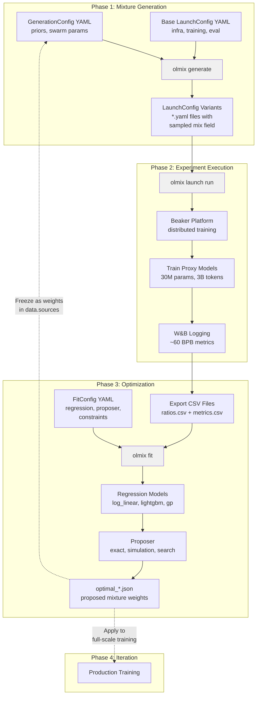
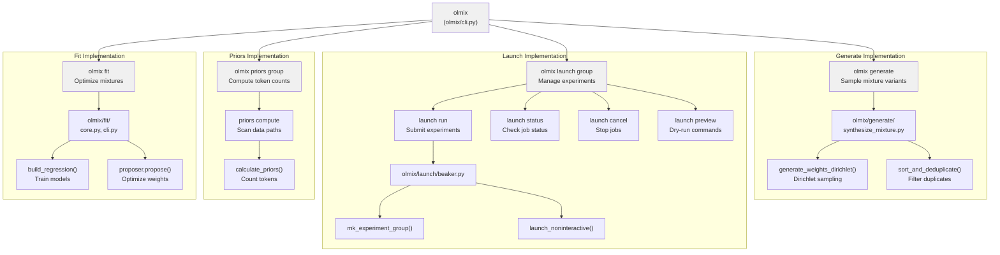
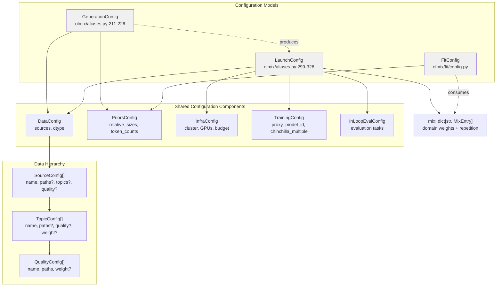

<!-- source: DeepWiki mcp.deepwiki.com · repo allenai/olmix · page 1 Overview · fetched 2026-10-26 -->

# Overview

<details>
<summary>Relevant source files</summary>

The following files were used as context for generating this wiki page:

- [README.md](README.md)
- [olmix/aliases.py](olmix/aliases.py)
- [olmix/cli.py](olmix/cli.py)
- [olmix/generate/synthesize_mixture.py](olmix/generate/synthesize_mixture.py)
- [olmix/generate/utils.py](olmix/generate/utils.py)
- [olmix/launch/utils.py](olmix/launch/utils.py)

</details>


## Purpose and Scope

**olmix** is a toolkit for optimizing pretraining data mixtures through systematic experimentation and statistical modeling. It enables researchers to determine optimal data mixing ratios by training small proxy models (typically 30M parameters) on diverse mixture variants ("swarms"), fitting regression models to the results, and proposing optimized mixtures for full-scale training runs.

This page provides a high-level overview of the olmix system architecture, workflow, and core components. For detailed information on specific subsystems:
- Installation and getting started: see [Installation and Setup](#1.2) and [Quick Start Tutorial](#1.3)
- Individual CLI commands: see [CLI Reference](#2)
- Configuration file formats: see [Configuration System](#3)
- Regression and optimization details: see [Regression and Optimization](#4)
- Training infrastructure: see [Training Infrastructure](#5)

**Sources:** [README.md:1-11]()

---

## System Architecture

olmix implements a four-phase iterative optimization cycle:



**Diagram: Four-Phase Optimization Cycle**

This architecture enables iterative refinement: each optimization cycle (Phase 3) identifies improved mixture weights, which can be frozen in the next generation cycle (Phase 1) using the **mixture reuse** pattern. This allows efficient exploration by fixing previously-optimized portions of the mixture while varying only new or underexplored domains.

**Sources:** [README.md:10-11](), [olmix/cli.py:1-454]()

---

## CLI Command Structure

The olmix CLI exposes four main command groups, each backed by dedicated modules:



**Diagram: CLI Command Hierarchy and Implementation Modules**

Each command group is implemented as a separate module with clear separation of concerns:

| Command Group | Purpose | Key Module | Main Entry Point |
|--------------|---------|------------|------------------|
| `generate` | Sample mixture variants from priors | `olmix/generate/synthesize_mixture.py` | `mk_mixtures()` |
| `launch` | Submit and manage Beaker training jobs | `olmix/launch/beaker.py` | `launch_noninteractive()` |
| `priors` | Compute token distributions from data paths | `olmix/generate/synthesize_mixture.py` | `calculate_priors()` |
| `fit` | Fit regression models and propose optimal mixtures | `olmix/fit/core.py` | `fit_main()` |

**Sources:** [olmix/cli.py:101-453](), [olmix/generate/synthesize_mixture.py:1-950]()

---

## Configuration System

olmix uses a three-tier configuration system built on Pydantic models defined in `olmix/aliases.py`:



**Diagram: Configuration Model Relationships**

**Key Configuration Types:**

- **`GenerationConfig`**: Defines sampling parameters for mixture generation. Contains `DataConfig`, `PriorsConfig`, and `SwarmConfig`. Used by `olmix generate`.

- **`LaunchConfig`**: Self-contained experiment specification. Contains all settings needed for training: infrastructure (`InfraConfig`), model/training (`TrainingConfig`), data landscape (`DataConfig`), evaluation (`InLoopEvalConfig`), and the specific mixture weights (`mix` field). Generated by `olmix generate` and consumed by `olmix launch`.

- **`FitConfig`**: Optimization configuration. Specifies regression model type, proposer type, constraints, and paths to swarm results. Used by `olmix fit`.

All three share a common **`DataConfig`** schema that describes the hierarchical organization of data sources:

```
sources (SourceConfig[])
  ├─ name: string
  └─ One of:
      ├─ paths: list[string]               # Flat source
      ├─ topics: TopicConfig[]             # Nested topics
      │   ├─ name: string
      │   ├─ weight?: float                # Optional fixed weight
      │   └─ paths or quality[]
      └─ quality: QualityConfig[]          # Source-level quality buckets
```

See [Configuration System](#3) for detailed specifications of each configuration type.

**Sources:** [olmix/aliases.py:1-341](), [olmix/fit/config.py]()

---

## Core Workflow

A typical olmix experiment follows this sequence:

### 1. Compute Priors

Calculate the natural token distribution and absolute token counts for all data sources:

```bash
olmix priors compute --config generation_config.yaml
```

This scans S3/GCS paths specified in `data.sources` and outputs a `priors:` block containing `relative_sizes` (fractional weights) and `token_counts` (absolute counts). The `calculate_priors()` function uses multithreaded file scanning and caches results based on a config hash.

**Sources:** [olmix/cli.py:387-437](), [olmix/generate/synthesize_mixture.py:696-799]()

### 2. Generate Mixture Variants

Sample N mixture variants from a Dirichlet distribution centered on the priors:

```bash
olmix generate \
  --config generation_config.yaml \
  --base base_launch_config.yaml \
  --output output/variants/
```

Each variant becomes a self-contained `LaunchConfig` YAML file with a unique `mix` field. The `mk_mixtures()` function performs hierarchical Dirichlet sampling (source-level, then topic-level), applies constraints (minimum weights, repetition bounds), and deduplicates similar mixtures.

**Sources:** [olmix/cli.py:112-165](), [olmix/generate/synthesize_mixture.py:513-640]()

### 3. Launch Training Experiments

Submit all variants to Beaker for distributed training:

```bash
olmix launch run --variants output/variants/
```

This creates a Beaker experiment group where each variant trains a proxy model (typically 30M parameters on 3B tokens). The `launch_noninteractive()` function converts `LaunchConfig` to Beaker launch specifications and submits them. All runs share a `group_id` and log to W&B.

**Sources:** [olmix/cli.py:178-261](), [olmix/launch/beaker.py]()

### 4. Export Metrics

Once training completes, export results to CSV format (manually or programmatically via W&B API). Two files are required:

- **`ratios.csv`**: Domain weights per run (rows are runs, columns are domains, values sum to ~1.0)
- **`metrics.csv`**: Evaluation metrics per run (rows are runs, columns are metrics, lower is better for BPB)

**Sources:** [README.md:20-44]()

### 5. Fit Regression and Propose Optimal Mixture

Fit regression models to predict metric performance from mixture weights, then optimize:

```bash
olmix fit --config fit_config.yaml --output-dir output/fit/
```

The `fit_main()` function loads the CSV data, builds one regression model per metric, and uses a proposer to search for optimal weights. The most common setup is `log_linear` regression (parametric scaling law) with `exact` proposer (convex optimization with KL regularization).

Output includes `*_optimal.json` files with proposed weights and visualization plots.

**Sources:** [README.md:46-181](), [olmix/fit/core.py]()

### 6. Iterate with Mixture Reuse

For the next optimization cycle, freeze the optimized domains by setting explicit `weight` fields in `data.sources` or `data.topics`. The generator will only vary domains without fixed weights, enabling efficient exploration of new data sources while preserving good baseline mixtures.

**Sources:** [README.md:263-290](), [olmix/generate/synthesize_mixture.py:303-342]()

---

## Key Design Principles

### Hierarchical Data Organization

Data is organized in a three-level hierarchy: **source → topic → quality**, where each level is optional. This enables flexible mixture specification at different granularities:

- **Source-level**: `{"wikipedia": 0.3, "books": 0.7}`
- **Topic-level**: `{"dclm:code": 0.2, "dclm:math": 0.3, "wikipedia": 0.5}`
- **Quality-level**: `{"dclm:code:vigintile_0018": 0.1, "dclm:code:vigintile_0019": 0.1, ...}`

The `flatten_mix()` function in [olmix/aliases.py:267-296]() normalizes both flat and nested mix representations into a canonical form.

**Sources:** [olmix/aliases.py:84-121]()

### Self-Contained Launch Configs

Each `LaunchConfig` YAML file produced by `olmix generate` is completely self-contained: it includes all infrastructure settings, training hyperparameters, data sources, evaluation configuration, and the specific mixture weights for that variant. This design ensures:

- **Reproducibility**: The YAML file alone is sufficient to recreate the exact training run
- **Portability**: Configs can be inspected, edited, and launched independently
- **Transparency**: All experiment details are visible in a single human-readable file

**Sources:** [olmix/aliases.py:299-326](), [olmix/cli.py:144-161]()

### Chinchilla Scaling Automation

Training duration is automatically computed from the model size using Chinchilla scaling laws. The `TrainingConfig.get_max_tokens()` method calculates total training tokens as:

```
max_tokens = 20 * num_params * chinchilla_multiple
```

Where `chinchilla_multiple` controls the compute budget relative to Chinchilla optimal (0.5× = undertrained proxy, 2× = overtrained proxy). The `TransformerConfigBuilder` further derives batch size, learning rate, and training steps from this budget. See [TransformerConfigBuilder](#5.2) for details.

**Sources:** [olmix/aliases.py:14-50](), [olmix/aliases.py:168-176]()

### Mixture Reuse Pattern

The configuration system supports **partial freezing** of mixture weights through optional `weight` fields on `SourceConfig` and `TopicConfig`. When weights are set:

- Those domains maintain fixed relative proportions
- Only domains without weights are resampled from the Dirichlet
- This enables iterative refinement: optimize a baseline mix, freeze it, then explore new domains

The `generate_weights_dirichlet()` function handles frozen weights by constructing fixed topic distributions when `source.topics[0].weight is not None`.

**Sources:** [README.md:263-290](), [olmix/generate/synthesize_mixture.py:303-342]()

### Regression-Based Optimization

Rather than grid search or random search, olmix uses **surrogate modeling**: fit a regression model to predict downstream performance from mixture weights, then optimize that model. This enables:

- **Sample efficiency**: Good proposals from relatively few training runs (~50-100)
- **Interpretability**: Regression coefficients show which domains help/hurt each metric
- **Flexibility**: Multiple regression types supported (log-linear, LightGBM, GP, etc.)
- **Constrained optimization**: Exact proposer supports KL regularization and token budgets

See [Regression and Optimization](#4) for details on available models and proposers.

**Sources:** [olmix/fit/core.py]()

---

## Repository Structure

```
olmix/
├── olmix/
│   ├── cli.py                    # Main CLI entry point
│   ├── aliases.py                # Configuration models (Pydantic)
│   ├── generate/
│   │   ├── synthesize_mixture.py # Dirichlet sampling, priors computation
│   │   └── utils.py              # Mixture formatting utilities
│   ├── launch/
│   │   ├── beaker.py            # Beaker experiment creation and submission
│   │   ├── train.py             # Training script (executed on Beaker)
│   │   └── utils.py             # Launch utilities
│   └── fit/
│       ├── cli.py               # Fit command implementation
│       ├── core.py              # Main fit logic
│       ├── config.py            # FitConfig model
│       ├── regression.py        # Regression model implementations
│       └── proposer.py          # Proposer implementations
├── configs/                      # Example configuration files
└── tests/                        # Test suite
```

**Sources:** Repository structure

---

## Next Steps

- For hands-on experience, see [Quick Start Tutorial](#1.3)
- To understand key concepts in depth, see [Core Concepts](#1.1)
- For command-line usage reference, see [CLI Reference](#2)
- For configuration file specifications, see [Configuration System](#3)

---

