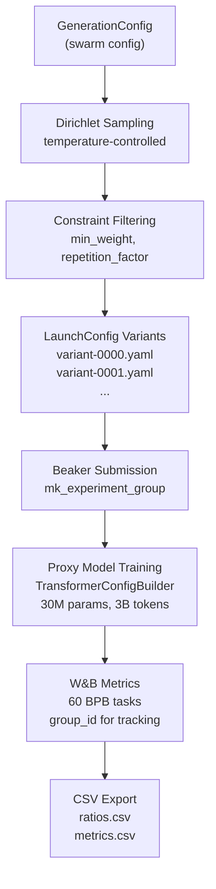
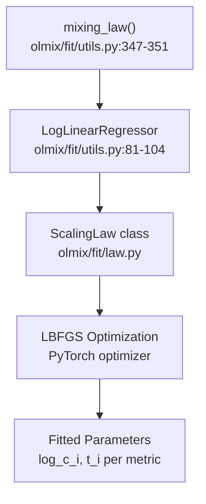
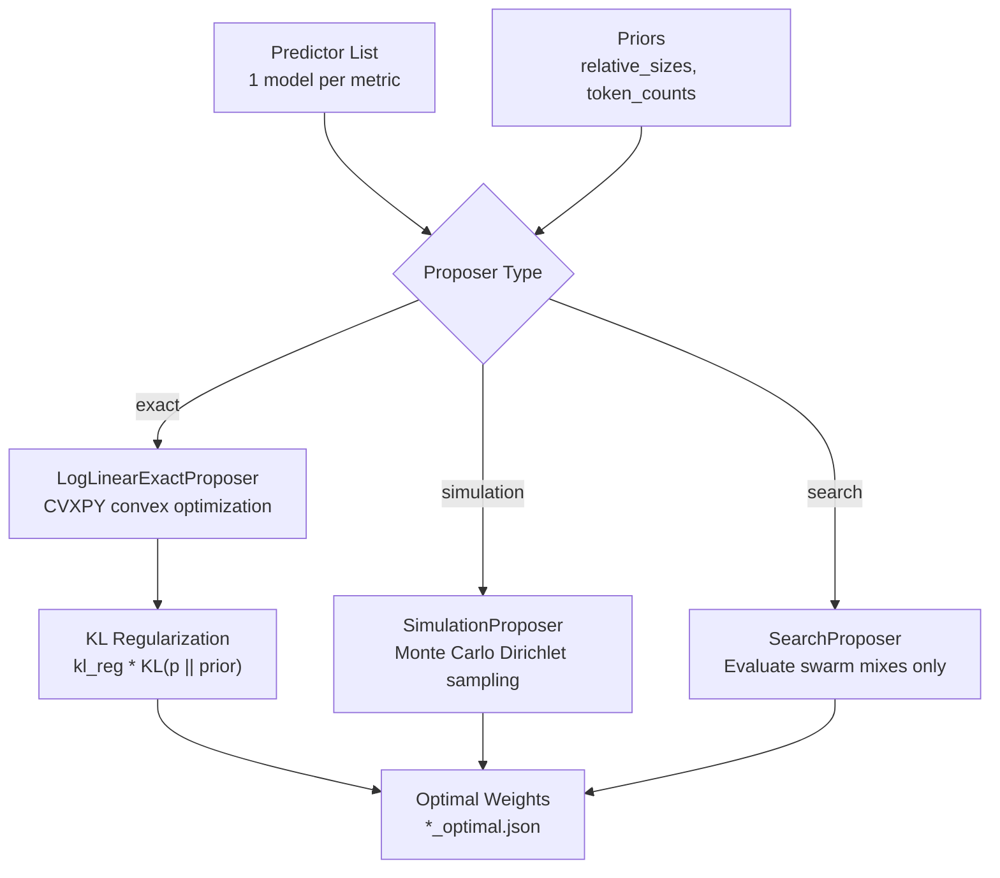
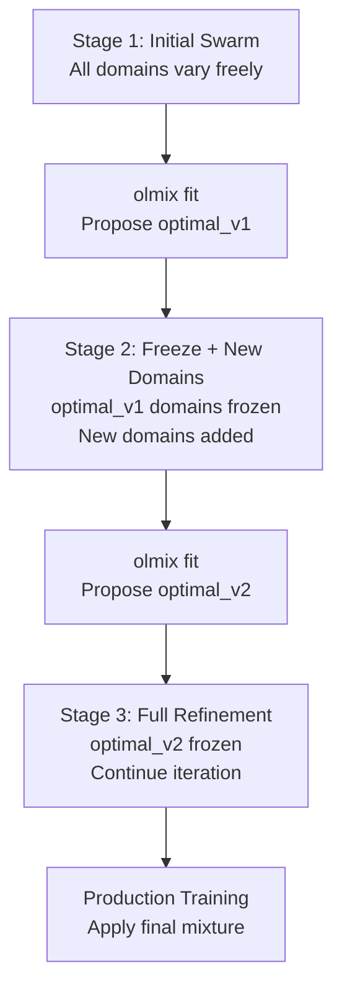
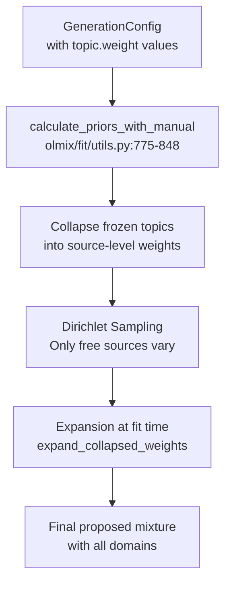
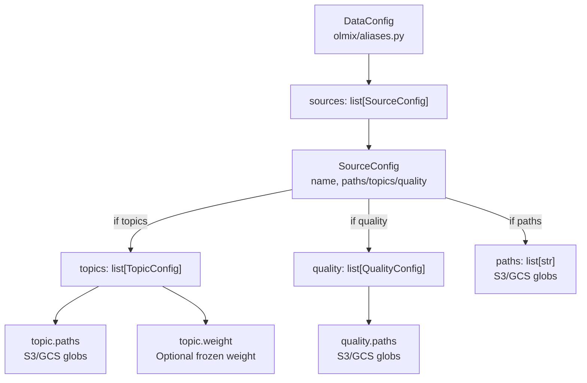
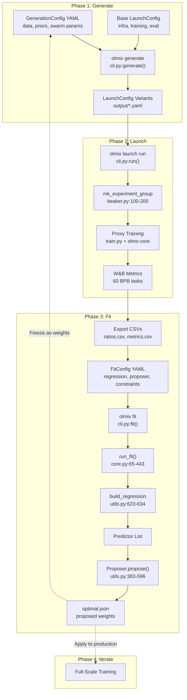

<!-- source: DeepWiki mcp.deepwiki.com · repo allenai/olmix · page 1.1 Core Concepts · fetched 2026-10-26 -->

# Core Concepts

<details>
<summary>Relevant source files</summary>

The following files were used as context for generating this wiki page:

- [README.md](README.md)
- [olmix/fit/cli.py](olmix/fit/cli.py)
- [olmix/fit/config.py](olmix/fit/config.py)
- [olmix/fit/core.py](olmix/fit/core.py)
- [olmix/fit/utils.py](olmix/fit/utils.py)
- [olmix/plots/plotting.py](olmix/plots/plotting.py)

</details>


## Purpose and Scope

This page explains the fundamental concepts underlying olmix's approach to data mixture optimization. It covers the core methodology, mathematical formulations, and iterative workflow that enable efficient exploration of the mixture space.

For installation instructions, see [Installation and Setup](#1.2). For hands-on usage, see [Quick Start Tutorial](#1.3). For detailed command documentation, see [CLI Reference](#2).

---

## Data Mixtures

A **data mixture** is a weighted combination of data sources used during language model pretraining. Each source receives a sampling weight that determines its representation in the training corpus.

### Representation in Code

Mixtures are represented as dictionaries mapping domain keys to fractional weights (summing to 1.0):

```python
mix = {
    "dclm:science_math_and_technology": 0.55,
    "dclm:software_development": 0.30,
    "dclm:entertainment": 0.10,
    "wikipedia": 0.05
}
```

In configuration files, mixtures are specified through the `mix` field of `LaunchConfig` using `MixEntry` objects that include both weights and repetition constraints:

| Field | Type | Purpose |
|-------|------|---------|
| `weight` | `float` | Fractional sampling weight (0-1) |
| `repetition` | `int \| None` | Maximum times this domain's data can be repeated |

**Sources:** [olmix/aliases.py:1-100](), [README.md:28-35]()

---

## The Swarm Methodology

### Proxy Models

Olmix evaluates candidate mixtures by training **proxy models**—small-scale language models that serve as cheap approximations of full-scale training behavior. The default configuration uses:

| Parameter | Value | Rationale |
|-----------|-------|-----------|
| Model size | 30M parameters | Small enough to train quickly |
| Training tokens | 3B (0.5-5x Chinchilla) | Enough to observe mixture effects |
| Evaluation | 60 downstream BPB metrics | Comprehensive coverage of capabilities |

### Swarms

A **swarm** is a collection of proxy model training runs, each using a different mixture sampled from a Dirichlet distribution. Typical swarms contain 50-200 variants, providing sufficient data for regression fitting while remaining computationally tractable.

**Diagram: Swarm Generation and Training**



**Sources:** [olmix/generate/synthesize_mixture.py:1-300](), [olmix/launch/train.py:1-200](), [README.md:184-246]()

---

## Priors and Token Distributions

### Natural Priors

The **prior distribution** represents the natural occurrence frequency of each domain in the available corpus. It is computed by scanning data paths and counting tokens:

```bash
olmix priors compute --config config.yaml
```

This produces two components:

| Component | Purpose | Example |
|-----------|---------|---------|
| `relative_sizes` | Fractional token distribution (sums to 1.0) | Used as Dirichlet center for sampling |
| `token_counts` | Absolute token counts per domain | Used for repetition constraints |

### Role in Optimization

Priors serve two critical functions:

1. **Sampling Center**: The Dirichlet distribution is centered at the prior, so swarm variants naturally explore around the natural corpus distribution
2. **KL Regularization**: During optimization, the `exact` proposer penalizes proposed mixtures that diverge too far from the prior using KL divergence

**Sources:** [olmix/generate/synthesize_mixture.py:100-200](), [olmix/fit/config.py:23-31]()

---

## Scaling Laws and Regression

### The Log-Linear Mixing Law

Olmix's default regression type fits a parametric **log-linear scaling law** that models how mixture weights affect each evaluation metric:

```
f(p) = exp(c) + exp(β · p)
```

Where:
- `p` is the mixture weight vector (domains)
- `β` is the coefficient vector learned per metric
- `c` is the bias term

This functional form is implemented in the `mixing_law` function:

**Code Mapping: Scaling Law Implementation**



**Sources:** [olmix/fit/utils.py:347-351](), [olmix/fit/utils.py:81-104](), [olmix/fit/law.py:1-100]()

### Alternative Regression Types

Olmix supports six regression models, defined in `REGRESSION_TYPES`:

| Type | Implementation | Use Case |
|------|---------------|----------|
| `log_linear` | `LogLinearRegressor` | Default; parametric scaling law |
| `lightgbm` | `LightGBMRegressor` | Gradient-boosted trees for non-linear patterns |
| `gp` | `GPRegressor` | Gaussian process for uncertainty quantification |
| `autoscale` | `AutoscaleRegressor` | Power-law autoscaling (N0 + N*p)^(-γ) |
| `bimix` | `BimixRegressor` | BiMix-style power law Σ F_i * x_i^(-α_i) |
| `search` | `SearchRegressor` | Lookup table (exact reuse of swarm results) |

Each regressor fits one model per metric, producing a list of predictors used by the proposer.

**Sources:** [olmix/fit/utils.py:369-376](), [olmix/fit/utils.py:67-342]()

---

## Optimization and Proposers

### Proposer Architecture

After regression fitting, a **proposer** searches for optimal mixture weights by minimizing (or maximizing) predicted performance. The proposer uses the fitted regression models as a surrogate objective function.

**Diagram: Proposer Types and Workflow**



**Sources:** [olmix/fit/utils.py:379-598](), [olmix/fit/core.py:405-429]()

### Proposer Types

| Proposer | Method | Requirements | Configuration Field |
|----------|--------|--------------|---------------------|
| `exact` | Convex optimization (CVXPY) | `log_linear` regression only | `proposer.kl_reg` |
| `simulation` | Monte Carlo sampling from Dirichlet | Any regression type | `proposer.temperature` |
| `search` | Exhaustive evaluation of swarm points | `search` regression only | — |

The `exact` proposer solves:

```
minimize: Σ w_i * exp(β_i · p) + λ * KL(p || prior)
subject to: p ≥ 0, Σ p = 1, optional token constraints
```

Where `w_i` are objective weights (`filtering.obj_weights`) and `λ` is KL regularization strength (`proposer.kl_reg`).

**Sources:** [olmix/fit/utils.py:539-596](), [olmix/fit/config.py:44-52]()

---

## Constraints and Token Budgets

### Repetition Constraints

When `constraints.enabled = true`, the proposer enforces that no domain exceeds its available data:

```
p_i * target_tokens ≤ token_counts[i] * repetition_factor
```

This prevents solutions that require repeating a small domain hundreds of times. The default `repetition_factor = 4.0` allows 4x repetition.

### Implementation

Constraints are applied differently by each proposer:

- **SimulationProposer**: Filters out sampled candidates that violate constraints ([olmix/fit/utils.py:446-464]())
- **LogLinearExactProposer**: Adds constraint to CVXPY problem ([olmix/fit/utils.py:556-561]())
- **SearchProposer**: Checks constraints during evaluation loop ([olmix/fit/utils.py:524-530]())

**Sources:** [olmix/fit/config.py:54-60](), [olmix/fit/utils.py:388-537]()

---

## Iterative Refinement and Mixture Reuse

### The Optimization Loop

Olmix enables iterative mixture improvement through a **mixture reuse** pattern:



**Sources:** [README.md:263-291](), [olmix/aliases.py:100-200]()

### Freezing Weights with the `weight` Field

To freeze portions of the mixture, add explicit `weight` values to topics or sources in `GenerationConfig`:

```yaml
data:
  sources:
  - name: existing
    topics:
    - name: dclm:science
      weight: 0.55      # Frozen from stage 1
    - name: dclm:code
      weight: 0.30      # Frozen from stage 1
    - name: wikipedia   # No weight → varies in stage 2
      paths: [...]
  - name: stack-edu     # New source added in stage 2
    topics: [...]
```

The `calculate_priors_with_manual` function collapses frozen topics into source-level priors, removing them from the optimization variables:

**Code Mapping: Mixture Reuse Logic**



**Sources:** [olmix/fit/utils.py:775-848](), [olmix/fit/utils.py:733-749](), [README.md:263-291]()

---

## Configuration Model Hierarchy

### Core Configuration Types

Olmix uses three primary Pydantic configuration models that correspond to the three CLI commands:

| Config Class | Purpose | Primary CLI Command | File Location |
|--------------|---------|---------------------|---------------|
| `GenerationConfig` | Swarm sampling parameters | `olmix generate` | [olmix/aliases.py:300-400]() |
| `LaunchConfig` | Self-contained experiment specification | `olmix launch run` | [olmix/aliases.py:200-300]() |
| `FitConfig` | Regression and optimization settings | `olmix fit` | [olmix/fit/config.py:131-176]() |

### Shared Schema: DataConfig

All three configs share a common `DataConfig` hierarchy for describing data sources:



This hierarchical structure enables flexible organization:
- **Flat sources**: `paths` directly in `SourceConfig`
- **Topic subdivision**: `topics` list with nested `TopicConfig`
- **Quality levels**: `quality` list for vigintile bucketing

**Sources:** [olmix/aliases.py:1-400](), [README.md:260-289]()

---

## The Complete Workflow

### End-to-End Pipeline

**Diagram: From Generation to Optimization**



**Sources:** [olmix/cli.py:1-300](), [olmix/fit/cli.py:32-114](), [olmix/fit/core.py:65-443]()

---

## Key Data Structures

### Ratios and Metrics DataFrames

After swarm training and CSV export, the canonical data format is:

**ratios.csv structure:**

| Column Type | Purpose | Example Values |
|-------------|---------|----------------|
| `run` or `run_id` | Required join key | `hz0dfydj`, `pj0hxxl7` |
| `name` | Optional display name | `my-swarm-0000` |
| `index` | Optional sequential index | `0`, `1`, `2` |
| Domain columns | Mixture weights (sum ≈ 1.0) | `0.45`, `0.30`, `0.25` |

**metrics.csv structure:**

| Column Type | Purpose | Example Values |
|-------------|---------|----------------|
| `run` or `run_id` | Required join key | `hz0dfydj`, `pj0hxxl7` |
| `name` | Optional display name | `my-swarm-0000` |
| `index` | Optional sequential index | `0`, `1`, `2` |
| Metric columns | Evaluation scores (lower = better for BPB) | `1.23`, `0.87`, `1.45` |

The `load_from_csv` function extracts domain and metric column names automatically by excluding metadata columns:

**Sources:** [olmix/fit/loaders.py:1-100](), [README.md:24-44]()

### RunInstance

When loading from WandB instead of CSV, results are packaged into `RunInstance` objects:

```python
@dataclass
class RunInstance:
    id: str                  # WandB run ID
    display_name: str        # Human-readable name
    config: dict             # Full run configuration
    samples: pd.DataFrame    # Metrics at final step
    state: str               # "finished", "crashed", "running"
```

**Sources:** [olmix/fit/utils.py:601-617]()

---

## Summary: Core Concepts Recap

| Concept | Key Point | Code Entry Point |
|---------|-----------|------------------|
| Data Mixture | Weighted combination of sources (dict mapping domain → weight) | `LaunchConfig.mix` |
| Swarm | Collection of proxy runs with diverse mixtures | `olmix generate` |
| Proxy Model | 30M param LM trained on 3B tokens | `TransformerConfigBuilder` |
| Priors | Natural token distribution (`relative_sizes`, `token_counts`) | `calculate_priors` |
| Scaling Law | Log-linear parametric model: `exp(c) + exp(β·p)` | `mixing_law`, `ScalingLaw` |
| Regression | Fit one model per metric | `build_regression`, `REGRESSION_TYPES` |
| Proposer | Optimize weights using fitted models | `PROPOSER_TYPES`, `Proposer.propose` |
| Constraints | Prevent excessive data repetition | `repetition_factor`, token budgets |
| Mixture Reuse | Freeze optimized portions, iterate on new domains | `topic.weight` field |

**Sources:** [olmix/aliases.py:1-600](), [olmix/fit/utils.py:1-951](), [olmix/fit/core.py:1-443]()

---

