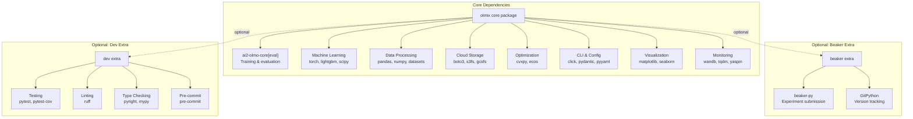
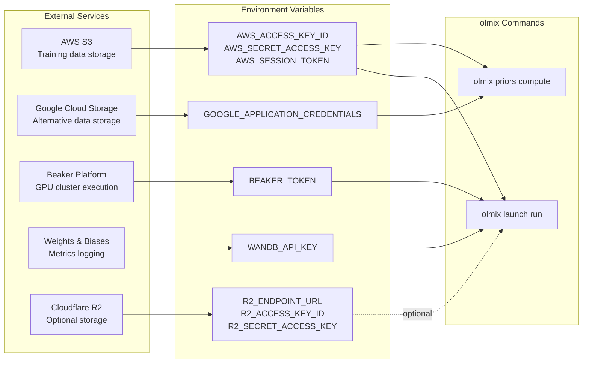
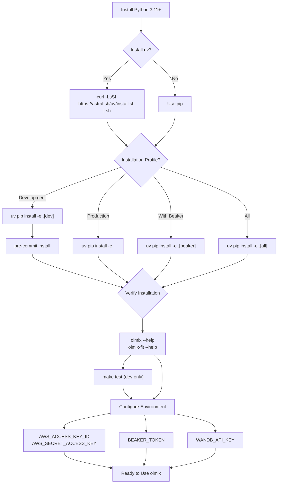
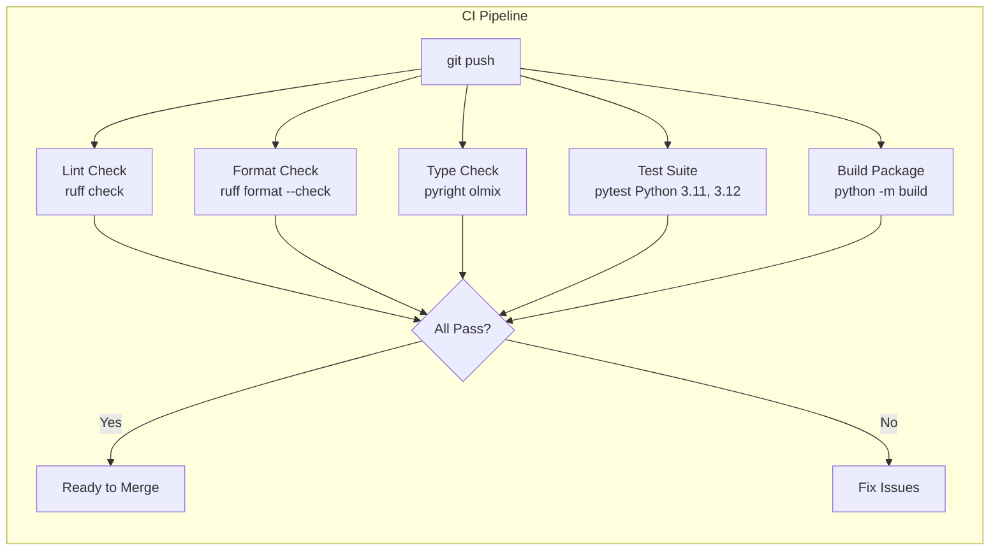

<!-- source: DeepWiki mcp.deepwiki.com · repo allenai/olmix · page 1.2 Installation and Setup · fetched 2026-10-26 -->

# Installation and Setup

<details>
<summary>Relevant source files</summary>

The following files were used as context for generating this wiki page:

- [.github/dependabot.yml](.github/dependabot.yml)
- [.github/workflows/main.yml](.github/workflows/main.yml)
- [CHANGELOG.md](CHANGELOG.md)
- [CONTRIBUTING.md](CONTRIBUTING.md)
- [Makefile](Makefile)
- [pyproject.toml](pyproject.toml)

</details>


This page provides instructions for installing olmix and configuring the required dependencies and credentials. It covers both production installation (for running experiments) and development installation (for contributing to the codebase).

For information about running your first experiment, see [Quick Start Tutorial](#1.3). For details on the testing infrastructure, see [Testing](#8.1). For CI/CD pipeline configuration, see [CI/CD Pipeline](#8.2).

---

## Prerequisites

### System Requirements

olmix requires **Python 3.11 or higher**. Python 3.12 is also supported and tested in CI.

**Sources:** [pyproject.toml:22](), [.github/workflows/main.yml:12]()

### Package Manager

The project uses **uv** for fast, reliable package management. While pip can also be used, uv is recommended and used throughout the CI/CD pipeline.

To install uv:
```bash
curl -LsSf https://astral.sh/uv/install.sh | sh
```

Alternatively, you can use standard pip if uv is not available.

**Sources:** [.github/workflows/main.yml:21-24](), [Makefile:25]()

---

## Installation Methods

### Production Installation

For users who want to run olmix commands without modifying the codebase:

```bash
# Using uv (recommended)
uv pip install -e .

# Using pip
pip install -e .
```

This installs the core dependencies and makes the `olmix` and `olmix-fit` CLI commands available in your environment.

**Sources:** [Makefile:23-25](), [pyproject.toml:53-55]()

### Development Installation

For contributors who need testing, linting, and type-checking tools:

```bash
# Using uv (recommended)
uv pip install -e ".[dev]"

# Using pip
pip install -e ".[dev]"

# Install pre-commit hooks
pre-commit install
```

The development installation includes all dependencies from the `dev` optional group plus the core dependencies.

**Sources:** [Makefile:28-31](), [pyproject.toml:67-87]()

### Beaker Integration (Optional)

To enable Beaker experiment submission (required for [olmix launch](#2.2)):

```bash
uv pip install -e ".[beaker]"
```

This installs `beaker-py` and `GitPython` for Beaker platform integration.

**Sources:** [pyproject.toml:63-66]()

### Complete Installation

To install all optional dependencies:

```bash
uv pip install -e ".[all]"
```

This is equivalent to installing both `dev` and `beaker` extras.

**Sources:** [pyproject.toml:88-91]()

---

## Dependency Architecture



**Diagram: Dependency Structure**

This diagram shows the three installation profiles: core dependencies (always installed), beaker extra (for experiment submission), and dev extra (for development workflows).

**Sources:** [pyproject.toml:23-49](), [pyproject.toml:62-91]()

---

## Verifying Installation

### Check CLI Availability

After installation, verify the CLI commands are available:

```bash
# Check main CLI
olmix --help

# Check fit CLI
olmix-fit --help

# Verify version
python -c "from olmix.version import __version__; print(__version__)"
```

The `olmix` command provides access to `generate`, `launch`, and `priors` commands. The `olmix-fit` command is a shorthand for the `fit` subcommand.

**Sources:** [pyproject.toml:53-55]()

### Run Tests

For development installations, verify the setup by running tests:

```bash
# Run all tests
make test

# Run only fast tests (skip slow/GPU tests)
make test-fast

# Run with coverage
make test-cov
```

**Sources:** [Makefile:33-43](), [pyproject.toml:167-183]()

### Check Code Quality Tools

Verify development tools are working:

```bash
# Check formatting
make format-check

# Run linter
make lint

# Run type checker
make typecheck
```

**Sources:** [Makefile:45-63]()

---

## Environment Setup

### Overview of Required Credentials



**Diagram: Environment Variables and Service Dependencies**

This diagram shows which environment variables are required for each external service and which olmix commands depend on them.

**Sources:** [olmix/launch/beaker.py:100-200]() (inferred from Beaker integration code)

### AWS Credentials (S3 Access)

Required for accessing training data in S3 and for the `priors compute` command.

**Option 1: AWS CLI Configuration**
```bash
aws configure
```

**Option 2: Environment Variables**
```bash
export AWS_ACCESS_KEY_ID="your-access-key"
export AWS_SECRET_ACCESS_KEY="your-secret-key"
export AWS_SESSION_TOKEN="your-session-token"  # If using temporary credentials
```

The credentials are used by `boto3` and `s3fs` for data access.

**Sources:** [pyproject.toml:27](), [pyproject.toml:40]()

### Google Cloud Credentials (GCS Access)

Required if using GCS for data storage instead of S3.

```bash
export GOOGLE_APPLICATION_CREDENTIALS="/path/to/credentials.json"
```

The credentials are used by `gcsfs` for data access.

**Sources:** [pyproject.toml:32]()

### Beaker Token

Required for the `olmix launch run` command to submit experiments to the Beaker platform.

```bash
export BEAKER_TOKEN="your-beaker-token"
```

To obtain a Beaker token:
1. Log in to the Beaker web interface
2. Navigate to your account settings
3. Generate an API token

**Sources:** [olmix/launch/beaker.py]() (referenced in launch command implementation)

### Weights & Biases API Key

Required for logging metrics during training and for `load_from_wandb` in the fit pipeline.

```bash
export WANDB_API_KEY="your-wandb-key"
```

To obtain a WandB API key:
1. Create an account at https://wandb.ai
2. Navigate to Settings → API keys
3. Copy your API key

**Sources:** [pyproject.toml:47]()

### Cloudflare R2 (Optional)

Optional alternative storage backend.

```bash
export R2_ENDPOINT_URL="https://your-account.r2.cloudflarestorage.com"
export R2_ACCESS_KEY_ID="your-r2-access-key"
export R2_SECRET_ACCESS_KEY="your-r2-secret-key"
```

**Sources:** Inferred from Beaker integration patterns

### Environment Variable Persistence

To make environment variables permanent, add them to your shell configuration:

```bash
# For bash
echo 'export AWS_ACCESS_KEY_ID="..."' >> ~/.bashrc
echo 'export BEAKER_TOKEN="..."' >> ~/.bashrc

# For zsh
echo 'export AWS_ACCESS_KEY_ID="..."' >> ~/.zshrc
echo 'export BEAKER_TOKEN="..."' >> ~/.zshrc
```

---

## Installation Flow



**Diagram: Installation and Setup Workflow**

This flowchart shows the complete installation process from Python installation through environment configuration.

**Sources:** [Makefile:23-31](), [pyproject.toml:22-91](), [CONTRIBUTING.md:32-56]()

---

## Development Workflow Tools

The `Makefile` provides convenient targets for common development tasks:

| Target | Purpose | Command |
|--------|---------|---------|
| `make install` | Install core dependencies | `uv pip install -e .` |
| `make install-dev` | Install with dev tools | `uv pip install -e ".[dev]"` |
| `make test` | Run all tests | `pytest` |
| `make test-fast` | Run fast tests only | `pytest -m "not slow"` |
| `make test-cov` | Run tests with coverage | `pytest --cov=olmix` |
| `make lint` | Run linter with fixes | `ruff check . --fix` |
| `make format` | Format code | `ruff format olmix tests scripts` |
| `make format-check` | Check formatting | `ruff format --check` |
| `make typecheck` | Run type checker | `pyright olmix` |
| `make clean` | Remove build artifacts | Remove caches and build dirs |
| `make run-checks` | Run all quality checks | Format, lint, type, test |

**Sources:** [Makefile:1-118]()

---

## CI/CD Verification

The GitHub Actions workflow automatically verifies installation on every push:



**Diagram: CI/CD Quality Gates**

The CI pipeline runs four parallel checks (lint, format, typecheck, test) plus a build step to ensure code quality and correctness.

**Sources:** [.github/workflows/main.yml:15-93]()

---

## Troubleshooting

### ImportError: No module named 'olmix'

Ensure you installed with the `-e` flag for editable mode:
```bash
uv pip install -e .
```

### Command not found: olmix

The CLI entry points may not be in your PATH. Try:
```bash
python -m olmix.cli --help
```

Or reinstall the package:
```bash
uv pip uninstall olmix
uv pip install -e .
```

### OLMo Core Installation Issues

The `ai2-olmo-core` dependency is pinned to a specific git branch. If installation fails:
```bash
# Install git if not available
apt-get install git  # On Ubuntu/Debian
brew install git     # On macOS

# Verify git is in PATH
which git
```

**Sources:** [pyproject.toml:26]()

### Type Checking Errors

Type checking is configured to "basic" mode. If you see unexpected errors:
```bash
# Check pyright configuration
cat pyproject.toml | grep -A 10 "\[tool.pyright\]"

# Run with verbose output
pyright --verbose olmix
```

**Sources:** [pyproject.toml:153-164]()

---

## Next Steps

After completing installation and setup:

1. **Run the Quick Start Tutorial** ([#1.3](#1.3)) to generate your first mixture variants
2. **Explore CLI commands** ([#2](#2)) to understand available functionality
3. **Review Configuration System** ([#3](#3)) to learn about YAML configuration files
4. **For contributors:** Read the complete [Development Guide](#8) and [Testing](#8.1) documentation

**Sources:** Table of contents structure

---

