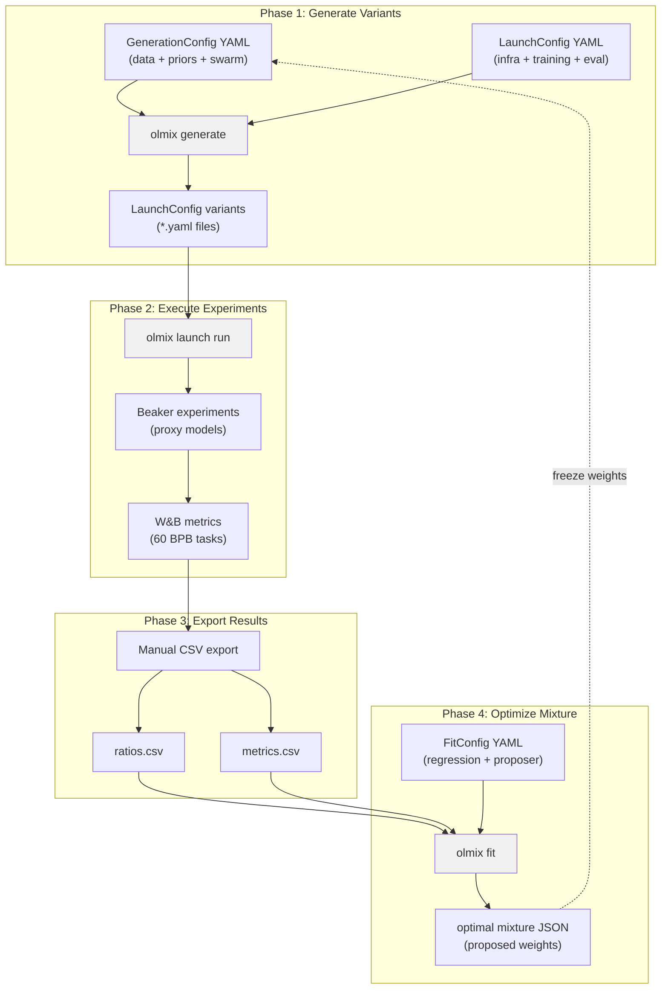
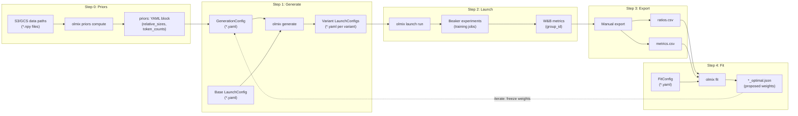
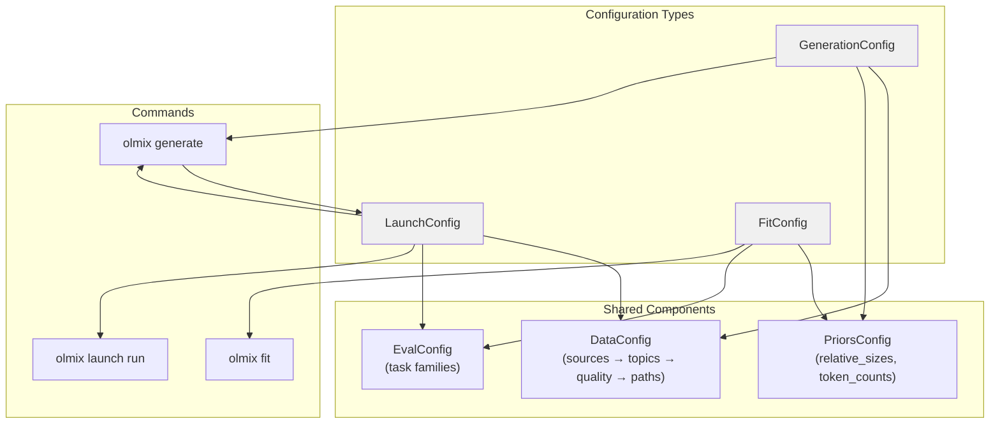

<!-- source: DeepWiki mcp.deepwiki.com · repo allenai/olmix · page 1.3 Quick Start Tutorial · fetched 2026-10-26 -->

# Quick Start Tutorial

<details>
<summary>Relevant source files</summary>

The following files were used as context for generating this wiki page:

- [README.md](README.md)
- [configs/examples/launch/README.md](configs/examples/launch/README.md)
- [configs/examples/launch/data_proportions/mix_baseline.yaml](configs/examples/launch/data_proportions/mix_baseline.yaml)
- [configs/examples/launch/data_proportions/mix_heavy_code.yaml](configs/examples/launch/data_proportions/mix_heavy_code.yaml)
- [olmix/aliases.py](olmix/aliases.py)
- [olmix/cli.py](olmix/cli.py)
- [olmix/generate/synthesize_mixture.py](olmix/generate/synthesize_mixture.py)
- [olmix/generate/utils.py](olmix/generate/utils.py)
- [olmix/launch/utils.py](olmix/launch/utils.py)

</details>


This tutorial walks through a complete example of using olmix to optimize a pretraining data mixture. You will learn two workflows: (1) fitting an optimal mixture from existing swarm results (CSV files), and (2) running the complete end-to-end pipeline from scratch (generating variants, launching experiments, and fitting). 

For detailed configuration options, see [GenerationConfig](#3.1), [LaunchConfig](#3.2), and [FitConfig](#3.3). For infrastructure setup and Beaker integration details, see [Beaker Integration](#5.1).

**Sources:** [README.md:1-334]()

---

## Prerequisites

Before starting, ensure olmix is installed and your environment is configured:

```bash
git clone https://github.com/allenai/olmix.git
cd olmix
uv pip install -e ".[dev]"
```

Verify the installation:

```bash
olmix --help
```

You should see four command groups: `generate`, `launch`, `priors`, and `fit`.

For full installation instructions, see [Installation and Setup](#1.2).

**Sources:** [README.md:12-18]()

---

## Overview: The olmix Workflow

The following diagram shows how olmix commands map to the optimization cycle and which configuration types each command uses:



**Sources:** [README.md:20-247](), [olmix/cli.py:101-453]()

---

## Workflow 1: Optimize from CSV (Simplest)

The fastest way to use olmix is to fit an optimal mixture from existing swarm results. This workflow assumes you already have CSV files containing mixture ratios and evaluation metrics from a swarm of proxy model runs.

### Input Format

Prepare two CSV files that will be joined on the `run` or `run_id` column:

**ratios.csv** — Domain mixture weights per run (must sum to ~1.0 per row):

| run      | name          | index | dclm  | wikipedia | arxiv |
|----------|---------------|-------|-------|-----------|-------|
| hz0dfydj | my-swarm-0000 | 0     | 0.45  | 0.30      | 0.25  |
| pj0hxxl7 | my-swarm-0001 | 1     | 0.60  | 0.20      | 0.20  |
| sqleanmq | my-swarm-0002 | 2     | 0.33  | 0.33      | 0.34  |

**metrics.csv** — Evaluation metrics per run (lower BPB = better):

| run      | name          | index | arc_challenge_bpb | hellaswag_bpb | mmlu_stem_bpb |
|----------|---------------|-------|-------------------|---------------|---------------|
| hz0dfydj | my-swarm-0000 | 0     | 1.23              | 0.87          | 1.45          |
| pj0hxxl7 | my-swarm-0001 | 1     | 1.15              | 0.91          | 1.38          |
| sqleanmq | my-swarm-0002 | 2     | 1.20              | 0.89          | 1.42          |

The `run` column is required for joining. The `name` and `index` columns are optional metadata. Domain columns in `ratios.csv` and metric columns in `metrics.csv` are derived automatically from the CSV headers.

**Sources:** [README.md:24-44]()

### Running the Fit Command

Create a FitConfig YAML that specifies the CSV paths and optimization parameters:

```bash
olmix fit --config configs/examples/fit/example.yaml --output-dir output/my_fit
```

The minimal FitConfig structure:

```yaml
swarm:
  ratios: path/to/ratios.csv
  metrics: path/to/metrics.csv

priors:
  relative_sizes:
    dclm: 0.6
    wikipedia: 0.2
    arxiv: 0.2
  token_counts:
    dclm: 600000000
    wikipedia: 200000000
    arxiv: 200000000

regression:
  type: log_linear

proposer:
  type: exact
  kl_reg: 0.1
```

The `priors` section defines the natural corpus distribution used for KL regularization. The `relative_sizes` should sum to ~1.0 and represent the fractional weight of each domain in the natural corpus. The `token_counts` are absolute token counts used for repetition constraints.

**Sources:** [README.md:46-105](), [olmix/fit/cli.py:1-100]()

### Understanding the Output

All results are written to a hashed subdirectory under the specified `--output-dir`. The hash is computed from the config to ensure different configurations produce separate outputs:

| File | Description |
|------|-------------|
| `config.json` | Full configuration used (for reproducibility) |
| `interaction_matrix.png` | Heatmap showing which domains help/hurt each metric |
| `{metric}_*_fit.png` | Per-metric regression plot (predicted vs actual) |
| `{metric}_*_optimal.json` | Proposed optimal weights for this metric |
| `{metric}_*_optimal.png` | Bar chart: prior vs proposed weights |
| `opt_avg_all_metrics_*_optimal.json` | **Main output**: weights optimizing average of all metrics |
| `predicted_performance.json` | Predicted metric values at optimal weights |

The key output is `opt_avg_all_metrics_*_optimal.json`, which contains the single mixture that optimizes the average across all evaluation metrics.

**Sources:** [README.md:159-181]()

### Key Configuration Options

The following table summarizes the most important FitConfig fields:

| Section | Field | Purpose |
|---------|-------|---------|
| `regression` | `type` | Model type: `log_linear` (default), `lightgbm`, `gp`, `autoscale`, `bimix`, `search` |
| `regression` | `aggregate_task_families` | Fit one model per task family (e.g., math, code) instead of per task |
| `proposer` | `type` | Optimization method: `exact` (convex opt), `simulation` (Monte Carlo), `search` |
| `proposer` | `kl_reg` | KL divergence regularization strength (penalizes divergence from prior) |
| `constraints` | `enabled` | Enable repetition constraints during optimization |
| `constraints` | `repetition_factor` | Maximum data repetition allowed (default: 4.0) |
| `filtering` | `obj_weights` | Non-uniform metric importance weights (default: uniform) |

For complete FitConfig documentation, see [FitConfig](#3.3).

**Sources:** [README.md:107-158]()

---

## Workflow 2: Complete End-to-End Pipeline

This workflow demonstrates the full olmix cycle: generating mixture variants, launching proxy model training, exporting results, and fitting an optimal mixture.

### Data Flow Diagram

The following diagram shows how data flows through the complete pipeline, including the specific CLI commands and file formats at each stage:



**Sources:** [olmix/cli.py:112-453](), [README.md:184-247]()

### Step 0: Compute Priors

Before generating mixtures, compute the natural token distribution and absolute token counts for your data sources:

```bash
olmix priors compute --config configs/examples/generate/example.yaml
```

This command scans S3/GCS paths and outputs a `priors:` YAML block to paste into your GenerationConfig. The scanning is done by [`calculate_priors()`](olmix/generate/synthesize_mixture.py:732-817)() which uses [`count_tokens()`](olmix/generate/synthesize_mixture.py:655-662)() to compute token counts via file size inspection.

Example output:

```yaml
priors:
  relative_sizes:
    arxiv: 0.13859324268101414
    dclm:education_and_jobs: 0.13466673502770904
    dclm:science_math_and_technology: 0.5479947162541395
    dclm:software_development: 0.1548063887874921
    wikipedia: 0.023938917249645256
  token_counts:
    arxiv: 21377485731
    dclm:education_and_jobs: 20771836713
    dclm:science_math_and_technology: 84526121193
    dclm:software_development: 23878302458
    wikipedia: 3692487830
```

Copy this block into your GenerationConfig under the `priors:` section.

**Sources:** [README.md:188-212](), [olmix/cli.py:387-436](), [olmix/generate/synthesize_mixture.py:732-817]()

### Step 1: Generate Mixture Variants

Generate mixture variants by sampling from a Dirichlet distribution using a GenerationConfig and a base LaunchConfig:

```bash
olmix generate \
  --config configs/examples/generate/example.yaml \
  --base configs/examples/launch/data_proportions/mix_baseline.yaml \
  --output output/my_variants/
```

This command is implemented in the [`generate()`](olmix/cli.py:112-165)() function, which calls [`mk_mixes()`](olmix/generate/utils.py:17-53)() to sample mixture weights via [`generate_weights_dirichlet()`](olmix/generate/synthesize_mixture.py:131-510)().

The command creates one self-contained LaunchConfig YAML per variant:

```
output/my_variants/
  example-swarm-a1b2c3d4-0000.yaml
  example-swarm-a1b2c3d4-0001.yaml
  example-swarm-a1b2c3d4-0002.yaml
  ...
```

Each variant file is a complete LaunchConfig with a unique `mix` field containing the sampled domain weights and repetition factors.

#### GenerationConfig Structure

A GenerationConfig specifies:

| Field | Purpose |
|-------|---------|
| `name` | Experiment name (used in variant filenames) |
| `data` | Data sources hierarchy (source → topic → quality → paths) |
| `priors` | Natural distribution (`relative_sizes`) and token counts |
| `swarm` | Sampling parameters (variants, strength range, temperature, etc.) |
| `max_tokens` | Token budget per proxy run (enforces repetition constraints) |

The `swarm` section controls mixture diversity:

| Swarm Parameter | Effect |
|-----------------|--------|
| `variants` | Number of mixtures to generate |
| `min_strength` / `max_strength` | Dirichlet concentration range (low = diverse, high = near-prior) |
| `minimum_weight` | Domains below this threshold are zeroed out |
| `repetition_factor` | Maximum data repetition allowed (default: 1.0) |
| `enable_bound` | Enforce repetition bounds during sampling |

For advanced mixture reuse patterns, see [Mixture Reuse Case Study](#7.1).

**Sources:** [README.md:213-313](), [olmix/cli.py:112-165](), [olmix/generate/utils.py:17-53](), [olmix/generate/synthesize_mixture.py:131-510]()

### Step 2: Launch Training Experiments

Submit the generated variants to Beaker for proxy model training:

```bash
olmix launch run --variants output/my_variants/
```

This command is implemented in [`launch_run()`](olmix/cli.py:178-261)(), which:
1. Loads all LaunchConfig YAMLs from the directory using [`_load_launch_configs()`](olmix/cli.py:79-98)()
2. Creates a Beaker experiment group via [`mk_experiment_group()`](olmix/launch/beaker.py:1-100)()
3. Launches experiments using [`launch_noninteractive()`](olmix/launch/beaker.py:200-250)()

Each experiment:
- Trains a proxy model (typically 14M-30M parameters) on the specified mixture
- Evaluates on 60 BPB tasks at regular intervals
- Logs all metrics to W&B under a shared `group_id`

The training command is constructed by [`mk_instance_cmd()`](olmix/launch/beaker.py:100-150)() which calls [`olmix/launch/train.py`](olmix/launch/train.py:1-200)() as the entry point.

#### Preview Commands Without Launching

To see the training commands without submitting to Beaker:

```bash
olmix launch preview --variants output/my_variants/
```

To perform a dry-run that validates the configuration:

```bash
olmix launch run --variants output/my_variants/ --dry-run
```

**Sources:** [olmix/cli.py:178-261](), [olmix/launch/beaker.py:1-250](), [README.md:236-242]()

### Step 3: Export Results to CSV

Once training completes, export the results from W&B to CSV files. This step is currently manual but can be automated using the W&B API.

You need to create two CSVs:

1. **ratios.csv**: Extract the domain weights from each run's mixture configuration
2. **metrics.csv**: Extract the evaluation metrics from W&B

The CSVs must have a `run` or `run_id` column that uniquely identifies each training run so they can be joined.

For automated loading from W&B, see [Loading from WandB](#6.1).

**Sources:** [README.md:244-246]()

### Step 4: Fit Optimal Mixture

Run the fit command using the exported CSVs:

```bash
olmix fit --config configs/examples/fit/example.yaml --output-dir output/my_fit
```

The fit command is implemented in [`olmix/fit/cli.py`](olmix/fit/cli.py:1-100)() which:
1. Loads data using [`load_from_csv()`](olmix/fit/utils.py:1-100)() or [`load_from_wandb()`](olmix/fit/utils.py:100-200)()
2. Builds regression models via [`build_regression()`](olmix/fit/core.py:1-200)()
3. Optimizes weights using a proposer (e.g., [`LogLinearExactProposer`](olmix/fit/proposer.py:1-300)())

The output includes the optimal mixture JSON and visualizations showing domain-metric interactions.

**Sources:** [olmix/fit/cli.py:1-100](), [olmix/fit/core.py:1-200](), [README.md:244-246]()

---

## Configuration Relationships

The following diagram shows how the three configuration types relate to each other and which commands consume them:



**Key relationships:**

| Config Type | Contains | Used By |
|-------------|----------|---------|
| [`GenerationConfig`](olmix/aliases.py:211-226)() | `DataConfig`, `PriorsConfig`, `SwarmConfig`, `max_tokens` | `olmix generate` |
| [`LaunchConfig`](olmix/aliases.py:299-326)() | `DataConfig`, `InfraConfig`, `TrainingConfig`, `EvalConfig`, `mix` | `olmix generate` (output), `olmix launch` (input) |
| [`FitConfig`](olmix/fit/config.py:1-100)() | `PriorsConfig`, `RegressionConfig`, `ProposerConfig`, `ConstraintsConfig` | `olmix fit` |

All three configs share the [`DataConfig`](olmix/aliases.py:178-183)() schema, which defines the hierarchical data organization (source → topic → quality → paths). The `LaunchConfig` produced by `olmix generate` inherits infrastructure and training settings from the base config and adds a generated `mix` field with sampled weights.

**Sources:** [olmix/aliases.py:178-326](), [olmix/fit/config.py:1-100]()

---

## Command Reference Quick Guide

The following table summarizes the four main CLI command groups:

| Command | Purpose | Input | Output |
|---------|---------|-------|--------|
| `olmix generate` | Sample mixture variants from Dirichlet | `GenerationConfig` + base `LaunchConfig` | Directory of `LaunchConfig` variants |
| `olmix launch run` | Submit training experiments to Beaker | Directory of `LaunchConfig` files | Beaker experiments + W&B metrics |
| `olmix launch preview` | Preview training commands without launching | Directory of `LaunchConfig` files | Training command strings (stdout) |
| `olmix priors compute` | Calculate token distributions from data paths | Config with `data.sources` field | `priors:` YAML block (stdout) |
| `olmix fit` | Optimize mixture from swarm results | `FitConfig` (referencing CSV or W&B) | Optimal mixture JSON + visualizations |

For detailed CLI documentation, see [CLI Reference](#2).

**Sources:** [olmix/cli.py:101-453]()

---

## Example: End-to-End Run

Here's a complete example starting from scratch:

```bash
# Step 0: Compute priors and update your GenerationConfig
olmix priors compute --config my_generation_config.yaml > priors.yaml
# (paste priors.yaml contents into my_generation_config.yaml)

# Step 1: Generate 10 mixture variants
olmix generate \
  --config my_generation_config.yaml \
  --base configs/examples/launch/data_proportions/mix_baseline.yaml \
  --output output/variants/

# Step 2: Preview one variant to verify
olmix launch preview --variants output/variants/my-swarm-abc123-0000.yaml

# Step 3: Launch the swarm
olmix launch run --variants output/variants/

# Step 4: Wait for training to complete, export CSVs from W&B

# Step 5: Fit optimal mixture
olmix fit --config my_fit_config.yaml --output-dir output/fit/
```

The final optimal mixture will be in `output/fit/{hash}/opt_avg_all_metrics_*_optimal.json`.

**Sources:** [README.md:188-247]()

---

## Next Steps

After completing this tutorial:

- **Explore regression types**: Try `lightgbm` or `gp` instead of `log_linear` for non-parametric modeling ([Regression Models](#4.1))
- **Use mixture reuse**: Freeze optimized domains and iterate on new ones ([Mixture Reuse Case Study](#7.1))
- **Configure quality thresholding**: Experiment with quality-weighted mixtures ([Quality Thresholding](#7.2))
- **Understand scaling laws**: Learn how Chinchilla scaling determines training duration ([Scaling Laws](#4.3))
- **Set up constraints**: Enforce token budgets and repetition limits ([Constraints and Objectives](#4.4))

**Sources:** [README.md:1-334]()

---

