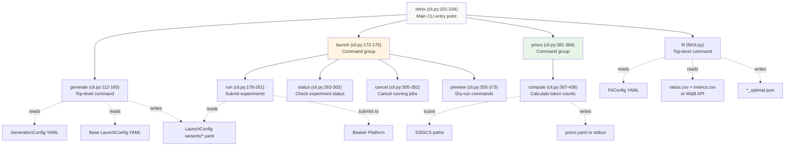
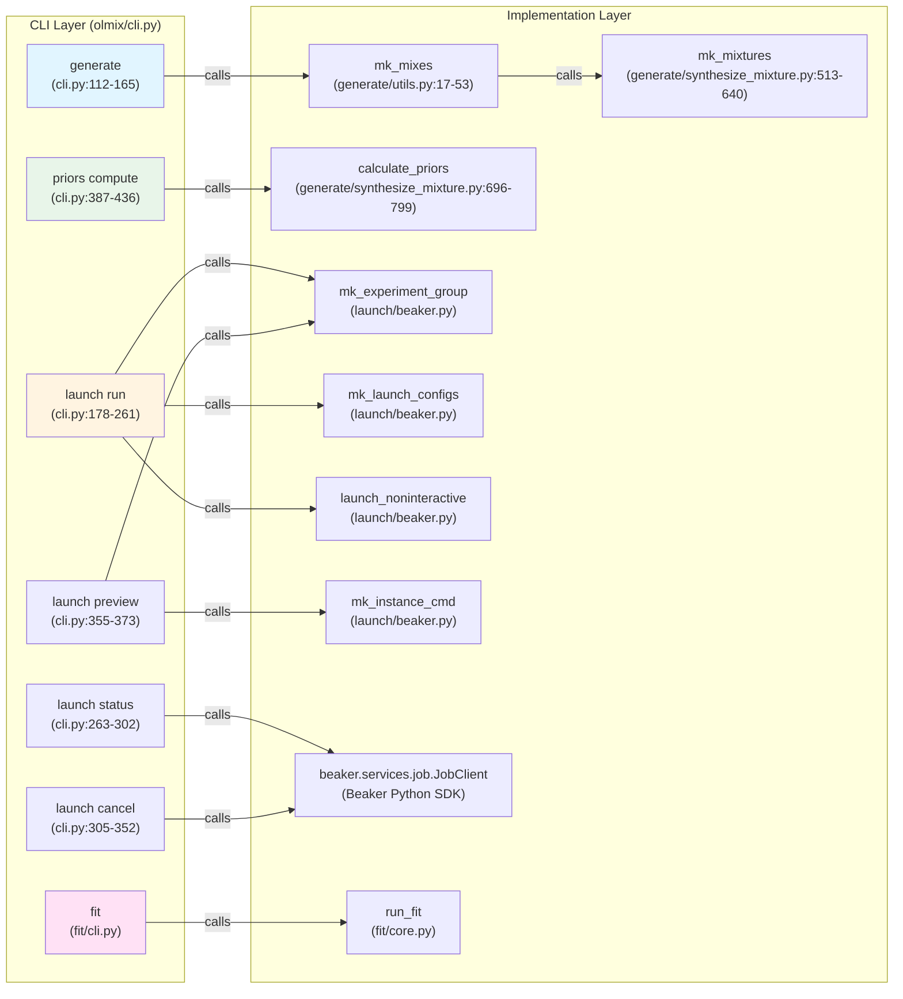

<!-- source: DeepWiki mcp.deepwiki.com · repo allenai/olmix · page 2 CLI Reference · fetched 2026-10-26 -->

# CLI Reference

<details>
<summary>Relevant source files</summary>

The following files were used as context for generating this wiki page:

- [olmix/aliases.py](olmix/aliases.py)
- [olmix/cli.py](olmix/cli.py)
- [olmix/generate/synthesize_mixture.py](olmix/generate/synthesize_mixture.py)
- [olmix/generate/utils.py](olmix/generate/utils.py)
- [olmix/launch/utils.py](olmix/launch/utils.py)
- [pyproject.toml](pyproject.toml)

</details>


This page provides an overview of the olmix command-line interface structure, entry points, and common usage patterns. The CLI is the primary way users interact with olmix to generate mixture variants, launch experiments, compute priors, and optimize mixtures.

For detailed documentation of individual commands, see:
- [olmix generate](#2.1) - Generate mixture variants through Dirichlet sampling
- [olmix launch](#2.2) - Manage Beaker experiments (run, status, cancel, preview)
- [olmix fit](#2.3) - Optimize mixtures based on swarm results
- [olmix priors](#2.4) - Calculate token distributions from data sources

---

## CLI Entry Points

The olmix package provides two entry points defined in [pyproject.toml:53-55]():

| Entry Point | Command | Module | Purpose |
|-------------|---------|--------|---------|
| Primary | `olmix` | `olmix.cli:cli` | Main CLI with generate, launch, and priors commands |
| Secondary | `olmix-fit` | `olmix.fit.cli:fit` | Direct access to fit command (also available as `olmix fit`) |

Both entry points are installed when you install the olmix package. The `olmix-fit` entry point exists for backward compatibility and convenience.

**Verification:**
```bash
# Check installation
which olmix
olmix --help

# Both commands provide the same functionality
olmix fit --help
olmix-fit --help
```

Sources: [pyproject.toml:53-55](), [olmix/cli.py:101-104]()

---

## Command Hierarchy

The olmix CLI uses Click's group-based command structure, organizing commands into logical groups:



**Key observations:**
- **Top-level commands** (`generate`, `fit`) perform single operations
- **Command groups** (`launch`, `priors`) organize related subcommands
- Each command operates on specific configuration types (see [Configuration System](#3))

Sources: [olmix/cli.py:101-449]()

---

## Code-to-Command Mapping

This diagram shows how CLI commands map to implementation modules and key functions:



**Key patterns:**
- CLI commands in [olmix/cli.py]() are thin wrappers that handle argument parsing and user interaction
- Core logic lives in dedicated modules (`generate/`, `launch/`, `fit/`)
- [olmix/cli.py:101-104]() uses `prepare_cli_environment()` from olmo-core to set up logging

Sources: [olmix/cli.py:1-453](), [olmix/generate/utils.py:17-53](), [olmix/generate/synthesize_mixture.py:513-799]()

---

## Common Patterns

### Configuration Files

All olmix commands operate on YAML configuration files. The CLI loads these using Pydantic models:

| Command | Config Type | Load Method | File Location |
|---------|-------------|-------------|---------------|
| `generate` | `GenerationConfig` | `GenerationConfig.from_yaml()` | [olmix/aliases.py:220-225]() |
| `launch` | `LaunchConfig` | `LaunchConfig.from_yaml()` | [olmix/aliases.py:321-325]() |
| `fit` | `FitConfig` | `FitConfig.from_yaml()` | [olmix/fit/config.py]() |

**Example loading pattern** from [olmix/cli.py:138-139]():
```python
gen_config = GenerationConfig.from_yaml(config)
base_config = LaunchConfig.from_yaml(base)
```

Sources: [olmix/cli.py:79-98](), [olmix/aliases.py:220-325]()

### Path Handling

The CLI accepts paths in multiple formats:

```python
# File paths (relative or absolute)
--config ./configs/generation.yaml
--variants ./output/variants/

# Directory paths (for variants)
--variants ./output/variants/  # Loads all *.yaml and *.yml files
```

The [_load_launch_configs]() helper at [olmix/cli.py:79-98]() handles both single files and directories, automatically discovering and sorting YAML files in directories.

Sources: [olmix/cli.py:79-98]()

### Output Organization

Commands write outputs to structured directories:

| Command | Output Path | Contents |
|---------|-------------|----------|
| `generate` | `--output <dir>/` | `{name}-{group_uuid}-{idx:04}.yaml` files |
| `launch run` | `output/mixes/{name}/{group_uuid}.json` | Launch metadata with Beaker experiment IDs |
| `fit` | `output/fit/{config_name}/` | Optimal mixtures, plots, regression models |
| `priors compute` | `--output <file>` or stdout | YAML with `relative_sizes` and `token_counts` |

**Launch metadata structure** from [olmix/cli.py:34-76]():
```json
{
  "metadata": {
    "timestamp": "2024-01-01T00:00:00Z",
    "beaker_user": "USER",
    "group_id": "abc123",
    "wandb_url": "https://wandb.ai/ai2-llm/olmix?group=abc123",
    "git_commit": "abc12345",
    "git_branch": "main"
  },
  "config": { ... },
  "experiments": [
    {
      "variant": 0,
      "beaker_id": "01ABCDEF",
      "beaker_name": "experiment-name",
      "beaker_url": "https://beaker.org/ex/01ABCDEF"
    }
  ]
}
```

Sources: [olmix/cli.py:34-76](), [olmix/cli.py:144-161]()

### User Interaction

The CLI uses several libraries for user interaction:

| Library | Purpose | Usage Location |
|---------|---------|----------------|
| `click` | Command parsing, prompts | Throughout [olmix/cli.py]() |
| `yaspin` | Progress spinners | [olmix/cli.py:212-245]() |
| `tqdm` | Progress bars | [olmix/cli.py:242]() |
| `logger` | Logging output | All commands |

**Confirmation prompts** ensure users review configurations before launching expensive experiments:
```python
if not click.confirm("Proceed with this configuration?", default=False):
    logger.info("Launch cancelled!")
    return
```

Sources: [olmix/cli.py:208-210]()

---

## Command Overview

### olmix generate

**Purpose:** Create LaunchConfig variants by sampling mixture weights from a Dirichlet distribution.

**Key options:**
- `-c, --config`: Path to GenerationConfig YAML
- `--base`: Path to base LaunchConfig YAML  
- `-o, --output`: Output directory for variant YAML files

**Workflow:**
1. Load GenerationConfig with data sources, priors, and sampling parameters
2. Load base LaunchConfig with infrastructure and training settings
3. Generate mixture weights using [mk_mixes()]() from [olmix/generate/utils.py:17-53]()
4. Write self-contained LaunchConfig YAML files (one per variant)

**Output:** `{name}-{group_uuid}-{idx:04}.yaml` files in output directory

See [olmix generate](#2.1) for detailed documentation.

Sources: [olmix/cli.py:112-165]()

### olmix launch

**Purpose:** Manage Beaker experiment lifecycle (submission, monitoring, cancellation).

**Subcommands:**

| Subcommand | Purpose | Key Options |
|------------|---------|-------------|
| `run` | Submit experiments to Beaker | `-v/--variants`, `--dry-run` |
| `status` | Check experiment status | `-c/--config`, `-g/--group-id` |
| `cancel` | Stop running experiments | `-c/--config`, `-g/--group-id` |
| `preview` | Preview training commands | `-v/--variants` |

**Workflow for `launch run`:**
1. Load LaunchConfig(s) from variants directory
2. Build Beaker experiment group using [mk_experiment_group()]()
3. Convert to Beaker launch configs using [mk_launch_configs()]()
4. Submit to Beaker (or dry-run locally if `--dry-run` flag)
5. Save launch metadata to `output/mixes/{name}/{group_uuid}.json`

See [olmix launch](#2.2) for detailed documentation.

Sources: [olmix/cli.py:172-374]()

### olmix priors

**Purpose:** Calculate token distributions from data sources for use in GenerationConfig.

**Subcommands:**

| Subcommand | Purpose | Key Options |
|------------|---------|-------------|
| `compute` | Scan S3/GCS paths and count tokens | `-c/--config`, `-n/--no-cache`, `-o/--output` |

**Workflow:**
1. Load DataConfig from any config file (extracts `data` section)
2. Scan cloud storage paths using [calculate_priors()]() from [olmix/generate/synthesize_mixture.py:696-799]()
3. Count tokens across all sources/topics/quality levels
4. Output as YAML with `relative_sizes` and `token_counts`

**Caching:** Results are cached in `cache/priors_cache_{hash}.json` based on source paths. Use `--no-cache` to force recalculation.

See [olmix priors](#2.4) for detailed documentation.

Sources: [olmix/cli.py:387-436]()

### olmix fit

**Purpose:** Optimize mixture weights by fitting regression models to swarm results.

**Key options:**
- `-c, --config`: Path to FitConfig YAML
- Various flags for visualization, caching, and output control

**Workflow:**
1. Load swarm results from CSV files or WandB API
2. Build regression models (one per evaluation metric)
3. Use proposer to optimize mixture weights
4. Output optimal mixture as JSON and visualizations

**Note:** The fit command has extensive options documented in its own module. It can be invoked as either `olmix fit` or `olmix-fit`.

See [olmix fit](#2.3) for detailed documentation.

Sources: [olmix/cli.py:443-449]()

---

## Environment Setup

The CLI uses `prepare_cli_environment()` from olmo-core at startup ([olmix/cli.py:104]()), which:
- Configures logging to stdout
- Sets log format and level
- Ensures proper encoding for Unicode output

**Required environment variables** (for different commands):

| Variable | Required For | Purpose |
|----------|--------------|---------|
| `BEAKER_TOKEN` | `launch run` | Beaker API authentication |
| `WANDB_API_KEY` | `launch run`, `fit` (WandB mode) | WandB API access |
| `AWS_PROFILE` or AWS credentials | `generate`, `launch`, `priors` | S3 access |
| `GOOGLE_CLOUD_PROJECT` | GCS paths | GCS access |

Sources: [olmix/cli.py:104]()

---

## Git Integration

Launch commands automatically capture git metadata using [_get_git_info()]() at [olmix/cli.py:24-31]():

```python
def _get_git_info() -> dict[str, str]:
    """Get current git commit and branch info."""
    try:
        commit = subprocess.check_output(["git", "rev-parse", "HEAD"], text=True).strip()[:8]
        branch = subprocess.check_output(["git", "rev-parse", "--abbrev-ref", "HEAD"], text=True).strip()
        return {"git_commit": commit, "git_branch": branch}
    except Exception:
        return {"git_commit": "unknown", "git_branch": "unknown"}
```

This metadata is saved in launch metadata JSON files for reproducibility tracking.

Sources: [olmix/cli.py:24-31]()

---

## Error Handling

The CLI uses several error handling patterns:

**Validation errors:**
```python
if not p.is_dir():
    raise click.BadParameter(f"Variants path is not a file or directory: {variants_path}")
```

**User cancellation:**
```python
except KeyboardInterrupt:
    logger.warning("\nAborting experiment group launch! You may need to manually stop the launched experiments.")
```

**Graceful fallbacks:**
- Missing git info returns `"unknown"` instead of failing
- Missing cache falls back to computing from source

Sources: [olmix/cli.py:83-98](), [olmix/cli.py:257-260]()

---

## Next Steps

For detailed usage of each command, see:
- [Generate Command](#2.1) - Dirichlet sampling and variant generation
- [Launch Commands](#2.2) - Beaker integration and experiment management  
- [Fit Command](#2.3) - Regression and optimization
- [Priors Command](#2.4) - Token counting and prior computation

For configuration system details, see [Configuration System](#3).

---

