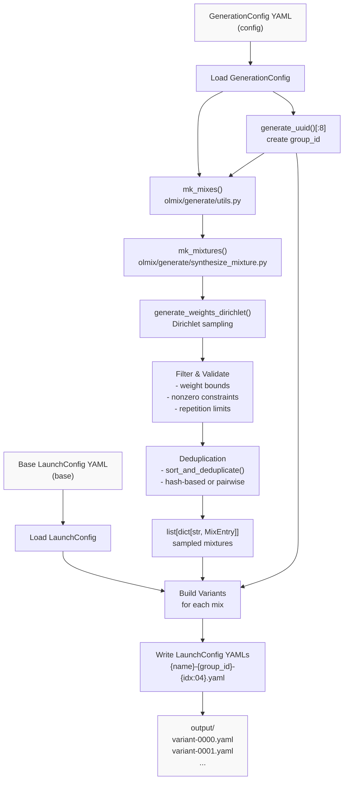
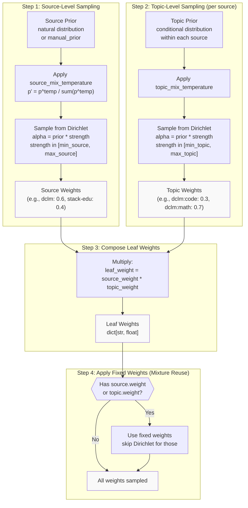
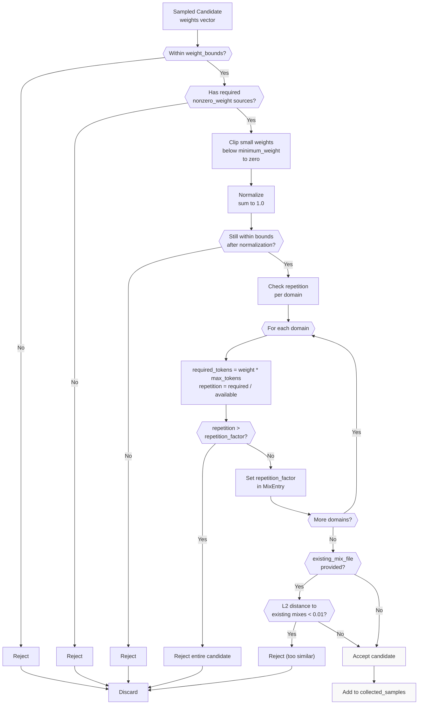

<!-- source: DeepWiki mcp.deepwiki.com · repo allenai/olmix · page 2.1 olmix generate · fetched 2026-10-26 -->

# olmix generate

<details>
<summary>Relevant source files</summary>

The following files were used as context for generating this wiki page:

- [README.md](README.md)
- [olmix/aliases.py](olmix/aliases.py)
- [olmix/cli.py](olmix/cli.py)
- [olmix/generate/synthesize_mixture.py](olmix/generate/synthesize_mixture.py)
- [olmix/generate/utils.py](olmix/generate/utils.py)
- [olmix/launch/utils.py](olmix/launch/utils.py)

</details>


## Purpose and Scope

This page documents the `olmix generate` command, which creates a swarm of mixture variants through Dirichlet-based sampling. The command takes a `GenerationConfig` YAML (defining data sources and sampling parameters) and a base `LaunchConfig` YAML (defining infrastructure and training settings), then produces multiple self-contained `LaunchConfig` variants, each with a unique sampled data mixture.

For information about launching the generated variants to Beaker, see [olmix launch](#2.2). For configuration details, see [GenerationConfig](#3.1) and [LaunchConfig](#3.2). For computing priors before generation, see [olmix priors](#2.4).

---

## Command Syntax

```bash
olmix generate --config <generation_config.yaml> \
               --base <base_launch_config.yaml> \
               --output <output_directory>
```

| Flag | Required | Description |
|------|----------|-------------|
| `-c`, `--config` | Yes | Path to `GenerationConfig` YAML |
| `--base` | Yes | Path to base `LaunchConfig` YAML (template) |
| `-o`, `--output` | Yes | Output directory for variant YAML files |

**Sources:** [olmix/cli.py:112-165]()

---

## Command Flow



**Diagram: End-to-end flow from configuration files to variant outputs**

**Sources:** [olmix/cli.py:112-165](), [olmix/generate/utils.py:17-53](), [olmix/generate/synthesize_mixture.py:513-640]()

---

## Input Requirements

### GenerationConfig Structure

The `GenerationConfig` specifies what data exists, how to sample from it, and constraints on the sampling process. It has four top-level sections:

```yaml
name: my-swarm           # Experiment name prefix
data:                    # DataConfig - sources hierarchy
  sources: [...]         
priors:                  # PriorsConfig - token distributions
  relative_sizes: {...}
  token_counts: {...}
swarm:                   # SwarmConfig - sampling parameters
  variants: 10
  min_strength: 0.1
  max_strength: 5.0
  # ... (see below)
max_tokens: 600000000    # Token budget per proxy run
```

**Data Hierarchy:** The `data` field defines sources in a three-level hierarchy: **source → topic → quality**. Each level can have an optional `weight` field. See [DataConfig Hierarchy](#3.4) for details.

**Priors:** The `priors` field provides two distributions at the **leaf level** (fully-qualified domain names like `dclm:science_math_and_technology` or `arxiv:vigintile_0015`):
- `relative_sizes`: Fractional weight of each leaf domain (sums to 1.0) - used as the Dirichlet prior center
- `token_counts`: Absolute token count per leaf domain - used for repetition constraints

These can be computed automatically with `olmix priors compute`. See [olmix priors](#2.4).

**Swarm Parameters:** The `swarm` field controls Dirichlet sampling behavior:

| Field | Type | Default | Description |
|-------|------|---------|-------------|
| `variants` | int | `1` | Number of mixture variants to generate |
| `seed` | int | `42` | Random seed for reproducibility |
| `min_strength` / `max_strength` | float | `0.1` / `5.0` | Dirichlet concentration range (low = diverse, high = near prior) |
| `min_source_strength` / `max_source_strength` | float | (uses `min_strength`/`max_strength`) | Override strength for source-level sampling |
| `min_topic_strength` / `max_topic_strength` | float | (uses `min_strength`/`max_strength`) | Override strength for topic-level sampling |
| `minimum_weight` | float | `0.002` | Domains below this threshold are zeroed out |
| `minimum_source_weight` / `minimum_topic_weight` | float | (uses `minimum_weight`) | Override minimum weight per hierarchy level |
| `nonzero_weight` | list[str] | `None` | Domain keys that must be nonzero in every variant |
| `manual_prior` | dict[str, float] | `None` | Override source-level Dirichlet prior |
| `manual_topic_prior` | dict[str, float] | `None` | Override topic-level Dirichlet prior for specific keys |
| `repetition_factor` | float | `1.0` | Maximum allowed data repetition per domain |
| `enable_bound` | bool | `true` | Enforce repetition bound during sampling |
| `sample_multiplier` | int | `10` | Generate N×variants candidates before filtering |
| `existing_mix_file` | str | `None` | Pickle of prior swarm ratios; reject samples too close to existing ones |

**Sources:** [olmix/aliases.py:185-209](), [olmix/aliases.py:211-226](), [olmix/generate/synthesize_mixture.py:33-38]()

### Base LaunchConfig

The base `LaunchConfig` provides the template for all variants. It contains infrastructure settings, training configuration, and evaluation setup that remain constant across the swarm. Each generated variant inherits these settings and adds a unique `mix` field.

The base config should include:
- `infra`: Beaker cluster, GPUs, budget, priority
- `training`: Model size, tokenizer, Chinchilla multiple, seed
- `data`: Complete `DataConfig` (same as in `GenerationConfig`)
- `eval`: Evaluation tasks and configuration

The `mix` field in the base config (if present) is **ignored** and replaced by sampled mixtures.

**Sources:** [olmix/aliases.py:299-326](), [olmix/cli.py:139-152]()

---

## The Generation Process

### Hierarchical Dirichlet Sampling

The generation process samples weights at two levels: **source-level** and **topic-level** (topic here refers to any leaf unit under a source: topics, quality buckets, or topic:quality combinations).



**Diagram: Two-stage hierarchical Dirichlet sampling with optional fixed weights**

**Implementation Details:**

1. **Prior Construction** [olmix/generate/synthesize_mixture.py:176-282]():
   - Split leaf distribution into source and topic distributions
   - Source prior: sum of leaf weights per source
   - Topic prior: conditional distribution within each source (normalized to sum to 1.0)
   - If `manual_prior` is set, override source-level priors
   - If `manual_topic_prior` is set, override topic-level priors for specific sources

2. **Temperature Scaling** [olmix/generate/synthesize_mixture.py:286-301]():
   - If `source_mix_temperature < 1.0`: `prior' = prior^temp / sum(prior^temp)` makes distribution more uniform
   - If `topic_mix_temperature < 1.0`: apply same transformation to topic priors
   - Lower temperature → more uniform sampling (higher diversity)
   - Higher temperature → samples closer to natural distribution

3. **Strength Sampling** [olmix/generate/synthesize_mixture.py:365-403]():
   - If `min_strength == max_strength`: single Dirichlet sample with that concentration
   - Otherwise: sample at 15 log-spaced strengths between min and max
   - Concentration parameter: `alpha = prior * strength`
   - Low strength (e.g., 0.1) → high variance, extreme mixtures
   - High strength (e.g., 5.0) → low variance, samples near prior

4. **Fixed Weights (Mixture Reuse)** [olmix/generate/synthesize_mixture.py:303-342]():
   - If `source.weight` is set: use that value, don't sample source weight
   - If `topic.weight` is set: use that value, don't sample topic weight
   - All sources must have weights if any do (consistency check)
   - Fixed weights enable iterative optimization: freeze optimized domains, vary new ones

**Sources:** [olmix/generate/synthesize_mixture.py:131-511](), [olmix/aliases.py:185-209]()

### Constraints and Filtering

After sampling, each candidate undergoes multiple filtering stages:



**Diagram: Multi-stage filtering pipeline for sampled candidates**

**Weight Bounds Calculation** [olmix/generate/synthesize_mixture.py:167-173]():
```
For each leaf domain:
  available_tokens = token_counts[domain]
  max_allowed_weight = min(available_tokens * repetition_factor / max_tokens, 1.0)
  bounds[domain] = (0.0, max_allowed_weight)
```

This ensures that at the configured `repetition_factor`, the domain has enough data to support the requested training budget (`max_tokens`).

**Clipping Behavior** [olmix/generate/synthesize_mixture.py:53-91]():
- Source-level clipping: If `weight < minimum_source_weight`, set to 0
- Topic-level clipping: If `weight < minimum_topic_weight * source_total`, set to 0
- Relative vs. absolute thresholds enable hierarchical control

**Nonzero Constraints** [olmix/generate/synthesize_mixture.py:93-128]():
- `nonzero_weight` can specify sources (e.g., `"dclm"`) or topics (e.g., `"dclm:code"`)
- Check considers post-clipping weights
- Source requirement: `sum(topics) > minimum_source_weight`
- Topic requirement: `weight >= minimum_topic_weight * source_total`

**Sources:** [olmix/generate/synthesize_mixture.py:414-489](), [olmix/generate/synthesize_mixture.py:53-128]()

### Deduplication

After filtering, the system deduplicates near-identical mixtures:

**Hash-Based Deduplication** (for >10,000 candidates) [olmix/generate/synthesize_mixture.py:818-836]():
```python
rounded = tuple(np.round(vec / threshold).astype(int))
if rounded not in seen_hashes:
    seen_hashes.add(rounded)
    unique_samples.append(sample)
```
- Rounds weights to nearest `threshold` (default 1e-5)
- O(N) time complexity
- Used when `len(collected_samples) > 10000`

**Pairwise Deduplication** (for ≤10,000 candidates) [olmix/generate/synthesize_mixture.py:802-815]():
```python
is_duplicate = any(np.allclose(sample[0], unique_sample[0], atol=threshold) 
                   for unique_sample in unique_samples)
```
- Compares each candidate to all unique samples
- O(N²) time complexity but more accurate
- Used when `len(collected_samples) <= 10000`

After deduplication, the system randomly selects `swarm.variants` samples from the unique set.

**Sources:** [olmix/generate/synthesize_mixture.py:493-510](), [olmix/generate/synthesize_mixture.py:802-836]()

---

## Output Structure

### Generated Files

The command produces one YAML file per variant in the output directory:

```
output/
  my-swarm-a1b2c3d4-0000.yaml
  my-swarm-a1b2c3d4-0001.yaml
  my-swarm-a1b2c3d4-0002.yaml
  ...
```

**Filename Format:** `{name}-{group_id}-{index:04}.yaml`
- `name`: From `GenerationConfig.name` or config filename stem
- `group_id`: 8-character UUID generated at runtime
- `index`: Zero-padded 4-digit sequential index

**Sources:** [olmix/cli.py:141-164]()

### Variant Content

Each variant is a complete `LaunchConfig` with:

```yaml
name: my-swarm-a1b2c3d4-0042
description: ""                    # From base config
group_id: a1b2c3d4                 # Shared across swarm

infra:                             # Copied from base config
  budget: ai2/oe-training
  cluster: ai2/jupiter-cirrascale-2
  gpus: 8
  # ...

training:                          # Copied from base config
  proxy_model_id: olmo2_30m
  chinchilla_multiple: 1.0
  # ...

data:                              # Copied from base config
  sources:
    - name: dclm
      topics:
        - name: science_math_and_technology
          paths: [...]
    # ...

eval:                              # Copied from base config
  tasks: [...]

mix:                               # UNIQUE TO THIS VARIANT
  "arxiv":
    weight: 0.123
    repetition_factor: 1.0
  "dclm:science_math_and_technology":
    weight: 0.456
    repetition_factor: 1.234
  "wikipedia":
    weight: 0.421
    repetition_factor: 1.0
```

**Mix Field Structure:**

The `mix` field is a dictionary mapping domain names to `MixEntry` objects:

```python
class MixEntry(BaseModel):
    weight: float              # Mixture weight (all weights sum to 1.0)
    repetition_factor: float   # Data repetition multiplier (1.0 = no repetition)
```

**Domain Name Format:**
- Flat source: `"source_name"` (e.g., `"wikipedia"`)
- Source + topic: `"source:topic"` (e.g., `"dclm:code"`)
- Source + topic + quality: `"source:topic:quality"` (e.g., `"arxiv:physics:vigintile_0015"`)

**Sources:** [olmix/aliases.py:228-233](), [olmix/generate/synthesize_mixture.py:586-592]()

### Visualization Artifacts

If a `group_uuid` is provided (always true for CLI usage), the system generates histograms in `cache/swarms/{group_uuid}/`:

- `{domain}_weights_hist.png`: Distribution of weights across variants for each topic/quality domain
- `{source}_source_weights_hist.png`: Distribution of source-level totals across variants

These help visualize the diversity of the swarm.

**Sources:** [olmix/generate/synthesize_mixture.py:594-638]()

---

## Examples

### Basic Generation

```bash
# Step 1: Compute priors (only needed once per data config)
olmix priors compute \
  --config configs/examples/generate/example.yaml

# Step 2: Generate 10 variants
olmix generate \
  --config configs/examples/generate/example.yaml \
  --base configs/examples/launch/data_proportions/mix_baseline.yaml \
  --output output/my_swarm/
```

**Output:**
```
Generated 10 variant(s) in output/my_swarm/
  example-a1b2c3d4-0000.yaml
  example-a1b2c3d4-0001.yaml
  ...
  example-a1b2c3d4-0009.yaml
```

### Mixture Reuse Example

To freeze previously-optimized weights and only vary new domains:

```yaml
# configs/generate/reuse.yaml
name: stack-edu-swarm

data:
  sources:
    # Existing optimized domains (frozen)
    - name: existing
      topics:
        - name: dclm:science_math_and_technology
          paths: [...]
          weight: 0.55        # Fixed from prior optimization
        - name: dclm:software_development
          paths: [...]
          weight: 0.30        # Fixed
        - name: wikipedia
          paths: [...]
          weight: 0.05        # Fixed
    
    # New domains to explore (will be sampled)
    - name: stack-edu
      topics:
        - name: Python
          paths: [...]       # No weight → sampled freely
        - name: Java
          paths: [...]       # No weight → sampled freely

priors:
  relative_sizes:
    # Must be at leaf level for ALL domains (frozen + free)
    "dclm:science_math_and_technology": 0.547
    "dclm:software_development": 0.154
    "wikipedia": 0.024
    "stack-edu:Python": 0.15
    "stack-edu:Java": 0.125
  token_counts:
    # Token counts for all domains
    # ...

swarm:
  variants: 20
  # ... other params
```

In this example:
- The source `existing` will always get `0.90` total weight (0.55 + 0.30 + 0.05)
- The source `stack-edu` will get `0.10` total weight (varying)
- Within `stack-edu`, the ratio between Python and Java will vary per the Dirichlet

See [Mix Field and Mixture Reuse](#3.5) for detailed mechanics.

**Sources:** [README.md:184-290](), [olmix/generate/synthesize_mixture.py:303-342]()

---

## Implementation Details

### Key Functions

| Function | Location | Purpose |
|----------|----------|---------|
| `generate()` | [olmix/cli.py:112-165]() | CLI entry point; loads configs, calls mk_mixes, writes outputs |
| `mk_mixes()` | [olmix/generate/utils.py:17-53]() | Wrapper that calls mk_mixtures and logs nested summary |
| `mk_mixtures()` | [olmix/generate/synthesize_mixture.py:513-640]() | Main orchestrator; sets seed, calls generate_weights_dirichlet, converts to MixEntry dicts |
| `generate_weights_dirichlet()` | [olmix/generate/synthesize_mixture.py:131-511]() | Core sampling logic; two-level Dirichlet, filtering, deduplication |
| `calculate_priors()` | [olmix/generate/synthesize_mixture.py:696-799]() | Scans S3/GCS paths to compute token counts and relative sizes |

### Key Classes

| Class | Location | Purpose |
|-------|----------|---------|
| `GenerationConfig` | [olmix/aliases.py:211-226]() | Input configuration model for generation |
| `LaunchConfig` | [olmix/aliases.py:299-326]() | Output configuration model for each variant |
| `MixEntry` | [olmix/aliases.py:228-233]() | Represents weight + repetition for one domain |
| `SwarmConfig` | [olmix/aliases.py:185-209]() | Sampling parameters (strength, temperature, etc.) |
| `DataConfig` | [olmix/aliases.py:178-183]() | Hierarchical data source specification |

**Sources:** [olmix/cli.py:112-165](), [olmix/generate/utils.py:1-54](), [olmix/generate/synthesize_mixture.py:1-950](), [olmix/aliases.py:1-341]()

---

