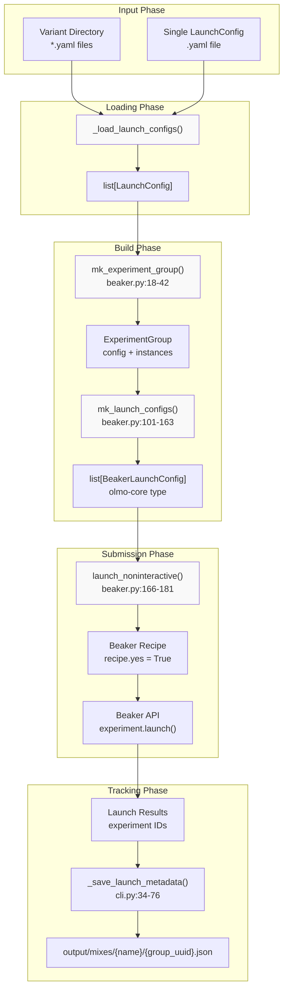
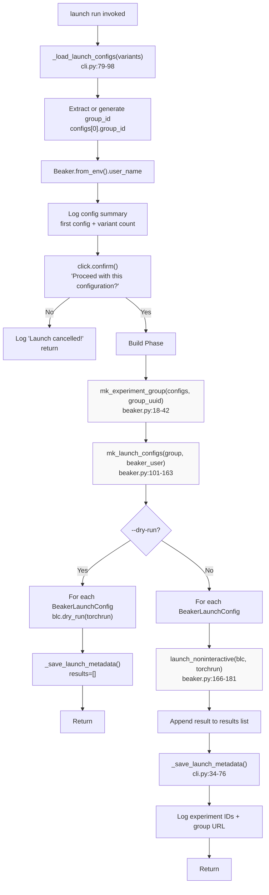
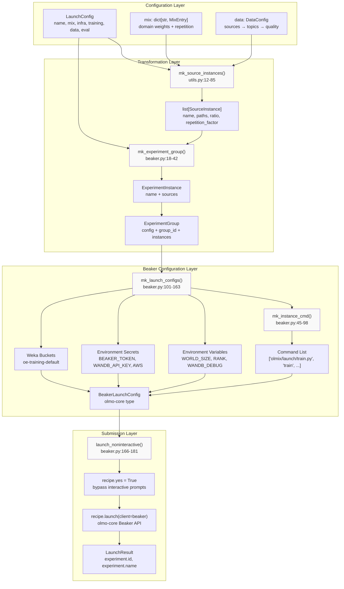
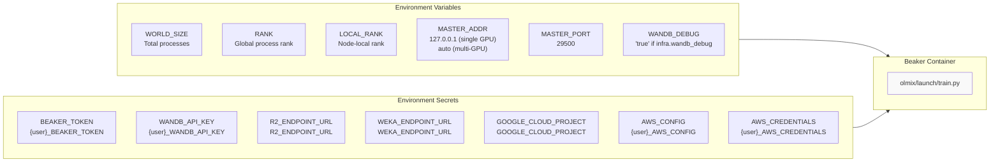
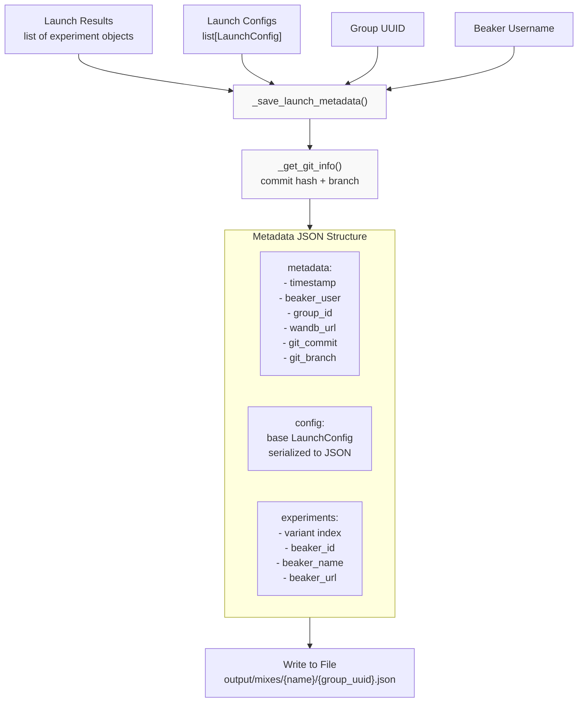

<!-- source: DeepWiki mcp.deepwiki.com · repo allenai/olmix · page 2.2 olmix launch · fetched 2026-10-26 -->

# olmix launch

<details>
<summary>Relevant source files</summary>

The following files were used as context for generating this wiki page:

- [olmix/__init__.py](olmix/__init__.py)
- [olmix/aliases.py](olmix/aliases.py)
- [olmix/cli.py](olmix/cli.py)
- [olmix/generate/synthesize_mixture.py](olmix/generate/synthesize_mixture.py)
- [olmix/generate/utils.py](olmix/generate/utils.py)
- [olmix/launch/__init__.py](olmix/launch/__init__.py)
- [olmix/launch/beaker.py](olmix/launch/beaker.py)
- [olmix/launch/utils.py](olmix/launch/utils.py)
- [tests/test_cli.py](tests/test_cli.py)
- [tests/test_config.py](tests/test_config.py)
- [tests/test_imports.py](tests/test_imports.py)

</details>


## Purpose and Scope

The `olmix launch` command group manages the submission and monitoring of training experiments on the Beaker platform. After generating mixture variants with [olmix generate](#2.1), these commands submit the variants as proxy model training runs, track their execution status, and enable cancellation if needed. The launch system converts LaunchConfig YAML files into Beaker-specific configurations and handles non-interactive job submission.

For information about the training infrastructure itself (Chinchilla scaling, data pipelines, etc.), see [Training Infrastructure](#5). For details on the configuration schema, see [LaunchConfig](#3.2).

---

## Command Overview

The launch command group provides four subcommands for managing experiment lifecycles:

| Subcommand | Purpose | Primary Use Case |
|------------|---------|------------------|
| `run` | Submit experiments to Beaker | Launch a swarm of training runs |
| `status` | Query job status for a group | Monitor running experiments |
| `cancel` | Stop all jobs in a group | Terminate failed or unwanted runs |
| `preview` | Display training commands without launching | Validate configuration before submission |

**Sources:** [olmix/cli.py:172-374]()

---

## Launch Workflow



**Launch Workflow from YAML to Beaker Submission**

This diagram shows the complete transformation pipeline from LaunchConfig files to running Beaker experiments. The process has four phases: loading configs from disk, building Beaker-specific structures, submitting to the API, and tracking metadata for reproducibility.

**Sources:** [olmix/cli.py:79-98](), [olmix/cli.py:192-261](), [olmix/launch/beaker.py:18-181]()

---

## olmix launch run

### Command Signature

```bash
olmix launch run --variants <PATH> [--dry-run]
```

### Options

| Option | Type | Required | Description |
|--------|------|----------|-------------|
| `-v, --variants` | Path | Yes | Path to a LaunchConfig file or directory of LaunchConfig files |
| `--dry-run` | Flag | No | Print experiment commands without submitting to Beaker |

### Execution Flow



**olmix launch run Execution Flow**

This diagram traces the complete execution path of the `run` subcommand, from loading configs through interactive confirmation to Beaker submission. The dry-run path bypasses actual submission but still validates configuration correctness.

**Sources:** [olmix/cli.py:178-261]()

### Key Implementation Details

The `launch run` command performs several critical steps:

1. **Config Loading**: Accepts either a single YAML file or a directory containing multiple variant files [olmix/cli.py:79-98]()
2. **Group ID Assignment**: Uses `group_id` from the first config, or generates a UUID if not present [olmix/cli.py:199]()
3. **Interactive Confirmation**: Prompts user to review the base config and variant count before submission [olmix/cli.py:208-210]()
4. **Torchrun Detection**: Automatically enables torchrun mode for multi-GPU configs (`gpus > 1`) [olmix/cli.py:226, 241]()
5. **Metadata Persistence**: Saves a JSON file with experiment IDs, Beaker URLs, and git info for reproducibility [olmix/cli.py:34-76]()

The metadata file is saved to `output/mixes/{name}/{group_uuid}.json` and contains:
- Timestamp and Beaker username
- Git commit and branch info
- W&B group URL
- Per-experiment Beaker IDs and URLs

**Sources:** [olmix/cli.py:178-261](), [olmix/cli.py:34-76]()

---

## olmix launch status

### Command Signature

```bash
olmix launch status --config <PATH> [--group-id <ID>]
```

### Options

| Option | Type | Required | Description |
|--------|------|----------|-------------|
| `-c, --config` | Path | Yes | Path to any generated LaunchConfig file (for cluster info) |
| `-g, --group-id` | String | No | Explicit group ID; auto-extracted from config if omitted |

### Implementation

The `status` command queries the Beaker job API to retrieve current job states for all experiments matching the group ID pattern:

1. **Load Config**: Parse the LaunchConfig to extract `infra.cluster` and optionally `group_id` [olmix/cli.py:287-288]()
2. **Extract Group ID**: Use `--group-id` if provided, otherwise fall back to `launch_cfg.group_id` [olmix/cli.py:289-291]()
3. **Query Jobs**: Use `JobClient.list(cluster=cluster)` to fetch all jobs on the cluster [olmix/cli.py:294]()
4. **Filter by Prefix**: Match jobs where `display_name` starts with `{name}-{group_id}` [olmix/cli.py:296-300]()
5. **Display Results**: Log a list of `{status, display_name}` dicts, sorted by name [olmix/cli.py:301-302]()

**Sources:** [olmix/cli.py:263-302]()

---

## olmix launch cancel

### Command Signature

```bash
olmix launch cancel --config <PATH> [--group-id <ID>]
```

### Options

| Option | Type | Required | Description |
|--------|------|----------|-------------|
| `-c, --config` | Path | Yes | Path to any generated LaunchConfig file (for cluster info) |
| `-g, --group-id` | String | No | Explicit group ID; auto-extracted from config if omitted |

### Implementation

The `cancel` command stops all running or queued jobs for an experiment group:

1. **Load Config and Group ID**: Same as `status` command [olmix/cli.py:329-333]()
2. **Query Jobs**: Fetch all jobs on the cluster [olmix/cli.py:335-340]()
3. **Filter by Prefix**: Match jobs where `display_name` starts with `{name}-{group_id}` [olmix/cli.py:339]()
4. **Interactive Confirmation**: Display the list of jobs and prompt `"Cancel these jobs?"` [olmix/cli.py:349]()
5. **Stop Jobs**: For each confirmed job, call `JobClient.stop(job_id)` [olmix/cli.py:350-352]()

This command is useful for terminating a swarm that is producing poor results or if a configuration error is discovered after launch.

**Sources:** [olmix/cli.py:305-352]()

---

## olmix launch preview

### Command Signature

```bash
olmix launch preview --variants <PATH>
```

### Options

| Option | Type | Required | Description |
|--------|------|----------|-------------|
| `-v, --variants` | Path | Yes | Path to a LaunchConfig file or directory of LaunchConfig files |

### Implementation

The `preview` command displays the exact training commands that would be executed without submitting to Beaker:

1. **Load Configs**: Same as `run` command [olmix/cli.py:367]()
2. **Extract Group ID**: Use existing `group_id` or generate UUID [olmix/cli.py:368]()
3. **Build Experiment Group**: Call `mk_experiment_group(configs, group_uuid)` [olmix/cli.py:370]()
4. **Generate Commands**: For each experiment instance, call `mk_instance_cmd()` [olmix/cli.py:372-373]()
5. **Display**: Log the full command list for each variant [olmix/cli.py:373]()

This is particularly useful for debugging configuration issues before consuming Beaker resources. The displayed commands match exactly what would run inside the Beaker container.

**Sources:** [olmix/cli.py:355-373]()

---

## Beaker Integration Architecture



**Beaker Integration Architecture: Config to API**

This diagram shows the complete transformation pipeline from high-level LaunchConfig to low-level Beaker API calls. Key functions (`mk_source_instances`, `mk_experiment_group`, `mk_launch_configs`, `mk_instance_cmd`, `launch_noninteractive`) bridge the layers.

**Sources:** [olmix/launch/beaker.py:1-188](), [olmix/launch/utils.py:12-85]()

### mk_experiment_group

**Function:** `mk_experiment_group(configs: list[LaunchConfig], group_uuid: str) -> ExperimentGroup`

**Location:** [olmix/launch/beaker.py:18-42]()

Builds an `ExperimentGroup` from a list of LaunchConfigs. Each LaunchConfig represents one variant with a specific mixture. The function:

1. Validates that each LaunchConfig has a `mix` field (must not be None)
2. Calls `mk_source_instances(lc.data.sources, lc.mix)` to convert the mixture into concrete source instances
3. Creates an `ExperimentInstance` for each LaunchConfig with its name and source instances
4. Returns an `ExperimentGroup` containing the first config (as the base), the group UUID, and all instances

**Sources:** [olmix/launch/beaker.py:18-42]()

### mk_source_instances

**Function:** `mk_source_instances(sources: list[SourceConfig], mix_map: dict[str, MixEntry]) -> list[SourceInstance]`

**Location:** [olmix/launch/utils.py:12-85]()

Converts the hierarchical `DataConfig` and flat `mix` dictionary into a list of `SourceInstance` objects. This function handles three levels of granularity:

| Pattern | Example | Handling |
|---------|---------|----------|
| `source` | `"wikipedia"` | Simple source with no hierarchy [olmix/launch/utils.py:72-83]() |
| `source:topic` | `"dclm:code"` | Source with topics [olmix/launch/utils.py:44-56]() |
| `source:topic:quality` | `"dclm:code:high"` | Source with topics and quality buckets [olmix/launch/utils.py:29-42]() |

The function filters out any entries with zero weight and returns only active source instances.

**Sources:** [olmix/launch/utils.py:12-85]()

### mk_launch_configs

**Function:** `mk_launch_configs(group: ExperimentGroup, beaker_user: str) -> list[BeakerLaunchConfig]`

**Location:** [olmix/launch/beaker.py:101-163]()

Converts an `ExperimentGroup` into a list of `BeakerLaunchConfig` objects (an olmo-core type). For each experiment instance, it:

1. **Constructs Command**: Calls `mk_instance_cmd()` to build the training command [olmix/launch/beaker.py:139]()
2. **Configures Environment**: Sets `WORLD_SIZE`, `RANK`, etc. for single-GPU or distributed training [olmix/launch/beaker.py:119-132]()
3. **Attaches Secrets**: Mounts `BEAKER_TOKEN`, `WANDB_API_KEY`, AWS credentials, R2 endpoint [olmix/launch/beaker.py:152-160]()
4. **Mounts Storage**: Attaches Weka buckets if `infra.weka = True` [olmix/launch/beaker.py:112-114]()
5. **Sets Infrastructure**: Specifies cluster, GPUs, nodes, budget, workspace, priority [olmix/launch/beaker.py:140-150]()

The resulting `BeakerLaunchConfig` objects are ready for submission via `launch_noninteractive()`.

**Sources:** [olmix/launch/beaker.py:101-163]()

### mk_instance_cmd

**Function:** `mk_instance_cmd(instance: ExperimentInstance, config: LaunchConfig, group_id: str, beaker_user: str) -> list[str]`

**Location:** [olmix/launch/beaker.py:45-98]()

Constructs the training command that will execute inside the Beaker container. The command invokes `olmix/launch/train.py` with arguments specifying:

| Argument | Source | Example |
|----------|--------|---------|
| `-n` | `instance.name` | `test-swarm-abc123-0001` |
| `-g` | `group_id` | `abc123` |
| `-x` | `config.training.chinchilla_multiple` | `1.0` |
| `-S` | `config.training.seed` | `42` |
| `-c` | `config.infra.cluster` | `ai2/saturn-cirrascale` |
| `-u` | `beaker_user` | `PETEW` |
| `-d` | `config.data.dtype` | `uint32` |
| `-T` | `config.training.tokenizer` | `dolma2` |
| `-m` | `config.training.proxy_model_id` | `olmo2_30m` |
| `-s` | Source specification | `("wiki",["s3://bucket/wiki/*.npy"],0.5,1.0)` |

The source specifications are formatted as tuples: `(name, paths, ratio, repetition_factor)` [olmix/launch/beaker.py:59-63]().

If evaluation is enabled, the command includes `-e` flags for each task ID [olmix/launch/beaker.py:89-94]().

**Sources:** [olmix/launch/beaker.py:45-98]()

### launch_noninteractive

**Function:** `launch_noninteractive(config: BeakerLaunchConfig, torchrun: bool = False)`

**Location:** [olmix/launch/beaker.py:166-181]()

Submits a `BeakerLaunchConfig` to the Beaker API without interactive prompts. This is necessary because olmo-core's standard `launch_experiment()` function includes several interactive prompts that block in non-interactive contexts (e.g., when launching hundreds of swarm variants).

The function:

1. Calls `config._build_recipe(beaker, torchrun, follow=False)` to construct the Beaker recipe [olmix/launch/beaker.py:179]()
2. Sets `recipe.yes = True` to bypass confirmation prompts [olmix/launch/beaker.py:180]()
3. Forces `follow=False` so the function returns immediately instead of streaming logs [olmix/launch/beaker.py:179]()
4. Calls `recipe.launch(client=beaker)` to submit the experiment [olmix/launch/beaker.py:181]()

This design allows launching entire swarms in a loop without manual intervention.

**Sources:** [olmix/launch/beaker.py:166-181]()

---

## Environment Variables and Secrets



**Environment Configuration for Training Containers**

The launch system configures two types of environment data: standard variables for distributed training coordination and secrets for authenticated cloud access. User-specific secrets are prefixed with the Beaker username.

**Sources:** [olmix/launch/beaker.py:117-160]()

### Single-GPU Configuration

For experiments with `infra.gpus = 1`, the launch system sets explicit single-process environment variables [olmix/launch/beaker.py:123-132]():

- `WORLD_SIZE=1`, `RANK=0`, `LOCAL_RANK=0`
- `MASTER_ADDR=127.0.0.1`, `MASTER_PORT=29500`

This ensures the training script runs in standalone mode without attempting distributed coordination.

### Multi-GPU Configuration

For experiments with `infra.gpus > 1`, these variables are omitted and Beaker's native torchrun integration handles distributed setup automatically [olmix/cli.py:226, 241]().

**Sources:** [olmix/launch/beaker.py:117-132]()

---

## Metadata Persistence



**Metadata Persistence Structure**

After each launch, metadata is saved to enable reproducibility tracking and offline analysis. The JSON file links the launch configs to specific Beaker experiments and git state.

**Sources:** [olmix/cli.py:34-76](), [olmix/cli.py:24-31]()

### Metadata Fields

The saved metadata includes three sections:

1. **metadata**: Tracking information [olmix/cli.py:59-66]()
   - `timestamp`: ISO 8601 timestamp in UTC
   - `beaker_user`: Uppercase Beaker username
   - `group_id`: Experiment group identifier
   - `wandb_url`: Direct link to W&B group view
   - `git_commit`: First 8 characters of HEAD commit hash
   - `git_branch`: Current git branch name

2. **config**: The base LaunchConfig serialized to JSON [olmix/cli.py:67]()

3. **experiments**: Per-variant Beaker information [olmix/cli.py:46-56]()
   - `variant`: Index in the variants list
   - `beaker_id`: Beaker experiment ID
   - `beaker_name`: Beaker experiment name
   - `beaker_url`: Direct link to Beaker experiment page

This metadata enables downstream analysis tools to correlate training results with exact configurations and git state.

**Sources:** [olmix/cli.py:34-76]()

---

## Example Usage Patterns

### Pattern 1: Launch a Small Swarm

```bash
# Generate 10 variants
olmix generate -c gen_config.yaml --base base_launch.yaml -o variants/

# Preview commands (optional)
olmix launch preview -v variants/

# Launch to Beaker
olmix launch run -v variants/
```

### Pattern 2: Monitor and Cancel

```bash
# Check status of running experiments
olmix launch status -c variants/variant-0000.yaml

# Cancel if needed
olmix launch cancel -c variants/variant-0000.yaml
```

### Pattern 3: Dry-Run Testing

```bash
# Test configuration without submitting
olmix launch run -v variants/ --dry-run
```

This displays the exact training commands that would execute, allowing validation of source specifications, evaluation tasks, and Chinchilla scaling parameters before consuming GPU hours.

**Sources:** [olmix/cli.py:172-374]()

---

## Integration with Generate and Fit

The launch system sits between the [generate](#2.1) and [fit](#2.3) phases:

1. **Generate** produces LaunchConfig variants with sampled mixtures
2. **Launch** submits these variants as Beaker experiments
3. Experiments train and log metrics to W&B
4. **Fit** loads results from W&B or CSV for optimization

The `group_id` field serves as the primary key linking these phases: it's embedded in experiment names, W&B group tags, and output file paths.

**Sources:** [olmix/cli.py:112-165](), [olmix/cli.py:178-261]()

---

