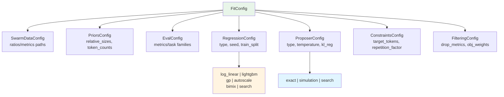
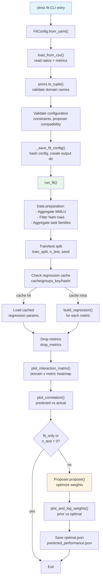
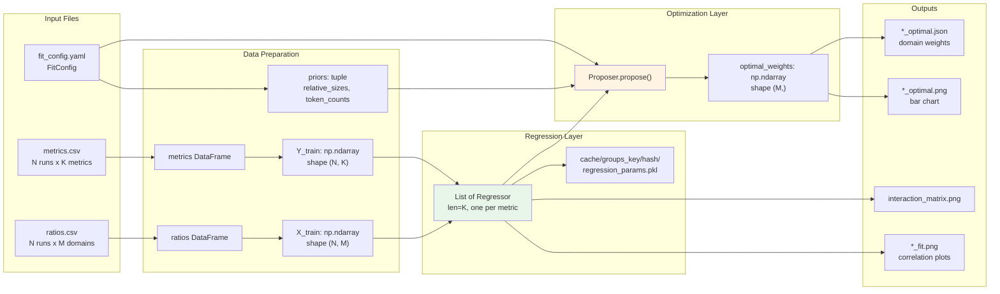
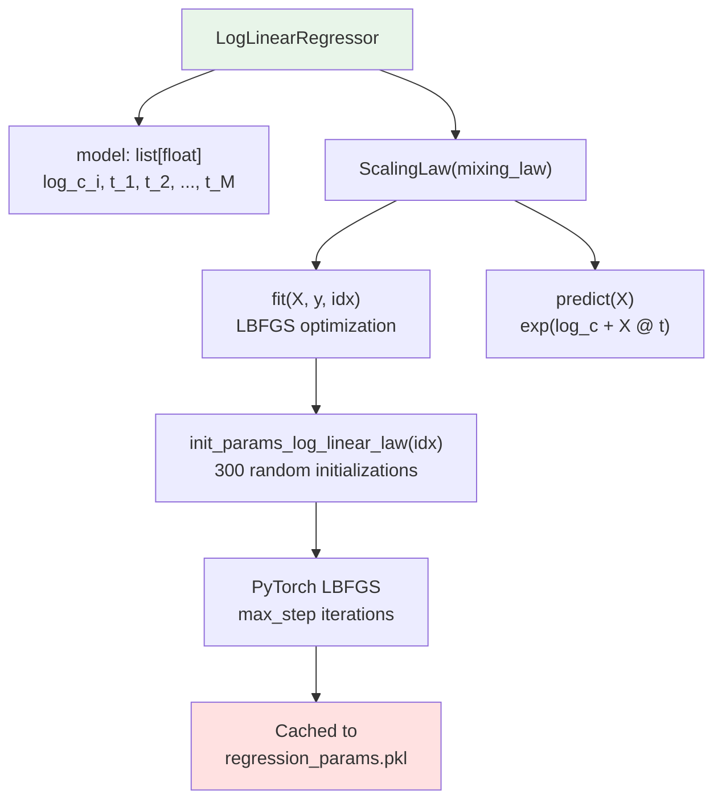

<!-- source: DeepWiki mcp.deepwiki.com · repo allenai/olmix · page 2.3 olmix fit · fetched 2026-10-26 -->

# olmix fit

<details>
<summary>Relevant source files</summary>

The following files were used as context for generating this wiki page:

- [olmix/fit/cli.py](olmix/fit/cli.py)
- [olmix/fit/config.py](olmix/fit/config.py)
- [olmix/fit/core.py](olmix/fit/core.py)
- [olmix/fit/utils.py](olmix/fit/utils.py)
- [olmix/plots/plotting.py](olmix/plots/plotting.py)
- [plans/016_refactor_fit_csv_support.md](plans/016_refactor_fit_csv_support.md)
- [uv.lock](uv.lock)

</details>


`olmix fit` analyzes swarm experiment results to propose optimal data mixture weights. It builds regression models from proxy training runs, then uses optimization algorithms to find mixture weights that minimize predicted loss across evaluation metrics.

For information about launching swarm experiments, see [olmix launch](#2.2). For configuration details, see [FitConfig](#3.3). For regression model internals, see [Regression Models](#4.1) and [Proposers](#4.2).

---

## Command Synopsis

```bash
olmix fit --config path/to/fit_config.yaml --output-dir path/to/output/
```

The command requires:
- `--config`: Path to a YAML file conforming to the `FitConfig` schema
- `--output-dir`: Directory for saving outputs (creates a hashed subdirectory)

Sources: [olmix/fit/cli.py:32-46]()

---

## Input Requirements

`olmix fit` operates on two CSV files specified in `FitConfig`:

| File | Description | Required Columns |
|------|-------------|------------------|
| `ratios.csv` | Domain mixture weights for each run | `run`, `name`, `index`, `<domain1>`, `<domain2>`, ... |
| `metrics.csv` | Evaluation metrics for each run | `run`, `name`, `index`, `<metric1>`, `<metric2>`, ... |

Both files must be joinable on the `run` column. Domain columns in `ratios.csv` should sum to approximately 1.0 per row.

**Priors**: The configuration must also specify token distributions across domains via `PriorsConfig`:
- `relative_sizes`: Dict mapping domain names to relative token proportions
- `token_counts`: Dict mapping domain names to absolute token counts

Sources: [olmix/fit/loaders.py:17-61](), [olmix/fit/config.py:16-31]()

---

## Configuration Structure



**Title**: FitConfig Composition and Key Options

The `FitConfig` model (defined in [olmix/fit/config.py:131-176]()) composes seven sub-configurations. The `from_yaml()` classmethod handles special preprocessing like evaluating fraction strings in `obj_weights`.

Sources: [olmix/fit/config.py:16-177]()

---

## Execution Workflow



**Title**: olmix fit Execution Pipeline

The `fit()` function in [olmix/fit/cli.py:47-113]() orchestrates this pipeline. Core logic resides in `run_fit()` at [olmix/fit/core.py:65-442]().

### Key Steps

1. **Configuration Loading**: `FitConfig.from_yaml()` parses YAML and evaluates fraction strings
2. **Data Loading**: `load_from_csv()` reads and validates ratios/metrics DataFrames
3. **Priors**: `PriorsConfig.to_tuple()` provides KL regularization target
4. **Hashed Output Directory**: `_save_fit_config()` creates `{output_dir}/{hash}/` where hash is based on config content
5. **MMLU Aggregation**: If individual MMLU tasks exist, `aggregate_mmlu()` computes weighted family scores
6. **Task Family Aggregation**: If `regression.aggregate_task_families=True`, metrics are grouped into families before fitting
7. **Regression Caching**: Log-linear models are cached at `cache/{groups_key}/{data_hash}/regression_params.pkl`
8. **Model Building**: `build_regression()` trains one model per metric (or task family)
9. **Visualization**: Interaction matrix shows domain-metric coefficients; correlation plots validate model fit
10. **Proposal**: Proposer optimizes mixture weights subject to constraints
11. **Output**: Optimal weights saved as JSON; predicted performance logged

Sources: [olmix/fit/cli.py:47-113](), [olmix/fit/core.py:65-442]()

---

## Data Flow Diagram



**Title**: Data Transformation Pipeline

Sources: [olmix/fit/core.py:183-236](), [olmix/fit/core.py:405-429]()

---

## Regression Models

Six regression types are available, specified via `regression.type` in `FitConfig`:

| Type | Class | Description | Use Case |
|------|-------|-------------|----------|
| `log_linear` | `LogLinearRegressor` | Fits `log(y) = c + Σ t_i * x_i` using LBFGS | Default; parametric scaling law |
| `lightgbm` | `LightGBMRegressor` | Gradient boosting with early stopping | Non-linear relationships |
| `gp` | `GPRegressor` | Gaussian Process with RBF kernel | Uncertainty quantification |
| `autoscale` | `AutoscaleRegressor` | Fits `y = Σ (N0_i + N*p_i)^(-γ_i) + L` | Autoscale paper reproduction |
| `bimix` | `BimixRegressor` | Fits `y = Σ F_i * x_i^(-α_i)` | BiMix paper reproduction |
| `search` | `SearchRegressor` | Lookup table from evaluated weights | Exact retrieval, no extrapolation |

### LogLinearRegressor Architecture



**Title**: LogLinearRegressor Components

The log-linear model is the most commonly used because:
1. It encodes scaling law assumptions
2. Its parameters are interpretable (t_i coefficients)
3. It's compatible with the exact proposer (convex optimization)
4. Models are cached based on data hash for fast iteration

Sources: [olmix/fit/utils.py:81-104](), [olmix/fit/law.py](), [olmix/fit/core.py:271-343]()

---

## Proposers

Three proposer types optimize mixture weights:

### Exact Proposer (`LogLinearExactProposer`)

**Compatibility**: Only works with `log_linear` regression.

Solves convex optimization problem using CVXPY:

```
minimize: Σ w_k * exp(A_k @ x) + λ * KL(x || q)
subject to: x >= 0, Σ x = 1, [x <= caps if constrained]
```

Where:
- `A_k`: coefficient vector for metric k from log-linear model
- `w_k`: objective weight for metric k (from `filtering.obj_weights`)
- `q`: prior distribution (from `priors.relative_sizes`)
- `λ`: KL regularization strength (from `proposer.kl_reg`)
- `caps`: token budget caps (from `constraints.target_tokens`, `constraints.repetition_factor`)

Sources: [olmix/fit/utils.py:539-596]()

### Simulation Proposer (`SimulationProposer`)

**Compatibility**: Works with any regression type.

Monte Carlo search procedure:

1. Sample 100k mixtures from `Dirichlet(α * prior)` with varying α
2. Filter mixtures violating token constraints
3. Predict performance for each mixture using regression models
4. Select best mixture (optionally weighted average across metrics)
5. Update prior to blend best mixture with previous prior
6. Repeat for `search_iterations` steps (default 10)

Hyperparameters:
- `min_weight`: 1e-5 (threshold for zeroing weights)
- `num_samples`: 100,000 per iteration
- `temperature`: Applied to prior as `prior^temperature` if specified

Sources: [olmix/fit/utils.py:387-500]()

### Search Proposer (`SearchProposer`)

**Compatibility**: Only works with `search` regression (requires `SearchRegressor`).

Exhaustively evaluates all previously-seen mixtures from the lookup table and returns the best one satisfying constraints. No interpolation or extrapolation.

Sources: [olmix/fit/utils.py:502-537]()

---

## Constraints and Objectives

### Token Budget Constraints

When `constraints.enabled=True`:

```python
token_usage[source] = weight[source] * target_tokens
constraint: token_usage[source] <= token_counts[source] * repetition_factor
```

- `target_tokens`: Total tokens for full-scale run (e.g., 2T)
- `repetition_factor`: Maximum epochs per domain (default 4.0)
- `token_counts`: Available tokens per source (from priors)

This ensures the proposed mixture is feasible at production scale without over-repeating any domain.

Sources: [olmix/fit/config.py:54-59](), [olmix/fit/core.py:405-416]()

### Objective Weighting

By default, proposers minimize the average across all metrics. To prioritize certain metrics:

```yaml
filtering:
  obj_weights:
    arc_challenge_bpb: 2.0
    mmlu_stem: 1.5
    hellaswag_bpb: 1.0
```

Proposers compute: `objective = Σ (w_k * prediction_k)` where `w_k` are normalized weights.

Sources: [olmix/fit/config.py:62-67](), [olmix/fit/core.py:245-251]()

---

## Regression Caching

Log-linear regression models are expensive to fit (300 random initializations × LBFGS). To enable fast iteration, models are cached based on:

```python
config_hash = hash({
    ratios_hash,      # pandas hash of ratios DataFrame
    metrics_hash,     # pandas hash of metrics DataFrame
    regression_type,
    train_split,
    n_test,
    seed,
    early_stopping,
    aggregate_task_families
})
```

Cache location: `cache/{experiment_groups_key}/{config_hash}/regression_params.pkl`

The cache stores a dict: `{metric_name: model_params}`. When loading from cache, `LogLinearRegressor` is initialized with `params=cached_params` instead of calling `fit()`.

A symlink `{output_dir}/path_to_regression_model.txt` records the cache path for debugging.

Sources: [olmix/fit/core.py:42-63](), [olmix/fit/core.py:271-343]()

---

## Outputs

### Directory Structure

```
{output_dir}/{config_hash}/
├── config.json                          # FitConfig as JSON
├── path_to_regression_model.txt         # Symlink to cache (if log_linear)
├── interaction_matrix.png               # Domain × metric heatmap
├── interaction_matrix.npy               # Raw interaction coefficients
├── {metric}_fit.png                     # Correlation plot per metric
├── {metric}_correlations.json           # Train/test correlations per metric
├── average_bpb_fit.png                  # Aggregate correlation
├── opt_avg_all_metrics_optimal.json     # Proposed weights
├── opt_avg_all_metrics_optimal.png      # Bar chart: prior vs optimal
└── predicted_performance.json           # Predicted loss at optimal weights
```

Sources: [olmix/fit/cli.py:19-29](), [olmix/fit/core.py:357-442]()

### Optimal Weights JSON Format

```json
[
  {"domain": "dclm", "weight": 0.45},
  {"domain": "wikipedia", "weight": 0.30},
  {"domain": "arxiv", "weight": 0.15},
  {"domain": "s2pdf", "weight": 0.10}
]
```

If domains were collapsed (due to fixed topic weights), the output expands them back to the original hierarchy.

Sources: [olmix/plots/plotting.py:247-286]()

---

## Validation and Compatibility

The CLI validates configuration compatibility:

| Condition | Error |
|-----------|-------|
| `constraints.enabled=True` and `target_tokens=None` | "constraints.enabled requires constraints.target_tokens" |
| `regression.aggregate_task_families=True` and `eval=None` | "aggregate_task_families requires eval config with task families" |
| `proposer.type="search"` and `regression.type != "search"` | "proposer.type 'search' only works with regression.type 'search'" |
| `proposer.kl_reg != None` and `proposer.type != "exact"` | "proposer.kl_reg requires proposer.type 'exact'" |

Sources: [olmix/fit/cli.py:63-74]()

---

## Example Configuration

```yaml
swarm:
  ratios: "swarm_outputs/ratios.csv"
  metrics: "swarm_outputs/metrics.csv"

priors:
  relative_sizes:
    dclm: 0.40
    wikipedia: 0.30
    arxiv: 0.20
    s2pdf: 0.10
  token_counts:
    dclm: 500000000000
    wikipedia: 100000000000
    arxiv: 80000000000
    s2pdf: 50000000000

regression:
  type: log_linear
  train_split: 1.0
  seed: 42

proposer:
  type: exact
  kl_reg: 0.05

constraints:
  enabled: true
  target_tokens: 2000000000000  # 2T
  repetition_factor: 4.0

filtering:
  drop_metrics:
    - "noisy_metric_1"
  obj_weights:
    arc_challenge_bpb: 2.0
    mmlu_stem: 1.5
```

Sources: [olmix/fit/config.py:16-177]()

---

## Code Structure Reference

```mermaid
graph TB
    subgraph "CLI Layer"
        FitCmd["olmix/fit/cli.py::fit()"]
        FitCmd --> SaveConfig["_save_fit_config()"]
    end
    
    subgraph "Configuration"
        FitConfig["olmix/fit/config.py::FitConfig"]
        FitConfig --> SwarmData["SwarmDataConfig"]
        FitConfig --> Priors["PriorsConfig"]
        FitConfig --> Regression["RegressionConfig"]
        FitConfig --> Proposer["ProposerConfig"]
        FitConfig --> Constraints["ConstraintsConfig"]
        FitConfig --> Filtering["FilteringConfig"]
        FitConfig --> Eval["EvalConfig"]
    end
    
    subgraph "Data Loading"
        LoadCSV["olmix/fit/loaders.py::load_from_csv()"]
    end
    
    subgraph "Core Logic"
        RunFit["olmix/fit/core.py::run_fit()"]
        RunFit --> BuildReg["utils.py::build_regression()"]
        RunFit --> ProposeCall["Proposer.propose()"]
    end
    
    subgraph "Regression Models"
        BuildReg --> RegTypes["utils.py::REGRESSION_TYPES"]
        RegTypes --> LogLinear["LogLinearRegressor"]
        RegTypes --> LightGBM["LightGBMRegressor"]
        RegTypes --> GP["GPRegressor"]
        RegTypes --> Autoscale["AutoscaleRegressor"]
        RegTypes --> Bimix["BimixRegressor"]
        RegTypes --> Search["SearchRegressor"]
    end
    
    subgraph "Proposers"
        ProposeCall --> PropTypes["utils.py::PROPOSER_TYPES"]
        PropTypes --> ExactProp["LogLinearExactProposer"]
        PropTypes --> SimProp["SimulationProposer"]
        PropTypes --> SearchProp["SearchProposer"]
    end
    
    subgraph "Visualization"
        RunFit --> PlotInt["plots.py::plot_interaction_matrix()"]
        RunFit --> PlotCorr["plots.py::plot_correlation()"]
        RunFit --> PlotWeights["plots.py::plot_and_log_weights()"]
    end
    
    FitCmd --> FitConfig
    FitCmd --> LoadCSV
    FitCmd --> RunFit
    
    style FitCmd fill:#e1f5ff
    style RunFit fill:#e8f5e9
    style ProposeCall fill:#fff4e1
```



**Title**: olmix fit Code Module Dependencies

Sources: [olmix/fit/cli.py:1-114](), [olmix/fit/config.py:1-177](), [olmix/fit/core.py:1-443](), [olmix/fit/utils.py:1-951](), [olmix/plots/plotting.py:1-355]()

---

