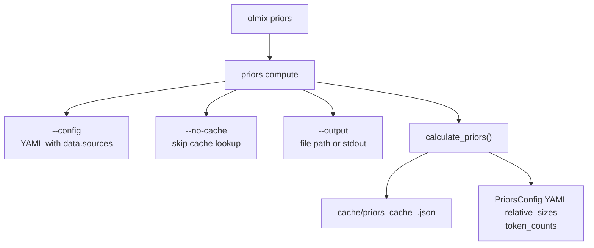
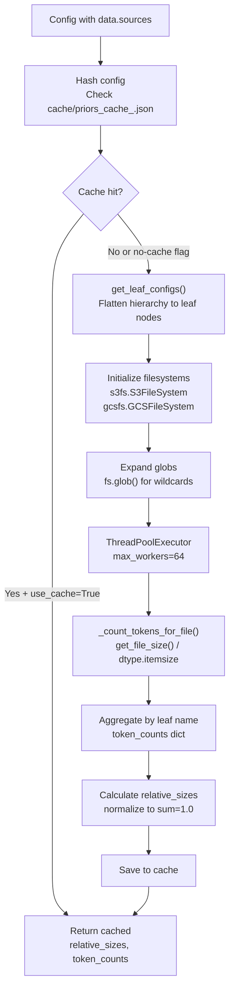
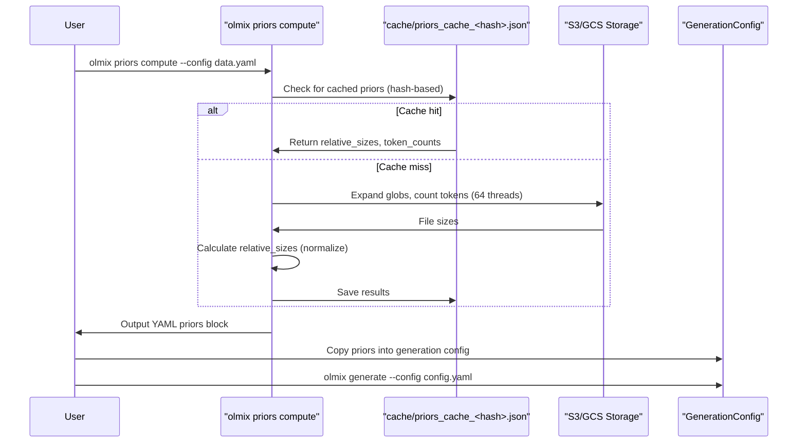

<!-- source: DeepWiki mcp.deepwiki.com · repo allenai/olmix · page 2.4 olmix priors · fetched 2026-10-26 -->

# olmix priors

<details>
<summary>Relevant source files</summary>

The following files were used as context for generating this wiki page:

- [README.md](README.md)
- [olmix/aliases.py](olmix/aliases.py)
- [olmix/cli.py](olmix/cli.py)
- [olmix/generate/synthesize_mixture.py](olmix/generate/synthesize_mixture.py)
- [olmix/generate/utils.py](olmix/generate/utils.py)
- [olmix/launch/utils.py](olmix/launch/utils.py)

</details>


## Purpose

This page documents the `olmix priors` CLI command and the prior calculation system. The `priors compute` subcommand scans cloud storage paths (S3, GCS) to determine the natural token distribution and absolute token counts for each data domain. These priors are essential inputs for both mixture generation (see [olmix generate](#2.1)) and mixture optimization (see [olmix fit](#2.3)).

## What are Priors?

In olmix, **priors** refer to two related pieces of metadata about your data sources:

| Field | Type | Purpose |
|-------|------|---------|
| `relative_sizes` | `dict[str, float]` | Fractional weight of each domain in the natural corpus. Values sum to 1.0. Used as the center of the Dirichlet distribution for sampling mixtures. |
| `token_counts` | `dict[str, int]` | Absolute token count available for each domain. Used to enforce repetition constraints during mixture generation. |

Both fields are defined at the **leaf level** of the data hierarchy. For a source like `dclm` with topics `math`, `code`, the leaf keys would be `dclm:math` and `dclm:code`, not just `dclm`.

The priors serve distinct roles in the olmix workflow:

- **During generation**: `relative_sizes` defines the Dirichlet prior center, while `token_counts` bounds each domain's maximum allocation to prevent exceeding `repetition_factor × available_tokens`.
- **During optimization**: `relative_sizes` defines the KL regularization target, preventing the proposer from selecting mixtures that diverge too far from the natural corpus distribution.

Sources: [README.md:111-117](), [olmix/fit/config.py](), [olmix/aliases.py:215-217]()

## Command Structure



Sources: [olmix/cli.py:381-437]()

## The `olmix priors compute` Command

### Basic Usage

```bash
olmix priors compute --config configs/examples/generate/example.yaml
```

This scans the data sources defined in the config file and outputs a `priors:` block to stdout:

```yaml
priors:
  relative_sizes:
    arxiv: 0.13859324268101414
    dclm:education_and_jobs: 0.13466673502770904
    dclm:science_math_and_technology: 0.5479947162541395
    dclm:software_development: 0.1548063887874921
    wikipedia: 0.023938917249645256
  token_counts:
    arxiv: 21377485731
    dclm:education_and_jobs: 20771836713
    dclm:science_math_and_technology: 84526121193
    dclm:software_development: 23878302458
    wikipedia: 3692487830
```

### Command Options

| Flag | Required | Description |
|------|----------|-------------|
| `--config` / `-c` | Yes | Path to a YAML config file containing a `data` section with `sources` |
| `--no-cache` / `-n` | No | Disable cache lookup. Forces re-scanning all paths even if cached. |
| `--output` / `-o` | No | Write output to a file instead of stdout. File is created if it doesn't exist. |

### Input Config Format

The command accepts any config file with a `data` section (GenerationConfig, LaunchConfig, or FitConfig). The `data` section is extracted and validated as a `DataConfig`:

```yaml
data:
  sources:
    - name: dclm
      topics:
        - name: math
          paths:
            - s3://bucket/dclm/math/*.npy
        - name: code
          paths:
            - s3://bucket/dclm/code/*.npy
    - name: wikipedia
      paths:
        - s3://bucket/wikipedia/*.npy
```

Sources: [olmix/cli.py:408-437](), [README.md:188-212]()

## Token Counting Process

### High-Level Flow



Sources: [olmix/generate/synthesize_mixture.py:696-800]()

### Implementation Details

#### Leaf-Level Calculation

The `calculate_priors` function operates at the **leaf level** of the data hierarchy. It flattens nested configurations into individual counting tasks using `get_leaf_configs`:

- `source.paths` → `(source, paths)`
- `source.quality[].paths` → `(source:quality_name, paths)`
- `source.topics[].paths` → `(source:topic, paths)`
- `source.topics[].quality[].paths` → `(source:topic:quality_name, paths)`

This ensures that priors are always represented at the finest granularity.

Sources: [olmix/generate/synthesize_mixture.py:665-694]()

#### Filesystem Handling

The system supports multiple storage backends through `get_filesystem_for_scheme`:

| Scheme | Filesystem | Configuration |
|--------|-----------|---------------|
| `s3://` | `s3fs.S3FileSystem` | Uses `AWS_PROFILE` env var if set |
| `weka://` | `s3fs.S3FileSystem` | Uses `WEKA_ENDPOINT_URL` and profile `"WEKA"` |
| `gs://` | `gcsfs.GCSFileSystem` | Uses `GOOGLE_CLOUD_PROJECT` and default credentials |
| Local paths | None | Uses standard file operations |

Each source's paths must use a **consistent scheme**. Mixing schemes within a single source raises an `OLMoEnvironmentError`.

Sources: [olmix/generate/synthesize_mixture.py:839-891]()

#### Glob Expansion

Paths with wildcards (`*`) are expanded before counting. The `expand_globs` function handles both local and remote patterns:

- **Local**: Uses Python's `glob.glob(pattern, recursive=True)`
- **Remote**: Uses the filesystem's `.glob()` method (e.g., `s3fs.glob()`)

All glob patterns are expanded **before** multithreaded counting begins, ensuring each thread operates on a concrete file path.

Sources: [olmix/generate/synthesize_mixture.py:893-950](), [olmix/generate/synthesize_mixture.py:751-756]()

#### Token Counting

Token counts are derived from file sizes using the numpy dtype:

```python
def _bytes_to_tokens(num_bytes: int, dtype: NumpyDatasetDType) -> int:
    npdtype = dtype.as_np_dtype()
    return num_bytes // npdtype(0).itemsize
```

For `uint32` (the default), each token occupies 4 bytes. For `uint16`, each token occupies 2 bytes.

The counting process:
1. Get file size in bytes via `get_file_size(path)` from olmo-core
2. Divide by dtype itemsize to get token count
3. Aggregate counts per leaf domain
4. Normalize to get `relative_sizes` where values sum to 1.0

Sources: [olmix/generate/synthesize_mixture.py:643-652](), [olmix/generate/synthesize_mixture.py:758-775]()

#### Multithreading

Token counting uses a `ThreadPoolExecutor` with 64 workers for parallel file access. Each future maps to a specific source and file path:

```python
futures = {
    executor.submit(_count_tokens_for_file, path, dtype): source
    for source in source_configs
    if source.paths is not None
    for path in source.paths
}
```

Results are aggregated as futures complete, with progress tracked via `tqdm`.

Sources: [olmix/generate/synthesize_mixture.py:747-775]()

## Caching Mechanism

### Cache Key Generation

The cache key is an MD5 hash of the source configurations (names and paths), ensuring that identical data layouts reuse cached results:

```python
config_hash = hashlib.md5(
    json.dumps(
        [(sc.name, sc.paths) for sc in source_configs],
        sort_keys=True,
    ).encode("utf-8")
).hexdigest()

cache_path = Path(f"cache/priors_cache_{config_hash}.json")
```

Sources: [olmix/generate/synthesize_mixture.py:699-707]()

### Cache Structure

The cache file is a JSON object with three fields:

```json
{
  "relative_sizes": {
    "dclm:math": 0.4,
    "dclm:code": 0.6
  },
  "token_counts": {
    "dclm:math": 40000000000,
    "dclm:code": 60000000000
  },
  "total_tokens": 100000000000
}
```

### Cache Behavior

| Scenario | Behavior |
|----------|----------|
| Cache hit + `use_cache=True` | Return cached values immediately |
| Cache miss | Scan all paths, save results to cache |
| `--no-cache` flag | Ignore cache, rescan all paths, overwrite cache |
| Cache file corrupt | Log warning, rescan as if cache miss |

The `--no-cache` flag disables cache lookup but **still writes** the new results to the cache file, overwriting any previous cached values.

Sources: [olmix/generate/synthesize_mixture.py:708-717](), [olmix/cli.py:396-401]()

## Integration with Other Commands

### Usage in `olmix generate`

The priors calculated by `priors compute` are copied into the `GenerationConfig` and used by `mk_mixtures`:

1. **Dirichlet Sampling**: `relative_sizes` defines the center of the Dirichlet distribution for both source-level and topic-level sampling.
2. **Repetition Constraints**: `token_counts` combined with `repetition_factor` and `max_tokens` creates upper bounds on each domain's weight:
   ```python
   caps = np.minimum(leaf_tokens * repetition_factor / max_tokens, 1.0)
   weight_bounds = [(0.0, caps[idx]) for idx in range(len(prior_dist))]
   ```

Sources: [olmix/generate/synthesize_mixture.py:167-173](), [olmix/generate/synthesize_mixture.py:520-526]()

### Usage in `olmix fit`

The priors are included in `FitConfig` and used by the proposer for KL regularization:

- **Exact Proposer**: Adds a KL divergence penalty term to the optimization objective, preventing the proposed mixture from diverging too far from `relative_sizes`.
- **Simulation Proposer**: Uses `relative_sizes` as the Dirichlet center for Monte Carlo sampling.

Sources: [olmix/fit/config.py](), [README.md:111-117]()

## Manual Priors

While `olmix priors compute` is the recommended approach, priors can be specified manually in any config file:

```yaml
priors:
  relative_sizes:
    dclm: 0.8
    wikipedia: 0.2
  token_counts:
    dclm: 800000000000
    wikipedia: 200000000000
```

Manual priors are useful when:
- Data paths are not yet available (e.g., planning stage)
- You want to override the natural distribution for experimentation
- Token counts are approximate or symbolic

The `priors compute` command simply automates the process of deriving these values from actual data.

Sources: [README.md:111-117]()

## Error Handling

| Error Condition | Exception | Message |
|-----------------|-----------|---------|
| Mixed URL schemes in a source | `OLMoEnvironmentError` | "Mixed URL schemes in source 'X': {schemes}" |
| No tokens found for any source | `Exception` | "Error processing config, no tokens found for sources!" |
| Unsupported URL scheme | `OLMoEnvironmentError` | "Unsupported URL scheme: X" |
| GCS not configured | `OLMoEnvironmentError` | "GOOGLE_CLOUD_PROJECT environment variable is not set!" |
| Glob pattern not found | `FileNotFoundError` | Pattern path |

Sources: [olmix/generate/synthesize_mixture.py:736-738](), [olmix/generate/synthesize_mixture.py:782-783](), [olmix/generate/synthesize_mixture.py:839-891]()

## Example Workflow



Sources: [README.md:188-212](), [olmix/cli.py:408-437]()

---

