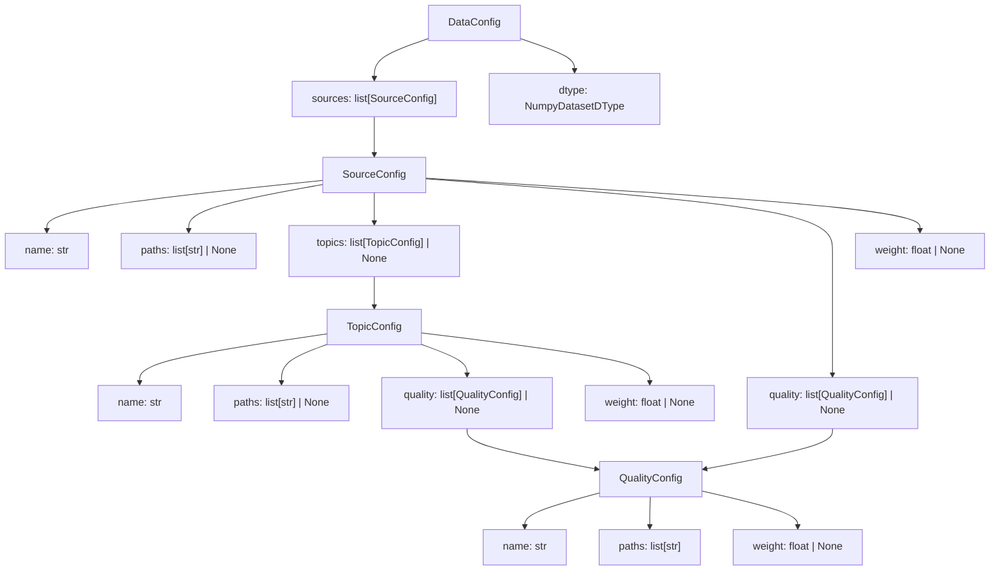

<!-- source: DeepWiki mcp.deepwiki.com · repo allenai/olmix · page 3 Configuration System · fetched 2026-10-26 -->

# Configuration System

<details>
<summary>Relevant source files</summary>

The following files were used as context for generating this wiki page:

- [olmix/aliases.py](olmix/aliases.py)
- [olmix/cli.py](olmix/cli.py)
- [olmix/generate/synthesize_mixture.py](olmix/generate/synthesize_mixture.py)
- [olmix/generate/utils.py](olmix/generate/utils.py)
- [olmix/launch/utils.py](olmix/launch/utils.py)
- [plans/017_decompose_experiment_config.md](plans/017_decompose_experiment_config.md)
- [plans/019_eval_config.md](plans/019_eval_config.md)
- [plans/021_split_experiment_config.md](plans/021_split_experiment_config.md)
- [plans/022_self_contained_launch_configs.md](plans/022_self_contained_launch_configs.md)
- [plans/023_explicit_mix_field.md](plans/023_explicit_mix_field.md)
- [tests/test_fit_config.py](tests/test_fit_config.py)

</details>


This document provides an overview of olmix's configuration architecture and how the different configuration types relate to each other. The configuration system defines how experiments are specified across the three main phases of the olmix workflow: mixture generation, experiment execution, and optimization.

For detailed specifications of individual configuration types, see:
- GenerationConfig: [#3.1](#3.1)
- LaunchConfig: [#3.2](#3.2)
- FitConfig: [#3.3](#3.3)
- DataConfig hierarchy: [#3.4](#3.4)
- Mix field and mixture reuse: [#3.5](#3.5)

---

## Configuration Architecture Overview

The olmix configuration system is built around three top-level Pydantic models, each corresponding to a phase in the workflow. These configurations share common components (`DataConfig`, `PriorsConfig`) to ensure consistency across the pipeline.

```mermaid
graph TB
    subgraph "Top-Level Configurations"
        GC[GenerationConfig<br/>olmix/aliases.py]
        LC[LaunchConfig<br/>olmix/aliases.py]
        FC[FitConfig<br/>olmix/fit/config.py]
    end
    
    subgraph "GenerationConfig Components"
        GC --> GC_name["name: str"]
        GC --> GC_data[DataConfig]
        GC --> GC_priors[PriorsConfig]
        GC --> GC_swarm[SwarmConfig]
        GC --> GC_max["max_tokens: int"]
    end
    
    subgraph "LaunchConfig Components"
        LC --> LC_name["name: str"]
        LC --> LC_infra[InfraConfig]
        LC --> LC_training[TrainingConfig]
        LC --> LC_data[DataConfig]
        LC --> LC_eval[InLoopEvalConfig]
        LC --> LC_mix["mix: dict[str, MixEntry]"]
        LC --> LC_gid["group_id: str | None"]
    end
    
    subgraph "FitConfig Components"
        FC --> FC_swarm[SwarmDataConfig]
        FC --> FC_priors[PriorsConfig]
        FC --> FC_eval[EvalConfig]
        FC --> FC_reg[RegressionConfig]
        FC --> FC_prop[ProposerConfig]
        FC --> FC_cons[ConstraintsConfig]
        FC --> FC_filt[FilteringConfig]
    end
    
    subgraph "Shared Components"
        DataConfig[DataConfig<br/>sources, dtype]
        PriorsConfig[PriorsConfig<br/>relative_sizes, token_counts]
    end
    
    GC_data -.-> DataConfig
    LC_data -.-> DataConfig
    GC_priors -.-> PriorsConfig
    FC_priors -.-> PriorsConfig
```



**Sources:**
- [olmix/aliases.py:178-341]()
- [olmix/fit/config.py:1-200]()

---

## The Three Main Configuration Types

Each configuration type serves a specific phase in the olmix workflow:

| Configuration | File Location | CLI Command | Purpose |
|---------------|---------------|-------------|---------|
| **GenerationConfig** | `olmix/aliases.py` | `olmix generate` | Defines parameters for sampling mixture variants using Dirichlet distributions |
| **LaunchConfig** | `olmix/aliases.py` | `olmix launch run` | Self-contained specification for training a single proxy model on Beaker |
| **FitConfig** | `olmix/fit/config.py` | `olmix fit` | Defines regression models and optimization parameters for finding optimal mixtures |

### GenerationConfig

Used as input to `olmix generate` to sample mixture variants. Contains everything needed to generate diverse candidate mixtures:

| Field | Type | Purpose |
|-------|------|---------|
| `name` | `str` | Human-readable identifier |
| `data` | `DataConfig` | Data source hierarchy (defines Dirichlet structure) |
| `priors` | `PriorsConfig` | Token counts and relative sizes (Dirichlet prior distribution) |
| `swarm` | `SwarmConfig` | Sampling parameters (temperature, strength, bounds, constraints) |
| `max_tokens` | `int` | Training budget per variant (determines repetition factors) |

**Sources:**
- [olmix/aliases.py:211-226]()

### LaunchConfig

Self-contained specification for a training experiment. After `olmix generate` produces variants, each is a complete LaunchConfig ready to submit:

| Field | Type | Purpose |
|-------|------|---------|
| `name` | `str` | Unique experiment name |
| `description` | `str` | Human-readable description |
| `infra` | `InfraConfig` | Beaker cluster, GPUs, budget, priority |
| `training` | `TrainingConfig` | Model size, Chinchilla multiple, batch size, seed |
| `data` | `DataConfig` | Data source hierarchy (same schema as GenerationConfig) |
| `eval` | `InLoopEvalConfig` | In-loop evaluation tasks (60 BPB metrics) |
| `mix` | `dict[str, MixEntry]` | Explicit weights and repetition factors per domain |
| `group_id` | `str \| None` | Shared identifier for variants in a swarm |

**Sources:**
- [olmix/aliases.py:299-326]()

### FitConfig

Defines how to analyze swarm results and propose an optimal mixture:

| Field | Type | Purpose |
|-------|------|---------|
| `swarm` | `SwarmDataConfig` | Paths to `ratios.csv` and `metrics.csv` |
| `priors` | `PriorsConfig` | Prior distribution for KL regularization |
| `eval` | `EvalConfig` | Task families and metric names |
| `regression` | `RegressionConfig` | Model type, train split, aggregation settings |
| `proposer` | `ProposerConfig` | Optimization method, temperature, KL weight |
| `constraints` | `ConstraintsConfig` | Token budget, repetition limits |
| `filtering` | `FilteringConfig` | Metric dropping, objective weights |

**Sources:**
- [olmix/fit/config.py:127-200]()

---

## Shared Configuration Components

### DataConfig

`DataConfig` is the central schema for describing the data landscape. It appears in both `GenerationConfig` and `LaunchConfig` with identical structure, ensuring that generated mixtures are compatible with the training pipeline.



The hierarchy is three levels deep:
- **Source**: Top-level data domain (e.g., `dclm`, `arxiv`, `wikipedia`)
- **Topic**: Subdivision of a source (e.g., `software_development`, `science_math_and_technology`)
- **Quality**: Quality bucket within a topic (e.g., `vigintile_0001`, `high`, `medium`)

Each level can either have `paths` (leaf node) or children (intermediate node), but not both. This is enforced by `model_post_init` validators.

**Sources:**
- [olmix/aliases.py:84-183]()

### PriorsConfig

`PriorsConfig` appears in both `GenerationConfig` (as input to sampling) and `FitConfig` (as target for KL regularization). It contains two dictionaries with matching keys:

| Field | Type | Purpose |
|-------|------|---------|
| `relative_sizes` | `dict[str, float]` | Normalized proportions (sum to 1.0) for Dirichlet prior |
| `token_counts` | `dict[str, int]` | Absolute token counts per domain (for feasibility checks) |

The `to_tuple()` method returns copies of both dictionaries for safe consumption.

**Sources:**
- [olmix/fit/config.py:35-48]()

---

## Configuration Flow Through CLI Commands

This diagram shows how configuration files flow through the olmix CLI commands, with actual command names and file paths:

```mermaid
graph LR
    subgraph "Input YAMLs"
        GenYAML["generation.yaml<br/>(GenerationConfig)"]
        BaseYAML["base_launch.yaml<br/>(LaunchConfig)"]
        FitYAML["fit.yaml<br/>(FitConfig)"]
    end
    
    subgraph "olmix generate"
        GenYAML --> olmix_generate["olmix generate<br/>-c generation.yaml<br/>--base base_launch.yaml<br/>-o variants/"]
        BaseYAML --> olmix_generate
        olmix_generate --> mk_mixes["mk_mixes()<br/>olmix/generate/utils.py"]
        mk_mixes --> synthesize["mk_mixtures()<br/>olmix/generate/synthesize_mixture.py"]
        synthesize --> variants["variants/*.yaml<br/>(LaunchConfig with mix)"]
    end
    
    subgraph "olmix launch run"
        variants --> olmix_launch["olmix launch run<br/>-v variants/"]
        olmix_launch --> load["_load_launch_configs()<br/>olmix/cli.py:79-98"]
        load --> mk_exp["mk_experiment_group()<br/>olmix/launch/beaker.py"]
        mk_exp --> beaker["Beaker submission"]
    end
    
    subgraph "olmix fit"
        FitYAML --> olmix_fit["olmix fit<br/>--config fit.yaml"]
        olmix_fit --> load_swarm["load_from_csv()<br/>olmix/fit/loaders.py"]
        load_swarm --> build_reg["build_regression()<br/>olmix/fit/utils.py"]
        build_reg --> propose["Proposer.propose()<br/>olmix/fit/proposers/*.py"]
        propose --> optimal["*_optimal.json<br/>(proposed weights)"]
    end
    
    optimal -.->|"freeze as weights"| GenYAML
```



**Sources:**
- [olmix/cli.py:79-165]()
- [olmix/generate/utils.py:17-53]()
- [olmix/launch/beaker.py:1-200]()
- [olmix/fit/cli.py:1-450]()

---

## Sub-Configuration Types

### InfraConfig

Beaker infrastructure settings for `LaunchConfig`:

| Field | Type | Default | Purpose |
|-------|------|---------|---------|
| `budget` | `str` | - | Beaker budget (e.g., `ai2/oe-base`) |
| `workspace` | `str` | - | Beaker workspace |
| `cluster` | `str` | - | Beaker cluster name |
| `priority` | `Priority` | `normal` | Job priority (low/normal/high/urgent) |
| `preemptible` | `bool` | `True` | Allow preemption |
| `nodes` | `int` | - | Number of nodes |
| `gpus` | `int` | - | GPUs per node |
| `weka` | `bool` | `False` | Mount Weka filesystem |
| `shared_filesystem` | `bool` | `False` | Use shared filesystem |
| `wandb_debug` | `bool` | `False` | Enable W&B debug mode |

**Sources:**
- [olmix/aliases.py:138-151]()

### TrainingConfig

OLMo Core training settings for `LaunchConfig`:

| Field | Type | Purpose |
|-------|------|---------|
| `proxy_model_id` | `str` | Model size (e.g., `olmo2_30m`, `olmo3_14m`) |
| `tokenizer` | `str` | Tokenizer name (e.g., `dolma2`) |
| `chinchilla_multiple` | `float` | Training duration multiplier (0.5x-5x Chinchilla optimal) |
| `seed` | `int` | Training seed for reproducibility |
| `device_batch_size` | `int` | Batch size per device |
| `global_batch_size` | `int \| None` | Total batch size across all devices |
| `checkpoint_path` | `str \| None` | Resume from checkpoint |
| `train_type` | `TrainType` | `pretrain` or `anneal` |
| `eval_interval` | `int` | Steps between evaluations |
| `no_eval` | `bool` | Disable downstream evaluations |
| `instance_filter` | `InstanceFilterConfig \| None` | Filter repetitive sequences |

The `get_max_tokens()` method computes training duration from `chinchilla_multiple` and `proxy_model_id`.

**Sources:**
- [olmix/aliases.py:153-176]()

### SwarmConfig

Mixture sampling parameters for `GenerationConfig`:

| Field | Type | Default | Purpose |
|-------|------|---------|---------|
| `seed` | `int` | `42` | Dirichlet sampling seed (independent from training seed) |
| `variants` | `int` | `1` | Number of mixture variants to generate |
| `mix_temperature` | `float` | `1.0` | Temperature scaling for priors |
| `source_mix_temperature` | `float \| None` | - | Override temperature for source-level sampling |
| `topic_mix_temperature` | `float \| None` | - | Override temperature for topic-level sampling |
| `min_strength` | `float` | `0.1` | Minimum Dirichlet concentration |
| `max_strength` | `float` | `5.0` | Maximum Dirichlet concentration |
| `minimum_weight` | `float \| None` | `0.002` | Minimum weight threshold (clip below) |
| `nonzero_weight` | `list[str] \| None` | - | Domains that must have nonzero weight |
| `repetition_factor` | `float` | `1.0` | Maximum repetition factor across all domains |
| `enable_bound` | `bool` | `True` | Enforce token count upper bounds |

Additional fields control hierarchical sampling (`min_source_strength`, `min_topic_strength`) and manual overrides (`manual_prior`, `manual_topic_prior`).

**Sources:**
- [olmix/aliases.py:185-209]()

### MixEntry

Represents a single domain's configuration in a mixture:

```python
class MixEntry(BaseModel):
    weight: float             # Proportion of total tokens (sum to 1.0 across mix)
    repetition_factor: float  # Maximum repetitions allowed (passed to OLMo Core)
```

The `mix` field in `LaunchConfig` is `dict[str, MixEntry]`, where keys are colon-separated domain paths (e.g., `dclm:software_development` or `arxiv`).

**Sources:**
- [olmix/aliases.py:228-233]()

---

## YAML Format and Loading

All three configuration types support loading from YAML via a `from_yaml` classmethod:

```python
# Load GenerationConfig
gen_config = GenerationConfig.from_yaml("generation.yaml")

# Load LaunchConfig
launch_config = LaunchConfig.from_yaml("base_launch.yaml")

# Load FitConfig
fit_config = FitConfig.from_yaml("fit.yaml")
```

### Nested vs. Flat Mix Format

`LaunchConfig.mix` supports two equivalent formats through the `flatten_mix()` function:

**Nested format** (recommended for hand-written configs):
```yaml
mix:
  dclm:
    weight: 0.8
    repetition_factor: 1.0
    software_development:
      weight: 0.625  # Relative to parent (0.8 * 0.625 = 0.5 absolute)
    science_math_and_technology:
      weight: 0.25   # Relative to parent (0.8 * 0.25 = 0.2 absolute)
  arxiv:
    weight: 0.2
    repetition_factor: 1.0
```

**Flat format** (used by `olmix generate` output):
```yaml
mix:
  dclm:software_development:
    weight: 0.5
    repetition_factor: 1.0
  dclm:science_math_and_technology:
    weight: 0.2
    repetition_factor: 1.0
  arxiv:
    weight: 0.2
    repetition_factor: 1.0
```

A `model_validator(mode="before")` on `LaunchConfig` automatically flattens nested mixes during parsing, so both formats are accepted.

**Sources:**
- [olmix/aliases.py:235-296]()
- [olmix/aliases.py:311-318]()

---

## Validation and Type Safety

All configuration models use Pydantic for validation:

1. **Field types**: Enforced at parse time (e.g., `int`, `float`, `str`, `list[str]`)
2. **Required fields**: Missing required fields raise `ValidationError`
3. **Model validators**: Custom validation logic (e.g., `SourceConfig` enforces exactly one of `paths`, `topics`, or `quality`)
4. **Discriminated unions**: `EvalConfig` uses `type` field to distinguish between `InLoopEvalConfig` and `OfflineEvalConfig`

### Example: DataConfig Validation

The `SourceConfig` validator ensures structural correctness:

```python
def model_post_init(self, __context) -> None:
    """Validate that exactly one of paths, topics, or quality is provided."""
    options = [self.paths is not None, self.topics is not None, self.quality is not None]
    if sum(options) != 1:
        raise ValueError("SourceConfig must have exactly one of 'paths', 'topics', or 'quality'")
```

This prevents ambiguous configurations where a source has both leaf-level paths and child topics.

**Sources:**
- [olmix/aliases.py:101-121]()
- [olmix/fit/config.py:1-200]()

---

## Configuration Dependencies

This diagram shows the import dependencies between configuration modules:

```mermaid
graph TB
    aliases["olmix/aliases.py"]
    fit_config["olmix/fit/config.py"]
    
    aliases --> |"imports"| fit_config_priors[PriorsConfig]
    aliases --> |"imports"| fit_config_eval[InLoopEvalConfig]
    
    fit_config --> fit_config_priors
    fit_config --> fit_config_eval
    fit_config --> offline_eval[OfflineEvalConfig]
    fit_config --> swarm_data[SwarmDataConfig]
    fit_config --> regression[RegressionConfig]
    fit_config --> proposer[ProposerConfig]
    fit_config --> constraints[ConstraintsConfig]
    fit_config --> filtering[FilteringConfig]
    
    aliases --> gen_config[GenerationConfig]
    aliases --> launch_config[LaunchConfig]
    aliases --> data_config[DataConfig]
    aliases --> infra_config[InfraConfig]
    aliases --> training_config[TrainingConfig]
    aliases --> swarm_config[SwarmConfig]
    aliases --> mix_entry[MixEntry]
    
    gen_config --> data_config
    gen_config --> fit_config_priors
    gen_config --> swarm_config
    
    launch_config --> data_config
    launch_config --> infra_config
    launch_config --> training_config
    launch_config --> fit_config_eval
    launch_config --> mix_entry
```



Note the circular dependency: `olmix/aliases.py` imports `PriorsConfig` and `InLoopEvalConfig` from `olmix/fit/config.py`. This is resolved because `fit/config.py` does not import from `aliases.py`.

**Sources:**
- [olmix/aliases.py:1-11]()
- [olmix/fit/config.py:1-11]()

---

