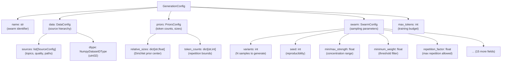
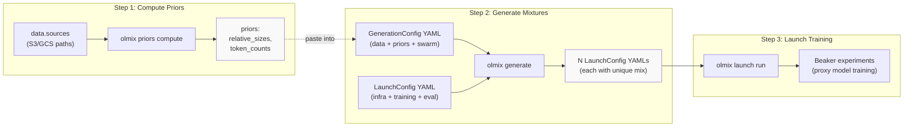
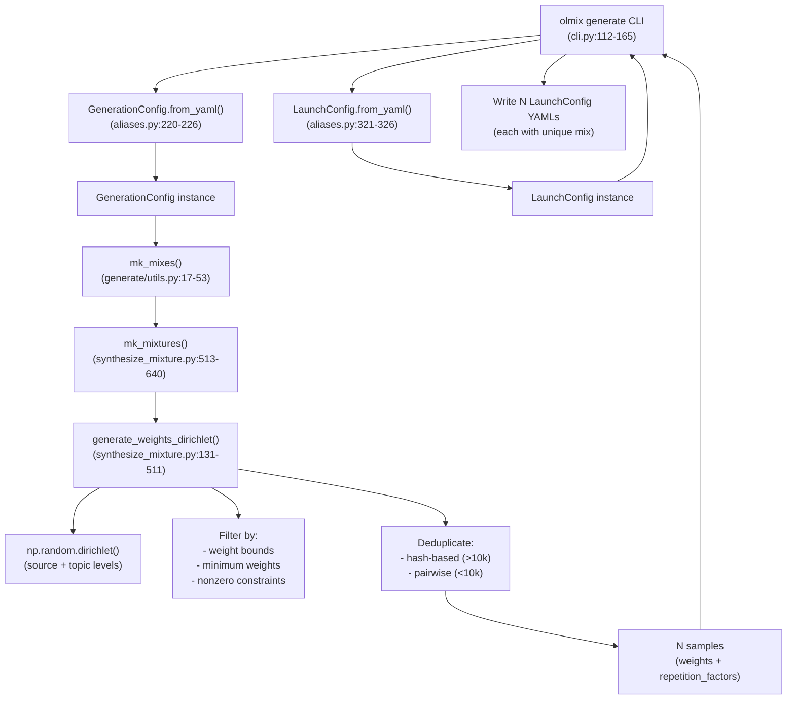
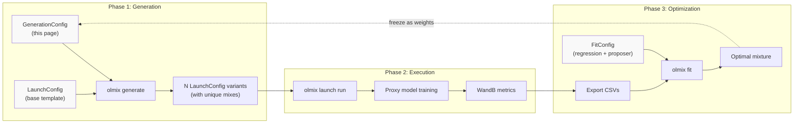

<!-- source: DeepWiki mcp.deepwiki.com · repo allenai/olmix · page 3.1 GenerationConfig · fetched 2026-10-26 -->

# GenerationConfig

<details>
<summary>Relevant source files</summary>

The following files were used as context for generating this wiki page:

- [README.md](README.md)
- [olmix/aliases.py](olmix/aliases.py)
- [olmix/cli.py](olmix/cli.py)
- [olmix/generate/synthesize_mixture.py](olmix/generate/synthesize_mixture.py)
- [olmix/generate/utils.py](olmix/generate/utils.py)
- [olmix/launch/utils.py](olmix/launch/utils.py)
- [plans/017_decompose_experiment_config.md](plans/017_decompose_experiment_config.md)
- [plans/019_eval_config.md](plans/019_eval_config.md)
- [plans/021_split_experiment_config.md](plans/021_split_experiment_config.md)
- [plans/022_self_contained_launch_configs.md](plans/022_self_contained_launch_configs.md)
- [plans/023_explicit_mix_field.md](plans/023_explicit_mix_field.md)

</details>


`GenerationConfig` specifies all parameters needed by `olmix generate` to sample mixture variants through Dirichlet-based probabilistic sampling. It contains the data landscape definition, prior distributions, sampling hyperparameters, and the token budget per proxy training run.

For information about the base training configuration that gets combined with generated mixtures, see [LaunchConfig](#3.2). For information about the data hierarchy within `GenerationConfig.data`, see [DataConfig Hierarchy](#3.4).

---

## Purpose and Scope

`GenerationConfig` is the input configuration for the `olmix generate` command. It defines:

1. **What data exists** (`data` field) — the hierarchical organization of data sources
2. **Natural distribution** (`priors` field) — token counts and relative sizes from scanning storage
3. **How to sample** (`swarm` field) — Dirichlet concentration, filtering thresholds, and repetition constraints
4. **Training budget** (`max_tokens` field) — token budget per proxy model run

The output of `olmix generate` is a set of `LaunchConfig` YAML files, each containing a unique sampled mixture ready for training.

**Sources:** [olmix/aliases.py:211-226](), [README.md:248-313]()

---

## Configuration Structure



**Sources:** [olmix/aliases.py:211-226](), [olmix/aliases.py:178-183](), [olmix/fit/config.py:64-70](), [olmix/aliases.py:185-209]()

---

## Workflow Integration



The `GenerationConfig` is positioned between prior computation and experiment launch. The `priors` section is typically populated by running `olmix priors compute --config <generation_config.yaml>` and pasting the output YAML into the config file.

**Sources:** [olmix/cli.py:112-165](), [README.md:188-246]()

---

## Top-Level Fields

### `name`

**Type:** `str` (optional, default: `""`)

Identifier for the swarm. Used as a prefix in the generated `LaunchConfig` filenames: `{name}-{group_uuid}-{index:04}.yaml`.

**Example:**
```yaml
name: dclm-baseline-swarm
```

**Sources:** [olmix/aliases.py:214](), [olmix/cli.py:148-149]()

---

### `data`

**Type:** `DataConfig`

Defines the hierarchical organization of data sources. This is the data landscape: **what data exists** and **how it is stored**. The hierarchy supports three levels:

- **source** (e.g., `dclm`, `wikipedia`, `stack-edu`)
- **topic** (e.g., `science_math_and_technology`, `Python`)
- **quality** (e.g., `vigintile_0001`, `high`, `low`)

Each level can optionally specify `weight` to freeze its relative proportion during sampling (mixture reuse pattern).

For detailed information about the data hierarchy, see [DataConfig Hierarchy](#3.4).

**Example:**
```yaml
data:
  dtype: uint32
  sources:
    - name: dclm
      topics:
        - name: science_math_and_technology
          paths: ["s3://ai2-llm/preprocessed/dclm/.../science_math_and_technology/**/*.npy"]
        - name: software_development
          paths: ["s3://ai2-llm/preprocessed/dclm/.../software_development/**/*.npy"]
    - name: wikipedia
      paths: ["s3://ai2-llm/preprocessed/wiki/.../*.npy"]
```

**Sources:** [olmix/aliases.py:215](), [olmix/aliases.py:178-183](), [README.md:259-290]()

---

### `priors`

**Type:** `PriorsConfig`

Contains two critical pieces of information derived from scanning the data storage paths:

1. **`relative_sizes`** — Natural distribution of tokens across leaf-level domains. Used as the center of the Dirichlet prior during sampling. Keys must be at the **leaf level** (e.g., `dclm:science_math_and_technology`, not just `dclm`).

2. **`token_counts`** — Absolute token counts per leaf-level domain. Used to enforce the repetition constraint: no domain should be sampled beyond `repetition_factor × token_counts[domain] / max_tokens`.

These values are computed automatically by `olmix priors compute`, which scans S3/GCS paths, counts tokens based on file sizes and `dtype`, and outputs YAML to paste into the config.

**Example:**
```yaml
priors:
  relative_sizes:
    arxiv: 0.13859324268101414
    dclm:education_and_jobs: 0.13466673502770904
    dclm:science_math_and_technology: 0.5479947162541395
    dclm:software_development: 0.1548063887874921
    wikipedia: 0.023938917249645256
  token_counts:
    arxiv: 21377485731
    dclm:education_and_jobs: 20771836713
    dclm:science_math_and_technology: 84526121193
    dclm:software_development: 23878302458
    wikipedia: 3692487830
```

**Sources:** [olmix/aliases.py:216](), [olmix/fit/config.py:64-70](), [olmix/cli.py:387-436](), [README.md:188-212](), [README.md:292-294]()

---

### `swarm`

**Type:** `SwarmConfig` (optional, defaults to `SwarmConfig()`)

Controls all aspects of the Dirichlet-based mixture sampling process. This section has 20 fields organized into several categories.

#### Sampling Control

| Field | Type | Default | Description |
|-------|------|---------|-------------|
| `variants` | `int` | `1` | Number of mixture variants to generate |
| `seed` | `int` | `42` | Random seed for Dirichlet sampling (separate from training seed) |

#### Dirichlet Concentration (Strength)

The "strength" parameters control how concentrated the Dirichlet samples are around the prior. **Low strength** (e.g., 0.1) produces diverse, extreme mixtures. **High strength** (e.g., 5.0) produces mixtures close to the prior.

| Field | Type | Default | Description |
|-------|------|---------|-------------|
| `min_strength` | `float` | `0.1` | Lower bound for concentration parameter |
| `max_strength` | `float` | `5.0` | Upper bound for concentration parameter |
| `min_source_strength` | `float \| None` | `None` | Override for source-level sampling |
| `max_source_strength` | `float \| None` | `None` | Override for source-level sampling |
| `min_topic_strength` | `float \| None` | `None` | Override for topic-level sampling |
| `max_topic_strength` | `float \| None` | `None` | Override for topic-level sampling |

The system samples log-uniformly between `min_strength` and `max_strength` to explore different concentration levels.

#### Temperature Scaling

Temperature parameters scale the prior distribution before Dirichlet sampling. Values < 1.0 flatten the distribution (more uniform), values > 1.0 sharpen it.

| Field | Type | Default | Description |
|-------|------|---------|-------------|
| `mix_temperature` | `float` | `1.0` | Global temperature for prior scaling |
| `source_mix_temperature` | `float \| None` | `None` | Override for source-level prior |
| `topic_mix_temperature` | `float \| None` | `None` | Override for topic-level prior |

#### Weight Filtering

Post-sampling filters to remove domains with negligible weights.

| Field | Type | Default | Description |
|-------|------|---------|-------------|
| `minimum_weight` | `float \| None` | `0.002` | Domains below this threshold are zeroed out |
| `minimum_source_weight` | `float \| None` | `None` | Override threshold at source level |
| `minimum_topic_weight` | `float \| None` | `None` | Override threshold at topic level (relative to source weight) |
| `nonzero_weight` | `list[str] \| None` | `None` | List of domain keys that must be nonzero in every variant |

#### Manual Overrides

Override the natural prior with manual specifications.

| Field | Type | Default | Description |
|-------|------|---------|-------------|
| `manual_prior` | `dict[str, float] \| None` | `None` | Override source-level Dirichlet prior (e.g., `{dclm: 0.75, stack-edu: 0.25}`) |
| `manual_topic_prior` | `dict[str, float] \| None` | `None` | Override topic-level prior for specific keys (still sampled, but with different center) |

#### Repetition Constraints

Control how much data repetition is allowed at the proxy training scale.

| Field | Type | Default | Description |
|-------|------|---------|-------------|
| `repetition_factor` | `float` | `1.0` | Maximum times a domain's tokens can be repeated (e.g., 1.0 = no repetition) |
| `enable_bound` | `bool` | `True` | Enforce the repetition bound when sampling |

The repetition bound is computed as: `weight_bound[domain] = min(token_counts[domain] × repetition_factor / max_tokens, 1.0)`. Samples that violate this bound are rejected.

#### Sampling Efficiency

| Field | Type | Default | Description |
|-------|------|---------|-------------|
| `sample_multiplier` | `int \| None` | `10` | Sample `variants × sample_multiplier` candidates, then filter and deduplicate |

#### Deduplication

| Field | Type | Default | Description |
|-------|------|---------|-------------|
| `existing_mix_file` | `str \| None` | `None` | Path to pickle of prior swarm ratios; new samples within L2 distance < 0.01 are rejected |

**Sources:** [olmix/aliases.py:185-209](), [olmix/aliases.py:217](), [README.md:296-312](), [olmix/generate/synthesize_mixture.py:131-511]()

---

### `max_tokens`

**Type:** `int`

Total token budget for each proxy training run. Used for two purposes:

1. **Repetition constraint enforcement** — ensures no domain is sampled beyond `token_counts[domain] × repetition_factor / max_tokens`
2. **Computing repetition factors** — for each sampled weight `w`, the required tokens are `w × max_tokens`, and the repetition factor is `⌈required_tokens / token_counts[domain]⌉`

Typically set based on Chinchilla scaling laws: `max_tokens = 20 × num_params × chinchilla_multiple`. For a 30M parameter proxy model with 0.5× Chinchilla, this would be `20 × 30M × 0.5 = 300M tokens`.

**Example:**
```yaml
max_tokens: 300000000  # 20 * 30M * 0.5
```

**Sources:** [olmix/aliases.py:218](), [olmix/generate/synthesize_mixture.py:522-524](), [olmix/aliases.py:45-50]()

---

## YAML Examples

### Basic Example

A simple swarm with 4 variants, no mixture reuse:

```yaml
name: example-swarm

data:
  dtype: uint32
  sources:
    - name: arxiv
      paths: ["s3://ai2-llm/preprocessed/arxiv/.../*.npy"]
    - name: dclm
      topics:
        - name: science_math_and_technology
          paths: ["s3://ai2-llm/preprocessed/dclm/.../science_math_and_technology/**/*.npy"]
        - name: software_development
          paths: ["s3://ai2-llm/preprocessed/dclm/.../software_development/**/*.npy"]
    - name: wikipedia
      paths: ["s3://ai2-llm/preprocessed/wiki/.../*.npy"]

priors:
  relative_sizes:
    arxiv: 0.13859
    dclm:science_math_and_technology: 0.54799
    dclm:software_development: 0.15481
    wikipedia: 0.02394
  token_counts:
    arxiv: 21377485731
    dclm:science_math_and_technology: 84526121193
    dclm:software_development: 23878302458
    wikipedia: 3692487830

swarm:
  seed: 42
  variants: 4
  min_strength: 0.1
  max_strength: 5.0
  minimum_weight: 0.002
  repetition_factor: 1.0

max_tokens: 300000000  # 20 * 30M * 0.5
```

**Sources:** [README.md:250-313](), [plans/021_split_experiment_config.md:172-204]()

---

### Mixture Reuse Example

Freezing previously-optimized weights while sampling new domains:

```yaml
name: stack-edu-addition

data:
  dtype: uint32
  sources:
    - name: existing
      topics:
        - name: dclm:science_math_and_technology
          paths: ["s3://..."]
          weight: 0.55   # frozen from prior optimization
        - name: dclm:software_development
          paths: ["s3://..."]
          weight: 0.15   # frozen
        - name: arxiv
          paths: ["s3://..."]
          weight: 0.25   # frozen
        - name: wikipedia
          paths: ["s3://..."]
          weight: 0.05   # frozen
    - name: stack-edu
      topics:
        - name: Python
          paths: ["s3://..."]   # free to vary
        - name: Java
          paths: ["s3://..."]   # free to vary

priors:
  relative_sizes:
    dclm:science_math_and_technology: 0.548
    dclm:software_development: 0.155
    arxiv: 0.139
    wikipedia: 0.024
    stack-edu:Python: 0.080
    stack-edu:Java: 0.054
  token_counts:
    dclm:science_math_and_technology: 84526121193
    dclm:software_development: 23878302458
    arxiv: 21377485731
    wikipedia: 3692487830
    stack-edu:Python: 12000000000
    stack-edu:Java: 8000000000

swarm:
  seed: 43
  variants: 10
  min_strength: 0.1
  max_strength: 5.0

max_tokens: 300000000
```

When topics have explicit `weight` values, those weights are frozen. The Dirichlet sampling only varies the **source-level** allocation: how much weight goes to `existing` vs. `stack-edu`, and within `stack-edu`, how the weight is split between `Python` and `Java`.

**Sources:** [README.md:263-290](), [plans/022_self_contained_launch_configs.md:1-162]()

---

## Loading and Usage

### Loading from YAML

```python
from olmix.aliases import GenerationConfig

gen_config = GenerationConfig.from_yaml("configs/examples/generate/example.yaml")
```

The `from_yaml` classmethod loads and validates the YAML file.

**Sources:** [olmix/aliases.py:220-226](), [olmix/cli.py:138]()

---

### CLI Usage

```bash
# Step 1: Compute priors from data paths
olmix priors compute --config configs/examples/generate/example.yaml

# Paste the output into the config file under 'priors:'

# Step 2: Generate mixture variants
olmix generate \
  --config configs/examples/generate/example.yaml \
  --base configs/examples/launch/data_proportions/mix_baseline.yaml \
  --output output/my_variants/

# This produces N self-contained LaunchConfig YAML files
```

**Sources:** [olmix/cli.py:112-165](), [olmix/cli.py:387-436](), [README.md:214-235]()

---

## Output Format

The `olmix generate` command produces one `LaunchConfig` YAML file per variant. Each file is self-contained and ready to launch with `olmix launch run`.

**Directory structure:**
```
output/my_variants/
  example-swarm-a1b2c3d4-0000.yaml
  example-swarm-a1b2c3d4-0001.yaml
  example-swarm-a1b2c3d4-0002.yaml
  example-swarm-a1b2c3d4-0003.yaml
```

**Example output file (`example-swarm-a1b2c3d4-0000.yaml`):**
```yaml
name: example-swarm-a1b2c3d4-0000
group_id: a1b2c3d4

# Base config fields (from --base)
infra:
  budget: ai2/oe-base
  workspace: ai2/oe-data
  cluster: ai2/jupiter
  gpus: 1
  # ...

training:
  proxy_model_id: olmo3_30m
  chinchilla_multiple: 0.5
  # ...

data:
  sources:
    - name: arxiv
      paths: [...]
    - name: dclm
      topics:
        - name: science_math_and_technology
          paths: [...]
        # ...
  # ...

eval:
  type: inloop
  tasks:
    math:
      gsm8k_gold_bpb_5shot: "eval/downstream/gsm8k_gold_bpb_5shot (BPB v2)"
      # ...
  # ...

# Generated mix (unique per variant)
mix:
  arxiv:
    weight: 0.15
    repetition_factor: 1.0
  dclm:science_math_and_technology:
    weight: 0.50
    repetition_factor: 1.0
  dclm:software_development:
    weight: 0.25
    repetition_factor: 1.0
  wikipedia:
    weight: 0.10
    repetition_factor: 1.5
```

Each variant has a unique `mix` field with sampled weights and computed repetition factors. All other fields (infra, training, data, eval) are inherited from the base `LaunchConfig`.

**Sources:** [olmix/cli.py:144-164](), [plans/022_self_contained_launch_configs.md:1-162](), [README.md:225-235]()

---

## Code Flow



**Sources:** [olmix/cli.py:112-165](), [olmix/generate/utils.py:17-53](), [olmix/generate/synthesize_mixture.py:513-640](), [olmix/generate/synthesize_mixture.py:131-511]()

---

## Relationship to Other Configs



- **GenerationConfig** (this page) — defines mixture sampling parameters
- **LaunchConfig** [see page 3.2](#3.2) — defines training infrastructure and configuration
- **FitConfig** [see page 3.3](#3.3) — defines regression and optimization parameters

The iterative workflow: fit produces optimal weights → freeze them in GenerationConfig for the next iteration → generate new variants exploring remaining degrees of freedom.

**Sources:** [olmix/aliases.py:211-226](), [olmix/aliases.py:299-326](), [olmix/fit/config.py:115-207]()

---

## Advanced Topics

### Two-Level Dirichlet Sampling

The system performs hierarchical sampling:

1. **Source level** — sample source weights from `Dirichlet(source_prior × strength)`
2. **Topic level** — for each source, sample topic weights from `Dirichlet(topic_prior × strength)`
3. **Flatten** — multiply source weight × topic weight to get leaf-level weights

This allows independent control of diversity at each hierarchy level via `min_source_strength`/`max_source_strength` and `min_topic_strength`/`max_topic_strength`.

**Sources:** [olmix/generate/synthesize_mixture.py:362-412]()

---

### Repetition Factor Computation

For each sampled weight `w` and domain with `token_count` tokens:

1. Required tokens: `required = w × max_tokens`
2. Repetition: `repetition = ceil(required / token_count * 1000) / 1000`
3. Reject if `repetition > repetition_factor`

This ensures no domain exceeds its allowed repetition at the proxy training scale.

**Sources:** [olmix/generate/synthesize_mixture.py:473-486]()

---

### Deduplication Strategies

When `len(collected_samples) > 10000`, the system uses hash-based deduplication (`sort_and_deduplicate_with_hash`) instead of pairwise comparison (`sort_and_deduplicate`) to avoid O(n²) complexity.

**Sources:** [olmix/generate/synthesize_mixture.py:490-497]()

---

