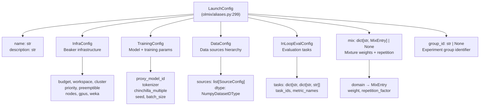
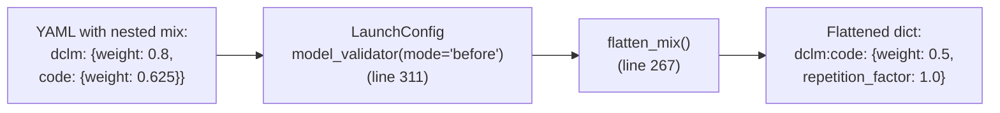
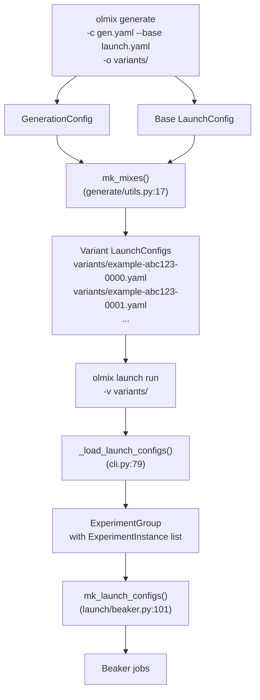
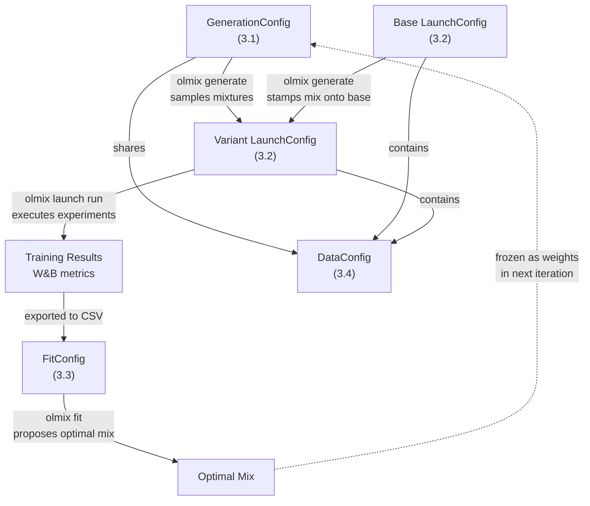

<!-- source: DeepWiki mcp.deepwiki.com · repo allenai/olmix · page 3.2 LaunchConfig · fetched 2026-10-26 -->

# LaunchConfig

<details>
<summary>Relevant source files</summary>

The following files were used as context for generating this wiki page:

- [olmix/__init__.py](olmix/__init__.py)
- [olmix/aliases.py](olmix/aliases.py)
- [olmix/cli.py](olmix/cli.py)
- [olmix/generate/synthesize_mixture.py](olmix/generate/synthesize_mixture.py)
- [olmix/generate/utils.py](olmix/generate/utils.py)
- [olmix/launch/__init__.py](olmix/launch/__init__.py)
- [olmix/launch/beaker.py](olmix/launch/beaker.py)
- [olmix/launch/utils.py](olmix/launch/utils.py)
- [plans/017_decompose_experiment_config.md](plans/017_decompose_experiment_config.md)
- [plans/019_eval_config.md](plans/019_eval_config.md)
- [plans/021_split_experiment_config.md](plans/021_split_experiment_config.md)
- [plans/022_self_contained_launch_configs.md](plans/022_self_contained_launch_configs.md)
- [plans/023_explicit_mix_field.md](plans/023_explicit_mix_field.md)
- [tests/test_cli.py](tests/test_cli.py)
- [tests/test_config.py](tests/test_config.py)
- [tests/test_imports.py](tests/test_imports.py)

</details>


LaunchConfig is a Pydantic configuration model that defines a **self-contained experiment specification** for training proxy models on Beaker. It encapsulates all infrastructure settings, training parameters, data sources, evaluation tasks, and mixture weights needed to execute a training run.

LaunchConfig is the primary configuration type consumed by the `olmix launch` commands. It is generated by `olmix generate` (which stamps mixture variants onto a base config) and can also be hand-written for single-experiment launches. For information about how mixtures are generated, see [GenerationConfig](#3.1). For information about optimization after training, see [FitConfig](#3.3).

---

## Overview and Structure

LaunchConfig is composed of five sub-configuration models plus top-level metadata:



**Diagram: LaunchConfig composition and key fields**

Sources: [olmix/aliases.py:299-326](), [olmix/aliases.py:138-151](), [olmix/aliases.py:153-176](), [olmix/aliases.py:178-183]()

| Field | Type | Purpose |
|-------|------|---------|
| `name` | `str` | Experiment name (e.g., `"example-abc123-0000"`) |
| `description` | `str` | Human-readable description |
| `infra` | `InfraConfig` | Beaker infrastructure settings |
| `training` | `TrainingConfig` | Model architecture, training schedule, evaluation |
| `data` | `DataConfig` | Data source definitions (paths, hierarchy) |
| `eval` | `InLoopEvalConfig` | In-loop evaluation task configuration |
| `mix` | `dict[str, MixEntry] \| None` | Explicit mixture weights (optional for backward compat) |
| `group_id` | `str \| None` | Shared identifier for grouped experiments (optional) |

The `mix` and `group_id` fields were added to enable self-contained configs ([plans/022_self_contained_launch_configs.md]()). Prior to this, mixture information was distributed across multiple files.

Sources: [olmix/aliases.py:299-326]()

---

## Sub-Configuration Models

### InfraConfig

Infrastructure settings for Beaker job submission:

| Field | Type | Default | Description |
|-------|------|---------|-------------|
| `budget` | `str` | — | Beaker budget (e.g., `"ai2/oe-data"`) |
| `workspace` | `str` | — | Beaker workspace (e.g., `"ai2/dolma2"`) |
| `cluster` | `str` | — | Cluster name (e.g., `"ai2/saturn-cirrascale"`) |
| `priority` | `Priority` | `normal` | Job priority (`low`, `normal`, `high`, `urgent`) |
| `preemptible` | `bool` | `True` | Allow job preemption |
| `nodes` | `int` | `1` | Number of compute nodes |
| `gpus` | `int` | — | GPUs per node (required) |
| `weka` | `bool` | `False` | Mount Weka shared filesystem |
| `shared_filesystem` | `bool` | `False` | Enable shared filesystem |
| `wandb_debug` | `bool` | `False` | Enable W&B debug logging |

Used by [olmix/launch/beaker.py:101-163]() to construct `BeakerLaunchConfig` objects.

Sources: [olmix/aliases.py:138-151]()

### TrainingConfig

Model and training parameters:

| Field | Type | Default | Description |
|-------|------|---------|-------------|
| `proxy_model_id` | `str` | — | Model identifier (e.g., `"olmo2_30m"`) |
| `tokenizer` | `str` | — | Tokenizer name (e.g., `"dolma2"`) |
| `chinchilla_multiple` | `float` | — | Chinchilla scaling factor (e.g., `1.0` = 20 tokens/param) |
| `seed` | `int` | — | Training RNG seed |
| `device_batch_size` | `int` | `4` | Batch size per device |
| `global_batch_size` | `int \| None` | `None` | Total batch size (if specified) |
| `checkpoint_path` | `str \| None` | `None` | Resume from checkpoint path |
| `train_type` | `TrainType` | `pretrain` | Training mode (`pretrain` or `anneal`) |
| `eval_interval` | `int` | `1000` | Steps between evaluations |
| `no_eval` | `bool` | `False` | Disable downstream evaluations |
| `instance_filter` | `InstanceFilterConfig \| None` | `None` | Repetitive sequence filtering |

The `get_max_tokens()` method computes total training tokens from `chinchilla_multiple` and model size:

```python
def get_max_tokens(self) -> int:
    """Compute the maximum training tokens from chinchilla_multiple and model size."""
    num_params = get_model_num_params(self.proxy_model_id)
    return compute_max_tokens(self.chinchilla_multiple, num_params)
```

Sources: [olmix/aliases.py:153-176](), [olmix/aliases.py:168-176](), [olmix/aliases.py:45-68]()

### DataConfig

Data landscape specification — describes what data exists and where it's stored:

```python
class DataConfig(BaseModel):
    """Data landscape: what data exists and how it's stored."""
    sources: list[SourceConfig]
    dtype: NumpyDatasetDType = NumpyDatasetDType.uint32
```

The `sources` field defines a hierarchical structure: **source → topic → quality → paths**. Each level can have optional weights in the `mix` field. See [DataConfig Hierarchy](#3.4) for details.

Sources: [olmix/aliases.py:178-183]()

### InLoopEvalConfig

Evaluation task configuration for in-loop downstream tasks (logged to W&B during training):

```yaml
eval:
  type: inloop
  tasks:
    math:
      gsm8k_gold_bpb_5shot: "eval/downstream/gsm8k_gold_bpb_5shot (BPB v2)"
      minerva_math_algebra_gold_bpb_0shot: "eval/downstream/minerva_math_algebra_gold_bpb_0shot (BPB v2)"
    code:
      codex_humaneval_gold_bpb_3shot: "eval/downstream/codex_humaneval_gold_bpb_3shot (BPB v2)"
    qa:
      arc_challenge_test_rc_5shot: "eval/downstream/arc_challenge_test_rc_5shot (BPB v2)"
```

The `tasks` field is a nested dictionary: **family → task_id → wandb_metric_name**. Properties:
- `task_ids` — list of olmo-core task identifiers (for configuring evaluation callbacks)
- `metric_names` — list of W&B metric names (for CSV column matching in `olmix fit`)
- `task_families` — dict mapping family names to metric lists (for aggregation)

Sources: [olmix/fit/config.py](), [olmix/aliases.py:307]()

---

## The Mix Field

The `mix` field is an **explicit top-level specification of mixture weights and repetition factors**. It separates concerns:
- `data.sources` describes what data exists (names, paths, hierarchy)
- `mix` describes how to use it (weights, repetition factors)

### MixEntry Structure

Each domain in the mixture maps to a `MixEntry`:

```python
class MixEntry(BaseModel):
    """A single domain entry in a mixture variant."""
    weight: float
    repetition_factor: float
```

| Field | Description |
|-------|-------------|
| `weight` | Sampling probability for this domain (should sum to ~1.0 across all domains) |
| `repetition_factor` | Maximum repetition cap — how many times this source's tokens can be repeated during training (passed to OLMo Core as `max_repetition_ratio`) |

Sources: [olmix/aliases.py:228-233]()

### Format: Nested vs Flat

LaunchConfig supports two equivalent formats for the `mix` field, with automatic flattening at parse time via a `model_validator`:

#### Nested Format (Hand-Written)

Mirrors the source hierarchy. Weights are **multiplicative** along the path:

```yaml
mix:
  dclm:
    weight: 0.8
    repetition_factor: 1.0
    software_development:
      weight: 0.625    # Leaf weight = 0.8 * 0.625 = 0.5
    science_math_and_technology:
      weight: 0.25     # Leaf weight = 0.8 * 0.25 = 0.2
  wikipedia:
    weight: 0.2
    repetition_factor: 2.0
```

#### Flat Format (Generated)

Domain paths are colon-separated keys:

```yaml
mix:
  dclm:software_development:
    weight: 0.5
    repetition_factor: 1.0
  dclm:science_math_and_technology:
    weight: 0.2
    repetition_factor: 1.0
  wikipedia:
    weight: 0.2
    repetition_factor: 2.0
```

Both formats parse to the same internal representation. The `flatten_mix()` function recursively expands nested dicts at parse time:



**Diagram: Nested mix auto-flattening flow**

Sources: [olmix/aliases.py:267-296](), [olmix/aliases.py:311-318]()

The `repetition_factor` is **inherited** from the nearest ancestor that sets it. If omitted at all levels, it defaults to `1.0` implicitly in downstream code.

Sources: [olmix/aliases.py:235-265](), [plans/023_explicit_mix_field.md]()

---

## Loading and Usage

### From YAML

LaunchConfig provides a `from_yaml()` classmethod:

```python
config = LaunchConfig.from_yaml("configs/experiments/example.yaml")
```

The method loads the file, parses YAML, and validates all fields including nested mix flattening.

Sources: [olmix/aliases.py:320-325]()

### In the CLI Workflow



**Diagram: LaunchConfig flow through olmix workflow**

Sources: [olmix/cli.py:112-165](), [olmix/cli.py:178-261](), [olmix/cli.py:79-98]()

1. **Generation**: `olmix generate` loads a GenerationConfig and a base LaunchConfig, samples N mixture variants, and writes each as a self-contained LaunchConfig YAML with `mix` and `group_id` populated.

2. **Launch**: `olmix launch run` loads all variant LaunchConfig files from a directory, groups them into an `ExperimentGroup`, converts to Beaker launch configs, and submits to the cluster.

The `_load_launch_configs()` helper accepts either a single YAML file or a directory:

```python
def _load_launch_configs(variants_path: str) -> list[LaunchConfig]:
    """Load LaunchConfig YAML files from a file or directory."""
    p = Path(variants_path)
    if p.is_file():
        return [LaunchConfig.from_yaml(p)]
    
    if not p.is_dir():
        raise click.BadParameter(f"Variants path is not a file or directory: {variants_path}")
    
    variant_files = sorted(p.glob("*.yaml")) + sorted(p.glob("*.yml"))
    # ... load each file
```

Sources: [olmix/cli.py:79-98]()

### Usage in Launch Pipeline

The launch pipeline extracts fields from LaunchConfig to construct Beaker jobs:

| LaunchConfig Field | Used By | Purpose |
|--------------------|---------|---------|
| `infra.cluster` | `mk_launch_configs()` | Cluster selection |
| `infra.gpus` | `mk_launch_configs()` | GPU allocation |
| `infra.budget` | `mk_launch_configs()` | Budget assignment |
| `training.proxy_model_id` | `mk_instance_cmd()` | Model size (via `-m`) |
| `training.chinchilla_multiple` | `mk_instance_cmd()` | Training duration (via `-x`) |
| `training.seed` | `mk_instance_cmd()` | RNG seed (via `-S`) |
| `data.sources` + `mix` | `mk_source_instances()` | Converts to `SourceInstance` list |
| `eval.task_ids` | `mk_instance_cmd()` | Evaluation tasks (via `-e`) |
| `group_id` | `mk_instance_cmd()` | W&B grouping (via `-g`) |

Sources: [olmix/launch/beaker.py:45-98](), [olmix/launch/beaker.py:101-163](), [olmix/launch/utils.py:12-85]()

---

## Example YAML Configurations

### Minimal LaunchConfig

```yaml
name: example-minimal
description: Minimal launch config

infra:
  budget: ai2/oe-data
  workspace: ai2/dolma2
  cluster: ai2/saturn-cirrascale
  gpus: 1

training:
  proxy_model_id: olmo2_30m
  tokenizer: dolma2
  chinchilla_multiple: 1.0
  seed: 42

data:
  sources:
    - name: wikipedia
      paths: ["s3://ai2-llm/preprocessed/wiki/**/*.npy"]

eval:
  type: inloop
  tasks:
    qa:
      arc_challenge_test_rc_5shot: "eval/downstream/arc_challenge_test_rc_5shot (BPB v2)"

mix:
  wikipedia:
    weight: 1.0
    repetition_factor: 1.0
```

### Multi-Source with Nested Mix

```yaml
name: example-multi
description: Multi-source config with nested mix

infra:
  budget: ai2/oe-data
  workspace: ai2/dolma2
  cluster: ai2/saturn-cirrascale
  priority: high
  gpus: 8
  weka: true

training:
  proxy_model_id: olmo3_30m
  tokenizer: dolma2
  chinchilla_multiple: 2.0
  seed: 42
  device_batch_size: 4
  global_batch_size: 512

data:
  sources:
    - name: dclm
      topics:
        - name: science_math_and_technology
          paths: ["s3://ai2-llm/preprocessed/dclm/.../science_math_and_technology/**/*.npy"]
        - name: software_development
          paths: ["s3://ai2-llm/preprocessed/dclm/.../software_development/**/*.npy"]
    - name: wikipedia
      paths: ["s3://ai2-llm/preprocessed/wiki/**/*.npy"]
    - name: arxiv
      paths: ["s3://ai2-llm/preprocessed/arxiv/**/*.npy"]

eval:
  type: inloop
  tasks:
    math:
      gsm8k_gold_bpb_5shot: "eval/downstream/gsm8k_gold_bpb_5shot (BPB v2)"
    code:
      codex_humaneval_gold_bpb_3shot: "eval/downstream/codex_humaneval_gold_bpb_3shot (BPB v2)"
    qa:
      arc_challenge_test_rc_5shot: "eval/downstream/arc_challenge_test_rc_5shot (BPB v2)"

mix:
  dclm:
    weight: 0.70
    repetition_factor: 1.0
    science_math_and_technology:
      weight: 0.6    # Effective: 0.70 * 0.6 = 0.42
    software_development:
      weight: 0.4    # Effective: 0.70 * 0.4 = 0.28
  wikipedia:
    weight: 0.15
    repetition_factor: 2.0
  arxiv:
    weight: 0.15
    repetition_factor: 1.5

group_id: abc12345
```

Sources: [configs/examples/launch/]()

---

## Relationship to Other Configs



**Diagram: LaunchConfig in the optimization loop**

- **[GenerationConfig](#3.1)** defines mixture sampling parameters and produces variant LaunchConfigs
- **LaunchConfig** is the complete experiment specification (this page)
- **[FitConfig](#3.3)** defines regression/optimization parameters for analyzing LaunchConfig results
- All three share a common **[DataConfig](#3.4)** schema

Sources: High-level diagrams (Diagram 1, Diagram 3 in context)

---

## Implementation Details

### Model Validation

LaunchConfig uses a `model_validator(mode="before")` to flatten nested mix dicts before field validation:

```python
@model_validator(mode="before")
@classmethod
def _resolve_nested_mix(cls, data: Any) -> Any:
    """Auto-flatten nested mix dicts into leaf-level MixEntry dicts."""
    if isinstance(data, dict) and isinstance(data.get("mix"), dict):
        data = dict(data)
        data["mix"] = flatten_mix(data["mix"])
    return data
```

This ensures that both nested and flat formats parse to the same internal representation.

Sources: [olmix/aliases.py:311-318]()

### Backward Compatibility

The `mix` and `group_id` fields default to `None` to support legacy configs that don't have these fields. However, all configs generated by `olmix generate` populate both fields.

Sources: [olmix/aliases.py:308-309](), [plans/022_self_contained_launch_configs.md]()

### Conversion to ExperimentGroup

The `mk_experiment_group()` function converts a list of LaunchConfigs to an `ExperimentGroup`:

```python
def mk_experiment_group(configs: list[LaunchConfig], group_uuid: str) -> ExperimentGroup:
    """Build an experiment group from self-contained launch configs."""
    instances = []
    for lc in configs:
        assert lc.mix is not None, f"LaunchConfig '{lc.name}' has no mix field"
        instances.append(
            ExperimentInstance(
                name=lc.name,
                sources=mk_source_instances(lc.data.sources, lc.mix),
            )
        )
    return ExperimentGroup(
        config=configs[0],
        group_id=group_uuid,
        instances=instances,
    )
```

Each `ExperimentInstance` has a `sources` list of `SourceInstance` objects with resolved paths, weights, and repetition factors.

Sources: [olmix/launch/beaker.py:18-42](), [olmix/launch/utils.py:12-85]()

---

## Testing

LaunchConfig parsing and validation is tested in [tests/test_config.py:101-449](). Key test coverage:

- Basic config construction and field defaults
- YAML round-tripping (`from_yaml()`)
- Nested mix flattening (2-level and 3-level)
- Repetition factor inheritance
- Hand-written config loading (31 production configs)
- Mix field normalization (weights sum to ~1.0)

Sources: [tests/test_config.py:101-449]()

---

