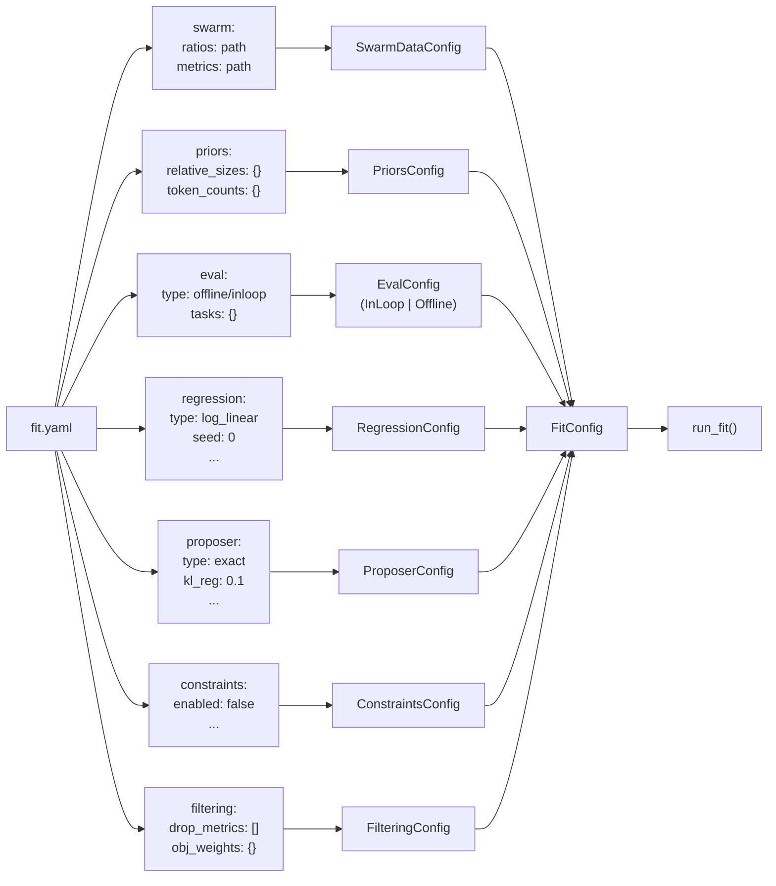
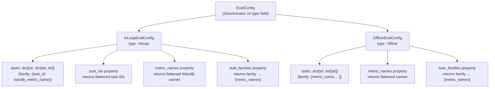
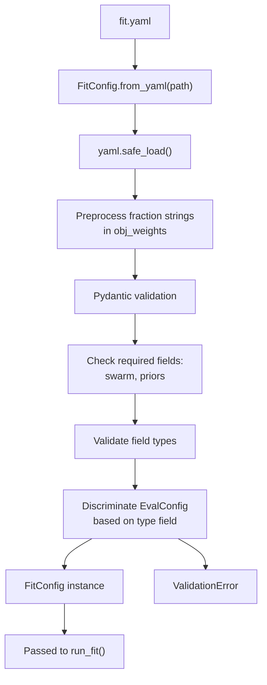
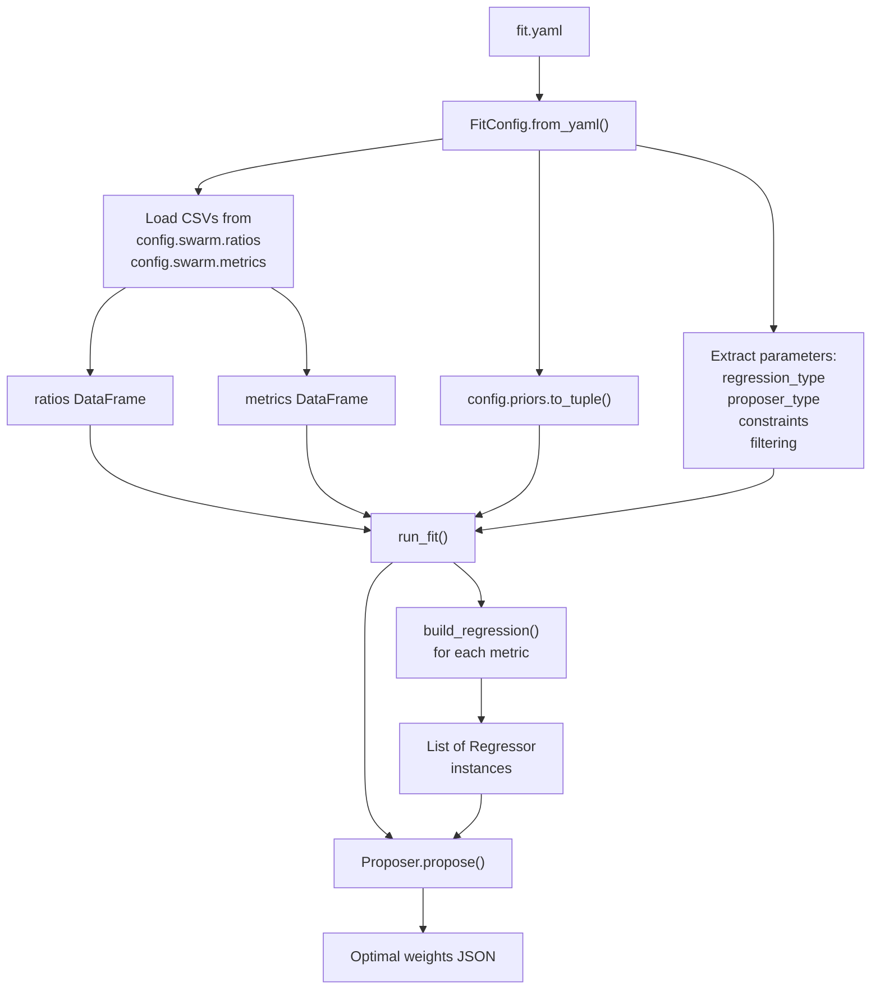

<!-- source: DeepWiki mcp.deepwiki.com · repo allenai/olmix · page 3.3 FitConfig · fetched 2026-10-26 -->

# FitConfig

<details>
<summary>Relevant source files</summary>

The following files were used as context for generating this wiki page:

- [README.md](README.md)
- [olmix/fit/config.py](olmix/fit/config.py)
- [olmix/fit/core.py](olmix/fit/core.py)
- [tests/test_fit_config.py](tests/test_fit_config.py)

</details>


## Purpose and Scope

`FitConfig` is a Pydantic configuration model that controls all aspects of the `olmix fit` command. It defines the complete specification for regression fitting and mixture optimization, including data sources, regression model parameters, proposer settings, constraints, and filtering rules.

This page documents the structure, fields, and validation logic of `FitConfig` and its nested sub-configurations. For information about how these configurations are used during the fitting process, see [olmix fit](#2.3). For details on regression models and proposers themselves, see [Regression and Optimization](#4).

---

## Configuration Model Hierarchy

`FitConfig` is composed of seven sub-configuration models, only two of which are required. The hierarchy is designed to cleanly separate concerns: data sources, prior distributions, evaluation metrics, regression behavior, optimization behavior, constraints, and filtering.

**Diagram: FitConfig Composition**

```mermaid
graph TB
    FC["FitConfig"]
    
    FC --> SDC["SwarmDataConfig<br/>(required)"]
    FC --> PC["PriorsConfig<br/>(required)"]
    FC --> EC["EvalConfig<br/>(optional)"]
    FC --> RC["RegressionConfig<br/>(has defaults)"]
    FC --> PrC["ProposerConfig<br/>(has defaults)"]
    FC --> CC["ConstraintsConfig<br/>(has defaults)"]
    FC --> FiC["FilteringConfig<br/>(has defaults)"]
    
    SDC --> Ratios["ratios: str<br/>path to ratios.csv"]
    SDC --> Metrics["metrics: str<br/>path to metrics.csv"]
    
    PC --> RelSizes["relative_sizes:<br/>dict[str, float]"]
    PC --> TokenCounts["token_counts:<br/>dict[str, int]"]
    
    EC --> InLoop["InLoopEvalConfig<br/>type: 'inloop'"]
    EC --> Offline["OfflineEvalConfig<br/>type: 'offline'"]
    
    RC --> Type1["type: str<br/>default: 'log_linear'"]
    RC --> Seed1["seed: int<br/>default: 0"]
    RC --> TrainSplit["train_split: float<br/>default: 1.0"]
    RC --> NTest["n_test: int<br/>default: 0"]
    RC --> AggFam["aggregate_task_families: bool<br/>default: False"]
    
    PrC --> Type2["type: str<br/>default: 'exact'"]
    PrC --> Temp["temperature: float | None<br/>default: None"]
    PrC --> KL["kl_reg: float | None<br/>default: None"]
    PrC --> FitOnly["fit_only: bool<br/>default: False"]
    PrC --> Worst["make_worst_mix: bool<br/>default: False"]
    
    CC --> Enabled["enabled: bool<br/>default: False"]
    CC --> Target["target_tokens: int | None<br/>default: None"]
    CC --> RepFactor["repetition_factor: float<br/>default: 4.0"]
    
    FiC --> Drop["drop_metrics: list[str]<br/>default: []"]
    FiC --> Weights["obj_weights: dict[str, float]<br/>default: {}"]
```



Sources: [olmix/fit/config.py:1-177]()

---

## YAML-to-Python Mapping

`FitConfig` is loaded from YAML files using the `from_yaml()` class method. The YAML structure directly maps to the Pydantic model hierarchy.

**Diagram: YAML Structure to Python Classes**



Sources: [olmix/fit/config.py:159-177](), [olmix/fit/core.py:65-102]()

---

## SwarmDataConfig

Specifies the paths to the two required CSV files containing swarm experiment results.

| Field | Type | Required | Description |
|-------|------|----------|-------------|
| `ratios` | `str` | Yes | Path to CSV with domain mixture ratios per run |
| `metrics` | `str` | Yes | Path to CSV with evaluation metrics per run |

The ratios CSV must have domain weight columns that sum to ~1.0 per row. The metrics CSV contains performance measurements (lower is better for BPB metrics). Both CSVs are joined on the `run` or `run_id` column.

**Example:**
```yaml
swarm:
  ratios: data/swarm_ratios.csv
  metrics: data/swarm_metrics.csv
```

Sources: [olmix/fit/config.py:16-21](), [README.md:24-44]()

---

## PriorsConfig

Defines the token distribution across domains, used for both KL regularization (in the proposer) and repetition constraints.

| Field | Type | Required | Description |
|-------|------|----------|-------------|
| `relative_sizes` | `dict[str, float]` | Yes | Fractional weight of each domain in the natural corpus (should sum to ~1.0) |
| `token_counts` | `dict[str, int]` | Yes | Absolute token count per domain |

**Methods:**
- `to_tuple() -> tuple[dict[str, float], dict[str, int]]`: Converts to the tuple format expected by `run_fit()`.

The `relative_sizes` field defines the prior distribution used as the KL regularization target. The `token_counts` field is used to enforce repetition constraints when `constraints.enabled` is true.

**Example:**
```yaml
priors:
  relative_sizes:
    dclm: 0.75
    wikipedia: 0.15
    arxiv: 0.10
  token_counts:
    dclm: 150_000_000_000
    wikipedia: 30_000_000_000
    arxiv: 20_000_000_000
```

Sources: [olmix/fit/config.py:23-32](), [README.md:111-117]()

---

## EvalConfig

Controls which evaluation metrics are included in the fit. This is a discriminated union of two types: `InLoopEvalConfig` and `OfflineEvalConfig`.

**Diagram: EvalConfig Discriminated Union**



### InLoopEvalConfig

Used when metrics are logged to WandB during training (the typical case for `olmix launch` experiments).

**Fields:**
- `type`: Literal `"inloop"`
- `tasks`: Nested dict of `{family: {task_id: wandb_metric_name}}`

**Properties:**
- `task_ids`: Flattened list of olmo-core task IDs
- `metric_names`: Flattened list of WandB metric names (CSV column names)
- `task_families`: Dict of `{family: [metric_names]}`

**Example:**
```yaml
eval:
  type: inloop
  tasks:
    math:
      gsm8k_gold_bpb_5shot: "eval/downstream/gsm8k_gold_bpb_5shot (BPB v2)"
    code:
      codex_humaneval_gold_bpb_3shot: "eval/downstream/codex_humaneval_gold_bpb_3shot (BPB v2)"
```

### OfflineEvalConfig

Used when metrics are computed offline and provided directly in the metrics CSV. This is the default if `type` is omitted.

**Fields:**
- `type`: Literal `"offline"` (default)
- `tasks`: Dict of `{family: [metric_name, ...]}`

**Properties:**
- `metric_names`: Flattened list of metric names
- `task_families`: Dict of `{family: [metric_names]}`

**Example:**
```yaml
eval:
  tasks:
    math:
      - minerva_math_algebra::olmes
    code:
      - codex_humaneval:3shot::none
      - mbpp:3shot::none
```

The `eval` section is **optional**. If omitted, all metrics found in the CSV are used without grouping into task families.

Sources: [olmix/fit/config.py:69-129](), [tests/test_fit_config.py:217-291]()

---

## RegressionConfig

Controls regression model selection and training behavior.

| Field | Type | Default | Description |
|-------|------|---------|-------------|
| `type` | `str` | `"log_linear"` | Model type: `log_linear`, `lightgbm`, `gp`, `autoscale`, `bimix`, `search` |
| `seed` | `int` | `0` | Random state for train-test split |
| `n_test` | `int` | `0` | Number of held-out test samples. If nonzero, only reports fit quality; does not propose a mix |
| `train_split` | `float` | `1.0` | Fraction (0-1) or number (>1) of samples used for training |
| `aggregate_task_families` | `bool` | `False` | Fit one model per task family instead of per individual task |

**Regression Types:**
- `log_linear`: Parametric scaling law (default, supports caching and exact proposer)
- `lightgbm`: Gradient-boosted trees (non-parametric)
- `gp`: Gaussian Process (non-parametric)
- `autoscale`: Power-law autoscaling
- `bimix`: BiMix-style power law
- `search`: Lookup table from evaluated mixtures

**Example:**
```yaml
regression:
  type: log_linear
  seed: 42
  n_test: 10
  train_split: 0.8
  aggregate_task_families: false
```

When `aggregate_task_families` is `true`, the regression fits one model per task family (e.g., "math", "code") instead of per individual metric. This requires task families to be defined in `eval.tasks`. The aggregation is done by computing the row-wise mean across all metrics in a family.

Sources: [olmix/fit/config.py:34-42](), [README.md:123-132](), [olmix/fit/core.py:165-182]()

---

## ProposerConfig

Controls how optimal mixture weights are proposed after regression fitting.

| Field | Type | Default | Description |
|-------|------|---------|-------------|
| `type` | `str` | `"exact"` | Proposer algorithm: `exact`, `simulation`, `search` |
| `temperature` | `float \| None` | `None` | Temperature for Dirichlet prior in simulation proposer |
| `kl_reg` | `float \| None` | `None` | KL regularization strength for exact proposer (0.1 is typical) |
| `fit_only` | `bool` | `False` | Only fit regression models; skip mixture proposal |
| `make_worst_mix` | `bool` | `False` | Invert objective to produce a bad mix (for counterfactual analysis) |

**Proposer Types:**
- `exact`: Convex optimization (CVXPY). Only compatible with `regression.type: log_linear`
- `simulation`: Monte Carlo sampling from Dirichlet distributions
- `search`: Evaluates and returns the best mixture from the swarm

The `exact` proposer uses the `kl_reg` parameter to regularize the proposed mixture toward the prior distribution specified in `priors.relative_sizes`. Higher values produce mixtures closer to the prior; lower values prioritize predicted performance.

**Example:**
```yaml
proposer:
  type: exact
  kl_reg: 0.1
  fit_only: false
  make_worst_mix: false
```

Sources: [olmix/fit/config.py:44-52](), [README.md:134-142](), [olmix/fit/core.py:405-416]()

---

## ConstraintsConfig

Enforces token budget constraints during optimization to prevent data repetition.

| Field | Type | Default | Description |
|-------|------|---------|-------------|
| `enabled` | `bool` | `False` | Enable repetition constraints |
| `target_tokens` | `int \| None` | `None` | Total token budget for the final training run (required when enabled) |
| `repetition_factor` | `float` | `4.0` | Maximum times a domain's tokens can be repeated |

When `enabled` is `true`, the proposer ensures that no domain is sampled more than `repetition_factor` times its available data. This is calculated as:

```
max_domain_weight = (domain_token_count * repetition_factor) / target_tokens
```

**Example:**
```yaml
constraints:
  enabled: true
  target_tokens: 3_000_000_000
  repetition_factor: 4.0
```

Sources: [olmix/fit/config.py:54-60](), [README.md:144-151]()

---

## FilteringConfig

Controls metric filtering and objective weighting.

| Field | Type | Default | Description |
|-------|------|---------|-------------|
| `drop_metrics` | `list[str]` | `[]` | Exclude specific metrics from the objective |
| `obj_weights` | `dict[str, float]` | `{}` | Non-uniform weights for averaging BPB across tasks (default is uniform) |

The `obj_weights` field allows specifying importance weights for each metric. If omitted, all metrics are weighted equally. The weights are normalized during optimization.

**Example:**
```yaml
filtering:
  drop_metrics:
    - bad_metric
    - noisy_metric
  obj_weights:
    gsm8k_bpb: 0.5
    hellaswag_bpb: 0.3
    arc_bpb: 0.2
```

The `obj_weights` values can be specified as floats or as fraction strings like `"7/52.0"`, which are evaluated by the `_evaluate_fraction()` helper method.

Sources: [olmix/fit/config.py:62-67](), [olmix/fit/config.py:143-176](), [README.md:152-158]()

---

## Loading and Validation

`FitConfig` is loaded from YAML using the `from_yaml()` class method, which handles Pydantic validation and special preprocessing.

**Diagram: Loading and Validation Flow**



**Validation Rules:**
1. `swarm.ratios` and `swarm.metrics` must be provided
2. `priors.relative_sizes` and `priors.token_counts` must be provided
3. Domain keys in `relative_sizes` must match `token_counts`
4. `eval.type` discriminates between `InLoopEvalConfig` and `OfflineEvalConfig`
5. Fraction strings in `filtering.obj_weights` are parsed and converted to floats

**Example Usage:**
```python
from olmix.fit.config import FitConfig

# Load from YAML
config = FitConfig.from_yaml("configs/my_fit.yaml")

# Access nested fields
print(config.regression.type)  # "log_linear"
print(config.proposer.kl_reg)  # 0.1

# Convert priors to tuple format for run_fit()
priors = config.priors.to_tuple()
```

Sources: [olmix/fit/config.py:159-177](), [tests/test_fit_config.py:42-105]()

---

## Flow from FitConfig to run_fit()

The `FitConfig` object is the single source of truth for all fitting parameters. It is unpacked and passed to the `run_fit()` function, which executes the regression and optimization pipeline.

**Diagram: FitConfig Data Flow**



Sources: [olmix/fit/core.py:65-102](), [olmix/fit/cli.py]()

---

## Complete Example

Here is a fully-specified `FitConfig` YAML with all optional sections:

```yaml
swarm:
  ratios: data/ratios.csv
  metrics: data/metrics.csv

priors:
  relative_sizes:
    dclm: 0.65
    wikipedia: 0.20
    arxiv: 0.15
  token_counts:
    dclm: 130_000_000_000
    wikipedia: 40_000_000_000
    arxiv: 30_000_000_000

eval:
  type: offline
  tasks:
    math:
      - minerva_math_algebra::olmes
      - gsm8k_gold_bpb_5shot
    code:
      - codex_humaneval:3shot::none
    qa:
      - arc_challenge:rc::olmes

regression:
  type: log_linear
  seed: 42
  n_test: 0
  train_split: 1.0
  aggregate_task_families: false

proposer:
  type: exact
  temperature: null
  kl_reg: 0.1
  fit_only: false
  make_worst_mix: false

constraints:
  enabled: true
  target_tokens: 3_000_000_000
  repetition_factor: 4.0

filtering:
  drop_metrics:
    - noisy_metric
  obj_weights:
    gsm8k_gold_bpb_5shot: 0.5
    arc_challenge:rc::olmes: 0.3
    codex_humaneval:3shot::none: 0.2
```

This configuration:
- Loads swarm data from two CSV files
- Defines priors for three domains
- Uses offline evaluation with tasks grouped into three families
- Fits log-linear regression models with default settings
- Uses exact proposer with KL regularization of 0.1
- Enables token budget constraints (3B tokens, 4x max repetition)
- Drops one metric and uses weighted averaging for the objective

Sources: [tests/test_fit_config.py:106-153](), [configs/examples/fit/example.yaml]()

---

## Default Values Summary

This table summarizes all default values for optional fields:

| Section | Field | Default |
|---------|-------|---------|
| `eval` | (entire section) | `None` (all metrics used) |
| `regression` | `type` | `"log_linear"` |
| `regression` | `seed` | `0` |
| `regression` | `n_test` | `0` |
| `regression` | `train_split` | `1.0` |
| `regression` | `aggregate_task_families` | `False` |
| `proposer` | `type` | `"exact"` |
| `proposer` | `temperature` | `None` |
| `proposer` | `kl_reg` | `None` |
| `proposer` | `fit_only` | `False` |
| `proposer` | `make_worst_mix` | `False` |
| `constraints` | `enabled` | `False` |
| `constraints` | `target_tokens` | `None` |
| `constraints` | `repetition_factor` | `4.0` |
| `filtering` | `drop_metrics` | `[]` |
| `filtering` | `obj_weights` | `{}` |

A minimal valid `FitConfig` requires only `swarm` and `priors` sections. All other sections are optional and fall back to the defaults shown above.

Sources: [tests/test_fit_config.py:47-67](), [olmix/fit/config.py:34-67]()

---

