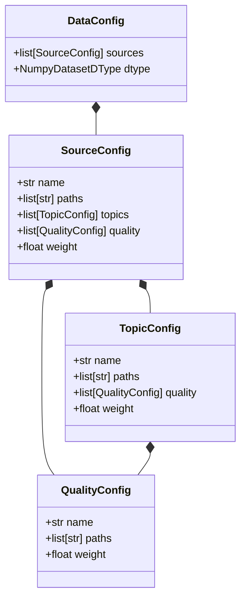
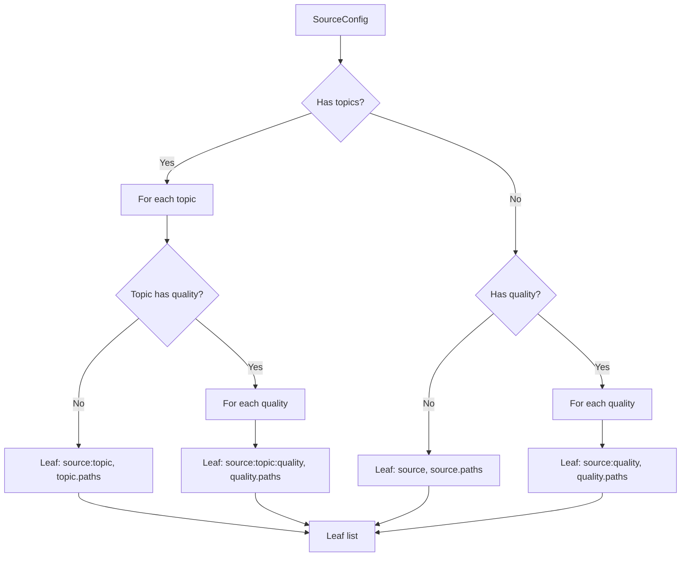
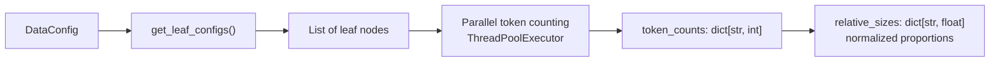
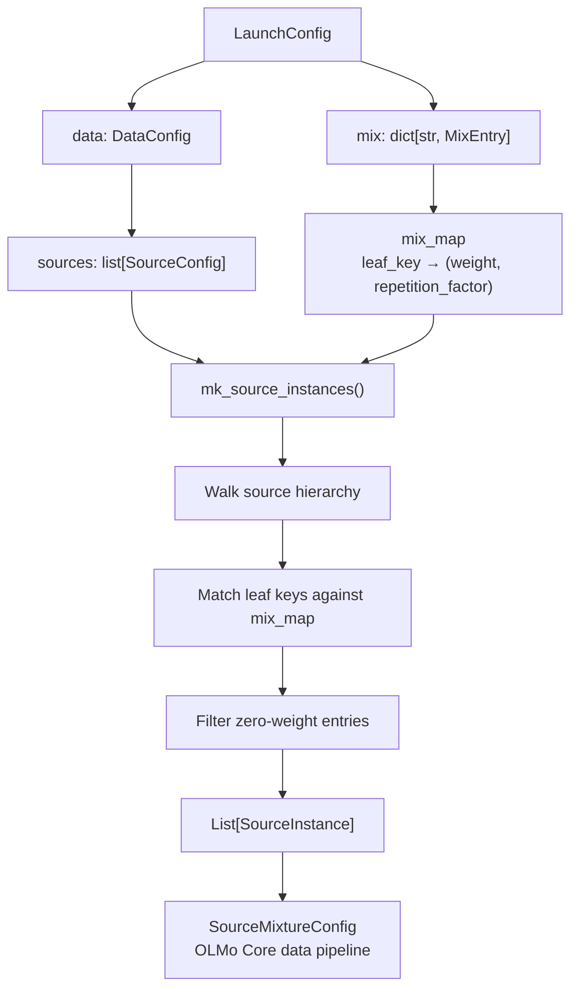

<!-- source: DeepWiki mcp.deepwiki.com · repo allenai/olmix · page 3.4 DataConfig Hierarchy · fetched 2026-10-26 -->

# DataConfig Hierarchy

<details>
<summary>Relevant source files</summary>

The following files were used as context for generating this wiki page:

- [olmix/aliases.py](olmix/aliases.py)
- [olmix/cli.py](olmix/cli.py)
- [olmix/generate/synthesize_mixture.py](olmix/generate/synthesize_mixture.py)
- [olmix/generate/utils.py](olmix/generate/utils.py)
- [olmix/launch/utils.py](olmix/launch/utils.py)
- [plans/011_reorganize_experiment_configs.md](plans/011_reorganize_experiment_configs.md)
- [plans/012_quality_threshold_experiments.md](plans/012_quality_threshold_experiments.md)
- [plans/013_align_wandb_metrics_with_olmo_core.md](plans/013_align_wandb_metrics_with_olmo_core.md)
- [plans/017_decompose_experiment_config.md](plans/017_decompose_experiment_config.md)
- [plans/019_eval_config.md](plans/019_eval_config.md)
- [plans/021_split_experiment_config.md](plans/021_split_experiment_config.md)
- [plans/022_self_contained_launch_configs.md](plans/022_self_contained_launch_configs.md)
- [plans/023_explicit_mix_field.md](plans/023_explicit_mix_field.md)

</details>


This document describes the hierarchical data configuration system that organizes training data sources in olmix. The `DataConfig` model and its nested components (`SourceConfig`, `TopicConfig`, `QualityConfig`) provide a three-level taxonomy for organizing data paths and specifying mixture weights.

For information about how mixture weights are specified separately from the data hierarchy, see [Mix Field and Mixture Reuse](#3.5). For information about the broader configuration architecture, see [Configuration System](#3).

## Overview

The data hierarchy serves two distinct purposes:

1. **Data Organization** - Describes what data exists and where it's stored (paths)
2. **Sampling Structure** - Defines the hierarchical structure for Dirichlet-based mixture sampling

The hierarchy supports three levels of nesting:
- **Source** - Top-level data source (e.g., "dclm", "arxiv", "wikipedia")
- **Topic** - Mid-level categorical subdivision (e.g., "science_math_and_technology", "software_development")
- **Quality** - Fine-grained quality buckets (e.g., "vigintile_0015", "high", "medium", "low")

Each level can either provide direct paths to tokenized data files OR nest deeper. This flexibility allows both simple flat configurations and complex hierarchical organizations.

Sources: [olmix/aliases.py:84-183]()

## Configuration Models

### Model Hierarchy



**Diagram: Pydantic model relationships in the data hierarchy**

Sources: [olmix/aliases.py:84-183]()

### QualityConfig

The leaf-level quality configuration represents fine-grained quality buckets or quality thresholds.

**Fields:**
- `name` (str) - Quality identifier (e.g., "vigintile_0015", "high", "medium", "low")
- `paths` (list[str]) - S3/GCS glob patterns for tokenized .npy files
- `weight` (float | None) - Optional explicit weight for quality upsampling experiments

**Example:**
```yaml
name: vigintile_0020  # Top 5% quality bucket
paths:
  - s3://ai2-llm/preprocessed/cc_all_dressed/.../vigintile_0020/*.npy
weight: 2.0  # Optional: upsample this quality level
```

Sources: [olmix/aliases.py:84-93]()

### TopicConfig

Mid-level configuration representing topical subdivisions within a source.

**Fields:**
- `name` (str) - Topic identifier
- `paths` (list[str] | None) - Direct paths (mutually exclusive with `quality`)
- `quality` (list[QualityConfig] | None) - Quality buckets (mutually exclusive with `paths`)
- `weight` (float | None) - Optional explicit weight for frozen mixtures

**Validation:**
- Exactly one of `paths` or `quality` must be provided
- If both or neither are provided, raises `ValueError`

**Example (with direct paths):**
```yaml
name: software_development
paths:
  - s3://ai2-llm/preprocessed/dclm/.../software_development/**/*.npy
```

**Example (with quality buckets):**
```yaml
name: science_math_and_technology
quality:
  - name: vigintile_0015
    paths: [...]
  - name: vigintile_0016
    paths: [...]
```

Sources: [olmix/aliases.py:95-107]()

### SourceConfig

Top-level configuration representing a distinct data source.

**Fields:**
- `name` (str) - Source identifier (e.g., "dclm", "arxiv", "wikipedia")
- `paths` (list[str] | None) - Direct paths (mutually exclusive with `topics`/`quality`)
- `topics` (list[TopicConfig] | None) - Topic subdivisions
- `quality` (list[QualityConfig] | None) - Source-level quality buckets (no topics)
- `weight` (float | None) - Optional explicit weight for frozen mixtures

**Validation:**
- Exactly one of `paths`, `topics`, or `quality` must be provided
- If multiple are provided or none are provided, raises `ValueError`

**Example (simple source):**
```yaml
name: wikipedia
paths:
  - s3://ai2-llm/preprocessed/wikipedia-dolma-0823/**/*.npy
```

**Example (source with topics):**
```yaml
name: dclm
topics:
  - name: science_math_and_technology
    paths: [...]
  - name: software_development
    paths: [...]
```

**Example (source-level quality buckets, no topics):**
```yaml
name: fineweb_edu
quality:
  - name: high
    paths: [...]
  - name: medium
    paths: [...]
```

Sources: [olmix/aliases.py:109-121]()

### DataConfig

The top-level data configuration container.

**Fields:**
- `sources` (list[SourceConfig]) - All data sources
- `dtype` (NumpyDatasetDType) - Token data format (default: uint32)

The `dtype` field is used both for reading tokenized data during training and for calculating token counts when scanning S3 paths.

Sources: [olmix/aliases.py:178-183]()

## Nesting Patterns

The hierarchy supports multiple valid nesting patterns depending on data organization needs:

```mermaid
graph TB
    subgraph "Pattern 1: Simple Source"
        S1["SourceConfig<br/>name: wikipedia"]
        S1 --> P1["paths: [...]"]
    end
    
    subgraph "Pattern 2: Source with Topics"
        S2["SourceConfig<br/>name: dclm"]
        S2 --> T2A["TopicConfig<br/>name: code"]
        S2 --> T2B["TopicConfig<br/>name: science"]
        T2A --> P2A["paths: [...]"]
        T2B --> P2B["paths: [...]"]
    end
    
    subgraph "Pattern 3: Source with Quality Buckets"
        S3["SourceConfig<br/>name: fineweb"]
        S3 --> Q3A["QualityConfig<br/>name: high"]
        S3 --> Q3B["QualityConfig<br/>name: low"]
        Q3A --> P3A["paths: [...]"]
        Q3B --> P3B["paths: [...]"]
    end
    
    subgraph "Pattern 4: Topics with Quality Buckets"
        S4["SourceConfig<br/>name: all_dressed"]
        S4 --> T4A["TopicConfig<br/>name: science"]
        T4A --> Q4A["QualityConfig<br/>name: vigintile_0020"]
        T4A --> Q4B["QualityConfig<br/>name: vigintile_0019"]
        Q4A --> P4A["paths: [...]"]
        Q4B --> P4B["paths: [...]"]
    end
```



**Diagram: Valid nesting patterns in the DataConfig hierarchy**

| Pattern | Levels | Example Use Case | Leaf Keys |
|---------|--------|------------------|-----------|
| Simple Source | 1 | Small sources without subdivisions | `wikipedia` |
| Source → Topic | 2 | Topical subdivisions | `dclm:code`, `dclm:science` |
| Source → Quality | 2 | Source-level quality filtering | `fineweb:high`, `fineweb:low` |
| Source → Topic → Quality | 3 | Quality bucketing per topic | `all_dressed:science:vigintile_0020` |

Sources: [olmix/aliases.py:84-121](), [olmix/generate/synthesize_mixture.py:665-694]()

## Leaf Node Resolution

The hierarchy is flattened to "leaf nodes" for both Dirichlet sampling and training. A leaf node is the finest-grained unit that has direct paths to data files.

### Leaf Key Format

Leaf keys use colon-separated naming:
- **Simple source**: `source`
- **Source with topic**: `source:topic`
- **Source with quality**: `source:quality`
- **Topic with quality**: `source:topic:quality`

### Resolution Algorithm

The `get_leaf_configs()` function walks the hierarchy and returns a list of `(leaf_key, paths)` tuples:



**Diagram: Leaf node resolution algorithm**

Sources: [olmix/generate/synthesize_mixture.py:665-694]()

### Example Resolution

**Input Configuration:**
```yaml
sources:
  - name: arxiv
    paths: [s3://bucket/arxiv/*.npy]
  
  - name: dclm
    topics:
      - name: code
        paths: [s3://bucket/dclm/code/*.npy]
      - name: science
        quality:
          - name: high
            paths: [s3://bucket/dclm/science/high/*.npy]
          - name: low
            paths: [s3://bucket/dclm/science/low/*.npy]
```

**Resolved Leaf Nodes:**
```python
[
    ("arxiv", [s3://bucket/arxiv/*.npy]),
    ("dclm:code", [s3://bucket/dclm/code/*.npy]),
    ("dclm:science:high", [s3://bucket/dclm/science/high/*.npy]),
    ("dclm:science:low", [s3://bucket/dclm/science/low/*.npy])
]
```

This flattened representation is used for:
1. Calculating token counts (priors)
2. Dirichlet sampling weight vectors
3. Training data pipeline configuration

Sources: [olmix/generate/synthesize_mixture.py:665-694](), [olmix/generate/synthesize_mixture.py:696-753]()

## Usage in Generation

During mixture generation, the hierarchy defines the structure for hierarchical Dirichlet sampling.

### Prior Calculation

The `calculate_priors()` function scans S3 paths at each leaf node to count tokens:



**Diagram: Prior calculation from data hierarchy to token counts**

The resulting `relative_sizes` dictionary maps leaf keys to their natural proportions in the data, which serves as the prior distribution for Dirichlet sampling.

Sources: [olmix/generate/synthesize_mixture.py:696-753]()

### Hierarchical Dirichlet Sampling

The `generate_weights_dirichlet()` function respects the hierarchy when sampling:

1. **Source-level Dirichlet** - Samples proportions across sources
2. **Topic-level Dirichlet** - For each source, samples proportions across topics/quality buckets
3. **Product weights** - Multiplies source and topic weights to get leaf weights

This two-stage sampling allows different temperature parameters (`source_mix_temperature`, `topic_mix_temperature`) to control diversity at each level.

**Example:**
```yaml
swarm:
  source_mix_temperature: 1.0  # Moderate source diversity
  topic_mix_temperature: 0.5   # High topic diversity (sharper distribution)
```

The hierarchy is also used for:
- **Minimum weight thresholds** - `minimum_source_weight` vs `minimum_topic_weight`
- **Strength ranges** - `min_source_strength`/`max_source_strength` vs `min_topic_strength`/`max_topic_strength`
- **Fixed weights** - `SourceConfig.weight` and `TopicConfig.weight` freeze portions of the mixture

Sources: [olmix/generate/synthesize_mixture.py:131-511]()

## Usage in Training

During training, the hierarchy is converted to flat `SourceInstance` objects for the OLMo Core data pipeline.

### Conversion Flow



**Diagram: Conversion from hierarchical DataConfig to flat SourceInstances**

Sources: [olmix/launch/utils.py:12-85]()

### mk_source_instances Algorithm

The `mk_source_instances()` function walks the hierarchy and creates a `SourceInstance` for each leaf node with non-zero weight:

| Hierarchy Level | Leaf Key | SourceInstance Fields |
|----------------|----------|----------------------|
| Simple source | `source` | name=`source`, paths=`source.paths`, ratio/repetition from mix |
| Source → Topic | `source:topic` | name=`source:topic`, paths=`topic.paths`, ratio/repetition from mix |
| Source → Quality | `source:quality` | name=`source:quality`, paths=`quality.paths`, ratio/repetition from mix |
| Topic → Quality | `source:topic:quality` | name=`source:topic:quality`, paths=`quality.paths`, ratio/repetition from mix |

The function handles all four nesting patterns transparently, filtering out any leaf nodes not present in the mix or with zero weight.

**Example:**

**Input:**
```python
sources = [
    SourceConfig(name="arxiv", paths=["s3://bucket/arxiv/*.npy"]),
    SourceConfig(name="dclm", topics=[
        TopicConfig(name="code", paths=["s3://bucket/dclm/code/*.npy"]),
        TopicConfig(name="science", paths=["s3://bucket/dclm/science/*.npy"])
    ])
]

mix_map = {
    "arxiv": MixEntry(weight=0.3, repetition_factor=1.5),
    "dclm:code": MixEntry(weight=0.5, repetition_factor=1.0),
    "dclm:science": MixEntry(weight=0.2, repetition_factor=1.0)
}
```

**Output:**
```python
[
    SourceInstance(
        name="arxiv",
        paths=["s3://bucket/arxiv/*.npy"],
        ratio=0.3,
        repetition_factor=1.5
    ),
    SourceInstance(
        name="dclm:code",
        paths=["s3://bucket/dclm/code/*.npy"],
        ratio=0.5,
        repetition_factor=1.0
    ),
    SourceInstance(
        name="dclm:science",
        paths=["s3://bucket/dclm/science/*.npy"],
        ratio=0.2,
        repetition_factor=1.0
    )
]
```

These `SourceInstance` objects are then passed to OLMo Core's `SourceMixtureConfig` for the actual training data pipeline.

Sources: [olmix/launch/utils.py:12-85]()

## Validation Rules

The hierarchy enforces strict validation rules to prevent ambiguous configurations:

| Model | Rule | Error Condition |
|-------|------|-----------------|
| `TopicConfig` | Exactly one of `paths` or `quality` | Both provided, or neither provided |
| `SourceConfig` | Exactly one of `paths`, `topics`, or `quality` | Multiple provided, or none provided |

These rules are enforced by Pydantic validators in the `model_post_init` hook:

```python
def model_post_init(self, __context) -> None:
    """Validate that exactly one of paths/topics/quality is provided."""
    options = [self.paths is not None, self.topics is not None, self.quality is not None]
    if sum(options) != 1:
        raise ValueError("SourceConfig must have exactly one of 'paths', 'topics', or 'quality'")
```

This ensures that every branch in the hierarchy terminates at a well-defined leaf node with paths, and prevents configurations where the same data could be accessed through multiple paths in the tree.

Sources: [olmix/aliases.py:101-107](), [olmix/aliases.py:116-121]()

## Real-World Examples

### DCLM Baseline (2-level: Source → Topic)

```yaml
data:
  dtype: uint32
  sources:
    - name: dclm
      topics:
        - name: science_math_and_technology
          paths: [s3://ai2-llm/.../science_math_and_technology/**/*.npy]
        - name: software_development
          paths: [s3://ai2-llm/.../software_development/**/*.npy]
        - name: education_and_jobs
          paths: [s3://ai2-llm/.../education_and_jobs/**/*.npy]
    
    - name: arxiv
      paths: [s3://ai2-llm/.../arxiv/*.npy]
    
    - name: wikipedia
      paths: [s3://ai2-llm/.../wikipedia/*.npy]
```

**Leaf keys:** `dclm:science_math_and_technology`, `dclm:software_development`, `dclm:education_and_jobs`, `arxiv`, `wikipedia`

Sources: [configs/experiments/data_proportions/mix_baseline.yaml]()

### Quality Upsampling (3-level: Source → Topic → Quality)

```yaml
data:
  dtype: uint32
  sources:
    - name: all_dressed
      topics:
        - name: science_math_and_technology
          quality:
            - name: best
              paths: [s3://bucket/.../science/.../vigintile_0020/*.npy]
            - name: high
              paths: [s3://bucket/.../science/.../vigintile_0015-0019/*.npy]
            - name: medium
              paths: [s3://bucket/.../science/.../vigintile_0010-0014/*.npy]
            - name: low
              paths: [s3://bucket/.../science/.../vigintile_0001-0009/*.npy]
```

**Leaf keys:** `all_dressed:science_math_and_technology:best`, `all_dressed:science_math_and_technology:high`, etc.

Sources: [configs/experiments/quality_upsampling/](), [plans/012_quality_threshold_experiments.md]()

### Vigintile Thresholding (3-level with fine-grained buckets)

```yaml
data:
  dtype: uint32
  sources:
    - name: all_dressed
      topics:
        - name: software_development
          quality:
            - name: vigintile_0015
              paths: [s3://bucket/.../software_development/vigintile_0015/*.npy]
            - name: vigintile_0016
              paths: [s3://bucket/.../software_development/vigintile_0016/*.npy]
            # ... through vigintile_0020 (top 30% quality)
```

This configuration includes only vigintiles 0015-0020, representing the top 30% quality data (6 buckets × 5% each).

Sources: [configs/experiments/quality_thresholds/](), [plans/012_quality_threshold_experiments.md]()

---

