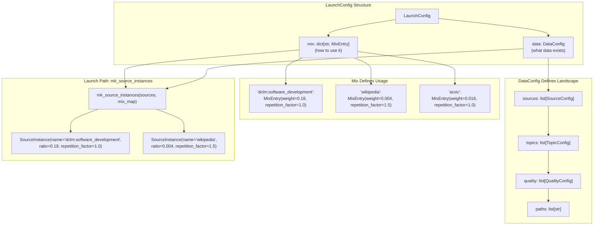
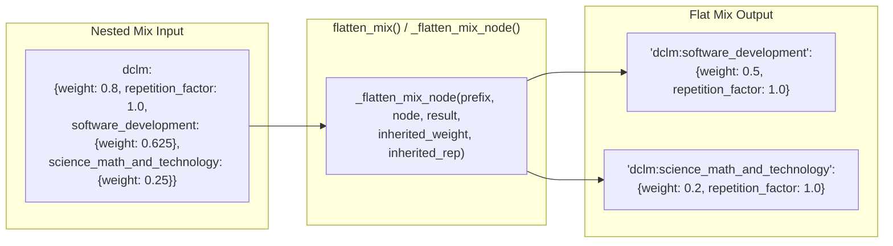
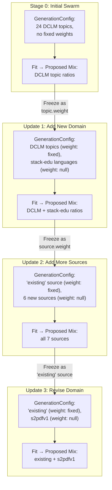
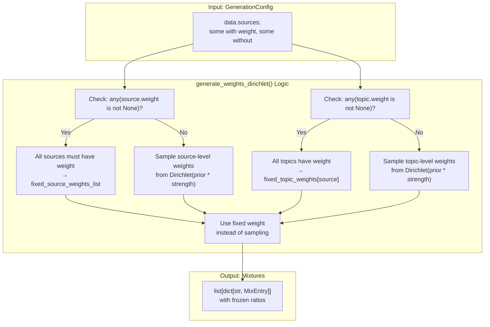
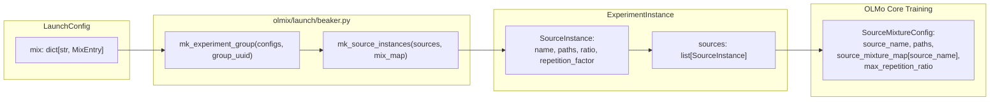

<!-- source: DeepWiki mcp.deepwiki.com · repo allenai/olmix · page 3.5 Mix Field and Mixture Reuse · fetched 2026-10-26 -->

# Mix Field and Mixture Reuse

<details>
<summary>Relevant source files</summary>

The following files were used as context for generating this wiki page:

- [configs/mixture_reuse_case_study/README.md](configs/mixture_reuse_case_study/README.md)
- [configs/mixture_reuse_case_study/fit/0_dclm.yaml](configs/mixture_reuse_case_study/fit/0_dclm.yaml)
- [configs/mixture_reuse_case_study/generate/0_dclm.yaml](configs/mixture_reuse_case_study/generate/0_dclm.yaml)
- [configs/mixture_reuse_case_study/generate/5_partition_pdfs.yaml](configs/mixture_reuse_case_study/generate/5_partition_pdfs.yaml)
- [olmix/aliases.py](olmix/aliases.py)
- [olmix/cli.py](olmix/cli.py)
- [olmix/generate/synthesize_mixture.py](olmix/generate/synthesize_mixture.py)
- [olmix/generate/utils.py](olmix/generate/utils.py)
- [olmix/launch/utils.py](olmix/launch/utils.py)
- [plans/017_decompose_experiment_config.md](plans/017_decompose_experiment_config.md)
- [plans/019_eval_config.md](plans/019_eval_config.md)
- [plans/021_split_experiment_config.md](plans/021_split_experiment_config.md)
- [plans/022_self_contained_launch_configs.md](plans/022_self_contained_launch_configs.md)
- [plans/023_explicit_mix_field.md](plans/023_explicit_mix_field.md)

</details>


This page explains the explicit `mix` field in `LaunchConfig`, the `MixEntry` structure, and the mixture reuse pattern that enables iterative optimization. The `mix` field separates *what data exists* (defined in `data.sources`) from *how to use it* (weights and repetition factors). For information about the data hierarchy itself, see [DataConfig Hierarchy](#3.4). For generation parameters that control how mixes are sampled, see [GenerationConfig](#3.1).

---

## MixEntry Structure

The `MixEntry` model defines the basic unit of a mixture: a domain's weight and its repetition factor.

```python
class MixEntry(BaseModel):
    weight: float
    repetition_factor: float
```

**Fields:**

| Field | Type | Purpose |
|-------|------|---------|
| `weight` | `float` | Domain's proportion in the mixture (typically sums to 1.0 across all domains) |
| `repetition_factor` | `float` | Maximum number of times this domain's tokens can be repeated during training |

The `weight` determines sampling probability during training. The `repetition_factor` is passed to OLMo Core's `SourceMixtureConfig` as `max_repetition_ratio`, controlling how many epochs over a domain are allowed when the domain is exhausted before the training budget is met.

**Sources:** [olmix/aliases.py:228-233]()

---

## Mix Field in LaunchConfig

`LaunchConfig` contains an optional `mix` field that maps domain names to `MixEntry` objects:

```python
class LaunchConfig(BaseModel):
    name: str
    description: str = ""
    infra: InfraConfig
    training: TrainingConfig
    data: DataConfig
    eval: InLoopEvalConfig
    mix: dict[str, MixEntry] | None = None
    group_id: str | None = None
```

**Domain naming convention:**

| Pattern | Example | Meaning |
|---------|---------|---------|
| `source` | `wikipedia` | Source-level domain (flat source) |
| `source:topic` | `dclm:software_development` | Topic within a source |
| `source:topic:quality` | `dclm:software_development:vigintile_0018` | Quality bucket within a topic |

The `mix` field defaults to `None` for backward compatibility. When present, it overrides any implicit weights in the `data.sources` hierarchy.



**Sources:** [olmix/aliases.py:299-326](), [olmix/launch/utils.py:12-85]()

---

## Mix Formats: Nested vs Flat

`LaunchConfig` supports two equivalent mix formats. A `model_validator` on `LaunchConfig` automatically flattens nested mixes at parse time.

### Flat Format (Generated Configs)

Used by `olmix generate`. Keys are colon-separated domain paths:

```yaml
mix:
  dclm:software_development:
    weight: 0.5
    repetition_factor: 1.0
  dclm:science_math_and_technology:
    weight: 0.2
    repetition_factor: 1.0
  wikipedia:
    weight: 0.3
    repetition_factor: 1.5
```

### Nested Format (Hand-Written Configs)

Recommended for hand-written configs. Mirrors the data hierarchy:

```yaml
mix:
  dclm:
    weight: 0.7
    repetition_factor: 1.0
    software_development:
      weight: 0.714  # Relative to dclm's 0.7
    science_math_and_technology:
      weight: 0.286
  wikipedia:
    weight: 0.3
    repetition_factor: 1.5
```

**Semantics:**
- **Weights are multiplicative** along the path from root to leaf. The final weight for `dclm:software_development` is `0.7 * 0.714 = 0.5`.
- **`repetition_factor` is inherited** from the nearest ancestor that sets it. If `dclm:software_development` doesn't specify `repetition_factor`, it inherits `1.0` from `dclm`.
- **Non-weight/non-repetition keys are child nodes**. All other keys in a dict are treated as child domain names.

### Flattening Logic



The `flatten_mix()` function walks the nested dict recursively, accumulating weights as products and inheriting `repetition_factor` from ancestors. This happens transparently via a `model_validator(mode="before")` on `LaunchConfig._resolve_nested_mix()`.

**Sources:** [olmix/aliases.py:235-296](), [olmix/aliases.py:311-318](), [plans/023_explicit_mix_field.md:23-52]()

---

## Mixture Reuse Pattern

Mixture reuse enables iterative optimization by freezing previously-optimized portions of the mixture while exploring new domains. This is the core workflow described in the paper's Section 5.1.

### High-Level Workflow



**Key principle:** Only the domains without explicit weights vary in the swarm. Domains with `weight: <value>` in the `data.sources` hierarchy are frozen, and the sampling mechanism respects those fixed ratios.

**Sources:** [configs/mixture_reuse_case_study/README.md](), [plans/023_explicit_mix_field.md]()

---

## Freezing Mechanisms

There are two primary ways to freeze domain ratios for mixture reuse:

### 1. Topic-Level Weights (Update 1 Pattern)

Freeze individual topics within a source while allowing other topics to vary:

```yaml
data:
  sources:
  - name: dclm
    topics:
    - name: software_development
      weight: 0.18083004  # Frozen from previous fit
      paths: [...]
    - name: science_math_and_technology
      weight: 0.11092831  # Frozen from previous fit
      paths: [...]
    # ... 22 more topics with fixed weights
  - name: stack-edu
    topics:
    - name: Python
      paths: [...]  # No weight → varies in swarm
    - name: JavaScript
      paths: [...]  # No weight → varies in swarm
    # ... more languages without weights
```

When topics have explicit `weight` values, `generate_weights_dirichlet()` creates `fixed_topic_weights` for that source. The swarm only varies domains without weights.

**Sources:** [configs/mixture_reuse_case_study/generate/1_add_stackedu.yaml](), [olmix/generate/synthesize_mixture.py:303-342]()

### 2. Source-Level Weights (Update 2+ Pattern)

Freeze an entire aggregate of domains as a single "existing" source:

```yaml
data:
  sources:
  - name: existing
    topics:
    - name: dclm:software_development
      weight: 0.18083004
      paths: [...]
    - name: dclm:science_math_and_technology
      weight: 0.11092831
      paths: [...]
    - name: stack-edu:Python
      weight: 0.059651027
      paths: [...]
    # ... all previously-optimized domains
  - name: finemath-3plus
    paths: [...]  # No weight → varies in swarm
  - name: arxiv
    paths: [...]  # No weight → varies in swarm
```

The `existing` source aggregates all previously-optimized domains with their relative ratios preserved. The swarm varies the split between `existing` and new sources (controlled by `manual_prior`), but the internal ratios within `existing` remain fixed.

**Sources:** [configs/mixture_reuse_case_study/generate/2_add_more_sources.yaml](), [configs/mixture_reuse_case_study/generate/5_partition_pdfs.yaml:1-244]()

---

## Sampling Behavior with Fixed Weights

The Dirichlet sampling mechanism in `generate_weights_dirichlet()` respects fixed weights through several code paths:



**Key code sections:**

| Mechanism | Code Location | Behavior |
|-----------|---------------|----------|
| Fixed source weights | [olmix/generate/synthesize_mixture.py:346-355]() | If any source has `weight`, all must have `weight`. Creates `fixed_source_weights_list`. |
| Fixed topic weights | [olmix/generate/synthesize_mixture.py:303-342]() | If a source's topics all have `weight`, creates `fixed_topic_weights[source]` and uses it instead of sampling. |
| Manual priors | [olmix/generate/synthesize_mixture.py:175-206]() | `manual_prior` (source-level) and `manual_topic_prior` (topic-level) set the Dirichlet prior distribution. |

**Sources:** [olmix/generate/synthesize_mixture.py:131-511]()

---

## Complete Example: 5-Stage Case Study

The mixture reuse case study in [configs/mixture_reuse_case_study/]() demonstrates a complete iterative workflow:

| Stage | Domains | Frozen | Free | Config |
|-------|---------|--------|------|--------|
| 0 | 24 DCLM topics | None | All 24 | [0_dclm.yaml]() |
| 1 | 24 DCLM + 15 stack-edu | 24 DCLM | 15 stack-edu | [1_add_stackedu.yaml]() |
| 2 | 39 existing + 6 new | 39 existing | 6 new | [2_add_more_sources.yaml]() |
| 3 | 45 existing + s2pdfv1 | 45 existing | s2pdfv1 | [3_revise_pdfs.yaml]() |
| 4 | 45 existing - algebraicstack | N/A (removal, no recomputation) | N/A |
| 5 | 44 existing + 21 PDF topics | 44 existing | 21 PDF topics | [5_partition_pdfs.yaml]() |

Each stage:
1. **Generate:** `olmix generate` samples a swarm with frozen ratios + free domains
2. **Train:** Proxy models trained on sampled mixes (128 → 64 → 16 → 16 → 64 variants)
3. **Fit:** `olmix fit` proposes optimal mix, which becomes the frozen input for the next stage

The final mix at Update 5 spans 65 domains (44 previously-optimized + 21 new PDF topics), but only required training 336 proxy models total instead of thousands needed for a fresh swarm over all 65 domains.

**Sources:** [configs/mixture_reuse_case_study/README.md](), [configs/mixture_reuse_case_study/generate/5_partition_pdfs.yaml](), [configs/mixture_reuse_case_study/fit/0_dclm.yaml]()

---

## From Mix to Training

The `mix` field flows through the launch pipeline to OLMo Core's training infrastructure:



**Pipeline steps:**

1. **`mk_experiment_group()`** [olmix/launch/beaker.py]() receives `LaunchConfig.mix`
2. **`mk_source_instances()`** [olmix/launch/utils.py:12-85]() walks `data.sources` hierarchy and looks up each domain in `mix_map`
3. **`SourceInstance`** objects created with `ratio` (from `MixEntry.weight`) and `repetition_factor` (from `MixEntry.repetition_factor`)
4. **`mk_instance_cmd()`** [olmix/launch/beaker.py]() serializes instances to JSON, passed to training script
5. **Training script** [olmix/launch/train.py]() constructs `SourceMixtureConfig` for OLMo Core with `max_repetition_ratio` per source

**Sources:** [olmix/launch/beaker.py](), [olmix/launch/utils.py:12-85](), [olmix/aliases.py:123-128]()

---

## Key Takeaways

| Concept | Implementation | Purpose |
|---------|----------------|---------|
| **Separation of concerns** | `data` defines landscape, `mix` defines usage | Clean distinction between "what exists" and "how to use it" |
| **Two formats** | Nested (multiplicative, inherited) vs flat (explicit) | Hand-written convenience vs generated precision |
| **Mixture reuse** | `weight` on sources/topics freezes ratios | Iterative optimization without full recomputation |
| **Fixed weights** | `fixed_source_weights_list`, `fixed_topic_weights` in sampling | Dirichlet sampling respects frozen domains |
| **Launch integration** | `mk_source_instances()` → `SourceInstance` → OLMo Core | Weights + repetition factors flow to training |

**Sources:** [olmix/aliases.py:228-326](), [olmix/generate/synthesize_mixture.py:131-640](), [olmix/launch/utils.py:12-85](), [plans/023_explicit_mix_field.md]()

---

