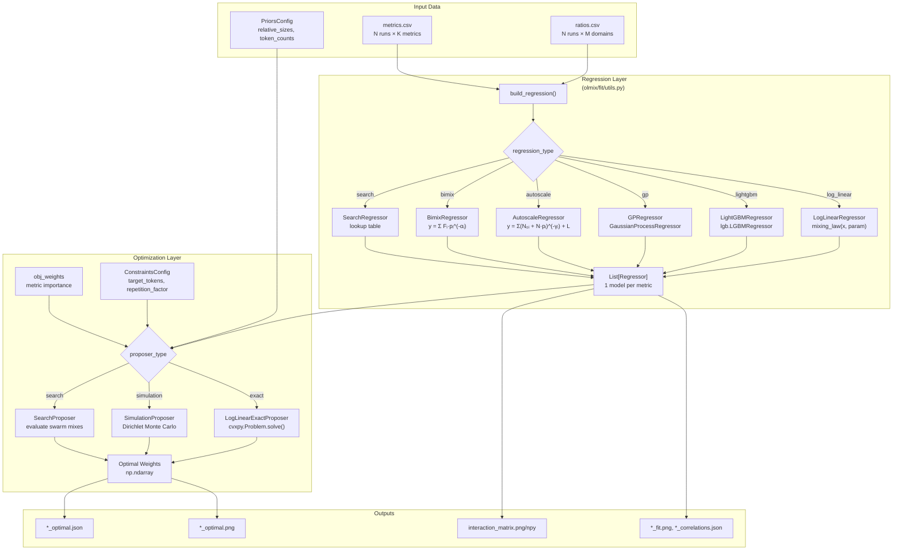
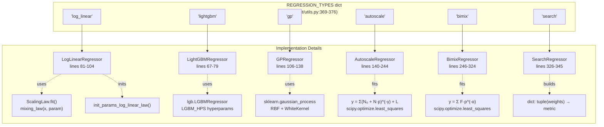
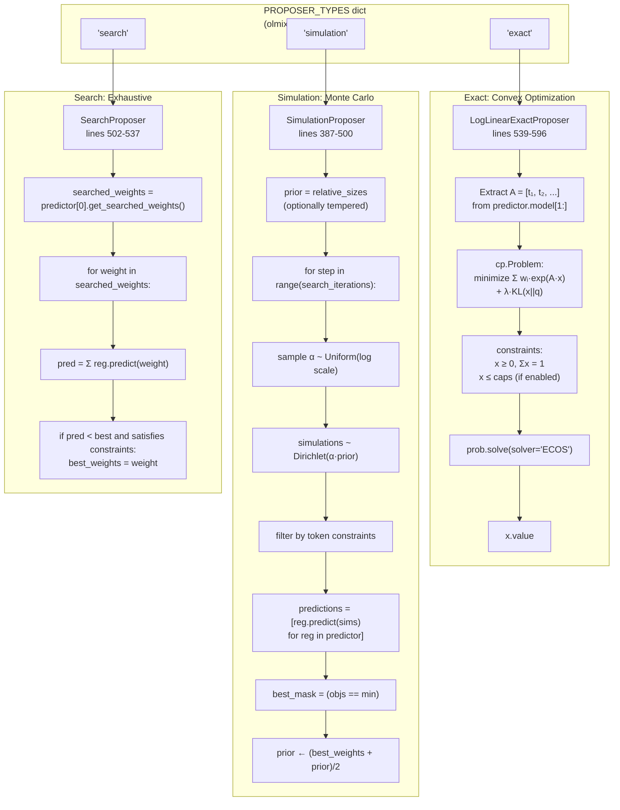

<!-- source: DeepWiki mcp.deepwiki.com · repo allenai/olmix · page 4 Regression and Optimization · fetched 2026-10-26 -->

# Regression and Optimization

<details>
<summary>Relevant source files</summary>

The following files were used as context for generating this wiki page:

- [README.md](README.md)
- [olmix/fit/cli.py](olmix/fit/cli.py)
- [olmix/fit/config.py](olmix/fit/config.py)
- [olmix/fit/core.py](olmix/fit/core.py)
- [olmix/fit/utils.py](olmix/fit/utils.py)
- [olmix/plots/plotting.py](olmix/plots/plotting.py)

</details>


This page documents the two-layer optimization architecture at the core of olmix's mixture fitting pipeline. The **regression layer** trains predictive models that map domain weights to evaluation metrics. The **optimization layer** uses these predictions to search for optimal mixture weights.

For configuration details, see [FitConfig](#3.3). For individual regression model specifications, see [Regression Models](#4.1). For proposer specifications, see [Proposers](#4.2). For scaling law details, see [Scaling Laws](#4.3).

---

## Overview: The Two-Layer Architecture

The optimization system operates in two sequential phases:

1. **Regression phase**: Build one predictor per metric that learns `f(p) → y` where `p` is a domain weight vector and `y` is the metric value (BPB). Each predictor is independent.

2. **Proposal phase**: Use the ensemble of predictors to search for weights `p*` that minimize the (weighted) average predicted performance across all metrics, subject to constraints.

The entry point is [`run_fit()`](olmix/fit/core.py:65-443)(), which orchestrates both phases and produces optimal weight recommendations and diagnostic visualizations.

### System Architecture



**Sources:** [olmix/fit/core.py:65-443](), [olmix/fit/utils.py:55-598](), [olmix/plots/plotting.py:1-355]()

---

## The Regression Layer

The regression layer trains independent models for each evaluation metric. Each model learns to predict metric performance given a domain weight vector.

### Regression Base Class

All regressors implement the `Regressor` interface:

| Method | Signature | Purpose |
|--------|-----------|---------|
| `fit()` | `(x, y, idx, **kwargs)` | Train on domain weights `x` and metric values `y[:, idx]` |
| `predict()` | `(x) → np.ndarray` | Predict metric values for weight vectors `x` |

**Sources:** [olmix/fit/utils.py:55-65]()

### Supported Regression Types

The system supports six regression model types, defined in the `REGRESSION_TYPES` dictionary:



**Sources:** [olmix/fit/utils.py:369-376](), [olmix/fit/utils.py:67-345]()

### Model Selection and Caching

The [`build_regression()`](olmix/fit/utils.py:623-634)() function instantiates the appropriate regressor based on `regression_type`. For log-linear models, fitted parameters are cached in `cache/{group_id}/{hash}/regression_params.pkl` based on a hash of the input data and configuration ([olmix/fit/core.py:271-344]()). This enables fast iteration when re-running fits with the same regression configuration.

| Regression Type | Typical Use Case | Pros | Cons |
|----------------|------------------|------|------|
| `log_linear` | Default; parametric scaling law | Fast, interpretable, compatible with exact proposer | Assumes log-linear form |
| `lightgbm` | Non-parametric baseline | Flexible, handles nonlinearity | Black box, no exact optimization |
| `gp` | Uncertainty quantification | Probabilistic predictions | Slow for large datasets |
| `autoscale` | Reproduce Autoscale paper | Power-law with N scaling | Requires `target_tokens` |
| `bimix` | Reproduce BiMix paper | Power-law per domain | Numerical instability possible |
| `search` | Evaluate swarm mixes only | No extrapolation | Only works on seen mixes |

**Sources:** [olmix/fit/utils.py:623-634](), [olmix/fit/core.py:271-344]()

---

## The Optimization Layer

The optimization layer uses the fitted regression models to propose optimal domain weights. Three proposer types are available, selected via `proposer_type` in the configuration.

### Proposer Base Class

All proposers implement the `Proposer` interface with a single method:

| Method | Signature | Returns |
|--------|-----------|---------|
| `propose()` | `(predictor, prior_distributions, token_counts, **kwargs)` | `np.ndarray` of optimal weights |

**Sources:** [olmix/fit/utils.py:379-384]()

### Proposer Types and Flow



**Sources:** [olmix/fit/utils.py:379-598]()

### Proposer Compatibility

| Proposer | Compatible Regressors | Requirements | Speed |
|----------|----------------------|--------------|-------|
| `exact` | `log_linear` only | Requires `kl_reg` parameter | Fast (convex optimization) |
| `simulation` | All types | Requires `relative_sizes` prior | Slow (100k samples × iterations) |
| `search` | `search` only | — | Fast (N evaluations) |

The exact proposer requires log-linear regression because it extracts the linear coefficients (`A = [t₁, t₂, ...]`) and solves a convex program. Other proposers treat the regression model as a black-box predictor.

**Sources:** [olmix/fit/utils.py:539-596](), [olmix/fit/utils.py:387-500](), [olmix/fit/utils.py:502-537]()

---

## The Pipeline: run_fit()

The [`run_fit()`](olmix/fit/core.py:65-443)() function in `olmix/fit/core.py` orchestrates the complete optimization pipeline.

### Pipeline Flow

```mermaid
graph TB
    Start["run_fit(ratios, metrics, priors, ...)"] --> ValidateInputs["Validate inputs:<br/>- Check for NaNs<br/>- Verify domain/metric alignment"]
    
    ValidateInputs --> AggTask{"aggregate_task_families?"}
    AggTask -->|yes| AggMetrics["Aggregate metrics by family:<br/>metrics_new[family] = metrics[tasks].mean(axis=1)"]
    AggTask -->|no| ExtractXY["Extract X_train, Y_train"]
    AggMetrics --> ExtractXY
    
    ExtractXY --> SplitData{"n_test > 0 or<br/>test paths provided?"}
    SplitData -->|yes| TrainTest["train_test_split() or<br/>load test data from paths"]
    SplitData -->|no| UseAll["X_test = X_train<br/>Y_test = Y_train"]
    TrainTest --> CheckCache
    UseAll --> CheckCache
    
    CheckCache{"log_linear and<br/>cache exists?"}
    CheckCache -->|yes| LoadCache["Load params from<br/>cache/group/hash/regression_params.pkl"]
    CheckCache -->|no| BuildNew["for idx, metric in indexed_metrics:<br/>build_regression(idx, Y_train, X_train, ...)"]
    
    LoadCache --> InitPredictors["Initialize predictors<br/>with cached params"]
    BuildNew --> InitPredictors
    
    InitPredictors --> SaveCache{"log_linear?"}
    SaveCache -->|yes| CacheParams["Save params to cache:<br/>pickle.dump(parameters, f)"]
    SaveCache -->|no| DropMetrics
    CacheParams --> DropMetrics
    
    DropMetrics["Apply drop_metrics filter:<br/>remove unwanted predictors"]
    
    DropMetrics --> PlotInt["plot_interaction_matrix():<br/>heatmap of coefficients"]
    PlotInt --> PlotCorr["for each metric:<br/>plot_correlation(Y_test, X_test, ...)"]
    
    PlotCorr --> FitOnly{"fit_only or n_test > 0?"}
    FitOnly -->|yes| Return["return<br/>(no proposal)"]
    FitOnly -->|no| Propose["weights = PROPOSER_TYPES[proposer_type]().propose()"]
    
    Propose --> PlotWeights["plot_and_log_weights():<br/>prior vs optimal comparison"]
    PlotWeights --> PredictPerf["predictions = [p.predict(weights)<br/>for p in predictors]<br/>predicted_performance = mean or weighted_avg"]
    PredictPerf --> SaveJSON["Save to predicted_performance.json"]
    SaveJSON --> End["return"]
```



**Sources:** [olmix/fit/core.py:65-443]()

### Key Steps

1. **Data validation** ([olmix/fit/core.py:156-164]()): Drop rows with NaN metrics, verify domain count < run count.

2. **Task aggregation** ([olmix/fit/core.py:165-182]()): If `aggregate_task_families=True`, replace individual metrics with family-level averages.

3. **Train/test split** ([olmix/fit/core.py:188-236]()): Support three modes:
   - `n_test=0`: Use all data for training and evaluation
   - `n_test>0`: Random split based on `seed`
   - External test set: Load from `test_ratios_path` and `test_metrics_path`

4. **Regression caching** ([olmix/fit/core.py:271-344]()): Hash input data and config to create cache key. For log-linear models, save/load fitted parameters.

5. **Model fitting** ([olmix/fit/core.py:320-343]()): Build one regressor per metric using [`build_regression()`](olmix/fit/utils.py:623-634)().

6. **Visualization** ([olmix/fit/core.py:357-398]()): Generate interaction matrix and correlation plots for each metric.

7. **Optimization** ([olmix/fit/core.py:405-416]()): Call the selected proposer to find optimal weights.

8. **Output** ([olmix/fit/core.py:417-442]()): Save optimal weights JSON/PNG and predicted performance.

**Sources:** [olmix/fit/core.py:65-443]()

---

## Constraints and Objectives

The optimization layer supports multiple mechanisms for controlling the proposed mixture.

### Token Budget Constraints

When `constrain_objective=True` and `target_tokens` is provided, the optimization enforces:

```
weight[i] * target_tokens ≤ token_counts[i] * repetition_factor
```

for each domain `i`. This prevents any domain from being repeated more than `repetition_factor` times (default 4.0) at the target scale.

**Implementation:**

- **Exact proposer** ([olmix/fit/utils.py:555-561]()): Adds `x <= caps` constraint where `caps = token_counts * repetition_factor / target_tokens`
- **Simulation proposer** ([olmix/fit/utils.py:444-462]()): Filters samples that violate constraints
- **Search proposer** ([olmix/fit/utils.py:524-530]()): Checks constraints before accepting a candidate

**Sources:** [olmix/fit/utils.py:555-561](), [olmix/fit/utils.py:444-462](), [olmix/fit/utils.py:524-530]()

### KL Regularization (Exact Proposer Only)

The exact proposer minimizes:

```
objective = Σᵢ wᵢ · exp(Aᵢ · x) + λ · KL(x || q)
```

where:
- `wᵢ` are metric importance weights (from `obj_weights`)
- `Aᵢ` are the linear coefficients from log-linear regression
- `x` is the weight vector being optimized
- `q` is the prior distribution (from `relative_sizes`)
- `λ` is the regularization strength (`kl_reg`)

The KL term penalizes the proposed mixture for diverging from the natural corpus distribution. Higher `kl_reg` produces mixtures closer to the prior.

**Implementation:** [olmix/fit/utils.py:578-584]()

```python
loss = cp.sum(cp.multiply(weights, cp.exp(A @ x)))
kl = cp.sum(cp.rel_entr(x, q))
obj = loss + kl_reg * kl
```

**Sources:** [olmix/fit/utils.py:578-591]()

### Objective Weights

The `obj_weights` parameter (from `filtering.obj_weights` in config) controls metric importance. By default, all metrics have equal weight (uniform average). Custom weights enable prioritizing specific metrics:

```yaml
filtering:
  obj_weights:
    arc_challenge_bpb: 2.0
    hellaswag_bpb: 1.0
    mmlu_stem_bpb: 3.0
```

This computes `predicted_performance = Σᵢ wᵢ · predᵢ / Σᵢ wᵢ` instead of a simple mean.

**Implementation:**

- **Exact proposer** ([olmix/fit/utils.py:565-579]()): Includes weights in the loss term
- **Simulation proposer** ([olmix/fit/utils.py:467-471]()): Computes weighted average of predictions
- **Search proposer**: Implicitly uses uniform weights (averages predictions)

**Sources:** [olmix/fit/utils.py:565-579](), [olmix/fit/utils.py:467-471]()

### Metric Filtering

The `drop_metrics` parameter excludes specific metrics from the objective. This is useful for:
- Removing outlier metrics with poor regression fit
- Focusing optimization on a subset of tasks
- Ablation studies

Dropped metrics are removed from the predictor list and visualization outputs ([olmix/fit/core.py:345-356]()).

**Sources:** [olmix/fit/core.py:345-356]()

---

## Output Files

The fit pipeline produces structured outputs in a hashed subdirectory of the specified output directory.

### Regression Outputs

| File | Description | Code Reference |
|------|-------------|----------------|
| `interaction_matrix.png` | Heatmap of regression coefficients (domains × metrics) | [olmix/plots/plotting.py:181-245]() |
| `interaction_matrix.npy` | Raw coefficient matrix as NumPy array | [olmix/plots/plotting.py:244]() |
| `{metric}_*_fit.png` | Scatter plot: predicted vs. actual for each metric | [olmix/plots/plotting.py:61-179]() |
| `{metric}_*_correlations.json` | Pearson correlation (train and test) | [olmix/plots/plotting.py:177-178]() |
| `path_to_regression_model.txt` | Path to cached regression model (log-linear only) | [olmix/fit/core.py:283-284]() |

**Sources:** [olmix/plots/plotting.py:61-245](), [olmix/fit/core.py:283-284]()

### Optimization Outputs

| File | Description | Code Reference |
|------|-------------|----------------|
| `opt_avg_all_metrics_*_optimal.json` | Proposed optimal weights (list of `{domain, weight}`) | [olmix/plots/plotting.py:280-285]() |
| `opt_avg_all_metrics_*_optimal.png` | Bar chart comparing prior vs. optimal weights | [olmix/plots/plotting.py:350-354]() |
| `predicted_performance.json` | Predicted average metric value at optimal weights | [olmix/fit/core.py:439-440]() |

The `*` placeholder encodes fit configuration (regression type, train split, test size, seed) for disambiguation when running multiple fits.

**Sources:** [olmix/plots/plotting.py:247-355](), [olmix/fit/core.py:439-440]()

### Configuration Snapshot

| File | Description | Code Reference |
|------|-------------|----------------|
| `config.json` | Full `FitConfig` serialized as JSON (for reproducibility) | [olmix/fit/cli.py:19-29]() |

**Sources:** [olmix/fit/cli.py:19-29]()

---

