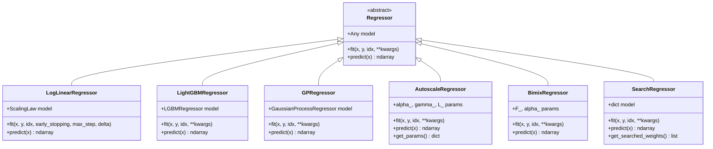
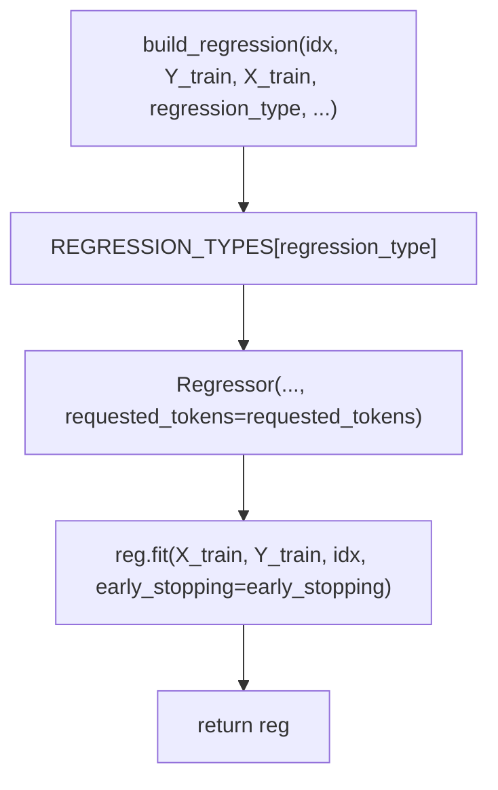

<!-- source: DeepWiki mcp.deepwiki.com · repo allenai/olmix · page 4.1 Regression Models · fetched 2026-10-26 -->

# Regression Models

<details>
<summary>Relevant source files</summary>

The following files were used as context for generating this wiki page:

- [olmix/fit/cli.py](olmix/fit/cli.py)
- [olmix/fit/law.py](olmix/fit/law.py)
- [olmix/fit/utils.py](olmix/fit/utils.py)
- [olmix/plots/plotting.py](olmix/plots/plotting.py)

</details>


This page documents the six regression model types available in olmix for predicting evaluation metric performance given mixture weights. Regression models form the first layer of the optimization system, with proposers forming the second layer (see [Proposers](#4.2)). For information about the underlying scaling law fitting logic, see [Scaling Laws](#4.3).

## Purpose and Architecture

Each regression model fits a predictive function that maps domain mixture weights to expected performance on a single evaluation metric. Given training data of N mixture configurations (rows) and M domains (columns), a regressor learns:

```
f: R^M → R
f(p_1, ..., p_M) → metric_value
```

where `p_i` represents the proportion of tokens from domain `i` in the mixture, and the output is the predicted evaluation metric (e.g., bits-per-byte on a specific task).

The system trains one regressor per evaluation metric. The resulting list of fitted regressors is then passed to a proposer, which optimizes mixture weights to minimize predicted performance across all metrics (see [Proposers](#4.2)).

**Sources:** [olmix/fit/utils.py:55-65]()

## Base Regressor Interface

All regression models inherit from the abstract `Regressor` base class, which defines a common interface:



**Key Methods:**

| Method | Parameters | Returns | Description |
|--------|-----------|---------|-------------|
| `fit()` | `x`: mixture weights (N×M)<br>`y`: metric values (N×K)<br>`idx`: metric index | None | Fits the model to predict metric `idx` |
| `predict()` | `x`: mixture weights (N×M) | `ndarray` (N,) | Predicts metric values for given mixtures |

**Sources:** [olmix/fit/utils.py:55-65]()

## Model Type Registry

The `REGRESSION_TYPES` dictionary maps configuration strings to regressor classes:

```python
REGRESSION_TYPES = {
    "lightgbm": LightGBMRegressor,
    "log_linear": LogLinearRegressor,
    "search": SearchRegressor,
    "gp": GPRegressor,
    "autoscale": AutoscaleRegressor,
    "bimix": BimixRegressor,
}
```

This registry is used by `build_regression()` to instantiate the appropriate model type based on the `regression.type` field in [FitConfig](#3.3).

**Sources:** [olmix/fit/utils.py:369-376]()

## Log-Linear Regressor

### Parametric Form

The log-linear regressor implements the mixing law from the regmix paper:

```
f(p) = exp(log_c) + exp(∑_i t_i * p_i)
```

where:
- `log_c` is the irreducible loss constant (performance ceiling)
- `t_i` are domain-specific coefficients (negative for "aligned" domains, positive for "unaligned")
- `p_i` are mixture proportions

This form is implemented in the `mixing_law()` function:

```python
def mixing_law(x, param, **kwargs):
    log_c_i = param[0]
    t_i = param[1:]
    result = torch.exp(log_c_i) + torch.exp(torch.matmul(x, t_i))
    return result
```

### Fitting Procedure

The log-linear regressor uses the `ScalingLaw` class (see [Scaling Laws](#4.3)) which employs LBFGS optimization with multiple random initializations:

1. Generate 300 initialization candidates via `init_params_log_linear_law()` (10 values of `log_c` × 30 random `t_i` vectors)
2. For each initialization, run LBFGS with Huber loss and early stopping
3. Select parameters with minimum validation loss

The initialization strategy biases coefficients negatively for the target metric's own domain and positively (closer to zero) for other domains, reflecting the intuition that increasing the aligned domain's proportion improves performance.

### Usage and Compatibility

Log-linear regression is the most commonly used type because:
- Its parametric form has a clear scaling law interpretation
- It is compatible with the `LogLinearExactProposer` (see [Proposers](#4.2))
- Fitted models can be cached based on data hash (see [Regression Caching](#7.4))

**Configuration Example:**

```yaml
regression:
  type: log_linear
  train_split: 1.0
  seed: 42
```

**Sources:** [olmix/fit/utils.py:81-104](), [olmix/fit/utils.py:347-358](), [olmix/fit/law.py:99-129]()

## LightGBM Regressor

### Implementation

The LightGBM regressor uses gradient boosted decision trees from the `lightgbm` library. It is a non-parametric model that can capture complex, non-linear relationships between mixture proportions and metrics.

**Hyperparameters:**

```python
LGBM_HPS = {
    "task": "train",
    "boosting_type": "gbdt",
    "objective": "regression",
    "metric": ["l1", "l2"],
    "seed": 42,
    "num_iterations": 10000,
    "learning_rate": 1e-2,
    "verbosity": -1,
    "early_stopping_round": 3,
}
```

These hyperparameters match the regmix paper's setup.

### Feature Importances

LightGBM computes feature importances that indicate how much each domain contributes to the model's predictions. These are used in the interaction matrix visualization:

```python
if regression_type == "lightgbm":
    interaction_matrix[i] = predictor.model.feature_importances_
```

### Limitations

- LightGBM is incompatible with `LogLinearExactProposer` (which requires parametric coefficients)
- Must use `SimulationProposer` or `SearchProposer` instead

**Sources:** [olmix/fit/utils.py:42-52](), [olmix/fit/utils.py:67-78](), [olmix/plots/plotting.py:196]()

## Gaussian Process Regressor

### Kernel Configuration

The GP regressor uses scikit-learn's `GaussianProcessRegressor` with a composite kernel:

```
kernel = λ * RBF(σ) + WhiteKernel(σ_ε)
```

where:
- `λ` (constant value): output variance scale
- `σ` (length scale): controls smoothness
- `σ_ε` (noise level): observation noise

### Hyperparameter Optimization

The GP automatically optimizes kernel hyperparameters by maximizing the log marginal likelihood:

```python
self.model = GaussianProcessRegressor(
    kernel=kernel,
    n_restarts_optimizer=n_restarts,
    normalize_y=normalize_y,
    random_state=kwargs.get("random_state", None),
)
```

Default bounds for hyperparameter search:

| Parameter | Default Value | Bounds |
|-----------|---------------|--------|
| `length_scale` | 1.0 | (1e-2, 1e2) |
| `constant_value` | 1.0 | (1e-3, 1e3) |
| `noise_level` | 0.1 | (1e-5, 1e1) |

The `n_restarts_optimizer=10` setting runs 10 independent optimization attempts to avoid local minima.

### Use Cases

GPs are appropriate when:
- The relationship between mixtures and metrics is smooth but unknown
- You want uncertainty estimates (GPs provide predictive variance)
- The training set is small (GPs scale O(N³) in dataset size)

**Sources:** [olmix/fit/utils.py:106-138]()

## Autoscale Regressor

### Parametric Form

The autoscale regressor implements the equation from the Autoscale paper:

```
f(p) = ∑_i (N0_i + N * p_i)^(-γ_i) + L
```

where:
- `N` is the total token budget (`requested_tokens`, passed at initialization)
- `p_i` are mixture proportions
- `N0_i = α_i * N` are learned pre-training token counts per domain
- `γ_i` are learned exponents (Chinchilla scaling exponents)
- `L` is the learned irreducible loss

### Parameter Estimation

The model uses `scipy.optimize.least_squares` with constrained nonlinear least squares:

**Parameters:** `[α_1, ..., α_m, γ_1, ..., γ_m, L]`

**Bounds:**
- `α_i > 0` (domain token ratios must be positive)
- `γ_i > 0` (exponents must be positive)
- `0 ≤ L ≤ min(y)` (irreducible loss is bounded)

**Initialization:**
- `α_i = 1/m` (uniform domain allocation)
- `γ_i = 0.5` (mid-range exponent)
- `L = 0.1 * min(y)` (small irreducible loss)

### Extension Beyond Original Paper

The original Autoscale paper fits per-domain validation loss vs. that domain's mixture weight. This implementation extends the formulation to out-of-distribution evaluation by summing power-law terms across all domains, enabling prediction for arbitrary mixture combinations.

### Usage Requirements

The autoscale regressor requires `requested_tokens` to be specified in `ConstraintsConfig`:

```yaml
constraints:
  enabled: true
  target_tokens: 1000000000  # Required for autoscale
regression:
  type: autoscale
```

**Sources:** [olmix/fit/utils.py:140-237]()

## Bimix Regressor

### Parametric Form

The bimix regressor implements a power-law mixture model derived from the BiMix paper:

```
f(p) = ∑_i F_i * p_i^(-α_i)
```

where:
- `F_i` are domain-specific scaling factors
- `α_i` are domain-specific exponents
- `p_i` are mixture proportions (clipped to avoid `0^(-α)`)

### Relationship to BiMix Paper

The original BiMix paper models validation loss vs. number of training steps for each domain individually. This implementation adapts the power-law form to OOD evaluation by summing contributions across all domains, similar to the Autoscale extension.

### Parameter Estimation

Uses `scipy.optimize.least_squares` with bounded optimization:

**Parameters:** `[F_1, ..., F_m, α_1, ..., α_m]`

**Bounds:**
- `F_i ≥ 0` (scaling factors must be non-negative)
- `α_i ≥ 0` (exponents must be non-negative)

**Initialization:**
- `F_i = mean(y) / m` (uniform contribution to mean performance)
- `α_i = 1.0` (linear exponent)

### Numerical Stability

To prevent division by zero in `p_i^(-α_i)`, mixture proportions are clipped:

```python
Xc = np.clip(X, self.eps, 1.0)  # eps=1e-12 by default
```

**Sources:** [olmix/fit/utils.py:246-323]()

## Search Regressor

### Lookup Table Implementation

The search regressor is not a fitted model but a lookup table that stores observed performance for each evaluated mixture:

```python
self.model = {tuple(row): target[i] for i, row in enumerate(x)}
```

### Prediction Behavior

When predicting:
- If the input mixture was observed during training: return the recorded metric value
- If the input mixture is novel: return `np.inf` (indicating unknown performance)

```python
def predict(self, x):
    preds = []
    for row in x:
        if tuple(row) in self.model:
            preds.append(self.model[tuple(row)])
        else:
            preds.append(np.inf)
    return preds
```

### Use Cases

The search regressor is used with `SearchProposer` to:
1. Identify the best-performing mixture from the evaluated swarm
2. Verify token constraints are satisfied
3. Return the optimal observed configuration

This approach requires no extrapolation but is limited to the discrete set of evaluated mixtures.

### Weight Retrieval

The `get_searched_weights()` method returns all observed mixture configurations:

```python
def get_searched_weights(self):
    return [np.array(weight) for weight, _ in self.model.items()]
```

This is used by `SearchProposer` to enumerate candidates.

**Sources:** [olmix/fit/utils.py:326-344]()

## Building Regression Models

The `build_regression()` function instantiates and fits a regressor for a single metric:

```python
def build_regression(
    idx: int,
    Y_train: np.ndarray,
    X_train: np.ndarray,
    regression_type: str,
    early_stopping: float,
    requested_tokens: int | None = None,
) -> Regressor:
```

**Flow Diagram:**



**Parameters:**

| Parameter | Type | Description |
|-----------|------|-------------|
| `idx` | `int` | Column index of metric to fit in `Y_train` |
| `Y_train` | `np.ndarray` | Metric values (N×K) |
| `X_train` | `np.ndarray` | Mixture proportions (N×M) |
| `regression_type` | `str` | One of: `"log_linear"`, `"lightgbm"`, `"gp"`, `"autoscale"`, `"bimix"`, `"search"` |
| `early_stopping` | `float` | Convergence threshold (used by log-linear) |
| `requested_tokens` | `int \| None` | Token budget (required for autoscale) |

**Integration Points:**

This function is called in a loop in `olmix/fit/core.py` to build one regressor per evaluation metric. The resulting list of regressors is then passed to a proposer.

**Sources:** [olmix/fit/utils.py:623-634]()

## Comparison Table

| Model | Parametric | Extrapolates | Compatible Proposers | Scaling | Interpretability |
|-------|-----------|--------------|---------------------|---------|------------------|
| `log_linear` | Yes | Yes | `exact`, `simulation`, `search` | O(M) parameters | High (scaling law) |
| `lightgbm` | No | Yes | `simulation`, `search` | O(num_trees × depth) | Medium (feature importances) |
| `gp` | Yes (kernel) | Yes | `simulation`, `search` | O(N³) training | Low (black box) |
| `autoscale` | Yes | Yes | `simulation`, `search` | O(2M + 1) parameters | High (power law) |
| `bimix` | Yes | Yes | `simulation`, `search` | O(2M) parameters | High (power law) |
| `search` | No | No | `search` | O(N) lookup | Perfect (on training data) |

**Key Observations:**

- **Log-linear** is the only model compatible with exact convex optimization
- **Search** is the only model that cannot extrapolate to unseen mixtures
- **LightGBM** and **GP** are non-parametric models suitable for complex relationships
- **Autoscale** and **bimix** require careful initialization due to non-convex optimization
- **All parametric models** (except search) can generate interaction matrices for visualization

**Sources:** [olmix/fit/utils.py:369-376](), [olmix/fit/utils.py:539-598]()

## Interaction Matrix Extraction

After fitting, regression coefficients can be extracted to create domain-metric interaction visualizations:

```python
if regression_type == "lightgbm":
    interaction_matrix[i] = predictor.model.feature_importances_
elif regression_type == "log_linear":
    interaction_matrix[i] = predictor.model[1:]  # Skip log_c, take t_i coefficients
```

The interaction matrix has shape (K metrics × M domains), where entry `(i, j)` indicates domain `j`'s influence on metric `i`:
- **Negative coefficients:** domain improves the metric (lower is better)
- **Positive coefficients:** domain degrades the metric
- **Large absolute values:** strong influence

This matrix is visualized as a heatmap in `plot_interaction_matrix()`.

**Sources:** [olmix/plots/plotting.py:181-245]()

---

