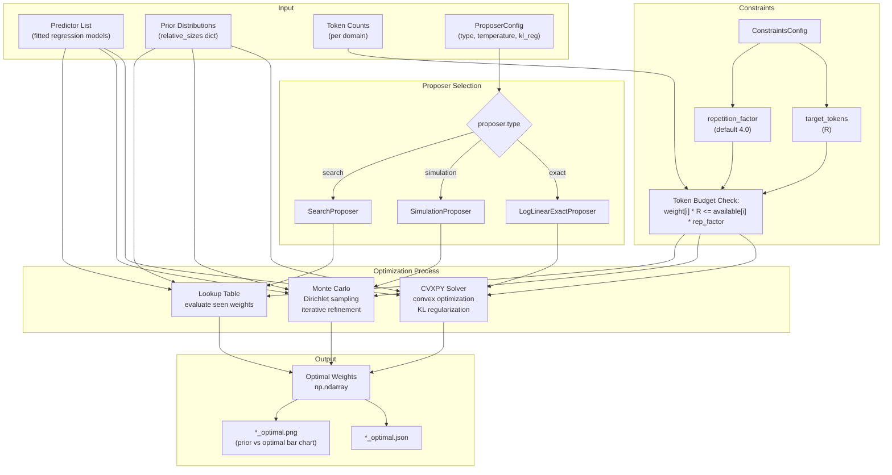
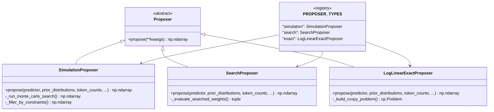
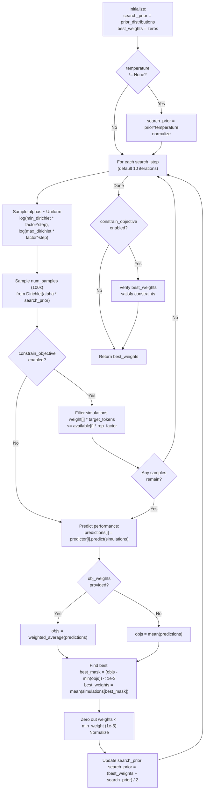
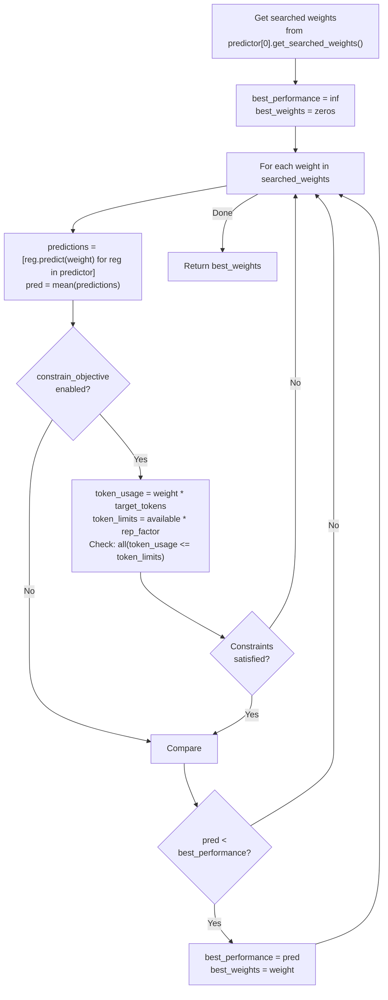
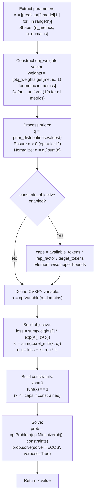
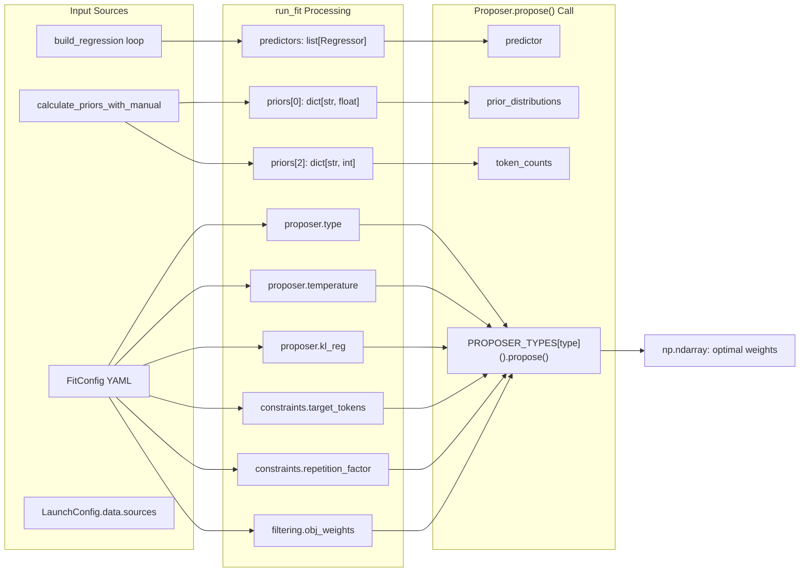

<!-- source: DeepWiki mcp.deepwiki.com · repo allenai/olmix · page 4.2 Proposers · fetched 2026-10-26 -->

# Proposers

<details>
<summary>Relevant source files</summary>

The following files were used as context for generating this wiki page:

- [olmix/fit/cli.py](olmix/fit/cli.py)
- [olmix/fit/config.py](olmix/fit/config.py)
- [olmix/fit/core.py](olmix/fit/core.py)
- [olmix/fit/utils.py](olmix/fit/utils.py)
- [olmix/plots/plotting.py](olmix/plots/plotting.py)

</details>


Proposers are optimization components that search for optimal data mixture weights given fitted regression models. They form the second layer of the olmix optimization pipeline, taking predictive models (from [Regression Models](#4.1)) and producing candidate mixture weights that minimize predicted loss while respecting token budget constraints and prior distributions.

For information about the regression models that proposers consume, see [Regression Models](#4.1). For details on the constraints that proposers respect, see [Constraints and Objectives](#4.4).

---

## Overview and Role in the Pipeline

Proposers operate after regression models have been fitted to swarm data. Their task is to find mixture weights that optimize the objective function (typically minimizing average evaluation loss) subject to constraints.

### Proposer Context in the Fit Pipeline



**Sources:** [olmix/fit/core.py:405-429](), [olmix/fit/utils.py:379-598]()

---

## Proposer Base Class and Type Registry

All proposers inherit from the abstract `Proposer` base class and implement the `propose()` method.



The `PROPOSER_TYPES` registry at [olmix/fit/utils.py:598]() maps string identifiers to proposer classes for dynamic instantiation in `run_fit()`.

**Sources:** [olmix/fit/utils.py:379-598](), [olmix/fit/core.py:405-416]()

---

## SimulationProposer

The `SimulationProposer` uses Monte Carlo sampling from Dirichlet distributions to search for optimal weights. It iteratively refines a search prior based on the best-performing samples, enabling adaptive exploration of the mixture space.

### Algorithm



**Sources:** [olmix/fit/utils.py:387-499]()

### Key Parameters

| Parameter | Type | Default | Description |
|-----------|------|---------|-------------|
| `search_iterations` | `int` | 10 | Number of refinement steps |
| `temperature` | `float \| None` | `None` | Exponent applied to priors before sampling; values > 1 sharpen, < 1 flatten |
| `min_weight` | `float` | `1e-5` | Threshold below which weights are zeroed |
| `num_samples` | `int` | 100,000 | Candidate samples per iteration |
| `min_dirichlet` | `float` | 1.0 | Minimum concentration parameter |
| `max_dirichlet` | `float` | 100.0 | Maximum concentration parameter |
| `search_dirichlet_factor` | `float` | 2.0 | Exponential growth factor for concentration |
| `make_worst_mix` | `bool` | `False` | Invert objective to find worst mixture (for counterfactual analysis) |

The Dirichlet concentration parameter `alpha` controls the diversity of samples. Higher values concentrate mass near the prior; lower values produce more uniform exploration. The algorithm increases `alpha` logarithmically across iterations (`alpha ~ exp(log(min) + step * log(factor))`), starting with broad exploration and narrowing toward the refined prior.

**Sources:** [olmix/fit/utils.py:406-418]()

### Constraint Enforcement

When `constrain_objective=True`, the proposer filters simulations based on token budgets:

```python
token_usage = simulations * target_tokens  # Element-wise: weight[i] * R
token_limits = available_tokens_per_source * repetition_factor  # Available[i] * rep
valid_mask = (token_usage <= token_limits).all(axis=1)  # All domains satisfy constraint
simulations = simulations[valid_mask]
```

This ensures that no domain is oversampled beyond its available data multiplied by the repetition factor. The final `best_weights` are verified against the same constraints before returning.

**Sources:** [olmix/fit/utils.py:424-461](), [olmix/fit/utils.py:492-497]()

---

## SearchProposer

The `SearchProposer` evaluates weights that were actually used in the swarm experiments. It is only compatible with `SearchRegressor` (see [Regression Models](#4.1)), which stores a lookup table mapping weight vectors to observed performance.

### Algorithm



**Sources:** [olmix/fit/utils.py:502-536]()

### Usage and Limitations

The `SearchProposer` is useful for:
- **Sanity checking**: Verifying that the regression models rank known mixtures correctly
- **Constrained re-evaluation**: Finding the best mixture from the swarm that satisfies updated token constraints

However, it cannot propose out-of-distribution mixtures. It is limited to the exact weight vectors seen during training. This makes it suitable for validation but not for discovering novel optimal mixtures.

To use `SearchProposer`, you must:
1. Set `regression.type = "search"` in your FitConfig
2. Set `proposer.type = "search"`

The validation logic at [olmix/fit/cli.py:71-72]() enforces this requirement.

**Sources:** [olmix/fit/utils.py:502-536](), [olmix/fit/cli.py:71-72]()

---

## LogLinearExactProposer

The `LogLinearExactProposer` uses convex optimization via CVXPY to find the exact optimal mixture for log-linear regression models. It is the most principled proposer but only works with `LogLinearRegressor` (see [Regression Models](#4.1)).

### Mathematical Formulation

The proposer solves the following convex optimization problem:

```
minimize:   Σ_i w_i * exp(A_i · x) + λ * KL(x || q)
subject to: x ≥ 0
            Σ_i x_i = 1
            x_i ≤ caps_i    (if constrain_objective)
```

Where:
- `x` is the mixture weight vector (decision variable)
- `A_i` is the parameter vector for regression model `i` (extracted from `predictor[i].model[1:]`)
- `w_i` is the objective weight for metric `i` (from `obj_weights`)
- `q` is the prior distribution (from `prior_distributions`)
- `λ` is the KL regularization strength (from `kl_reg`)
- `caps_i = available_tokens[i] * repetition_factor / target_tokens` (constraint upper bounds)

The KL divergence term `KL(x || q) = Σ_i x_i * log(x_i / q_i)` is implemented using CVXPY's `cp.rel_entr()` function, which handles the convex formulation automatically.

**Sources:** [olmix/fit/utils.py:562-595]()

### Implementation Details



**Sources:** [olmix/fit/utils.py:539-595]()

### Solver Configuration

The proposer uses the **ECOS** solver (Embedded Conic Solver) by default, which is specifically designed for exponential cone programs. CVXPY automatically reformulates the problem into the conic form required by ECOS.

Alternative solvers:
- **SCS** (Splitting Conic Solver): More robust for poorly-conditioned problems but slower
- **MOSEK** (commercial): Fastest and most reliable, requires a license

The solver is specified at [olmix/fit/utils.py:591]() and can be modified if needed.

**Sources:** [olmix/fit/utils.py:591]()

### KL Regularization

The `kl_reg` parameter controls the strength of the KL divergence penalty `KL(x || q)`. This term biases the optimal weights toward the prior distribution:

| `kl_reg` | Effect |
|----------|--------|
| 0.0 | Pure loss minimization (may diverge wildly from priors) |
| 0.01-0.1 | Weak regularization (allows moderate deviation) |
| 0.1-1.0 | Strong regularization (stays close to priors) |
| > 1.0 | Very strong regularization (almost ignores loss) |

The validation logic at [olmix/fit/cli.py:73-74]() enforces that `kl_reg` is only used with `proposer.type = "exact"`.

**Sources:** [olmix/fit/utils.py:552-553](), [olmix/fit/utils.py:582-584](), [olmix/fit/cli.py:73-74]()

---

## Configuration Schema

Proposer behavior is configured via `ProposerConfig` in the FitConfig YAML:

### ProposerConfig Fields

| Field | Type | Default | Description |
|-------|------|---------|-------------|
| `type` | `str` | `"exact"` | Proposer type: `"exact"`, `"simulation"`, or `"search"` |
| `temperature` | `float \| None` | `None` | Prior sharpening/flattening for simulation proposer |
| `kl_reg` | `float \| None` | `None` | KL regularization strength for exact proposer |
| `fit_only` | `bool` | `False` | Skip proposal step (only fit regression models) |
| `make_worst_mix` | `bool` | `False` | Invert objective to find worst mixture |

**Sources:** [olmix/fit/config.py:44-52]()

### Example Configurations

**Exact proposer with KL regularization:**
```yaml
proposer:
  type: exact
  kl_reg: 0.05
```

**Simulation proposer with temperature:**
```yaml
proposer:
  type: simulation
  temperature: 1.5  # Sharpen priors
```

**Search proposer (requires search regression):**
```yaml
regression:
  type: search

proposer:
  type: search
```

**Fit-only mode (no proposal):**
```yaml
proposer:
  fit_only: true
```

**Sources:** [olmix/fit/config.py:44-52](), [olmix/fit/cli.py:71-74]()

---

## Common Parameters and Data Flow

All proposers accept a common set of parameters through the `propose()` method:

### Parameter Flow Diagram



**Sources:** [olmix/fit/core.py:405-416](), [olmix/fit/utils.py:387-595]()

### Parameter Reference Table

| Parameter | Source | Used By | Description |
|-----------|--------|---------|-------------|
| `predictor` | `build_regression()` | All | List of fitted regression models |
| `prior_distributions` | `calculate_priors_with_manual()` | All | Relative token counts per domain (normalized) |
| `token_counts` | `calculate_priors_with_manual()` | Simulation, Search | Absolute token counts per domain |
| `constrain_objective` | `constraints.enabled` | Simulation, Search, Exact | Enable token budget constraints |
| `target_tokens` | `constraints.target_tokens` | Simulation, Search, Exact | Total tokens for target training run (R) |
| `repetition_factor` | `constraints.repetition_factor` | Simulation, Search, Exact | Maximum data repetition allowed (default 4.0) |
| `obj_weights` | `filtering.obj_weights` | Simulation, Exact | Metric importance weights (default: uniform) |
| `temperature` | `proposer.temperature` | Simulation | Prior sharpening parameter |
| `kl_reg` | `proposer.kl_reg` | Exact | KL regularization strength |
| `make_worst_mix` | `proposer.make_worst_mix` | Simulation | Invert objective |
| `seed` | `regression.seed` | Simulation | RNG seed for reproducibility |

**Sources:** [olmix/fit/core.py:405-416](), [olmix/fit/utils.py:387-595]()

---

## Output Format and Downstream Usage

All proposers return a `np.ndarray` of shape `(n_domains,)` representing the optimal mixture weights. These weights:
- Sum to 1.0 (probability simplex)
- Are non-negative
- Satisfy token budget constraints (if enabled)
- Are ordered to match `domain_cols` from the input DataFrames

### Serialization and Visualization

The `plot_and_log_weights()` function at [olmix/plots/plotting.py:247-354]() processes proposer output:

1. **JSON output** (`*_optimal.json`):
   ```json
   [
     {"domain": "source1:topic1", "weight": 0.15},
     {"domain": "source1:topic2", "weight": 0.25},
     {"domain": "source2", "weight": 0.60}
   ]
   ```

2. **PNG visualization** (`*_optimal.png`):
   - Bar chart comparing corpus weights (priors) vs optimal weights
   - Sorted by corpus weight magnitude for readability
   - Uses color palette: corpus (teal), optimal (pink)

3. **Predicted performance** (`predicted_performance.json`):
   ```json
   2.4567
   ```
   Scalar value representing the expected average loss (BPB) for the optimal mixture.

**Sources:** [olmix/plots/plotting.py:247-354](), [olmix/fit/core.py:417-442]()

### Mixture Reuse Pattern

The optimal weights can be fed back into the generation phase for iterative refinement (see [Mixture Reuse](#3.5)):

1. Export optimal weights to JSON
2. Load into next GenerationConfig as `source.weight` or `topic.weight`
3. Freeze optimized domains by setting explicit weights
4. Sample only over unfrozen domains in the next swarm

This enables efficient multi-stage optimization where previously-optimized portions of the mixture remain fixed while new domains are explored.

**Sources:** [olmix/fit/core.py:417-442]()

---

