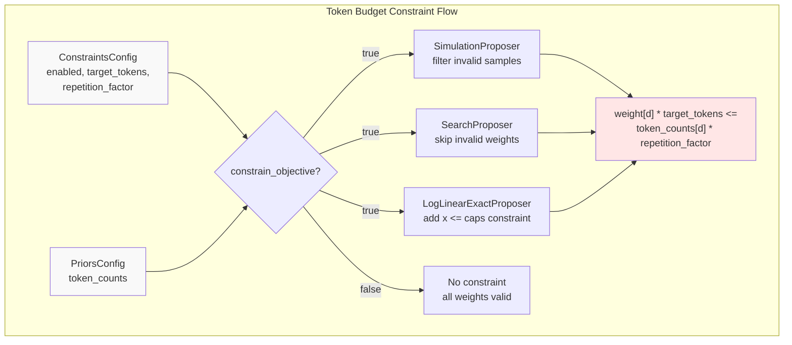
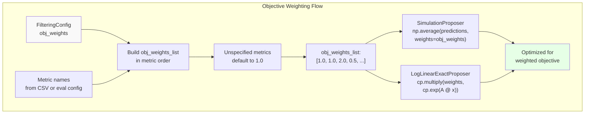

<!-- source: DeepWiki mcp.deepwiki.com · repo allenai/olmix · page 4.4 Constraints and Objectives · fetched 2026-10-26 -->

# Constraints and Objectives

<details>
<summary>Relevant source files</summary>

The following files were used as context for generating this wiki page:

- [README.md](README.md)
- [olmix/fit/cli.py](olmix/fit/cli.py)
- [olmix/fit/config.py](olmix/fit/config.py)
- [olmix/fit/core.py](olmix/fit/core.py)
- [olmix/fit/utils.py](olmix/fit/utils.py)
- [olmix/plots/plotting.py](olmix/plots/plotting.py)

</details>


This page documents the constraint and objective mechanisms in olmix's mixture optimization system. These control what mixtures are valid (constraints) and what the optimizer tries to achieve (objectives).

**Scope:** This page covers token budget constraints, KL regularization, objective weighting, and the `make_worst_mix` flag. For the proposer algorithms themselves, see [4.2](#4.2). For regression models, see [4.1](#4.1). For overall configuration, see [3.3](#3.3).

## Overview

The optimization problem solved by olmix proposers has two components:

1. **Constraints**: Hard bounds on valid mixtures. The primary constraint is the **token budget constraint**, which ensures no domain requires more repetition than allowed at the target scale.

2. **Objectives**: What to optimize. The base objective is minimizing average BPB across metrics. This can be modified with **objective weights** (to prioritize certain metrics) and **KL regularization** (to stay close to the corpus distribution).

**Sources:** [olmix/fit/utils.py:379-598](), [olmix/fit/config.py:54-67]()

---

## Token Budget Constraints

### Problem Definition

When training at scale (e.g., 100B tokens), some domains may not have enough data. The **token budget constraint** ensures the proposed mixture respects data availability:

```
For each domain d:
  weight[d] × target_tokens ≤ available_tokens[d] × repetition_factor
```

Where:
- `target_tokens`: Total token budget for the final training run (e.g., 100B)
- `available_tokens[d]`: Total tokens available in domain `d` (from `priors.token_counts`)
- `repetition_factor`: Maximum allowed repetition (default: 4.0, meaning up to 4 epochs)

**Configuration:**

```yaml
constraints:
  enabled: true
  target_tokens: 100000000000  # 100B tokens
  repetition_factor: 4.0        # Allow up to 4 epochs per domain
```

**Sources:** [olmix/fit/config.py:54-60](), [olmix/fit/utils.py:424-451]()

### Enforcement by Proposer Type



**Sources:** [olmix/fit/utils.py:387-596](), [olmix/fit/core.py:100-101]()

### Implementation Details

#### SimulationProposer

The `SimulationProposer` generates candidate mixtures via Dirichlet sampling, then filters out violators:

```python
# Setup constraint bounds
desired_tokens = target_tokens
available_tokens_per_source = {
    source: token_counts[source] 
    for source, _ in prior_distributions.items()
}

# For each simulation batch
token_usage = simulations * desired_tokens
token_limits = np.array(list(available_tokens_per_source.values())) * repetition_factor
valid_mask = (token_usage <= token_limits).all(axis=1)
simulations = simulations[valid_mask]
```

**Sources:** [olmix/fit/utils.py:424-464]()

#### SearchProposer

The `SearchProposer` evaluates weights from the regression's search space, skipping invalid ones:

```python
for weight in searched_weights:
    pred = np.array([reg.predict(weight[None]) for reg in predictor]).mean(axis=0)[0]
    
    if constrain_objective:
        token_usage = weight * desired_tokens
        token_limits = np.array(list(available_tokens_per_source.values())) * repetition_factor
        
        if (token_usage <= token_limits).all() and pred < best_performance:
            best_performance = pred
            best_weights = weight
```

**Sources:** [olmix/fit/utils.py:521-530]()

#### LogLinearExactProposer

The `LogLinearExactProposer` adds per-domain upper bounds to the convex optimization problem:

```python
caps = np.array(list(available_tokens_per_source.values())) * repetition_factor / desired_tokens
constraints = [x >= 0, cp.sum(x) == 1, x <= caps]
```

This ensures `weight[d] ≤ (available_tokens[d] × repetition_factor) / target_tokens`.

**Sources:** [olmix/fit/utils.py:555-588]()

---

## KL Regularization

**Applies to:** `LogLinearExactProposer` only (requires differentiable objective)

KL regularization penalizes proposals that diverge from the natural corpus distribution (the prior). This prevents overfitting to proxy model results and ensures proposals remain plausible.

### Mathematical Formulation

The `LogLinearExactProposer` solves:

```
minimize: loss(x) + λ × KL(x || q)
subject to: x ≥ 0, sum(x) = 1, [x ≤ caps if constrained]
```

Where:
- `loss(x) = sum_i w_i × exp(A_i · x)` is the predicted average BPB from log-linear regression
- `KL(x || q) = sum_d x[d] × log(x[d] / q[d])` is the KL divergence
- `λ` is the regularization strength (`kl_reg`)
- `q` is the prior distribution (from `priors.relative_sizes`)

**Configuration:**

```yaml
proposer:
  type: exact
  kl_reg: 0.1  # Higher = stay closer to prior
```

**Sources:** [olmix/fit/utils.py:569-584](), [olmix/fit/config.py:44-52]()

### Implementation

```python
# Prior distribution from priors.relative_sizes
q = np.array(list(prior_distributions.values()))
q = np.maximum(q, 1e-12)  # Ensure strictly positive
q = q / q.sum()            # Normalize

# CVXPY optimization variable
x = cp.Variable(d)

# Loss term (from regression models)
loss = cp.sum(cp.multiply(weights, cp.exp(A @ x)))

# KL divergence term
kl = cp.sum(cp.rel_entr(x, q))

# Combined objective
obj = loss + kl_reg * kl
```

**Effect of `kl_reg`:**

| kl_reg | Behavior |
|--------|----------|
| 0.0 | Pure optimization; may produce extreme mixtures |
| 0.01-0.1 | Light regularization; small deviations from prior |
| 0.1-1.0 | Strong regularization; proposals close to prior |
| Very large | Effectively freezes mixture at prior |

**Sources:** [olmix/fit/utils.py:569-591]()

---

## Objective Weighting

By default, olmix minimizes the **uniform average** of all metric BPBs. Objective weights allow non-uniform importance:

```
minimize: sum_i obj_weights[i] × BPB_i
```

### Configuration

```yaml
filtering:
  obj_weights:
    arc_challenge_bpb: 1.0
    hellaswag_bpb: 1.0
    mmlu_stem_bpb: 2.0      # 2x importance
    codex_humaneval_bpb: 0.5  # Half importance
```

If a metric is not specified, its weight defaults to `1.0`.

**Sources:** [olmix/fit/config.py:62-67](), [README.md:152-158]()

### Implementation



**Sources:** [olmix/fit/core.py:244-250]()

#### SimulationProposer

```python
predictions = np.array([reg.predict(simulations) for reg in predictor])
if obj_weights is not None:
    objs = np.average(predictions, axis=0, weights=obj_weights)
else:
    objs = predictions.mean(axis=0)
```

**Sources:** [olmix/fit/utils.py:466-471]()

#### LogLinearExactProposer

```python
weights = np.ones(n) / n if obj_weights is None else np.array(obj_weights)
loss = cp.sum(cp.multiply(weights, cp.exp(A @ x)))
```

**Sources:** [olmix/fit/utils.py:565-579]()

---

## Make Worst Mix

The `make_worst_mix` flag inverts the objective, producing a **counterfactually bad** mixture. This is useful for understanding what makes a mixture good by examining what makes it bad.

```yaml
proposer:
  make_worst_mix: true  # Maximize instead of minimize
```

### Implementation

In `SimulationProposer`:

```python
if make_worst_mix:
    best_mask = (objs.max() - objs) < 1e-3  # Find maximum
else:
    best_mask = (objs - objs.min()) < 1e-3  # Find minimum
```

**Note:** Only implemented in `SimulationProposer`. The exact proposer would require changing the objective to maximization.

**Sources:** [olmix/fit/utils.py:473-478](), [olmix/fit/config.py:51]()

---

## Configuration Reference

### ConstraintsConfig

| Field | Type | Default | Description |
|-------|------|---------|-------------|
| `enabled` | `bool` | `false` | Enable token budget constraints |
| `target_tokens` | `int` | `None` | Total token budget for final run (required if enabled) |
| `repetition_factor` | `float` | `4.0` | Maximum allowed data repetition per domain |

**Sources:** [olmix/fit/config.py:54-60]()

### ProposerConfig Constraint/Objective Fields

| Field | Type | Default | Description |
|-------|------|---------|-------------|
| `kl_reg` | `float` | `None` | KL regularization strength (exact proposer only) |
| `make_worst_mix` | `bool` | `false` | Invert objective to produce bad mixture |

**Sources:** [olmix/fit/config.py:44-52]()

### FilteringConfig

| Field | Type | Default | Description |
|-------|------|---------|-------------|
| `obj_weights` | `dict[str, float]` | `{}` | Per-metric objective weights (unspecified default to 1.0) |
| `drop_metrics` | `list[str]` | `[]` | Exclude metrics from objective entirely |

**Sources:** [olmix/fit/config.py:62-67]()

---

## Complete Optimization Problem

Putting it all together, the full optimization problem for `LogLinearExactProposer` is:

```
Variables:
  x ∈ ℝ^d  (domain weights)

Minimize:
  sum_i obj_weights[i] × exp(A[i] · x) + λ × sum_d x[d] × log(x[d] / q[d])
  
Subject to:
  x[d] ≥ 0                    for all d (non-negativity)
  sum_d x[d] = 1              (simplex constraint)
  x[d] ≤ caps[d]              for all d (if constrain_objective=True)

Where:
  - A[i] = regression coefficients for metric i
  - obj_weights[i] = importance of metric i
  - λ = kl_reg (regularization strength)
  - q[d] = prior distribution from priors.relative_sizes
  - caps[d] = (token_counts[d] × repetition_factor) / target_tokens
```

For `SimulationProposer` and `SearchProposer`, the problem is solved via Monte Carlo search or exhaustive evaluation rather than convex optimization, but the constraints and objectives are the same.

**Sources:** [olmix/fit/utils.py:539-596]()

---

## Validation and Error Handling

The CLI validates constraint/objective configurations before running:

```python
# Validate constraints
if cfg.constraints.enabled and cfg.constraints.target_tokens is None:
    raise click.UsageError("constraints.enabled requires constraints.target_tokens")

# Validate proposer config
if cfg.proposer.kl_reg is not None and cfg.proposer.type != "exact":
    raise click.UsageError("proposer.kl_reg requires proposer.type 'exact'")
```

Runtime validation also occurs:

```python
# In LogLinearExactProposer
if kl_reg is None:
    raise ValueError("kl_reg must be provided for LogLinearExactProposer")

# In SimulationProposer
if constrain_objective:
    # Verify best weights satisfy constraints
    token_usage = best_weights * desired_tokens
    token_limits = np.array(list(available_tokens_per_source.values())) * repetition_factor
    if not all(token_usage <= token_limits):
        raise ValueError("Best weights are out of bounds!")
```

**Sources:** [olmix/fit/cli.py:63-74](), [olmix/fit/utils.py:492-497](), [olmix/fit/utils.py:552-553]()

---

