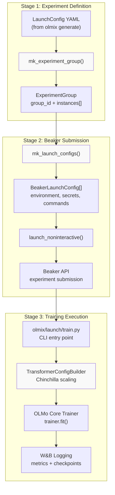
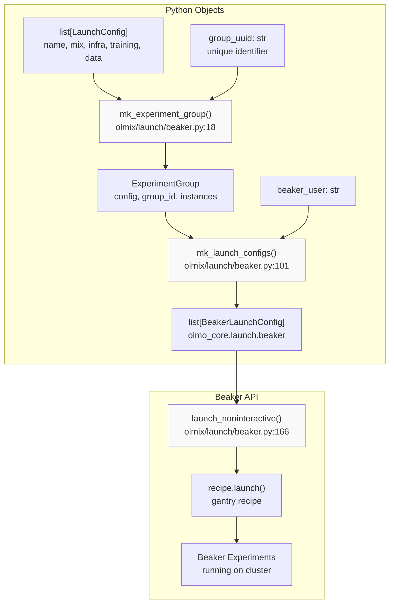
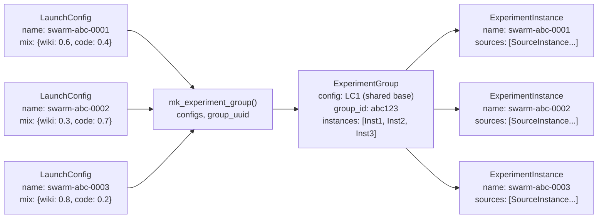
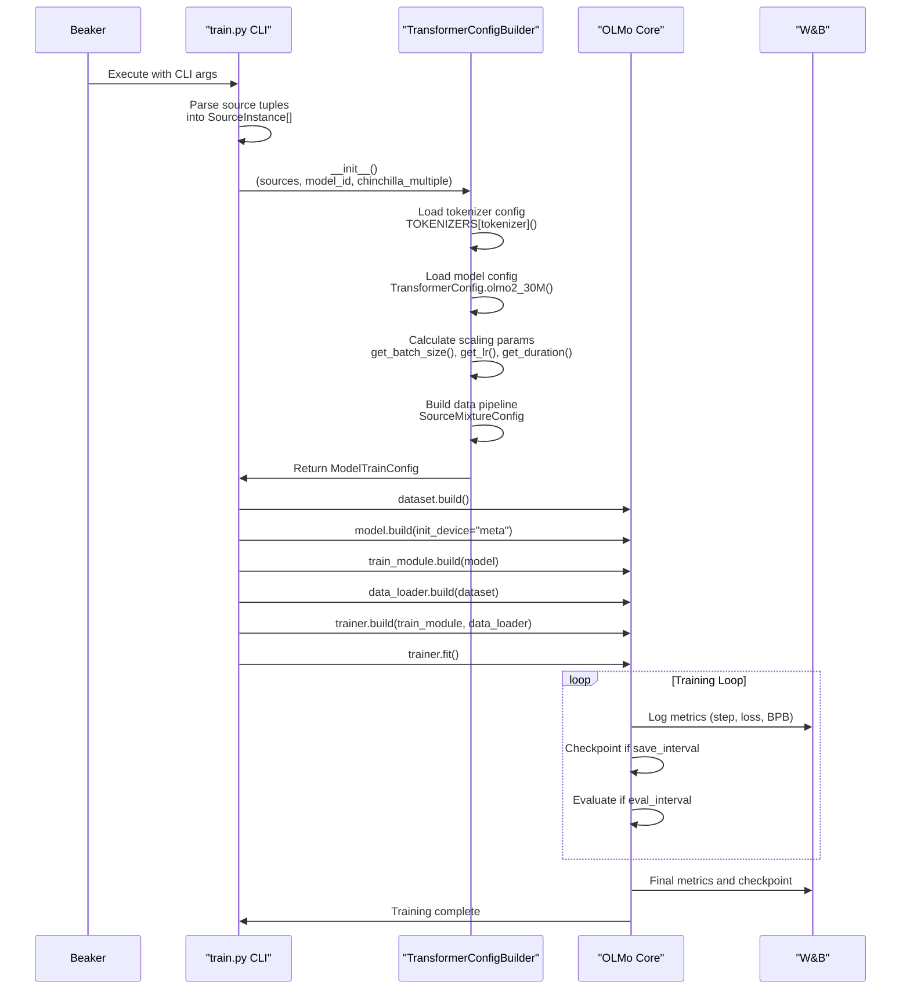
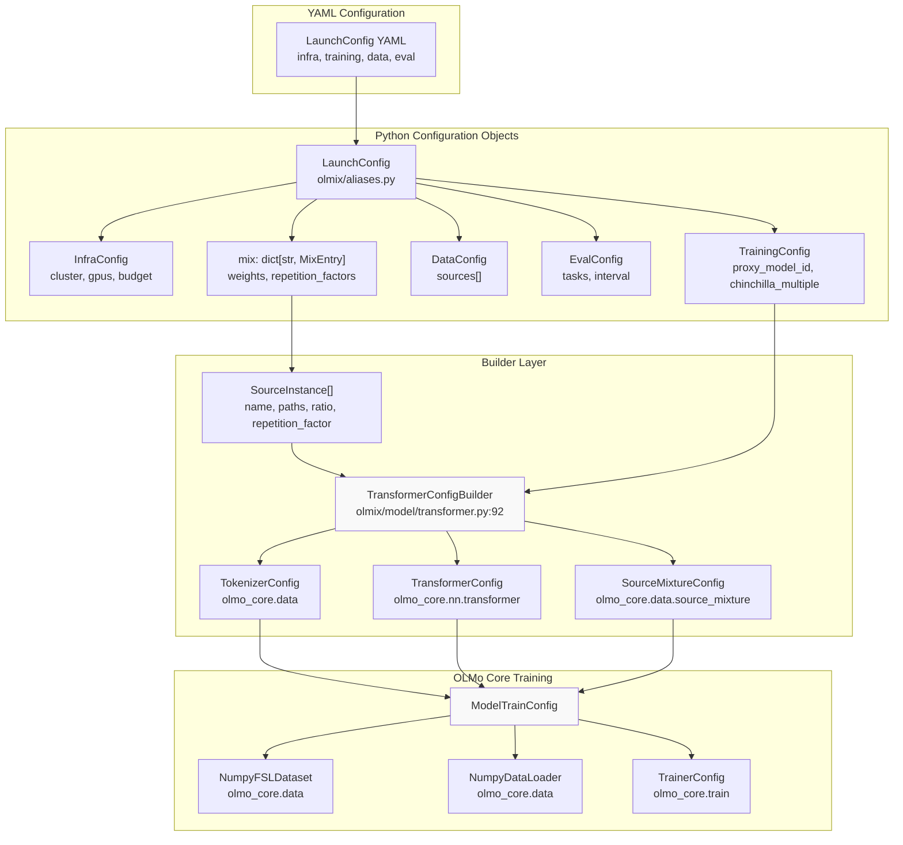
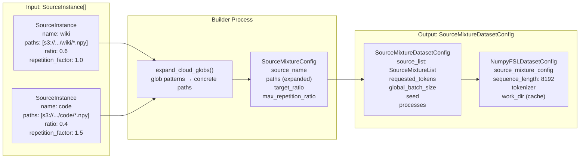
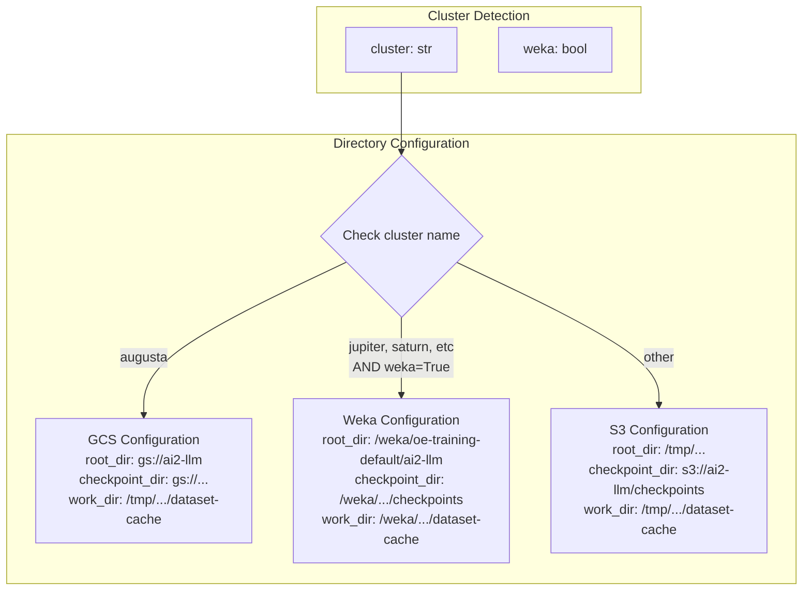
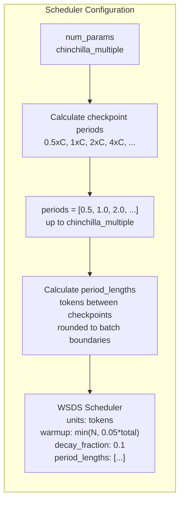
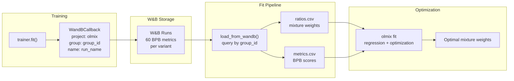

<!-- source: DeepWiki mcp.deepwiki.com · repo allenai/olmix · page 5 Training Infrastructure · fetched 2026-10-26 -->

# Training Infrastructure

<details>
<summary>Relevant source files</summary>

The following files were used as context for generating this wiki page:

- [olmix/__init__.py](olmix/__init__.py)
- [olmix/fit/__init__.py](olmix/fit/__init__.py)
- [olmix/launch/__init__.py](olmix/launch/__init__.py)
- [olmix/launch/beaker.py](olmix/launch/beaker.py)
- [olmix/launch/train.py](olmix/launch/train.py)
- [olmix/model/__init__.py](olmix/model/__init__.py)
- [olmix/model/evaluators.py](olmix/model/evaluators.py)
- [olmix/model/transformer.py](olmix/model/transformer.py)
- [tests/test_cli.py](tests/test_cli.py)
- [tests/test_config.py](tests/test_config.py)
- [tests/test_imports.py](tests/test_imports.py)

</details>


This document provides an overview of how olmix integrates with Beaker and OLMo Core for distributed GPU training. The training infrastructure orchestrates the execution of proxy model experiments, applying Chinchilla scaling laws to automatically configure training parameters and logging comprehensive evaluation metrics to Weights & Biases.

**Scope**: This page covers the end-to-end training pipeline from experiment submission to result collection. For detailed information on specific components:
- Beaker experiment creation and submission: see [Beaker Integration](#5.1)
- Chinchilla scaling and parameter computation: see [TransformerConfigBuilder](#5.2)
- Data loading and mixture configuration: see [Data Pipeline](#5.3)
- Evaluation task definitions: see [Evaluation Tasks](#5.4)

For the broader workflow (generation, optimization, iteration), see [Overview](#1).

## Architecture Overview

The training infrastructure bridges olmix's high-level experiment definitions with Beaker's distributed execution platform and OLMo Core's training framework. The system follows a three-stage pipeline:



**Stage 1** converts LaunchConfig objects (which contain explicit mixture weights) into ExperimentGroup structures with individual ExperimentInstance records. **Stage 2** transforms these into Beaker-specific launch configurations with appropriate environment variables, secrets, and command-line arguments. **Stage 3** executes the training script, which uses TransformerConfigBuilder to apply scaling laws and delegates actual training to OLMo Core.

Sources: [olmix/launch/beaker.py:18-42](), [olmix/launch/beaker.py:101-163](), [olmix/launch/train.py:157-238]()

## Key Components

The training infrastructure consists of several interconnected components:

| Component | File Location | Purpose |
|-----------|---------------|---------|
| `mk_experiment_group` | [olmix/launch/beaker.py:18-42]() | Groups LaunchConfigs into ExperimentGroup with shared configuration |
| `mk_launch_configs` | [olmix/launch/beaker.py:101-163]() | Converts ExperimentGroup to Beaker-specific launch configs |
| `launch_noninteractive` | [olmix/launch/beaker.py:166-181]() | Submits experiments to Beaker without interactive prompts |
| `TransformerConfigBuilder` | [olmix/model/transformer.py:92-443]() | Builds training configuration with Chinchilla scaling |
| `train` CLI command | [olmix/launch/train.py:157-238]() | Entry point executed on Beaker workers |

Sources: [olmix/launch/beaker.py](), [olmix/model/transformer.py](), [olmix/launch/train.py]()

## Experiment Submission Flow

The following diagram shows how code entities map to the submission process:



### ExperimentGroup Creation

The `mk_experiment_group` function transforms a list of LaunchConfig objects into an ExperimentGroup. Each LaunchConfig must have a `mix` field containing `MixEntry` objects with explicit weights and repetition factors:



The group uses the first LaunchConfig as the shared base configuration (infrastructure, training parameters, evaluation settings), while each instance retains its unique mixture specification via `sources` field.

Sources: [olmix/launch/beaker.py:18-42](), [olmix/launch/utils.py]()

### BeakerLaunchConfig Generation

The `mk_launch_configs` function converts an ExperimentGroup into a list of `BeakerLaunchConfig` objects. Each config includes:

**Environment Variables** ([olmix/launch/beaker.py:116-132]()):
- `WORLD_SIZE`, `RANK`, `LOCAL_RANK` for single-GPU jobs
- `MASTER_ADDR`, `MASTER_PORT` for distributed setup
- `WANDB_DEBUG` if debugging is enabled

**Environment Secrets** ([olmix/launch/beaker.py:152-158]()):
- `BEAKER_TOKEN` for Beaker API access
- `WANDB_API_KEY` for W&B logging
- `R2_ENDPOINT_URL`, `WEKA_ENDPOINT_URL` for cloud storage
- `GOOGLE_CLOUD_PROJECT` for GCS access
- AWS credentials (`AWS_CONFIG`, `AWS_CREDENTIALS`)

**Weka Buckets** ([olmix/launch/beaker.py:112-114]()):
- Mounts `/weka/oe-training-default` if `weka` is enabled
- Used for high-performance shared filesystem access

**Training Command** ([olmix/launch/beaker.py:45-98]()):
The `mk_instance_cmd` function builds the command-line arguments for `olmix/launch/train.py`:

```
olmix/launch/train.py train
  -n <instance.name>
  -g <group_id>
  -x <chinchilla_multiple>
  -S <seed>
  -c <cluster>
  -u <beaker_user>
  -d <dtype>
  -T <tokenizer>
  -m <proxy_model_id>
  -w <weka>
  -y <train_type>
  -b <device_batch_size>
  [-B <global_batch_size>]
  [-C <checkpoint_path>]
  [--no-eval | -E <eval_interval> -e <task_id> ...]
  -s ("source_name", ["path1", "path2"], ratio, repetition_factor) ...
```

Sources: [olmix/launch/beaker.py:45-98](), [olmix/launch/beaker.py:101-163]()

## Training Execution

Once Beaker schedules the job on a GPU cluster, the training script [olmix/launch/train.py]() executes the following sequence:



Sources: [olmix/launch/train.py:157-238](), [olmix/model/transformer.py:350-443]()

## Chinchilla Scaling Laws

TransformerConfigBuilder automatically computes training hyperparameters using Chinchilla scaling laws. These formulas ensure compute-optimal training by relating model size to batch size, learning rate, and training duration.

| Parameter | Formula | Implementation |
|-----------|---------|----------------|
| **Batch Size** | `2048 * 160 * (N / 108M)^(2/3)` rounded to next power of 2 | [olmix/model/transformer.py:225-232]() |
| **Learning Rate** | `0.0047 * (N / 108M)^(-1/3) / 2` | [olmix/model/transformer.py:238-245]() |
| **Training Duration** | `20 * N * chinchilla_multiple` tokens | [olmix/model/transformer.py:247-253]() |
| **Warmup Tokens** | `min(N, 0.05 * total_tokens)` | [olmix/model/transformer.py:214-223]() |

The system uses `TOKENS_PER_PARAM = 20` ([olmix/model/transformer.py:53]()) as the Chinchilla-optimal token budget per parameter. The `chinchilla_multiple` parameter allows training for longer (e.g., `5.0` for 5x Chinchilla) or shorter (e.g., `0.5` for proxy models) than the optimal budget.

Sources: [olmix/model/transformer.py:225-253]()

## Configuration Pipeline

The following diagram shows how configuration flows from YAML files through Python objects to OLMo Core:



The `TransformerConfigBuilder.build()` method ([olmix/model/transformer.py:350-443]()) produces a `ModelTrainConfig` object that aggregates all configuration needed for training:

- **Model**: `TransformerConfig` from olmo-core model factories
- **Dataset**: `NumpyFSLDatasetConfig` with `SourceMixtureConfig`
- **DataLoader**: `NumpyDataLoaderConfig` with caching settings
- **Trainer**: `TrainerConfig` with callbacks (WandB, checkpointing, evaluation)
- **TrainModule**: `TransformerTrainModuleConfig` with optimizer, scheduler, compilation settings

Sources: [olmix/model/transformer.py:350-443](), [olmix/model/aliases.py:7-18]()

## Data Pipeline Integration

TransformerConfigBuilder constructs a `SourceMixtureConfig` that specifies how to mix multiple data sources with different sampling ratios and repetition factors:



The [olmix/model/transformer.py:366-393]() code constructs the data pipeline:

1. **Glob Expansion**: Cloud storage patterns (e.g., `s3://bucket/**/*.npy`) are expanded to concrete file paths using `expand_cloud_globs()` ([olmix/utils/cloud.py]())
2. **Source Mixing**: Each `SourceInstance` becomes a `SourceMixtureConfig` with its target ratio and repetition factor
3. **Token Budget**: `requested_tokens` is set to the Chinchilla training duration
4. **Caching**: `work_dir` specifies where tokenized sequences are cached (varies by cluster/weka configuration)

The resulting `NumpyFSLDatasetConfig` uses OLMo Core's `NumpyFSLDataset` for efficient fixed-sequence-length training with automatic tokenization and caching.

Sources: [olmix/model/transformer.py:366-393](), [olmix/utils/cloud.py]()

## Callbacks and Monitoring

TransformerConfigBuilder configures several callbacks for monitoring and checkpointing ([olmix/model/transformer.py:304-348]()):

| Callback | Purpose | Configuration |
|----------|---------|---------------|
| `GPUMemoryMonitorCallback` | Track GPU memory usage | Default settings |
| `ConfigSaverCallback` | Save configuration to checkpoint | Saves `config_dict` |
| `ProfilerCallback` | PyTorch profiling (optional) | `enabled=self.profile` |
| `CheckpointerCallback` | Save model checkpoints | `save_interval=1000`<br/>`ephemeral_save_interval=250`<br/>`save_async=True` |
| `WandBCallback` | Log metrics to Weights & Biases | `project="olmix"`<br/>`group=group_id`<br/>`name=run_name` |
| `DownstreamEvaluatorCallbackConfig` | Evaluate on downstream tasks | `tasks=eval_tasks`<br/>`eval_interval=eval_interval`<br/>`fixed_steps=[final_step]` |

The **WandB callback** is configured with the experiment's `group_id`, enabling all variants in a swarm to be grouped together for analysis. The `group_id` is later used by the `fit` command to query and aggregate results across the entire swarm.

The **Downstream Evaluator** runs in-loop evaluation on specified tasks (see [Evaluation Tasks](#5.4)). It evaluates at regular intervals and ensures a final evaluation at the last training step, even if that step doesn't align with the regular interval.

Sources: [olmix/model/transformer.py:304-348]()

## Cluster-Specific Configuration

TransformerConfigBuilder adapts directory paths based on the target cluster ([olmix/model/transformer.py:196-212]()):



**Augusta cluster** (GCP): Uses Google Cloud Storage (`gs://`) for checkpoints and a local temporary directory for caching.

**AI2 clusters with Weka**: Uses the Weka shared filesystem for both checkpoints and caching, providing high-performance shared access across nodes.

**Default (S3)**: Uses S3 for checkpoints and local temporary storage for caching.

The `work_dir` is where `NumpyFSLDataset` caches tokenized sequences for fast repeated access.

Sources: [olmix/model/transformer.py:196-212]()

## WSDS Scheduler

Training uses the WSDS (Warmup-Stable-Decay-Stable) learning rate scheduler with multi-period checkpoints ([olmix/model/transformer.py:255-302]()):



For example, with a 30M parameter model and `chinchilla_multiple=5.0`:
- **0.5xC**: Checkpoint at 300M tokens (0.5 * 20 * 30M)
- **1xC**: Checkpoint at 600M tokens (1.0 * 20 * 30M)
- **2xC**: Checkpoint at 1.2B tokens (2.0 * 20 * 30M)
- **4xC**: Checkpoint at 2.4B tokens (4.0 * 20 * 30M)
- **5xC**: Final training at 3B tokens (5.0 * 20 * 30M)

This allows analysis at intermediate Chinchilla multiples without running separate experiments. For very short runs (`chinchilla_multiple < 0.5`), the scheduler uses a single period for the full duration.

Sources: [olmix/model/transformer.py:255-302]()

## Model Architectures

The system supports OLMo2 and OLMo3 model families through factory functions in olmo-core ([olmix/model/transformer.py:62-88]()):

**OLMo2 Models**:
- `olmo2_1m`: 1M parameters
- `olmo2_30m`: 30M parameters (most common for swarms)
- `olmo2_60m`: 60M parameters
- `olmo2_190m`: 190M parameters
- `olmo2_1b`: 1B parameters
- `olmo2_7b`: 7B parameters

**OLMo3 Models**:
- `olmo3_1m` through `olmo3_32b`: Wide range from 1M to 32B parameters

The model factory is selected based on the `proxy_model_id` parameter in `TrainingConfig`. The tokenizer's `padded_vocab_size()` is used to configure the model's embedding layer.

Sources: [olmix/model/transformer.py:62-88](), [olmix/model/transformer.py:175-183]()

## Result Collection

After training completes, results are available in Weights & Biases under the project `olmix` with the experiment's `group_id`. The `fit` command queries W&B to retrieve metrics for all variants in the swarm:



The `group_id` serves as the key linking mechanism between:
1. Experiment generation (`olmix generate` assigns the same `group_id` to all variants)
2. Training execution (logged to W&B with this `group_id`)
3. Result retrieval (`olmix fit` queries W&B by `group_id`)
4. Analysis and optimization (all variants are analyzed together)

For details on data loading, see [Loading from WandB](#6.1) and [Loading from CSV](#6.2).

Sources: [olmix/model/transformer.py:319-324](), [olmix/fit/core.py]()

---

