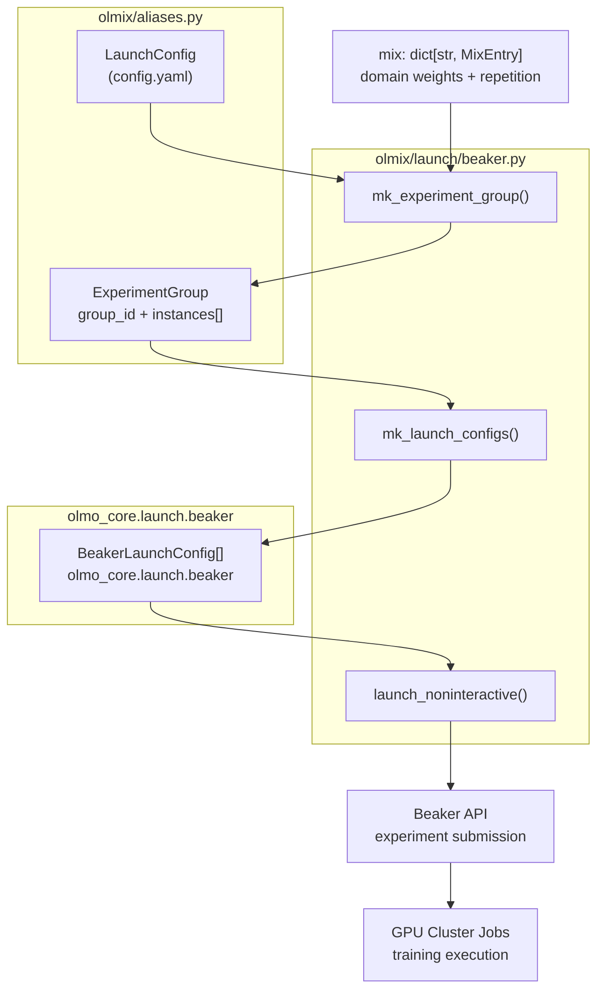
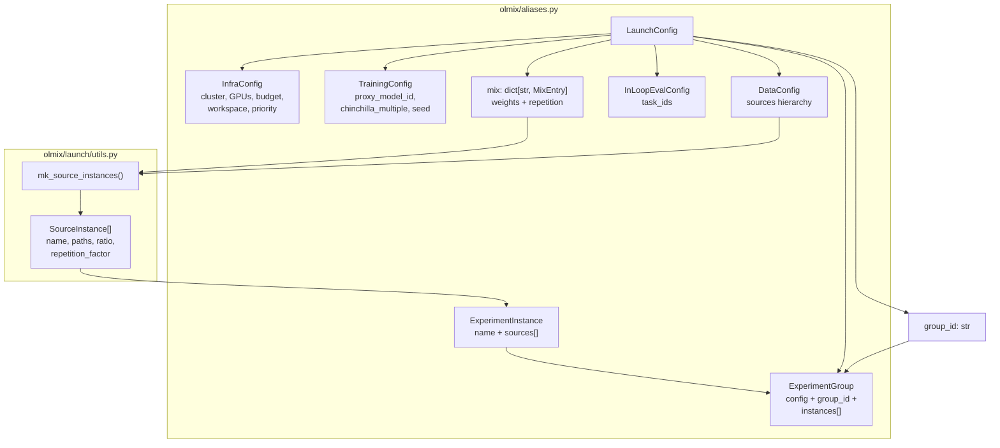
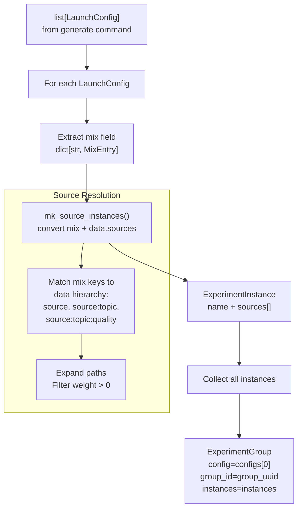
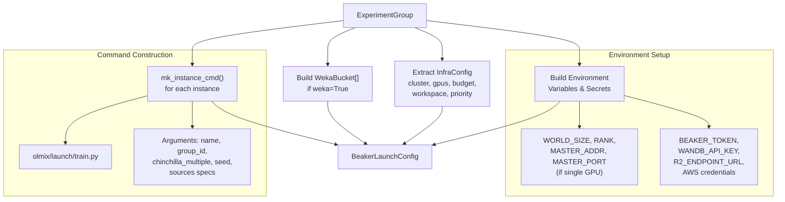
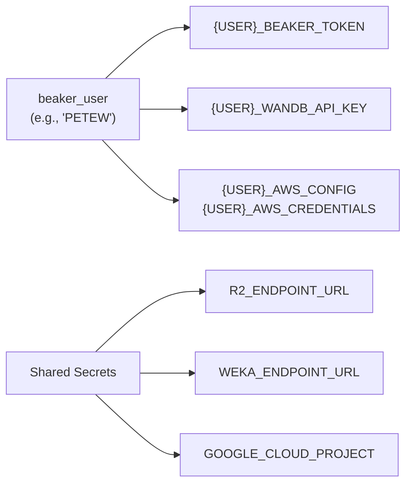
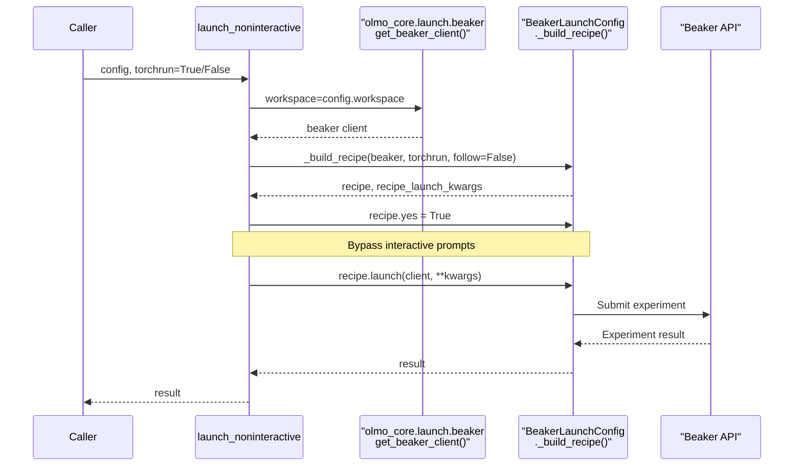
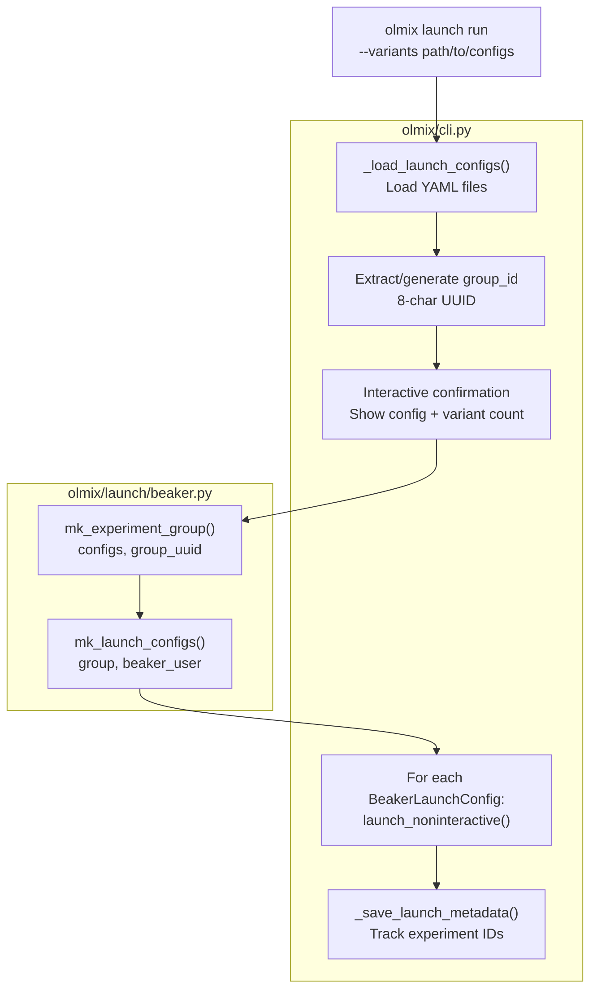
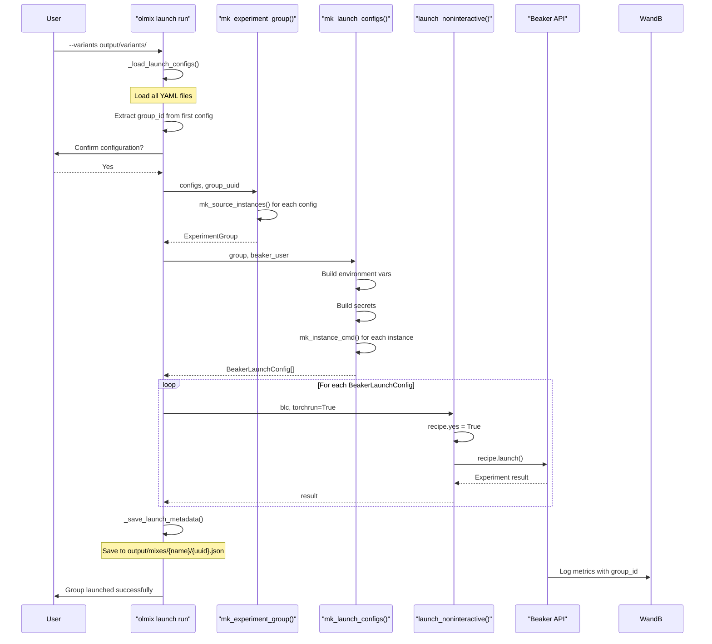

<!-- source: DeepWiki mcp.deepwiki.com · repo allenai/olmix · page 5.1 Beaker Integration · fetched 2026-10-26 -->

# Beaker Integration

<details>
<summary>Relevant source files</summary>

The following files were used as context for generating this wiki page:

- [olmix/__init__.py](olmix/__init__.py)
- [olmix/aliases.py](olmix/aliases.py)
- [olmix/cli.py](olmix/cli.py)
- [olmix/generate/synthesize_mixture.py](olmix/generate/synthesize_mixture.py)
- [olmix/generate/utils.py](olmix/generate/utils.py)
- [olmix/launch/__init__.py](olmix/launch/__init__.py)
- [olmix/launch/beaker.py](olmix/launch/beaker.py)
- [olmix/launch/utils.py](olmix/launch/utils.py)
- [tests/test_cli.py](tests/test_cli.py)
- [tests/test_config.py](tests/test_config.py)
- [tests/test_imports.py](tests/test_imports.py)

</details>


## Purpose and Scope

This document details how olmix integrates with the Beaker platform for distributed GPU training. It covers the conversion of olmix configuration models into Beaker-compatible launch specifications, environment setup for distributed training, and non-interactive job submission. For information about the training script itself and Chinchilla scaling, see [TransformerConfigBuilder](#5.2). For data pipeline configuration, see [Data Pipeline](#5.3).

---

## Architecture Overview

The Beaker integration layer transforms olmix's high-level configuration models (`LaunchConfig`) into Beaker-specific job specifications, handling infrastructure requirements, environment setup, and multi-node distributed training coordination.

### Configuration to Beaker Job Flow



**Sources:** [olmix/launch/beaker.py:18-42](), [olmix/launch/beaker.py:101-163](), [olmix/launch/beaker.py:166-181]()

---

## Configuration Models

### ExperimentInstance

An `ExperimentInstance` represents a single training run with its specific mixture configuration. Each instance contains a list of `SourceInstance` objects that specify which data sources to use with their weights and repetition factors.

| Field | Type | Description |
|-------|------|-------------|
| `name` | `str` | Unique identifier for this experiment variant (e.g., `"test-swarm-abc123-0001"`) |
| `sources` | `list[SourceInstance]` | Data sources with resolved weights and paths |

The `SourceInstance` model contains:

| Field | Type | Description |
|-------|------|-------------|
| `name` | `str` | Domain identifier (e.g., `"dclm:code"`, `"wikipedia"`) |
| `paths` | `list[str]` | S3/GCS paths to `.npy` files |
| `ratio` | `float` | Weight for this source in the mixture (sums to 1.0 across all sources) |
| `repetition_factor` | `float` | Number of epochs to repeat this data (default 1.0) |

**Sources:** [olmix/aliases.py:328-332](), [olmix/aliases.py:123-128]()

### ExperimentGroup

An `ExperimentGroup` bundles multiple experiment instances that share common infrastructure and training settings. This is the primary abstraction for launching swarms of experiments.

| Field | Type | Description |
|-------|------|-------------|
| `config` | `LaunchConfig` | Base configuration (infra, training, eval settings) |
| `group_id` | `str` | Unique identifier for tracking related experiments (8-character UUID) |
| `instances` | `list[ExperimentInstance]` | Individual experiment variants with their mixtures |

**Sources:** [olmix/aliases.py:335-340]()

### Configuration Model Hierarchy



**Sources:** [olmix/aliases.py:299-326](), [olmix/aliases.py:138-151](), [olmix/aliases.py:153-176](), [olmix/aliases.py:178-183](), [olmix/launch/utils.py:12-85]()

---

## Building Experiment Groups

The `mk_experiment_group()` function converts a list of `LaunchConfig` objects (each with a `mix` field) into an `ExperimentGroup` ready for submission.

### Function Signature

```python
def mk_experiment_group(configs: list[LaunchConfig], group_uuid: str) -> ExperimentGroup
```

### Process Flow



**Key Logic:**

1. **Assertion Check:** Each `LaunchConfig` must have a non-null `mix` field ([olmix/launch/beaker.py:31]())
2. **Source Instance Creation:** Calls `mk_source_instances()` to resolve the hierarchical data configuration against the flat mixture weights ([olmix/launch/beaker.py:35]())
3. **Base Config Selection:** Uses the first config as the base, assuming all variants share infrastructure settings ([olmix/launch/beaker.py:39]())

**Sources:** [olmix/launch/beaker.py:18-42](), [olmix/launch/utils.py:12-85]()

---

## Creating Beaker Launch Configs

The `mk_launch_configs()` function transforms an `ExperimentGroup` into a list of `BeakerLaunchConfig` objects, which are olmo-core's abstraction for Beaker job specifications.

### Function Signature

```python
def mk_launch_configs(group: ExperimentGroup, beaker_user: str) -> list[BeakerLaunchConfig]
```

### BeakerLaunchConfig Components



**Sources:** [olmix/launch/beaker.py:101-163]()

### Environment Variables

The function sets up environment variables based on GPU configuration:

| Variable | Value | Condition |
|----------|-------|-----------|
| `WORLD_SIZE` | `"1"` | Single GPU only |
| `RANK` | `"0"` | Single GPU only |
| `LOCAL_RANK` | `"0"` | Single GPU only |
| `MASTER_ADDR` | `"127.0.0.1"` | Single GPU only |
| `MASTER_PORT` | `"29500"` | Single GPU only |
| `WANDB_DEBUG` | `"true"` | If `infra.wandb_debug=True` |

For multi-GPU setups (when `infra.gpus > 1`), these variables are omitted and managed by Beaker's torchrun integration.

**Sources:** [olmix/launch/beaker.py:117-132]()

### Environment Secrets

Secrets are mounted using user-specific Beaker secret names:



**Sources:** [olmix/launch/beaker.py:152-160]()

### Storage Configuration

The Weka shared filesystem is mounted when `infra.weka=True`:

| Bucket | Mount Point |
|--------|-------------|
| `oe-training-default` | `/weka/oe-training-default` |

**Sources:** [olmix/launch/beaker.py:112-114]()

### BeakerLaunchConfig Fields

| Field | Source | Example Value |
|-------|--------|---------------|
| `name` | `experiment.name` | `"test-swarm-abc123-0001"` |
| `description` | `group.config.description` | `"Swarm experiment"` |
| `task_name` | `experiment.name` | Same as `name` |
| `cmd` | `mk_instance_cmd()` | `["olmix/launch/train.py", "train", "-n", "test", ...]` |
| `clusters` | `[group.config.infra.cluster]` | `["ai2/saturn-cirrascale"]` |
| `num_nodes` | `group.config.infra.nodes` | `1` |
| `num_gpus` | `group.config.infra.gpus` | `8` |
| `budget` | `group.config.infra.budget` | `"ai2/oe-data"` |
| `workspace` | `group.config.infra.workspace` | `"ai2/dolma2"` |
| `beaker_image` | Fixed | `"petew/olmo-core-tch270cu128-v2.1"` |
| `priority` | `group.config.infra.priority.value` | `"normal"` |
| `preemptible` | `group.config.infra.preemptible` | `true` |

**Sources:** [olmix/launch/beaker.py:134-161]()

---

## Command Construction

The `mk_instance_cmd()` function builds the command-line arguments for the training script.

### Function Signature

```python
def mk_instance_cmd(
    instance: ExperimentInstance,
    config: LaunchConfig,
    group_id: str,
    beaker_user: str
) -> list[str]
```

### Command Structure

The generated command follows this pattern:

```bash
olmix/launch/train.py train \
  -n {instance.name} \
  -g {group_id} \
  -x {chinchilla_multiple} \
  -S {seed} \
  -c {cluster} \
  -u {beaker_user} \
  -d {dtype} \
  -T {tokenizer} \
  -m {proxy_model_id} \
  -w {weka} \
  -y {train_type} \
  -b {device_batch_size} \
  [-B {global_batch_size}] \
  [-C {checkpoint_path}] \
  [--no-eval | -E {eval_interval} -e {task_id} ...] \
  -s ("source_name",[paths],ratio,repetition) ...
```

### Source Specification Format

Each source is passed as a tuple-like argument:

```python
'-s ("dclm:code",["s3://bucket/dclm/code/*.npy"],0.35,1.0)'
```

The format is: `("name",[paths],ratio,repetition_factor)` where:
- `name`: Domain identifier
- `paths`: List of S3/GCS glob patterns (quoted)
- `ratio`: Weight in the mixture (0.0-1.0)
- `repetition_factor`: Data repetition multiplier

**Sources:** [olmix/launch/beaker.py:45-98]()

---

## Non-Interactive Launching

The `launch_noninteractive()` function bypasses interactive prompts that would block in automated contexts.

### Function Signature

```python
def launch_noninteractive(config: BeakerLaunchConfig, torchrun: bool = False)
```

### Implementation Details



**Key Behavior:**

1. **Force Non-Interactive:** Sets `recipe.yes = True` to bypass confirmation prompts ([olmix/launch/beaker.py:180]())
2. **No Follow:** Sets `follow=False` so the function returns immediately without blocking ([olmix/launch/beaker.py:179]())
3. **TorchRun Support:** Enables multi-GPU distributed training when `torchrun=True` ([olmix/launch/beaker.py:179]())

**Why This Exists:**

The standard olmo-core `launch_experiment` function includes interactive prompts for experiment name confirmation and GitHub token input. These block in non-interactive contexts (CI/CD, batch submissions). This wrapper bypasses them while maintaining the same underlying functionality.

**Sources:** [olmix/launch/beaker.py:166-181]()

---

## CLI Integration

The `launch run` command orchestrates the entire submission process.

### CLI Command Flow



**Sources:** [olmix/cli.py:178-261]()

### Dry Run Mode

When `--dry-run` is specified, the command:

1. Builds the experiment group and launch configs as normal
2. Calls `blc.dry_run(torchrun=torchrun)` for each config ([olmix/cli.py:229]())
3. Saves metadata without Beaker experiment IDs ([olmix/cli.py:232-237]())
4. Exits without submitting to Beaker

This allows validating configuration and command construction before committing resources.

**Sources:** [olmix/cli.py:224-238]()

### Launch Status and Control

Additional launch subcommands provide cluster management:

| Command | Function | Description |
|---------|----------|-------------|
| `launch status` | Query job status | Lists all jobs matching the group ID ([olmix/cli.py:263-302]()) |
| `launch cancel` | Stop running jobs | Cancels all jobs in a group ([olmix/cli.py:305-353]()) |
| `launch preview` | Show commands | Displays training commands without launching ([olmix/cli.py:355-373]()) |

All commands use the `group_id` field to identify related experiments. The group ID can be provided explicitly via `--group-id` or extracted from any variant's config file.

**Sources:** [olmix/cli.py:263-373]()

---

## Metadata Tracking

The `_save_launch_metadata()` function creates a JSON record of each experiment group for reproducibility.

### Metadata Structure

```json
{
  "metadata": {
    "timestamp": "2024-01-15T10:30:00Z",
    "beaker_user": "PETEW",
    "group_id": "abc12345",
    "wandb_url": "https://wandb.ai/ai2-llm/olmix?group=abc12345",
    "git_commit": "a1b2c3d4",
    "git_branch": "main"
  },
  "config": { /* LaunchConfig as JSON */ },
  "experiments": [
    {
      "variant": 0,
      "beaker_id": "01HQXXX...",
      "beaker_name": "test-swarm-abc12345-0000",
      "beaker_url": "https://beaker.org/ex/01HQXXX..."
    }
  ]
}
```

### Output Location

Metadata is saved to: `output/mixes/{base.name}/{group_uuid}.json`

This hierarchical organization groups experiments by their base name, making it easy to track multiple swarms for the same configuration.

**Sources:** [olmix/cli.py:34-76]()

### Git Information Capture

The `_get_git_info()` helper captures the current repository state:

```python
{
  "git_commit": "a1b2c3d4",  # First 8 chars of HEAD
  "git_branch": "main"        # Current branch name
}
```

If git commands fail (e.g., not in a repo), both fields default to `"unknown"`.

**Sources:** [olmix/cli.py:24-31]()

---

## Complete Launch Sequence

The following diagram shows the complete flow from variant YAMLs to running Beaker jobs:



**Sources:** [olmix/cli.py:178-261](), [olmix/launch/beaker.py:18-181]()

---

## Key Design Principles

### 1. Self-Contained Variants

Each `LaunchConfig` YAML contains everything needed to launch that specific experiment: infrastructure settings, training parameters, data sources, and the explicit mixture weights. This eliminates ambiguity about which version of a configuration was used.

**Sources:** [olmix/aliases.py:299-326]()

### 2. Group-Based Tracking

All experiments in a swarm share a common `group_id`, which flows through to:
- Beaker experiment names (`{name}-{group_id}-{variant}`)
- W&B group field (enables aggregated visualization)
- Metadata output paths
- Status/cancel commands

**Sources:** [olmix/cli.py:199](), [olmix/launch/beaker.py:69]()

### 3. Non-Interactive by Default

The integration is designed for programmatic use:
- Batch submission via `tqdm` progress bars
- No blocking waits for job completion
- Explicit confirmation only for the initial launch decision

**Sources:** [olmix/launch/beaker.py:166-181](), [olmix/cli.py:242-243]()

### 4. Reproducibility First

Every launch generates:
- Complete configuration snapshot (JSON)
- Git commit and branch information
- Beaker experiment IDs and URLs
- Timestamp and user attribution

This enables exact reproduction of any experiment and tracing results back to code versions.

**Sources:** [olmix/cli.py:34-76]()

---

