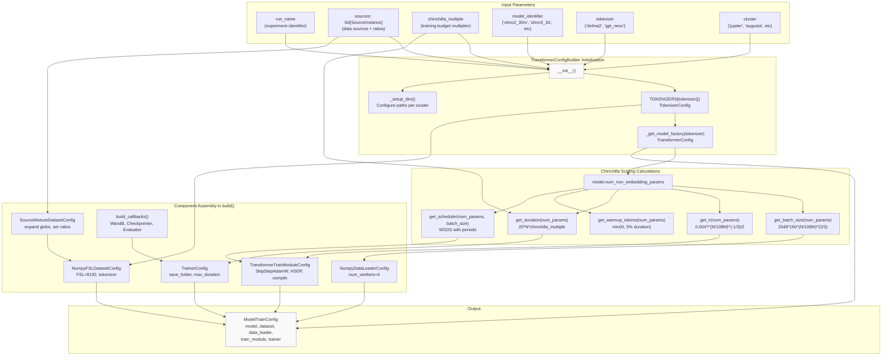
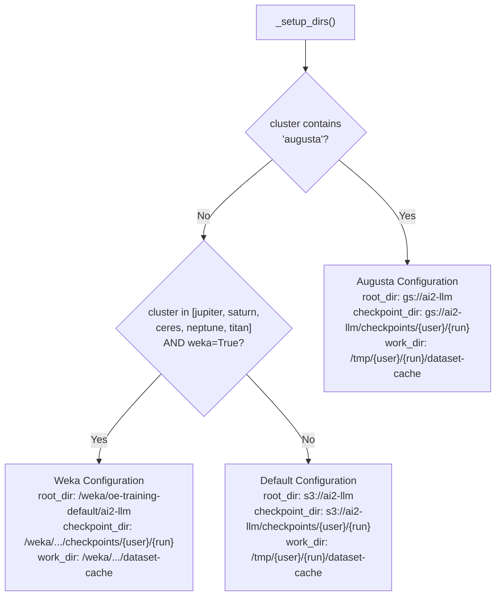
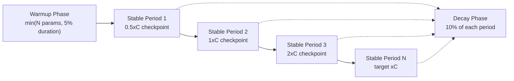
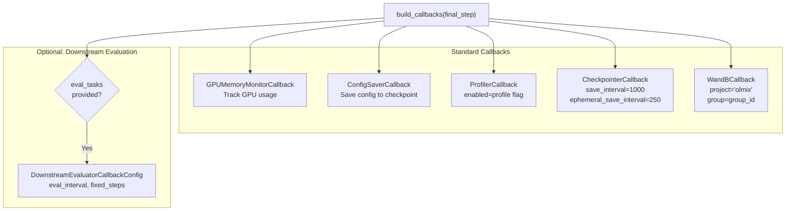
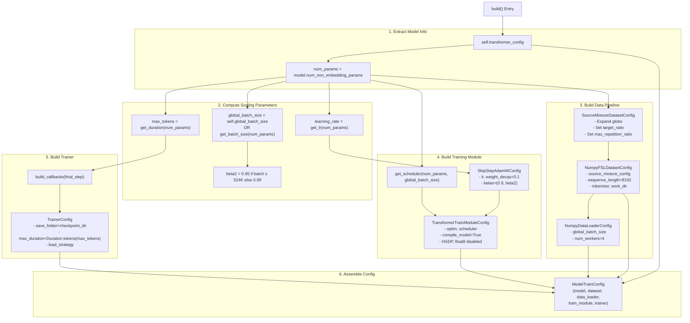
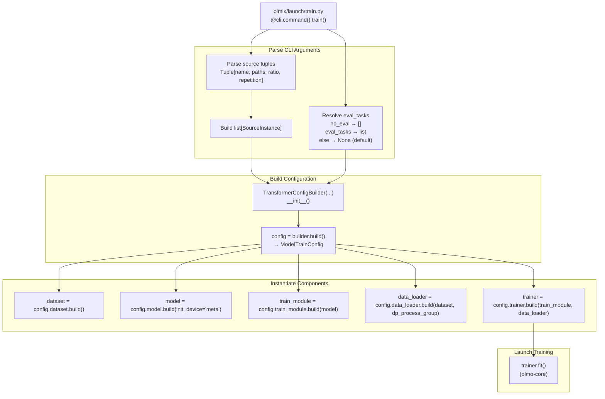

<!-- source: DeepWiki mcp.deepwiki.com · repo allenai/olmix · page 5.2 TransformerConfigBuilder · fetched 2026-10-26 -->

# TransformerConfigBuilder

<details>
<summary>Relevant source files</summary>

The following files were used as context for generating this wiki page:

- [olmix/__init__.py](olmix/__init__.py)
- [olmix/fit/__init__.py](olmix/fit/__init__.py)
- [olmix/launch/__init__.py](olmix/launch/__init__.py)
- [olmix/launch/beaker.py](olmix/launch/beaker.py)
- [olmix/launch/train.py](olmix/launch/train.py)
- [olmix/model/__init__.py](olmix/model/__init__.py)
- [olmix/model/evaluators.py](olmix/model/evaluators.py)
- [olmix/model/transformer.py](olmix/model/transformer.py)
- [tests/test_cli.py](tests/test_cli.py)
- [tests/test_config.py](tests/test_config.py)
- [tests/test_imports.py](tests/test_imports.py)

</details>


## Purpose and Scope

The `TransformerConfigBuilder` class is responsible for constructing complete training configurations for proxy model experiments. It applies **Chinchilla scaling laws** to automatically determine batch size, learning rate, and training duration based on model size and a `chinchilla_multiple` parameter. The builder integrates with `olmo-core` components to produce a `ModelTrainConfig` that can be passed directly to the trainer.

This page covers the configuration builder itself. For information about how Beaker experiments are launched, see [Beaker Integration](#5.1). For details on the data pipeline and source mixture construction, see [Data Pipeline](#5.3). For evaluation task definitions, see [Evaluation Tasks](#5.4).

**Sources:** [olmix/model/transformer.py:1-444]()

---

## Overview

The `TransformerConfigBuilder` serves as the bridge between high-level experiment parameters (model size, data sources, training budget) and the low-level `olmo-core` training infrastructure. It automates the application of Chinchilla-optimal hyperparameters, eliminating manual tuning for proxy model runs.

### Key Responsibilities

| Responsibility | Description |
|---|---|
| **Scaling Law Application** | Compute batch size, learning rate, and duration from model parameters using Chinchilla formulas |
| **Directory Configuration** | Set up checkpoint and work directories based on cluster type (S3, GCS, Weka) |
| **Scheduler Construction** | Build WSDS scheduler with multi-period checkpoints at 0.5xC, 1xC, 2xC, etc. |
| **Callback Assembly** | Configure WandB logging, checkpointing, profiling, and downstream evaluation |
| **Data Pipeline Setup** | Construct `SourceMixtureConfig` from source instances with glob expansion |
| **Configuration Integration** | Assemble all components into `ModelTrainConfig` for `olmo-core` trainer |

**Sources:** [olmix/model/transformer.py:92-115]()

---

## Architecture

### Configuration Flow



**Sources:** [olmix/model/transformer.py:136-194](), [olmix/model/transformer.py:350-443]()

---

## Chinchilla Scaling Laws

The builder implements Chinchilla-optimal scaling laws to automatically determine hyperparameters based on model size. These formulas ensure consistent training behavior across different model scales.

### Scaling Formulas

| Parameter | Formula | Implementation |
|---|---|---|
| **Batch Size** | `2048 × 160 × (N / 108M)^(2/3)`, rounded to next power of 2 | [get_batch_size():225-232]() |
| **Learning Rate** | `0.0047 × (N / 108M)^(-1/3) / 2` | [get_lr():238-245]() |
| **Training Duration** | `TOKENS_PER_PARAM × N × chinchilla_multiple` | [get_duration():247-253]() |
| **Warmup Tokens** | `min(N, 0.05 × total_duration)` | [get_warmup_tokens():214-223]() |

Where:
- `N` = `model.num_non_embedding_params` (e.g., 30,000,000 for `olmo2_30m`)
- `TOKENS_PER_PARAM = 20` (Chinchilla optimal tokens per parameter)

### Constants

```python
# From olmix/model/transformer.py:49-53
BATCH_DIVISOR = 32
SAVE_INTERVAL = 1000
SEQUENCE_LENGTH = 8192  # Fixed sequence length for Chinchilla strategy
TOKENS_PER_PARAM = 20   # Chinchilla optimal tokens per parameter
```

### Adaptive Beta2

The builder selects `beta2` for the Adam optimizer based on batch size:

```python
# From olmix/model/transformer.py:362-364
batch_size_in_tokens = global_batch_size * self.sequence_length
beta2 = 0.95 if batch_size_in_tokens >= 524_288 else 0.99
```

Large batches (≥524K tokens) use `beta2=0.95` for stability, smaller batches use `beta2=0.99` for better convergence.

**Sources:** [olmix/model/transformer.py:49-53](), [olmix/model/transformer.py:214-253](), [olmix/model/transformer.py:362-364]()

---

## Model and Tokenizer Factories

The builder uses factory mappings to instantiate `olmo-core` configurations for models and tokenizers.

### Tokenizer Mapping

```python
# From olmix/model/transformer.py:56-59
TOKENIZERS: dict[str, Callable[[], TokenizerConfig]] = {
    "dolma2": TokenizerConfig.dolma2,
    "gpt_neox": TokenizerConfig.gpt_neox_olmo_dolma_v1_5,
}
```

### Model Factory Generation

The `_get_model_factory()` function dynamically creates model factories with the correct vocabulary size:

```python
# Supported models include:
# OLMo2: olmo2_1m, olmo2_30m, olmo2_60m, olmo2_190m, olmo2_1b, olmo2_7b
# OLMo3: olmo3_1m, olmo3_14m, olmo3_30m, ..., olmo3_13b, olmo3_32b
```

Each factory calls the corresponding `TransformerConfig` class method (e.g., `TransformerConfig.olmo2_30M(vocab_size=vocab_size)`).

**Sources:** [olmix/model/transformer.py:56-88]()

---

## Directory Configuration

The builder configures storage paths based on the cluster type and availability of Weka shared filesystem.

### Directory Setup Logic



### Directory Attributes

| Attribute | Purpose | Default Value |
|---|---|---|
| `data_dir` | Base data directory for referencing cloud storage | `"s3://ai2-llm"` |
| `root_dir` | Base directory for all experiment outputs | Cluster-dependent |
| `checkpoint_dir` | Directory for saving model checkpoints | `{root_dir}/checkpoints/{user}/{run}` |
| `work_dir` | Local cache directory for dataset preprocessing | Cluster-dependent |

**Sources:** [olmix/model/transformer.py:196-212]()

---

## WSDS Scheduler Configuration

The builder constructs a **WSDS (Warmup-Stable-Decay-Stable)** scheduler with multiple checkpoint periods based on Chinchilla multiples.

### Scheduler Architecture



### Period Generation Logic

Periods are generated at exponentially increasing Chinchilla multiples: `0.5xC`, `1xC`, `2xC`, `4xC`, ... up to the target `chinchilla_multiple`.

```python
# From olmix/model/transformer.py:266-271
periods: list[float] = []
p = 0.5
while p <= self.chinchilla_multiple:
    periods.append(p)
    p *= 2
```

For each period, the length in tokens is calculated as:

```
tokens_at_c = TOKENS_PER_PARAM * num_params * c
period_length = tokens_at_c - tokens_at_prev_c  # Rounded to batch boundary
```

### Special Case: Small Chinchilla Multiple

If `chinchilla_multiple < 0.5`, the scheduler uses a single period for the full duration to avoid checkpoint overhead:

```python
# From olmix/model/transformer.py:273-281
if not periods:
    period_length = batch_size * max(1, round(max_tokens / batch_size))
    return WSDS(
        units=SchedulerUnits.tokens,
        warmup=warmup,
        decay_fraction=0.1,
        period_lengths=[period_length],
    )
```

**Sources:** [olmix/model/transformer.py:255-302]()

---

## Callback System

The builder assembles a set of callbacks for logging, checkpointing, profiling, and evaluation.

### Callback Configuration



### Checkpointer Settings

| Parameter | Value | Purpose |
|---|---|---|
| `save_interval` | `1000` steps | Permanent checkpoints at period boundaries |
| `ephemeral_save_interval` | `250` steps | Temporary checkpoints for fault tolerance |
| `save_async` | `True` | Non-blocking saves to reduce training interruption |

### Downstream Evaluator

If `eval_tasks` are specified, the builder adds a `DownstreamEvaluatorCallbackConfig`:

```python
# From olmix/model/transformer.py:328-346
if self.eval_tasks:
    fixed_steps: list[int] | None = None
    if final_step is not None and final_step % self.eval_interval != 0:
        fixed_steps = [final_step]  # Ensure eval at end of training
    
    callbacks["downstream_evaluator"] = DownstreamEvaluatorCallbackConfig(
        tasks=self.eval_tasks,
        tokenizer=self.tokenizer,
        eval_interval=self.eval_interval,
        fixed_steps=fixed_steps,
    )
```

The `fixed_steps` list ensures evaluation at the final training step if it doesn't align with `eval_interval`.

**Sources:** [olmix/model/transformer.py:304-348]()

---

## Build Process

The `build()` method assembles all components into a `ModelTrainConfig`.

### Component Construction Sequence



### Key Configuration Details

#### Optimizer Configuration

```python
# From olmix/model/transformer.py:405-409
optim=SkipStepAdamWConfig(
    lr=learning_rate,
    weight_decay=0.1,
    betas=(0.9, beta2),
    group_overrides=[OptimGroupOverride(params=["embeddings.weight"], opts=dict(weight_decay=0.0))],
)
```

Embeddings have weight decay disabled to prevent vocabulary collapse.

#### Data Parallelism Configuration

```python
# From olmix/model/transformer.py:412-414
dp_config=tm.TransformerDataParallelConfig(
    name=DataParallelType.hsdp,
    param_dtype=DType.bfloat16,
    reduce_dtype=DType.float32
)
```

Uses **HSDP (Hybrid Sharded Data Parallel)** with bfloat16 parameters and float32 reduction for numerical stability.

#### Load Strategy

```python
# From olmix/model/transformer.py:427
load_strategy=(LoadStrategy.always if self.train_type == TrainType.anneal else LoadStrategy.if_available)
```

For annealing runs (`TrainType.anneal`), a checkpoint **must** exist. For pretraining, checkpoints are loaded if available (for fault tolerance).

**Sources:** [olmix/model/transformer.py:350-443]()

---

## Usage from Training Entry Point

The `TransformerConfigBuilder` is instantiated in the training entry point script.

### Invocation Flow



### Example CLI Invocation

```bash
olmix/launch/train.py train \
  -n "my-swarm-abc123-0001" \
  -g "abc123" \
  -x 1.0 \
  -S 42 \
  -c "ai2/jupiter" \
  -u "researcher" \
  -d "uint16" \
  -T "dolma2" \
  -m "olmo2_30m" \
  -b 8 \
  -E 1000 \
  -e "arc_challenge_test_rc_5shot" \
  -e "hellaswag_test_rc_10shot" \
  -s '("dclm",["/path/to/dclm/*.npy"],0.6,1.0)' \
  -s '("wikipedia",["/path/to/wiki/*.npy"],0.4,2.0)'
```

**Sources:** [olmix/launch/train.py:157-237]()

---

## Related Configuration Classes

### ModelTrainConfig

The `ModelTrainConfig` is a simple dataclass that bundles all components:

```python
# From olmix/model/aliases.py
@dataclass
class ModelTrainConfig:
    model: TransformerConfig
    dataset: NumpyFSLDatasetConfig
    data_loader: NumpyDataLoaderConfig
    trainer: TrainerConfig
    train_module: tm.TransformerTrainModuleConfig
```

This structure allows `trainer.fit()` to receive a fully-configured training setup.

**Sources:** [olmix/model/aliases.py]()

---

## Summary

The `TransformerConfigBuilder` automates the application of Chinchilla scaling laws to proxy model training:

1. **Accepts high-level parameters**: model identifier, data sources, Chinchilla multiple, cluster configuration
2. **Applies scaling formulas**: batch size, learning rate, training duration based on model size
3. **Configures infrastructure**: directory paths for checkpoints and cache based on cluster type
4. **Builds scheduler**: WSDS with multi-period checkpoints at exponentially increasing token counts
5. **Assembles callbacks**: WandB logging, checkpointing, optional downstream evaluation
6. **Produces ModelTrainConfig**: fully-configured object for `olmo-core` trainer

This design enables **reproducible, automated proxy model training** without manual hyperparameter tuning, ensuring consistent experimental conditions across the swarm.

**Sources:** [olmix/model/transformer.py:1-444]()

---

