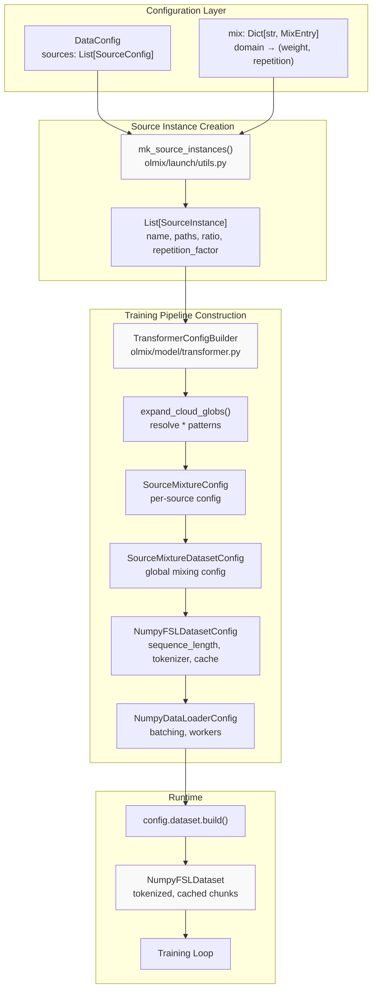
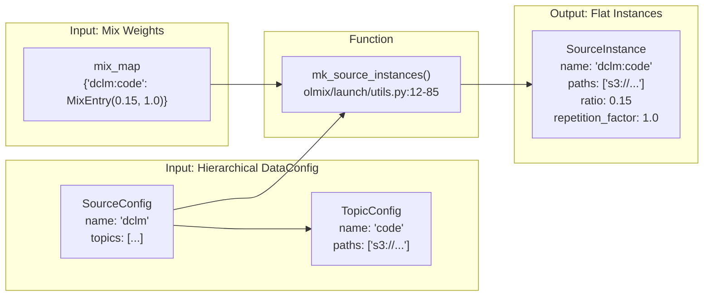
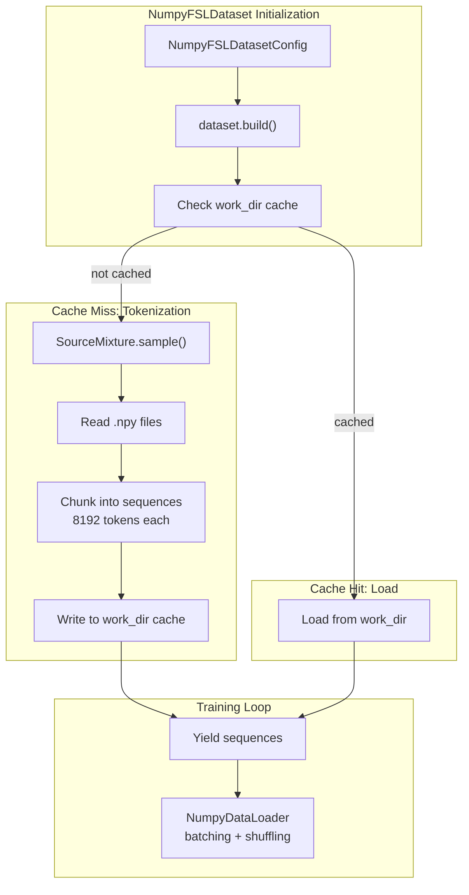
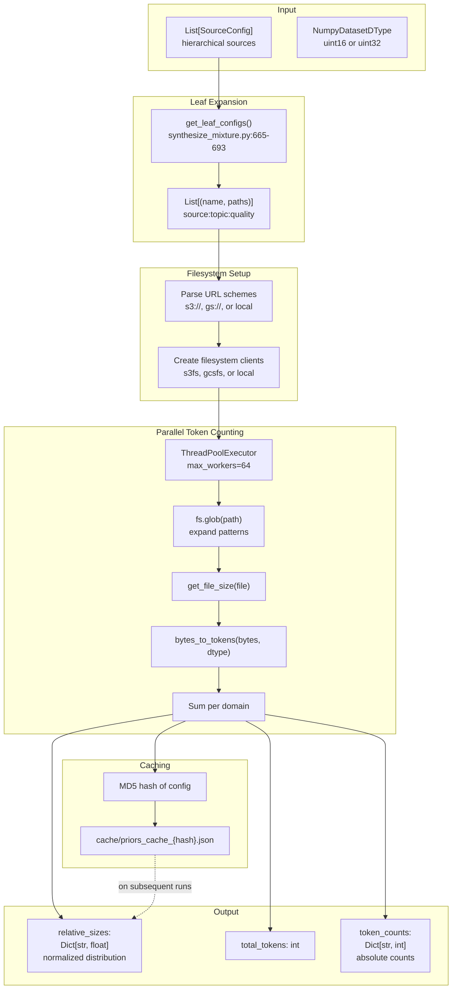
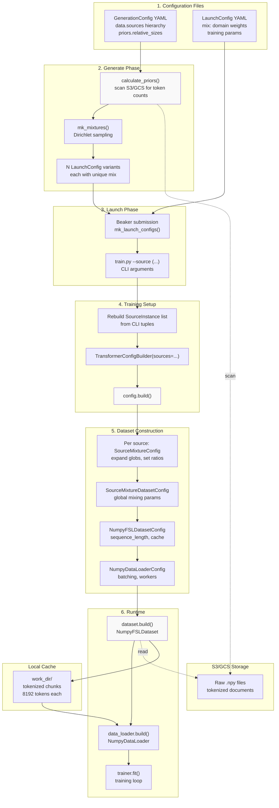

<!-- source: DeepWiki mcp.deepwiki.com · repo allenai/olmix · page 5.3 Data Pipeline · fetched 2026-10-26 -->

# Data Pipeline

<details>
<summary>Relevant source files</summary>

The following files were used as context for generating this wiki page:

- [olmix/aliases.py](olmix/aliases.py)
- [olmix/cli.py](olmix/cli.py)
- [olmix/fit/__init__.py](olmix/fit/__init__.py)
- [olmix/generate/synthesize_mixture.py](olmix/generate/synthesize_mixture.py)
- [olmix/generate/utils.py](olmix/generate/utils.py)
- [olmix/launch/train.py](olmix/launch/train.py)
- [olmix/launch/utils.py](olmix/launch/utils.py)
- [olmix/model/__init__.py](olmix/model/__init__.py)
- [olmix/model/evaluators.py](olmix/model/evaluators.py)
- [olmix/model/transformer.py](olmix/model/transformer.py)

</details>


## Purpose and Scope

This page documents the data pipeline infrastructure in olmix, which transforms hierarchical data source configurations into training-ready datasets. The pipeline handles:

- Conversion from hierarchical `DataConfig` to flat `SourceInstance` lists based on mixture weights
- Glob pattern expansion for cloud storage paths (S3/GCS)
- Integration with olmo-core's `SourceMixtureConfig` for weighted data mixing
- Dataset construction with `NumpyFSLDataset` for tokenized, cached sequences
- Token counting for prior computation

For information about training infrastructure and Beaker integration, see [Beaker Integration](#5.1). For details on how Chinchilla scaling determines training parameters, see [TransformerConfigBuilder](#5.2). For evaluation metrics collected during training, see [Evaluation Tasks](#5.4).

---

## Overview: From Configuration to Dataset

The data pipeline transforms a hierarchical data configuration (sources → topics → quality levels → paths) into a flat list of weighted data sources, then constructs olmo-core data structures for training.



**Sources:** [olmix/launch/utils.py:12-85](), [olmix/model/transformer.py:366-401](), [olmix/aliases.py:123-127]()

---

## Source Instance Creation

The `mk_source_instances` function converts hierarchical `SourceConfig` structures into flat `SourceInstance` objects by applying mixture weights.

### Hierarchical to Flat Conversion

**Input:** 
- `sources`: List of `SourceConfig` with hierarchical structure (source/topic/quality)
- `mix_map`: Dictionary mapping domain keys to `MixEntry(weight, repetition_factor)`

**Output:**
- List of `SourceInstance` with non-zero weights

**Key behavior:**
- Handles three nesting patterns:
  - `source` → Simple source with direct paths
  - `source:topic` → Topics within sources
  - `source:topic:quality` → Quality buckets within topics
  - `source:quality` → Quality buckets at source level (no topics)
- Filters out zero-weight domains
- Preserves `repetition_factor` from mix for data upsampling



**Code structure:**

| Nesting Level | Domain Key Format | Code Reference |
|---------------|-------------------|----------------|
| Source only | `source` | [olmix/launch/utils.py:72-83]() |
| Source + Topic | `source:topic` | [olmix/launch/utils.py:44-56]() |
| Source + Quality | `source:quality` | [olmix/launch/utils.py:58-70]() |
| Source + Topic + Quality | `source:topic:quality` | [olmix/launch/utils.py:28-42]() |

**Sources:** [olmix/launch/utils.py:12-85](), [olmix/aliases.py:123-127]()

---

## Glob Expansion

Cloud storage paths containing glob patterns (`*`) are expanded to concrete file lists before training.

### expand_cloud_globs Function

The `expand_cloud_globs` function resolves S3 and GCS glob patterns into explicit file paths. This expansion happens in the `TransformerConfigBuilder.build()` method when constructing `SourceMixtureConfig` objects.

```python
# From olmix/model/transformer.py:366-378
source_configs = SourceMixtureList(sources=[])
for source in self.sources:
    globs = [p for p in source.paths if "*" in p]
    paths = [p for p in source.paths if "*" not in p]
    source_configs.sources.append(
        SourceMixtureConfig(
            source_name=source.name,
            paths=paths + expand_cloud_globs(globs),
            target_ratio=source.ratio,
            max_repetition_ratio=source.repetition_factor,
        )
    )
```

**Expansion behavior:**
- **S3 paths:** Uses `s3fs` to list matching files
- **GCS paths:** Uses `gcsfs` to list matching files
- **Local paths:** Uses Python `glob` module
- **No-op:** Non-glob paths are passed through unchanged

**Common patterns:**
- `s3://bucket/data/train/*.npy` → Expands to all `.npy` files in directory
- `s3://bucket/data/shard-{000..999}.npy` → Brace expansion (if supported by filesystem)

**Sources:** [olmix/model/transformer.py:366-378](), [olmix/utils/cloud.py]()

---

## SourceMixtureConfig: Weighted Data Mixing

The `SourceMixtureConfig` system (from olmo-core) implements weighted sampling across multiple data sources with optional repetition.

### Configuration Hierarchy

```mermaid
graph TB
    subgraph "Per-Source Configuration"
        SMC["SourceMixtureConfig<br/>(olmo-core)"]
        SMC --> Name["source_name: str"]
        SMC --> Paths["paths: List[str]<br/>expanded file paths"]
        SMC --> Ratio["target_ratio: float<br/>sampling weight"]
        SMC --> Rep["max_repetition_ratio: float<br/>upsampling limit"]
    end
    
    subgraph "Global Mixture Configuration"
        SMDC["SourceMixtureDatasetConfig<br/>(olmo-core)"]
        SMDC --> SList["source_list: SourceMixtureList<br/>all sources"]
        SMDC --> Tokens["requested_tokens: int<br/>total training tokens"]
        SMDC --> GBS["global_batch_size: int<br/>batch size in tokens"]
        SMDC --> Seed["seed: int<br/>shuffling seed"]
        SMDC --> Procs["processes: int<br/>multiprocessing workers"]
    end
    
    SMC --> SList
    
    subgraph "Dataset Configuration"
        NFSL["NumpyFSLDatasetConfig<br/>(olmo-core)"]
        NFSL --> SMDC2["source_mixture_config:<br/>SourceMixtureDatasetConfig"]
        NFSL --> SeqLen["sequence_length: int<br/>8192 tokens"]
        NFSL --> Tok["tokenizer: TokenizerConfig"]
        NFSL --> Work["work_dir: str<br/>cache location"]
    end
    
    SMDC --> SMDC2
```



### Built in TransformerConfigBuilder

The `TransformerConfigBuilder.build()` method constructs this hierarchy:

```python
# From olmix/model/transformer.py:366-393
# 1. Create per-source configs
source_configs = SourceMixtureList(sources=[])
for source in self.sources:
    globs = [p for p in source.paths if "*" in p]
    paths = [p for p in source.paths if "*" not in p]
    source_configs.sources.append(
        SourceMixtureConfig(
            source_name=source.name,
            paths=paths + expand_cloud_globs(globs),
            target_ratio=source.ratio,
            max_repetition_ratio=source.repetition_factor,
        )
    )

# 2. Create global mixture config
mixture_config = SourceMixtureDatasetConfig(
    source_list=source_configs,
    requested_tokens=max_tokens,
    global_batch_size=batch_size_in_tokens,
    seed=self.seed,
    processes=min(os.cpu_count() or 1, 16),
)

# 3. Create dataset config
dataset_config = NumpyFSLDatasetConfig(
    source_mixture_config=mixture_config,
    sequence_length=self.sequence_length,
    tokenizer=tokenizer,
    work_dir=self.work_dir,
)
```

**Key parameters:**

| Parameter | Value | Description |
|-----------|-------|-------------|
| `requested_tokens` | `max_tokens` from Chinchilla | Total tokens to train for |
| `global_batch_size` | `batch_size * sequence_length` | Batch size in tokens (not sequences) |
| `processes` | `min(cpu_count, 16)` | Multiprocessing workers for sampling |
| `sequence_length` | `8192` | Fixed sequence length (FSL) |
| `work_dir` | `/tmp/.../dataset-cache` | Cache directory for tokenized chunks |

**Sources:** [olmix/model/transformer.py:366-393](), [olmo-core data module]()

---

## NumpyFSLDataset: Fixed Sequence Length Dataset

The `NumpyFSLDataset` (from olmo-core) provides tokenized sequences with caching for efficient training.

### Dataset Characteristics

- **Format:** Numpy arrays (`.npy` files) of token IDs
- **Sequence length:** Fixed at 8192 tokens
- **Dtype:** Configurable (`uint16` or `uint32`), specified in `DataConfig.dtype`
- **Caching:** Tokenized chunks are cached in `work_dir` to avoid re-processing
- **Mixing:** Weighted sampling across sources based on `target_ratio`
- **Repetition:** Sources can be oversampled up to `max_repetition_ratio`

### Cache Directory Structure

The `work_dir` parameter determines where cached tokenized data is stored:

**Cluster-specific locations:**

| Cluster Type | work_dir Path | Description |
|--------------|---------------|-------------|
| **Augusta (GCS)** | `/tmp/{user}/{run}/dataset-cache` | Local temp (GCS root for checkpoints) |
| **Jupiter/Saturn/etc + Weka** | `/weka/oe-training-default/ai2-llm/{user}/{run}/dataset-cache` | Weka bucket for shared access |
| **Default (S3)** | `/tmp/{run}/{user}/dataset-cache` | Local temp |

**Cache benefits:**
- Avoids re-tokenizing data on every epoch
- Enables fast restart from checkpoints
- Shared cache in Weka allows multiple nodes to reuse work



**Sources:** [olmix/model/transformer.py:388-393](), [olmix/model/transformer.py:196-212]()

---

## Token Counting for Priors

The `calculate_priors` function scans cloud storage paths to count tokens for each data source, producing the token distributions used in mixture sampling.

### Token Counting Process



### Function Signature

```python
# From olmix/generate/synthesize_mixture.py:696-698
def calculate_priors(
    source_configs: list[SourceConfig], 
    dtype: NumpyDatasetDType, 
    use_cache: bool
) -> tuple[dict[str, float], int, dict[str, int]]:
```

**Returns:**
1. `relative_sizes`: Dict mapping domain keys to normalized proportions (sum to 1.0)
2. `total_tokens`: Total token count across all sources
3. `token_counts`: Dict mapping domain keys to absolute token counts

### Bytes to Tokens Conversion

```python
# From olmix/generate/synthesize_mixture.py:643-652
def _bytes_to_tokens(num_bytes: int, dtype: NumpyDatasetDType) -> int:
    """Convert bytes to tokens based on the dtype."""
    npdtype = dtype.as_np_dtype()
    return num_bytes // npdtype(0).itemsize
```

**Token calculation:**
- **uint16:** 2 bytes per token → `tokens = bytes / 2`
- **uint32:** 4 bytes per token → `tokens = bytes / 4`

### Cache Mechanism

The function caches results based on an MD5 hash of the source configuration:

```python
# From olmix/generate/synthesize_mixture.py:699-715
config_hash = hashlib.md5(
    json.dumps(
        [(sc.name, sc.paths) for sc in source_configs],
        sort_keys=True,
    ).encode("utf-8")
).hexdigest()

cache_path = pathlib.Path(f"cache/priors_cache_{config_hash}.json")
if use_cache:
    try:
        with open(cache_path) as f:
            obj = json.load(f)
            return (obj["relative_sizes"], obj["total_tokens"], obj["token_counts"])
    except FileNotFoundError:
        # Calculate from source files...
```

**Cache invalidation:** Changing source names, paths, or their order invalidates the cache.

**Sources:** [olmix/generate/synthesize_mixture.py:696-762](), [olmix/cli.py:408-436]()

---

## Data Loader Configuration

The `NumpyDataLoaderConfig` wraps the dataset with batching and shuffling logic.

```python
# From olmix/model/transformer.py:395-400
data_loader_config = NumpyDataLoaderConfig(
    global_batch_size=batch_size_in_tokens,
    work_dir=self.work_dir,
    seed=self.seed,
    num_workers=4,
)
```

**Key parameters:**

| Parameter | Value | Purpose |
|-----------|-------|---------|
| `global_batch_size` | `batch_size * 8192` | Total tokens per global batch |
| `work_dir` | Same as dataset | Shared cache directory |
| `seed` | From TrainingConfig | Reproducible shuffling |
| `num_workers` | `4` | DataLoader worker processes |

**Runtime instantiation:**

```python
# From olmix/launch/train.py:222-227
dataset = config.dataset.build()
data_loader = config.data_loader.build(
    dataset, 
    dp_process_group=train_module.dp_process_group
)
trainer = config.trainer.build(train_module, data_loader)
```

**Sources:** [olmix/model/transformer.py:395-400](), [olmix/launch/train.py:222-227]()

---

## Complete Data Flow

This diagram shows the end-to-end transformation from configuration files to training batches.



**Phase-by-phase breakdown:**

1. **Configuration:** User writes GenerationConfig (data sources) and base LaunchConfig
2. **Generate:** `calculate_priors` scans storage to count tokens, `mk_mixtures` samples weights
3. **Launch:** Variants are submitted to Beaker with mixture weights embedded
4. **Training Setup:** `train.py` receives sources as CLI args, passes to `TransformerConfigBuilder`
5. **Dataset Construction:** Builder creates olmo-core configs with glob expansion and mixing
6. **Runtime:** Configs are built into live objects, data is loaded from cache or storage

**Sources:** [olmix/cli.py:112-165](), [olmix/launch/train.py:177-227](), [olmix/model/transformer.py:350-443]()

---

## CLI Integration: olmix priors compute

The `olmix priors compute` command wraps `calculate_priors` for standalone use.

```bash
olmix priors compute --config generation_config.yaml --output priors.yaml
```

**Behavior:**
- Extracts `data` section from any config type (GenerationConfig, LaunchConfig, etc.)
- Calls `calculate_priors` with the sources and dtype
- Outputs a YAML file with `priors.relative_sizes` and `priors.token_counts`
- Can disable cache with `--no-cache` flag

**Output format:**

```yaml
priors:
  relative_sizes:
    dclm:code: 0.15
    dclm:math: 0.10
    wikipedia: 0.05
    ...
  token_counts:
    dclm:code: 15000000000
    dclm:math: 10000000000
    wikipedia: 5000000000
    ...
```

This output can be copy-pasted into a GenerationConfig to freeze the priors.

**Sources:** [olmix/cli.py:408-436](), [olmix/generate/synthesize_mixture.py:696-762]()

---

## Instance Filtering

The `InstanceFilterConfig` (optional in `TrainingConfig`) can filter out repetitive sequences at the instance level.

```python
# From olmix/aliases.py:130-135
class InstanceFilterConfig(BaseModel):
    """Config for filtering repetitive sequences at the instance level."""
    repetition_min_period: int = 1
    repetition_max_period: int = 13
    repetition_max_count: int = 32
```

**Purpose:** Remove low-quality data with repetitive patterns (e.g., `"the the the the"`).

**Integration:** If `TrainingConfig.instance_filter` is set, olmo-core applies these filters when loading sequences from the dataset.

**Sources:** [olmix/aliases.py:130-167]()

---

## Summary: Key Classes and Functions

| Component | Module | Purpose |
|-----------|--------|---------|
| `mk_source_instances` | [olmix/launch/utils.py:12-85]() | Convert hierarchical configs to flat instances |
| `expand_cloud_globs` | [olmix/utils/cloud.py]() | Resolve glob patterns to file lists |
| `SourceMixtureConfig` | [olmo-core]() | Per-source configuration with weights |
| `SourceMixtureDatasetConfig` | [olmo-core]() | Global mixing configuration |
| `NumpyFSLDatasetConfig` | [olmo-core]() | Fixed-length dataset with caching |
| `NumpyDataLoaderConfig` | [olmo-core]() | DataLoader with batching and shuffling |
| `calculate_priors` | [olmix/generate/synthesize_mixture.py:696-762]() | Scan storage and count tokens |
| `TransformerConfigBuilder.build` | [olmix/model/transformer.py:350-443]() | Orchestrates dataset construction |

**Sources:** [olmix/model/transformer.py](), [olmix/launch/utils.py](), [olmix/generate/synthesize_mixture.py](), [olmix/aliases.py]()

---

