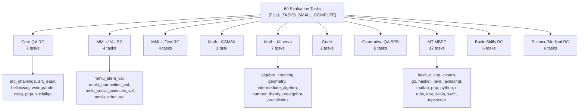
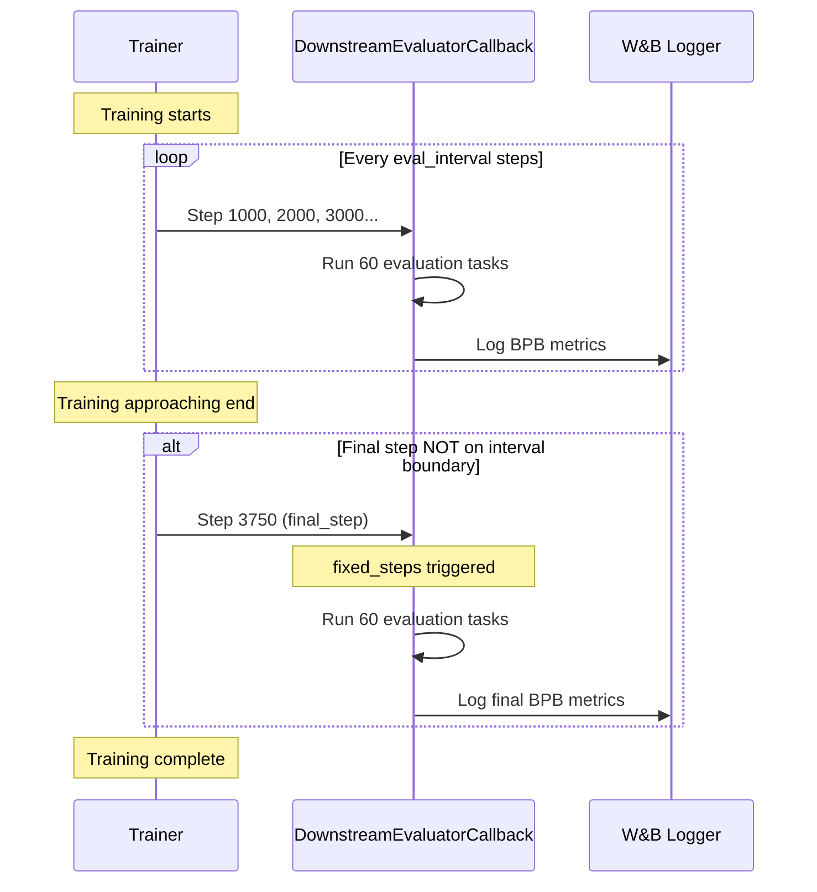

<!-- source: DeepWiki mcp.deepwiki.com · repo allenai/olmix · page 5.4 Evaluation Tasks · fetched 2026-10-26 -->

# Evaluation Tasks

<details>
<summary>Relevant source files</summary>

The following files were used as context for generating this wiki page:

- [olmix/fit/__init__.py](olmix/fit/__init__.py)
- [olmix/launch/train.py](olmix/launch/train.py)
- [olmix/model/__init__.py](olmix/model/__init__.py)
- [olmix/model/evaluators.py](olmix/model/evaluators.py)
- [olmix/model/transformer.py](olmix/model/transformer.py)
- [plans/011_reorganize_experiment_configs.md](plans/011_reorganize_experiment_configs.md)
- [plans/012_quality_threshold_experiments.md](plans/012_quality_threshold_experiments.md)
- [plans/013_align_wandb_metrics_with_olmo_core.md](plans/013_align_wandb_metrics_with_olmo_core.md)

</details>


This document describes the 60 evaluation tasks used to measure model performance during olmix training runs. These tasks are logged as Bits Per Byte (BPB) metrics to W&B and provide comprehensive coverage across reasoning, mathematics, code, and scientific domains.

For information about how training runs are configured and executed, see [Training Infrastructure](#5). For details on the regression models that use these metrics for optimization, see [Regression Models](#4.1).

---

## Overview

olmix evaluates proxy models using **60 downstream tasks** during training, logging results as BPB (Bits Per Byte) metrics to W&B. These tasks are aligned with olmo-core's `FULL_TASKS_SMALL_COMPUTE` task group, excluding only the `copycolors` sanity check task.

BPB metrics measure the negative log-likelihood of the correct answer normalized by the number of bytes, providing a scale-invariant performance measure. Lower BPB values indicate better performance.

**Key characteristics:**
- **60 tasks total** across 10 categories
- **BPB v2 format** logged to W&B during training
- **Synchronized with olmo-core** for consistency
- **Configurable evaluation interval** (default: every 1000 steps)
- **End-of-training evaluation** automatically added

Sources: [plans/013_align_wandb_metrics_with_olmo_core.md:1-10](), [olmix/model/transformer.py:133-134]()

---

## Task Categories

The 60 evaluation tasks are organized into 10 categories based on capability:

| Category | Count | Description |
|----------|-------|-------------|
| **Core QA RC** | 7 | Multiple-choice reading comprehension: ARC, HellaSwag, Winogrande, CSQA, PIQA, SocialIQA |
| **MMLU Val RC** | 4 | MMLU validation splits across 4 domains: STEM, humanities, social sciences, other |
| **MMLU Test RC** | 4 | MMLU test splits across 4 domains: STEM, humanities, social sciences, other |
| **Math - GSM8K** | 1 | Grade school math word problems with numerical answers |
| **Math - Minerva** | 7 | Advanced mathematics across 7 subdomains: algebra, counting, geometry, intermediate algebra, number theory, prealgebra, precalculus |
| **Code** | 2 | Code generation: HumanEval (Python) and MBPP (Python) |
| **Generative QA BPB** | 6 | Open-ended question answering: CoQA, DROP, Jeopardy, LAMBADA, NaturalQS, SQuAD |
| **MT MBPP** | 17 | Multi-lingual code generation across 17 programming languages |
| **Basic Skills RC** | 6 | Fundamental capabilities: arithmetic, coding, common knowledge, logical reasoning, pattern matching, string operations |
| **Science/Medical RC** | 6 | Domain-specific knowledge: LabBench (2 tasks), MedMCQA, MedQA, QASPER, SciRIFF |

**Total: 60 tasks**

### Task Category Diagram



Sources: [plans/013_align_wandb_metrics_with_olmo_core.md:27-117]()

---

## WandBMetrics Enum

The `WandBMetrics` enum in [olmix/fit/constants.py]() maps W&B metric names to their task identifiers. Each enum member's value is the exact W&B metric key logged during training.

**Naming convention:** `eval/downstream/{task_name} (BPB v2)`

Example mappings:
```python
class WandbMetrics(Enum):
    # Core QA RC (7)
    arc_challenge_bpb = "eval/downstream/arc_challenge_test_rc_5shot (BPB v2)"
    arc_easy_bpb = "eval/downstream/arc_easy_test_rc_5shot (BPB v2)"
    
    # MMLU Val RC (4)
    mmlu_stem_val_bpb = "eval/downstream/mmlu_stem_val_rc_5shot (BPB v2)"
    
    # Math - Minerva (7)
    minerva_algebra_bpb = "eval/downstream/minerva_math_algebra_gold_bpb_0shot (BPB v2)"
    
    # Code (2) - Note: 3shot, not 0shot
    codex_humaneval_bpb = "eval/downstream/codex_humaneval_gold_bpb_3shot (BPB v2)"
    
    # MT MBPP - All 17 languages (17)
    mt_mbpp_python_bpb = "eval/downstream/mt_mbpp_python_gold_bpb_3shot (BPB v2)"
    # ... 16 more languages
```

**Shot counts vary by task:**
- **0-shot:** Minerva math tasks, CoQA, LAMBADA
- **3-shot:** Code tasks (HumanEval, MBPP, MT MBPP), LabBench
- **5-shot:** Most RC tasks, GSM8K, DROP, generative QA

Sources: [plans/013_align_wandb_metrics_with_olmo_core.md:27-115]()

---

## DEFAULT_EVAL_TASKS Configuration

The `DEFAULT_EVAL_TASKS` list is imported from olmo-core and used when no explicit evaluation tasks are specified.

**Definition in [olmix/model/evaluators.py]():**
```python
from olmo_core.eval.task_groups import FULL_TASKS_SMALL_COMPUTE

# Use olmo-core's task list, excluding copycolors sanity check (60 tasks)
DEFAULT_EVAL_TASKS: list[str] = [t for t in FULL_TASKS_SMALL_COMPUTE if "copycolors" not in t]
```

**Synchronization guarantee:** By importing directly from olmo-core, olmix stays aligned with the canonical task definitions. The only modification is excluding `copycolors`, which is a synthetic sanity check task not needed for mixture optimization.

Sources: [plans/013_align_wandb_metrics_with_olmo_core.md:136-147](), [olmix/model/transformer.py:133]()

---

## Evaluation Configuration Flow

### From LaunchConfig to Evaluation

```mermaid
graph LR
    LaunchConfig["LaunchConfig YAML"]
    TrainCmd["olmix launch train command"]
    TCB["TransformerConfigBuilder"]
    Callbacks["build_callbacks()"]
    DownstreamEval["DownstreamEvaluatorCallbackConfig"]
    WandB["W&B Logging<br/>60 BPB metrics"]
    
    LaunchConfig -->|"eval_tasks (optional)<br/>eval_interval"| TrainCmd
    TrainCmd -->|"--eval-task (multiple)<br/>--eval-interval<br/>--no-eval"| TCB
    TCB -->|"eval_tasks: list[str] | None<br/>eval_interval: int"| Callbacks
    Callbacks -->|"tasks, tokenizer,<br/>eval_interval, fixed_steps"| DownstreamEval
    DownstreamEval --> WandB
```



### Configuration Resolution Logic

The `TransformerConfigBuilder.__init__` determines which tasks to evaluate:

```python
# Default: None (uses DEFAULT_EVAL_TASKS)
eval_tasks: list[str] | None = None

# If explicitly provided, use those
if eval_tasks is not None:
    self.eval_tasks = eval_tasks
else:
    self.eval_tasks = []  # Will trigger DEFAULT_EVAL_TASKS in olmo-core
```

The CLI command [olmix/launch/train.py:191-201]() implements three modes:

| Mode | Command | Behavior |
|------|---------|----------|
| **Default** | _(no flags)_ | Uses `DEFAULT_EVAL_TASKS` (60 tasks) |
| **Custom** | `--eval-task task1 --eval-task task2` | Evaluates only specified tasks |
| **Disabled** | `--no-eval` | Empty list, no evaluation |

Sources: [olmix/model/transformer.py:133-172](), [olmix/launch/train.py:136-201]()

---

## Evaluation Timing and Callbacks

### Evaluation Intervals

The `DownstreamEvaluatorCallbackConfig` is created in [olmix/model/transformer.py:328-346]():

```python
callbacks["downstream_evaluator"] = DownstreamEvaluatorCallbackConfig(
    tasks=self.eval_tasks,
    tokenizer=self.tokenizer,
    eval_interval=self.eval_interval,  # Default: 1000 steps
    fixed_steps=fixed_steps,           # End-of-training eval if needed
)
```

**Key timing parameters:**

| Parameter | Default | Description |
|-----------|---------|-------------|
| `eval_interval` | 1000 | Steps between regular evaluations |
| `fixed_steps` | `[final_step]` | Additional evaluation at training end (if not on boundary) |

### End-of-Training Evaluation

The `build_callbacks` method [olmix/model/transformer.py:304-348]() ensures evaluation happens at the final training step:

```python
final_step = max_tokens // batch_size_in_tokens

# Only add final_step if it's not already on an eval_interval boundary
if final_step % self.eval_interval != 0:
    fixed_steps = [final_step]
```

This guarantees that every training run logs evaluation metrics at completion, even if the final step doesn't align with the regular interval.

### Evaluation Timing Diagram



Sources: [olmix/model/transformer.py:304-348](), [olmix/model/transformer.py:432-433]()

---

## Disabling Evaluation

Evaluation can be disabled in two ways:

### 1. Command-Line Flag

```bash
olmix launch train --no-eval --config my_config.yaml
```

This sets `eval_tasks = []`, which prevents `DownstreamEvaluatorCallbackConfig` from being added to the trainer.

### 2. Empty Task List in Configuration

When building `TransformerConfigBuilder` programmatically:

```python
builder = TransformerConfigBuilder(
    # ... other params
    eval_tasks=[],  # Empty list disables evaluation
)
```

**Why disable evaluation?**
- **Speed testing:** Measure pure training throughput without eval overhead
- **Debugging:** Isolate training issues from evaluation issues
- **Quick iteration:** Skip eval during early experiment setup

Sources: [olmix/launch/train.py:150-201](), [olmix/model/transformer.py:328-346]()

---

## Task Names and Identifiers

### olmo-core Task Naming

Tasks in olmo-core use snake_case identifiers without the `eval/downstream/` prefix or `(BPB v2)` suffix:

```python
# olmo-core format (used in DEFAULT_EVAL_TASKS)
"arc_challenge_test_rc_5shot"
"mmlu_stem_val_rc_5shot"
"codex_humaneval_gold_bpb_3shot"
```

### W&B Metric Naming

W&B metrics logged during training include the full path and format indicator:

```python
# W&B format (used in WandBMetrics enum)
"eval/downstream/arc_challenge_test_rc_5shot (BPB v2)"
"eval/downstream/mmlu_stem_val_rc_5shot (BPB v2)"
"eval/downstream/codex_humaneval_gold_bpb_3shot (BPB v2)"
```

### Mapping Between Systems

```mermaid
graph LR
    OlmoCore["olmo-core<br/>FULL_TASKS_SMALL_COMPUTE"]
    DEFAULT["DEFAULT_EVAL_TASKS<br/>61 tasks"]
    Filtered["Filtered List<br/>60 tasks<br/>(excludes copycolors)"]
    Config["TransformerConfigBuilder<br/>eval_tasks parameter"]
    Callback["DownstreamEvaluatorCallback<br/>runs evaluations"]
    WandB["W&B Metrics<br/>eval/downstream/... (BPB v2)"]
    Enum["WandBMetrics enum<br/>for regression fitting"]
    
    OlmoCore -->|"import"| DEFAULT
    DEFAULT -->|"filter 'copycolors'"| Filtered
    Filtered -->|"default value"| Config
    Config -->|"tasks list"| Callback
    Callback -->|"logs with prefix/suffix"| WandB
    WandB -->|"exact string match"| Enum
```



Sources: [plans/013_align_wandb_metrics_with_olmo_core.md:136-147](), [olmix/model/transformer.py:328-346]()

---

## Integration with Regression and Fitting

The `WandBMetrics` enum serves as the bridge between training evaluation and mixture optimization:

1. **During Training:** Tasks are evaluated and logged to W&B with full metric names
2. **CSV Export:** Metrics are exported to `metrics.csv` using the W&B keys
3. **Regression Fitting:** [olmix/fit/core.py]() loads metrics and builds predictive models
4. **Optimization:** Proposers use regression models to predict performance for new mixtures

See [Regression Models](#4.1) for details on how these metrics are used in optimization.

Sources: [plans/013_align_wandb_metrics_with_olmo_core.md:1-10]()

---

## Summary Table

| Aspect | Details |
|--------|---------|
| **Task Count** | 60 (excluding copycolors sanity check) |
| **Source** | olmo-core's `FULL_TASKS_SMALL_COMPUTE` |
| **Metric Format** | BPB v2 (Bits Per Byte, lower is better) |
| **Default Interval** | Every 1000 training steps |
| **End-of-Training** | Automatic evaluation at final step |
| **Configuration** | `eval_tasks` (list), `eval_interval` (int), `--no-eval` (flag) |
| **W&B Logging** | `eval/downstream/{task_name} (BPB v2)` |
| **Enum Mapping** | `WandBMetrics` in [olmix/fit/constants.py]() |

Sources: [plans/013_align_wandb_metrics_with_olmo_core.md:1-180](), [olmix/model/transformer.py:133-346]()

---

