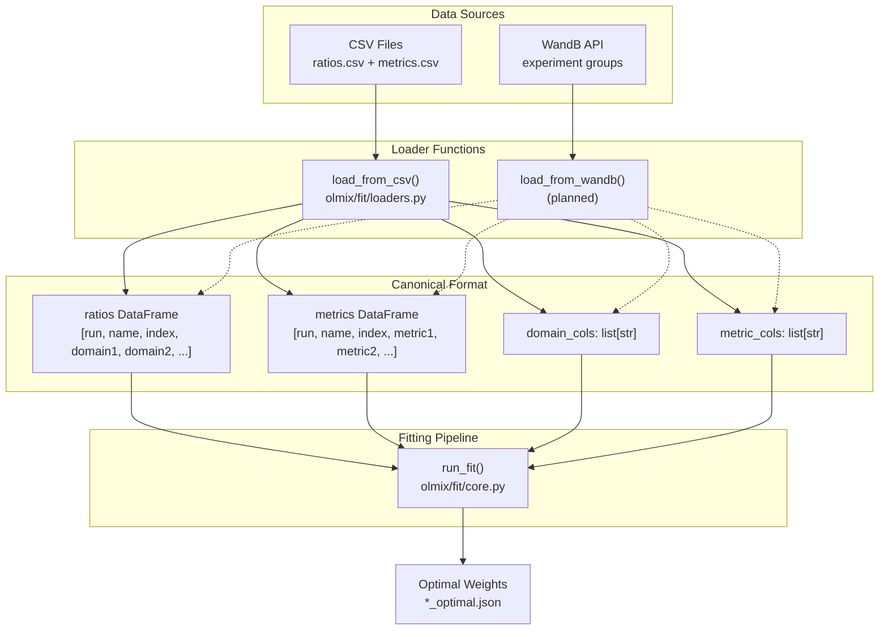
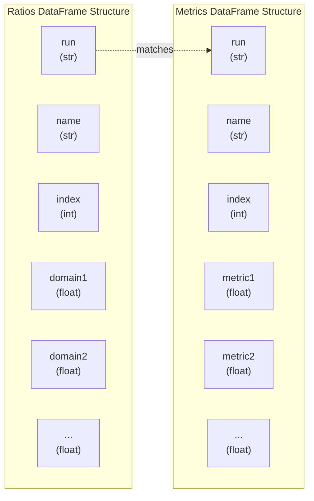
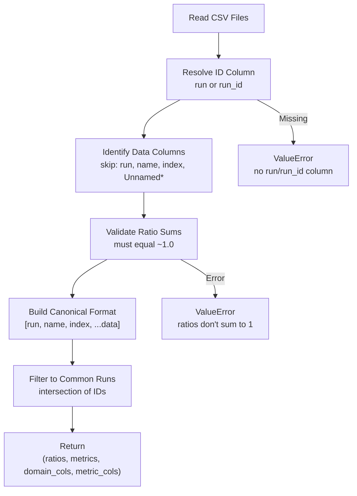
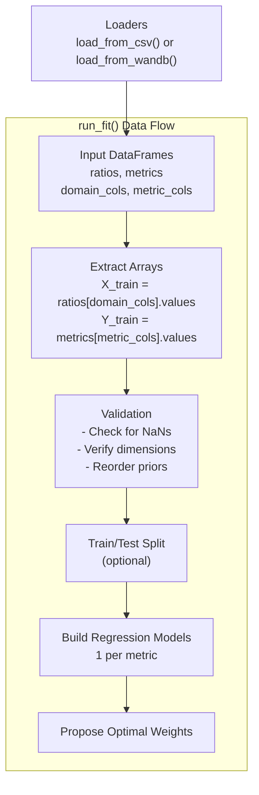

<!-- source: DeepWiki mcp.deepwiki.com · repo allenai/olmix · page 6 Data Loading · fetched 2026-10-26 -->

# Data Loading

<details>
<summary>Relevant source files</summary>

The following files were used as context for generating this wiki page:

- [.gitignore](.gitignore)
- [olmix/fit/config.py](olmix/fit/config.py)
- [olmix/fit/core.py](olmix/fit/core.py)
- [olmix/fit/loaders.py](olmix/fit/loaders.py)
- [plans/016_refactor_fit_csv_support.md](plans/016_refactor_fit_csv_support.md)
- [uv.lock](uv.lock)

</details>


## Purpose and Scope

This page documents how experiment results are loaded into `olmix fit` for regression analysis and mixture optimization. After training proxy models (see [Training Infrastructure](#5)) and logging metrics to WandB, the fit pipeline requires two datasets: domain mixture ratios and evaluation metrics for each training run. These datasets can be loaded from two sources: exported CSV files or directly from the WandB API.

For detailed information on the regression and optimization algorithms that consume this data, see [Regression and Optimization](#4). For the complete fit pipeline orchestration, see [olmix fit](#2.3).

**Sources:** [olmix/fit/loaders.py:1-90](), [olmix/fit/core.py:1-443](), [plans/016_refactor_fit_csv_support.md:1-154]()

---

## Data Loading Architecture

The data loading system provides two independent paths for ingesting experiment results:

1. **CSV Path** (`load_from_csv`): Reads pre-exported `ratios.csv` and `metrics.csv` files from a local directory
2. **WandB Path** (not yet implemented in loaders.py): Queries the WandB API using experiment group IDs, with caching for performance

Both paths produce DataFrames in a canonical format consumed by `run_fit()` in [olmix/fit/core.py:65-443]().



**Diagram: Data Loading Pipeline**

The loaders transform raw data into a standardized format, enabling `run_fit()` to work identically regardless of data source.

**Sources:** [olmix/fit/loaders.py:1-90](), [olmix/fit/core.py:65-102]()

---

## Canonical DataFrame Structure

Both loading paths produce DataFrames with a consistent three-column metadata prefix followed by data columns:

| Column Position | Column Name | Description |
|-----------------|-------------|-------------|
| 0 | `run` | Unique identifier for each training run (string) |
| 1 | `name` | Human-readable run name (defaults to `run` if not provided) |
| 2 | `index` | Sequential integer index (0, 1, 2, ...) |
| 3+ | *data columns* | Domain weights (ratios) or metric values (metrics) |

**Ratios DataFrame** contains domain mixture weights:
- Each row represents one training run
- Each data column (position 3+) is a domain name (e.g., `dclm`, `wikipedia`, `arxiv`)
- Values are floats in [0, 1] that sum to ~1.0 per row

**Metrics DataFrame** contains evaluation results:
- Each row corresponds to a training run (matched by `run` column)
- Each data column (position 3+) is a metric name (e.g., `arc_challenge_bpb`, `hellaswag_bpb`)
- Values are floats representing bits-per-byte or other evaluation scores



**Diagram: Canonical DataFrame Format**

The `run` column acts as a join key between ratios and metrics, ensuring each training run's mixture is paired with its evaluation results.

**Sources:** [olmix/fit/loaders.py:56-72]()

---

## Loading from CSV Files

The `load_from_csv()` function in [olmix/fit/loaders.py:14-81]() provides local file-based data loading.

### Function Signature

```python
def load_from_csv(
    ratios_path: str,
    metrics_path: str,
) -> tuple[pd.DataFrame, pd.DataFrame, list[str], list[str]]
```

Returns:
- `ratios`: DataFrame with domain mixture weights
- `metrics`: DataFrame with evaluation results
- `domain_cols`: List of domain column names (for indexing into `ratios`)
- `metric_cols`: List of metric column names (for indexing into `metrics`)

### CSV File Format

**ratios.csv** must contain:
- An ID column: `run` or `run_id` (first one found is used)
- Optional `name` column (defaults to ID if absent)
- Domain weight columns (any names, e.g., `dclm`, `wikipedia`, `arxiv`)

**metrics.csv** must contain:
- An ID column: `run` or `run_id` (matched with ratios)
- Optional `name` column
- Metric value columns (any names, e.g., `arc_challenge_bpb`, `hellaswag_bpb`)

Example `ratios.csv`:
```csv
run_id,dclm,wikipedia,arxiv,s2pdf
run_001,0.45,0.30,0.15,0.10
run_002,0.60,0.20,0.10,0.10
```

Example `metrics.csv`:
```csv
run_id,arc_challenge_bpb,hellaswag_bpb,mmlu_stem_bpb
run_001,1.23,0.87,1.45
run_002,1.15,0.91,1.38
```

### Validation Logic

The loader performs several validation checks at [olmix/fit/loaders.py:35-77]():

1. **ID Column Resolution** ([loaders.py:38-40]()): Accepts either `run` or `run_id`, preferring `run`
2. **Column Identification** ([loaders.py:43-45]()): Separates metadata columns from data columns
3. **Ratio Sum Validation** ([loaders.py:47-53]()): Ensures domain weights sum to ~1.0 (±0.01 tolerance)
4. **Common Runs Filtering** ([loaders.py:73-76]()): Keeps only runs present in both CSVs



**Diagram: CSV Validation Pipeline**

**Sources:** [olmix/fit/loaders.py:14-81]()

---

## Loading from WandB

The WandB loading path is designed to query experiment groups directly from the WandB API, fetching run metadata, mixture configurations, and logged metrics. This functionality is currently implemented in [olmix/fit/cli.py]() but is planned to be extracted to `load_from_wandb()` in [olmix/fit/loaders.py]() (see [plans/016_refactor_fit_csv_support.md:33-43]()).

### Planned Interface

```python
def load_from_wandb(
    launch_output_dir: str,
    workspace: str = "ai2/olmix",
    use_cache: bool = True,
    # ... additional WandB API options
) -> tuple[pd.DataFrame, pd.DataFrame, list[str], list[str], list[LaunchConfig]]
```

The function will:
1. Read `metadata.json` from the launch output directory
2. Extract `group_id` from `metadata["metadata"]["group_id"]`
3. Reconstruct `LaunchConfig` objects from `metadata["config"]`
4. Initialize WandB API and fetch runs by group ID
5. Build ratios and metrics DataFrames from run data
6. Cache results as pickle files for faster subsequent loads

For details on this implementation, see [Loading from WandB](#6.1).

**Sources:** [plans/016_refactor_fit_csv_support.md:36-43]()

---

## Integration with run_fit()

The `run_fit()` function in [olmix/fit/core.py:65-443]() consumes the loaded data and orchestrates the complete regression and optimization pipeline.

### Input Parameters

```python
def run_fit(
    ratios: pd.DataFrame,
    metrics: pd.DataFrame,
    priors: tuple,
    original_priors: tuple,
    output_dir: str,
    *,
    domain_cols: list[str],
    metric_cols: list[str],
    eval_metrics: list[str] | None = None,
    experiment_groups: list[str] | None = None,
    launch_configs: list[LaunchConfig] | None = None,
    # ... regression and proposer options
) -> None
```

Key inputs from loaders:
- `ratios`: Domain weights DataFrame
- `metrics`: Evaluation results DataFrame
- `domain_cols`: Ordered list of domain names (used to index `ratios` columns)
- `metric_cols`: Ordered list of metric names (used to index `metrics` columns)

### Data Extraction and Validation

At [core.py:183-237](), `run_fit()`:

1. **Extracts training data** ([core.py:183-186]()):
   ```python
   X_train = ratios[domain_cols].values
   Y_train = metrics[metric_cols].values
   ```

2. **Checks for missing values** ([core.py:159-163]()):
   - Drops rows with NaN metrics
   - Maintains synchronization between ratios and metrics

3. **Reorders priors** ([core.py:252-269]()):
   - Ensures prior distributions match the order of `domain_cols`
   - Raises errors if domains are missing

4. **Validates dimensions** ([core.py:156-157]()):
   - Ensures more runs than domains (prevents underdetermined systems)



**Diagram: Data Flow from Loaders to run_fit()**

**Sources:** [olmix/fit/core.py:65-269]()

---

## CLI Integration

The `olmix fit` command in [olmix/fit/cli.py]() orchestrates data loading based on user-specified flags:

- `--from-csv DIR`: Loads from local CSV files using `load_from_csv()`
- `--from-wandb DIR`: Loads from WandB using launch output directory (planned)

The CLI validates that exactly one data source is specified and passes loaded data to `run_fit()`. For complete CLI documentation, see [olmix fit](#2.3).

**Sources:** [olmix/fit/cli.py](), [plans/016_refactor_fit_csv_support.md:76-109]()

---

## Related Pages

- [olmix fit](#2.3) - CLI command documentation
- [Loading from WandB](#6.1) - Detailed WandB API interaction
- [Loading from CSV](#6.2) - Detailed CSV format specification
- [Regression and Optimization](#4) - How loaded data is used for fitting

---

