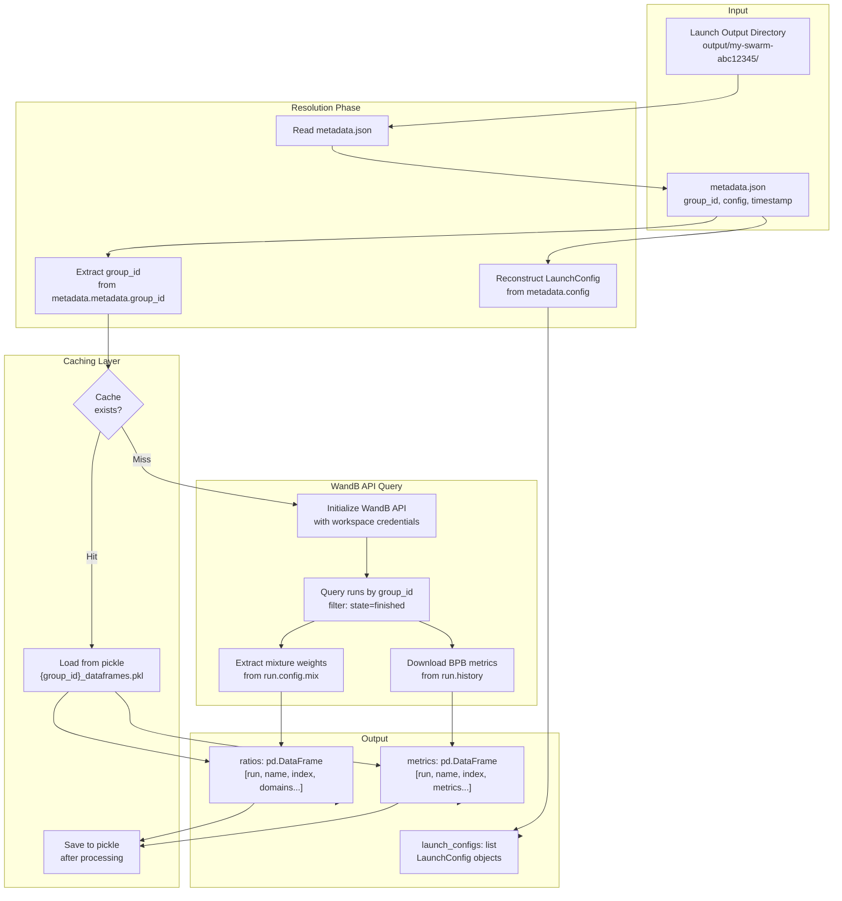
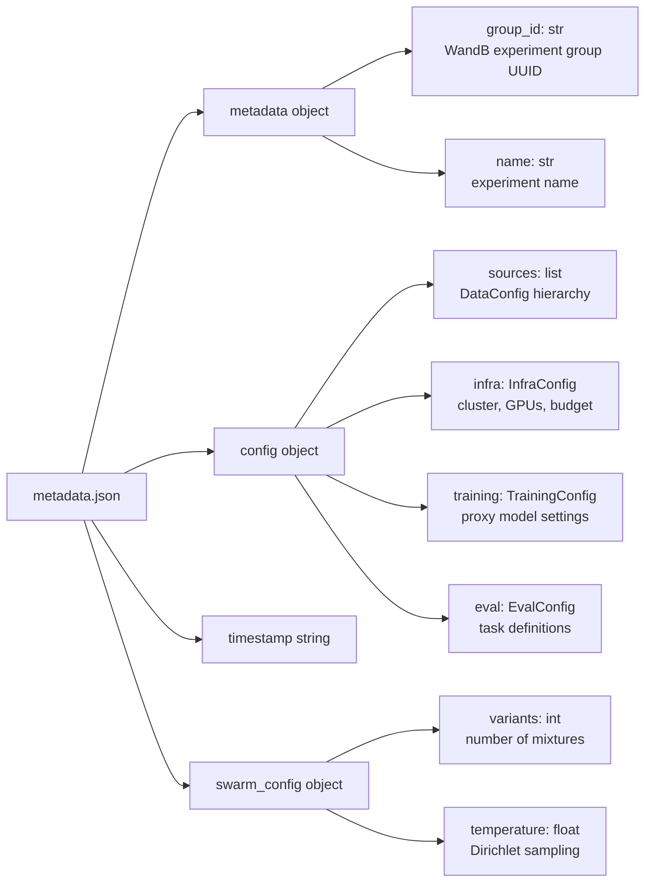
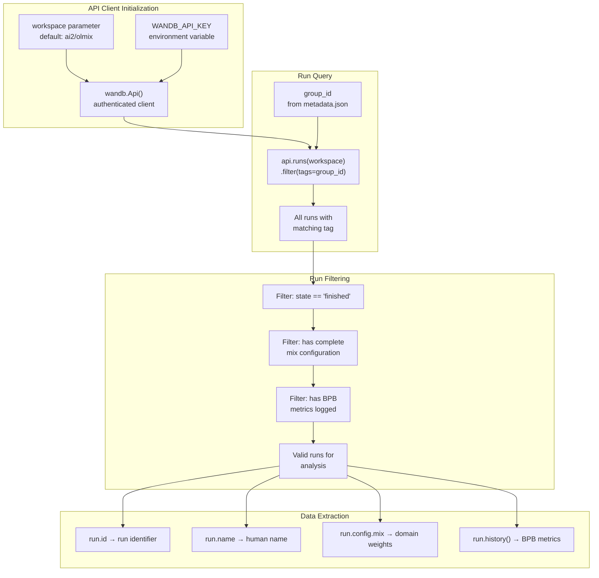
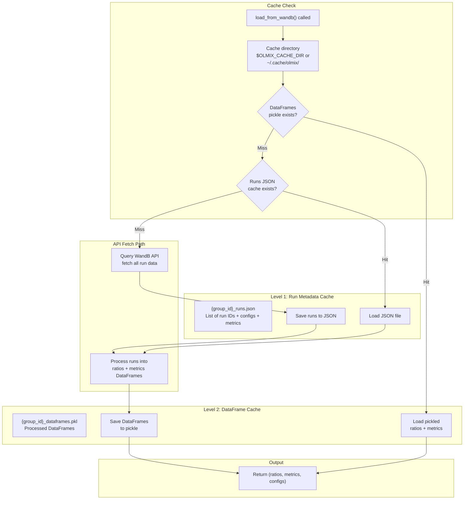
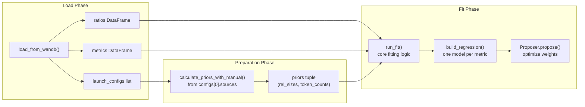

<!-- source: DeepWiki mcp.deepwiki.com · repo allenai/olmix · page 6.1 Loading from WandB · fetched 2026-10-26 -->

# Loading from WandB

<details>
<summary>Relevant source files</summary>

The following files were used as context for generating this wiki page:

- [.gitignore](.gitignore)
- [olmix/fit/loaders.py](olmix/fit/loaders.py)
- [plans/016_refactor_fit_csv_support.md](plans/016_refactor_fit_csv_support.md)
- [uv.lock](uv.lock)

</details>


## Purpose and Scope

This page documents how experiment results are loaded from Weights & Biases (WandB) for use in the `olmix fit` command. The WandB loader retrieves training metrics and mixture ratios from completed swarm experiments, enabling the regression and optimization pipeline. For loading from local CSV files instead, see [Loading from CSV](#6.2).

**Sources:** [plans/016_refactor_fit_csv_support.md:1-154]()

## Overview of the Loading Process

The WandB loading process follows this workflow:



**Sources:** [plans/016_refactor_fit_csv_support.md:33-43]()

## Metadata Resolution

### The metadata.json File

When `olmix launch` submits a swarm to Beaker, it creates a launch output directory containing `metadata.json`. This file serves as the single source of truth for resolving the WandB experiment group and reconstructing the original configuration.

**File location pattern:** `output/{experiment_name}-{group_id}/metadata.json`

**Structure:**



**Sources:** [plans/016_refactor_fit_csv_support.md:38-42]()

### Auto-Resolution from Launch Directory

The `load_from_wandb()` function accepts a path to the launch output directory and automatically:

1. Locates `metadata.json` in that directory
2. Extracts `group_id` from `metadata["metadata"]["group_id"]`
3. Reconstructs `LaunchConfig` objects from `metadata["config"]`
4. Uses the group ID to query WandB for associated runs

This eliminates the need for users to manually specify `--experiment-groups` or `--config` when using `--from-wandb`.

**Sources:** [plans/016_refactor_fit_csv_support.md:38-42]()

## WandB API Interaction

### Run Query and Filtering

The loader interacts with the WandB API to retrieve all runs associated with an experiment group:



**Sources:** [plans/016_refactor_fit_csv_support.md:38-42]()

### Mixture Weight Extraction

Each run's configuration stores the mixture weights used for training:

- **Location in run config:** `run.config["mix"]`
- **Format:** `{"domain1": weight1, "domain2": weight2, ...}`
- **Validation:** Weights must sum to approximately 1.0 (tolerance: ±0.01)

The loader extracts these weights and constructs the `ratios` DataFrame where each row represents one run's mixture.

**Sources:** [plans/016_refactor_fit_csv_support.md:38-42]()

### Evaluation Metrics Extraction

Metrics are retrieved from the run's logged history:

- **Metric set:** 60 BPB (bits-per-byte) evaluation tasks (see [Evaluation Tasks](#5.4))
- **Extraction method:** Final logged value for each metric
- **Metric naming:** Follows `WandBMetrics` enum conventions (e.g., `arc_challenge_bpb`, `hellaswag_bpb`)

The loader constructs the `metrics` DataFrame where each row contains all evaluation metrics for a single run.

**Sources:** Diagram 1 from high-level architecture, [olmix/fit/loaders.py:1-90]()

## Caching Strategy

The loader implements a two-level caching system to minimize redundant API calls during iterative fitting workflows:



### Cache Invalidation

| Trigger | Level 1 (JSON) | Level 2 (Pickle) |
|---------|----------------|------------------|
| `--no-cache` flag | Deleted before load | Deleted before load |
| Manual deletion | User removes file | User removes file |
| Group ID change | New cache key used | New cache key used |
| Runs still training | JSON reflects incomplete state | Pickle not created |

### Cache Location

Cache directory resolution priority:
1. `OLMIX_CACHE_DIR` environment variable (if set)
2. `~/.cache/olmix/` (default)

**Sources:** [plans/016_refactor_fit_csv_support.md:42-43]()

## DataFrame Structure

### Canonical Format

Both `ratios` and `metrics` DataFrames follow a canonical format that ensures compatibility with all regression and proposer implementations:

**Column layout:** `[run, name, index, ...data columns]`

| Column | Type | Description |
|--------|------|-------------|
| `run` | `str` | Unique run identifier (WandB run ID) |
| `name` | `str` | Human-readable run name (defaults to run ID if not available) |
| `index` | `int` | Sequential index (0 to N-1 for N runs) |
| Data columns | `float` | Domain weights (ratios) or metric values (metrics) |

### Ratios DataFrame Example

```
   run         name            index  dclm   wikipedia  arxiv  s2pdf
0  abc123      swarm-var-00    0      0.45   0.30       0.15   0.10
1  def456      swarm-var-01    1      0.60   0.20       0.10   0.10
2  ghi789      swarm-var-02    2      0.40   0.35       0.15   0.10
```

**Domain columns:** Derived from the `mix` configuration keys (all domains present in any run)

**Sources:** [olmix/fit/loaders.py:54-64]()

### Metrics DataFrame Example

```
   run         name            index  arc_challenge_bpb  hellaswag_bpb  mmlu_stem_bpb
0  abc123      swarm-var-00    0      1.234              0.876          1.456
1  def456      swarm-var-01    1      1.156              0.912          1.389
2  ghi789      swarm-var-02    2      1.298              0.845          1.502
```

**Metric columns:** 60 BPB evaluation tasks (see [Evaluation Tasks](#5.4))

**Sources:** [olmix/fit/loaders.py:65-72]()

## Return Value Specification

The `load_from_wandb()` function returns a tuple of three elements:

```python
def load_from_wandb(
    launch_output_dir: str,
    workspace: str | None = None,
    use_cache: bool = True,
    # ... additional options
) -> tuple[pd.DataFrame, pd.DataFrame, list[LaunchConfig]]:
    """Load swarm results from WandB.
    
    Returns:
        (ratios, metrics, launch_configs)
    """
```

### Return Tuple Components

| Position | Name | Type | Description |
|----------|------|------|-------------|
| 0 | `ratios` | `pd.DataFrame` | Domain weights per run, canonical format |
| 1 | `metrics` | `pd.DataFrame` | Evaluation metrics per run, canonical format |
| 2 | `launch_configs` | `list[LaunchConfig]` | Original experiment configurations, one per variant |

The `launch_configs` list enables:
- **Prior calculation:** Extract domain token counts from `sources` (see [Priors](#2.4))
- **Constraint application:** Determine `target_tokens` and `repetition_factor` for optimization
- **Reproducibility:** Full experiment configuration preserved for reference

**Sources:** [plans/016_refactor_fit_csv_support.md:37-43]()

## CLI Integration

### Command-Line Usage

```bash
# Basic usage (auto-resolves group_id and config from metadata.json)
olmix fit --from-wandb output/my-swarm-abc12345/ -r log_linear

# With custom workspace
olmix fit --from-wandb output/my-swarm-abc12345/ \
  --workspace ai2-custom/olmix-experiments \
  -r log_linear

# Bypass cache for fresh data
olmix fit --from-wandb output/my-swarm-abc12345/ \
  --no-cache \
  -r log_linear

# Full fit with proposer
olmix fit --from-wandb output/my-swarm-abc12345/ \
  -r log_linear \
  -p exact \
  --kl-reg 0.1
```

### Option Reference

| Option | Type | Default | Description |
|--------|------|---------|-------------|
| `--from-wandb` | Path | (required) | Launch output directory path |
| `--workspace` | str | `"ai2/olmix"` | WandB workspace (org/project) |
| `--no-cache` | flag | False | Bypass all caching layers |
| `--num-samples` | int | None | Limit number of runs loaded (for testing) |

**Sources:** [plans/016_refactor_fit_csv_support.md:83-94]()

## Programmatic API

### Python Usage Example

```python
from olmix.fit.loaders import load_from_wandb
from olmix.fit.utils import calculate_priors_with_manual

# Load swarm results
ratios, metrics, configs = load_from_wandb(
    launch_output_dir="output/my-swarm-abc12345/",
    workspace="ai2/olmix",
    use_cache=True
)

# Inspect loaded data
print(f"Loaded {len(ratios)} runs")
print(f"Domains: {list(ratios.columns[3:])}")
print(f"Metrics: {list(metrics.columns[3:])}")

# Calculate priors from first config
priors, original_priors = calculate_priors_with_manual(
    configs[0].sources,
    # ... additional arguments
)

# Use in fitting pipeline
from olmix.fit.core import run_fit
run_fit(
    ratios=ratios,
    metrics=metrics,
    priors=priors,
    original_priors=original_priors,
    # ... fitting parameters
)
```

**Sources:** [plans/016_refactor_fit_csv_support.md:96-109]()

## Error Handling

### Common Failure Modes

| Error Type | Symptom | Cause | Resolution |
|------------|---------|-------|------------|
| `FileNotFoundError` | `metadata.json not found` | Invalid launch directory path | Verify path points to an `olmix launch` output directory |
| `KeyError` | `'group_id' missing from metadata` | Malformed or corrupted metadata | Re-run launch or manually specify `--experiment-groups` (legacy) |
| `AuthenticationError` | `WandB API 401 Unauthorized` | Missing or invalid credentials | Set `WANDB_API_KEY` environment variable |
| `ValueError` | `No runs found for group` | Runs still training or group ID mismatch | Wait for training completion or verify group ID |
| `ValueError` | `Ratios do not sum to ~1.0` | Corrupted run configuration | Inspect WandB dashboard, manually exclude problematic runs |
| `KeyError` | `Missing BPB metric` | Incomplete evaluation logging | Verify run completed all evaluation tasks |

### Error Recovery Strategies

**For authentication errors:**
```bash
# Set WandB API key
export WANDB_API_KEY="your-api-key-here"

# Or use WandB login
wandb login
```

**For incomplete runs:**
```bash
# Use --num-samples to test with partial data
olmix fit --from-wandb output/my-swarm/ \
  --num-samples 10 \
  -r log_linear
```

**For cache corruption:**
```bash
# Clear cache and reload
rm -rf ~/.cache/olmix/
olmix fit --from-wandb output/my-swarm/ -r log_linear
```

**Sources:** [plans/016_refactor_fit_csv_support.md:147-153]()

## Performance Characteristics

### Loading Time Breakdown

| Phase | Time per Run | Cacheable | Notes |
|-------|--------------|-----------|-------|
| API authentication | ~500ms | No | One-time per session |
| Run query | ~50ms | Yes (Level 1) | Fetches run metadata |
| Config extraction | ~10ms | Yes (Level 1) | Parses run.config.mix |
| Metrics download | ~100-200ms | Yes (Level 1) | Downloads run.history |
| DataFrame construction | ~5ms | Yes (Level 2) | In-memory processing |
| Pickle serialization | ~50ms | N/A | One-time save |

**Total for 50-run swarm:**
- **First load (cold cache):** 5-10 minutes
- **Cached reload (warm cache):** <5 seconds
- **Level 1 cache hit (no API calls):** ~10 seconds (DataFrame processing only)

### Scaling Considerations

Performance scales with three factors:

1. **Number of runs (N):** Linear scaling for API calls (~150ms per run)
2. **Number of metrics (M):** Fixed at 60 BPB tasks (see [Evaluation Tasks](#5.4))
3. **Cache state:** Orders of magnitude difference between cold and warm loads

**Recommended workflow for large swarms (>100 runs):**
1. First fit: Allow 10-15 minutes for initial load
2. Iterative fitting: Leverage cache for <5 second reloads
3. Final run: Use `--no-cache` to ensure fresh data

**Sources:** Diagram 4 from high-level architecture

## Integration with Fit Pipeline

### Data Flow to Regression



The loaded data flows through:
1. **Ratios → Regression:** Training data (X) for predicting metric performance
2. **Metrics → Regression:** Training labels (y) for each metric-specific model
3. **Configs → Priors:** Compute domain token counts for KL regularization

**Sources:** [plans/016_refactor_fit_csv_support.md:96-109](), Diagram 4 from high-level architecture

---

