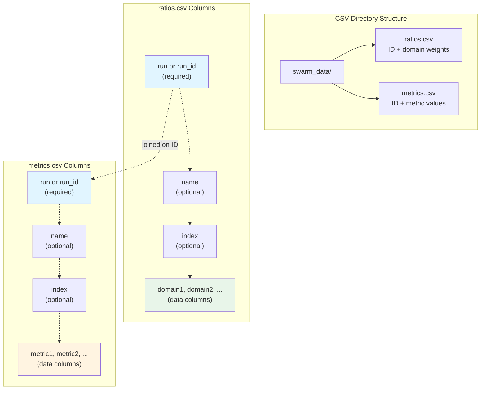
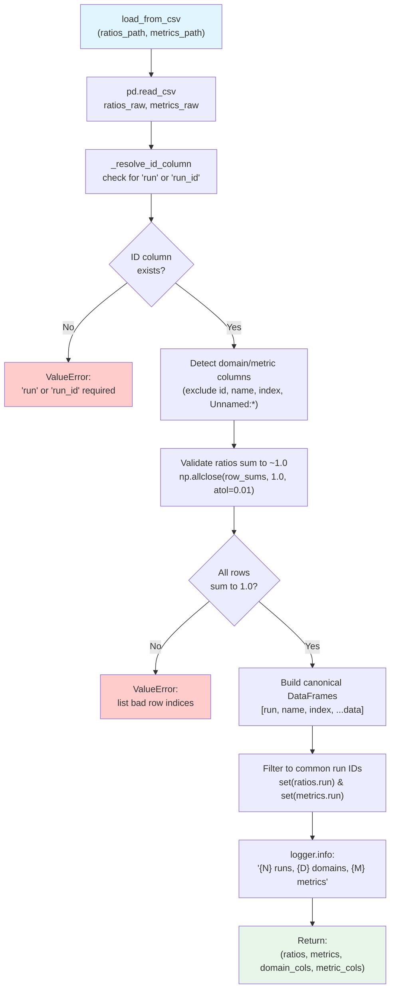
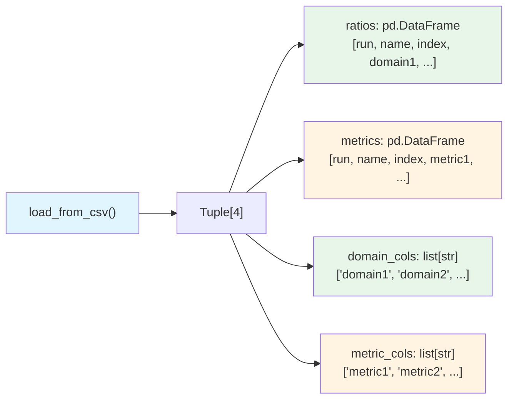

<!-- source: DeepWiki mcp.deepwiki.com · repo allenai/olmix · page 6.2 Loading from CSV · fetched 2026-10-26 -->

# Loading from CSV

<details>
<summary>Relevant source files</summary>

The following files were used as context for generating this wiki page:

- [.gitignore](.gitignore)
- [README.md](README.md)
- [olmix/fit/loaders.py](olmix/fit/loaders.py)
- [plans/016_refactor_fit_csv_support.md](plans/016_refactor_fit_csv_support.md)
- [uv.lock](uv.lock)

</details>


## Purpose and Scope

This page documents the CSV-based data loading mechanism in `olmix fit`. The `load_from_csv` function reads experiment results from local CSV files as an alternative to pulling data from WandB. This enables reproducible fits, offline workflows, and integration with custom data pipelines.

For loading data from WandB instead, see [Loading from WandB](#6.1). For the broader fitting workflow, see [olmix fit](#2.3).

**Sources:** [olmix/fit/loaders.py:1-90](), [README.md:20-181]()

---

## CSV File Requirements

The CSV loading system expects two files in a specified directory:

| File | Purpose | Key Columns |
|------|---------|-------------|
| `ratios.csv` | Domain mixture weights per run | ID column + domain columns (must sum to ~1.0) |
| `metrics.csv` | Evaluation metrics per run | ID column + metric columns (typically BPB) |

Both files are joined on a shared identifier column (`run` or `run_id`). Only runs present in both files are retained.

**Sources:** [olmix/fit/loaders.py:14-34](), [README.md:24-44]()

---

## File Format Specification



**Sources:** [olmix/fit/loaders.py:35-80](), [README.md:28-43](), [plans/016_refactor_fit_csv_support.md:126-144]()

---

## Column Specifications

### ID Column

The ID column uniquely identifies each experiment run and is used to join `ratios.csv` and `metrics.csv`. The loader accepts either `run` or `run_id` as the column name, preferring `run` if both are present.

**Resolution logic** ([olmix/fit/loaders.py:83-89]()):
1. Check for `run` column → use if present
2. Check for `run_id` column → use if `run` not found
3. Raise `ValueError` if neither exists

**Sources:** [olmix/fit/loaders.py:38-40](), [olmix/fit/loaders.py:83-89]()

---

### Domain Columns (ratios.csv)

Domain columns represent the mixture weights for each data source. These are the data columns in `ratios.csv`, excluding the ID column and any metadata columns.

**Identification** ([olmix/fit/loaders.py:44]()):
- Domain columns = all columns except `{run, run_id, name, index, Unnamed:*}`
- Column names must exactly match the domain keys used in `FitConfig.priors.relative_sizes`

**Validation** ([olmix/fit/loaders.py:48-53]()):
```python
row_sums = ratios_raw[domain_cols].sum(axis=1)
if not np.allclose(row_sums, 1.0, atol=0.01):
    # Raises ValueError with row indices that fail validation
```

Ratios must sum to ~1.0 (±0.01 tolerance) per row. The validation reports which rows violate this constraint.

**Example ratios.csv:**
```csv
run,name,index,dclm,wikipedia,arxiv
hz0dfydj,my-swarm-0000,0,0.45,0.30,0.25
pj0hxxl7,my-swarm-0001,1,0.60,0.20,0.20
sqleanmq,my-swarm-0002,2,0.33,0.33,0.34
```

**Sources:** [olmix/fit/loaders.py:43-53](), [README.md:28-34]()

---

### Metric Columns (metrics.csv)

Metric columns represent evaluation results (typically bits-per-byte on downstream tasks). These are the data columns in `metrics.csv`, excluding the ID column and metadata columns.

**Identification** ([olmix/fit/loaders.py:45]()):
- Metric columns = all columns except `{run, run_id, name, index, Unnamed:*}`
- Column names become the metric identifiers in the fitting pipeline

**Type coercion** ([olmix/fit/loaders.py:71]()):
```python
metrics[col] = pd.to_numeric(metrics_raw[col], errors="coerce")
```

All metric columns are cast to numeric types. Non-numeric values are converted to `NaN`.

**Example metrics.csv:**
```csv
run,name,index,arc_challenge_bpb,hellaswag_bpb,mmlu_stem_bpb
hz0dfydj,my-swarm-0000,0,1.23,0.87,1.45
pj0hxxl7,my-swarm-0001,1,1.15,0.91,1.38
sqleanmq,my-swarm-0002,2,1.20,0.89,1.42
```

**Sources:** [olmix/fit/loaders.py:45-71](), [README.md:36-42]()

---

### Metadata Columns

Metadata columns provide optional human-readable labels and are not used in regression fitting:

| Column | Required | Purpose | Default if Missing |
|--------|----------|---------|-------------------|
| `run` or `run_id` | **Yes** | Join key | N/A (error) |
| `name` | No | Human-readable label | Copies ID column |
| `index` | No | Sequential index | Auto-generated `range(len(df))` |
| `Unnamed:*` | No | Pandas row indices | Ignored |

**Sources:** [olmix/fit/loaders.py:56-69](), [README.md:44]()

---

## Validation and Filtering



### Validation Steps

1. **ID Column Resolution** ([olmix/fit/loaders.py:38-40]()): Both files must have `run` or `run_id`
2. **Ratio Sum Validation** ([olmix/fit/loaders.py:48-53]()): Each row in `ratios.csv` must sum to 1.0 ± 0.01
3. **Common Run Filtering** ([olmix/fit/loaders.py:74-76]()): Only runs present in both files are retained

**Sources:** [olmix/fit/loaders.py:14-80]()

---

## Canonical DataFrame Structure

The `load_from_csv` function returns DataFrames in a standardized format used throughout the fitting pipeline:

```python
# Column order: [run, name, index, ...data columns]
ratios = pd.DataFrame({
    "run": [...],      # ID column (string)
    "name": [...],     # Human label (string, defaults to ID)
    "index": [...],    # Sequential index (int, 0..N-1)
    "domain1": [...],  # Domain weight (float, 0.0-1.0)
    "domain2": [...],  # Domain weight (float, 0.0-1.0)
    # ... more domains
})

metrics = pd.DataFrame({
    "run": [...],      # ID column (string)
    "name": [...],     # Human label (string, defaults to ID)
    "index": [...],    # Sequential index (int, 0..N-1)
    "metric1": [...],  # Metric value (float)
    "metric2": [...],  # Metric value (float)
    # ... more metrics
})
```

**Construction logic** ([olmix/fit/loaders.py:58-71]()):
- `run`: Always derived from the ID column
- `name`: Uses `name` column if present, otherwise copies `run`
- `index`: Always regenerated as `range(len(df))` regardless of input
- Data columns: Copied directly from input CSVs

**Sources:** [olmix/fit/loaders.py:14-22](), [olmix/fit/loaders.py:56-71]()

---

## Return Values



**Type signature** ([olmix/fit/loaders.py:14-29]()):
```python
def load_from_csv(
    ratios_path: str,
    metrics_path: str,
) -> tuple[pd.DataFrame, pd.DataFrame, list[str], list[str]]:
    """Returns: (ratios, metrics, domain_cols, metric_cols)"""
```

**Sources:** [olmix/fit/loaders.py:14-29]()

---

## Usage with olmix fit

The `olmix fit` command uses `load_from_csv` when invoked with the `--from-csv` flag:

```bash
olmix fit --from-csv path/to/csv_dir/ \
          --config configs/fit.yaml \
          --output-dir output/my_fit \
          --regression-type log_linear
```

**CLI integration** (from design document):
- `--from-csv DIR`: Specifies the directory containing `ratios.csv` and `metrics.csv`
- `--config PATH`: Required when using `--from-csv` (provides priors and fitting parameters)
- The loader returns DataFrames that are passed to `run_fit()` in [olmix/fit/core.py]()

**Workflow:**
1. CLI validates `--from-csv` and `--config` are both present
2. Calls `load_from_csv(csv_dir / "ratios.csv", csv_dir / "metrics.csv")`
3. Extracts priors from `FitConfig` loaded from `--config`
4. Passes DataFrames to `run_fit()` for regression and optimization

**Sources:** [README.md:46-58](), [plans/016_refactor_fit_csv_support.md:94-109]()

---

## Error Handling

### Missing ID Column

```python
ValueError: ratios CSV must have a 'run' or 'run_id' column
ValueError: metrics CSV must have a 'run' or 'run_id' column
```

Raised by `_resolve_id_column` ([olmix/fit/loaders.py:83-89]()) when neither `run` nor `run_id` is present.

### Invalid Ratio Sums

```python
ValueError: Ratios do not sum to ~1.0 for rows: [2, 5, 8]. 
Got sums: [0.95, 1.03, 0.89]
```

Raised when domain weights don't sum to 1.0 ± 0.01 ([olmix/fit/loaders.py:48-53]()). Reports which rows fail validation and their actual sums.

### Missing Files

```python
FileNotFoundError: [Errno 2] No such file or directory: 'path/to/ratios.csv'
```

Standard Python exception when CSV files don't exist. The CLI validates directory existence with `click.Path(exists=True, file_okay=False)`.

**Sources:** [olmix/fit/loaders.py:48-53](), [olmix/fit/loaders.py:83-89]()

---

## Complete Example

**Directory structure:**
```
swarm_results/
├── ratios.csv
└── metrics.csv
```

**ratios.csv:**
```csv
run_id,name,dclm,wikipedia,arxiv,s2pdf
run_001,swarm-0001,0.45,0.30,0.15,0.10
run_002,swarm-0002,0.60,0.20,0.10,0.10
run_003,swarm-0003,0.33,0.33,0.17,0.17
```

**metrics.csv:**
```csv
run_id,name,arc_challenge_bpb,hellaswag_bpb,mmlu_stem_bpb
run_001,swarm-0001,1.23,0.87,1.45
run_002,swarm-0002,1.15,0.91,1.38
run_003,swarm-0003,1.20,0.89,1.42
```

**Python usage:**
```python
from olmix.fit.loaders import load_from_csv

ratios, metrics, domain_cols, metric_cols = load_from_csv(
    "swarm_results/ratios.csv",
    "swarm_results/metrics.csv"
)

# ratios.columns: ['run', 'name', 'index', 'dclm', 'wikipedia', 'arxiv', 's2pdf']
# metrics.columns: ['run', 'name', 'index', 'arc_challenge_bpb', 'hellaswag_bpb', 'mmlu_stem_bpb']
# domain_cols: ['dclm', 'wikipedia', 'arxiv', 's2pdf']
# metric_cols: ['arc_challenge_bpb', 'hellaswag_bpb', 'mmlu_stem_bpb']
# len(ratios): 3  (all runs present in both files)
```

**CLI usage:**
```bash
olmix fit --from-csv swarm_results/ \
          --config configs/fit.yaml \
          --output-dir output/csv_fit \
          --regression-type log_linear \
          --proposer-type exact
```

**Sources:** [olmix/fit/loaders.py:1-90](), [README.md:28-43](), [plans/016_refactor_fit_csv_support.md:126-144]()

---

