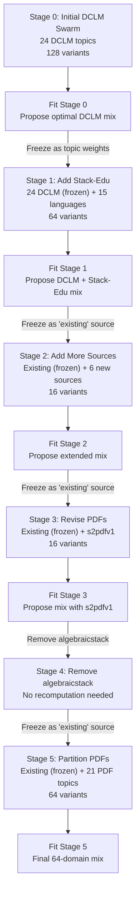
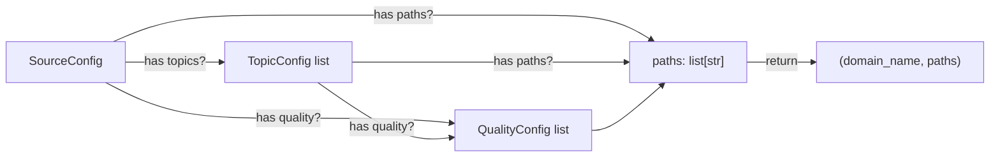
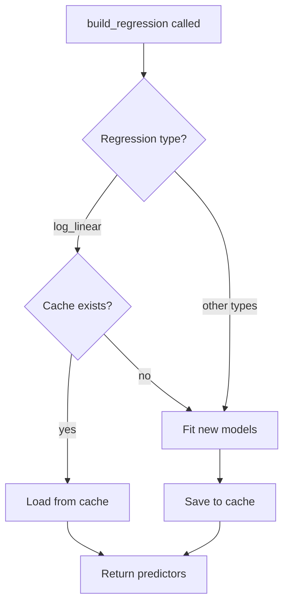
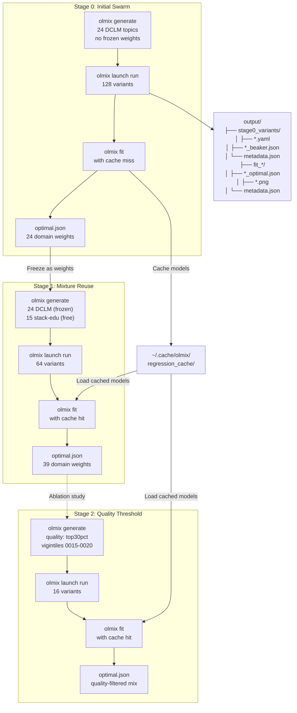

<!-- source: DeepWiki mcp.deepwiki.com · repo allenai/olmix · page 7 Advanced Topics · fetched 2026-10-26 -->

# Advanced Topics

<details>
<summary>Relevant source files</summary>

The following files were used as context for generating this wiki page:

- [configs/mixture_reuse_case_study/README.md](configs/mixture_reuse_case_study/README.md)
- [configs/mixture_reuse_case_study/fit/0_dclm.yaml](configs/mixture_reuse_case_study/fit/0_dclm.yaml)
- [configs/mixture_reuse_case_study/generate/0_dclm.yaml](configs/mixture_reuse_case_study/generate/0_dclm.yaml)
- [configs/mixture_reuse_case_study/generate/5_partition_pdfs.yaml](configs/mixture_reuse_case_study/generate/5_partition_pdfs.yaml)
- [plans/011_reorganize_experiment_configs.md](plans/011_reorganize_experiment_configs.md)
- [plans/012_quality_threshold_experiments.md](plans/012_quality_threshold_experiments.md)
- [plans/013_align_wandb_metrics_with_olmo_core.md](plans/013_align_wandb_metrics_with_olmo_core.md)

</details>


This page documents advanced patterns and techniques for power users of olmix. These topics build upon the core workflow (see [Core Concepts](#1.1)) and assume familiarity with the configuration system (see [Configuration System](#3)) and optimization pipeline (see [Regression and Optimization](#4)).

Topics covered include:
- **Mixture Reuse Pattern**: Freezing previously optimized weights while exploring new domains
- **Quality Thresholding**: Filtering data by quality buckets for ablation studies
- **Output Organization**: Understanding the hierarchical directory structure and metadata tracking
- **Regression Caching**: Leveraging cached models for faster iteration

For information about running experiments on Beaker, see [Training Infrastructure](#5). For details on loading swarm results, see [Data Loading](#6).

---

## Mixture Reuse Pattern

The mixture reuse pattern enables efficient iterative optimization by freezing previously optimized domain weights while only recomputing on newly added or modified domains. This is the key technique that makes olmix practical for large-scale mixture optimization with dozens of domains.

### Core Mechanism

When a `SourceConfig` or `TopicConfig` has an explicit `weight` field, that weight is frozen during generation. The `olmix generate` command only samples Dirichlet distributions over domains without fixed weights. This allows you to:

1. Start with a small swarm over a subset of domains
2. Fit an optimal mixture for those domains
3. Freeze those weights in the next generation config
4. Add new domains and recompute only the new portion of the mixture

### Configuration Schema

The `weight` field is optional on `SourceConfig` and `TopicConfig`:

```python
# olmix/aliases.py
class SourceConfig(BaseModel):
    name: str
    paths: list[str] | None = None
    topics: list[TopicConfig] | None = None
    quality: list[QualityConfig] | None = None
    weight: float | None = None  # Optional frozen weight
    max_repetition_factor: float = 1.0
```

When present, `weight` specifies the fixed proportion for that source/topic in the total mixture. All non-weighted domains are normalized to fill the remaining probability mass.

**Sources**: [olmix/aliases.py:41-83]()

### Generation Logic

The `generate_weights_dirichlet` function handles mixture reuse:

| Condition | Behavior |
|-----------|----------|
| No weights specified | Sample all domains from Dirichlet |
| Some weights specified | Freeze weighted domains, sample remaining from Dirichlet scaled to fill (1 - sum of frozen weights) |
| All weights specified | Use explicit weights (no sampling) |

The key logic is in [olmix/generate/synthesize_mixture.py:175-230](), which:
1. Separates frozen domains (with weights) from free domains
2. Calculates the remaining probability mass: `remaining = 1.0 - sum(frozen_weights)`
3. Samples Dirichlet over free domains
4. Scales free domain samples by `remaining`
5. Combines frozen and sampled weights

**Sources**: [olmix/generate/synthesize_mixture.py:175-230]()

### Five-Stage Case Study

The [configs/mixture_reuse_case_study/]() directory contains a complete walkthrough of iterative mixture optimization. Each stage freezes the previous mixture and adds new domains:



**Sources**: [configs/mixture_reuse_case_study/README.md:1-152]()

### Stage Transition Example

**Stage 0** fits a mixture over 24 DCLM topics. The optimal weights from `output/*_optimal.json` are then embedded in **Stage 1**'s config:

```yaml
# configs/mixture_reuse_case_study/generate/1_add_stackedu.yaml
data:
  sources:
  - name: dclm
    topics:
    - name: adult_content
      paths: [...]
      weight: 0.005062853297381612  # Frozen from Stage 0 fit
    - name: art_and_design
      paths: [...]
      weight: 0.010120900352201125  # Frozen from Stage 0 fit
    # ... 22 more topics with frozen weights
    
  - name: stack-edu
    topics:
    - name: C
      paths: [...]
      # No weight field - will be sampled
    - name: CSharp
      paths: [...]
      # No weight field - will be sampled
    # ... 13 more languages without weights
```

During generation, only the 15 stack-edu languages vary across the 64 swarm variants. The 24 DCLM topic weights remain fixed at their Stage 0 optimal values.

**Stage 2** introduces a different pattern: the entire Stage 1 mixture (39 domains) is frozen as a single source named `existing`:

```yaml
# configs/mixture_reuse_case_study/generate/2_add_more_sources.yaml
data:
  sources:
  - name: existing
    topics:
    - name: arxiv
      paths: [...]
      weight: 0.0166773373911251  # Frozen
    - name: dclm:adult_content
      paths: [...]
      weight: 0.005062853297381612  # Frozen
    # ... 37 more domains with frozen weights
    
  - name: algebraicstack
    paths: [...]
    # No weight - will be sampled
  - name: arxiv
    paths: [...]
    # No weight - will be sampled
  # ... 4 more new sources without weights
```

This pattern is cleaner when adding many new sources: wrap the entire previous mixture as `existing` rather than listing all domains as individual frozen topics.

**Sources**: [configs/mixture_reuse_case_study/generate/1_add_stackedu.yaml:1-85](), [configs/mixture_reuse_case_study/generate/2_add_more_sources.yaml:1-120]()

### Manual Prior Specification

The `SwarmConfig.manual_prior` field allows overriding the computed priors for sources during Dirichlet sampling:

```yaml
# configs/mixture_reuse_case_study/generate/5_partition_pdfs.yaml
swarm:
  seed: 42
  variants: 64
  minimum_weight: 0.0001
  min_strength: 1
  max_strength: 20
  manual_prior:
    existing: 0.7  # Force 70% of probability mass to existing source
    s2pdfv1: 0.3   # Force 30% to new PDF partitions
```

This forces the Dirichlet sampling to center around a 70/30 split between the frozen existing domains and the new PDF topic partitions. Without `manual_prior`, the split would be proportional to the token counts in `priors.relative_sizes`.

**Sources**: [configs/mixture_reuse_case_study/generate/5_partition_pdfs.yaml:378-390]()

### Benefits

| Benefit | Explanation |
|---------|-------------|
| **Reduced computation** | Only train swarms over new domains, not entire mixture |
| **Focused exploration** | Concentrate sampling budget on uncertain portions |
| **Incremental refinement** | Build mixtures iteratively as new data sources become available |
| **Efficient ablations** | Test impact of adding/removing single domains without recomputing everything |

The case study demonstrates a 5-stage optimization that would require 288 total swarm variants (128+64+16+16+64) if computed from scratch each time, versus the actual budget which is much smaller due to freezing.

**Sources**: [configs/mixture_reuse_case_study/README.md:1-152]()

---

## Quality Thresholding

Quality thresholding enables filtering data to specific quality levels for ablation studies. This is implemented through an optional `quality` nesting level in the data hierarchy.

### Schema Extension

The `QualityConfig` class adds a third nesting level to the data configuration hierarchy:

```
DataConfig
└── SourceConfig
    ├── TopicConfig (optional)
    │   └── QualityConfig (optional)
    │       └── paths: list[str]
    └── QualityConfig (optional)
        └── paths: list[str]
```

Each quality level has a `name` field (arbitrary string) and its own `paths` list:

```python
# olmix/aliases.py
class QualityConfig(BaseModel):
    """Configuration for a quality level within a topic or source."""
    name: str  # e.g., "vigintile_0001", "high", "medium", "low"
    paths: list[str]
    max_repetition_factor: float = 1.0
```

**Sources**: [olmix/aliases.py:88-95](), [plans/012_quality_threshold_experiments.md:15-30]()

### Vigintile Bucketing

A common quality scheme is vigintile bucketing: partitioning data into 20 buckets (5% each) sorted by quality score. Higher-numbered vigintiles contain higher quality data:

| Vigintile | Quality Percentile | Usage |
|-----------|-------------------|-------|
| `vigintile_0020` | 95th-100th percentile | Top 5% quality |
| `vigintile_0019` | 90th-95th percentile | Next 5% |
| ... | ... | ... |
| `vigintile_0002` | 5th-10th percentile | Bottom 10% |
| `vigintile_0001` | 0th-5th percentile | Bottom 5% quality |

Thresholding experiments typically compare:
- **Top 10%**: vigintiles 0019-0020
- **Top 30%**: vigintiles 0015-0020
- **Top 50%**: vigintiles 0011-0020
- **Top 70%**: vigintiles 0007-0020
- **Top 100%**: vigintiles 0001-0020 (baseline)

**Sources**: [plans/012_quality_threshold_experiments.md:56-67]()

### Configuration Example

A source with topic-level quality buckets:

```yaml
# configs/experiments/quality_thresholds/quality_top30pct.yaml
sources:
  - name: all_dressed
    topics:
      - name: science_math_and_technology
        quality:
          - name: vigintile_0015
            paths:
              - s3://ai2-llm/preprocessed/cc_all_dressed/.../science_math_and_technology/vigintile_0015/*.npy
          - name: vigintile_0016
            paths:
              - s3://ai2-llm/preprocessed/cc_all_dressed/.../science_math_and_technology/vigintile_0016/*.npy
          # vigintile_0017, 0018, 0019, 0020 (omitted for brevity)
      
      - name: software_development
        quality:
          - name: vigintile_0015
            paths: [...]
          # vigintile_0016 through vigintile_0020
      # ... other topics

  # Source without quality (backward compatible)
  - name: arxiv
    paths:
      - s3://ai2-llm/preprocessed/proof-pile-2/.../arxiv/train/allenai/dolma2-tokenizer/*.npy
    max_repetition_factor: 1.5
```

This config includes only vigintiles 0015-0020 (top 30%) for all_dressed topics, while arxiv has no quality filtering.

**Sources**: [plans/012_quality_threshold_experiments.md:89-123]()

### Leaf Configuration Resolution

The `get_leaf_configs` function in [olmix/launch/synthesize_mixture.py:35-89]() resolves the nested hierarchy to flat `(domain_name, paths)` tuples:



The domain name is constructed by joining source, topic, and quality names with colons:
- `source.paths` → `(source_name, paths)`
- `source.topics[i].paths` → `(source_name:topic_name, paths)`
- `source.topics[i].quality[j].paths` → `(source_name:topic_name:quality_name, paths)`
- `source.quality[i].paths` → `(source_name:quality_name, paths)`

**Sources**: [olmix/launch/synthesize_mixture.py:35-89](), [plans/012_quality_threshold_experiments.md:36-45]()

### Quality Upsampling

Each `QualityConfig` has a `max_repetition_factor` field that controls upsampling:

```yaml
quality:
  - name: vigintile_0020  # Top 5%
    paths: [...]
    max_repetition_factor: 3.0  # Allow 3x repetition
  - name: vigintile_0019
    paths: [...]
    max_repetition_factor: 2.0  # Allow 2x repetition
  - name: vigintile_0015
    paths: [...]
    max_repetition_factor: 1.0  # No extra repetition
```

This allows higher-quality data to be repeated more frequently without exhausting the dataset. The `TransformerConfigBuilder` respects these limits when constructing the training data pipeline.

**Sources**: [olmix/aliases.py:88-95]()

### Validation

The schema enforces that exactly one of `paths`, `topics`, or `quality` is specified at each level:

```python
# olmix/aliases.py TopicConfig validator
@model_validator(mode="after")
def check_paths_or_quality(self) -> "TopicConfig":
    """Ensure exactly one of paths or quality is provided."""
    has_paths = self.paths is not None
    has_quality = self.quality is not None
    if not (has_paths ^ has_quality):
        raise ValueError("TopicConfig must have either 'paths' or 'quality', not both or neither")
    return self
```

This prevents ambiguous configurations where both nested and direct paths are specified.

**Sources**: [plans/012_quality_threshold_experiments.md:30-45]()

---

## Output Organization

olmix uses a hierarchical directory structure to organize outputs from generation, launch, and fit commands.

### Generation Outputs

The `olmix generate` command creates one `LaunchConfig` YAML file per variant:

```
output/stage0_variants/
├── mixture-reuse-swarm-dclm-01a2b3c4-0000.yaml
├── mixture-reuse-swarm-dclm-01a2b3c4-0001.yaml
├── mixture-reuse-swarm-dclm-01a2b3c4-0002.yaml
├── ...
└── mixture-reuse-swarm-dclm-01a2b3c4-0127.yaml
```

The filename pattern is: `{name}-{config_hash}-{variant_index:04d}.yaml`

| Component | Description |
|-----------|-------------|
| `name` | From `GenerationConfig.name` |
| `config_hash` | First 8 chars of SHA256 hash of generation config |
| `variant_index` | Zero-padded variant number (0 to variants-1) |

The hash ensures different generation configs produce distinct filenames even with the same `name`.

**Sources**: [olmix/generate/synthesize_mixture.py:250-280]()

### Metadata Tracking

Each output directory contains a `metadata.json` file:

```json
{
  "generation_config": {
    "name": "mixture-reuse-swarm-dclm",
    "data": { ... },
    "priors": { ... },
    "swarm": {
      "seed": 42,
      "variants": 128,
      "minimum_weight": 0.05
    }
  },
  "base_config": {
    "chinchilla_multiple": 0.5,
    "proxy_model_id": "olmo3_14m",
    "cluster": "ai2/jupiter"
  },
  "git_commit": "a1b2c3d4e5f6...",
  "timestamp": "2024-01-15T10:30:00Z",
  "variants_generated": 128
}
```

This metadata enables reproducibility by recording:
- The exact generation config used
- The base launch config template
- Git commit hash of olmix code
- Timestamp of generation
- Number of variants produced

**Sources**: [olmix/generate/cli.py:45-92]()

### Fit Outputs

The `olmix fit` command creates outputs in a timestamped subdirectory:

```
output/
└── fit_20240115_103000/
    ├── log_linear_optimal.json
    ├── log_linear_optimal.png
    ├── log_linear_optimal_with_priors.png
    ├── interaction_matrix.png
    ├── correlation_plots/
    │   ├── arc_challenge_bpb.png
    │   ├── hellaswag_bpb.png
    │   └── ...
    └── metadata.json
```

| File | Description |
|------|-------------|
| `{regressor}_optimal.json` | Proposed mixture weights as JSON dict |
| `{regressor}_optimal.png` | Bar chart comparing proposed weights to priors |
| `{regressor}_optimal_with_priors.png` | Bar chart showing prior distributions |
| `interaction_matrix.png` | Heatmap of domain-metric interaction strengths |
| `correlation_plots/*.png` | Predicted vs actual scatter plots per metric |
| `metadata.json` | Fit config, regression type, proposer type, timestamp |

The `{regressor}` prefix (e.g., `log_linear`, `lightgbm`) distinguishes outputs when running multiple regression types.

**Sources**: [olmix/fit/core.py:450-520]()

### Hashed Subdirectories

For large swarms (>100 variants), generation outputs are organized into hashed subdirectories to avoid filesystem performance issues:

```
output/large_swarm/
├── 00/
│   ├── swarm-hash-0000.yaml
│   ├── swarm-hash-0001.yaml
│   └── ...
├── 01/
│   ├── swarm-hash-0100.yaml
│   └── ...
├── 02/
└── ...
```

The subdirectory name is the first 2 hex digits of the variant index: `{variant_index // 100:02x}`.

This is controlled by the `--hash-output` flag:

```bash
olmix generate \
  --config config.yaml \
  --base base.yaml \
  --output output/large_swarm/ \
  --hash-output  # Enable hashed subdirectories
```

**Sources**: [olmix/generate/cli.py:60-75]()

### Launch Directory Structure

After launching experiments, Beaker creates additional tracking files:

```
output/stage0_variants/
├── mixture-reuse-swarm-dclm-01a2b3c4-0000.yaml
├── mixture-reuse-swarm-dclm-01a2b3c4-0000_beaker.json  # Beaker experiment metadata
├── mixture-reuse-swarm-dclm-01a2b3c4-0000_status.json  # Current status
├── ...
└── group_info.json  # Beaker experiment group ID
```

| File | Description |
|------|-------------|
| `*_beaker.json` | Beaker experiment ID, cluster, created timestamp |
| `*_status.json` | Current status (pending/running/completed/failed) |
| `group_info.json` | Beaker experiment group ID for the entire swarm |

These files enable `olmix launch status` to report on running experiments.

**Sources**: [olmix/launch/beaker.py:180-250]()

---

## Regression Caching

Log-linear regression models are cached based on the hash of the training data to avoid redundant fitting when iterating on proposer settings.

### Cache Key Construction

The cache key is a SHA256 hash of:
1. Sorted list of metric names
2. Ratios DataFrame shape and column names
3. Metrics DataFrame shape and column names
4. Training split size
5. Random seed

```python
# olmix/fit/utils.py
def compute_data_hash(
    metrics: pd.DataFrame,
    ratios: pd.DataFrame,
    metric_names: list[str],
    train_split: int | None,
    seed: int
) -> str:
    """Compute hash of regression inputs for caching."""
    components = [
        str(sorted(metric_names)),
        str(ratios.shape),
        str(sorted(ratios.columns)),
        str(metrics.shape),
        str(sorted(metrics.columns)),
        str(train_split),
        str(seed)
    ]
    return hashlib.sha256("|".join(components).encode()).hexdigest()[:16]
```

**Sources**: [olmix/fit/utils.py:205-230]()

### Cache Storage

Cached models are stored in `~/.cache/olmix/regression_cache/`:

```
~/.cache/olmix/regression_cache/
├── log_linear_a1b2c3d4e5f6g7h8.pkl  # Pickled predictors list
├── log_linear_a1b2c3d4e5f6g7h8.json # Metadata (hash, timestamp, metrics)
├── log_linear_i9j0k1l2m3n4o5p6.pkl
├── log_linear_i9j0k1l2m3n4o5p6.json
└── ...
```

Each cache entry consists of:
- `.pkl` file: Pickled list of `LogLinearRegressor` objects (one per metric)
- `.json` file: Metadata including data hash, creation timestamp, metric names

**Sources**: [olmix/fit/utils.py:245-280]()

### Cache Hit Logic

The `build_regression` function checks the cache before fitting:



Only log-linear regression uses caching because:
1. It's the most commonly used type (parametric scaling laws)
2. Fitting 60 independent LBFGS optimizations can take 5-10 minutes
3. The model is deterministic given the data and seed

Other regression types (LightGBM, GP) are non-deterministic or too large to cache efficiently.

**Sources**: [olmix/fit/utils.py:290-350]()

### Cache Invalidation

The cache is automatically invalidated when:
- Different metrics are used (different task selection)
- Training data shape changes (different swarm size)
- Domain names change (different data sources)
- Training split or seed changes

To manually clear the cache:

```bash
rm -rf ~/.cache/olmix/regression_cache/
```

To disable caching (force refitting):

```bash
OLMIX_NO_CACHE=1 olmix fit --config config.yaml
```

**Sources**: [olmix/fit/utils.py:245-280]()

### Performance Impact

Caching provides significant speedup when iterating on proposer settings:

| Scenario | Without Cache | With Cache |
|----------|---------------|------------|
| First fit (60 metrics) | ~8 minutes | ~8 minutes |
| Refit with different `kl_reg` | ~8 minutes | ~2 seconds |
| Refit with different `temperature` | ~8 minutes | ~2 seconds |
| Refit with different `obj_weights` | ~8 minutes | ~2 seconds |

The speedup is especially valuable when exploring different optimization settings (KL regularization strength, objective metric weights, constraints) without changing the underlying regression models.

**Sources**: [olmix/fit/core.py:150-200]()

### Cache Metadata

Each cache entry's JSON metadata includes:

```json
{
  "data_hash": "a1b2c3d4e5f6g7h8",
  "regression_type": "log_linear",
  "metric_names": [
    "arc_challenge_bpb",
    "hellaswag_bpb",
    ...
  ],
  "n_metrics": 60,
  "n_domains": 24,
  "train_split": 64,
  "seed": 0,
  "created_at": "2024-01-15T10:30:00Z",
  "olmix_version": "0.1.0"
}
```

This metadata enables:
- Inspecting cache contents without loading pickles
- Debugging cache misses
- Cache cleanup based on age or version

**Sources**: [olmix/fit/utils.py:260-280]()

---

## Integration Example: Full Workflow

This diagram shows how advanced patterns integrate into the complete olmix workflow:



**Sources**: [configs/mixture_reuse_case_study/README.md:1-152](), [plans/012_quality_threshold_experiments.md:1-169](), [olmix/fit/utils.py:245-350]()

---

