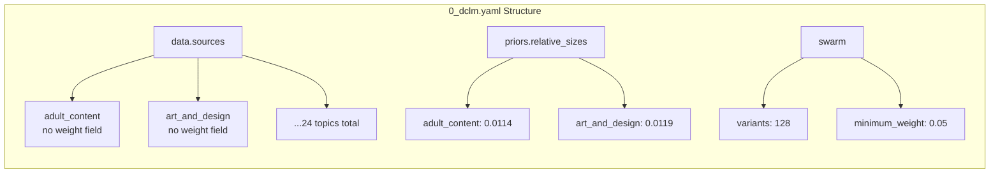
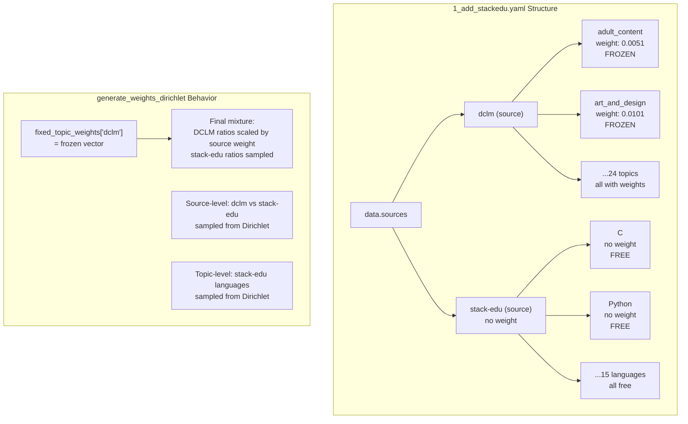
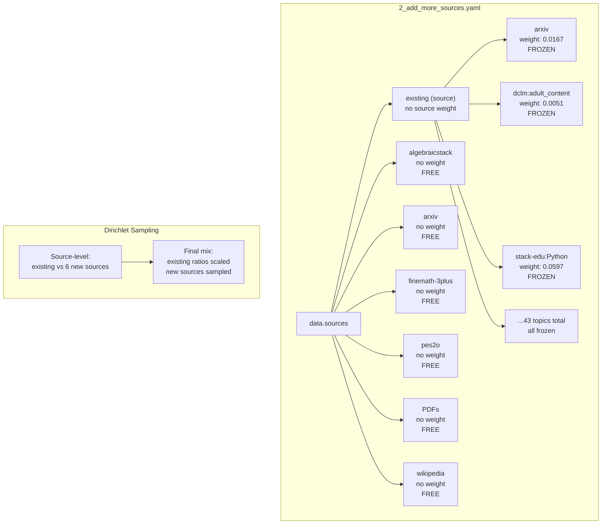
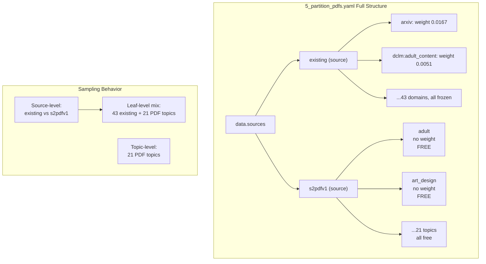
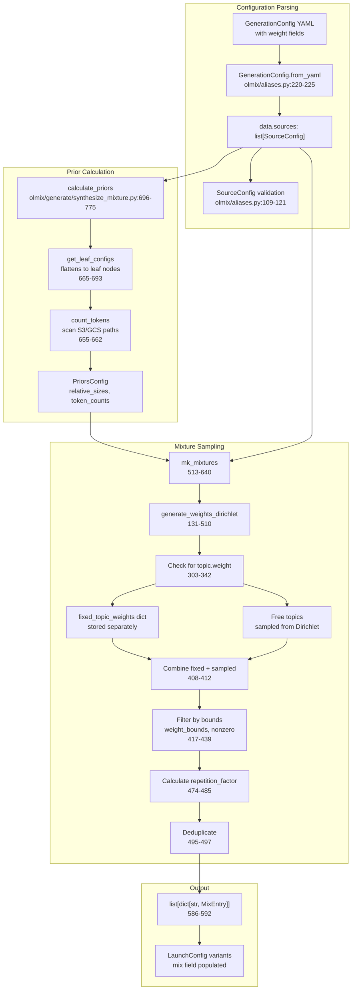

<!-- source: DeepWiki mcp.deepwiki.com · repo allenai/olmix · page 7.1 Mixture Reuse Case Study · fetched 2026-10-26 -->

# Mixture Reuse Case Study

<details>
<summary>Relevant source files</summary>

The following files were used as context for generating this wiki page:

- [configs/mixture_reuse_case_study/README.md](configs/mixture_reuse_case_study/README.md)
- [configs/mixture_reuse_case_study/fit/0_dclm.yaml](configs/mixture_reuse_case_study/fit/0_dclm.yaml)
- [configs/mixture_reuse_case_study/generate/0_dclm.yaml](configs/mixture_reuse_case_study/generate/0_dclm.yaml)
- [configs/mixture_reuse_case_study/generate/5_partition_pdfs.yaml](configs/mixture_reuse_case_study/generate/5_partition_pdfs.yaml)
- [olmix/aliases.py](olmix/aliases.py)
- [olmix/cli.py](olmix/cli.py)
- [olmix/generate/synthesize_mixture.py](olmix/generate/synthesize_mixture.py)
- [olmix/generate/utils.py](olmix/generate/utils.py)
- [olmix/launch/utils.py](olmix/launch/utils.py)

</details>


This page presents a complete real-world example of the mixture reuse workflow from the OLMix paper (Section 5.1, c=3, seed=0). It demonstrates how to iteratively optimize a data mixture by freezing previously-optimized portions while exploring new domains, enabling efficient refinement without full recomputation.

For the technical specification of the `mix` field and `MixEntry` structure, see [Mix Field and Mixture Reuse](#3.5). For general information on the `GenerationConfig`, see [GenerationConfig](#3.1).

## Overview

The case study follows a 5-stage evolution of a data mixture, beginning with 24 DCLM topics and progressively adding new sources. Each stage follows the same pattern:

1. **Generate** — Use `olmix generate` to sample mixture variants with frozen weights from previous stages
2. **Train** — Launch proxy models to evaluate each variant (via `olmix launch run`)
3. **Fit** — Use `olmix fit` to regress and propose the optimal mixture
4. **Freeze** — Embed the proposed weights as explicit `weight:` fields in the next stage's `GenerationConfig`

The key insight is that when a source or topic has an explicit `weight` field in the `GenerationConfig`, that weight is frozen and not sampled. Only domains without explicit weights vary in the swarm, dramatically reducing the computational cost of exploring new domains.

Sources: [configs/mixture_reuse_case_study/README.md:1-152]()

## Workflow Stages Overview

```mermaid
graph TB
    subgraph "Stage 0: Initial DCLM Swarm"
        S0Gen["olmix generate<br/>0_dclm.yaml<br/>128 variants over 24 DCLM topics"]
        S0Train["Train 128 proxy models<br/>Evaluate on 60 BPB metrics"]
        S0Fit["olmix fit<br/>0_dclm.yaml<br/>Propose optimal DCLM mix"]
        
        S0Gen --> S0Train
        S0Train --> S0Fit
    end
    
    subgraph "Update 1: Add stack-edu"
        S1Gen["olmix generate<br/>1_add_stackedu.yaml<br/>DCLM weights frozen<br/>64 variants over stack-edu"]
        S1Train["Train 64 proxy models"]
        S1Fit["olmix fit<br/>1_add_stackedu.yaml<br/>Propose DCLM + stack-edu mix"]
        
        S1Gen --> S1Train
        S1Train --> S1Fit
    end
    
    subgraph "Update 2: Add more sources"
        S2Gen["olmix generate<br/>2_add_more_sources.yaml<br/>DCLM+stack-edu as 'existing'<br/>16 variants over 6 new sources"]
        S2Train["Train 16 proxy models"]
        S2Fit["olmix fit<br/>2_add_more_sources.yaml<br/>Propose full mix"]
        
        S2Gen --> S2Train
        S2Train --> S2Fit
    end
    
    subgraph "Update 3: Revise PDFs"
        S3Gen["olmix generate<br/>3_revise_pdfs.yaml<br/>'existing' frozen<br/>16 variants on s2pdfv1"]
        S3Train["Train 16 proxy models"]
        S3Fit["olmix fit<br/>3_revise_pdfs.yaml<br/>Propose updated mix"]
        
        S3Gen --> S3Train
        S3Train --> S3Fit
    end
    
    subgraph "Update 4: Remove algebraicstack"
        S4["No computation<br/>Just drop from mixture"]
    end
    
    subgraph "Update 5: Partition PDFs"
        S5Gen["olmix generate<br/>5_partition_pdfs.yaml<br/>'existing' frozen<br/>64 variants on 21 PDF topics"]
        S5Train["Train 64 proxy models"]
        S5Fit["olmix fit<br/>5_partition_pdfs.yaml<br/>Final mix: 64 domains"]
        
        S5Gen --> S5Train
        S5Train --> S5Fit
    end
    
    S0Fit -->|"Freeze as topic.weight"| S1Gen
    S1Fit -->|"Freeze as 'existing' source"| S2Gen
    S2Fit -->|"Freeze as 'existing' source"| S3Gen
    S3Fit --> S4
    S4 --> S5Gen
```



This diagram shows the complete workflow across all 5 stages. Each stage proposes a mixture that is frozen in the next stage's `GenerationConfig`. Updates 1-3 and 5 require recomputation (new swarms), while Update 4 simply removes a source with no training needed.

Sources: [configs/mixture_reuse_case_study/README.md:8-152]()

## Stage 0: Initial DCLM Swarm

The initial stage establishes a baseline mixture over 24 DCLM topics. This stage samples broadly to explore the entire DCLM landscape.

### Generation Configuration

The `GenerationConfig` at this stage defines 24 flat sources (one per DCLM topic) with no explicit weights. The `generate_weights_dirichlet` function samples all 24 domains freely.



Key configuration values:
- **variants**: 128 — generates 128 unique mixture variants
- **minimum_weight**: 0.05 — topics below 5% are clipped to zero
- **max_tokens**: 2,910,233,600 — budget for each proxy model (0.5× Chinchilla for a 30M model)

Sources: [configs/mixture_reuse_case_study/generate/0_dclm.yaml:1-166]()

### Commands

**Generate variants**:
```bash
olmix generate \
  --config configs/mixture_reuse_case_study/generate/0_dclm.yaml \
  --base configs/mixture_reuse_case_study/launch/base.yaml \
  --output output/stage0_variants/
```

This invokes [olmix/cli.py:112-165]() which calls [olmix/generate/utils.py:17-53]() → [olmix/generate/synthesize_mixture.py:513-640](). The `mk_mixtures` function uses `generate_weights_dirichlet` to sample from a Dirichlet distribution with the prior computed from token counts.

**Fit to propose optimal mix**:
```bash
cp hf-data/dclm_swarm/{ratios,metrics}.csv .
olmix fit --config configs/mixture_reuse_case_study/fit/0_dclm.yaml --output-dir output/
```

This loads the CSVs containing the 128 swarm results, builds a `log_linear` regression model per metric, and uses the `exact` proposer to solve the convex optimization problem. The result is written to `output/*_optimal.json`.

Sources: [configs/mixture_reuse_case_study/README.md:22-46](), [configs/mixture_reuse_case_study/fit/0_dclm.yaml:1-86]()

### Output: Frozen Weights for Update 1

The fit step produces optimal weights for all 24 DCLM topics. These weights are embedded in the next stage's config as the `weight:` field on each topic under the `dclm` source. For example:

```yaml
sources:
  - name: dclm
    topics:
      - name: adult_content
        weight: 0.0051  # Frozen from Stage 0 fit
      - name: art_and_design
        weight: 0.0101  # Frozen from Stage 0 fit
```

Sources: [configs/mixture_reuse_case_study/README.md:45-46]()

## Update 1: Add stack-edu

This stage reuses the DCLM topic mixture and recomputes over stack-edu programming languages. The DCLM weights are frozen; only the relative proportions of DCLM-to-stack-edu and the stack-edu language distributions vary.

### Configuration Evolution

The `GenerationConfig` now has a hierarchical structure where DCLM topics have explicit `weight` fields:



The key mechanism is in [olmix/generate/synthesize_mixture.py:303-342](): when `topic.weight` is not `None`, that topic's weight is stored in `fixed_topic_weights` and not sampled. The Dirichlet sampling only varies the free parameters (source-level split and stack-edu topic distribution).

Sources: [configs/mixture_reuse_case_study/README.md:49-71]()

### Swarm Configuration

```yaml
swarm:
  variants: 64  # Reduced from 128 (fewer free parameters)
  minimum_weight: 0.001  # Lower threshold (more granular)
  min_strength: 0.1
  max_strength: 5.0
```

Since only the stack-edu distribution is free, fewer variants are needed to cover the space.

Sources: [configs/mixture_reuse_case_study/README.md:52-60]()

### Weight Propagation

The fit step proposes a mixture over DCLM + stack-edu. This entire mixture becomes the frozen `existing` source in Update 2:

```yaml
sources:
  - name: existing
    topics:
      - name: arxiv  # New source from Update 2, but we're showing the pattern
        weight: 0.0167
      - name: dclm:adult_content  # Flattened naming
        weight: 0.0051
      - name: stack-edu:Python
        weight: 0.0597
```

Notice the colon-separated naming convention: `source:topic` becomes the flat domain key in the `existing` source.

Sources: [configs/mixture_reuse_case_study/README.md:70-71]()

## Update 2: Add More Sources

This stage freezes the entire DCLM + stack-edu mixture as a single `existing` source and explores 6 new sources: algebraicstack, arxiv, finemath-3plus, pes2o, PDFs, and wikipedia.

### Configuration Structure



The `existing` source contains 43 topics (24 DCLM + 1 arxiv + 15 stack-edu + 2 finemath + 1 pes2o from stage 1, though the README indicates it's simplified). All have explicit weights. The 6 new sources have no weights and are sampled freely.

Key configuration:
```yaml
swarm:
  variants: 16  # Even fewer variants (only 7 free parameters: 6 new + existing)
  manual_prior:
    existing: 0.5  # Suggest 50% for existing
    algebraicstack: 0.08
    arxiv: 0.08
    # ...
```

The `manual_prior` biases the source-level Dirichlet prior to reasonable starting proportions.

Sources: [configs/mixture_reuse_case_study/README.md:74-96]()

## Update 3: Revise PDFs

This stage replaces the `PDFs` source with `s2pdfv1` (a revised version) while keeping everything else frozen. This demonstrates the workflow for swapping out a single domain.

### Configuration Pattern

```yaml
data:
  sources:
    - name: existing
      topics:
        - name: arxiv
          weight: 0.0167  # Frozen from Update 2
        - name: dclm:adult_content
          weight: 0.0051  # Frozen from Update 2
        # ... all other domains frozen
    - name: s2pdfv1  # New source, replaces old PDFs
      paths: [...]  # No weight, freely sampled
```

The swarm explores the ratio of `existing` to `s2pdfv1`, keeping the internal `existing` ratios fixed.

Sources: [configs/mixture_reuse_case_study/README.md:99-121]()

## Update 4: Remove algebraicstack

No recomputation is needed to remove a domain. The mixture from Update 3 is simply used without the `algebraicstack` entries. This demonstrates that removal operations are free.

Sources: [configs/mixture_reuse_case_study/README.md:124-127]()

## Update 5: Partition PDFs by Topic

The final stage partitions the `s2pdfv1` source into 21 topic-level domains (adult, art_design, crime_law, etc.). The rest of the mixture remains frozen as `existing`.

### Configuration Structure



Configuration details:
```yaml
swarm:
  variants: 64  # More variants to cover 21-dimensional topic space
  minimum_weight: 0.0001  # Very low threshold for fine-grained control
  min_strength: 1
  max_strength: 20  # Wider strength range
  manual_prior:
    existing: 0.7
    s2pdfv1: 0.3  # Suggest 30% for PDFs
```

The `manual_prior` establishes a 70/30 split expectation, but the swarm explores around this. The `priors.relative_sizes` for `s2pdfv1` topics guides the topic-level Dirichlet:

```yaml
priors:
  relative_sizes:
    # ... existing domains ...
    s2pdfv1:adult: 0.0002
    s2pdfv1:art_design: 0.0036
    s2pdfv1:science_tech: 0.2274  # Largest PDF topic
    # ...
```

Sources: [configs/mixture_reuse_case_study/generate/5_partition_pdfs.yaml:1-391](), [configs/mixture_reuse_case_study/README.md:130-151]()

## Code Flow: Mixture Reuse Mechanics



### Key Functions

**`generate_weights_dirichlet`** [olmix/generate/synthesize_mixture.py:131-510]()

This is the core sampling function. It:
1. Splits the prior into source-level and topic-level distributions (lines 176-282)
2. Checks for `source.weight` and `topic.weight` to populate `fixed_source_weights_list` and `fixed_topic_weights` (lines 303-354)
3. Samples source-level and topic-level weights from Dirichlet distributions (lines 363-412)
4. For fixed weights, uses the explicit values instead of sampling (lines 386-394)
5. Combines into leaf-level vectors and filters (lines 414-488)

**`mk_source_instances`** [olmix/launch/utils.py:12-85]()

This function converts the `LaunchConfig.mix` field into `SourceInstance` objects for training. It handles the three-level hierarchy:
- Simple sources: `source` → `SourceInstance`
- Sources with topics: `source:topic` → `SourceInstance`
- Sources with quality: `source:topic:quality` → `SourceInstance`

The `mix_map` parameter is a `dict[str, MixEntry]` where keys are colon-separated domain paths and values contain `weight` and `repetition_factor`.

Sources: [olmix/generate/synthesize_mixture.py:131-510](), [olmix/launch/utils.py:12-85]()

## Mixture Reuse Pattern Summary

| Stage | Frozen Domains | Free Domains | Swarm Size | Total Domains |
|-------|----------------|--------------|------------|---------------|
| 0     | 0              | 24 DCLM topics | 128        | 24            |
| 1     | 24 DCLM topics | 15 stack-edu langs | 64         | 39            |
| 2     | 39 (DCLM+stack-edu) | 6 new sources | 16         | 45            |
| 3     | 44 (Update 2 - PDFs) | 1 (s2pdfv1) | 16         | 45            |
| 4     | 44 (dropped algebraicstack) | 0 | 0          | 44            |
| 5     | 44 (everything except PDFs) | 21 PDF topics | 64         | 64            |

The pattern demonstrates exponential reduction in computational cost: as more domains are frozen, fewer swarm variants are needed. The key insight is that **freezing preserves relative ratios within frozen groups**, while only the high-level splits and new domain distributions are recomputed.

### Configuration File Naming Convention

All configs follow a systematic naming:
- **Generate configs**: `configs/mixture_reuse_case_study/generate/{stage}_{description}.yaml`
- **Fit configs**: `configs/mixture_reuse_case_study/fit/{stage}_{description}.yaml`

The stage numbers (0, 1, 2, 3, 5) match the update sequence in the paper. Update 4 has no configs because it's a simple removal.

Sources: [configs/mixture_reuse_case_study/README.md:1-152]()

## Running the Case Study

### Prerequisites

```bash
git clone https://github.com/allenai/olmix
cd olmix
git clone https://huggingface.co/datasets/allenai/olmix hf-data
```

The HuggingFace dataset contains pre-computed swarm results (`ratios.csv` and `metrics.csv`) for each stage, enabling the fit steps to run without access to AI2's internal S3 data.

### Full Workflow Example (Stage 0)

**1. Generate 128 variants:**
```bash
olmix generate \
  --config configs/mixture_reuse_case_study/generate/0_dclm.yaml \
  --base configs/mixture_reuse_case_study/launch/base.yaml \
  --output output/stage0_variants/
```

This creates 128 YAML files in `output/stage0_variants/`, each with a unique `mix` field sampled from the Dirichlet distribution.

**2. Launch proxy models (requires AI2 infrastructure):**
```bash
olmix launch run --variants output/stage0_variants/ --dry-run
```

The `--dry-run` flag prints training commands without submitting to Beaker. Actual training requires access to the S3 paths in the configs.

**3. Fit to propose optimal mix:**
```bash
cp hf-data/dclm_swarm/{ratios,metrics}.csv .
olmix fit --config configs/mixture_reuse_case_study/fit/0_dclm.yaml --output-dir output/
```

This outputs:
- `output/log_linear_seed0_optimal.json` — proposed mixture weights
- `output/log_linear_seed0_optimal.png` — visualization comparing prior vs proposed
- `output/log_linear_seed0_interaction_matrix.png` — domain × metric heatmap

**4. Manually embed weights in next stage:**

Copy the weights from the JSON output into `configs/mixture_reuse_case_study/generate/1_add_stackedu.yaml` as `weight:` fields under each topic.

Sources: [configs/mixture_reuse_case_study/README.md:12-46](), [olmix/cli.py:112-165](), [olmix/cli.py:178-261]()

## Key Takeaways

1. **Freezing mechanism**: Setting `weight:` on a `SourceConfig`, `TopicConfig`, or `QualityConfig` prevents that domain from being sampled in `generate_weights_dirichlet`
2. **Hierarchical flattening**: The `existing` source pattern flattens previously-optimized mixtures into a single frozen group using colon-separated naming
3. **Computational efficiency**: Swarm sizes decrease as more domains are frozen (128 → 64 → 16 → 16 → 64)
4. **Removal is free**: Update 4 demonstrates that dropping domains requires no recomputation
5. **Iterative refinement**: Each stage builds on previous optimizations, enabling continuous mixture improvement

This workflow is the foundation for the mixture optimization described in the OLMix paper, demonstrating how to efficiently explore large mixture spaces through strategic freezing and incremental updates.

Sources: [configs/mixture_reuse_case_study/README.md:1-152](), [olmix/generate/synthesize_mixture.py:131-510](), [olmix/aliases.py:84-121]()

---

