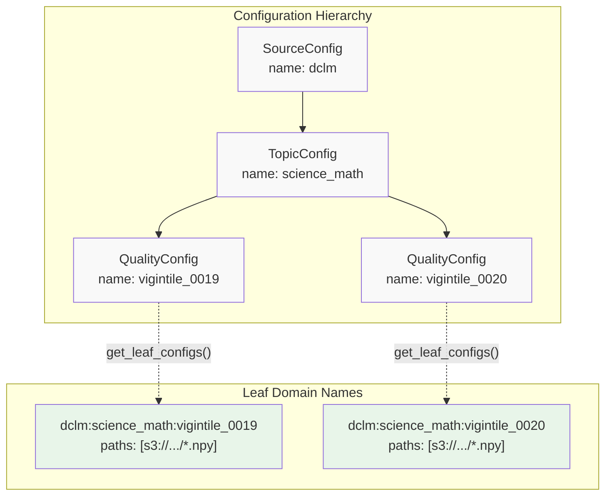
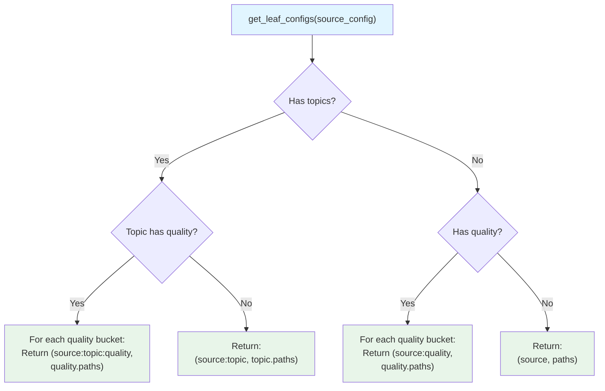
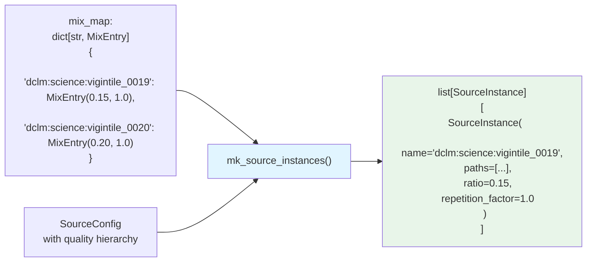
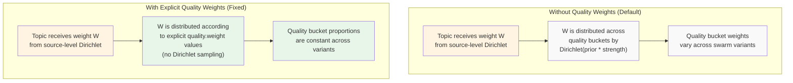
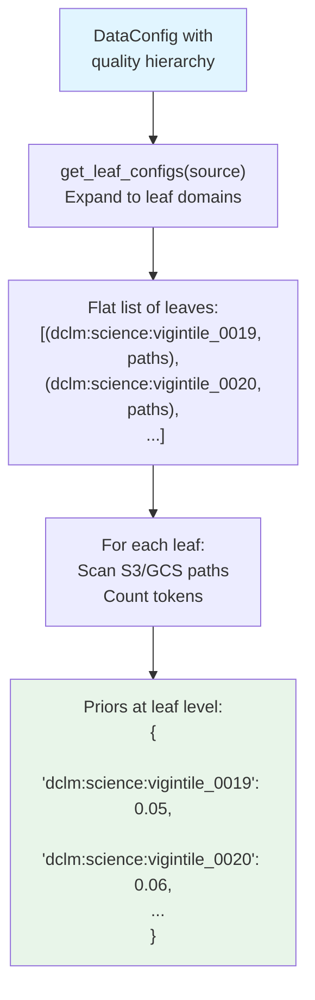
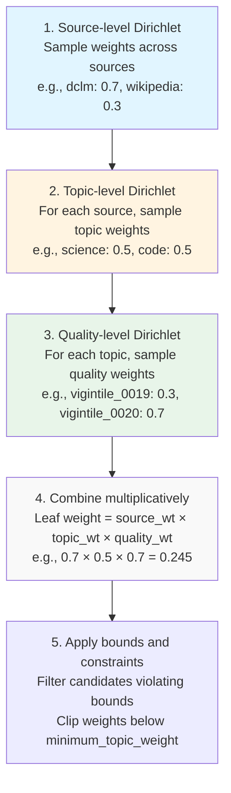

<!-- source: DeepWiki mcp.deepwiki.com · repo allenai/olmix · page 7.2 Quality Thresholding · fetched 2026-10-26 -->

# Quality Thresholding

<details>
<summary>Relevant source files</summary>

The following files were used as context for generating this wiki page:

- [olmix/aliases.py](olmix/aliases.py)
- [olmix/cli.py](olmix/cli.py)
- [olmix/generate/synthesize_mixture.py](olmix/generate/synthesize_mixture.py)
- [olmix/generate/utils.py](olmix/generate/utils.py)
- [olmix/launch/utils.py](olmix/launch/utils.py)
- [plans/011_reorganize_experiment_configs.md](plans/011_reorganize_experiment_configs.md)
- [plans/012_quality_threshold_experiments.md](plans/012_quality_threshold_experiments.md)
- [plans/013_align_wandb_metrics_with_olmo_core.md](plans/013_align_wandb_metrics_with_olmo_core.md)

</details>


## Purpose and Scope

This page documents olmix's quality thresholding system, which enables data mixture experiments that filter or upsample data based on quality scores. The system supports hierarchical quality bucketing (typically vigintiles, i.e., 20 buckets representing 5% percentiles each) and allows researchers to test hypotheses like "Does training on only top 30% quality data improve model performance?"

Quality thresholding extends the hierarchical [DataConfig](#3.4) schema with an optional `QualityConfig` level. For information about how quality configurations participate in mixture sampling, see [Mixture Generation](#2.1). For details on mixture reuse patterns with quality buckets, see [Mixture Reuse](#7.1).

---

## Configuration Schema

### QualityConfig Model

The `QualityConfig` class represents a single quality bucket within a topic or source. It is the lowest level in the data hierarchy.

```python
class QualityConfig(BaseModel):
    name: str                      # e.g., "vigintile_0001", "high", "low"
    paths: list[str]               # S3/GCS globs for this quality level
    weight: float | None = None    # Optional explicit weight (for upsampling)
```

**Key properties:**
- `name`: Arbitrary string identifier (vigintile_0001–0020, or descriptive labels like "high"/"low")
- `paths`: File globs specific to this quality bucket
- `weight`: Optional explicit weight used in quality upsampling experiments (see below)

Sources: [olmix/aliases.py:84-93]()

### Hierarchical Integration

Quality buckets can nest at two levels in the hierarchy:

**Level 1: Topic-level quality** (most common)
```yaml
sources:
  - name: dclm
    topics:
      - name: science_math_and_technology
        quality:
          - name: vigintile_0019
            paths: ["s3://.../.../science_math_and_technology/vigintile_0019/*.npy"]
          - name: vigintile_0020
            paths: ["s3://.../.../science_math_and_technology/vigintile_0020/*.npy"]
```

**Level 2: Source-level quality** (for sources without topics)
```yaml
sources:
  - name: all_dressed
    quality:
      - name: high
        paths: ["s3://.../.../high_quality/*.npy"]
      - name: low
        paths: ["s3://.../.../low_quality/*.npy"]
```

### Validation Rules

The schema enforces mutual exclusivity at each level using Pydantic validators:

| Config Class | Rule | Validation |
|--------------|------|------------|
| `TopicConfig` | XOR constraint | Must have exactly one of: `paths` OR `quality` |
| `SourceConfig` | XOR constraint | Must have exactly one of: `paths` OR `topics` OR `quality` |

These validators prevent ambiguous configurations like defining both direct paths and quality buckets at the same level.

Sources: [olmix/aliases.py:95-121]()

---

## Vigintile Bucketing System

### What Are Vigintiles?

Vigintiles divide a dataset into 20 equal-sized buckets, each representing 5% of the data sorted by quality score. This bucketing scheme is commonly used in data quality filtering experiments.

**Naming convention:**
- `vigintile_0020` = top 5% (highest quality)
- `vigintile_0019` = next 5% (95th–90th percentile)
- `vigintile_0018` = next 5% (90th–85th percentile)
- ...
- `vigintile_0002` = 10th–5th percentile
- `vigintile_0001` = bottom 5% (lowest quality)

### Quality Threshold Semantics

When specifying a quality threshold like "top 30%", include all vigintiles from the threshold bucket up to `vigintile_0020`:

| Threshold | Description | Vigintiles Included | Buckets |
|-----------|-------------|---------------------|---------|
| top 10% | Best 10% of data | vigintile_0019–0020 | 2 |
| top 30% | Best 30% of data | vigintile_0015–0020 | 6 |
| top 50% | Best 50% of data | vigintile_0011–0020 | 10 |
| top 70% | Best 70% of data | vigintile_0007–0020 | 14 |
| top 100% | All data | vigintile_0001–0020 | 20 |

**Example configuration for top 30% threshold:**

```yaml
sources:
  - name: all_dressed
    topics:
      - name: science_math_and_technology
        quality:
          - name: vigintile_0015
            paths: ["s3://ai2-llm/.../science_math_and_technology/vigintile_0015/*.npy"]
          - name: vigintile_0016
            paths: ["s3://ai2-llm/.../science_math_and_technology/vigintile_0016/*.npy"]
          - name: vigintile_0017
            paths: ["s3://ai2-llm/.../science_math_and_technology/vigintile_0017/*.npy"]
          - name: vigintile_0018
            paths: ["s3://ai2-llm/.../science_math_and_technology/vigintile_0018/*.npy"]
          - name: vigintile_0019
            paths: ["s3://ai2-llm/.../science_math_and_technology/vigintile_0019/*.npy"]
          - name: vigintile_0020
            paths: ["s3://ai2-llm/.../science_math_and_technology/vigintile_0020/*.npy"]
```

Sources: [plans/012_quality_threshold_experiments.md:56-67]()

---

## Path Resolution and Leaf Expansion

### Leaf-Level Domain Names

The system flattens hierarchical configurations into leaf-level domains using colon-separated naming:



**Leaf naming patterns:**

| Hierarchy | Leaf Name Pattern | Example |
|-----------|-------------------|---------|
| source only | `{source}` | `wikipedia` |
| source + quality | `{source}:{quality}` | `all_dressed:high` |
| source + topic | `{source}:{topic}` | `dclm:code` |
| source + topic + quality | `{source}:{topic}:{quality}` | `dclm:science_math:vigintile_0019` |

### get_leaf_configs Function

The `get_leaf_configs` function recursively traverses the configuration hierarchy to extract leaf-level (name, paths) tuples:



**Implementation details:**
- Handles four nesting levels: source, source+quality, source+topic, source+topic+quality
- Returns flat list of (domain_name, paths) tuples
- Used by both prior calculation ([calculate_priors:665-694]()) and path resolution
- Each leaf domain becomes an independent variable in Dirichlet sampling

Sources: [olmix/generate/synthesize_mixture.py:665-694]()

### SourceInstance Creation

The `mk_source_instances` function uses leaf domain names to look up weights from the mixture map and construct `SourceInstance` objects for training:



**Key logic:**
- Iterates through sources, topics, and quality buckets
- For each quality bucket, constructs full domain name (e.g., `source:topic:quality`)
- Looks up weight and repetition_factor from `mix_map`
- Skips domains with zero weight
- Returns only non-zero instances for training data pipeline

Sources: [olmix/launch/utils.py:12-86]()

---

## Quality Upsampling Experiments

### Explicit Quality Weights

The `weight` field on `QualityConfig` enables quality upsampling experiments where specific quality buckets receive explicit sampling weights instead of being sampled uniformly within their topic.

**Example: Upsample top-quality buckets within a topic**

```yaml
sources:
  - name: dclm
    topics:
      - name: science_math_and_technology
        weight: 0.5  # Topic receives 50% of source weight
        quality:
          - name: vigintile_0019
            paths: ["s3://.../vigintile_0019/*.npy"]
            weight: 0.3  # 30% of topic weight
          - name: vigintile_0020
            paths: ["s3://.../vigintile_0020/*.npy"]
            weight: 0.7  # 70% of topic weight (upsampled)
```

In this configuration:
- The topic `science_math_and_technology` receives 50% of the source's total weight
- Within the topic, `vigintile_0020` (highest quality) receives 70% × 0.5 = 35% of source weight
- `vigintile_0019` receives 30% × 0.5 = 15% of source weight

### Fixed Quality Weight Distribution

When quality buckets have explicit weights, the system treats them as fixed during Dirichlet sampling:



**Implementation:**

The `generate_weights_dirichlet` function detects explicit quality weights and stores them in `fixed_topic_weights`:

```python
# Around lines 303-342 in synthesize_mixture.py
for source in sources:
    if source.topics:
        if source.topics[0].weight is not None:
            # Topic has fixed weights - expand to leaf-level units
            unit_weights = []
            for topic in sorted(source.topics, key=lambda x: x.name):
                if topic.quality:
                    if has_quality_weights:
                        # Use explicit quality weights
                        quality_weights = [q.weight for q in topic.quality]
                        total_quality_weight = sum(quality_weights)
                        for qw in quality_weights:
                            unit_weights.append(
                                topic.weight * (qw / total_quality_weight)
                            )
                    else:
                        # Distribute proportionally by token count
                        ...
            conditional_weight = np.array([unit_weights])
            fixed_topic_weights[source.name] = conditional_weight
```

During sampling (lines 386-394), these fixed weights bypass Dirichlet variation:

```python
for source, topic_prior in topic_priors.items():
    if source in fixed_topic_weights:
        # Use fixed weights - no Dirichlet sampling
        conditional_weight = fixed_topic_weights[source]
        topic_samples[source].append(conditional_weight)
        continue
    # Otherwise: sample from Dirichlet(topic_prior * strength)
```

Sources: [olmix/generate/synthesize_mixture.py:303-342](), [olmix/generate/synthesize_mixture.py:386-394]()

---

## Integration with Mixture Generation

### Prior Calculation with Quality Buckets

The `calculate_priors` function computes token distributions at the leaf level, treating each quality bucket as an independent domain:



Each quality bucket's token count contributes independently to the prior distribution, enabling the system to respect quality-specific data availability during mixture sampling.

Sources: [olmix/generate/synthesize_mixture.py:696-733]()

### Quality Bucket Weight Bounds

When `enable_bound=True` (default), the system computes per-domain weight bounds based on available tokens and `max_tokens`:

```
bound[domain] = min(tokens[domain] * repetition_factor / max_tokens, 1.0)
```

For quality buckets with limited data (e.g., only top 10% quality), these bounds prevent the sampler from allocating more weight than can be satisfied without exceeding `repetition_factor`.

**Example:**
- `max_tokens = 1B`
- `tokens[dclm:science:vigintile_0020] = 50M`
- `repetition_factor = 2.0`
- `bound = min(50M * 2.0 / 1B, 1.0) = 0.10` (max 10% weight for this bucket)

During Dirichlet sampling, candidates that violate these bounds are rejected, ensuring mixtures respect data availability constraints.

Sources: [olmix/generate/synthesize_mixture.py:167-173]()

### Hierarchical Weight Distribution

The Dirichlet sampling process distributes weights hierarchically when quality buckets are present:



**Key implementation points:**
- Each level uses its own temperature parameter: `source_mix_temperature`, `topic_mix_temperature`
- Strength parameters control diversity: `min_source_strength`, `min_topic_strength`, etc.
- Quality buckets with explicit `weight` values bypass step 3 (no Dirichlet sampling)
- Final leaf weights are products of ancestor weights along the path

Sources: [olmix/generate/synthesize_mixture.py:362-412]()

---

## Common Patterns and Use Cases

### Pattern 1: Uniform Quality Thresholding

**Goal:** Test multiple quality thresholds with equal sampling within each threshold.

```yaml
# top_30pct.yaml
sources:
  - name: dclm
    topics:
      - name: science_math_and_technology
        quality:
          - name: vigintile_0015
            paths: ["s3://.../vigintile_0015/*.npy"]
          - name: vigintile_0016
            paths: ["s3://.../vigintile_0016/*.npy"]
          # ... vigintile_0017 through vigintile_0020
```

All quality buckets within the threshold receive weight proportional to their token counts (natural prior). Useful for isolating the effect of quality filtering.

### Pattern 2: Progressive Upsampling

**Goal:** Gradually increase emphasis on highest-quality data.

```yaml
sources:
  - name: dclm
    topics:
      - name: science_math_and_technology
        quality:
          - name: vigintile_0017
            paths: ["s3://.../vigintile_0017/*.npy"]
            weight: 0.1
          - name: vigintile_0018
            paths: ["s3://.../vigintile_0018/*.npy"]
            weight: 0.2
          - name: vigintile_0019
            paths: ["s3://.../vigintile_0019/*.npy"]
            weight: 0.3
          - name: vigintile_0020
            paths: ["s3://.../vigintile_0020/*.npy"]
            weight: 0.4
```

Higher-quality buckets receive exponentially increasing weights, testing whether "cream of the crop" data provides disproportionate value.

### Pattern 3: Mixed-Quality Sources

**Goal:** Combine quality-bucketed sources with unbucketed sources in a single experiment.

```yaml
sources:
  - name: dclm
    topics:
      - name: science_math_and_technology
        quality:  # Quality-bucketed topic
          - name: vigintile_0019
            paths: ["s3://.../vigintile_0019/*.npy"]
          - name: vigintile_0020
            paths: ["s3://.../vigintile_0020/*.npy"]
  
  - name: arxiv
    paths:  # Direct paths, no quality buckets
      - "s3://.../arxiv/train/*.npy"
```

This pattern enables controlled experiments comparing quality-filtered data against unfiltered reference datasets.

---

## Summary

The quality thresholding system provides a flexible, hierarchical framework for data quality experiments:

| Component | Role | Key Files |
|-----------|------|-----------|
| `QualityConfig` | Defines quality bucket metadata (name, paths, optional weight) | [olmix/aliases.py:84-93]() |
| `get_leaf_configs` | Expands nested configs to flat leaf-level domains | [olmix/generate/synthesize_mixture.py:665-694]() |
| `mk_source_instances` | Resolves leaf domains to training data instances | [olmix/launch/utils.py:12-86]() |
| `generate_weights_dirichlet` | Samples mixture weights with quality-aware bounds | [olmix/generate/synthesize_mixture.py:131-510]() |
| `calculate_priors` | Computes token distributions at leaf level | [olmix/generate/synthesize_mixture.py:696-733]() |

**Key capabilities:**
- Hierarchical quality nesting at source or topic level
- Vigintile bucketing (20 buckets × 5% each)
- Optional explicit weights for quality upsampling
- Automatic weight bounds based on data availability
- Seamless integration with Dirichlet-based mixture generation

For practical examples of quality threshold experiments, see the configurations in `configs/experiments/quality_thresholds/` or consult [Mixture Reuse Case Study](#7.1) for multi-stage optimization patterns.

---

