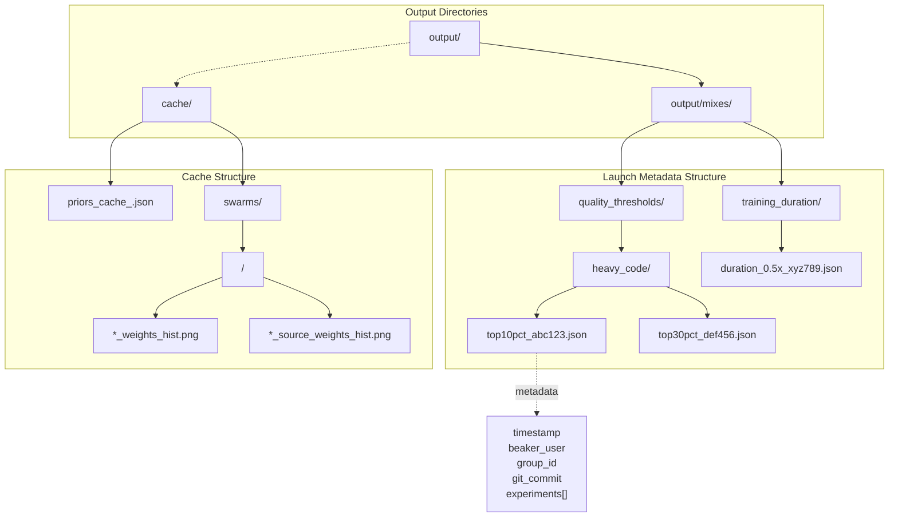
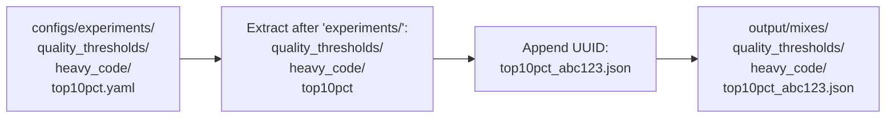
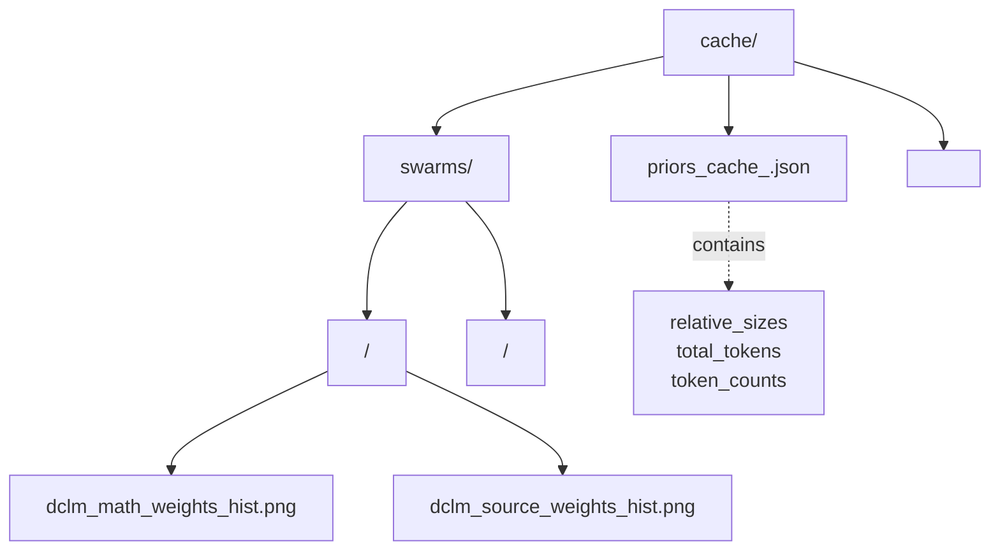
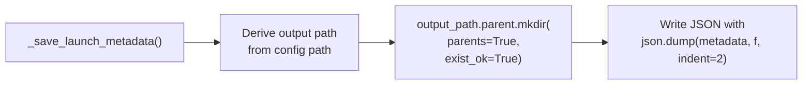
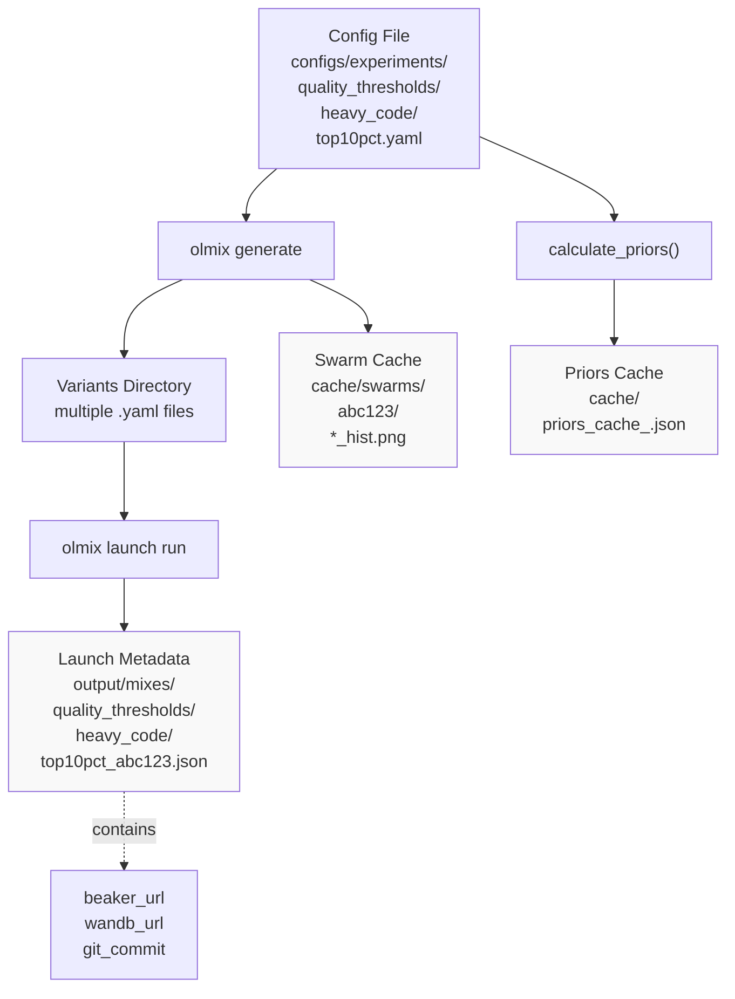

<!-- source: DeepWiki mcp.deepwiki.com · repo allenai/olmix · page 7.3 Output Organization · fetched 2026-10-26 -->

# Output Organization

<details>
<summary>Relevant source files</summary>

The following files were used as context for generating this wiki page:

- [olmix/aliases.py](olmix/aliases.py)
- [olmix/cli.py](olmix/cli.py)
- [olmix/generate/synthesize_mixture.py](olmix/generate/synthesize_mixture.py)
- [olmix/generate/utils.py](olmix/generate/utils.py)
- [olmix/launch/utils.py](olmix/launch/utils.py)
- [plans/014_reorganize_output_structure.md](plans/014_reorganize_output_structure.md)
- [plans/015_quality_upsampling.md](plans/015_quality_upsampling.md)

</details>


This page documents how olmix organizes its output artifacts, including launch metadata files, cache directories, and the hierarchical path structure that mirrors the experiment configuration layout. Understanding this organization is essential for locating experiment results, debugging issues, and managing long-running research projects with many experimental variants.

For information about the configuration structure that these outputs mirror, see [Configuration System](#3). For details on loading experiment results for fitting, see [Data Loading](#6).

---

## Output Directory Structure

Olmix produces outputs in two primary locations: `output/mixes/` for launch metadata and `cache/` for temporary artifacts.



**Sources:** [olmix/cli.py:34-76](), [olmix/generate/synthesize_mixture.py:594-638](), [plans/014_reorganize_output_structure.md:1-212]()

---

## Hierarchical Launch Metadata Paths

Launch metadata files are organized to mirror the structure of experiment configuration files under `configs/experiments/`. This makes it easy to locate outputs for specific experiments.

### Path Derivation Logic

| Config Path | Output Path |
|------------|-------------|
| `configs/experiments/training_duration/duration_0.5x.yaml` | `output/mixes/training_duration/duration_0.5x_e326e56e.json` |
| `configs/experiments/quality_thresholds/heavy_code/top10pct.yaml` | `output/mixes/quality_thresholds/heavy_code/top10pct_333ccd44.json` |

The output path construction follows these rules:
1. Extract the relative path after `experiments/` in the config path
2. Replace the `.yaml` extension with `_{group_uuid}.json`
3. Place under `output/mixes/` with the same directory hierarchy



**Sources:** [plans/014_reorganize_output_structure.md:51-79]()

---

## Launch Metadata JSON Structure

Each launch operation saves a metadata file containing comprehensive information for reproducibility and tracking.

### Metadata Fields

The `_save_launch_metadata()` function in [olmix/cli.py:34-76]() creates JSON files with the following structure:

```json
{
  "metadata": {
    "timestamp": "2024-03-15T14:23:45.123456+00:00",
    "beaker_user": "USERNAME",
    "group_id": "abc123de",
    "wandb_url": "https://wandb.ai/ai2-llm/olmix?group=abc123de",
    "git_commit": "a1b2c3d4",
    "git_branch": "main"
  },
  "config": {
    "name": "top10pct-heavy-code",
    "description": "Quality threshold experiment with heavy code",
    "infra": { ... },
    "training": { ... },
    "data": { ... },
    "eval": { ... },
    "mix": { ... },
    "group_id": "abc123de"
  },
  "experiments": [
    {
      "variant": 0,
      "beaker_id": "01HXYZ...",
      "beaker_name": "top10pct-heavy-code-abc123de-0000",
      "beaker_url": "https://beaker.org/ex/01HXYZ..."
    }
  ]
}
```

### Field Descriptions

| Field | Purpose | Source |
|-------|---------|--------|
| `metadata.timestamp` | ISO 8601 timestamp of launch | `datetime.now(UTC).isoformat()` |
| `metadata.beaker_user` | User who launched the experiment | `Beaker.from_env().user_name` |
| `metadata.group_id` | Experiment group UUID (8 chars) | Generated or from config |
| `metadata.wandb_url` | Direct link to W&B group dashboard | Constructed from group_id |
| `metadata.git_commit` | Git commit hash (8 chars) | `git rev-parse HEAD` |
| `metadata.git_branch` | Git branch name | `git rev-parse --abbrev-ref HEAD` |
| `config` | Complete LaunchConfig | `base.model_dump(mode="json")` |
| `experiments[].variant` | Variant index in swarm | Loop index |
| `experiments[].beaker_id` | Beaker experiment ID | `result.experiment.id` |
| `experiments[].beaker_url` | Direct link to Beaker | Constructed from experiment ID |

**Sources:** [olmix/cli.py:34-76](), [olmix/cli.py:24-31]()

---

## Cache Organization

The `cache/` directory stores temporary artifacts that can be regenerated but are cached for performance.

### Cache Directory Structure



### Priors Cache

Priors are cached using an MD5 hash of the source configuration to avoid re-scanning cloud storage paths. The cache file path is constructed as:

```python
config_hash = hashlib.md5(
    json.dumps(
        [(sc.name, sc.paths) for sc in source_configs],
        sort_keys=True,
    ).encode("utf-8")
).hexdigest()

cache_path = Path(f"cache/priors_cache_{config_hash}.json")
```

The cache contains:
- `relative_sizes`: Dict mapping domain names to fractional token counts
- `total_tokens`: Total tokens across all sources
- `token_counts`: Dict mapping domain names to absolute token counts

**Sources:** [olmix/generate/synthesize_mixture.py:696-716]()

### Swarm Cache

When generating mixture variants, weight histograms are saved to help visualize the sampling distribution. These are organized by `group_uuid`:

```python
out_dir = pathlib.Path("cache") / "swarms" / str(group_uuid)
out_dir.mkdir(parents=True, exist_ok=True)

# Save topic-level histograms
safe_topic = re.sub(r"[^A-Za-z0-9_.-]+", "_", domains[i])
plt.savefig(out_dir / f"{safe_topic}_weights_hist.png", dpi=200)

# Save source-level histograms
safe_source = re.sub(r"[^A-Za-z0-9_.-]+", "_", source)
plt.savefig(out_dir / f"{safe_source}_source_weights_hist.png", dpi=200)
```

Histogram files follow the naming pattern:
- Topic: `<source>_<topic>_weights_hist.png`
- Source: `<source>_source_weights_hist.png`

Special characters are replaced with underscores for filesystem safety.

**Sources:** [olmix/generate/synthesize_mixture.py:594-638]()

---

## Creating Output Directories

Olmix automatically creates output directories as needed, using `parents=True, exist_ok=True` to ensure idempotent operation.



### Directory Creation Examples

| Operation | Directory Created | Code Location |
|-----------|------------------|---------------|
| Launch metadata | `output/mixes/<hierarchy>/` | [olmix/cli.py:72]() |
| Priors cache | `cache/` | [olmix/generate/synthesize_mixture.py:706]() |
| Swarm histograms | `cache/swarms/<group_uuid>/` | [olmix/generate/synthesize_mixture.py:603]() |

**Sources:** [olmix/cli.py:72](), [olmix/generate/synthesize_mixture.py:603-612](), [olmix/generate/synthesize_mixture.py:706]()

---

## Working with Output Files

### Locating Launch Metadata

To find the metadata for a specific experiment:

1. **From config path**: Replace `configs/experiments/` with `output/mixes/` and `.yaml` with `_{group_uuid}.json`
2. **From experiment name**: Search in `output/mixes/` for files matching `*_{group_uuid}.json`
3. **From W&B group**: The metadata file contains `wandb_url` linking to the group dashboard

### Metadata Usage Patterns

| Task | Metadata Fields Used |
|------|---------------------|
| Resume failed launches | `experiments[].beaker_id`, `experiments[].beaker_name` |
| Track W&B runs | `metadata.wandb_url`, `metadata.group_id` |
| Reproduce experiment | `config`, `metadata.git_commit` |
| Debug issues | `metadata.timestamp`, `metadata.beaker_user`, `experiments[]` |

### Example: Loading Metadata

```python
import json
from pathlib import Path

metadata_path = Path("output/mixes/quality_thresholds/heavy_code/top10pct_abc123.json")
with open(metadata_path) as f:
    metadata = json.load(f)

# Access experiment information
group_id = metadata["metadata"]["group_id"]
wandb_url = metadata["metadata"]["wandb_url"]
beaker_experiments = metadata["experiments"]

# Access full config
config = metadata["config"]
```

**Sources:** [olmix/cli.py:59-74]()

---

## Path Resolution for Non-Standard Configs

If a configuration file is not under `configs/experiments/`, the output path falls back to a flat structure using just the filename:

```python
# Fallback logic (from plan)
try:
    experiments_idx = parts.index("experiments")
except ValueError:
    # Not under experiments/ - use flat structure
    return Path(f"output/mixes/{config_path.stem}_{group_uuid}.json")
```

This ensures backward compatibility for legacy configs or configs stored in non-standard locations.

| Config Location | Output Location |
|----------------|-----------------|
| `configs/experiments/training_duration/dur.yaml` | `output/mixes/training_duration/dur_abc123.json` |
| `my_experiment.yaml` | `output/mixes/my_experiment_abc123.json` |
| `/tmp/test.yaml` | `output/mixes/test_abc123.json` |

**Sources:** [plans/014_reorganize_output_structure.md:54-79]()

---

## Complete Output Organization Example

This diagram shows the complete flow from configuration to all output artifacts:



**Sources:** [olmix/cli.py:34-76](), [olmix/generate/synthesize_mixture.py:594-638](), [olmix/generate/synthesize_mixture.py:696-716]()

---

