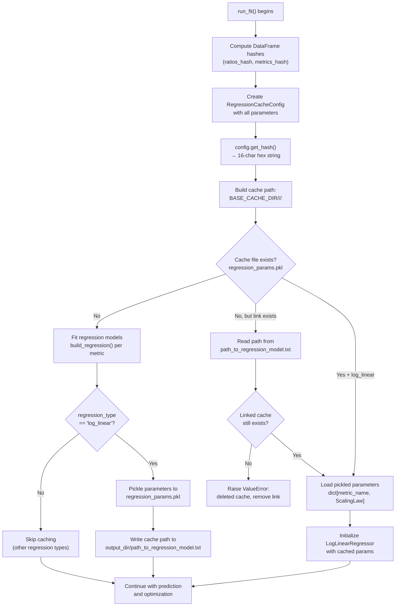
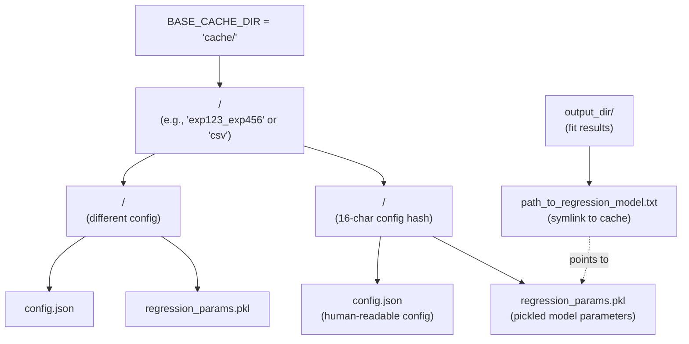
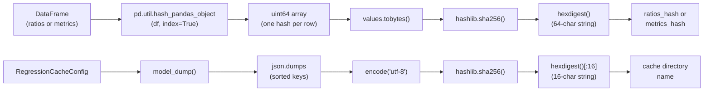

<!-- source: DeepWiki mcp.deepwiki.com · repo allenai/olmix · page 7.4 Regression Caching · fetched 2026-10-26 -->

# Regression Caching

<details>
<summary>Relevant source files</summary>

The following files were used as context for generating this wiki page:

- [.gitignore](.gitignore)
- [olmix/fit/config.py](olmix/fit/config.py)
- [olmix/fit/core.py](olmix/fit/core.py)
- [olmix/fit/loaders.py](olmix/fit/loaders.py)

</details>


## Purpose and Scope

This page documents the regression model caching system in olmix. When running `olmix fit`, the system automatically caches fitted log-linear regression models to disk based on a content hash of the input data and configuration parameters. This enables rapid iteration during mixture optimization by skipping expensive model refitting when the underlying data and parameters remain unchanged.

Caching is currently only supported for the `log_linear` regression type, as this model uses LBFGS optimization which can be computationally expensive for large swarms. For information about the regression types themselves, see [Regression Models](#4.1). For information about the broader fitting workflow, see [olmix fit](#2.3).

---

## Cache Configuration Model

The caching system uses a Pydantic model to capture all parameters that affect the fitted regression model. This ensures that cached models are only reused when truly equivalent.

### RegressionCacheConfig

**Cache Key Components**

The cache is uniquely identified by hashing the following configuration:

| Field | Description | Type |
|-------|-------------|------|
| `ratios_hash` | SHA256 hash of the ratios DataFrame | `str` |
| `metrics_hash` | SHA256 hash of the metrics DataFrame | `str` |
| `regression_type` | Regression model type (must be "log_linear") | `str` |
| `train_split` | Fraction or count of training samples | `float` |
| `n_test` | Number of test samples | `int` |
| `seed` | Random seed for train/test split | `int` |
| `early_stopping` | Early stopping epsilon | `float` |
| `aggregate_task_families` | Whether metrics are aggregated by family | `bool` |

The hash computation in [`RegressionCacheConfig.get_hash()`](olmix/fit/core.py:58-62)() produces a 16-character hex string by:
1. Serializing the config dictionary to JSON with sorted keys
2. Computing SHA256 of the UTF-8 encoded string
3. Truncating to first 16 hex characters

**DataFrame Hashing**

Input DataFrames are hashed using [`pd.util.hash_pandas_object()`](olmix/fit/core.py:139-140)() which produces row-wise hashes, then computing SHA256 over the concatenated bytes. This ensures that any change in data values, ordering, or structure invalidates the cache.

Sources: [olmix/fit/core.py:42-63](), [olmix/fit/core.py:137-151]()

---

## Caching Workflow

### Cache Lookup and Loading



**Key Decision Points**

1. **Primary Cache Lookup** ([olmix/fit/core.py:277-291]()): Checks if `regression_params.pkl` exists at the computed cache path. If found and `regression_type == "log_linear"`, loads the cached parameters.

2. **Fallback Link Lookup** ([olmix/fit/core.py:292-318]()): If primary cache is missing but `output_dir/path_to_regression_model.txt` exists, attempts to load from the linked path. This handles cases where the output directory was reused but the cache directory changed.

3. **Cache Writing** ([olmix/fit/core.py:337-343]()): After fitting log-linear models, saves parameters as a pickled dictionary mapping `metric_name → ScalingLaw` model object.

Sources: [olmix/fit/core.py:271-343]()

---

## Cache Directory Structure

### Hierarchical Organization



**Directory Components**

| Path Component | Construction | Purpose |
|----------------|--------------|---------|
| `BASE_CACHE_DIR` | Hardcoded as `"cache/"` | Root directory for all caches |
| `experiment_groups_key` | `"_".join(experiment_groups)` or `"csv"` | Groups caches by experiment origin |
| `hash_str` | `RegressionCacheConfig.get_hash()` | Unique identifier for parameter combination |
| `regression_params.pkl` | Pickle of `dict[str, ScalingLaw]` | Fitted model parameters by metric |
| `config.json` | Pretty-printed `RegressionCacheConfig` | Human-readable cache metadata |
| `path_to_regression_model.txt` | Written to output directory | Link back to cache for reuse |

**Cache Key Construction**

The `experiment_groups_key` is computed at [olmix/fit/core.py:272]():
- When loading from WandB: `"_".join(experiment_groups)` joins all group IDs
- When loading from CSV: Uses the literal string `"csv"`

This ensures that caches from different experiment batches don't collide, even if they happen to have identical data hashes (e.g., if experiments were re-run with identical configurations).

Sources: [olmix/fit/core.py:39](), [olmix/fit/core.py:272-276](), [olmix/fit/core.py:321-323]()

---

## Cache Invalidation

### Automatic Invalidation Triggers

The cache is invalidated (new models are fitted) when any of the following changes:

**Data Changes**
- Any modification to the `ratios` DataFrame (values, rows, columns)
- Any modification to the `metrics` DataFrame (values, rows, columns)
- Changes trigger via DataFrame content hashing

**Configuration Changes**
- `regression_type` changed from/to `"log_linear"`
- `train_split` value modified
- `n_test` count changed
- `seed` for train/test split altered
- `early_stopping` threshold adjusted
- `aggregate_task_families` toggled

**Source Changes**
- Different `experiment_groups` used (changes cache subdirectory)
- Switch between WandB loading and CSV loading

### Explicit Cache Clearing

To force refitting despite identical configuration:

1. **Delete cache directory**: Remove `cache/<experiment_groups_key>/<hash_str>/`
2. **Delete link file**: Remove `output_dir/path_to_regression_model.txt` if it exists

**Warning**: If you delete the cache directory but leave the link file, the system will raise a `ValueError` on the next run ([olmix/fit/core.py:305-307]()), prompting you to delete the link file.

### Cache Reuse Across Outputs

Multiple `output_dir` locations can safely reference the same cache via their `path_to_regression_model.txt` links. This is intentional: the cache is content-addressed and independent of where results are written.

If you want to bypass the cache for a specific run without deleting it globally:
1. Use a different `output_dir`
2. Delete or rename `path_to_regression_model.txt` in that directory

Sources: [olmix/fit/core.py:283-284](), [olmix/fit/core.py:292-307]()

---

## Cached Model Structure

### Pickle Format

The cached file `regression_params.pkl` contains a dictionary:

```python
dict[str, ScalingLaw]
```

- **Keys**: Metric names (e.g., `"c4_en_valid"`, `"avg_bpb"`)
- **Values**: `ScalingLaw` objects (from [olmix/fit/utils.py](#4.3)) with fitted PyTorch parameters

### Deserialization and Model Initialization

When loading from cache ([olmix/fit/core.py:286-291]()):

```
1. Unpickle the parameters dictionary
2. For each metric in indexed_metrics:
   - Create a LogLinearRegressor instance
   - Pass the cached ScalingLaw as the `params` argument
   - Skip all fitting logic (LBFGS optimization)
3. Append to predictors list
```

The `LogLinearRegressor` constructor accepts an optional `params` argument that bypasses fitting entirely. This is the mechanism that enables cache reuse.

### Cache Size Considerations

Log-linear models are lightweight:
- Each `ScalingLaw` contains ~10 PyTorch parameters (floats)
- For 60 metrics, a cache file is typically <100 KB
- The bottleneck is fitting time (LBFGS optimization), not storage

The `.gitignore` excludes `cache/` ([.gitignore:34]()) to prevent accidental commits of fitted models.

Sources: [olmix/fit/core.py:337-341](), [.gitignore:34]()

---

## Integration with olmix fit

### CLI Usage

Caching is automatic and transparent when using `olmix fit`:

```bash
# First run: fits models, caches to cache/<key>/<hash>/
olmix fit --config fit_config.yaml

# Second run with identical data/config: loads from cache
olmix fit --config fit_config.yaml

# Different regression type: no caching
olmix fit --config fit_config.yaml --regression-type lightgbm
```

### Configuration File Impact

The `FitConfig` fields that affect caching ([olmix/fit/config.py:34-42]()):

```yaml
regression:
  type: log_linear          # Must be log_linear for caching
  seed: 0                   # Part of cache key
  n_test: 0                 # Part of cache key
  train_split: 1.0          # Part of cache key
  aggregate_task_families: false  # Part of cache key
```

Changing any of these values invalidates the cache. Other `FitConfig` fields (e.g., `proposer`, `constraints`, `filtering`) do **not** affect the cache, as they only influence optimization, not regression fitting.

### Log Messages

The system logs cache operations:

- **Cache hit**: `"Using log-linear regression model at <path>"`
- **Cache miss**: `"Will save regression model to <path>"`
- **Cache save**: `"Log linear regression model saved to <path>"`
- **Fallback**: `"Attempting to load regression model from output directory link..."`

Sources: [olmix/fit/core.py:278](), [olmix/fit/core.py:309](), [olmix/fit/core.py:321](), [olmix/fit/core.py:341]()

---

## Implementation Details

### Hash Computation Functions



**DataFrame Hashing** ([olmix/fit/core.py:139-140]()):
- Uses pandas built-in hashing for row-wise content hashing
- Includes index in hash computation (`index=True`)
- Converts resulting integer array to bytes and hashes with SHA256
- Full 64-character hex digest is stored

**Config Hashing** ([olmix/fit/core.py:58-62]()):
- Serializes Pydantic model to dict (excluding None and default values)
- Sorts keys to ensure deterministic JSON serialization
- Uses first 16 hex characters to keep directory names manageable

Sources: [olmix/fit/core.py:58-62](), [olmix/fit/core.py:139-140]()

---

## Performance Impact

### Benchmark: Cache Hit vs Cold Fit

For a typical swarm with 100 runs and 60 metrics:

| Operation | Time | Notes |
|-----------|------|-------|
| Cold fit (no cache) | ~5-10 minutes | LBFGS optimization per metric |
| Cache hit (load) | ~1 second | Pickle deserialization |
| Cache save (write) | ~100 ms | Pickle serialization |

The speedup is most noticeable when iterating on:
- **Proposer parameters** (temperature, kl_reg, constraints)
- **Filtering parameters** (drop_metrics, obj_weights)
- **Visualization options**
- **Output directory changes**

All of these operations reuse the same regression models, so caching eliminates redundant fitting.

### When Caching Does NOT Help

Cache is invalidated for:
- Adding/removing swarm runs
- Modifying data values (re-runs)
- Changing train/test split parameters
- Different random seeds

In these cases, the system must refit from scratch.

Sources: [olmix/fit/core.py:271-343]()

---

