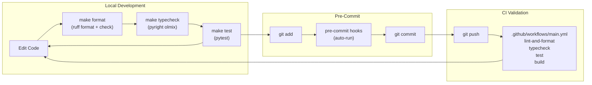
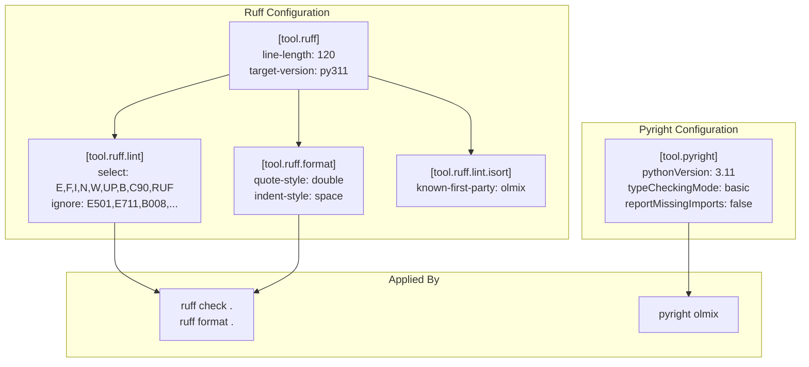
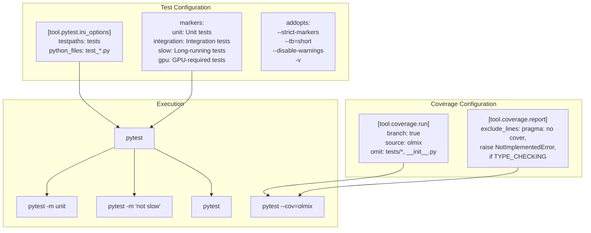
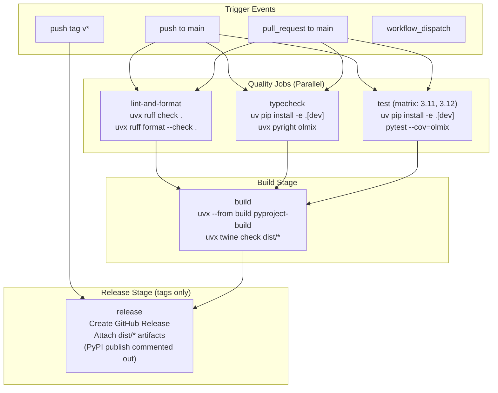
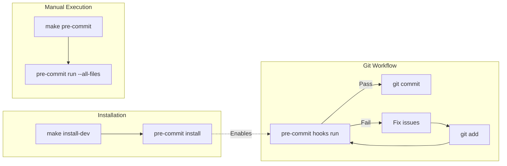
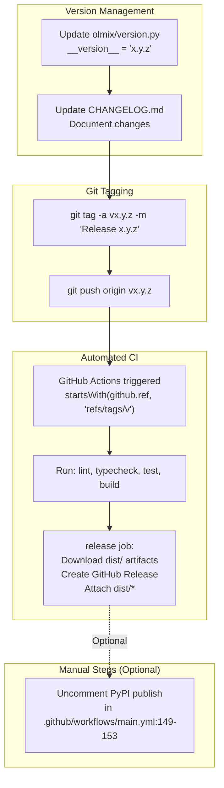

<!-- source: DeepWiki mcp.deepwiki.com · repo allenai/olmix · page 8 Development Guide · fetched 2026-10-26 -->

# Development Guide

<details>
<summary>Relevant source files</summary>

The following files were used as context for generating this wiki page:

- [.github/dependabot.yml](.github/dependabot.yml)
- [.github/workflows/main.yml](.github/workflows/main.yml)
- [CHANGELOG.md](CHANGELOG.md)
- [CONTRIBUTING.md](CONTRIBUTING.md)
- [Makefile](Makefile)
- [pyproject.toml](pyproject.toml)

</details>


This guide provides information for contributors to the olmix codebase. It covers development environment setup, code quality standards, testing practices, CI/CD workflows, and the release process. 

For detailed information about specific testing practices and markers, see [Testing](#8.1). For CI/CD pipeline specifics, see [CI/CD Pipeline](#8.2). For individual code quality tool configurations, see [Code Quality Tools](#8.3).

## Development Environment Setup

The olmix project uses modern Python packaging tools and requires Python 3.11 or higher. Development dependencies are defined in the `[project.optional-dependencies]` section of `pyproject.toml`.

### Installation Steps

```bash
# Clone and create virtual environment
git clone https://github.com/allenai/olmix.git
cd olmix
python -m venv .venv
source .venv/bin/activate

# Install with development dependencies
make install-dev
# Equivalent to: uv pip install -e ".[dev]"
```

The `install-dev` target [Makefile:28-31]() installs the package in editable mode with all development dependencies including pytest, ruff, pyright, and pre-commit hooks.

### Development Dependencies

| Category | Tools | Purpose |
|----------|-------|---------|
| **Testing** | pytest, pytest-cov, pytest-asyncio, pytest-timeout, flaky | Test execution, coverage, async support |
| **Linting/Formatting** | ruff | Combined linting and code formatting |
| **Type Checking** | pyright, mypy | Static type analysis |
| **Git Hooks** | pre-commit | Automated quality checks on commit |

Sources: [pyproject.toml:62-91]()

## Development Workflow

The standard development workflow follows this cycle:



### Quick Development Commands

| Command | Action | Equivalent |
|---------|--------|------------|
| `make install-dev` | Install with dev dependencies | `uv pip install -e ".[dev]"` |
| `make format` | Format and fix code | `ruff format . && ruff check --fix .` |
| `make lint` | Check and fix linting issues | `ruff check . --fix` |
| `make typecheck` | Run static type checking | `pyright olmix` |
| `make test` | Run all tests | `pytest` |
| `make test-fast` | Skip slow tests | `pytest -m "not slow"` |
| `make test-cov` | Run tests with coverage | `pytest --cov=olmix --cov-report=html` |
| `make run-checks` | Run all quality checks | Runs format-check, lint, typecheck, test |
| `make clean` | Remove build artifacts | Cleans dist/, __pycache__, .ruff_cache, etc. |

Sources: [Makefile:1-118]()

## Code Quality Standards

The project enforces strict code quality standards through automated tooling. Configuration is centralized in `pyproject.toml`.

### Code Style



### Ruff Linter Rules

The project uses ruff for both linting and formatting, configured at [pyproject.toml:100-151](). Key rules:

- **Selected rule sets**: pycodestyle errors (E), pyflakes (F), isort (I), pep8-naming (N), pycodestyle warnings (W), pyupgrade (UP), flake8-bugbear (B), mccabe complexity (C90), ruff-specific rules (RUF)
- **Ignored rules**: Line length checked by formatter (E501), comparison to None (E711), comparison to True/False (E712), function complexity (C901)
- **Line length**: 120 characters
- **Quote style**: Double quotes
- **Import order**: `olmix` is a known first-party package

### Type Checking

Pyright configuration [pyproject.toml:152-164]():
- **Type checking mode**: `basic` (not strict)
- **Python version**: 3.11
- **Missing imports**: Not reported (allows flexibility with optional dependencies)
- **Excluded paths**: `__pycache__`, `.venv`, `build`, `dist`, `docs`

Sources: [pyproject.toml:100-164]()

## Testing Infrastructure

Testing uses pytest with custom markers for categorizing test types. Detailed testing documentation is in [Testing](#8.1).

### Test Organization



### Test Markers

Defined at [pyproject.toml:178-183]():

| Marker | Purpose | Usage |
|--------|---------|-------|
| `@pytest.mark.unit` | Fast unit tests, no external resources | Default for most tests |
| `@pytest.mark.integration` | Tests requiring external services (S3, WandB) | Use sparingly |
| `@pytest.mark.slow` | Tests taking >1 second | Skip with `pytest -m "not slow"` |
| `@pytest.mark.gpu` | Tests requiring GPU hardware | Skip on CPU-only systems |

### Coverage Configuration

Coverage tracking [pyproject.toml:190-219]():
- **Source**: `olmix` package only
- **Omitted**: Test files, `__init__.py`, `conftest.py`, `version.py`
- **Branch coverage**: Enabled (`branch = true`)
- **Excluded lines**: Type checking blocks, abstract methods, debug code
- **Output**: Terminal report + HTML report in `htmlcov/`

Sources: [pyproject.toml:166-219]()

## CI/CD Pipeline

The GitHub Actions workflow `.github/workflows/main.yml` automates quality checks, testing, building, and releasing. See [CI/CD Pipeline](#8.2) for details.

### Pipeline Stages



### Job Details

| Job | Runs On | Python Versions | Key Steps |
|-----|---------|-----------------|-----------|
| **lint-and-format** | ubuntu-latest | 3.11 | `uvx ruff check .`, `uvx ruff format --check .` |
| **typecheck** | ubuntu-latest | 3.11 | Install deps, `uvx pyright olmix` |
| **test** | ubuntu-latest | 3.11, 3.12 (matrix) | Install deps, `pytest --cov`, upload coverage |
| **build** | ubuntu-latest | 3.11 | Build with `pyproject-build`, check with `twine` |
| **release** | ubuntu-latest | 3.11 | Create GitHub release, attach artifacts |

The `release` job [.github/workflows/main.yml:123-153]() only runs on version tags (`refs/tags/v*`) and requires all other jobs to pass. PyPI publishing is commented out but can be enabled.

Sources: [.github/workflows/main.yml:1-154]()

## Pre-Commit Hooks

Pre-commit hooks automatically run quality checks before commits. The hooks are installed by `make install-dev` [Makefile:30-31]().

### Hook Configuration Flow



Pre-commit hooks ensure code quality before commits reach CI. If hooks fail, fix the issues and re-stage the files.

Sources: [Makefile:28-31](), [Makefile:106-113]()

## Build and Release Process

### Building Distribution Packages

The build process creates source distributions and wheels:

```bash
make build
# Equivalent to:
# make clean  # Remove old artifacts
# python -m build
```

The build job in CI [.github/workflows/main.yml:95-122]() uses `uvx --from build pyproject-build --installer uv` and validates with `uvx twine check dist/*`.

### Release Workflow



### Versioning Strategy

The project follows [Semantic Versioning](https://semver.org/):
- **MAJOR**: Breaking API changes
- **MINOR**: New features (backward compatible)
- **PATCH**: Bug fixes (backward compatible)

The version is dynamically loaded from [olmix/version.py]() via [pyproject.toml:97-98]():
```python
# In pyproject.toml:
[tool.setuptools.dynamic]
version = {attr = "olmix.version.__version__"}
```

### Release Conditions

The release job [.github/workflows/main.yml:123-153]() has these conditions:
- **Trigger**: Only on tags matching `refs/tags/v*`
- **Dependencies**: Requires `lint-and-format`, `typecheck`, `test`, `build` jobs to pass
- **Permissions**: `id-token: write` (for PyPI trusted publishing), `contents: write` (for GitHub releases)
- **Prerelease detection**: Tags containing `rc`, `alpha`, or `beta` are marked as prereleases

Sources: [.github/workflows/main.yml:123-153](), [pyproject.toml:97-98]()

## Dependency Management

### Core Dependencies

Project dependencies are defined in [pyproject.toml:23-49]():

| Category | Dependencies |
|----------|--------------|
| **Training** | `ai2-olmo-core[eval] @ git+...` (pinned to specific branch) |
| **Cloud Storage** | `boto3`, `s3fs`, `gcsfs` |
| **ML/Data** | `torch`, `numpy`, `pandas`, `scikit-learn`, `scipy`, `lightgbm` |
| **Optimization** | `cvxpy`, `ecos` |
| **Utilities** | `click`, `pyyaml`, `tqdm`, `yaspin`, `pydantic` |
| **Visualization** | `matplotlib`, `seaborn` |
| **Experiment Tracking** | `wandb`, `datasets` |

### Optional Dependencies

Two optional dependency groups [pyproject.toml:62-91]():

1. **`beaker`**: For Beaker platform integration
   - `beaker-py>=1,<2`
   - `GitPython>=3.0,<4.0`

2. **`dev`**: All development tools (testing, linting, type checking)
   - Installed via `make install-dev` or `pip install -e ".[dev]"`

### Automated Updates

Dependabot is configured [.github/dependabot.yml:1-12]() to check for updates daily:
- **Python packages**: Checks `pyproject.toml`
- **GitHub Actions**: Checks workflow files
- **Open PR limit**: Maximum 10 concurrent update PRs

Sources: [pyproject.toml:23-91](), [.github/dependabot.yml:1-12]()

## Project Structure

```
olmix/
├── olmix/                  # Main package
│   ├── __init__.py
│   ├── version.py         # Version string
│   ├── cli.py             # Main CLI entry point
│   ├── aliases.py         # Configuration models (LaunchConfig, etc.)
│   ├── generate/          # Mixture generation (olmix generate)
│   ├── launch/            # Beaker integration (olmix launch)
│   ├── fit/               # Optimization (olmix fit)
│   └── priors/            # Prior computation (olmix priors)
├── tests/                 # Test suite
│   ├── conftest.py        # Pytest fixtures
│   ├── test_*.py          # Test modules
│   └── ...
├── pyproject.toml         # Project configuration
├── Makefile               # Development commands
├── .github/
│   ├── workflows/
│   │   └── main.yml       # CI/CD pipeline
│   └── dependabot.yml     # Dependency automation
├── CONTRIBUTING.md        # Contribution guidelines
├── CHANGELOG.md           # Version history
└── README.md              # Project documentation
```

### Configuration Centralization

All tool configurations are centralized in `pyproject.toml`:

| Tool | Configuration Section | Lines |
|------|----------------------|-------|
| Project metadata | `[project]` | [5-60]() |
| Build system | `[build-system]` | [1-3]() |
| Dependencies | `[project.dependencies]`, `[project.optional-dependencies]` | [23-91]() |
| Ruff (linting + formatting) | `[tool.ruff.*]` | [100-151]() |
| Pyright (type checking) | `[tool.pyright]` | [152-164]() |
| Pytest | `[tool.pytest.ini_options]` | [166-187]() |
| Coverage | `[tool.coverage.*]` | [189-219]() |

Sources: [pyproject.toml:1-220]()

## Common Development Tasks

### Running Specific Test Subsets

```bash
# Run only unit tests
pytest -m unit

# Run only integration tests
pytest -m integration

# Skip slow tests
pytest -m "not slow"

# Run tests for specific module
pytest tests/test_generate.py

# Run tests matching pattern
pytest -k "test_dirichlet"

# Run with verbose output
pytest -vv

# Run with coverage
pytest --cov=olmix --cov-report=term-missing
```

### Code Quality Checks

```bash
# Run all checks (used in CI)
make run-checks

# Individual checks
make format-check  # Check formatting without applying
make lint          # Check and auto-fix linting issues
make typecheck     # Run pyright
make test          # Run pytest

# Format code
make format        # Apply ruff formatting and fixes
```

### Cleaning Build Artifacts

```bash
make clean
# Removes:
# - build/, dist/, *.egg-info
# - .pytest_cache/, .mypy_cache/, .ruff_cache/
# - htmlcov/, .coverage
# - All __pycache__ directories
# - All .pyc, .pyo, *~ files
```

Sources: [Makefile:1-118](), [pyproject.toml:166-219]()

## Troubleshooting

### Common Issues

| Issue | Solution |
|-------|----------|
| Import errors after installation | Ensure you installed in editable mode: `pip install -e ".[dev]"` |
| Pre-commit hooks not running | Run `pre-commit install` to install hooks |
| Type checking errors | Check `[tool.pyright]` config; some missing imports are ignored |
| Coverage too low | Check `[tool.coverage.report]` for excluded lines |
| Tests hanging | Some tests may be marked `@pytest.mark.slow`; skip with `-m "not slow"` |
| Ruff formatting conflicts | Run `make format` to apply consistent formatting |

### CI Failures

If CI fails:

1. **Lint/format failures**: Run `make format` locally and commit
2. **Type check failures**: Run `make typecheck` and fix reported issues
3. **Test failures**: Run `make test` locally to reproduce
4. **Build failures**: Run `make build` to check packaging

Sources: [pyproject.toml:1-220](), [Makefile:1-118](), [.github/workflows/main.yml:1-154]()

---

