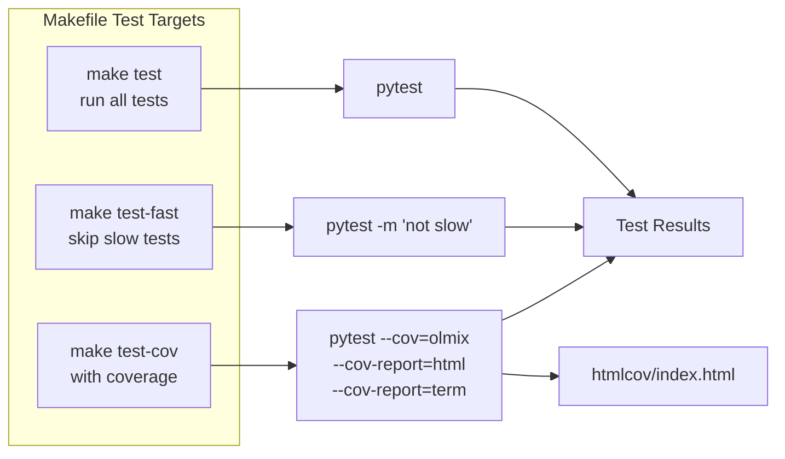
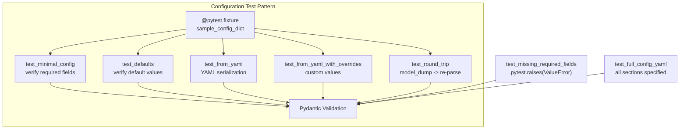
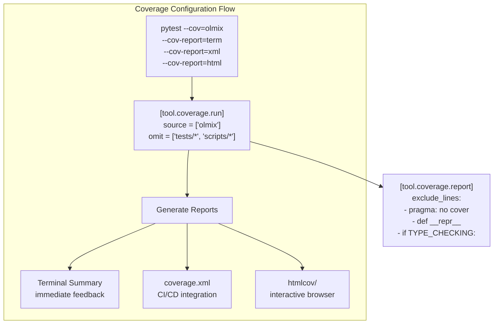
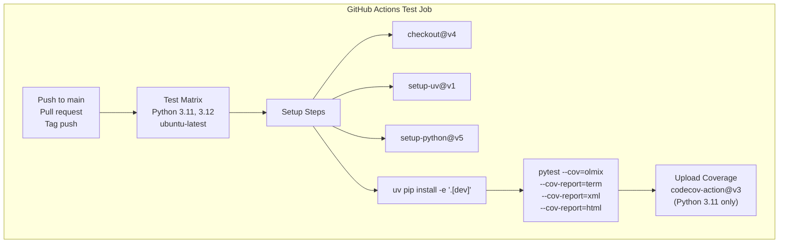
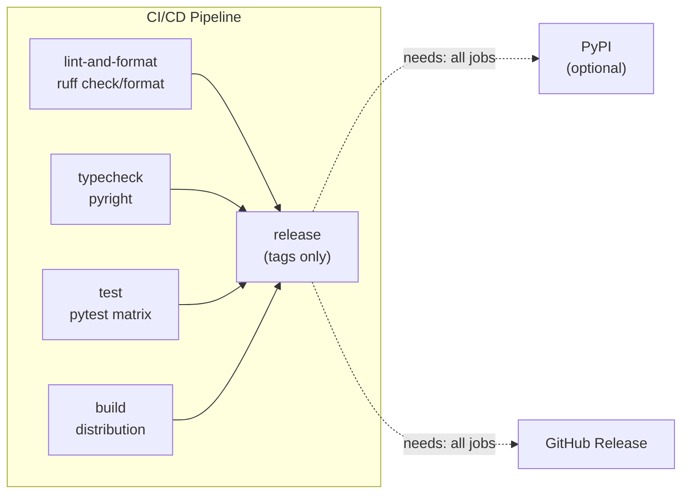
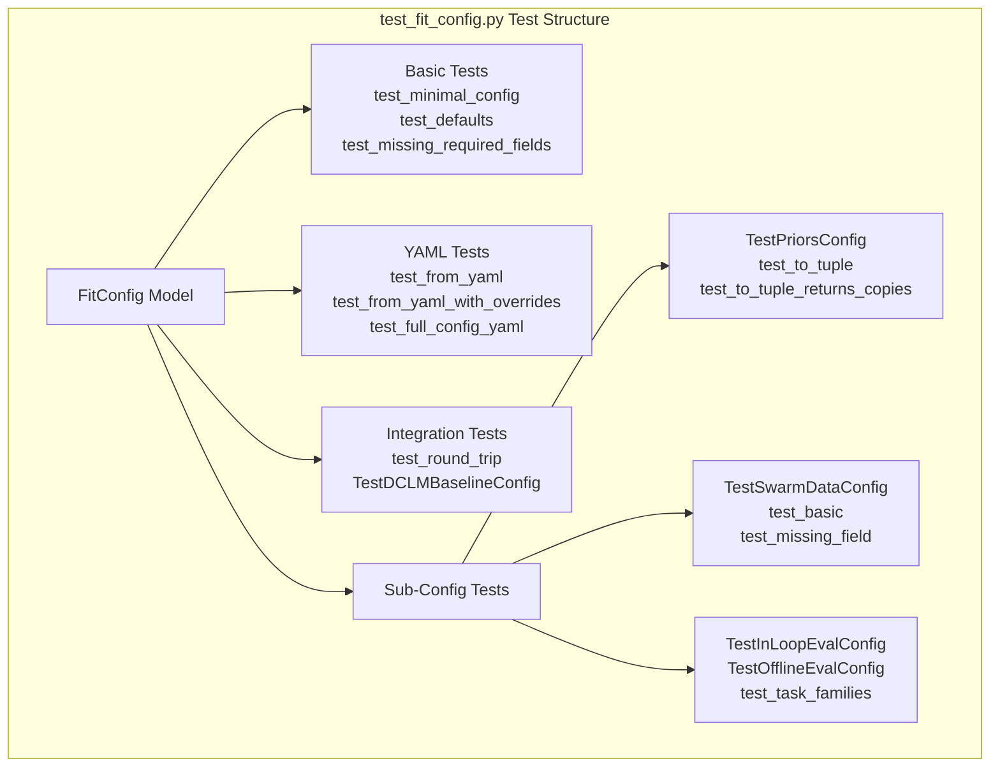

<!-- source: DeepWiki mcp.deepwiki.com · repo allenai/olmix · page 8.1 Testing · fetched 2026-10-26 -->

# Testing

<details>
<summary>Relevant source files</summary>

The following files were used as context for generating this wiki page:

- [.github/dependabot.yml](.github/dependabot.yml)
- [.github/workflows/main.yml](.github/workflows/main.yml)
- [CHANGELOG.md](CHANGELOG.md)
- [CONTRIBUTING.md](CONTRIBUTING.md)
- [Makefile](Makefile)
- [tests/test_fit_config.py](tests/test_fit_config.py)

</details>


This page documents the testing infrastructure for olmix, including test organization, pytest markers, running tests, coverage configuration, and integration with CI/CD. For information about the complete CI/CD pipeline including linting and builds, see [CI/CD Pipeline](#8.2). For details about code quality tools and pre-commit hooks, see [Code Quality Tools](#8.3).

## Test Organization

The olmix test suite is organized in the `tests/` directory with a structure that mirrors the main package layout. Tests follow standard pytest conventions with files named `test_*.py`.

### Directory Structure

```
tests/
├── test_fit_config.py         # FitConfig and Pydantic model tests
├── test_regression.py          # Regression model tests
├── test_proposer.py            # Proposer tests
├── test_generate.py            # Mixture generation tests
├── test_launch.py              # Beaker integration tests
└── conftest.py                 # Shared fixtures
```

Test files are organized by functional area, with each file focusing on a specific subsystem or configuration model. The most comprehensive configuration tests are found in [tests/test_fit_config.py:1-303](), which validates all aspects of the `FitConfig` hierarchy.

**Sources:** [tests/test_fit_config.py:1-303]()

### Test Class Organization

Tests within each file are organized into classes that group related functionality:

```mermaid
graph TB
    subgraph "tests/test_fit_config.py"
        TestFitConfig["TestFitConfig<br/>main config validation"]
        TestPriorsConfig["TestPriorsConfig<br/>priors computation"]
        TestSwarmDataConfig["TestSwarmDataConfig<br/>data loading"]
        TestRegressionConfig["TestRegressionConfig<br/>regression settings"]
        TestProposerConfig["TestProposerConfig<br/>proposer settings"]
        TestConstraintsConfig["TestConstraintsConfig<br/>constraints"]
        TestFilteringConfig["TestFilteringConfig<br/>filtering"]
        TestInLoopEvalConfig["TestInLoopEvalConfig<br/>in-loop eval"]
        TestOfflineEvalConfig["TestOfflineEvalConfig<br/>offline eval"]
        TestEvalDiscriminator["TestEvalDiscriminator<br/>eval type detection"]
        TestDCLMBaselineConfig["TestDCLMBaselineConfig<br/>example config loading"]
    end
    
    TestFitConfig --> Defaults["test_defaults<br/>test_minimal_config<br/>test_from_yaml"]
    TestFitConfig --> Validation["test_missing_required_fields<br/>test_round_trip"]
    TestFitConfig --> Integration["test_full_config_yaml"]
```



Each test class focuses on a specific Pydantic model, verifying defaults, validation, YAML serialization, and round-trip behavior.

**Sources:** [tests/test_fit_config.py:19-303]()

## Pytest Markers

The test suite uses pytest markers to categorize tests by type and execution characteristics. This enables selective test execution based on time constraints or integration requirements.

### Marker Types

| Marker | Purpose | Usage |
|--------|---------|-------|
| `unit` | Fast, isolated unit tests | Test individual functions without external dependencies |
| `integration` | Tests requiring external services | Test Beaker API, WandB integration, S3/GCS access |
| `slow` | Tests taking >1 second | Large dataset processing, full optimization runs |
| `gpu` | Tests requiring GPU hardware | Training tests, large model evaluation |

### Applying Markers

```python
@pytest.mark.unit
def test_basic_functionality():
    """Test basic functionality without external dependencies."""
    pass

@pytest.mark.integration
def test_wandb_api():
    """Test WandB API integration."""
    pass

@pytest.mark.slow
def test_full_optimization():
    """Test complete optimization pipeline (takes >5 seconds)."""
    pass

@pytest.mark.gpu
def test_model_training():
    """Test model training on GPU."""
    pass
```

Multiple markers can be combined:

```python
@pytest.mark.integration
@pytest.mark.slow
def test_beaker_submission():
    """Test complete Beaker experiment submission."""
    pass
```

**Sources:** [CONTRIBUTING.md:121-137](), [Makefile:38-39]()

### Marker Configuration

Pytest markers are configured in `pyproject.toml`:

```ini
[tool.pytest.ini_options]
markers = [
    "unit: Fast unit tests",
    "integration: Tests requiring external services",
    "slow: Tests that take more than 1 second",
    "gpu: Tests requiring GPU hardware",
]
```

## Running Tests

The olmix test suite can be executed through multiple interfaces: Makefile targets (recommended), direct pytest commands, or CI/CD pipeline.

### Makefile Targets

The Makefile provides convenient targets for common testing workflows:



**Sources:** [Makefile:33-43]()

### Test Execution Commands

| Command | Purpose | Typical Use Case |
|---------|---------|------------------|
| `make test` | Run all tests | Pre-commit verification |
| `make test-fast` | Skip slow tests | Rapid iteration during development |
| `make test-cov` | Generate coverage report | Verify test coverage |
| `uv run pytest` | Direct pytest execution | Advanced pytest options |

**Sources:** [Makefile:34-43]()

### Direct Pytest Commands

For advanced usage, pytest can be invoked directly with specific options:

```bash
# Run specific test file
pytest tests/test_fit_config.py

# Run specific test class
pytest tests/test_fit_config.py::TestFitConfig

# Run specific test method
pytest tests/test_fit_config.py::TestFitConfig::test_defaults

# Run tests matching pattern
pytest -k "test_config"

# Run tests with specific markers
pytest -m "unit"
pytest -m "not slow and not integration"
pytest -m "integration or slow"

# Verbose output with print statements
pytest -v -s

# Stop on first failure
pytest -x

# Run last failed tests only
pytest --lf
```

**Sources:** [CONTRIBUTING.md:141-156](), [Makefile:34-43]()

### Coverage Reports

Coverage reporting generates three output formats:

1. **Terminal summary**: Displayed immediately after test run
2. **HTML report**: Interactive browsable report at `htmlcov/index.html`
3. **XML report**: Machine-readable format for CI/CD integration

```bash
# Generate coverage report
make test-cov

# View HTML report
open htmlcov/index.html  # macOS
xdg-open htmlcov/index.html  # Linux
```

The coverage configuration targets the `olmix` package and excludes test files:

```ini
[tool.coverage.run]
source = ["olmix"]
omit = ["tests/*", "scripts/*"]

[tool.coverage.report]
exclude_lines = [
    "pragma: no cover",
    "def __repr__",
    "raise AssertionError",
    "raise NotImplementedError",
    "if __name__ == .__main__.:",
    "if TYPE_CHECKING:",
]
```

**Sources:** [Makefile:42-43](), [.github/workflows/main.yml:84-93]()

## Test Patterns and Fixtures

The test suite employs consistent patterns for configuration testing, fixtures, and validation.

### Configuration Testing Pattern

Configuration tests follow a standard structure demonstrated in [tests/test_fit_config.py:19-303]():



**Sources:** [tests/test_fit_config.py:19-153]()

### Fixture Usage

Fixtures provide reusable test data and setup:

```python
@pytest.fixture
def sample_config_dict():
    """Minimal valid FitConfig dict."""
    return {
        "swarm": {
            "ratios": "ratios.csv",
            "metrics": "metrics.csv",
        },
        "priors": {
            "relative_sizes": {"domain_a": 0.6, "domain_b": 0.4},
            "token_counts": {"domain_a": 600_000, "domain_b": 400_000},
        },
        "eval": {
            "type": "offline",
            "tasks": {"math": ["metric_a", "metric_b"]},
        },
    }
```

Fixtures are used by test functions through dependency injection:

```python
def test_minimal_config(self, sample_config_dict):
    cfg = FitConfig(**sample_config_dict)
    assert cfg.swarm.ratios == "ratios.csv"
    assert cfg.swarm.metrics == "metrics.csv"
```

**Sources:** [tests/test_fit_config.py:19-46]()

### YAML Round-Trip Testing

Configuration models are tested for YAML serialization round-trip consistency:

```python
def test_round_trip(self, sample_config_dict, tmp_path):
    """model_dump -> re-parse should be identical."""
    cfg = FitConfig(**sample_config_dict)
    dumped = cfg.model_dump()
    cfg2 = FitConfig(**dumped)
    assert cfg == cfg2
```

This pattern validates that Pydantic models serialize and deserialize correctly, ensuring configuration persistence works as expected.

**Sources:** [tests/test_fit_config.py:89-94]()

### Validation Testing

Pydantic validation is tested by verifying that invalid configurations raise appropriate errors:

```python
def test_missing_required_fields(self):
    with pytest.raises(ValueError):
        FitConfig()
    
    with pytest.raises(ValueError):
        FitConfig(
            swarm={"ratios": "r.csv", "metrics": "m.csv"},
            eval={"type": "offline", "tasks": {"qa": ["m1"]}},
        )  # Missing priors field
```

**Sources:** [tests/test_fit_config.py:96-104]()

### Testing Model Defaults

Every configuration model has a test verifying default values:

```python
def test_defaults(self, sample_config_dict):
    cfg = FitConfig(**sample_config_dict)
    assert cfg.regression.type == "log_linear"
    assert cfg.regression.seed == 0
    assert cfg.regression.train_split == 1.0
    assert cfg.proposer.type == "exact"
    assert cfg.proposer.fit_only is False
    assert cfg.constraints.enabled is False
```

This ensures that optional fields have sensible defaults and the API remains stable.

**Sources:** [tests/test_fit_config.py:47-66]()

## Coverage Configuration

Code coverage is configured to measure test effectiveness and identify untested code paths.

### Coverage Settings



**Sources:** [.github/workflows/main.yml:84-93](), [Makefile:42-43]()

### Coverage Targets

| Metric | Target | Purpose |
|--------|--------|---------|
| Overall coverage | ≥80% | Ensure comprehensive testing |
| Critical paths | 100% | Core functionality must be tested |
| Edge cases | High coverage | Validation and error handling |

**Sources:** [CONTRIBUTING.md:160-166]()

### Excluded Lines

The coverage configuration excludes certain patterns that don't require testing:

- `pragma: no cover`: Explicit coverage exclusion
- `def __repr__`: String representation methods
- `raise AssertionError`: Assertion failures
- `raise NotImplementedError`: Abstract method stubs
- `if __name__ == .__main__.:`: Script entry points
- `if TYPE_CHECKING:`: Type checking imports

**Sources:** Configuration derived from standard pytest-cov patterns

### Viewing Coverage Reports

After running `make test-cov`, three report formats are available:

```bash
# Terminal output (displayed automatically)
# Shows per-file coverage percentages

# HTML report (interactive)
open htmlcov/index.html

# XML report (for CI/CD)
cat coverage.xml
```

The HTML report provides:
- Line-by-line coverage visualization
- Clickable file navigation
- Uncovered line highlighting
- Coverage percentage per module

**Sources:** [Makefile:42-43](), [CONTRIBUTING.md:163-166]()

## CI/CD Integration

Tests are automatically executed in the GitHub Actions CI/CD pipeline for every push and pull request.

### Test Matrix Strategy



**Sources:** [.github/workflows/main.yml:59-93]()

### CI Test Configuration

The test job in `.github/workflows/main.yml` runs tests across multiple Python versions:

| Step | Command | Purpose |
|------|---------|---------|
| Checkout | `actions/checkout@v4` | Clone repository |
| Install uv | `astral-sh/setup-uv@v1` | Fast package manager |
| Setup Python | `actions/setup-python@v5` | Install Python 3.11/3.12 |
| Install deps | `uv pip install --system -e ".[dev]"` | Install with test dependencies |
| Run tests | `pytest --cov=olmix --cov-report=term --cov-report=xml --cov-report=html` | Execute test suite with coverage |
| Upload coverage | `codecov/codecov-action@v3` | Upload to Codecov (3.11 only) |

**Sources:** [.github/workflows/main.yml:59-93]()

### Fail-Fast Strategy

The test matrix uses `fail-fast: false`, allowing all Python versions to complete even if one fails:

```yaml
strategy:
  fail-fast: false
  matrix:
    python-version: ["3.11", "3.12"]
```

This provides complete visibility into version-specific failures.

**Sources:** [.github/workflows/main.yml:63-65]()

### Coverage Upload

Coverage reports are uploaded to Codecov only for Python 3.11 builds to avoid duplicate uploads:

```yaml
- name: Upload coverage reports
  if: matrix.python-version == '3.11'
  uses: codecov/codecov-action@v3
  with:
    file: ./coverage.xml
    flags: unittests
    name: codecov-umbrella
    fail_ci_if_error: false
```

The `fail_ci_if_error: false` setting ensures that Codecov upload failures don't block the build.

**Sources:** [.github/workflows/main.yml:86-93]()

### Integration with Other Jobs

The test job is part of a larger CI/CD pipeline:



The release job depends on successful completion of all quality checks including tests.

**Sources:** [.github/workflows/main.yml:1-154]()

## Test File Examples

### FitConfig Comprehensive Testing

The `test_fit_config.py` file demonstrates comprehensive configuration testing patterns:



Key test patterns demonstrated:

1. **Minimal configuration validation** [tests/test_fit_config.py:42-45]()
2. **Default value verification** [tests/test_fit_config.py:47-66]()
3. **YAML serialization** [tests/test_fit_config.py:68-87]()
4. **Round-trip consistency** [tests/test_fit_config.py:89-94]()
5. **Required field validation** [tests/test_fit_config.py:96-104]()
6. **Full configuration loading** [tests/test_fit_config.py:106-152]()
7. **Example config integration test** [tests/test_fit_config.py:293-302]()

**Sources:** [tests/test_fit_config.py:1-303]()

### Discriminated Union Testing

The `FitConfig.eval` field uses a discriminated union pattern, tested thoroughly:

```python
class TestEvalDiscriminator:
    def test_offline_default(self):
        """When type is omitted, should default to offline."""
        cfg = FitConfig(
            swarm={"ratios": "r.csv", "metrics": "m.csv"},
            priors={"relative_sizes": {"a": 0.5, "b": 0.5},
                   "token_counts": {"a": 500_000, "b": 500_000}},
            eval={"tasks": {"qa": ["metric1"]}},
        )
        assert cfg.eval.type == "offline"
    
    def test_inloop_explicit(self):
        cfg = FitConfig(
            swarm={"ratios": "r.csv", "metrics": "m.csv"},
            priors={"relative_sizes": {"a": 0.5, "b": 0.5},
                   "token_counts": {"a": 500_000, "b": 500_000}},
            eval={"type": "inloop", "tasks": {"qa": {"task_a": "metric_a"}}},
        )
        assert cfg.eval.type == "inloop"
```

This verifies that Pydantic's discriminated union correctly defaults to `offline` type when unspecified.

**Sources:** [tests/test_fit_config.py:268-291]()

## Best Practices

### Writing New Tests

When adding tests to the olmix codebase:

1. **Place tests in appropriate files**: Mirror the package structure
2. **Use descriptive test names**: `test_<functionality>_<scenario>`
3. **Apply appropriate markers**: `@pytest.mark.unit`, `@pytest.mark.slow`, etc.
4. **Create fixtures for shared setup**: Use `@pytest.fixture` for reusable data
5. **Test both success and failure cases**: Validate error handling
6. **Verify defaults explicitly**: Don't assume Pydantic defaults
7. **Test YAML round-trips**: For all configuration models
8. **Add docstrings**: Brief description of what each test validates

**Sources:** [CONTRIBUTING.md:114-137]()

### Test Maintenance

To maintain test quality:

- Run `make test-cov` regularly to track coverage
- Use `make test-fast` during development for rapid iteration
- Run full test suite with `make test` before committing
- Update tests when modifying configuration schemas
- Keep test data fixtures DRY (Don't Repeat Yourself)
- Validate integration tests against real example configs

**Sources:** [CONTRIBUTING.md:141-166](), [Makefile:1-117]()

---

