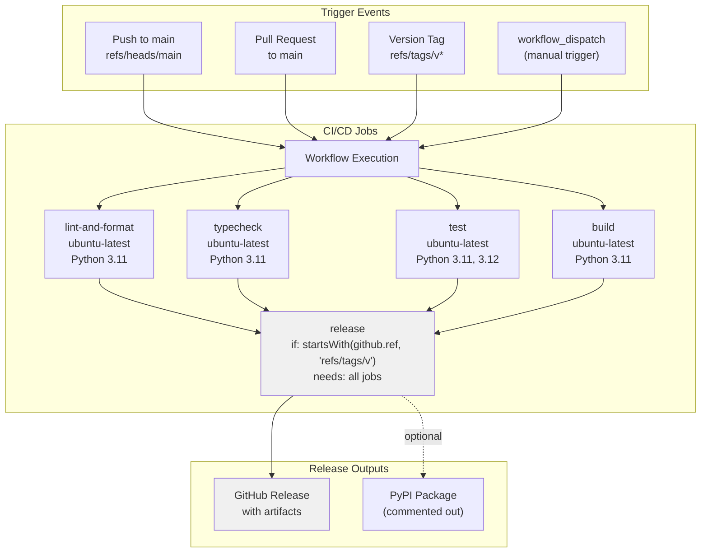
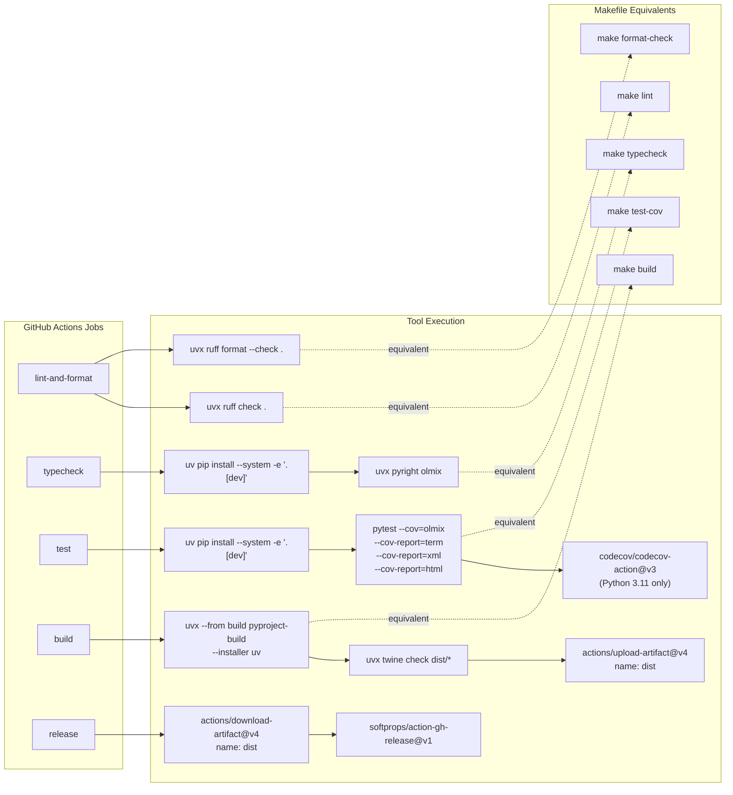
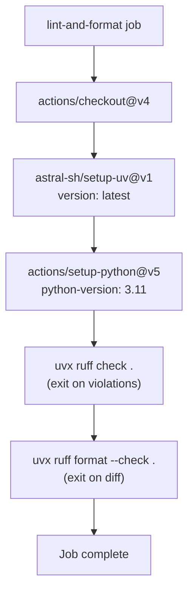
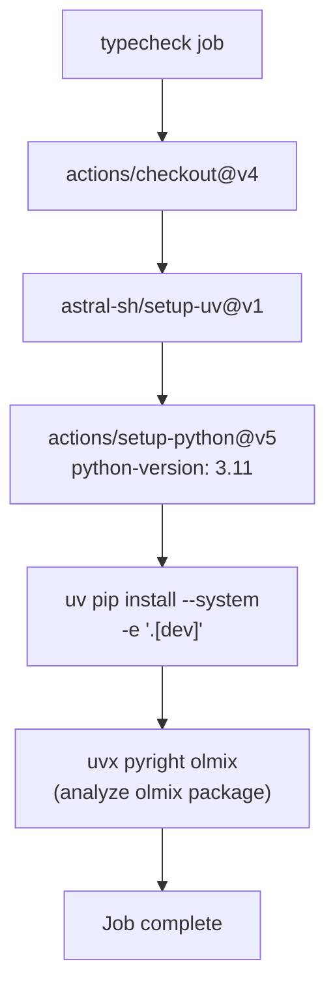
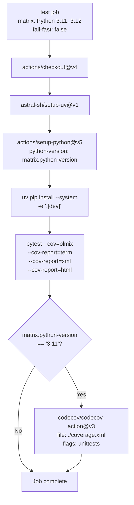
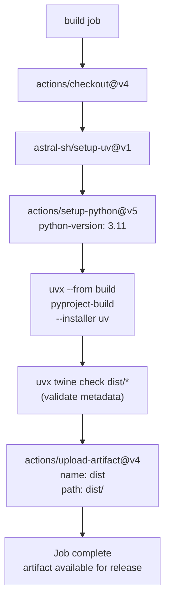
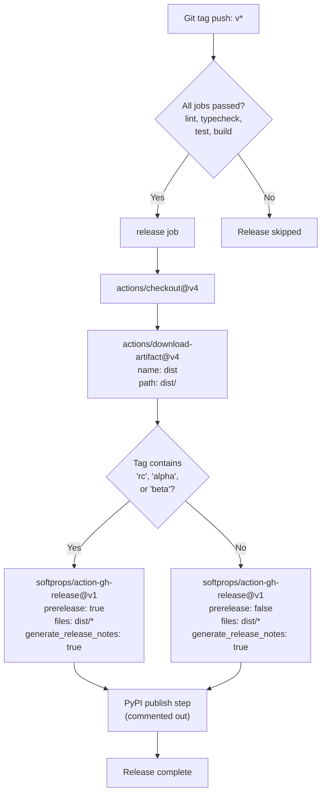
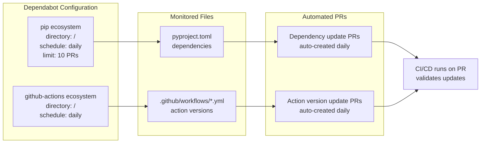

<!-- source: DeepWiki mcp.deepwiki.com · repo allenai/olmix · page 8.2 CI/CD Pipeline · fetched 2026-10-26 -->

# CI/CD Pipeline

<details>
<summary>Relevant source files</summary>

The following files were used as context for generating this wiki page:

- [.github/dependabot.yml](.github/dependabot.yml)
- [.github/workflows/main.yml](.github/workflows/main.yml)
- [CHANGELOG.md](CHANGELOG.md)
- [CONTRIBUTING.md](CONTRIBUTING.md)
- [Makefile](Makefile)
- [pyproject.toml](pyproject.toml)

</details>


This document describes the automated continuous integration and continuous deployment (CI/CD) pipeline for the olmix repository. The pipeline is implemented using GitHub Actions and executes on every push, pull request, and tag creation. For information about the underlying testing infrastructure, see [Testing](#8.1). For details on the code quality tools themselves, see [Code Quality Tools](#8.3).

## Overview

The olmix CI/CD pipeline consists of five sequential jobs that ensure code quality, validate functionality, build distribution packages, and automate releases. The pipeline uses **uv** for fast dependency installation and runs on Ubuntu Linux with Python 3.11 as the primary version.

### Workflow Triggers and Job Dependencies



**Sources**: [.github/workflows/main.yml:1-154]()

### Job-to-Tool Mapping



**Sources**: [.github/workflows/main.yml:15-154](), [Makefile:1-118]()

## Workflow Triggers

The pipeline executes on four trigger conditions defined in [.github/workflows/main.yml:3-9]():

| Trigger Type | Condition | Jobs Executed |
|--------------|-----------|---------------|
| `push` | Commits to `main` branch | All except `release` |
| `push` | Tags matching `v*` pattern | All including `release` |
| `pull_request` | PRs targeting `main` | All except `release` |
| `workflow_dispatch` | Manual trigger | All except `release` |

The `release` job only executes when a version tag is pushed, as controlled by the condition `startsWith(github.ref, 'refs/tags/v')` in [.github/workflows/main.yml:125]().

**Sources**: [.github/workflows/main.yml:3-9](), [.github/workflows/main.yml:125]()

## Lint and Format Job

The `lint-and-format` job runs **ruff** for both linting and formatting checks without installing dependencies. It uses `uvx` to execute ruff directly from PyPI.



### Configuration Details

- **Runs on**: `ubuntu-latest` [.github/workflows/main.yml:17]()
- **Python version**: Environment variable `PYTHON_VERSION: "3.11"` [.github/workflows/main.yml:12]()
- **Linting command**: `uvx ruff check .` [.github/workflows/main.yml:32]()
- **Format check**: `uvx ruff format --check .` [.github/workflows/main.yml:35]()
- **Configuration source**: [pyproject.toml:100-151]() defines ruff settings

The job fails if:
- Any linting violations are detected (E, F, W, etc. rule violations)
- Code formatting does not match ruff's expected output

**Sources**: [.github/workflows/main.yml:15-36](), [pyproject.toml:100-151]()

## Type Check Job

The `typecheck` job installs dependencies and runs **pyright** for static type analysis.



### Configuration Details

- **Runs on**: `ubuntu-latest` [.github/workflows/main.yml:39]()
- **Dependencies installed**: Development extras including `pyright>=1.1.350` [pyproject.toml:79]()
- **Type check command**: `uvx pyright olmix` [.github/workflows/main.yml:57]()
- **Type checking mode**: `basic` with relaxed import checking [pyproject.toml:153-164]()

The job analyzes all Python files in the `olmix` package directory, excluding `__pycache__`, `.venv`, `build`, `dist`, and `docs` directories as specified in [pyproject.toml:158-164]().

**Sources**: [.github/workflows/main.yml:37-58](), [pyproject.toml:153-164]()

## Test Job

The `test` job runs the pytest suite with coverage reporting across multiple Python versions using a matrix strategy.



### Matrix Strategy

The job runs in parallel across Python versions defined in [.github/workflows/main.yml:64-65]():

| Python Version | Coverage Upload | Test Markers |
|----------------|-----------------|--------------|
| 3.11 | Yes (codecov) | All tests |
| 3.12 | No | All tests |

### Coverage Configuration

- **Branch coverage**: Enabled [pyproject.toml:191]()
- **Source**: `olmix` package [pyproject.toml:192]()
- **Omitted paths**: `*/tests/*`, `*/test_*.py`, `*/__init__.py`, `*/conftest.py`, `*/version.py` [pyproject.toml:193-199]()
- **Report formats**: Terminal, XML (for Codecov), HTML (for artifact) [.github/workflows/main.yml:84]()

The coverage report is uploaded to Codecov only from the Python 3.11 run to avoid duplicate reports, controlled by the condition `matrix.python-version == '3.11'` [.github/workflows/main.yml:87]().

**Sources**: [.github/workflows/main.yml:59-94](), [pyproject.toml:167-220]()

## Build Job

The `build` job creates distribution packages (source and wheel) using the modern `pyproject-build` tool via uv.



### Build Outputs

The build job creates two distribution formats in the `dist/` directory:

1. **Source distribution** (`.tar.gz`): Contains source code and metadata
2. **Wheel** (`.whl`): Pre-built binary distribution

Both formats are validated using `twine check` [.github/workflows/main.yml:115]() to ensure:
- Package metadata is complete and valid
- README renders correctly on PyPI
- All required files are included

The artifacts are uploaded with name `dist` [.github/workflows/main.yml:119-121]() and made available for the release job.

**Sources**: [.github/workflows/main.yml:95-122](), [pyproject.toml:1-3]()

## Release Job

The `release` job executes only for version tags (e.g., `v0.2.0`) and creates GitHub releases with build artifacts. It requires all previous jobs to succeed via the `needs` declaration [.github/workflows/main.yml:126]().



### Release Configuration

| Setting | Value | Source |
|---------|-------|--------|
| **Trigger condition** | `startsWith(github.ref, 'refs/tags/v')` | [.github/workflows/main.yml:125]() |
| **Dependencies** | All four previous jobs must succeed | [.github/workflows/main.yml:126]() |
| **Permissions** | `id-token: write`, `contents: write` | [.github/workflows/main.yml:128-130]() |
| **Prerelease detection** | Contains `rc`, `alpha`, or `beta` | [.github/workflows/main.yml:147]() |
| **Release notes** | Auto-generated from commits | [.github/workflows/main.yml:145]() |

### PyPI Publishing

The workflow includes a commented-out PyPI publishing step [.github/workflows/main.yml:149-153]() that uses trusted publishing with OIDC:

```yaml
# Uncomment to publish to PyPI
# - name: Publish to PyPI
#   uses: pypa/gh-action-pypi-publish@release/v1
#   with:
#     skip-existing: true
```

To enable PyPI publishing:
1. Configure trusted publishing on PyPI for the repository
2. Uncomment lines 150-153 in the workflow
3. The `id-token: write` permission is already configured

**Sources**: [.github/workflows/main.yml:123-154]()

## Dependency Management

The repository uses **Dependabot** for automated dependency updates configured in [.github/dependabot.yml:1-12]().



### Dependabot Settings

| Ecosystem | Directory | Schedule | Open PR Limit | Source |
|-----------|-----------|----------|---------------|--------|
| `pip` | `/` | daily | 10 | [.github/dependabot.yml:3-7]() |
| `github-actions` | `/` | daily | (unlimited) | [.github/dependabot.yml:8-11]() |

Dependabot creates pull requests that automatically trigger the full CI/CD pipeline, ensuring updates don't break tests or type checking before merge.

**Sources**: [.github/dependabot.yml:1-12]()

## Local Development Equivalents

The Makefile provides targets that mirror CI/CD jobs for local development:

| CI/CD Job | Makefile Target | Command | Source |
|-----------|-----------------|---------|--------|
| `lint-and-format` | `make format-check` | `ruff format --check` + `ruff check` | [Makefile:57-59]() |
| `lint-and-format` | `make lint` | `ruff check . --fix` | [Makefile:46-48]() |
| `typecheck` | `make typecheck` | `pyright olmix` | [Makefile:62-63]() |
| `test` | `make test` | `pytest` | [Makefile:34-35]() |
| `test` | `make test-cov` | `pytest --cov=olmix --cov-report=html` | [Makefile:42-43]() |
| `build` | `make build` | `python -m build` | [Makefile:84-86]() |

### Comprehensive Check Target

The `make run-checks` target [Makefile:90-104]() sequences all quality checks in the same order as CI/CD:

```bash
make run-checks
# Executes: format-check → lint → typecheck → test
```

This ensures local validation matches CI/CD requirements before pushing code.

**Sources**: [Makefile:1-118](), [.github/workflows/main.yml:1-154]()

## Environment Variables

The workflow sets environment variables for consistent Python version management:

| Variable | Value | Scope | Source |
|----------|-------|-------|--------|
| `PYTHON_VERSION` | `"3.11"` | Workflow-wide | [.github/workflows/main.yml:12]() |

Jobs reference this variable using `${{ env.PYTHON_VERSION }}` syntax [.github/workflows/main.yml:29]() to ensure version consistency across lint, typecheck, build, and the primary test run.

**Sources**: [.github/workflows/main.yml:11-13]()

## Artifact Retention

Build artifacts uploaded during the `build` job persist according to GitHub's default retention policy (90 days for public repositories). The artifacts are:

- **Upload**: [.github/workflows/main.yml:118-121]()
- **Download**: [.github/workflows/main.yml:136-139]() (release job only)
- **Contents**: Source distribution (`.tar.gz`) and wheel (`.whl`)

Artifacts are automatically attached to GitHub releases when tags are pushed, providing permanent storage for release distributions.

**Sources**: [.github/workflows/main.yml:118-121](), [.github/workflows/main.yml:136-139]()

---

