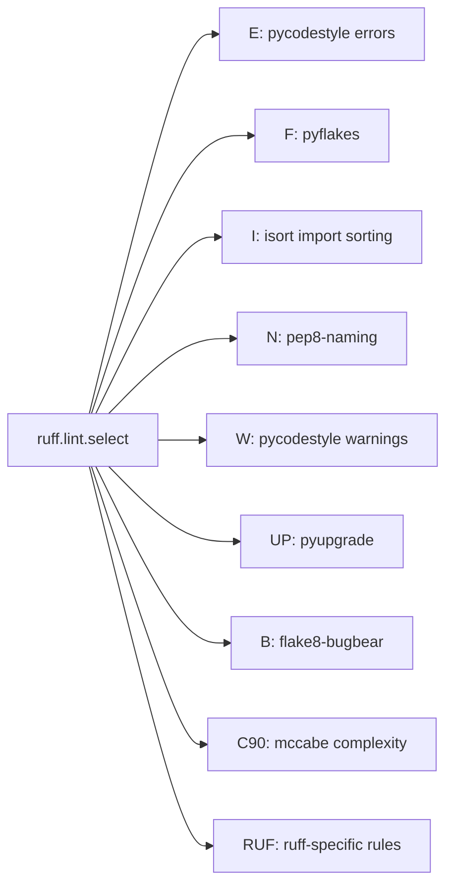
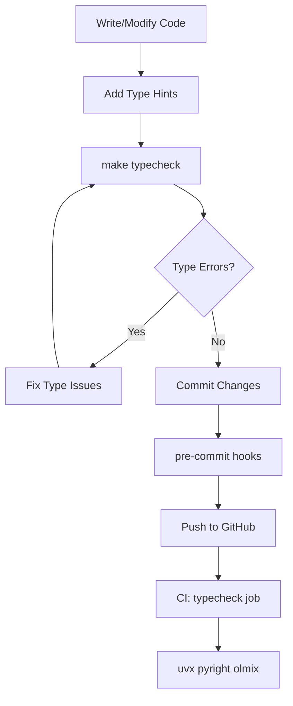
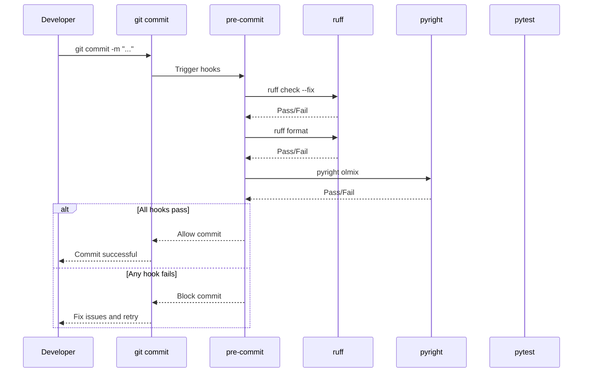
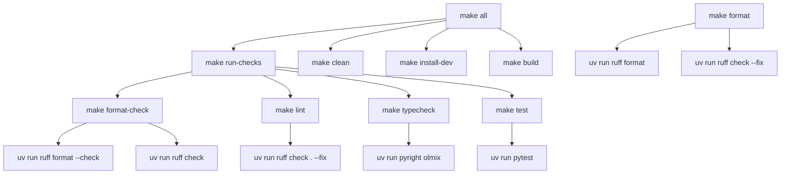
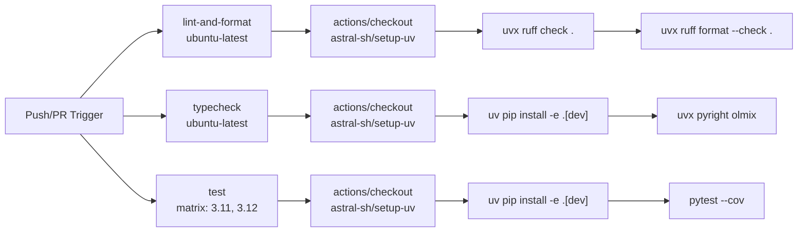

<!-- source: DeepWiki mcp.deepwiki.com · repo allenai/olmix · page 8.3 Code Quality Tools · fetched 2026-10-26 -->

# Code Quality Tools

<details>
<summary>Relevant source files</summary>

The following files were used as context for generating this wiki page:

- [.github/dependabot.yml](.github/dependabot.yml)
- [.github/workflows/main.yml](.github/workflows/main.yml)
- [CHANGELOG.md](CHANGELOG.md)
- [CONTRIBUTING.md](CONTRIBUTING.md)
- [Makefile](Makefile)
- [pyproject.toml](pyproject.toml)

</details>


This page documents the code quality tools used in olmix to maintain consistent code style, catch errors early, and enforce best practices. The repository uses **ruff** for linting and formatting, **pyright** for static type checking, and **pre-commit hooks** for automated validation. These tools are configured centrally in `pyproject.toml` and integrated into both local development workflows (via `Makefile` targets) and CI/CD pipelines.

For information about testing infrastructure and pytest configuration, see [Testing](#8.1). For CI/CD workflow details, see [CI/CD Pipeline](#8.2).

---

## Tool Ecosystem Overview

The olmix codebase uses a modern Python tooling stack that emphasizes speed and developer experience. The following diagram shows how these tools interact during development and in CI:

```mermaid
graph TB
    subgraph "Developer Workflow"
        DevCode["Code Changes"]
        DevCode --> PreCommit["pre-commit run"]
        PreCommit --> RuffCheck["ruff check --fix"]
        PreCommit --> RuffFormat["ruff format"]
        PreCommit --> Pyright["pyright olmix"]
        
        DevCode -.->|manual| MakeLint["make lint"]
        DevCode -.->|manual| MakeFormat["make format"]
        DevCode -.->|manual| MakeTypecheck["make typecheck"]
    end
    
    subgraph "CI Pipeline Jobs"
        PR["Pull Request"]
        PR --> LintJob["lint-and-format job"]
        PR --> TypeJob["typecheck job"]
        PR --> TestJob["test job"]
        
        LintJob --> UvxRuffCheck["uvx ruff check ."]
        LintJob --> UvxRuffFormat["uvx ruff format --check ."]
        
        TypeJob --> UvxPyright["uvx pyright olmix"]
        
        TestJob --> PytestCov["pytest --cov"]
    end
    
    subgraph "Configuration Source"
        PyProject["pyproject.toml"]
        
        PyProject --> RuffConfig["[tool.ruff]<br/>[tool.ruff.lint]<br/>[tool.ruff.format]"]
        PyProject --> PyrightConfig["[tool.pyright]"]
        PyProject --> PytestConfig["[tool.pytest.ini_options]"]
        PyProject --> CovConfig["[tool.coverage.run]<br/>[tool.coverage.report]"]
    end
    
    RuffConfig -.->|reads| RuffCheck
    RuffConfig -.->|reads| RuffFormat
    RuffConfig -.->|reads| UvxRuffCheck
    RuffConfig -.->|reads| UvxRuffFormat
    
    PyrightConfig -.->|reads| Pyright
    PyrightConfig -.->|reads| UvxPyright
```



**Sources:** [pyproject.toml:1-220](), [Makefile:1-118](), [.github/workflows/main.yml:1-154]()

---

## Ruff: Unified Linting and Formatting

Ruff is a fast Python linter and formatter written in Rust that replaces multiple tools (black, isort, flake8, and various flake8 plugins). Olmix uses ruff for both code style enforcement and import organization.

### Ruff Configuration

The ruff configuration is defined in [pyproject.toml:100-151]():

| Setting | Value | Purpose |
|---------|-------|---------|
| `line-length` | 120 | Maximum characters per line |
| `target-version` | "py311" | Target Python 3.11+ features |
| `quote-style` | "double" | Use double quotes for strings |
| `indent-style` | "space" | Use spaces for indentation |

### Enabled Lint Rules

Ruff's rule selection is configured at [pyproject.toml:105-116]():



### Ignored Rules

Specific rules are ignored for practical reasons [pyproject.toml:117-135]():

- **E501** (line too long): Handled by the formatter
- **E711/E712** (comparison to None/True/False): Allow explicit comparisons
- **B007/B008/B023** (loop variable issues, function call defaults): Common patterns
- **C901** (function complexity): Enforced by max-complexity instead
- **UP007** (union syntax): Allow `Optional[X]` over `X | None`

### Per-File Overrides

Special rules apply to specific file types [pyproject.toml:137-139]():

- **`__init__.py`**: Allow unused imports (F401) for re-exports
- **`tests/*`**: Allow assert statements (S101) for pytest

### Running Ruff

The following table shows how to invoke ruff for different purposes:

| Command | Purpose | Auto-fix |
|---------|---------|----------|
| `make lint` | Check and fix linting issues | ✓ |
| `make format` | Format code and fix linting | ✓ |
| `make format-check` | Check without modifying files | ✗ |
| `uvx ruff check .` | CI linting (no fix) | ✗ |
| `uvx ruff format --check .` | CI format check | ✗ |

The `make lint` target [Makefile:45-48]() runs `ruff check . --fix` to automatically fix issues. The `make format` target [Makefile:50-54]() runs both formatting and linting with fixes.

**Sources:** [pyproject.toml:100-151](), [Makefile:45-59](), [.github/workflows/main.yml:31-35]()

---

## Pyright: Static Type Checking

Pyright is a fast type checker for Python that validates type hints and catches type-related errors. Olmix uses pyright in "basic" mode to balance strictness with developer productivity.

### Pyright Configuration

The pyright configuration is at [pyproject.toml:152-164]():

| Setting | Value | Description |
|---------|-------|-------------|
| `pythonVersion` | "3.11" | Target Python version |
| `typeCheckingMode` | "basic" | Moderate strictness level |
| `reportMissingImports` | false | Don't error on missing stubs |
| `reportMissingTypeStubs` | false | Allow libraries without stubs |

### Excluded Directories

Pyright skips the following directories [pyproject.toml:158-164]():

- `**/__pycache__`: Python bytecode cache
- `.venv`: Virtual environment
- `build/`, `dist/`: Build artifacts
- `docs/`: Documentation build directory

### Running Type Checks

Type checking is performed using:

```bash
# Local development
make typecheck          # Runs: uv run pyright olmix

# CI pipeline
uvx pyright olmix       # In typecheck job
```

The type check only analyzes the `olmix` package, not tests or scripts. The CI workflow defines a separate `typecheck` job [.github/workflows/main.yml:37-57]() that installs dependencies and runs pyright.

### Type Checking in Development Workflow



**Sources:** [pyproject.toml:152-164](), [Makefile:61-63](), [.github/workflows/main.yml:37-57]()

---

## Pre-commit Hooks

Pre-commit hooks automatically run quality checks before each commit, catching issues early in the development process. The hooks are configured in `.pre-commit-config.yaml` (not provided in source files, but referenced in [Makefile:30-31]() and [CONTRIBUTING.md:54-55]()).

### Installing Pre-commit Hooks

Pre-commit hooks are installed during development setup:

```bash
# During make install-dev
make install-dev
# This runs: pip install -e ".[dev]" && pre-commit install

# Or manually
pre-commit install
```

The `make install-dev` target [Makefile:27-31]() automatically installs the hooks after installing dependencies.

### Running Pre-commit Hooks

| Command | Scope | When to Use |
|---------|-------|-------------|
| `pre-commit run` | Staged files only | Automatic on commit |
| `pre-commit run --all-files` | All files | Manual check/fix |
| `make pre-commit` | All files | Before pushing |

The Makefile provides a `pre-commit` target [Makefile:106-113]() that validates the configuration and runs all hooks on all files.

### Hook Execution Flow



**Sources:** [Makefile:27-31](), [Makefile:106-113](), [CONTRIBUTING.md:54-55](), [pyproject.toml:82]()

---

## Makefile Targets for Code Quality

The `Makefile` provides convenient shortcuts for running code quality tools. These targets wrap the underlying tool commands and are designed for local development.

### Quality Check Targets

The following diagram shows the dependency relationships between Makefile targets:



### Target Reference Table

| Target | Command(s) | Purpose |
|--------|-----------|---------|
| `make lint` | `uv run ruff check . --fix` | Lint and auto-fix issues |
| `make format` | `uv run ruff format olmix tests scripts`<br/>`uv run ruff check --fix olmix tests scripts` | Format code and fix linting |
| `make format-check` | `uv run ruff format --check olmix tests scripts`<br/>`uv run ruff check olmix tests scripts` | Check format without changes |
| `make typecheck` | `uv run pyright olmix` | Run type checker |
| `make run-checks` | Sequential: format-check → lint → typecheck → test | Run all quality checks |
| `make all` | Sequential: clean → install-dev → run-checks → build | Complete workflow |

### Target Implementation Details

The `make run-checks` target [Makefile:89-104]() orchestrates all quality checks in sequence:

1. **Format check** - Verify code style compliance
2. **Linting** - Check for code issues
3. **Type checking** - Validate type hints
4. **Testing** - Run test suite

Each step must pass before proceeding to the next, and the target exits with an error if any step fails.

**Sources:** [Makefile:1-118]()

---

## Tool Configuration in pyproject.toml

All tool configurations are centralized in `pyproject.toml`, following modern Python packaging standards. This eliminates the need for separate configuration files like `.flake8`, `mypy.ini`, or `pytest.ini`.

### Configuration Hierarchy

```mermaid
graph TB
    PyProject["pyproject.toml"]
    
    PyProject --> BuildSys["[build-system]<br/>setuptools, wheel"]
    PyProject --> Project["[project]<br/>metadata, dependencies"]
    PyProject --> Scripts["[project.scripts]<br/>olmix, olmix-fit"]
    
    PyProject --> ToolRuff["[tool.ruff]<br/>line-length: 120<br/>target-version: py311"]
    PyProject --> ToolRuffLint["[tool.ruff.lint]<br/>select: E,F,I,N,W,UP,B,C90,RUF<br/>ignore: E501,E711,E712,etc"]
    PyProject --> ToolRuffFormat["[tool.ruff.format]<br/>quote-style: double<br/>indent-style: space"]
    PyProject --> ToolRuffIsort["[tool.ruff.lint.isort]<br/>known-first-party: olmix"]
    PyProject --> ToolRuffMccabe["[tool.ruff.lint.mccabe]<br/>max-complexity: 10"]
    
    PyProject --> ToolPyright["[tool.pyright]<br/>pythonVersion: 3.11<br/>typeCheckingMode: basic"]
    
    PyProject --> ToolPytest["[tool.pytest.ini_options]<br/>testpaths, markers"]
    PyProject --> ToolCoverageRun["[tool.coverage.run]<br/>branch: true, source: olmix"]
    PyProject --> ToolCoverageReport["[tool.coverage.report]<br/>exclude_lines, precision"]
```



### Key Configuration Sections

| Section | Lines | Purpose |
|---------|-------|---------|
| `[tool.ruff]` | [100-103]() | Global ruff settings |
| `[tool.ruff.lint]` | [105-135]() | Linting rules and ignores |
| `[tool.ruff.lint.per-file-ignores]` | [137-139]() | File-specific rule overrides |
| `[tool.ruff.lint.mccabe]` | [141-142]() | Complexity threshold |
| `[tool.ruff.lint.isort]` | [144-145]() | Import sorting configuration |
| `[tool.ruff.format]` | [147-150]() | Code formatting style |
| `[tool.pyright]` | [152-164]() | Type checker settings |
| `[tool.pytest.ini_options]` | [167-187]() | Test framework configuration |
| `[tool.coverage.run]` | [190-199]() | Coverage collection settings |
| `[tool.coverage.report]` | [201-216]() | Coverage reporting settings |

### Accessing Configuration

All tools automatically discover and read their configuration from `pyproject.toml`:

- **Ruff**: Searches for `pyproject.toml` in current and parent directories
- **Pyright**: Searches for `pyproject.toml` or `pyrightconfig.json`
- **Pytest**: Reads `[tool.pytest.ini_options]` section
- **Coverage**: Reads `[tool.coverage.*]` sections

No additional configuration files or environment variables are needed.

**Sources:** [pyproject.toml:1-220]()

---

## Integration with CI Pipeline

The code quality tools are integrated into the GitHub Actions CI pipeline to enforce standards on all pull requests and pushes to main.

### CI Job Structure

The CI workflow [.github/workflows/main.yml:1-154]() defines three quality-related jobs:



### Job Execution Details

**lint-and-format job** [.github/workflows/main.yml:15-35]():
- Runs ruff checks without auto-fixing (`uvx ruff check .`)
- Validates formatting without modifications (`uvx ruff format --check .`)
- No dependency installation required (ruff is self-contained via uvx)

**typecheck job** [.github/workflows/main.yml:37-57]():
- Installs full dev dependencies (`uv pip install -e ".[dev]"`)
- Runs pyright on the olmix package only
- Uses Python 3.11 (defined in `env.PYTHON_VERSION`)

**test job** [.github/workflows/main.yml:59-93]():
- Runs on matrix of Python 3.11 and 3.12
- Executes pytest with coverage reporting
- Uploads coverage to codecov (3.11 only)

### Using uvx for Tool Execution

The CI pipeline uses `uvx` (UV's tool runner) to execute tools without explicit installation:

```bash
# Instead of: pip install ruff && ruff check
# CI uses: uvx ruff check

# Instead of: pip install pyright && pyright
# CI uses: uvx pyright
```

This ensures consistent tool versions and faster CI execution.

**Sources:** [.github/workflows/main.yml:1-154]()

---

## Best Practices and Workflows

### Local Development Workflow

The recommended workflow for local development:

1. **Before starting work:**
   ```bash
   make install-dev    # Install dependencies and hooks
   ```

2. **During development:**
   ```bash
   make format         # Auto-format code
   make typecheck      # Check types
   ```

3. **Before committing:**
   ```bash
   make run-checks     # Run all checks
   git commit          # Triggers pre-commit hooks
   ```

### Continuous Integration Workflow

When a pull request is opened:

1. **lint-and-format** job validates code style
2. **typecheck** job validates type hints
3. **test** job runs the test suite
4. All jobs must pass before merging

### Fixing Common Issues

| Issue | Solution |
|-------|----------|
| Linting errors | Run `make lint` to auto-fix |
| Formatting issues | Run `make format` |
| Type errors | Add/fix type hints, then `make typecheck` |
| Pre-commit fails | Fix reported issues, stage changes, retry commit |
| CI linting fails | Run `make format-check` locally to reproduce |

### Configuration Override Patterns

Per-file ignores are used sparingly for legitimate cases [pyproject.toml:137-139]():

- **`__init__.py`**: Allow unused imports for re-exports
- **`tests/*`**: Allow assert statements (pytest idiom)

Avoid adding broad ignores; address the underlying issue instead.

**Sources:** [pyproject.toml:137-139](), [Makefile:89-104](), [CONTRIBUTING.md:57-78](), [CONTRIBUTING.md:190-232]()

---

