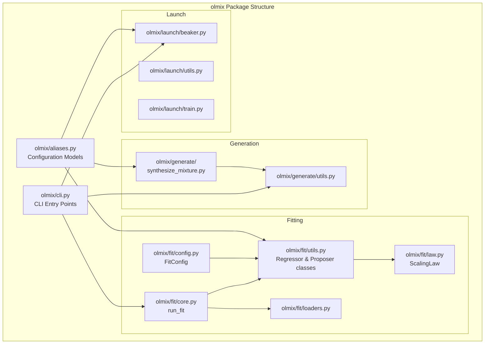
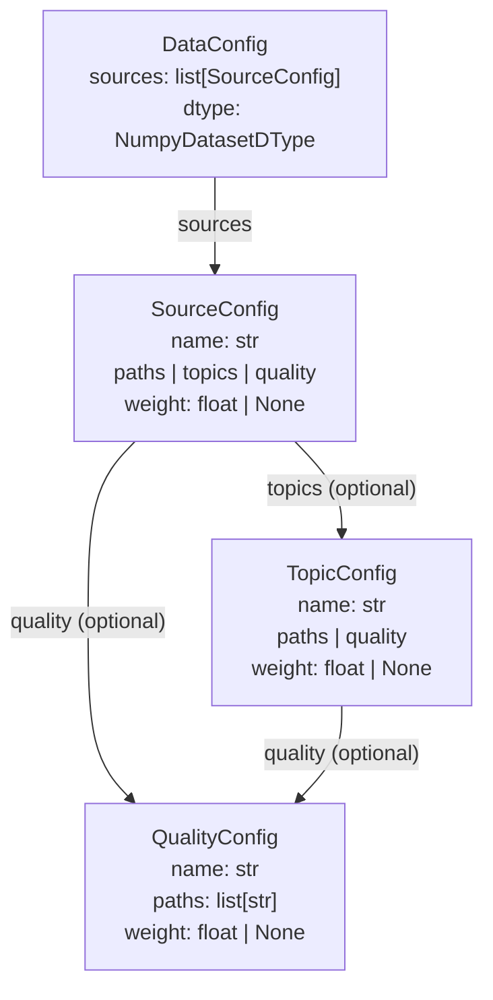

<!-- source: DeepWiki mcp.deepwiki.com · repo allenai/olmix · page 9 API Reference · fetched 2026-10-26 -->

# API Reference

<details>
<summary>Relevant source files</summary>

The following files were used as context for generating this wiki page:

- [olmix/__init__.py](olmix/__init__.py)
- [olmix/aliases.py](olmix/aliases.py)
- [olmix/cli.py](olmix/cli.py)
- [olmix/fit/cli.py](olmix/fit/cli.py)
- [olmix/fit/utils.py](olmix/fit/utils.py)
- [olmix/generate/synthesize_mixture.py](olmix/generate/synthesize_mixture.py)
- [olmix/generate/utils.py](olmix/generate/utils.py)
- [olmix/launch/__init__.py](olmix/launch/__init__.py)
- [olmix/launch/beaker.py](olmix/launch/beaker.py)
- [olmix/launch/utils.py](olmix/launch/utils.py)
- [olmix/plots/plotting.py](olmix/plots/plotting.py)
- [tests/test_cli.py](tests/test_cli.py)
- [tests/test_config.py](tests/test_config.py)
- [tests/test_imports.py](tests/test_imports.py)

</details>


This page documents the low-level Python API of olmix, providing detailed reference for classes, functions, and data structures that can be used programmatically. For command-line usage, see [CLI Reference](#2). For high-level configuration schemas, see [Configuration System](#3).

**Scope**: This reference covers the core public API that developers interact with when:
- Building custom regression models or proposers
- Programmatically generating or analyzing mixtures
- Extending olmix with new functionality

---

## Module Organization

The olmix codebase is organized into several key modules, each responsible for a distinct phase of the mixture optimization workflow.



**Sources**: [olmix/__init__.py](), [olmix/aliases.py](), [olmix/fit/utils.py](), [olmix/generate/synthesize_mixture.py](), [olmix/launch/beaker.py]()

---

## Regression Classes

The regression system provides multiple model types for fitting the relationship between mixture weights and evaluation metrics. All regressors implement a common interface defined by the `Regressor` base class.

### Base Class: `Regressor`

[olmix/fit/utils.py:55-65]()

```python
class Regressor:
    model: Any
    
    def fit(self, x, y, idx, **kwargs):
        raise NotImplementedError("Subclasses must implement this method")
    
    def predict(self, x):
        if not hasattr(self, "model"):
            raise AttributeError("Subclasses must define self.model before calling predict()")
        return self.model.predict(x)
```

**Interface Contract**:
- `fit(x, y, idx, **kwargs)`: Train the model on data
  - `x`: (n_samples, m_domains) array of mixture weights
  - `y`: (n_samples, k_metrics) array of evaluation metrics
  - `idx`: Integer index of which metric column to fit (enables per-metric models)
  - Returns: `self` for method chaining
  
- `predict(x)`: Make predictions for new mixture weights
  - `x`: (n_samples, m_domains) array of mixture weights
  - Returns: (n_samples,) array of predicted metric values

### Concrete Implementations

| Regressor Class | Type String | Use Case | Key Properties |
|-----------------|-------------|----------|----------------|
| `LogLinearRegressor` | `"log_linear"` | Parametric scaling law fitting | Interpretable coefficients, works with exact optimization |
| `LightGBMRegressor` | `"lightgbm"` | Gradient boosting for complex patterns | High accuracy, handles non-linearities |
| `GPRegressor` | `"gp"` | Gaussian Process regression | Uncertainty quantification, smooth interpolation |
| `AutoscaleRegressor` | `"autoscale"` | Power-law autoscaling formula | Based on Autoscale paper methodology |
| `BimixRegressor` | `"bimix"` | Power-law with mixture weights | Based on BiMix paper methodology |
| `SearchRegressor` | `"search"` | Lookup table for evaluated points | Exact for seen mixtures, useful for constrained search |

**Sources**: [olmix/fit/utils.py:55-376]()

---

### `LogLinearRegressor`

[olmix/fit/utils.py:81-104]()

Fits a log-linear scaling law of the form:

```
loss(p) = c + exp(β₁·p₁ + β₂·p₂ + ... + βₘ·pₘ)
```

where `p` is the mixture weight vector and `β` are learned coefficients.

**Constructor Parameters**:
- `params`: Optional pre-fitted `ScalingLaw` parameters. If `None`, initializes a new model.

**Fit Parameters**:
- `early_stopping`: Early stopping threshold (default: 0.0, disabled)
- `max_step`: Maximum optimization steps (default: 100)
- `delta`: Step size for optimization (default: 0.02)

**Internal Model**: Uses [ScalingLaw](#scalinglaw-class) with `mixing_law` function.

**Special Methods**:
- `predict(x)`: Evaluates `mixing_law(x, self.model)` using PyTorch tensors

**Sources**: [olmix/fit/utils.py:81-104](), [olmix/fit/law.py]()

---

### `LightGBMRegressor`

[olmix/fit/utils.py:67-79]()

Uses LightGBM gradient boosting for regression. Hyperparameters are configured via the `LGBM_HPS` dictionary:

```python
LGBM_HPS = {
    "task": "train",
    "boosting_type": "gbdt",
    "objective": "regression",
    "metric": ["l1", "l2"],
    "seed": 42,
    "num_iterations": 10000,
    "learning_rate": 1e-2,
    "verbosity": -1,
    "early_stopping_round": 3,
}
```

**Feature Importance**: Access via `model.feature_importances_` after fitting (useful for interaction matrices).

**Sources**: [olmix/fit/utils.py:42-79]()

---

### `GPRegressor`

[olmix/fit/utils.py:106-138]()

Gaussian Process regression with RBF + WhiteKernel.

**Constructor Parameters**:
- `length_scale`: Initial RBF length scale (default: 1.0)
- `length_scale_bounds`: Bounds for optimization (default: (1e-2, 1e2))
- `constant_value`: Initial constant kernel value (default: 1.0)
- `constant_value_bounds`: Bounds (default: (1e-3, 1e3))
- `noise_level`: Initial noise level (default: 0.1)
- `noise_level_bounds`: Bounds (default: (1e-5, 1e1))
- `n_restarts_optimizer`: Number of random restarts (default: 10)
- `normalize_y`: Whether to normalize targets (default: True)

**Kernel Structure**: `ConstantKernel * RBF + WhiteKernel`

**Sources**: [olmix/fit/utils.py:106-138]()

---

### `AutoscaleRegressor`

[olmix/fit/utils.py:140-244]()

Implements the Autoscale paper's power-law formula:

```
y(p) = Σᵢ (N₀ᵢ + N·pᵢ)^(-γᵢ) + L
```

where:
- `N`: Total training tokens (required parameter)
- `N₀ᵢ`: Learned offset per domain (parameterized as `αᵢ·N`)
- `γᵢ`: Learned exponent per domain
- `L`: Learned asymptotic loss

**Constructor Parameters**:
- `requested_tokens`: Required. Total training tokens `N`.
- `max_nfev`: Maximum function evaluations for scipy optimizer (default: 50000)
- `verbose`: Print fit diagnostics (default: False)
- `params`: Optional pre-fitted parameters dict with keys `"alpha"`, `"gamma"`, `"L"`

**Fitted Attributes**:
- `alpha_`: Array of `N₀/N` ratios, shape (m,)
- `N0_`: Array of offsets, shape (m,)
- `gamma_`: Array of exponents, shape (m,)
- `L_`: Scalar asymptotic loss
- `result_`: scipy.optimize.least_squares result object

**Methods**:
- `get_params()`: Returns dict with `"alpha"`, `"gamma"`, `"L"`

**Sources**: [olmix/fit/utils.py:140-244]()

---

### `BimixRegressor`

[olmix/fit/utils.py:246-324]()

Implements a power-law formula inspired by the BiMix paper:

```
f(x) = Σᵢ Fᵢ · xᵢ^(-αᵢ)
```

**Constructor Parameters**:
- `eps`: Small constant to avoid `0^(-α)` (default: 1e-12)
- `max_nfev`: Maximum function evaluations (default: 50000)
- `verbose`: Print fit diagnostics (default: False)

**Fitted Attributes**:
- `F_`: Array of scaling factors, shape (m,)
- `alpha_`: Array of exponents, shape (m,)
- `result_`: scipy.optimize.least_squares result object

**Sources**: [olmix/fit/utils.py:246-324]()

---

### `SearchRegressor`

[olmix/fit/utils.py:326-345]()

A lookup table that stores exact metric values for evaluated mixture weights. Returns `np.inf` for unseen mixtures.

**Methods**:
- `fit(x, y, idx)`: Stores `{tuple(row): y[idx][i]}` mapping
- `predict(x)`: Returns stored values or `np.inf` for unknown mixtures
- `get_searched_weights()`: Returns list of all evaluated weight vectors

**Use Case**: Enables `SearchProposer` to select the best from previously-evaluated mixtures while respecting constraints.

**Sources**: [olmix/fit/utils.py:326-345]()

---

### `mixing_law` Function

[olmix/fit/utils.py:347-351]()

The core scaling law formula used by `LogLinearRegressor`:

```python
def mixing_law(x, param, **kwargs):
    log_c_i = param[0]
    t_i = param[1:]
    result = torch.exp(log_c_i) + torch.exp(torch.matmul(x, t_i))
    return result
```

**Parameters**:
- `x`: (batch, m_domains) tensor of mixture weights
- `param`: (m_domains + 1,) tensor where `param[0]` is log(c) and `param[1:]` are linear coefficients

**Returns**: (batch,) tensor of predicted losses

**Mathematical Form**: `loss = c + exp(β·p)` where `c = exp(param[0])` and `β = param[1:]`

**Sources**: [olmix/fit/utils.py:347-351]()

---

### `build_regression` Helper

[olmix/fit/utils.py:623-634]()

Factory function for constructing regressors by type string.

```python
def build_regression(
    idx: int,
    Y_train: np.ndarray,
    X_train: np.ndarray,
    regression_type: str,
    early_stopping: float,
    requested_tokens: int | None = None,
) -> Regressor
```

**Usage**: 
```python
reg = build_regression(
    idx=0,  # Fit first metric
    Y_train=metrics_array,
    X_train=weights_array,
    regression_type="log_linear",
    early_stopping=0.0,
)
```

**Type Mapping**: Uses `REGRESSION_TYPES` dict at [olmix/fit/utils.py:369-376]():
```python
REGRESSION_TYPES = {
    "lightgbm": LightGBMRegressor,
    "log_linear": LogLinearRegressor,
    "search": SearchRegressor,
    "gp": GPRegressor,
    "autoscale": AutoscaleRegressor,
    "bimix": BimixRegressor,
}
```

**Sources**: [olmix/fit/utils.py:369-376,623-634]()

---

## Proposer Classes

Proposers use fitted regression models to search for optimal mixture weights. All proposers implement the `Proposer` base class interface.

### Base Class: `Proposer`

[olmix/fit/utils.py:379-384]()

```python
class Proposer:
    def __init__(self):
        pass
    
    def propose(self, **kwargs):
        raise NotImplementedError("Subclasses must implement this method")
```

**Interface Contract**:
- `propose(**kwargs)`: Returns optimal weights as `np.ndarray` of shape (m_domains,)

**Common Parameters** (accepted by all concrete proposers):
- `predictor`: List of fitted `Regressor` objects (one per metric)
- `prior_distributions`: Dict mapping domain names to prior probabilities
- `token_counts`: Dict mapping domain names to available token counts
- `constrain_objective`: Boolean, whether to enforce token budget constraints
- `target_tokens`: Required if `constrain_objective=True`, total training tokens
- `repetition_factor`: Maximum repetition allowed per domain (default: 4.0)

**Sources**: [olmix/fit/utils.py:379-384]()

---

### `SimulationProposer`

[olmix/fit/utils.py:387-499]()

Monte Carlo search via Dirichlet sampling. Uses iterative refinement over multiple search steps.

**Algorithm**:
1. Sample candidates from Dirichlet distributions centered on prior
2. Predict performance for each candidate using regression models
3. Select best candidates and update prior
4. Repeat for `search_iterations` steps with increasing concentration

**Key Parameters**:
- `seed`: Random seed (default: 1337)
- `search_iterations`: Number of iterative refinement steps (default: 10)
- `obj_weights`: Optional list of weights for combining multiple metrics
- `temperature`: Optional, raises prior to power before sampling
- `make_worst_mix`: If True, finds worst mixture instead of best (default: False)

**Internal Hyperparameters** (not configurable):
- `min_weight`: 1e-5, weights below this are zeroed
- `min_dirichlet`: 1, minimum Dirichlet concentration
- `max_dirichlet`: 100, maximum concentration
- `search_dirichlet_factor`: 2.0, concentration growth factor
- `num_samples`: 100,000 candidates per iteration

**Constraint Enforcement**: If `constrain_objective=True`, filters candidates where any domain exceeds its token budget before evaluation.

**Sources**: [olmix/fit/utils.py:387-499]()

---

### `SearchProposer`

[olmix/fit/utils.py:502-536]()

Selects the best mixture from previously-evaluated weights stored in `SearchRegressor`.

**Algorithm**:
1. Extract all evaluated weights from `SearchRegressor.get_searched_weights()`
2. For each weight vector, predict performance
3. Filter by constraints if enabled
4. Return weight with lowest predicted loss

**Requirements**: Only works with `regression_type="search"`. All predictors must be `SearchRegressor` instances.

**Use Case**: Useful when constraints eliminate many sampled mixtures—finds the best from what was actually evaluated.

**Sources**: [olmix/fit/utils.py:502-536]()

---

### `LogLinearExactProposer`

[olmix/fit/utils.py:539-595]()

Convex optimization using CVXPY. Only compatible with `LogLinearRegressor`.

**Algorithm**:
Solves the convex optimization problem:
```
minimize: Σᵢ wᵢ·exp(Aᵢ·x) + λ·KL(x || q)
subject to: x ≥ 0, Σᵢ xᵢ = 1, [xᵢ ≤ caps] (optional)
```

where:
- `A`: (n_metrics, m_domains) matrix of log-linear coefficients
- `w`: Metric weights (default: uniform)
- `λ`: KL regularization weight (`kl_reg` parameter)
- `q`: Prior distribution
- `caps`: Per-domain token budget caps (if `constrain_objective=True`)

**Key Parameters**:
- `kl_reg`: Required. KL divergence regularization weight (typical: 0.05)
- `obj_weights`: Optional list of metric importance weights (default: uniform)

**Solver**: Uses CVXPY with ECOS backend. Prints solver status and objective value.

**Mathematical Detail**: The exponential terms `exp(A·x)` come from the log-linear model `c + exp(β·p)`. The constant `c` doesn't affect the argmin, so it's omitted from the objective.

**Sources**: [olmix/fit/utils.py:539-595]()

---

### Proposer Type Registry

[olmix/fit/utils.py:598]()

```python
PROPOSER_TYPES = {
    "simulation": SimulationProposer,
    "search": SearchProposer,
    "exact": LogLinearExactProposer,
}
```

**Compatibility Matrix**:

| Proposer Type | Compatible Regression Types | Constraint Support | KL Regularization |
|---------------|----------------------------|-------------------|-------------------|
| `simulation` | All | Yes | No (uses `temperature` instead) |
| `search` | `search` only | Yes | No |
| `exact` | `log_linear` only | Yes | Required (`kl_reg` parameter) |

**Sources**: [olmix/fit/utils.py:598]()

---

## Configuration Models

All configuration classes are Pydantic `BaseModel` subclasses defined in [olmix/aliases.py](). They provide:
- Automatic validation
- Type checking
- JSON serialization via `.model_dump()`
- YAML loading via `.from_yaml(path)`

### Data Hierarchy Models



**Hierarchy Rules**:
- `SourceConfig` must have exactly one of: `paths`, `topics`, or `quality`
- `TopicConfig` must have exactly one of: `paths` or `quality`
- `QualityConfig` always has `paths` (leaf level)

**Weight Field**: When `weight` is set on a source or topic, that weight is frozen during mixture generation—only non-weighted domains vary. This enables [Mixture Reuse](#7.1).

**Sources**: [olmix/aliases.py:84-121]()

---

### `SourceConfig`

[olmix/aliases.py:109-121]()

```python
class SourceConfig(BaseModel):
    name: str
    paths: list[str] | None = None
    topics: list[TopicConfig] | None = None
    quality: list[QualityConfig] | None = None
    weight: float | None = None
```

**Validation**: `model_post_init` ensures exactly one of `paths`, `topics`, or `quality` is provided.

**Usage Patterns**:
1. **Flat source**: `SourceConfig(name="wiki", paths=["s3://.../*.npy"])`
2. **Source with topics**: `SourceConfig(name="dclm", topics=[TopicConfig(...), ...])`
3. **Source with quality buckets**: `SourceConfig(name="arxiv", quality=[QualityConfig(...), ...])`

**Sources**: [olmix/aliases.py:109-121]()

---

### `TopicConfig`

[olmix/aliases.py:95-107]()

```python
class TopicConfig(BaseModel):
    name: str
    paths: list[str] | None = None
    quality: list[QualityConfig] | None = None
    weight: float | None = None
```

**Validation**: Exactly one of `paths` or `quality` must be provided.

**Examples**:
- Simple topic: `TopicConfig(name="math", paths=["s3://.../*.npy"])`
- Topic with quality: `TopicConfig(name="code", quality=[QualityConfig(...), ...])`

**Sources**: [olmix/aliases.py:95-107]()

---

### `QualityConfig`

[olmix/aliases.py:84-92]()

```python
class QualityConfig(BaseModel):
    name: str  # e.g., "vigintile_0001", "high", "low"
    paths: list[str]
    weight: float | None = None
```

Represents a quality level within a topic or source. Always a leaf node in the hierarchy.

**Sources**: [olmix/aliases.py:84-92]()

---

### `MixEntry`

[olmix/aliases.py:228-233]()

```python
class MixEntry(BaseModel):
    weight: float
    repetition_factor: float
```

Represents a single domain's weight and repetition factor in a mixture. Used in `LaunchConfig.mix` field.

**Repetition Factor**: Allows domains to be repeated during training. A value of 2.0 means the domain's data can be seen twice (up to 2× the unique token count). See [olmix/launch/train.py]() for usage.

**Sources**: [olmix/aliases.py:228-233]()

---

### `LaunchConfig`

[olmix/aliases.py:299-326]()

```python
class LaunchConfig(BaseModel):
    name: str
    description: str = ""
    infra: InfraConfig
    training: TrainingConfig
    data: DataConfig
    eval: InLoopEvalConfig
    mix: dict[str, MixEntry] | None = None
    group_id: str | None = None
```

Self-contained configuration for launching a training experiment. Generated by `olmix generate` or written by hand.

**Key Fields**:
- `mix`: Explicit mixture weights. Keys are domain names (flat: `"source"` or hierarchical: `"source:topic:quality"`). Auto-flattened via `flatten_mix` validator.
- `group_id`: UUID linking variants in an experiment group

**YAML Loading**: `LaunchConfig.from_yaml(path)` at [olmix/aliases.py:321-326]()

**Nested Mix Syntax**: The `mix` field accepts nested dictionaries which are automatically flattened. See [olmix/aliases.py:235-297]() for `flatten_mix` implementation.

**Sources**: [olmix/aliases.py:299-326]()

---

### `GenerationConfig`

[olmix/aliases.py:211-226]()

```python
class GenerationConfig(BaseModel):
    name: str = ""
    data: DataConfig
    priors: PriorsConfig
    swarm: SwarmConfig = SwarmConfig()
    max_tokens: int
```

Input to `olmix generate`. Contains everything needed to sample mixture variants.

**Key Fields**:
- `priors`: Token counts and relative sizes, typically computed via `olmix priors compute`
- `swarm`: Dirichlet sampling parameters (variants, temperature, strength ranges, etc.)
- `max_tokens`: Total training tokens for the proxy model (used for computing repetition bounds)

**YAML Loading**: `GenerationConfig.from_yaml(path)` at [olmix/aliases.py:221-226]()

**Sources**: [olmix/aliases.py:211-226]()

---

### `InfraConfig`

[olmix/aliases.py:138-151]()

```python
class InfraConfig(BaseModel):
    budget: str
    workspace: str
    cluster: str
    priority: Priority = Priority.normal
    preemptible: bool = True
    nodes: int = 1
    gpus: int
    weka: bool = False
    shared_filesystem: bool = False
    wandb_debug: bool = False
```

Beaker infrastructure settings for experiment execution.

**Priority Enum**: `Priority.low`, `.normal`, `.high`, `.urgent` at [olmix/aliases.py:70-77]()

**Sources**: [olmix/aliases.py:70-77,138-151]()

---

### `TrainingConfig`

[olmix/aliases.py:153-176]()

```python
class TrainingConfig(BaseModel):
    proxy_model_id: str
    tokenizer: str
    chinchilla_multiple: float
    seed: int
    device_batch_size: int = 4
    global_batch_size: int | None = None
    checkpoint_path: str | None = None
    train_type: TrainType = TrainType.pretrain
    eval_interval: int = 1000
    no_eval: bool = False
    instance_filter: InstanceFilterConfig | None = None
```

OLMo Core model and training settings.

**Methods**:
- `get_max_tokens()`: Computes total training tokens from `chinchilla_multiple` and model size using [olmix/aliases.py:168-176]()

**Model IDs**: Predefined in `MODEL_NUM_PARAMS` dict at [olmix/aliases.py:19-42](). Example: `"olmo2_30m"` → 30M non-embedding parameters.

**Chinchilla Formula**: `max_tokens = 20 * num_params * chinchilla_multiple` (see `compute_max_tokens` at [olmix/aliases.py:45-50]())

**Sources**: [olmix/aliases.py:14-68,153-176]()

---

### `SwarmConfig`

[olmix/aliases.py:185-209]()

```python
class SwarmConfig(BaseModel):
    seed: int = 42
    variants: int = 1
    mix_temperature: float = 1.0
    source_mix_temperature: float | None = None
    topic_mix_temperature: float | None = None
    min_strength: float = 0.1
    max_strength: float = 5.0
    min_source_strength: float | None = None
    max_source_strength: float | None = None
    min_topic_strength: float | None = None
    max_topic_strength: float | None = None
    minimum_weight: float | None = None
    minimum_source_weight: float | None = None
    minimum_topic_weight: float | None = None
    nonzero_weight: list[str] | None = None
    manual_prior: dict[str, float] | None = None
    manual_topic_prior: dict[str, float] | None = None
    sample_multiplier: int | None = None
    existing_mix_file: str | None = None
    repetition_factor: float = 1.0
    enable_bound: bool = True
```

Controls Dirichlet sampling behavior for mixture generation.

**Strength**: Dirichlet concentration parameter. Higher = closer to prior, lower = more uniform.

**Temperature**: Sharpens (`<1.0`) or smooths (`>1.0`) the prior distribution before sampling.

**Hierarchical Settings**: Can specify different temperature/strength for sources vs topics via `source_*` and `topic_*` parameters.

**Minimum Weight Filters**: 
- `minimum_source_weight`: Absolute threshold (e.g., 0.01 = 1%)
- `minimum_topic_weight`: Relative to parent source (e.g., 0.05 = 5% of source)

**Sources**: [olmix/aliases.py:185-209]()

---

### Chinchilla Scaling Utilities

[olmix/aliases.py:14-68]()

```python
TOKENS_PER_PARAM = 20  # Chinchilla optimal tokens per parameter

MODEL_NUM_PARAMS: dict[str, int] = {
    "olmo2_30m": 30_000_000,
    "olmo2_1b": 1_000_000_000,
    "olmo3_30m": 30_000_000,
    # ... (20+ models)
}

def compute_max_tokens(chinchilla_multiple: float, num_params: int) -> int:
    """Formula: TOKENS_PER_PARAM * num_params * chinchilla_multiple"""
    return int(TOKENS_PER_PARAM * num_params * chinchilla_multiple)

def get_model_num_params(proxy_model_id: str) -> int:
    """Lookup num_params from MODEL_NUM_PARAMS dict"""
    if proxy_model_id not in MODEL_NUM_PARAMS:
        raise ValueError(f"Unknown model: {proxy_model_id}")
    return MODEL_NUM_PARAMS[proxy_model_id]
```

**Usage Example**:
```python
# 5xC training for OLMo2-30M
config = TrainingConfig(
    proxy_model_id="olmo2_30m",
    chinchilla_multiple=5.0,
    # ...
)
max_tokens = config.get_max_tokens()  # 20 * 30M * 5.0 = 3B tokens
```

**Sources**: [olmix/aliases.py:14-68]()

---

## Utility Functions

### `calculate_priors`

[olmix/generate/synthesize_mixture.py]() (main implementation spans multiple functions)

Scans S3/GCS paths to compute token counts for each domain.

```python
def calculate_priors(
    source_configs: list[SourceConfig],
    dtype: NumpyDatasetDType,
    use_cache: bool = True,
) -> tuple[dict[str, float], int, dict[str, int]]
```

**Returns** (as tuple):
1. `relative_sizes`: Dict mapping domain names to proportions (sums to 1.0)
2. `total_tokens`: Integer total token count across all domains
3. `token_counts`: Dict mapping domain names to absolute token counts

**Algorithm**:
1. Expands glob patterns in `paths` using [olmix/utils/cloud.py:expand_cloud_globs]()
2. For each file, reads shape from `.npy` header or counts lines in text files
3. Converts shapes to token counts based on `dtype` (uint16 vs uint32)
4. Caches results in `~/.olmix/prior_cache/` keyed by paths hash
5. Aggregates counts hierarchically (quality → topic → source)

**Cache Location**: `~/.olmix/prior_cache/<hash>.pkl` where hash is computed from sorted paths.

**Sources**: [olmix/generate/synthesize_mixture.py](), [olmix/utils/cloud.py]()

---

### `mk_mixtures`

[olmix/generate/synthesize_mixture.py]() (main entry point for generation)

Generates mixture variants from a `GenerationConfig` using Dirichlet sampling.

```python
def mk_mixtures(
    config: GenerationConfig,
    group_uuid: str | None = None,
) -> list[dict[str, MixEntry]]
```

**Algorithm**:
1. Calls `calculate_priors` to get token counts
2. Applies manual priors and fixed weights from config
3. Calls `generate_weights_dirichlet` to sample variants
4. Filters and deduplicates sampled weights
5. Converts to `MixEntry` dictionaries

**Deduplication**: Uses pairwise cosine similarity with threshold 0.99 to remove near-duplicate mixtures.

**Output Format**: List of dictionaries where keys are domain names (e.g., `"dclm:code"`) and values are `MixEntry(weight=..., repetition_factor=...)`.

**Sources**: [olmix/generate/synthesize_mixture.py]()

---

### `expand_collapsed_weights`

[olmix/fit/utils.py:733-749]()

Expands optimized weights from collapsed (source-level) back to full (topic-level) when topics had fixed relative weights.

```python
def expand_collapsed_weights(
    opt_weights: dict[str, float],
    original_prior: dict[str, float],
    collapsed_prior: dict[str, float],
) -> dict[str, float]
```

**Use Case**: When optimizing a mixture where some sources have topics with fixed `weight` fields, the fit operates on collapsed source-level weights. This function expands them back to topic-level for final output.

**Algorithm**:
1. Identifies sources present in `collapsed_prior` but not `original_prior`
2. For each collapsed source, finds its topics in `original_prior`
3. Distributes the source's optimized weight to topics proportionally

**Sources**: [olmix/fit/utils.py:733-749]()

---

### `flatten_mix`

[olmix/aliases.py:267-297]()

Converts nested mixture dictionaries to flat `dict[str, MixEntry]` format.

```python
def flatten_mix(mix: dict[str, Any]) -> dict[str, Any]
```

**Input Formats**:

**Flat** (already leaf-level):
```python
{
    "dclm:code": {"weight": 0.5, "repetition_factor": 1.0},
    "wiki": {"weight": 0.5, "repetition_factor": 2.0},
}
```

**Nested** (hierarchical):
```python
{
    "dclm": {
        "weight": 0.98,
        "code": {"weight": 0.6},
        "science": {"weight": 0.4},
    },
    "arxiv": {"weight": 0.02, "repetition_factor": 1.5},
}
```

**Output** (always flat):
```python
{
    "dclm:code": {"weight": 0.588, "repetition_factor": 1.0},  # 0.98 * 0.6
    "dclm:science": {"weight": 0.392, "repetition_factor": 1.0},  # 0.98 * 0.4
    "arxiv": {"weight": 0.02, "repetition_factor": 1.5},
}
```

**Weight Multiplication**: Weights at each level multiply together along the path from root to leaf.

**Repetition Factor Inheritance**: Children inherit parent's `repetition_factor` unless they specify their own.

**Default Weight**: If `weight` is omitted at any level, defaults to 1.0.

**Sources**: [olmix/aliases.py:235-297]()

---

### `mk_experiment_group`

[olmix/launch/beaker.py:18-42]()

Constructs an `ExperimentGroup` from a list of `LaunchConfig` variants.

```python
def mk_experiment_group(
    configs: list[LaunchConfig],
    group_uuid: str,
) -> ExperimentGroup
```

**Validation**: Ensures each config has a non-None `mix` field.

**Output Structure**:
```python
ExperimentGroup(
    config=configs[0],  # Base config shared by all
    group_id=group_uuid,
    instances=[
        ExperimentInstance(
            name=lc.name,
            sources=mk_source_instances(lc.data.sources, lc.mix),
        )
        for lc in configs
    ],
)
```

**Sources**: [olmix/launch/beaker.py:18-42](), [olmix/launch/utils.py:12-85]()

---

### `mk_source_instances`

[olmix/launch/utils.py:12-85]()

Converts `SourceConfig` hierarchy + `mix` dict into flat list of `SourceInstance` objects.

```python
def mk_source_instances(
    sources: list[SourceConfig],
    mix_map: dict[str, MixEntry],
) -> list[SourceInstance]
```

**Algorithm**:
1. Traverses source → topic → quality hierarchy
2. For each leaf node, looks up weight in `mix_map` by full name (e.g., `"dclm:code:high"`)
3. Skips entries with zero weight
4. Creates `SourceInstance` with flattened name, paths, ratio, and repetition_factor

**Example**:
```python
sources = [
    SourceConfig(
        name="dclm",
        topics=[
            TopicConfig(name="code", paths=["s3://.../*.npy"]),
        ],
    ),
]
mix_map = {
    "dclm:code": MixEntry(weight=0.8, repetition_factor=1.5),
}

instances = mk_source_instances(sources, mix_map)
# [SourceInstance(
#     name="dclm:code",
#     paths=["s3://.../*.npy"],
#     ratio=0.8,
#     repetition_factor=1.5,
# )]
```

**Sources**: [olmix/launch/utils.py:12-85]()

---

## ScalingLaw Class

[olmix/fit/law.py]()

PyTorch-based optimizer for fitting parametric scaling laws using LBFGS.

```python
class ScalingLaw:
    def __init__(self, functional_form):
        """functional_form: callable like mixing_law(x, params)"""
        
    def fit(
        self,
        x: np.ndarray,
        y: np.ndarray,
        param_init_generator,
        max_step: int = 100,
        delta: float = 0.02,
        eps: float = 0.0,
    ) -> torch.Tensor:
        """Fit parameters by minimizing MSE loss"""
```

**Algorithm**:
1. Tries multiple initializations from `param_init_generator`
2. For each initialization:
   - Converts to PyTorch tensors with `requires_grad=True`
   - Runs LBFGS optimizer on MSE loss
   - Tracks best parameters by loss
3. Returns best parameters as tensor

**Used By**: `LogLinearRegressor` at [olmix/fit/utils.py:87-90]() with `mixing_law` as functional form.

**Initialization Strategy**: `init_params_log_linear_law` at [olmix/fit/utils.py:354-358]() generates 10×30=300 candidates with varying `log_c_i` and random `t_i` coefficients.

**Sources**: [olmix/fit/law.py](), [olmix/fit/utils.py:81-104,347-358]()

---

## Data Loading

### `load_from_csv`

[olmix/fit/loaders.py]() 

Loads experiment results from CSV files.

```python
def load_from_csv(
    ratios_path: str,
    metrics_path: str,
) -> tuple[pd.DataFrame, pd.DataFrame, list[str], list[str]]
```

**File Formats**:

**ratios.csv**: Each row is a mixture variant
```
run_name,dclm:code,dclm:science,wiki,...
exp-001,0.5,0.3,0.2,...
exp-002,0.4,0.4,0.2,...
```

**metrics.csv**: Each row has evaluation results
```
run_name,arc_challenge,hellaswag,mmlu,...
exp-001,0.45,0.38,0.42,...
exp-002,0.46,0.37,0.43,...
```

**Returns**:
1. `ratios`: DataFrame with run_name index, domain columns
2. `metrics`: DataFrame with run_name index, metric columns
3. `domain_cols`: List of domain column names
4. `metric_cols`: List of metric column names

**Validation**: Ensures both CSVs have matching `run_name` indices.

**Sources**: [olmix/fit/loaders.py]()

---

### `load_from_wandb`

[olmix/fit/loaders.py]()

Loads experiment results from W&B API.

```python
def load_from_wandb(
    workspace: str,
    groups: list[str],
    eval_metrics: list[str],
    cache_path: Path,
    no_cache: bool = False,
) -> tuple[pd.DataFrame, pd.DataFrame, list[str], list[str]]
```

**Algorithm**:
1. Queries W&B API for runs matching `groups`
2. Extracts final metric values from `run.summary`
3. Parses mixture weights from `run.config`
4. Caches results as JSON to avoid repeated API calls
5. Returns in same format as `load_from_csv`

**Cache Format**: JSON file at `cache_path` with list of `RunInstance.as_dict()` objects.

**Error Handling**: Logs warnings for crashed or running jobs but includes them if they have final metrics.

**Sources**: [olmix/fit/loaders.py](), [olmix/fit/utils.py:601-703]()

---

## API Usage Examples

### Fitting a Regression Model

```python
from olmix.fit.utils import build_regression
import numpy as np

# Load data
ratios = np.random.dirichlet([1, 1, 1], size=20)  # 20 samples, 3 domains
metrics = np.random.randn(20, 5)  # 20 samples, 5 metrics

# Build regressor for metric 0
reg = build_regression(
    idx=0,
    Y_train=metrics,
    X_train=ratios,
    regression_type="log_linear",
    early_stopping=0.0,
)

# Predict on new mixture
new_mix = np.array([[0.5, 0.3, 0.2]])
prediction = reg.predict(new_mix)
```

**Sources**: [olmix/fit/utils.py:623-634]()

---

### Using a Proposer

```python
from olmix.fit.utils import SimulationProposer

# Fit regressors (one per metric)
regressors = [...]  # list of fitted Regressor objects

# Define priors and token counts
priors = {"dclm:code": 0.6, "dclm:science": 0.3, "wiki": 0.1}
token_counts = {"dclm:code": 1e9, "dclm:science": 5e8, "wiki": 3e8}

# Propose optimal mixture
proposer = SimulationProposer()
optimal_weights = proposer.propose(
    predictor=regressors,
    prior_distributions=priors,
    token_counts=token_counts,
    search_iterations=10,
    constrain_objective=True,
    target_tokens=1e9,
    repetition_factor=4.0,
)
```

**Sources**: [olmix/fit/utils.py:387-499]()

---

### Programmatic Config Creation

```python
from olmix.aliases import (
    LaunchConfig,
    InfraConfig,
    TrainingConfig,
    DataConfig,
    SourceConfig,
    MixEntry,
)
from olmix.fit.config import InLoopEvalConfig

config = LaunchConfig(
    name="my-experiment",
    infra=InfraConfig(
        budget="ai2/oe-data",
        workspace="ai2/dolma2",
        cluster="ai2/saturn-cirrascale",
        gpus=8,
    ),
    training=TrainingConfig(
        proxy_model_id="olmo2_30m",
        tokenizer="dolma2",
        chinchilla_multiple=1.0,
        seed=42,
    ),
    data=DataConfig(
        sources=[
            SourceConfig(name="wiki", paths=["s3://bucket/wiki/*.npy"]),
            SourceConfig(name="code", paths=["s3://bucket/code/*.npy"]),
        ],
    ),
    eval=InLoopEvalConfig(
        tasks={"qa": {"arc": "eval/arc (BPB v2)"}},
    ),
    mix={
        "wiki": MixEntry(weight=0.6, repetition_factor=1.0),
        "code": MixEntry(weight=0.4, repetition_factor=1.5),
    },
    group_id="abc12345",
)

# Serialize to YAML
import yaml
with open("config.yaml", "w") as f:
    yaml.dump(
        config.model_dump(mode="json", exclude_none=True),
        f,
        default_flow_style=False,
    )
```

**Sources**: [olmix/aliases.py:299-326]()

---

### Computing Priors

```python
from olmix.generate.synthesize_mixture import calculate_priors
from olmix.aliases import SourceConfig, DataConfig
from olmo_core.data.types import NumpyDatasetDType

sources = [
    SourceConfig(name="wiki", paths=["s3://bucket/wiki/**/*.npy"]),
    SourceConfig(name="code", paths=["s3://bucket/code/**/*.npy"]),
]

relative_sizes, total_tokens, token_counts = calculate_priors(
    source_configs=sources,
    dtype=NumpyDatasetDType.uint32,
    use_cache=True,
)

print(f"Total tokens: {total_tokens:,}")
print(f"Relative sizes: {relative_sizes}")
print(f"Token counts: {token_counts}")
```

**Sources**: [olmix/generate/synthesize_mixture.py]()

---

This API reference provides the foundation for understanding and extending olmix. For higher-level workflows, see [Quick Start Tutorial](#1.3). For configuration file formats, see [Configuration System](#3).

---

