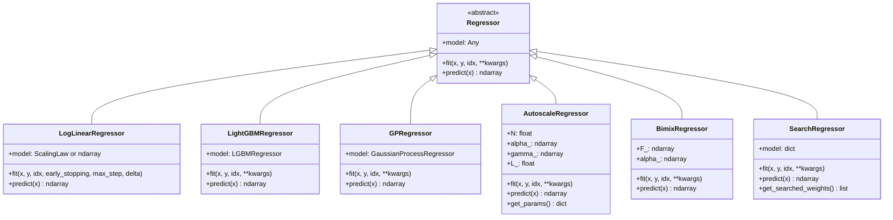
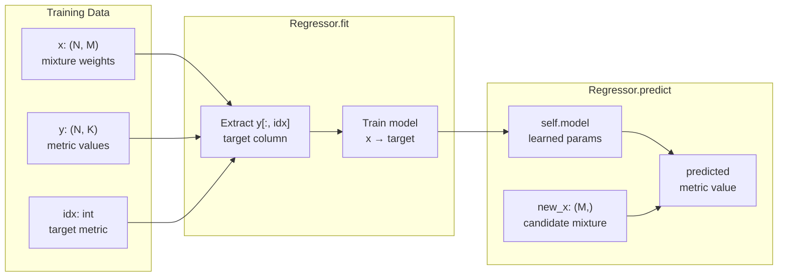
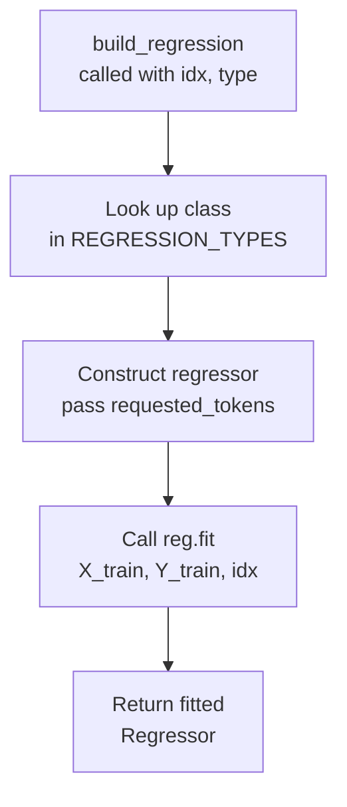
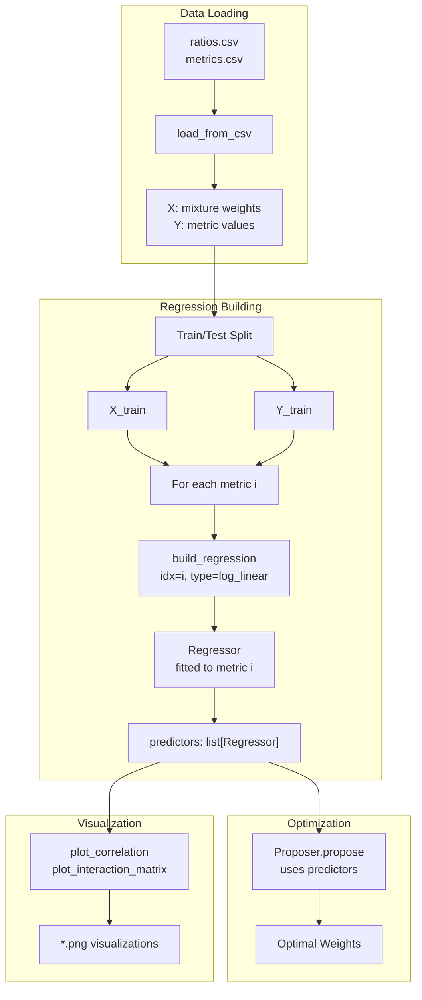

<!-- source: DeepWiki mcp.deepwiki.com · repo allenai/olmix · page 9.1 Regression Classes · fetched 2026-10-26 -->

# Regression Classes

<details>
<summary>Relevant source files</summary>

The following files were used as context for generating this wiki page:

- [olmix/fit/cli.py](olmix/fit/cli.py)
- [olmix/fit/utils.py](olmix/fit/utils.py)
- [olmix/plots/plotting.py](olmix/plots/plotting.py)

</details>


This document provides a technical reference for the `Regressor` base class and its six concrete implementations in olmix. These classes form the predictive modeling layer that estimates downstream performance from mixture weights.

For information about how regressors are used in the optimization pipeline, see [Regression Models](#4.1). For proposer classes that consume regressor predictions, see [Proposer Classes](#9.2). For the broader regression and optimization system, see [Regression and Optimization](#4).

---

## Overview

Regression models in olmix predict evaluation metric values (e.g., BPB on specific tasks) from mixture weight vectors. Each regressor:
- Trains on historical swarm data (mixture weights → observed metrics)
- Implements a `fit(x, y, idx, **kwargs)` method to train on a specific metric
- Implements a `predict(x)` method to predict metric values for new mixture weights
- Stores a learned `model` attribute representing the fitted parameters

The system builds **one regressor per evaluation metric**, creating a list of predictors that proposers use to search for optimal mixtures.

**Sources:** [olmix/fit/utils.py:55-635]()

---

## Class Hierarchy



**Sources:** [olmix/fit/utils.py:55-376]()

---

## Base Regressor Class

The `Regressor` class defines the interface that all concrete implementations must follow.

### Interface Contract

| Method | Signature | Purpose |
|--------|-----------|---------|
| `fit` | `fit(x, y, idx, **kwargs)` | Train on metric `idx` from target matrix `y` |
| `predict` | `predict(x) -> ndarray` | Predict metric values for mixture weights `x` |

### Data Format

- **`x`**: `(n_samples, m_domains)` - Mixture weight vectors (rows typically sum to 1.0)
- **`y`**: `(n_samples, k_metrics)` - Observed metric values per run
- **`idx`**: `int` - Column index in `y` to fit (each regressor fits one metric)



**Sources:** [olmix/fit/utils.py:55-64]()

---

## LogLinearRegressor

Fits a parametric scaling law model of the form:

```
f(x) = c + exp(t · x)
```

where `c` is a constant and `t` is a vector of domain coefficients. This is the most commonly used regressor in olmix due to its:
- **Interpretability**: Coefficients represent domain-metric interaction strengths
- **Compatibility with exact optimization**: Enables convex optimization via `LogLinearExactProposer`
- **Parametric form**: Embeds scaling law assumptions

### Initialization

```python
LogLinearRegressor(params=None, **kwargs)
```

| Parameter | Type | Default | Description |
|-----------|------|---------|-------------|
| `params` | `ndarray \| None` | `None` | Pre-fitted parameters; if `None`, initializes `ScalingLaw(mixing_law)` |

### Fitting

```python
fit(x, y, idx, early_stopping=0.0, max_step=100, delta=0.02)
```

Uses `ScalingLaw.fit()` with LBFGS optimization to learn parameters. Initial parameters are generated via `init_params_log_linear_law()`, which samples multiple starting points biased toward the target domain.

| Parameter | Type | Default | Description |
|-----------|------|---------|-------------|
| `early_stopping` | `float` | `0.0` | Convergence threshold for LBFGS |
| `max_step` | `int` | `100` | Maximum optimization iterations |
| `delta` | `float` | `0.02` | Step size for LBFGS |

### Prediction

Evaluates the mixing law formula:

```python
mixing_law(torch.tensor(x), torch.tensor(self.model)).numpy()
```

where `mixing_law` computes `exp(log_c_i) + exp(x @ t_i)`.

### Model Caching

Log-linear models can be cached based on data hashes for faster iteration. See [Regression Caching](#7.4) for details.

**Sources:** [olmix/fit/utils.py:81-103](), [olmix/fit/utils.py:347-358]()

---

## LightGBMRegressor

Gradient boosting machine using the LightGBM library. Provides a non-parametric alternative to log-linear regression.

### Initialization

```python
LightGBMRegressor(**kwargs)
```

Initializes with fixed hyperparameters from `LGBM_HPS`:

```python
{
    "task": "train",
    "boosting_type": "gbdt",
    "objective": "regression",
    "metric": ["l1", "l2"],
    "seed": 42,
    "num_iterations": 10000,
    "learning_rate": 1e-2,
    "verbosity": -1,
    "early_stopping_round": 3,
}
```

### Fitting

```python
fit(x, y, idx, **kwargs)
```

Trains the LightGBM model with early stopping on the L2 metric.

### Feature Importance

The trained model exposes `model.feature_importances_`, which can be visualized in interaction matrices to show domain-metric relationships.

**Sources:** [olmix/fit/utils.py:42-52](), [olmix/fit/utils.py:67-78](), [olmix/plots/plotting.py:181-245]()

---

## GPRegressor

Gaussian Process regressor using a composite kernel with RBF and white noise.

### Initialization

```python
GPRegressor(
    length_scale=1.0,
    length_scale_bounds=(1e-2, 1e2),
    constant_value=1.0,
    constant_value_bounds=(1e-3, 1e3),
    noise_level=0.1,
    noise_level_bounds=(1e-5, 1e1),
    n_restarts_optimizer=10,
    normalize_y=True,
    random_state=None,
    **kwargs
)
```

Constructs kernel: `λ * RBF(σ) + WhiteKernel(σ_ε)`

| Parameter | Type | Default | Description |
|-----------|------|---------|-------------|
| `length_scale` | `float` | `1.0` | Initial RBF length scale |
| `length_scale_bounds` | `tuple` | `(1e-2, 1e2)` | Bounds for length scale optimization |
| `constant_value` | `float` | `1.0` | Initial constant kernel multiplier |
| `noise_level` | `float` | `0.1` | Initial white noise level |
| `n_restarts_optimizer` | `int` | `10` | Restarts for hyperparameter optimization |
| `normalize_y` | `bool` | `True` | Whether to normalize target values |

### Fitting

```python
fit(x, y, idx, verbose=False, **kwargs)
```

Fits the GP model with automatic hyperparameter optimization. If `verbose=True`, prints optimized kernel parameters and log marginal likelihood.

**Sources:** [olmix/fit/utils.py:106-137]()

---

## AutoscaleRegressor

Implements the model from the Autoscale paper:

```
y(p) = Σᵢ (N₀ᵢ + N·pᵢ)^(-γᵢ) + L
```

where:
- `N` = total training tokens (fixed)
- `N₀ᵢ` = initial token offset per domain (learned)
- `γᵢ` = power-law exponent per domain (learned)
- `L` = asymptotic loss floor (learned)

### Initialization

```python
AutoscaleRegressor(
    requested_tokens,
    max_nfev=50000,
    verbose=False,
    params=None,
    **kwargs
)
```

| Parameter | Type | Required | Description |
|-----------|------|----------|-------------|
| `requested_tokens` | `int` | **Yes** | Total training tokens (`N`) for the model |
| `max_nfev` | `int` | No | Maximum function evaluations for `least_squares` |
| `verbose` | `bool` | No | Whether to print fit diagnostics |
| `params` | `dict \| None` | No | Pre-fitted parameters: `{"alpha", "gamma", "L"}` |

### Fitting

```python
fit(x, y, idx, **kwargs)
```

Uses `scipy.optimize.least_squares` with bounds:
- `α > 0` (where `N₀ = α·N`)
- `γ > 0`
- `0 ≤ L ≤ min(y)` (loss floor cannot exceed observed minimum)

Prints RMSE and learned parameters after fitting.

### Prediction

```python
predict(x, **kwargs)
```

Evaluates: `Σᵢ (N·(αᵢ + xᵢ))^(-γᵢ) + L`

### Parameter Access

```python
get_params() -> dict
```

Returns `{"alpha": α, "gamma": γ, "L": L}` for inspection or serialization.

**Sources:** [olmix/fit/utils.py:140-243]()

---

## BimixRegressor

Derived from the BiMix paper, fits a power-law mixture model:

```
f(x) = Σᵢ Fᵢ · xᵢ^(-αᵢ)
```

where:
- `Fᵢ` = domain-specific scaling factor (learned)
- `αᵢ` = domain-specific power exponent (learned)

### Initialization

```python
BimixRegressor(
    eps=1e-12,
    max_nfev=50000,
    verbose=False,
    **kwargs
)
```

| Parameter | Type | Default | Description |
|-----------|------|---------|-------------|
| `eps` | `float` | `1e-12` | Minimum weight value to avoid `0^(-α)` |
| `max_nfev` | `int` | `50000` | Maximum function evaluations |
| `verbose` | `bool` | `False` | Print fit diagnostics |

### Fitting

```python
fit(x, y, idx, **kwargs)
```

Uses `scipy.optimize.least_squares` with bounds:
- `Fᵢ ≥ 0`
- `αᵢ ≥ 0`

Initial guesses: `F ~ mean(y)/m`, `α ~ 1.0`

### Prediction

```python
predict(x, **kwargs)
```

Clips input weights to `[eps, 1.0]` to avoid numerical issues, then evaluates the power-law formula.

**Sources:** [olmix/fit/utils.py:246-323]()

---

## SearchRegressor

A non-parametric lookup table that returns observed performance for previously-evaluated mixtures.

### Initialization

```python
SearchRegressor(**kwargs)
```

No parameters required.

### Fitting

```python
fit(x, y, idx, **kwargs)
```

Builds a dictionary mapping mixture weight tuples to observed metric values:

```python
self.model = {tuple(row): target[i] for i, row in enumerate(x)}
```

### Prediction

```python
predict(x) -> ndarray
```

Looks up each mixture in the dictionary. Returns `np.inf` for unseen mixtures (signals infeasibility to proposers).

### Weight Retrieval

```python
get_searched_weights() -> list[ndarray]
```

Returns all previously-observed mixture weights as a list. Used by `SearchProposer` to enumerate candidates.

**Sources:** [olmix/fit/utils.py:326-344]()

---

## Regression Type Registry

The `REGRESSION_TYPES` dictionary provides a string-to-class mapping for configuration-based instantiation:

```python
REGRESSION_TYPES = {
    "lightgbm": LightGBMRegressor,
    "log_linear": LogLinearRegressor,
    "search": SearchRegressor,
    "gp": GPRegressor,
    "autoscale": AutoscaleRegressor,
    "bimix": BimixRegressor,
}
```

This registry is used by `build_regression()` and in configuration validation to ensure only supported types are specified.

**Sources:** [olmix/fit/utils.py:369-376]()

---

## Building Regressors

The `build_regression()` function provides a factory pattern for constructing and fitting regressors.

### Signature

```python
def build_regression(
    idx: int,
    Y_train: np.ndarray,
    X_train: np.ndarray,
    regression_type: str,
    early_stopping: float,
    requested_tokens: int | None = None,
) -> Regressor
```

### Parameters

| Parameter | Type | Description |
|-----------|------|-------------|
| `idx` | `int` | Index of metric to fit in `Y_train` |
| `Y_train` | `ndarray` | Training target matrix `(n_samples, k_metrics)` |
| `X_train` | `ndarray` | Training mixture weights `(n_samples, m_domains)` |
| `regression_type` | `str` | Key from `REGRESSION_TYPES` |
| `early_stopping` | `float` | Convergence threshold (used by some regressors) |
| `requested_tokens` | `int \| None` | Required for `AutoscaleRegressor` |

### Process



### Usage Pattern

The fit pipeline builds one regressor per evaluation metric:

```python
predictors = []
for i, metric in enumerate(metric_cols):
    reg = build_regression(
        idx=i,
        Y_train=Y_train,
        X_train=X_train,
        regression_type="log_linear",
        early_stopping=0.0,
        requested_tokens=target_tokens,
    )
    predictors.append(reg)
```

**Sources:** [olmix/fit/utils.py:623-634]()

---

## Integration with the Fit Pipeline



### Compatibility Matrix

| Regression Type | Compatible Proposers | Provides Coefficients | Caching Support |
|-----------------|---------------------|----------------------|-----------------|
| `log_linear` | exact, simulation, search | Yes (`model[1:]`) | Yes |
| `lightgbm` | simulation, search | Yes (`feature_importances_`) | No |
| `gp` | simulation, search | No | No |
| `autoscale` | simulation, search | Partial (`alpha_`, `gamma_`) | No |
| `bimix` | simulation, search | Partial (`F_`, `alpha_`) | No |
| `search` | search only | No | No |

**Note:** Only `log_linear` regression is compatible with the `exact` proposer because it produces convex objective functions that can be solved with CVXPY.

**Sources:** [olmix/fit/cli.py:47-113](), [olmix/fit/core.py]()

---

## Choosing a Regression Type

| Type | Use When | Strengths | Limitations |
|------|----------|-----------|-------------|
| `log_linear` | Default choice; need interpretability or exact optimization | Parametric scaling law form; convex optimization; interpretable coefficients | Assumes exponential relationship |
| `lightgbm` | Complex non-linear relationships; large swarms | Flexible; handles interactions well | Black box; no exact optimization |
| `gp` | Small swarms; need uncertainty estimates | Principled uncertainty; flexible | Computationally expensive; no exact optimization |
| `autoscale` | Explicitly modeling token scaling | Matches Autoscale paper formulation | Requires `requested_tokens`; complex to fit |
| `bimix` | Power-law relationships | Matches BiMix paper formulation | Sensitive to initialization |
| `search` | Re-evaluating observed mixtures | Exact lookup; no modeling error | Cannot predict unseen mixtures |

**Sources:** [olmix/fit/utils.py:55-635](), [olmix/plots/plotting.py:181-245]()

---

